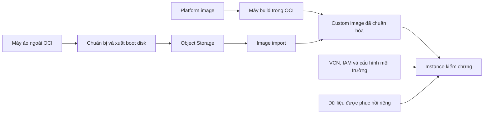

# Platform images, custom images và image import

Trong chương **Compute và máy chủ ảo** của module Oracle Cloud Infrastructure (OCI), image là điểm xuất phát để tạo máy chủ có hệ điều hành và phần mềm phù hợp. Chọn image ảnh hưởng đến khả năng khởi động, kiến trúc CPU, thời gian triển khai và cách duy trì bản vá.

Bài học này hướng dẫn lựa chọn platform image, xây dựng custom image và nhập image từ bên ngoài OCI. Các thao tác được đặt trong bối cảnh tenancy, compartment, IAM, VCN và Object Storage để người học có thể triển khai một quy trình có phân quyền, giám sát, tự động hóa và kiểm soát chi phí.

## Mục tiêu và kiến thức cần có

Sau bài học, bạn có thể:

- Phân biệt platform image, custom image và thao tác image import.
- Chọn image tương thích với shape, hệ điều hành và kiến trúc CPU.
- Chuẩn bị một máy nguồn để tạo image có thể tái sử dụng.
- Nhập image qua Object Storage và chứng minh máy tạo từ image hoạt động được.
- Tổ chức phiên bản image, quyền sử dụng, kế hoạch thay thế và dọn tài nguyên.

Bạn nên biết cách chọn region và compartment, tạo Compute instance, sử dụng SSH hoặc RDP, và đọc cấu hình subnet/NSG. Ví dụ CLI trong bài dùng Bash và giả định OCI CLI đã được cấu hình; các OCID, namespace, tên bucket và tên object phải được thay bằng tài nguyên của môi trường thực hành.

## Image là gì và ba khái niệm liên hệ ra sao?

Image là mẫu ổ đĩa dùng để khởi tạo hệ điều hành và phần mềm trên một instance. Khi khởi chạy máy mới, OCI sử dụng image làm nguồn tạo boot volume. Sau đó instance hoạt động trên boot volume của chính nó. Khái niệm và các hệ điều hành nền tảng được mô tả trong [Platform Images của OCI](https://docs.oracle.com/en-us/iaas/Content/Compute/References/images.htm).

| Khái niệm | Nguồn hình thành | Tình huống sử dụng |
| --- | --- | --- |
| Platform image | Image hệ điều hành do nền tảng cung cấp | Khởi tạo máy mới với nền hệ điều hành tiêu chuẩn |
| Custom image | Image riêng tạo từ boot disk của instance hoặc từ quy trình import | Phân phối cấu hình và phần mềm đã chuẩn hóa |
| Image import | Thao tác đưa file image vào OCI để tạo tài nguyên custom image | Di chuyển máy ảo hoặc đưa bản image từ môi trường khác vào OCI |

Vì vậy, imported image là một custom image có nguồn gốc từ bên ngoài quy trình chụp boot disk trực tiếp trong OCI. Đây là quan hệ giữa **loại tài nguyên** và **cách tạo tài nguyên**.

Ví dụ: một nhóm phát triển ứng dụng Java có thể dùng Oracle Linux platform image cho máy thử nghiệm đầu tiên. Khi đã thống nhất JDK, agent và cấu hình hệ thống, nhóm đóng gói thành custom image. Nếu phần mềm đang chạy trên máy ảo tại trung tâm dữ liệu, nhóm có thể chuẩn bị boot disk của máy đó rồi import vào OCI.

### Những thành phần cần được quản lý riêng

Custom image tạo trong OCI chứa nội dung boot disk; dữ liệu trên các block volume gắn thêm không nằm trong image. VCN, subnet, NSG và chính sách IAM cũng cần được cấu hình cho môi trường đích. Xem phạm vi boot disk trong [Managing Custom Images](https://docs.oracle.com/en-us/iaas/Content/Compute/Tasks/managingcustomimages.htm).

Hãy tách một kế hoạch triển khai thành ba phần:

1. **Image:** hệ điều hành, runtime và các cấu hình dùng chung.
2. **Hạ tầng:** Compute shape, boot volume, mạng, quyền và giám sát.
3. **Dữ liệu, cấu hình môi trường:** database, volume dữ liệu, endpoint và bí mật.

Với ứng dụng kết nối cơ sở dữ liệu Oracle, cấu hình kết nối có thể được cung cấp khi triển khai. Việc khôi phục database phải có quy trình riêng tương ứng với dịch vụ database đang dùng; một image của máy ứng dụng không thể hiện trạng thái giao dịch của database.



## Chọn platform image và cố định đầu vào triển khai

Platform image phù hợp khi muốn bắt đầu từ một hệ điều hành phổ biến rồi tự động cài phần mềm của ứng dụng. Danh mục gồm các họ như Oracle Linux, Ubuntu và Windows Server; hãy tra phiên bản hiện có và release notes tại thời điểm triển khai. Những bản phát hành hoặc kiến trúc khác nhau có thể có danh sách shape hỗ trợ khác nhau. [Danh mục platform image](https://docs.oracle.com/en-us/iaas/Content/Compute/References/images.htm) là nguồn đối chiếu ban đầu.

Trước khi chọn image, trả lời bốn câu hỏi:

| Câu hỏi | Vì sao cần quyết định sớm? |
| --- | --- |
| Workload yêu cầu hệ điều hành và bản phát hành nào? | Tránh chọn nền không đáp ứng yêu cầu của runtime hoặc nhà cung cấp ứng dụng |
| Workload dùng x86-64 hay Arm? | Binary, thư viện native và agent có thể phụ thuộc kiến trúc |
| Shape đích đã được xác định chưa? | Cần kiểm tra tương thích của đúng cặp image–shape |
| Đầu vào đã có phiên bản cụ thể chưa? | Hai lần build phải có cơ sở để giải thích sự khác biệt |

Chuyển một hệ thống sang Arm cần kiểm chứng cả runtime lẫn thư viện native của ứng dụng. Việc đổi tên image hoặc sửa danh sách compatible shapes không chuyển đổi tập lệnh của hệ điều hành.

Ví dụ liệt kê image cho một shape x86 đã được chọn trong bài lab:

```bash
export OCI_REGION='ap-singapore-1'
export LAB_COMPARTMENT_OCID='ocid1.compartment.oc1..REPLACE_ME'
export TARGET_SHAPE='VM.Standard.E4.Flex'

oci compute image list \
  --region "$OCI_REGION" \
  --compartment-id "$LAB_COMPARTMENT_OCID" \
  --operating-system 'Oracle Linux' \
  --shape "$TARGET_SHAPE" \
  --lifecycle-state AVAILABLE \
  --all
```

Lệnh trên trả danh sách ứng viên, không tự quyết định image được phê duyệt. `--all` lấy các trang kết quả của truy vấn; nó không biến kết quả thành danh mục lịch sử của mọi platform image. OCI làm mới danh sách theo các bản phát hành gần đây, và OCID của bản cũ có thể không còn xuất hiện trong truy vấn liệt kê. Xem [OCI CLI: image list](https://docs.oracle.com/en-us/iaas/tools/oci-cli/latest/oci_cli_docs/cmdref/compute/image/list.html).

Sau khi đánh giá, ghi lại image OCID, region, hệ điều hành, kiến trúc, shape đã thử và mã phiên bản của quy trình build. Trong pipeline production, việc chọn một image mới nên tạo ra đầu vào build mới để có thể kiểm chứng trước khi thay thế các máy đang phục vụ.

## Thiết kế nội dung của custom image

Custom image giúp đưa các quyết định dùng chung vào một bản phát hành có thể tái sử dụng. Tuy nhiên, càng đưa nhiều cấu hình đặc thù môi trường vào image, việc dùng lại image ở môi trường khác càng khó.

| Nên chuẩn hóa trong image | Nên cung cấp khi triển khai hoặc khi chạy |
| --- | --- |
| Hệ điều hành và runtime đã chọn | Tên môi trường, endpoint và tham số riêng của từng hệ thống |
| Agent đã được kiểm chứng | Quyền truy cập tài nguyên gắn với danh tính của máy mới |
| Cấu hình logging và baseline hệ thống | Bí mật như mật khẩu, token và private key |
| Thư mục và service unit của ứng dụng | Danh tính máy và thông tin kết nối dữ liệu |
| Gói ứng dụng có phiên bản, nếu chiến lược phát hành yêu cầu | Dữ liệu giao dịch và trạng thái người dùng |

Hai cách tổ chức phổ biến là:

- **Image nền mỏng:** có hệ điều hành, runtime và agent; ứng dụng được triển khai ở bước sau. Nhóm có thể cập nhật ứng dụng thường xuyên mà ít build lại nền hơn.
- **Image kèm ứng dụng:** chứa cả runtime và một phiên bản ứng dụng. Nhóm cần build image mới cho mỗi bản phát hành nhưng giảm số việc phải làm ở lần khởi động đầu.

Đây là lựa chọn thiết kế cho workload. Có thể đánh giá bằng thời gian khởi động, mức độ phụ thuộc kho gói khi triển khai và yêu cầu truy vết bản phát hành.

Ví dụ quy ước tên nội bộ:

```text
orders-ol9-x86_64-jdk21-2026-11-20-r1
```

Tên này giúp con người nhận biết mục đích. Pipeline vẫn cần ghi nhận OCID để tham chiếu chính xác tài nguyên, cùng bản kê gói và phiên bản mã nguồn của quy trình build.

## Tạo custom image từ instance trong OCI

Nên dùng một máy build chuyên dụng được dựng lại từ đầu vào đã ghi nhận. Làm image từ máy production lâu ngày thường kéo theo cấu hình sửa tay, dữ liệu thử hoặc thông tin không còn cần thiết.

Quy trình thực hành:

1. Tạo máy build từ platform image đã chọn trong compartment dành cho build.
2. Cài phần mềm, áp dụng cấu hình và ghi lại phiên bản của từng đầu vào.
3. Kiểm tra service, log và khả năng truy cập của máy build.
4. Chuẩn bị trạng thái đóng gói theo các lưu ý dưới đây.
5. Tại trang instance, chọn **Create custom image**, chọn compartment chứa image và đặt tên phiên bản.
6. Theo dõi thao tác trong Console và work request liên quan.
7. Khi image sẵn sàng, tạo một instance mới để kiểm chứng bản đóng gói.

Tạo image có thể khiến instance nguồn bị shutdown và gián đoạn trong thời gian xử lý. Windows cần được shutdown từ hệ điều hành theo hướng dẫn tương ứng. Vì vậy, lịch đóng gói phải tính đến thời gian máy nguồn không phục vụ. Xem [Creating Custom Images](https://docs.oracle.com/en-us/iaas/Content/Compute/Tasks/custom-images-create.htm).

### Chuẩn bị trạng thái máy nguồn

- Dừng hoặc làm yên các tiến trình còn ghi dữ liệu quan trọng trước khi đóng gói.
- Gỡ bí mật, credential tạm và dữ liệu không thuộc bản image dùng chung.
- Kiểm tra cơ chế tạo danh tính mới cho từng máy sau này, gồm hostname, SSH host key và dữ liệu khởi tạo.
- Với Linux, lập kế hoạch làm sạch trạng thái khởi tạo theo hệ điều hành đang dùng; không xóa tùy tiện cấu hình mạng hoặc thư mục hệ thống.
- Bảo đảm ứng dụng không phụ thuộc cứng vào địa chỉ IP của máy build.
- Nếu dùng iSCSI, ngắt các attachment và loại bỏ cấu hình node iSCSI theo yêu cầu trước khi tạo image; thao tác này phải đi cùng kế hoạch dừng dịch vụ phụ thuộc volume.

Yêu cầu về iSCSI và các giới hạn của custom image được nêu trong [Managing Custom Images](https://docs.oracle.com/en-us/iaas/Content/Compute/Tasks/managingcustomimages.htm).

CLI minh họa thao tác tạo image; `BUILD_INSTANCE_OCID` phải trỏ đến máy build đã chuẩn bị:

```bash
export BUILD_INSTANCE_OCID='ocid1.instance.oc1.ap-singapore-1.REPLACE_ME'
export IMAGE_COMPARTMENT_OCID='ocid1.compartment.oc1..REPLACE_ME'

oci compute image create \
  --region "$OCI_REGION" \
  --compartment-id "$IMAGE_COMPARTMENT_OCID" \
  --instance-id "$BUILD_INSTANCE_OCID" \
  --display-name 'orders-ol9-x86_64-jdk21-2026-11-20-r1'
```

Phản hồi tạo tài nguyên là đầu mối để theo dõi tiến trình. Hãy ghi lại OCID được trả về và kiểm tra trạng thái trước khi triển khai. Tham số chi tiết có trong [OCI CLI: image create](https://docs.oracle.com/en-us/iaas/tools/oci-cli/latest/oci_cli_docs/cmdref/compute/image/create.html).

## Windows: generalized image và specialized image

Windows custom image có hai dạng cần phân biệt:

| Dạng | Đặc điểm | Cách dùng phù hợp |
| --- | --- | --- |
| Generalized | Đã làm sạch thông tin riêng của máy bằng Sysprep | Tạo nhiều máy mới từ một nền chuẩn |
| Specialized | Giữ đặc điểm của máy nguồn | Khôi phục hoặc thử nghiệm một cấu hình cụ thể |

Dùng specialized image để nhân bản nhiều máy cùng mạng có thể gây trùng tên hoặc định danh. Với quy trình generalized của OCI, hãy thực hiện trên bản sao dùng để đóng gói: generalization có thể làm máy đang thao tác không còn vận hành bình thường. Khả năng giữ hay tạo lại tài khoản `opc` và lấy mật khẩu phụ thuộc cấu hình image; cần kiểm thử đường đăng nhập của máy mới. Xem [Creating Windows Custom Images](https://docs.oracle.com/en-us/iaas/Content/Compute/References/windowsimages.htm).

Với Windows nhập từ ngoài OCI, cần chuẩn bị Oracle VirtIO drivers, RDP, DHCP và quy trình generalization nếu dự kiến nhân nhiều máy. Windows Firewall cũng cần cho phép đường quản trị trong network profile mà hệ điều hành nhận sau import. Chọn đúng phiên bản/SKU và kiểm tra điều kiện sử dụng phần mềm trước khi di chuyển. [Importing Custom Windows Images](https://docs.oracle.com/en-us/iaas/Content/Compute/Tasks/importingcustomimagewindows.htm) cung cấp các bước riêng cho Windows.

## Image import: chuẩn bị file nguồn và hiểu định dạng

Bring Your Own Image (BYOI) giúp đưa hệ điều hành từ môi trường khác vào OCI và tạo VM từ image đó. Không suy rộng quy trình BYOI này sang bare metal. Phần cứng đích, hệ điều hành và chế độ thiết bị đều phải được đối chiếu. Xem [Bring Your Own Image](https://docs.oracle.com/en-us/iaas/Content/Compute/References/bringyourownimage.htm).

### Định dạng và nguồn gốc

| Định dạng | Cần hiểu khi import |
| --- | --- |
| QCOW2 | Một định dạng disk image dùng trong quy trình import |
| VMDK | Phải đáp ứng kiểu đóng gói được OCI hỗ trợ |
| OCI (`.oci`) | Gói gồm QCOW2 và metadata OCI, phù hợp luân chuyển custom image giữa các region/tenancy |

Danh sách định dạng import và export có thể khác nhau. Ví dụ, VHD/VDI được liệt kê cho export nhưng không phải định dạng đầu vào trực tiếp trong danh sách import này. Platform image, Marketplace image và custom image có nguồn từ Marketplace có hạn chế export; cần kiểm tra trước khi chọn đường di chuyển. Xem [Importing and Exporting Custom Images](https://docs.oracle.com/en-us/iaas/Content/Compute/Tasks/imageimportexport.htm).

Đổi đuôi file không chuyển đổi cấu trúc disk. Nếu nguồn là bộ snapshot hoặc nhiều file phụ thuộc nhau, cần hợp nhất/xuất bằng công cụ của nền ảo hóa nguồn theo yêu cầu import. Hãy giữ bản nguồn có thể phục hồi trước khi điều chỉnh.

### Điều kiện nguồn Linux cần kiểm tra

Theo [Importing Custom Linux Images](https://docs.oracle.com/en-us/iaas/Content/Compute/Tasks/importingcustomimagelinux.htm), cần đối chiếu tối thiểu:

- Giới hạn image import là 1 TB.
- Nguồn dùng BIOS boot, MBR và boot loader hợp lệ.
- Một disk làm boot drive; không phụ thuộc disk dữ liệu khác để boot.
- Disk image không mã hóa.
- File QCOW2 hoặc VMDK một file thuộc kiểu `monolithicSparse`/`streamOptimized` được hỗ trợ.
- Mạng dùng DHCP, không ghim IP/MAC của máy nguồn.
- Boot loader tìm boot volume bằng UUID hoặc LVM.

Dừng VM nguồn trước khi clone/xuất. Chuẩn bị cloud-init nếu muốn xử lý SSH key từ dữ liệu khởi tạo. Các volume dữ liệu, NIC phụ và dịch vụ phụ thuộc lưu trữ cần có kế hoạch khôi phục sau lần boot đầu.

Với Windows import, tài liệu hiện hành còn nêu boot volume tối thiểu 256 GB. Không áp dụng con số này cho mọi image Linux hoặc mọi tình huống tạo custom image. Xem [yêu cầu nguồn Windows](https://docs.oracle.com/en-us/iaas/Content/Compute/Tasks/importingcustomimagewindows.htm).

### Launch mode và compatible shapes

Launch mode mô tả cách thiết bị ảo được cung cấp cho hệ điều hành khách. Với nguồn ngoài OCI, ưu tiên **Paravirtualized** khi có driver phù hợp; **Emulated** chỉ áp dụng cho những trường hợp Linux được hỗ trợ. Windows import yêu cầu paravirtualized; một số họ shape và image Linux cũng chỉ hỗ trợ chế độ này. Các điều kiện nằm trong [BYOI: Launch Modes](https://docs.oracle.com/en-us/iaas/Content/Compute/References/bringyourownimage.htm).

Khi nhập file `.oci`, Console xác định mode theo metadata nguồn. Với QCOW2 được export từ OCI, hướng dẫn import chỉ định Native mode. Vì vậy, phải ghi nhận nguồn gốc file trước khi chọn mode. [Importing Custom Images](https://docs.oracle.com/en-us/iaas/Content/Compute/Tasks/custom-images-import.htm) giải thích cách chọn theo từng nguồn.

Compatible shapes là khai báo những shape được dùng với image. Có thể chỉnh danh sách này, nhưng sau mỗi thay đổi cần khởi chạy kiểm chứng trên shape mới; riêng việc thêm tên shape chưa chứng minh driver và hệ điều hành hoạt động. Xem [Editing Custom Images](https://docs.oracle.com/en-us/iaas/Content/Compute/Tasks/custom-images-edit.htm).

Image capabilities còn mô tả firmware và kiểu attachment. Việc chỉnh capability dành cho trường hợp nâng cao, cần hiểu cấu hình nguồn; thay một giá trị metadata không cài thêm driver còn thiếu vào disk image. Xem [Editing Image Capabilities](https://docs.oracle.com/en-us/iaas/Content/Compute/Tasks/configuringimagecapabilities.htm).

## Thực hành import qua Object Storage

Giả sử nhóm có một file Oracle Linux 9 QCOW2, x86-64, đã chuẩn bị cho paravirtualized và đáp ứng yêu cầu nguồn. Nhóm muốn đưa nó vào compartment image để thử trên một shape tương thích.

### Chuẩn bị quyền và vị trí lưu

Cần xác định region đích, compartment image và bucket chứa file. Người thực hiện phải có quyền tạo image và đọc object nguồn. Quyền tạo image không tự giải quyết quyền dùng subnet, volume hay instance trong bài kiểm chứng sau đó.

Trong Console:

1. Upload file vào bucket Object Storage đã chuẩn bị.
2. Mở **Compute → Custom images** trong region đích.
3. Chọn **Import image**, compartment, tên image và hệ điều hành.
4. Chọn bucket/object hoặc URL phù hợp với đường import.
5. Chọn đúng định dạng và launch mode theo nguồn đã chuẩn bị.
6. Gửi yêu cầu; theo dõi tiến trình import và lỗi liên quan.
7. Chỉ chuyển sang khởi chạy máy kiểm chứng khi image ở trạng thái **Available**.

Quy trình và yêu cầu đọc object được mô tả tại [Importing Custom Images](https://docs.oracle.com/en-us/iaas/Content/Compute/Tasks/custom-images-import.htm).

### Ví dụ CLI cho nguồn QCOW2 ngoài OCI

```bash
export IMAGE_NAMESPACE='REPLACE_WITH_OBJECT_STORAGE_NAMESPACE'
export IMAGE_BUCKET='oci-image-staging'
export IMAGE_OBJECT='incoming/orders-ol9-x86_64.qcow2'
export LOCAL_IMAGE_FILE='./orders-ol9-x86_64.qcow2'

oci os object put \
  --region "$OCI_REGION" \
  --namespace-name "$IMAGE_NAMESPACE" \
  --bucket-name "$IMAGE_BUCKET" \
  --name "$IMAGE_OBJECT" \
  --file "$LOCAL_IMAGE_FILE"

oci compute image import from-object \
  --region "$OCI_REGION" \
  --compartment-id "$IMAGE_COMPARTMENT_OCID" \
  --namespace "$IMAGE_NAMESPACE" \
  --bucket-name "$IMAGE_BUCKET" \
  --name "$IMAGE_OBJECT" \
  --display-name 'orders-import-ol9-x86_64-2026-11-20-r1' \
  --operating-system 'Oracle Linux' \
  --operating-system-version '9' \
  --source-image-type QCOW2 \
  --launch-mode PARAVIRTUALIZED
```

`--name` ở lệnh import là tên object nguồn; `--display-name` là tên tài nguyên image tạo ra. Ví dụ này dành cho nguồn QCOW2 ngoài OCI đã chuẩn bị đúng điều kiện, không phải mẫu thay thế cho mọi định dạng hay nguồn Windows. Tham số được mô tả trong [OCI CLI: image import from-object](https://docs.oracle.com/en-us/iaas/tools/oci-cli/latest/oci_cli_docs/cmdref/compute/image/import/from-object.html).

Sau khi lấy OCID từ phản hồi, xem chi tiết:

```bash
export IMPORTED_IMAGE_OCID='ocid1.image.oc1.ap-singapore-1.REPLACE_ME'

oci compute image get \
  --region "$OCI_REGION" \
  --image-id "$IMPORTED_IMAGE_OCID"
```

Kiểm tra trường `lifecycle-state` và đúng image cần sử dụng. Lệnh này được mô tả trong [OCI CLI: image get](https://docs.oracle.com/en-us/iaas/tools/oci-cli/latest/oci_cli_docs/cmdref/compute/image/get.html). Một bước import hoàn tất chỉ xác nhận đã có tài nguyên image; khả năng phục vụ workload phải được chứng minh bằng máy kiểm chứng.

## Kiểm chứng instance tạo từ image

Máy kiểm chứng nên ở subnet dành cho thử nghiệm và có đường SSH/RDP đã chuẩn bị. Với Linux platform image, người dùng thường là `opc` trên Oracle Linux hoặc `ubuntu` trên Ubuntu; imported image phải theo tài khoản và cơ chế khởi tạo thực tế của nguồn. Tham khảo [chi tiết tài khoản trên platform image](https://docs.oracle.com/en-us/iaas/Content/Compute/References/images.htm).

Khi tạo máy, chọn custom image theo đúng region, compartment và OCID đã ghi nhận; sau đó chọn shape, boot volume, subnet và khóa/quyền quản trị phù hợp. Cấu hình mạng là đầu vào riêng của thao tác launch. Xem [Creating an Instance](https://docs.oracle.com/en-us/iaas/Content/Compute/Tasks/launchinginstance.htm).

| Lớp kiểm chứng | Bằng chứng nên thu thập |
| --- | --- |
| Boot | Hệ điều hành hoàn tất khởi động; có log để giải thích nếu boot thất bại |
| Lưu trữ | Root filesystem được nhận diện; cấu hình mount không làm treo lần boot đầu |
| Định danh | Máy có danh tính mới theo thiết kế, không dùng credential tạm của máy build |
| Mạng | IP, DNS và đường quản trị hoạt động trong subnet đích |
| Khởi tạo | Tác vụ lần boot đầu kết thúc; dữ liệu khởi tạo không bị bỏ qua hoặc chạy sai |
| Ứng dụng | Runtime đúng phiên bản, service hoạt động, health endpoint đạt yêu cầu |
| Giám sát | Có thể thu thập log, metric hoặc heartbeat đã thiết kế |
| Reboot | Máy trở lại trạng thái phục vụ sau một lần khởi động lại có kiểm soát |

Các lệnh quan sát Linux cơ bản, thực hiện trên máy kiểm chứng:

```bash
uname -m
lsblk
findmnt /
ip -brief address
systemctl --failed
```

Nếu image có cloud-init, có thể xem trạng thái bằng `cloud-init status --long` và xem log tương ứng. Nếu workload có service riêng, kiểm tra đúng service đó và đường kết nối đến dependency; một instance được đánh dấu đang chạy vẫn có thể chưa chạy được ứng dụng.

Thử tạo hai máy từ cùng image giúp phát hiện dữ liệu định danh hoặc cấu hình riêng đã bị đóng gói nhầm. Không ghi nhận image là bản dùng chung chỉ từ việc máy build ban đầu chạy tốt.

## Phân quyền, phiên bản và vòng đời vận hành

Nên tách vai trò xây dựng image, phê duyệt bản dùng chung và triển khai ứng dụng. Người triển khai thường chỉ cần quyền sử dụng image được chọn cùng các quyền cần thiết để launch tài nguyên của họ.

Bảng sau là cách phân công trách nhiệm cho một quy trình mẫu:

| Vai trò | Trách nhiệm |
| --- | --- |
| Image builder | Dựng máy nguồn, tạo/import image và ghi nguồn gốc |
| Người phê duyệt | Đọc kết quả kiểm chứng và quyết định phiên bản được dùng |
| Người triển khai | Dùng image đã chọn để tạo workload trong môi trường được cấp quyền |
| Người vận hành | Theo dõi hạn dùng, khả năng thay thế và tài nguyên còn phụ thuộc |

OCI có policy mẫu quản lý custom image và giới hạn launch theo image OCID. Đối chiếu [Common Policies](https://docs.oracle.com/en-us/iaas/Content/Identity/Concepts/commonpolicies.htm) khi thiết kế quyền cho nhóm, compartment và mạng cụ thể; việc launch thường cần nhiều loại quyền hơn quyền đọc image.

Một bản kê phát hành image có thể chứa: owner, ngày build, image OCID theo region, base image, kiến trúc, phiên bản runtime, mã nguồn build, kết quả kiểm chứng và thời hạn rà soát. Quy ước này giúp trả lời được câu hỏi “máy đang chạy được tạo từ đầu vào nào?” khi xảy ra sự cố.

### Thay phiên bản và rollback

Một quy trình thay thế có thể đi theo chuỗi:

```text
Build bản mới → tạo máy kiểm chứng → phê duyệt → triển khai nhóm nhỏ
→ theo dõi → mở rộng → giữ bản trước trong khoảng rollback đã định
```

Nếu phát hiện lỗi, tạo nhóm máy thay thế từ bản trước và thực hiện chuyển lưu lượng theo quy trình ứng dụng. Rollback image chỉ khôi phục nền máy của phiên bản đó; nhóm vẫn phải xét tương thích schema và trạng thái dữ liệu đã thay đổi trong thời gian triển khai.

Thêm nhiều instance từ cùng một image chỉ tăng số bản sao phần mềm. Để có tính sẵn sàng, cần bố trí máy, kiểm tra sức khỏe, phân phối lưu lượng và phương án dữ liệu tương ứng; các máy được nhân bản không nên cùng mang một điểm lỗi về cấu hình hoặc credential.

### Chi phí và dọn tài nguyên

Custom image lưu trữ có tính phí; không giả định tạo image là miễn phí. Các giới hạn và lưu ý chi phí được nêu tại [Managing Custom Images](https://docs.oracle.com/en-us/iaas/Content/Compute/Tasks/managingcustomimages.htm).

Trong bài lab, lập danh sách những thứ đã tạo: máy build, máy kiểm chứng, boot volume giữ lại, custom image và object trung gian. Gắn owner và thời hạn giữ để có thể dọn sau khi hoàn thành. Trước khi xóa phiên bản cũ, kiểm tra kế hoạch scale-out, khôi phục và rollout còn tham chiếu image đó hay không. Dọn sớm object trung gian chỉ nên thực hiện khi không còn cần cho import lại hoặc điều tra.

## Luân chuyển image giữa region hoặc tenancy

Custom image cần có kế hoạch hiện diện tại nơi triển khai dự phòng. Một đường thực hiện là export image ra Object Storage, chuyển object đến nơi đích rồi import thành image ở region/tenancy đích. Với luân chuyển OCI, định dạng `.oci` bảo toàn metadata liên quan. Xem [quy trình image import/export](https://docs.oracle.com/en-us/iaas/Content/Compute/Tasks/imageimportexport.htm).

Export cần quyền ghi bucket đích. Sau thao tác, kiểm tra object thực sự tồn tại thay vì chỉ dựa vào image đã quay lại Available. [Exporting Custom Images](https://docs.oracle.com/en-us/iaas/Content/Compute/Tasks/custom-images-export.htm) mô tả điều kiện và cách theo dõi.

Khi dùng pre-authenticated request (PAR), URL là quyền truy cập vào object cho bất kỳ ai có URL đó. Chọn phạm vi một object, quyền đọc cần thiết và thời gian đủ cho thao tác; tránh đưa URL vào tài liệu hoặc log dùng chung, rồi thu hồi khi hoàn tất. Cơ chế và điều kiện mất hiệu lực có trong [Object Storage Pre-Authenticated Requests](https://docs.oracle.com/en-us/iaas/Content/Object/Tasks/usingpreauthenticatedrequests.htm).

Ở nơi đích, ghi lại OCID mới và thực hiện lại bài kiểm chứng trên mạng, shape và quyền đích. Việc file đã đến bucket đích chưa chứng minh hệ thống dự phòng có thể khởi động và kết nối được dữ liệu.

## Chẩn đoán theo giai đoạn

Bắt đầu bằng cách xác định lỗi xảy ra trước import, trong import, khi launch hay sau khi hệ điều hành đã boot. Cách phân lớp giúp chọn bằng chứng cần lấy thay vì thay nhiều thiết lập cùng lúc.

| Hiện tượng | Kiểm tra trước tiên |
| --- | --- |
| Không thấy image mong muốn | Region, compartment, bộ lọc, trạng thái và quyền của người dùng |
| Import không hoàn tất | Chi tiết thao tác, quyền đọc object, đúng object và định dạng nguồn |
| Shape không chọn được | Kiến trúc, danh sách compatible shapes và yêu cầu của image |
| Launch thất bại | Lỗi API/work request, quota, capacity và các quyền hạ tầng liên quan |
| VM bắt đầu chạy nhưng không boot được | Console boot, firmware, boot loader, driver và mount bắt buộc |
| Không SSH/RDP được | Đường mạng, NSG/security list, firewall hệ điều hành, service và tài khoản |
| Ứng dụng lỗi dù đăng nhập được | Runtime, cấu hình môi trường, credential và dependency |
| Hai máy mới có hành vi giống máy nguồn | Danh tính, trạng thái khởi tạo và cấu hình riêng còn trong image |

Ví dụ, một máy đã boot nhưng không mở được cổng ứng dụng cần được kiểm tra từ service và firewall trở ra đường mạng. Ngược lại, nếu console cho thấy không tìm thấy root filesystem, việc mở thêm cổng NSG sẽ không xử lý nguyên nhân boot.

Khi thử một thay đổi, ghi lại giả thuyết, thay đổi đã thực hiện và kết quả quan sát. Giữ bản nguồn để có thể quay về một trạng thái xác định nếu thay đổi không có tác dụng.

## Bài thực hành tổng hợp

Mục tiêu là tạo một bản image cho máy ứng dụng Java kết nối cơ sở dữ liệu Oracle qua mạng riêng. Không đưa dữ liệu database hoặc mật khẩu kết nối vào image.

1. Chọn một platform image phù hợp shape và ghi lại đầu vào.
2. Tạo máy build; cài runtime và một service ứng dụng đơn giản có phiên bản.
3. Chuẩn bị đóng gói, tạo custom image và ghi nhận OCID.
4. Tạo máy A từ image trong subnet thử nghiệm; cung cấp cấu hình môi trường riêng.
5. Thu thập bằng chứng boot, truy cập, service, giám sát và reboot.
6. Tạo máy B từ cùng image; đối chiếu danh tính và hành vi khởi tạo của hai máy.
7. Nếu có file nguồn ngoài OCI hợp lệ, thực hiện nhánh import rồi kiểm chứng theo cùng tiêu chí.
8. Ghi lại tài nguyên phải giữ để rollback và tài nguyên có thể dọn.

Kết quả cần có gồm bản kê đầu vào, image OCID, nguồn gốc image, shape đã thử, kết quả kiểm chứng và phương án thay phiên bản. Nếu nhánh import chưa có nguồn phù hợp, ghi rõ nhánh đó chưa thực hiện; không dùng image đang thử lỗi làm bản phát hành chung.

Một quy trình hoàn chỉnh kết thúc khi bạn có thể dựng lại máy từ image trong môi trường đích, quan sát được trạng thái ứng dụng và giải thích được nguồn gốc của cấu hình đang chạy.
