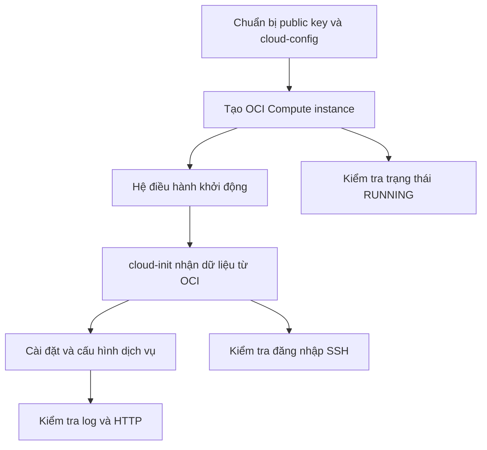

# Khởi tạo instance với SSH keys và cloud-init

Trong chương **Compute và máy chủ ảo** của module Oracle Cloud Infrastructure (OCI), bài này hướng dẫn dựng một máy chủ Linux có thể truy cập bằng SSH và tự cấu hình ở lần khởi động đầu. Công việc đi từ chọn compartment, kết nối VCN và cấp khóa truy cập đến kiểm tra dịch vụ, đọc log và thu hồi tài nguyên sau thực hành.

Tình huống xuyên suốt: nhóm phát triển cần một máy `oci-compute-lab-01` chạy trang HTTP nội bộ để kiểm tra hạ tầng. Người vận hành truy cập bằng khóa riêng; phần mềm và trang kiểm tra được cloud-init thiết lập. Ta dùng **Oracle Linux 9 platform image**, một VM shape tương thích và tài nguyên lab riêng. Trang HTTP được xem qua SSH tunnel, nên lab chỉ cần cho phép SSH từ địa chỉ quản trị.

Sau bài học, người học có thể:

- Phân biệt quyền IAM, SSH key và SSH host key.
- Chuẩn bị đường mạng và public key trước khi tạo instance.
- Cung cấp cấu hình cloud-init ở thời điểm tạo máy.
- Chứng minh riêng trạng thái hạ tầng, truy cập hệ điều hành và kết quả bootstrap.
- Tìm lỗi theo lớp, thay khóa có kiểm soát và dọn tài nguyên lab.

## 1. SSH keys và cloud-init tham gia vào quá trình tạo máy như thế nào?

OCI nhận yêu cầu tạo instance qua Console hoặc API. Instance được gắn boot volume và VNIC. Khi hệ điều hành khởi động, cloud-init sử dụng datasource của Oracle để nhận thông tin phục vụ khởi tạo. Datasource này đọc metadata, vendor-data và user-data do nền tảng cung cấp. [Nguồn: cloud-init Oracle datasource](https://docs.cloud-init.io/en/latest/reference/datasources/oracle.html).

Hai đầu vào cần phân biệt:

| Đầu vào | Mục đích trong lab | Không dùng để làm gì |
|---|---|---|
| SSH public key | Cho phép xác thực vào tài khoản Linux mặc định | Không cấp quyền tạo hoặc xóa tài nguyên OCI |
| User-data cloud-init | Mô tả phần cấu hình cần áp dụng khi máy khởi tạo | Không thay thế toàn bộ quản lý cấu hình lâu dài |

Về metadata OCI, `ssh_authorized_keys` mang public key và `user_data` mang dữ liệu khởi tạo. Không đưa private key vào hai trường này. [Nguồn: OCI instance metadata](https://docs.oracle.com/en-us/iaas/Content/Compute/Tasks/gettingmetadata.htm).



Sơ đồ biểu diễn các điểm kiểm tra; việc SSH thành công không chứng minh mọi bước cài đặt đã xong. Cloud-init có nhiều giai đoạn, trong đó cài gói và chạy script người dùng thường diễn ra ở giai đoạn Final. [Nguồn: cloud-init boot stages](https://docs.cloud-init.io/en/latest/explanation/boot.html).

Ba loại quyền hoặc khóa có vai trò khác nhau:

- **IAM identity và policy** quyết định ai được thao tác với tài nguyên OCI trong tenancy/compartment.
- **SSH user key pair** chứng minh người kết nối được phép đăng nhập vào tài khoản hệ điều hành.
- **SSH host key** giúp máy khách nhận diện máy chủ SSH đang kết nối.

Một người có quyền xem instance trên Console chưa chắc có khóa đăng nhập máy. Người có private key cũng chưa chắc được phép chỉnh sửa VCN hoặc terminate instance.

## 2. Chuẩn bị môi trường lab

Ghi lại các quyết định sau trước khi bấm tạo máy:

| Thành phần | Lựa chọn cho bài thực hành | Lý do |
|---|---|---|
| Region | Region đã được cấp quyền sử dụng | Image OCID và tài nguyên mạng phải đúng region |
| Compartment | Compartment lab được giao | Dễ kiểm soát quyền, tài nguyên và chi phí |
| Tên instance | `oci-compute-lab-01` | Nhận diện được mục đích |
| Hệ điều hành | Oracle Linux 9 platform image | Thống nhất tài khoản và lệnh quản trị trong bài |
| Shape | VM nhỏ, tương thích image và ngân sách | Đủ cho một dịch vụ HTTP kiểm tra |
| Mạng | Public subnet của VCN lab, public IPv4 | Phục vụ đường SSH trực tiếp từ máy học viên |
| SSH | Public key riêng của học viên | Không chia sẻ private key giữa người dùng |
| Khởi tạo | Một cloud-config nhỏ, không chứa bí mật | Dễ hiểu và dễ tìm nguyên nhân lỗi |

Tài khoản thực hành phải có các quyền cần thiết để tạo instance, dùng image/volume và gắn kết nối mạng trong các compartment liên quan. Nếu nhóm chỉ được dùng VCN do quản trị viên cung cấp, dùng đúng subnet và NSG đã được giao. Việc thấy một tài nguyên trên Console không tự chứng minh mọi thao tác ghi đều được cấp quyền.

### 2.1. Đường mạng cho SSH

Đường đi của lab là:

```text
Máy học viên
  -> Internet
  -> public IPv4 của instance
  -> VNIC trong public subnet
  -> dịch vụ sshd trên TCP/22
```

Cần đồng thời có public IP, Internet Gateway hoạt động, route ra Internet phù hợp và các rule cho phép lưu lượng. Với public subnet của lab, kiểm tra route `0.0.0.0/0` tới Internet Gateway. Cũng cần DNS và đường ra repository để cài gói. Public IP chỉ là một phần của đường kết nối.

Rule SSH đề xuất:

| Thuộc tính | Giá trị |
|---|---|
| Direction | Ingress |
| Stateful | Có |
| Protocol | TCP |
| Source CIDR | Public IPv4 hiện tại của máy quản trị, dạng `/32` |
| Source port | All |
| Destination port | `22` |

Ví dụ `198.51.100.25/32` là địa chỉ minh họa; phải thay bằng địa chỉ ra Internet thực của máy đang dùng. Khi đổi mạng hoặc VPN, nguồn kết nối có thể thay đổi.

Nếu dùng NSG, gắn NSG vào VNIC của instance. Kiểm tra cả security list của subnet: các rule cho phép từ security list và NSG được kết hợp. NSG chỉ mở `/32` không thu hẹp được một rule SSH `0.0.0.0/0` vẫn còn ở security list. Chỉ sửa rule thuộc mạng lab mình quản lý; với mạng dùng chung, nhờ người quản trị điều chỉnh. Firewall bên trong hệ điều hành là một lớp kiểm tra khác. [Nguồn: OCI security rules](https://docs.oracle.com/en-us/iaas/Content/Network/Concepts/securityrules.htm).

Trong môi trường triển khai thật, có thể đặt máy trong private subnet và truy cập qua Bastion hoặc mạng riêng. Khi đó dùng đường truy cập đã được thiết kế thay cho việc gán public IP theo lab này.

## 3. Tạo và giữ SSH key pair

Public key có thể được tải lên OCI. Private key phải ở máy quản trị hoặc kho khóa được phê duyệt. Passphrase bảo vệ file private key khi file bị lấy cắp; đây không phải mật khẩu của tài khoản Linux.

Chỉ chạy một trong hai nhóm lệnh phù hợp với máy của bạn. Nếu tên file đã tồn tại, dùng tên mới hoặc xác nhận nguồn gốc của khóa hiện có trước khi tiếp tục.

### 3.1. Linux, macOS hoặc WSL

```bash
mkdir -p "$HOME/.ssh"
chmod 700 "$HOME/.ssh"

ssh-keygen -t rsa -b 4096 \
  -f "$HOME/.ssh/oci-compute-lab" \
  -C "oci-compute-lab"

chmod 600 "$HOME/.ssh/oci-compute-lab"
cat "$HOME/.ssh/oci-compute-lab.pub"
```

Nhập passphrase khi được hỏi. Kết quả gồm:

- `oci-compute-lab`: private key, dùng với tùy chọn `ssh -i`.
- `oci-compute-lab.pub`: public key, dùng khi tạo instance.

### 3.2. Windows PowerShell với OpenSSH

```powershell
$labSshDir = Join-Path $env:USERPROFILE '.ssh'
New-Item -ItemType Directory -Path $labSshDir -Force | Out-Null
$labKeyPath = Join-Path $labSshDir 'oci-compute-lab'

ssh-keygen -t rsa -b 4096 -f $labKeyPath -C 'oci-compute-lab'
Get-Content -LiteralPath ($labKeyPath + '.pub')
```

Public key OpenSSH thường có dạng một dòng:

```text
ssh-rsa <DU_LIEU_PUBLIC_KEY_THUC_TE> oci-compute-lab
```

Không dùng dòng có placeholder trên để tạo máy. Không sao chép phần có tiêu đề `BEGIN OPENSSH PRIVATE KEY`. File khóa dùng để ký yêu cầu OCI API cũng nên được quản lý riêng với khóa SSH đăng nhập máy chủ.

Với Oracle Linux platform image, tài khoản SSH mặc định là `opc`; Ubuntu platform image dùng `ubuntu`. Trên Linux/macOS, giới hạn quyền đọc private key bằng permission của file; trên Windows dùng ACL chỉ cho tài khoản cần thiết. [Nguồn: OCI kết nối Linux instance](https://docs.oracle.com/en-us/iaas/Content/Compute/Tasks/connect-to-linux-instance.htm).

## 4. Viết cloud-config cho lần khởi động đầu

Trên máy chuẩn bị cấu hình, tạo file `cloud-init-oci-lab.yaml` chứa nguyên văn ví dụ sau. File này là **user-data đưa vào instance**, khác với metadata mô tả bài học trong một hệ thống quản lý nội dung.

Ví dụ dành cho Oracle Linux 9 có cloud-init và các tiện ích cơ bản của platform image, trong đó có `curl`. Với custom image hoặc bản phân phối khác, cần điều chỉnh theo image đó.

```yaml
#cloud-config
package_update: true
package_upgrade: false

ssh_pwauth: false
disable_root: true

packages:
  - httpd

write_files:
  - path: /var/www/html/index.html
    owner: root:root
    permissions: '0644'
    content: |
      <!doctype html>
      <html lang="vi">
      <head>
        <meta charset="utf-8">
        <title>OCI Compute Lab</title>
      </head>
      <body>
        <h1>OCI bootstrap OK</h1>
        <p>Instance duoc cau hinh bang cloud-init.</p>
      </body>
      </html>

  - path: /usr/local/sbin/oci-lab-bootstrap
    owner: root:root
    permissions: '0750'
    content: |
      #!/usr/bin/env bash
      set -euo pipefail

      install -d -m 0755 /var/lib/oci-lab
      restorecon -RF /var/www/html
      systemctl enable --now httpd

      curl --fail --silent --show-error \
        --retry 5 --retry-connrefused --retry-delay 2 \
        --max-time 3 http://127.0.0.1/ > /dev/null

      date -u +'%Y-%m-%dT%H:%M:%SZ' > /var/lib/oci-lab/bootstrap-complete
      logger -t oci-lab 'Bootstrap completed; local HTTP check passed'

runcmd:
  - [/usr/local/sbin/oci-lab-bootstrap]
```

### 4.1. Những lựa chọn trong cấu hình

Đầu dòng `#cloud-config` giúp nhận diện định dạng. Dùng space để thụt lề và lưu UTF-8, ưu tiên xuống dòng LF cho nội dung có shell script. Nếu có một môi trường đã cài cloud-init tương thích, người học có thể kiểm tra schema trước khi gửi:

```bash
cloud-init schema -c cloud-init-oci-lab.yaml --annotate
```

Schema hợp lệ chỉ kiểm tra cấu trúc được hỗ trợ; nó không chứng minh repository truy cập được hay dịch vụ sẽ chạy thành công. [Nguồn: kiểm tra user-data cloud config](https://docs.cloud-init.io/en/latest/howto/debug_user_data.html).

`package_update` làm mới thông tin gói; `package_upgrade: false` giúp bài tập tập trung vào bootstrap. Lựa chọn này không thay thế kế hoạch cập nhật bảo mật. Gói `httpd` cung cấp Apache; với Ubuntu, tên gói và tên service khác nên không dùng nguyên cấu hình này.

`write_files` tạo trang kiểm tra và script có quyền thực thi. `runcmd` gọi script sau các phần chuẩn bị liên quan. Mục dạng danh sách là lệnh và các đối số; muốn dùng pipe, redirect hoặc biến shell phức tạp thì đặt chúng trong script như ví dụ. Module `runcmd` thường có tần suất một lần cho mỗi instance; reboot thông thường không phải cơ chế chạy lại cấu hình. [Nguồn: cloud-init module reference](https://docs.cloud-init.io/en/latest/reference/modules.html).

Các lệnh shell có mục đích cụ thể:

| Lệnh hoặc thiết lập | Ý nghĩa trong ví dụ |
|---|---|
| `set -euo pipefail` | Dừng script khi gặp các lỗi lệnh hoặc biến chưa khai báo thay vì tiếp tục báo thành công |
| `restorecon` | Khôi phục SELinux context chuẩn của nội dung web |
| `systemctl enable --now httpd` | Chạy service ngay và bật khởi động cùng hệ điều hành |
| `curl --fail ...` | Kiểm tra HTTP cục bộ, có retry giới hạn |
| `bootstrap-complete` | Ghi thời điểm script đi tới sau bước HTTP thành công |
| `logger -t oci-lab` | Gửi một sự kiện để dễ đối chiếu trong journal |

Marker là bằng chứng của lần chạy script, không phải giám sát sức khỏe liên tục. Nếu HTTP hỏng sau đó, marker cũ vẫn có thể tồn tại. Khi triển khai thật, phải có kiểm tra dịch vụ hiện tại và cơ chế cảnh báo riêng.

### 4.2. Dữ liệu nhạy cảm và việc chạy lại

Không ghi mật khẩu cơ sở dữ liệu, API signing key hoặc token dài hạn vào user-data. Metadata và dữ liệu cloud-init có thể được lưu trên máy, hiển thị qua các công cụ quản trị hoặc xuất hiện trong log. Khi cần lấy secret, thiết kế dùng OCI Vault với instance principal và policy giới hạn đúng tài nguyên.

Script được viết để các thao tác đơn giản như tạo thư mục và bật service có thể lặp lại mà không chèn thêm dòng cấu hình trùng. Tuy nhiên, khả năng chạy lại an toàn là trách nhiệm của từng thao tác. Một lệnh xóa dữ liệu, tạo tài khoản trùng hay ghi đè khóa vẫn có thể gây hỏng hệ thống.

Không dùng cloud-init như một vòng đồng bộ cấu hình sau mỗi lần sửa file. Giữ lại cấu hình đã dùng, chọn image có phiên bản xác định khi cần tái lập, và dùng công cụ quản lý cấu hình hoặc image pipeline cho thay đổi lâu dài.

## 5. Tạo instance bằng OCI Console

Chọn đúng region, mở **Compute → Instances → Create instance**, rồi điền:

1. Tên `oci-compute-lab-01` và compartment lab.
2. Availability domain và VM shape còn dung lượng, trong hạn mức được cấp.
3. Oracle Linux 9 platform image tương thích kiến trúc của shape.
4. VCN/subnet của lab, public IP và NSG cho SSH nếu dùng.
5. Ở phần SSH keys, tải file `.pub` hoặc dán toàn bộ public key.
6. Ở **Initialization script** trong các tùy chọn nâng cao, tải `cloud-init-oci-lab.yaml`.
7. Rà lại boot volume, lựa chọn tính phí và cấu hình rồi tạo máy.

Console tự mã hóa user-data khi gửi; tải file cloud-config dạng văn bản, không base64 trước. Không đặt lệnh reboot vào initialization script lúc launch. [Nguồn: OCI tạo instance](https://docs.oracle.com/en-us/iaas/Content/Compute/Tasks/launchinginstance.htm).

Ghi lại instance OCID, image đã chọn, shape, địa chỉ public/private IP, compartment và tên cấu hình khởi tạo. Khi cần tìm sự cố, thông tin này giúp xác định đúng máy và đúng lần triển khai.

Nếu Console báo hết capacity hoặc vượt giới hạn, xử lý theo lỗi được trả về. Đổi shape/availability domain chỉ sau khi kiểm tra tương thích image, subnet và ngân sách. Không kết luận lỗi cloud-init khi instance chưa tạo được.

## 6. Lựa chọn thay thế: tạo bằng OCI CLI

Phần này là **cách thay thế thao tác tạo bằng Console**, dùng khi OCI CLI đã được cấu hình xác thực. Không chạy tiếp để tạo thêm một máy nếu đã hoàn thành bước Console.

Ví dụ dưới chạy trong Bash. Các OCID, region và availability domain phải thay bằng giá trị của tenancy. `VM.Standard.E4.Flex` chỉ là shape minh họa; xác nhận shape đó khả dụng và chi phí phù hợp. Chuẩn bị file public key cùng cloud-config tại môi trường chạy lệnh; với Cloud Shell chỉ cần chuyển public key, không cần đưa private key của máy quản trị lên đó.

```bash
REGION='<REGION_THUC_TE>'
COMPARTMENT_ID='<COMPARTMENT_OCID>'
AVAILABILITY_DOMAIN='<AVAILABILITY_DOMAIN_THUC_TE>'
SUBNET_ID='<PUBLIC_SUBNET_OCID>'
IMAGE_ID='<ORACLE_LINUX_9_IMAGE_OCID_TUONG_THICH>'
SSH_PUBLIC_KEY_FILE='./oci-compute-lab.pub'

oci compute instance launch \
  --region "$REGION" \
  --compartment-id "$COMPARTMENT_ID" \
  --availability-domain "$AVAILABILITY_DOMAIN" \
  --display-name 'oci-compute-lab-01' \
  --image-id "$IMAGE_ID" \
  --shape 'VM.Standard.E4.Flex' \
  --shape-config '{"ocpus":1,"memoryInGBs":8}' \
  --subnet-id "$SUBNET_ID" \
  --assign-public-ip true \
  --ssh-authorized-keys-file "$SSH_PUBLIC_KEY_FILE" \
  --user-data-file './cloud-init-oci-lab.yaml' \
  --wait-for-state RUNNING
```

Ví dụ giả định security list của subnet lab đã có rule SSH đúng nguồn. Nếu thiết kế dùng NSG, bổ sung `--nsg-ids` với danh sách JSON chứa OCID NSG đã chuẩn bị.

`--ssh-authorized-keys-file` nhận public key; `--user-data-file` nhận file khởi tạo và CLI xử lý cách biểu diễn cần gửi. Không truyền đồng thời các tùy chọn tiện ích đó với cùng khóa metadata tương ứng. `--wait-for-state RUNNING` đợi lifecycle của Compute. [Nguồn: OCI CLI instance launch](https://docs.oracle.com/en-us/iaas/tools/oci-cli/latest/oci_cli_docs/cmdref/compute/instance/launch.html).

Nếu CLI hết thời gian chờ hoặc mất kết nối sau khi gửi yêu cầu, tìm instance vừa tạo theo OCID/tên và thời điểm trước khi thử lại. Thử lại lệnh tạo một cách máy móc có thể sinh thêm tài nguyên.

## 7. Kết nối SSH và xác minh máy chủ

Thay `203.0.113.10` trong ví dụ bằng public IP thực tế. Đây là địa chỉ tài liệu minh họa.

Trên Linux/macOS/WSL:

```bash
ssh -o IdentitiesOnly=yes \
  -i "$HOME/.ssh/oci-compute-lab" \
  opc@203.0.113.10
```

Trên PowerShell:

```powershell
$labPrivateKey = Join-Path $env:USERPROFILE '.ssh\oci-compute-lab'
ssh -o IdentitiesOnly=yes -i $labPrivateKey opc@203.0.113.10
```

`IdentitiesOnly=yes` giúp giới hạn các identity mà SSH thử theo cấu hình, hữu ích khi SSH agent đang giữ nhiều khóa. Nếu được hỏi passphrase, nhập passphrase của private key ở máy khách.

Lần đầu kết nối, SSH hiển thị host fingerprint. Đối chiếu qua một kênh tin cậy được quản trị viên cung cấp trước khi chấp nhận. Có thể lấy fingerprint từ đúng máy qua một phiên serial console được xác thực và đã có quyền vào hệ điều hành:

```bash
for host_key in /etc/ssh/ssh_host_*_key.pub; do
  sudo ssh-keygen -lf "$host_key"
done
```

Fingerprint này thuộc **host key** của máy chủ; nó khác fingerprint public key cá nhân. Khi đã có bản ghi trong `known_hosts`, thông báo host key đổi cần được điều tra. Việc tạo lại instance hoặc tái sử dụng IP có thể giải thích thay đổi, nhưng phải xác nhận trước khi cập nhật bản ghi tin cậy.

Sau khi vào được shell:

```bash
whoami
hostname
cat /etc/os-release
```

Với lab này, tài khoản mong đợi là `opc` và hệ điều hành phải đúng image đã chọn. Đây là bước xác minh đang làm việc trên đúng môi trường trước các thao tác có quyền `sudo`.

## 8. Xác minh cloud-init và dịch vụ

Chạy từ phiên SSH sau khi đăng nhập:

```bash
sudo cloud-init status --wait
sudo cloud-init status --long
```

Lệnh đầu chờ cloud-init kết thúc; lệnh sau giúp xem trạng thái chi tiết. Kiểm tra cả thông tin lỗi, không chỉ một dòng thông báo. Trạng thái như `running`, `done`, `error`, `disabled` phải được hiểu theo phiên bản cloud-init của image. [Nguồn: cloud-init reported status](https://docs.cloud-init.io/en/latest/howto/status.html).

Không đặt `cloud-init status --wait` vào chính `runcmd` hoặc script mà cloud-init đang chờ hoàn thành: điều đó có thể khiến quá trình tự chờ nó. [Nguồn: cloud-init debugging](https://docs.cloud-init.io/en/latest/howto/debugging.html).

Kiểm tra kết quả cụ thể của lab:

```bash
sudo systemctl is-active httpd
sudo systemctl is-enabled httpd
curl --fail --silent --show-error http://127.0.0.1/
sudo cat /var/lib/oci-lab/bootstrap-complete
sudo journalctl -t oci-lab --no-pager
```

Kết quả mong đợi:

| Bằng chứng | Giá trị cần thấy | Kết luận cho phép |
|---|---|---|
| Lifecycle Compute | `RUNNING` | Tài nguyên Compute đang chạy |
| SSH vào `opc` | Phiên shell hợp lệ | Đường SSH và xác thực đã hoạt động |
| Cloud-init | Kết thúc và không có lỗi chưa xử lý | Quá trình khởi tạo đã hoàn tất theo trạng thái báo cáo |
| `httpd` | `active`, `enabled` | Service đang chạy và được bật lúc boot |
| HTTP cục bộ | Trang chứa `OCI bootstrap OK` | Service trả đúng nội dung kiểm tra hiện tại |
| Marker và journal | Có thời điểm/sự kiện phù hợp | Script đã đi qua bước kiểm tra HTTP ở lần chạy đó |

Để xem trang từ trình duyệt máy học viên mà không mở cổng 80 ra Internet, mở một terminal khác và giữ SSH tunnel:

```bash
ssh -N -o ExitOnForwardFailure=yes -o IdentitiesOnly=yes \
  -i "$HOME/.ssh/oci-compute-lab" \
  -L 127.0.0.1:8080:127.0.0.1:80 \
  opc@203.0.113.10
```

Ví dụ PowerShell tương đương:

```powershell
ssh -N -o ExitOnForwardFailure=yes -o IdentitiesOnly=yes -i $labPrivateKey -L 127.0.0.1:8080:127.0.0.1:80 opc@203.0.113.10
```

Mở `http://127.0.0.1:8080` trên máy học viên. Kết nối HTTP đi trong phiên SSH và được chuyển tới loopback của instance. Dùng `Ctrl+C` tại terminal tunnel để đóng. Nếu cổng 8080 trên máy học viên đã được dùng, đổi cổng phía trái thành một cổng trống khác.

Để xác nhận service tự khởi động sau reboot, chỉ reboot sau khi đã lưu bằng chứng bootstrap và cloud-init đã kết thúc. Sau khi máy trở lại, kiểm tra `httpd` cùng HTTP; không kỳ vọng `runcmd` chạy lại chỉ vì reboot.

## 9. Tìm lỗi theo lớp

Đọc thông báo lỗi trước khi thay đổi cấu hình. Một lỗi xác thực và một lỗi định tuyến cần cách xử lý khác nhau.

| Hiện tượng | Lớp cần kiểm tra trước | Hành động phù hợp |
|---|---|---|
| Tạo máy bị từ chối | IAM, quota/limit, capacity, cấu hình | Đọc lỗi OCI; kiểm tra compartment, shape và quyền liên quan |
| SSH bị timeout | IP và đường mạng | Kiểm tra public IP, route, gateway, rule nguồn `/32` và mạng máy khách |
| `Connection refused` | Dịch vụ hoặc firewall từ chối | Xác minh IP đích, trạng thái `sshd` và firewall qua kênh quản trị khác |
| `Permission denied (publickey)` | Tài khoản và khóa | Dùng `opc`, đúng private key và public key đã cung cấp lúc tạo |
| Private key bị báo quá nhiều quyền | Permission/ACL máy khách | Giới hạn quyền đọc file khóa, không gửi private key để nhờ kiểm tra |
| SSH được nhưng chưa có trang | Bootstrap hoặc service | Chờ/xem cloud-init, log gói và trạng thái `httpd` |
| HTTP cục bộ được, tunnel lỗi | Chuyển tiếp SSH/máy khách | Kiểm tra cổng local, phiên SSH và policy cho phép forwarding |
| Marker có nhưng HTTP hỏng | Trạng thái dịch vụ hiện tại | Kiểm tra `httpd`, log và nội dung hiện tại, không dựa vào marker cũ |

Nếu SSH vào được nhưng bootstrap có lỗi, bắt đầu với:

```bash
sudo tail -n 100 /var/log/cloud-init.log
sudo tail -n 100 /var/log/cloud-init-output.log
sudo journalctl -u cloud-final.service -b --no-pager
sudo systemctl status httpd --no-pager
```

`cloud-init.log` giúp xem hoạt động của cloud-init; `cloud-init-output.log` thường chứa đầu ra lệnh/script. Khi chia sẻ log để tìm lỗi, loại bỏ thông tin nhạy cảm trước. [Nguồn: cloud-init debugging](https://docs.cloud-init.io/en/latest/howto/debugging.html).

Với lỗi repository, xem DNS, route/egress, proxy nếu có và nguồn gói được image sử dụng. Với lỗi YAML, kiểm tra dòng đầu, thụt lề, dấu hai chấm và kiểu dữ liệu. Với lỗi script, tìm lệnh đầu tiên thất bại; `set -e` có thể khiến các dòng sau không được chạy.

Khi cần xem dữ liệu user-data thực tế và phiên bản hỗ trợ, có thể dùng:

```bash
sudo cloud-init schema --system --annotate
```

Lệnh có thể hiển thị cấu hình; chỉ chạy trong phiên được phép và quản lý đầu ra tương ứng. [Nguồn: kiểm tra cấu hình trên instance](https://docs.cloud-init.io/en/latest/howto/debug_user_data.html).

Nếu không có SSH, dùng phương án serial console hoặc phục hồi boot volume theo quy trình của tổ chức. Tạo console connection không tự cấp quyền đăng nhập hệ điều hành. Không mở SSH toàn Internet hoặc tắt kiểm tra host key như phản xạ đầu tiên.

## 10. Thay khóa và sửa bootstrap sau lần tạo đầu

### 10.1. Thay khóa khi vẫn còn phiên truy cập

Một quy trình thay khóa có thể kiểm chứng:

1. Tạo cặp khóa mới tại máy quản trị và giữ private key mới an toàn.
2. Trong phiên truy cập hiện có, thêm **public key mới** thành một dòng vào `authorized_keys` của đúng tài khoản.
3. Kiểm tra ownership của thư mục/file; với tài khoản `opc`, thư mục `.ssh` thường đặt `0700`, file `authorized_keys` đặt `0600` và thuộc `opc`.
4. Mở một phiên SSH mới bằng private key mới.
5. Chỉ sau khi phiên mới thành công mới xóa dòng public key cũ cần thu hồi.
6. Kiểm tra một phiên mới bằng khóa cũ không còn đăng nhập được nếu khóa đó đã bị thu hồi hoàn toàn.

Giữ phiên cũ cho đến khi chứng minh khóa mới hoạt động. Xóa public key không tự kết thúc các phiên SSH đã tồn tại; xử lý phiên đang mở theo yêu cầu quản trị của tổ chức.

### 10.2. Sửa cấu hình khởi tạo

Sửa file cloud-config trên máy cá nhân không làm instance đã tạo tự nhận thay đổi. Với lab chưa có dữ liệu quan trọng, có thể thu hồi máy lỗi rồi tạo máy mới bằng cấu hình đã sửa, sau khi lưu log cần thiết.

Với hệ thống có dữ liệu, đánh giá từng thao tác trước khi áp dụng bản sửa có kiểm soát. Không mặc định dùng `cloud-init clean` để khắc phục: việc xóa trạng thái có thể khiến các module khởi tạo chạy lại và làm thay đổi máy ngoài dự kiến. Cũng không coi cập nhật metadata là cơ chế bảo đảm tự thay khóa hoặc tái chạy toàn bộ bootstrap.

## 11. Giới hạn vận hành, khả năng tái lập và chi phí

Một VM được bootstrap thành công là nền tảng cho các bước vận hành tiếp theo. Nó chưa tạo ra thiết kế sẵn sàng cao. Muốn chịu lỗi, cần thêm quyết định về nhiều instance, miền lỗi, cân bằng tải, dữ liệu và quy trình thay thế máy.

Để có thể dựng lại môi trường, giữ bản cấu hình không chứa bí mật, image/version, shape, tham số mạng và nguồn gói cần thiết. Cài theo repository tại thời điểm chạy có thể cho phiên bản gói khác nhau; nếu cần tái lập chặt chẽ, quản lý phiên bản artifact và chiến lược image tương ứng.

Sau thực hành:

1. Lưu bằng chứng kết quả và log cần giữ.
2. Xác nhận đúng instance lab bằng tên, compartment và OCID.
3. Terminate instance nếu không còn dùng.
4. Chọn xóa boot volume khi chắc chắn không cần dữ liệu; kiểm tra volume/backup còn giữ lại.
5. Thu hồi các tài nguyên mạng dành riêng cho lab khi không còn phụ thuộc; giữ nguyên tài nguyên dùng chung.

OCI có thể giữ boot volume sau khi terminate tùy lựa chọn; kiểm tra rõ tùy chọn xóa/giữ thay vì suy rằng xóa máy sẽ xóa mọi dữ liệu. [Nguồn: OCI terminate instance](https://docs.oracle.com/en-us/iaas/Content/Compute/Tasks/terminatinginstance.htm).

Không giả định stop instance làm mọi chi phí về 0. Cách tính phí Compute khi dừng phụ thuộc shape; các tài nguyên được giữ lại cần được kiểm tra riêng. Xem ước tính hiện tại của tenancy thay vì mặc định lab thuộc hạn mức miễn phí. [Nguồn: tính phí instance đã dừng](https://docs.oracle.com/en-us/iaas/Content/Compute/Tasks/resource-billing-stopped-instances.htm).

## 12. Tiêu chí hoàn thành bài thực hành

Có thể coi lab đạt yêu cầu khi lưu được các bằng chứng sau:

- Instance được tạo trong đúng region/compartment, với image và shape đã chọn.
- Đường SSH chỉ cho phép các nguồn quản trị dự kiến theo toàn bộ rule đang áp dụng.
- Đăng nhập bằng private key của học viên vào đúng tài khoản `opc`.
- Cloud-init kết thúc, các lỗi được xử lý và có log để giải thích kết quả.
- `httpd` đang chạy, được bật khi boot và HTTP cục bộ trả đúng trang.
- SSH tunnel hiển thị được trang từ máy học viên mà không cần công bố HTTP ra Internet.
- Cấu hình khởi tạo không chứa private key hoặc secret dài hạn.
- Tài nguyên lab được thu hồi hoặc có người chịu trách nhiệm giữ lại cùng mục đích rõ ràng.

Trong một lần triển khai OCI, hãy ghi nhận kết quả riêng của **tạo tài nguyên**, **xác thực SSH** và **bootstrap ứng dụng**. Cách kiểm chứng này giúp xác định đúng lớp đang lỗi và tạo cơ sở để tiến tới triển khai tự động, giám sát và vận hành nhiều máy.
