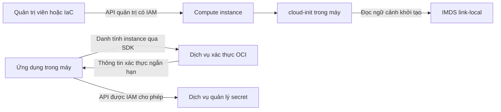

# Instance metadata, IMDS và bảo vệ thông tin khởi tạo

## 1. Mục tiêu và bối cảnh

Trong chương **Compute và máy chủ ảo** của module **CLOUD_PROVIDERS_ORACLE**, một máy ảo không chỉ có hệ điều hành và địa chỉ IP. Khi khởi động, nó cần biết mình thuộc môi trường nào, lấy cấu hình ở đâu và dùng danh tính nào để truy cập dịch vụ OCI. Instance metadata và Instance Metadata Service, viết tắt là **IMDS**, tham gia vào quá trình đó.

Bài học tập trung vào Oracle Cloud Infrastructure, gắn cấu hình máy ảo với tenancy, compartment, IAM, VCN và dịch vụ quản lý secret. Cách triển khai phải phục vụ cả bảo mật, khả năng phục hồi khi tạo lại máy, giám sát và kiểm soát chi phí vận hành.

Sau bài này, bạn có thể:

- Phân biệt metadata, user data, secret và thông tin xác thực của instance.
- Đọc một số trường cần thiết qua IMDSv2 mà không đưa toàn bộ metadata vào log.
- Hiểu IMDSv2 giúp giảm rủi ro nào và còn cần những lớp bảo vệ nào.
- Thiết kế bootstrap không nhúng mật khẩu hoặc private key vào dữ liệu khởi tạo.
- Lập kế hoạch chuyển một instance sang chỉ dùng IMDSv2 và nhận diện lỗi thường gặp.

Các lệnh Bash bên dưới dành cho **máy Linux thử nghiệm trên OCI**. Các lệnh `oci compute` chạy tại môi trường quản trị có OCI CLI và quyền phù hợp. Chúng là ví dụ để người học thực hành, không phải yêu cầu chạy trên máy đang chứa tài liệu. OCID và tên tài nguyên minh họa đều phải được thay bằng giá trị của môi trường học.

## 2. Metadata là gì, và dữ liệu nào cần được bảo vệ?

Metadata là dữ liệu mô tả instance hoặc cấu hình liên quan đến instance. Ví dụ, một tác vụ khởi tạo có thể cần OCID để gắn nhãn sự kiện, hoặc tên region để chọn cấu hình phù hợp.

Không nên đánh đồng mọi metadata với mật khẩu, nhưng cũng không nên coi toàn bộ metadata là thông tin công khai. Một bản ghi nhìn riêng lẻ có vẻ vô hại có thể giúp người ngoài ghép lại sơ đồ triển khai khi kết hợp với dữ liệu khác.

| Nhóm dữ liệu | Ví dụ trong một hệ thống học tập | Cách xử lý phù hợp |
| --- | --- | --- |
| Nhận dạng hạ tầng | OCID của máy, compartment, tên máy | Chỉ đưa vào hệ thống quan sát cần sử dụng; che bớt trong tài liệu công khai |
| Ngữ cảnh cấu hình | `environment=lab`, phiên bản cấu hình | Có thể đưa vào metadata nếu không chứa thông tin bí mật |
| Dữ liệu khởi tạo | Script hoặc cloud-config để chuẩn bị hệ điều hành | Xem như mã triển khai cần kiểm soát thay đổi |
| Dữ liệu xác thực | Mật khẩu database, private key, token | Lưu trong hệ thống quản lý secret; giới hạn người và tiến trình đọc |
| Tham chiếu đến secret | OCID của secret cần lấy | Có thể truyền như cấu hình; quyền đọc nội dung vẫn do IAM quyết định |

**Base64 là phép mã hóa biểu diễn dữ liệu, không phải cơ chế giữ bí mật.** Nếu bạn đặt mật khẩu trong script rồi chuyển script sang base64, người đọc được chuỗi đó vẫn có thể khôi phục mật khẩu.

Tương tự, public SSH key được dùng để cho phép đăng nhập khác với private SSH key dùng để chứng minh danh tính của người đăng nhập. Không đưa private key vào metadata chỉ vì một trường có tên liên quan đến SSH.

## 3. IMDS nằm ở đâu trong kiến trúc OCI?

IMDS của OCI được truy cập từ instance tại địa chỉ HTTP link-local `169.254.169.254`. IMDSv2 sử dụng tiền tố `/opc/v2/`; các endpoint thường dùng gồm `/instance/` và `/vnics/`. Với máy có nhiều VNIC, yêu cầu metadata phải đi qua VNIC chính. Đây là giao diện từ bên trong máy, khác với API quản trị Compute mà người quản trị gọi để xem hoặc sửa tài nguyên. [Oracle: Getting Instance Metadata](https://docs.oracle.com/en-us/iaas/Content/Compute/Tasks/gettingmetadata.htm).



Sơ đồ là mô hình khái niệm. Một lần gọi SDK có thể gồm nhiều bước như lấy vật liệu danh tính qua IMDS, trao đổi với dịch vụ xác thực và gọi API đích. Việc kết nối được IMDS chưa chứng minh rằng máy kết nối được dịch vụ xác thực hoặc dịch vụ secret.

Điều này đặc biệt quan trọng với máy trong private subnet. Khi bootstrap bị lỗi, cần tách riêng ba câu hỏi:

1. Máy có lấy được dữ liệu cục bộ qua IMDS không?
2. Máy có phân giải tên và đi đến endpoint OCI cần dùng không?
3. Danh tính máy có quyền thực hiện đúng thao tác trên tài nguyên đích không?

Một thay đổi route, proxy hoặc IAM có thể làm hỏng một bước mà hai bước còn lại vẫn hoạt động.

## 4. IMDSv2 và giới hạn của cơ chế bảo vệ

### 4.1. Header bắt buộc của OCI

Yêu cầu IMDSv2 cần header:

```http
Authorization: Bearer Oracle
```

`Oracle` ở đây là giá trị cố định theo giao thức, không phải mật khẩu, API signing key hoặc token phiên dành riêng cho ứng dụng. Khi tắt legacy endpoints, `/opc/v1` và `/openstack` bị từ chối với HTTP 404. IMDSv2 cũng từ chối yêu cầu có các header `Forwarded`, `X-Forwarded-For` hoặc `X-Forwarded-Host`. [Quy tắc IMDSv2 của OCI](https://docs.oracle.com/en-us/iaas/Content/Compute/Tasks/gettingmetadata.htm).

Không áp dụng nguyên xi quy trình lấy session token của nhà cung cấp cloud khác cho OCI chỉ vì cùng dùng thuật ngữ IMDSv2.

### 4.2. Vì sao header giúp giảm rủi ro SSRF?

**Server-Side Request Forgery**, hay SSRF, xảy ra khi ứng dụng bị lợi dụng để gửi yêu cầu đến một đích do người ngoài điều khiển. Ví dụ, chức năng xem trước ảnh nhận một URL rồi tải nội dung từ máy chủ ứng dụng.

Giả sử chức năng đó chỉ cho người gọi chọn URL, còn thư viện HTTP không cho thêm header. Nếu kẻ tấn công hướng yêu cầu đến IMDSv2, ứng dụng sẽ thiếu header cần thiết và không đọc được dữ liệu. Đây là ví dụ suy luận từ quy tắc giao thức, không phải cam kết rằng mọi SSRF đều được chặn.

Nếu chức năng tải URL cho phép người ngoài điều khiển cả header, hoặc kẻ tấn công đã chạy được mã trong máy, họ có thể tự thêm header cố định. Vì thế, IMDSv2 không tạo ra cơ chế phân quyền theo UID, theo tiến trình hoặc theo tên ứng dụng.

### 4.3. Những lớp bảo vệ vẫn cần thiết

Đối với chức năng tải URL, hãy xác định rõ những máy chủ nghiệp vụ được phép truy cập. Kiểm tra scheme, hostname, địa chỉ IP sau phân giải DNS và đích của từng lần redirect. Chặn đường đến địa chỉ loopback và link-local đối với luồng không cần truy cập chúng. Kiểm soát kết nối đi ra ở môi trường chạy để bổ sung cho kiểm tra trong mã.

Không chuyển tiếp tùy ý header `Authorization` từ yêu cầu người dùng sang một máy chủ khác. Không cho người dùng biến một chức năng tải ảnh thành HTTP client tổng quát chạy với vị trí mạng của ứng dụng.

Đối với mã không tin cậy, hãy dùng ranh giới cô lập phù hợp. Không suy ra rằng một container đã cách ly được IMDS chỉ vì container có filesystem riêng. Cần kiểm tra network namespace, đường đi của gói tin và quyền mà container đang có.

## 5. Đọc tối thiểu dữ liệu cần thiết

### 5.1. Đọc OCID và region chuẩn

Ví dụ dưới đây chỉ lấy hai trường. Trường `canonicalRegionName` trả tên region chuẩn; trường `region` có thể trả tên rút gọn ở một số region cũ. [Các trường metadata của OCI](https://docs.oracle.com/en-us/iaas/Content/Compute/Tasks/gettingmetadata.htm).

```bash
# Chạy trong máy Linux OCI thử nghiệm.
IMDS='http://169.254.169.254/opc/v2'

curl --noproxy '*' --fail --silent --show-error \
  --connect-timeout 2 --max-time 5 \
  -H 'Authorization: Bearer Oracle' \
  "$IMDS/instance/id"
printf '\n'

curl --noproxy '*' --fail --silent --show-error \
  --connect-timeout 2 --max-time 5 \
  -H 'Authorization: Bearer Oracle' \
  "$IMDS/instance/canonicalRegionName"
printf '\n'
```

Trong ví dụ này:

- `--noproxy '*'` giữ yêu cầu trực tiếp đến IMDS, tránh đưa nó qua proxy lấy từ biến môi trường.
- Timeout giới hạn thời gian chờ để tác vụ khởi tạo không treo vô hạn.
- `--fail` làm lệnh báo lỗi với HTTP lỗi; script sử dụng kết quả cần kiểm tra mã thoát.
- URL và header được cố định, không lấy từ tham số không tin cậy của người dùng.

Không chạy vòng lặp truy vấn metadata theo từng HTTP request nghiệp vụ. Trong thiết kế ứng dụng, hãy xác định thời gian sống của dữ liệu, dùng cache hợp lý và giới hạn retry để lỗi phụ trợ không tạo thành bão yêu cầu.

### 5.2. Phân biệt đọc một trường với xuất cả cây dữ liệu

Trong một phiên chẩn đoán, việc đọc `/instance/` thuận tiện nhưng dễ thu thập quá nhiều. Một thao tác như gửi toàn bộ JSON vào hệ thống log tập trung có thể kéo theo cả cấu hình khởi tạo.

Nên xác định trước dữ liệu cần trả lời câu hỏi chẩn đoán. Ví dụ, để xác nhận máy nào đang chạy tiến trình, hãy lấy OCID; để kiểm tra đang chọn đúng vùng triển khai, hãy lấy region. Không cần đọc `user_data` cho hai câu hỏi đó.

Kết quả curl thành công chỉ chứng minh yêu cầu đó được chấp nhận tại thời điểm kiểm tra. Nó không chứng minh mọi agent đã chuyển sang v2, và cũng không chứng minh ứng dụng có quyền đọc secret.

## 6. User data, cloud-init và thông tin còn lại sau khởi động

### 6.1. Dữ liệu khởi tạo trở thành mã chạy trên máy

Trong metadata của resource Compute, `ssh_authorized_keys` chứa public key cho người dùng mặc định; `user_data` có thể chứa script hoặc cấu hình cho cloud-init. Khi cung cấp trực tiếp `user_data` qua trường metadata của API hoặc Terraform, nội dung được biểu diễn bằng base64. Các công cụ có tùy chọn nhận file có thể thực hiện phần chuyển đổi giúp bạn; cần kiểm tra giao diện đang dùng để tránh encode hai lần. [Metadata trong resource OCI Compute](https://docs.oracle.com/en-us/iaas/tools/terraform-provider-oci/latest/docs/r/core_instance.html).

Một script khởi tạo thường có khả năng cài gói, tạo file hoặc cấu hình dịch vụ với quyền cao. Vì thế, việc cho ai sửa user data cũng là quyết định về quyền chạy mã trên những máy dùng cấu hình đó.

Đừng tải một script từ URL có thể thay đổi rồi chạy ngay với quyền root. Trong thiết kế triển khai, hãy kiểm soát nguồn, phiên bản và tính toàn vẹn của artifact; xác định rõ ai có quyền thay artifact trước lần tạo máy tiếp theo.

### 6.2. Dữ liệu không biến mất chỉ vì máy đã boot xong

Cloud-init lưu dữ liệu và trạng thái trong máy. Những vị trí liên quan thường có `/var/lib/cloud/instance/`, `/run/cloud-init/instance-data.json` và `/run/cloud-init/instance-data-sensitive.json`; bản có hậu tố `sensitive` có thể chứa dữ liệu chưa được che. Quyền truy cập và chi tiết file cần đối chiếu với phiên bản cloud-init của image. [Cloud-init: Internal Files](https://docs.cloud-init.io/en/latest/development/internal_files.html).

Cần xét thêm log, bản sao boot volume, ảnh máy tùy chỉnh, bản backup và artifact của pipeline. Xóa mật khẩu khỏi phiên bản script hiện tại không làm mất những bản sao đã tồn tại.

`cloud-init collect-logs` cũng có thể đóng gói log và user data để chẩn đoán. Trước khi đưa gói đó vào ticket, hãy rà soát và loại bỏ thông tin nhạy cảm. [Cloud-init: CLI commands](https://docs.cloud-init.io/en/latest/reference/cli.html).

Trong thiết kế vận hành, hãy coi quyền đọc backup và quyền tạo image từ máy đã khởi tạo là các đường truy cập dữ liệu cần được quản lý. Nếu đã đưa secret thật vào user data, biện pháp xử lý chính là thay hoặc thu hồi secret, đồng thời kiểm tra các bản sao liên quan.

### 6.3. Sửa metadata không tương đương áp dụng lại cấu hình hệ điều hành

Không thiết kế quy trình vận hành dựa trên giả định rằng sửa user data rồi reboot sẽ chạy lại tất cả tác vụ. Cloud-init có các module với tần suất chạy khác nhau; hành vi thực tế phụ thuộc image, cấu hình và trạng thái đã lưu.

Ví dụ, sửa public key trong metadata không nên được coi là bằng chứng rằng file `authorized_keys` của tài khoản hiện tại đã đổi đúng như mong muốn. Hãy dùng quy trình quản lý truy cập hoặc cấu hình hệ điều hành phù hợp và kiểm tra kết quả trên máy.

## 7. Ví dụ bootstrap không nhúng secret

Giả sử bài thực hành cần tạo một file ngữ cảnh để dịch vụ quan sát biết OCID và region của máy. Không có nhu cầu kết nối database ở bước này, vì vậy script không cần mật khẩu, API key hoặc quyền đọc secret.

Nội dung sau là **shell script có thể dùng làm user data** cho image Linux hỗ trợ cloud-init và IMDSv2. Nó giả định `bash`, `curl`, `install` và `mktemp` đã có trong image. Script chưa cài hay khởi động ứng dụng nghiệp vụ.

```bash
#!/bin/bash
set -euo pipefail
umask 077

readonly IMDS='http://169.254.169.254/opc/v2'

read_metadata() {
  curl --noproxy '*' --fail --silent --show-error \
    --connect-timeout 2 --max-time 5 \
    --retry 2 --retry-delay 1 \
    -H 'Authorization: Bearer Oracle' \
    "$IMDS/$1"
}

instance_id="$(read_metadata 'instance/id')"
region="$(read_metadata 'instance/canonicalRegionName')"

# Chỉ chấp nhận định dạng dự kiến trước khi tạo file cấu hình.
[[ "$instance_id" =~ ^ocid1\.instance\.[A-Za-z0-9._-]+$ ]] || exit 1
[[ "$region" =~ ^[a-z0-9]+(-[a-z0-9]+)+$ ]] || exit 1

install -d -m 0750 -o root -g root /etc/oci-bootstrap
tmp_file="$(mktemp /etc/oci-bootstrap/context.XXXXXX)"
trap 'rm -f -- "$tmp_file"' EXIT

printf '{"instanceOcid":"%s","region":"%s"}\n' \
  "$instance_id" "$region" > "$tmp_file"
chmod 0640 "$tmp_file"
mv -f -- "$tmp_file" /etc/oci-bootstrap/context.json
trap - EXIT
```

Các quyết định trong ví dụ là một thiết kế đề xuất cho bài lab:

- Chỉ lấy trường phục vụ nhu cầu của tác vụ.
- Kiểm tra định dạng trước khi đưa dữ liệu vào JSON.
- Dừng nếu không lấy được thông tin cần thiết, thay vì ghi cấu hình rỗng rồi báo thành công.
- Dùng file tạm trong cùng thư mục rồi đổi tên để giảm khả năng dịch vụ đọc trúng file đang ghi dở.
- Không dùng `set -x`, không in toàn bộ metadata và không chứa credential dài hạn.

Khi gửi script qua công cụ triển khai, hãy làm theo đúng cơ chế truyền user data của công cụ đó. Sau khi máy khởi tạo, có thể kiểm tra trạng thái bằng `cloud-init status --long` rồi xem sự tồn tại và quyền của `/etc/oci-bootstrap/context.json`. Với dịch vụ chạy bằng tài khoản riêng, hãy thiết kế group hoặc cách truyền cấu hình thích hợp thay vì mở rộng quyền đọc mọi file khởi tạo.

## 8. Khi ứng dụng cần secret: dùng danh tính máy và IAM

### 8.1. Phân tách danh tính và quyền

Instance principals cho phép Compute instance dùng danh tính của chính nó để gọi dịch vụ OCI, tránh phân phối API signing key của một IAM user vào từng máy. Dynamic group xác định tập instance; policy cấp quyền cho tập đó. Việc lấy được thông tin từ IMDS không tự tạo quyền đọc secret hay quản trị database. [Oracle: Calling Services from an Instance](https://docs.oracle.com/en-us/iaas/Content/Identity/Tasks/callingservicesfrominstances.htm).

Với bài lab, có thể đề xuất luồng sau:

1. User data chỉ chứa cấu hình không bí mật và tham chiếu tới secret.
2. Image đã có SDK hoặc agent cần thiết.
3. Thành phần được tin cậy trên máy dùng instance principals.
4. IAM chỉ cho phép đọc secret cần dùng.
5. Thành phần đó chuyển secret đến ứng dụng qua cơ chế có quyền truy cập phù hợp và hỗ trợ xoay vòng.

Không giả định mỗi Unix user tự động có một danh tính OCI riêng. Người có khả năng truy cập instance cần được xem xét trong phạm vi tin cậy của quyền đã cấp cho máy. Tách hai ứng dụng có yêu cầu quyền rất khác nhau sang các instance riêng có thể tạo ranh giới dễ kiểm soát hơn việc đặt cả hai vào cùng máy.

### 8.2. Ví dụ phạm vi quyền đọc một secret

Giả sử dynamic group `dg-oci-bootstrap` đã chỉ chọn đúng các máy của bài lab. Một policy minh họa là:

```text
Allow dynamic-group dg-oci-bootstrap to read secret-bundles in compartment app-secrets where target.secret.id = 'ocid1.vaultsecret.oc1..EXAMPLE'
```

Thay tên dynamic group, compartment và secret OCID theo môi trường thực. Nếu tenancy sử dụng tên dynamic group kèm identity domain, hãy dùng định danh tương ứng của tenancy. Policy phải được đặt tại vị trí có phạm vi bao phủ tài nguyên đích.

Điểm cần học là giới hạn quyền vào nội dung secret cụ thể, thay vì cấp `manage all-resources in tenancy` để làm mất lỗi quyền. Cú pháp điều kiện `target.secret.id` được OCI sử dụng để giới hạn secret được đọc. [Ví dụ policy giới hạn một secret](https://docs.oracle.com/en-us/iaas/Content/internet-of-things/node-red.htm).

Nếu dùng CLI để lấy nội dung, giao diện liên quan là `oci secrets secret-bundle get --secret-id ... --stage CURRENT`. Không dùng một lệnh kiểm tra có mục đích in secret ra terminal của phiên ghi hình hoặc pipeline. Thiết kế ứng dụng nên lấy dữ liệu qua SDK và kiểm soát nơi sử dụng, thời gian giữ và việc ghi log. [OCI CLI: secret-bundle get](https://docs.oracle.com/en-us/iaas/tools/oci-cli/latest/oci_cli_docs/cmdref/secrets/secret-bundle/get.html).

### 8.3. Liên hệ với ứng dụng Java

Trong ứng dụng Java chạy trên OCI instance, lựa chọn provider cho danh tính máy có dạng:

```java
import com.oracle.bmc.auth.InstancePrincipalsAuthenticationDetailsProvider;

// Đoạn cấu hình minh họa; cần OCI Java SDK và môi trường OCI phù hợp.
InstancePrincipalsAuthenticationDetailsProvider provider =
        InstancePrincipalsAuthenticationDetailsProvider.builder().build();
```

Sau đó truyền provider cho client dịch vụ cần dùng. Provider không thay thế policy IAM, cấu hình mạng hoặc cơ chế xử lý secret của ứng dụng. Không ghi nội dung credential hay secret vào exception message do ứng dụng tự tạo. [Oracle: cấu hình SDK cho instance principals](https://docs.oracle.com/en-us/iaas/Content/Identity/callresources/Configuring_the_SDK_CLI_or_Terraform.htm).

Ví dụ chỉ minh họa lựa chọn danh tính, chưa phải chương trình hoàn chỉnh. Khi triển khai thật cần quản lý vòng đời client, timeout, retry, xoay vòng secret và cách ứng dụng nhận cấu hình mới.

## 9. Chuyển sang chỉ dùng IMDSv2 có kiểm soát

### 9.1. Điều kiện trước khi đổi

Hãy xác minh image, phiên bản cloud-init, Oracle Cloud Agent, SDK và các script đang sử dụng hỗ trợ IMDSv2. Không suy luận rằng mọi image trong Marketplace hay image tự đóng gói đều tương thích. Đặc biệt với Windows hoặc image cũ, cần đối chiếu tài liệu hỗ trợ và thử nghiệm tạo mới trước khi áp dụng rộng.

Một kế hoạch thay đổi nên có máy canary, đường quản trị dự phòng và tiêu chí thành công. Kiểm tra một máy đang chạy ổn chưa đủ để kết luận quá trình tạo máy thay thế cũng sẽ ổn.

### 9.2. Quan sát các lời gọi legacy

OCI có metric `InstanceMetadataRequests` trong namespace `oci_compute`. Các dimension gồm `metadataVersion`, `path`, `resourceId`, `userAgent` và `status`, giúp tìm client còn gọi legacy endpoint. [Oracle: Compute Management Metrics](https://docs.oracle.com/en-us/iaas/Content/Compute/References/compute-management-metrics.htm).

Với bài lab, hãy đề xuất cửa sổ quan sát bao gồm khởi động dịch vụ, công việc theo lịch và một lần tạo máy từ image. Nếu không thấy dữ liệu, kiểm tra quyền xem metric, khoảng thời gian và đúng tài nguyên trước khi kết luận không còn lời gọi v1.

Không đưa credential vào metric hoặc nhãn tự định nghĩa. Một bảng theo dõi thay đổi chỉ cần máy nào đã chuyển, agent nào đã xác nhận và các lỗi phát sinh.

### 9.3. Cập nhật lựa chọn instance qua OCI CLI

Sau khi đã chuyển các thành phần phụ thuộc, người quản trị có thể đọc rồi đổi instance option:

```bash
# Chạy từ môi trường quản trị đã cấu hình OCI CLI.
INSTANCE_OCID='ocid1.instance.oc1..EXAMPLE'

oci compute instance get \
  --instance-id "$INSTANCE_OCID" \
  --query 'data."instance-options"' \
  --output json

oci compute instance update \
  --instance-id "$INSTANCE_OCID" \
  --instance-options '{"areLegacyImdsEndpointsDisabled":true}' \
  --query 'data."instance-options"' \
  --output json
```

`areLegacyImdsEndpointsDisabled=true` nghĩa là tắt endpoint legacy, vẫn giữ IMDSv2. Tên field trong JSON đầu vào dùng camelCase; JSON đầu ra CLI có thể dùng dấu gạch ngang như `are-legacy-imds-endpoints-disabled`. [OCI CLI: compute instance update](https://docs.oracle.com/en-us/iaas/tools/oci-cli/latest/oci_cli_docs/cmdref/compute/instance/update.html).

Để máy tạo mới giữ cùng lựa chọn, đưa cấu hình tương ứng vào nguồn IaC. Ví dụ phần bên trong một resource `oci_core_instance` đang có:

```hcl
instance_options {
  are_legacy_imds_endpoints_disabled = true
}
```

Đây là đoạn bổ sung vào resource, không phải file Terraform độc lập. Cần xem plan vì resource thực tế có thể còn thay đổi khác. [Terraform OCI: instance_options](https://docs.oracle.com/en-us/iaas/tools/terraform-provider-oci/latest/docs/r/core_instance.html).

### 9.4. Kiểm tra chấp nhận trên máy canary

Sau thay đổi, kiểm tra cả ba hướng:

| Kiểm tra | Kết quả cần đạt |
| --- | --- |
| Đọc một trường IMDSv2 với header đúng | Có dữ liệu mong đợi |
| Đọc IMDSv2 không có header | Bị từ chối |
| Đọc trường tương ứng qua legacy endpoint | Không còn trả dữ liệu khi đã tắt legacy |
| Khởi động lại ứng dụng và tác vụ phụ trợ | Không xuất hiện lỗi phụ thuộc metadata |
| Tạo máy mới từ cấu hình triển khai | Bootstrap hoàn thành theo tiêu chí đã định |

Có thể kiểm tra HTTP code mà không xuất nội dung response:

```bash
# Các phép kiểm tra này chạy trong máy OCI thử nghiệm.
# Không dùng --fail ở đây vì cần quan sát cả mã HTTP lỗi.
curl --noproxy '*' --silent --show-error \
  --connect-timeout 2 --max-time 5 \
  -o /dev/null -w 'v2_with_header=%{http_code}\n' \
  -H 'Authorization: Bearer Oracle' \
  'http://169.254.169.254/opc/v2/instance/id'

curl --noproxy '*' --silent --show-error \
  --connect-timeout 2 --max-time 5 \
  -o /dev/null -w 'v2_without_header=%{http_code}\n' \
  'http://169.254.169.254/opc/v2/instance/id'

curl --noproxy '*' --silent --show-error \
  --connect-timeout 2 --max-time 5 \
  -o /dev/null -w 'legacy=%{http_code}\n' \
  'http://169.254.169.254/opc/v1/instance/id'
```

Không kết luận chỉ từ một HTTP 404: đường dẫn sai cũng có thể cho kết quả đó. Kết hợp cấu hình instance option, v2 hoạt động và legacy bị chặn. Nếu curl báo `000`, đó không phải response HTTP thành công từ IMDS; cần xem mã thoát và lỗi kết nối.

Nếu canary mất chức năng vì client cũ, dừng triển khai rộng và sửa client hoặc image. Việc bật lại legacy, nếu cần để khôi phục dịch vụ, phải là thay đổi có thời hạn cùng kế hoạch đóng lại; không để trở thành cấu hình lâu dài do quên cập nhật.

## 10. Hạn chế truy cập IMDS tại hệ điều hành

Oracle khuyến nghị giới hạn truy cập metadata vào những người dùng có đặc quyền. Ví dụ sau là một biến thể cho **máy lab chỉ cho root dùng IMDS**, giới hạn riêng TCP port 80:

```bash
# Chỉ áp dụng sau khi xác nhận không có dịch vụ non-root cần IMDS.
sudo iptables -I OUTPUT 1 \
  -d 169.254.169.254/32 -p tcp --dport 80 \
  -m owner ! --uid-owner 0 -j REJECT
```

Cần có phiên quản trị dự phòng và cách gỡ đúng rule thử nghiệm:

```bash
sudo iptables -D OUTPUT \
  -d 169.254.169.254/32 -p tcp --dport 80 \
  -m owner ! --uid-owner 0 -j REJECT
```

Ví dụ minh họa ý tưởng kiểm soát tại host, dựa trên hướng dẫn bảo vệ Compute của Oracle. Không thay thế nguyên trạng bộ rule hiện có và không flush firewall. [Oracle: Securing Compute](https://docs.oracle.com/en-us/iaas/Content/Security/Reference/compute_security.htm).

Trước khi áp dụng vào hệ thống thật, cần xét các giới hạn:

- Ứng dụng Java hoặc agent chạy bằng tài khoản non-root có thể cần IMDS để dùng instance principals; rule root-only sẽ làm chúng mất chức năng.
- Rule trong `OUTPUT` xử lý lưu lượng tạo tại namespace đó; lưu lượng container đi qua namespace hoặc chain khác cần thiết kế riêng.
- Một tiến trình có root hoặc quyền thay firewall có thể thay đổi rule; đây không phải ranh giới chống lại người đã kiểm soát toàn bộ máy.
- Nếu hệ thống dùng nftables hoặc firewalld, hãy tích hợp vào cơ chế quản lý firewall hiện có và xác minh khả năng lưu rule qua reboot.

Địa chỉ link-local còn có vai trò cho những dịch vụ nền khác. Vì vậy ví dụ giới hạn TCP/80 cho IMDS, tránh áp dụng một lệnh chặn toàn bộ địa chỉ rồi vô tình làm lỗi DNS hoặc đồng bộ thời gian. Không coi NSG hoặc security list của VCN là bằng chứng duy nhất rằng từng tiến trình đã bị hạn chế truy cập IMDS.

## 11. Chẩn đoán theo triệu chứng

| Triệu chứng | Giả thuyết cần kiểm tra | Bước tiếp theo có phạm vi hẹp |
| --- | --- | --- |
| V2 bị từ chối | Thiếu header hoặc request bị gắn header chuyển tiếp | Thử đúng một trường bằng curl trực tiếp với header cố định |
| Timeout hoặc mã `000` | Route cục bộ, proxy, host firewall hoặc namespace | Kiểm tra mã thoát, cấu hình proxy và đường đi từ đúng môi trường chạy ứng dụng |
| V1 trả 404 sau thay đổi | Legacy đã tắt, hoặc client dùng đường dẫn sai | Đọc instance option và xác nhận v2 hoạt động |
| Curl chạy bằng root được, dịch vụ chạy không được | Chính sách theo UID, môi trường proxy hoặc namespace khác | Kiểm tra bằng chính tài khoản và môi trường của dịch vụ |
| Đọc OCID được nhưng lấy secret bị lỗi | Mạng đến dịch vụ OCI, danh tính hoặc quyền IAM | Tách chẩn đoán kết nối, xác thực và quyền trên secret đích |
| Máy cũ ổn, máy mới bootstrap lỗi | Image, artifact hoặc tác vụ chỉ chạy khi tạo mới | Kiểm tra trạng thái cloud-init và log đã lọc thông tin nhạy cảm |
| Lỗi lúc có lúc không | Quá nhiều request hoặc sự cố ngắn hạn | Giới hạn retry, cache phù hợp và theo dõi tần suất lỗi |

Một sự cố cần được mô tả bằng dữ kiện tối thiểu: instance nào, thời điểm nào, endpoint loại nào, HTTP code hoặc lỗi kết nối, UID của tiến trình và thay đổi gần nhất. Không cần đính kèm nội dung user data hoặc secret để báo rằng endpoint bị timeout.

IMDS có thể áp dụng throttling; code cần xử lý lỗi tạm thời bằng retry có giới hạn và backoff. Với credential do SDK quản lý, ưu tiên cơ chế làm mới của SDK thay vì tự truy vấn vật liệu danh tính cho mỗi giao dịch. [Khuyến nghị vận hành IMDS](https://docs.oracle.com/en-us/iaas/Content/Compute/Tasks/gettingmetadata.htm).

## 12. Bài thực hành tổng hợp và tiêu chí hoàn thành

Dùng một instance Linux trong compartment lab, image đã xác nhận hỗ trợ IMDSv2 và không chứa secret sản xuất. Bài thực hành không đòi hỏi mở port ứng dụng ra Internet hay tạo database mới.

Thực hiện theo thứ tự:

1. Ghi nhận lựa chọn IMDS hiện tại và xác nhận hai trường OCID, region bằng v2.
2. Lập danh sách script, SDK, agent và tác vụ theo lịch có thể phụ thuộc metadata.
3. Chạy bootstrap không secret ở môi trường thử nghiệm; kiểm tra trạng thái và file đầu ra.
4. Quan sát metric và sửa những client còn dùng legacy.
5. Đổi canary sang chỉ dùng v2, kiểm tra request có header, thiếu header và legacy.
6. Nếu thử instance principals, chỉ cấp quyền cho tài nguyên thử nghiệm đã chọn; không dùng secret sản xuất để kiểm tra.
7. Tạo lại một máy thử từ cấu hình đã lưu để kiểm tra khả năng tái lập, sau đó dọn tài nguyên không còn cần.

Sản phẩm thực hành nên là một biên bản ngắn gồm instance option trước và sau, trạng thái bootstrap, kết quả các phép kiểm tra và những thay đổi cần đưa vào IaC. Khi chia sẻ biên bản ra ngoài môi trường học, che các định danh không cần thiết.

Tiêu chí hoàn thành của thiết kế là: bootstrap tạo ra cấu hình cần thiết; legacy không còn được sử dụng; ứng dụng được cấp đúng quyền cần có; tài liệu chẩn đoán không làm lộ credential; quy trình tạo lại máy tái lập được kết quả.

Kiểm soát chi phí bắt đầu từ phạm vi bài lab: dùng lại tài nguyên được phép, không tạo thêm database hoặc dịch vụ chỉ để chứng minh IMDS hoạt động. Khi dọn lab, kiểm tra boot volume, block volume, public IP được giữ lại và các tài nguyên phụ trợ theo chính sách của môi trường; chỉ xóa những tài nguyên đã xác nhận thuộc bài thực hành.

## 13. Những nguyên tắc cần ghi nhớ

Metadata là đầu vào của tự động hóa nên phải được đọc có chủ đích. User data là một phần của quy trình triển khai và có thể để lại bản sao trên nhiều lớp lưu trữ. IMDSv2 giảm rủi ro từ một số kiểu yêu cầu ngoài ý muốn, còn quyền truy cập dữ liệu và dịch vụ vẫn cần được kiểm soát ở ứng dụng, hệ điều hành và IAM.

Một thiết kế dễ vận hành sẽ truyền ngữ cảnh không bí mật qua metadata, lấy secret bằng danh tính phù hợp, chỉ cấp quyền cần dùng và kiểm tra cả đường tạo máy mới. Khi có lỗi, chẩn đoán theo từng lớp kết nối, xác thực và phân quyền giúp sửa đúng nguyên nhân mà không phải mở rộng quyền hoặc xuất toàn bộ dữ liệu khởi tạo.
