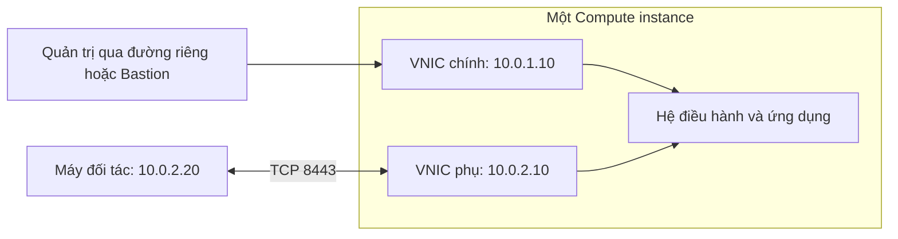

# Quản lý VNIC phụ và kết nối mạng cho instance

Trong chương **Compute và máy chủ ảo** của Oracle Cloud Infrastructure (OCI), việc thêm một VNIC phụ giúp instance có thêm điểm kết nối vào mạng. Công việc chỉ hoàn thành khi hệ điều hành nhận đúng interface, ứng dụng dùng đúng địa chỉ, các lớp bảo mật cho phép kết nối và gói trả lời đi theo đường phù hợp.

Bài học sử dụng một máy ảo Linux có mạng quản trị và mạng ứng dụng riêng để giải thích toàn bộ quá trình: chuẩn bị quyền IAM, tạo VNIC, cấu hình hệ điều hành, kiểm tra định tuyến, giám sát và thu hồi tài nguyên. Mục tiêu vận hành là duy trì truy cập quản trị trong khi triển khai kết nối mới, đồng thời hiểu giới hạn về chi phí và tính sẵn sàng.

## Mục tiêu học tập

Sau bài học, bạn có thể:

- Phân biệt VNIC chính, VNIC phụ và private IP phụ.
- Chọn subnet, NSG và phạm vi quyền phù hợp cho một VNIC phụ.
- Tạo VNIC bằng Console hoặc OCI CLI và đối chiếu với interface trong instance.
- Giải thích sự khác nhau giữa route trong hệ điều hành và route trong VCN.
- Phát hiện định tuyến bất đối xứng, kiểm tra đường đi theo địa chỉ nguồn và áp dụng policy routing khi cần.
- Xác minh kết nối bằng bằng chứng ở cả phía gửi, phía nhận và lớp mạng OCI.
- Lập phương án cấu hình bền vững, gỡ VNIC và khôi phục kết nối.

## VNIC phụ giải quyết bài toán nào?

VNIC, viết tắt của Virtual Network Interface Card, là giao diện mạng ảo kết nối instance với một subnet trong VCN. Instance được tạo cùng VNIC chính. VNIC phụ được gắn thêm sau đó; số lượng hỗ trợ phụ thuộc shape. Một VNIC phụ có thể kết nối subnet khác, kể cả trong VCN khác. VNIC gắn vào instance thuộc cùng availability domain với instance; subnet regional vẫn dùng được cho instance trong các AD được hỗ trợ. Thêm VNIC không làm tăng tổng băng thông được shape cấp. Xem [khái niệm và giới hạn VNIC của OCI](https://docs.oracle.com/en-us/iaas/Content/Network/Tasks/managingVNICs.htm).

Các tình huống phù hợp gồm:

| Nhu cầu | Cách cân nhắc |
|---|---|
| Tách địa chỉ quản trị khỏi địa chỉ ứng dụng | Có thể dùng VNIC riêng cho từng subnet, kết hợp NSG và cấu hình ứng dụng |
| Một instance cần hiện diện trực tiếp trong hai miền mạng | Xem xét VNIC phụ, cùng đường đi và chính sách của từng miền |
| Chỉ cần thêm địa chỉ cho nhiều dịch vụ trong một subnet | Cân nhắc private IP phụ trên VNIC hiện có |
| Cần nhiều instance trao đổi giữa hai VCN | Cân nhắc kiến trúc peering hoặc DRG thay vì gắn thêm VNIC cho từng máy |
| Cần tăng thông lượng mạng | Đánh giá shape, OCPU và giới hạn băng thông trước khi thêm VNIC |

Tách subnet giúp tổ chức mạng nhưng mọi interface vẫn thuộc cùng một hệ điều hành. Nếu instance bị chiếm quyền, kẻ tấn công có thể tiếp cận các kết nối mà máy đó được phép sử dụng. Vì vậy, VNIC phụ không thay thế cho phân quyền, kiểm soát dịch vụ và thiết kế ranh giới tin cậy.

### Phân biệt các định danh

| Thành phần | Ý nghĩa | Dùng khi nào? |
|---|---|---|
| Instance OCID | Định danh máy ảo hoặc máy bare metal | Chọn máy nhận VNIC |
| VNIC OCID | Định danh giao diện mạng trên OCI | Tra cứu IP, MAC, subnet, NSG |
| VNIC attachment OCID | Định danh liên kết giữa instance và VNIC | Làm việc với API attachment |
| Private IP | Địa chỉ bên trong subnet | Bind ứng dụng, xác định nguồn và đích kết nối |
| Tên interface trong OS | Ví dụ `ens3`, `ens5` | Dùng lệnh mạng trong hệ điều hành |
| MAC address | Địa chỉ lớp liên kết của VNIC | Đối chiếu VNIC trên OCI với interface trong OS |

Không suy VNIC từ thứ tự tên interface. Interface thứ hai trên một image có thể mang tên khác trên image khác. Đối chiếu MAC là bước thực tế để tránh sửa nhầm mạng quản trị.

Một **private IP phụ** bổ sung địa chỉ cho VNIC hiện có; một **VNIC phụ** bổ sung giao diện kết nối. Nếu chỉ cần hai địa chỉ trong cùng subnet, thêm private IP thường làm mô hình định tuyến đơn giản hơn. Nhiều VNIC cùng CIDR cần được xem xét kỹ vì lựa chọn interface và đường trả lời có thể trở nên khó dự đoán.

## Mô hình thực hành

Giả sử bạn đã có một VCN và một instance thử nghiệm, cùng một máy đối tác để kiểm tra dịch vụ:

| Thành phần | Giá trị minh họa |
|---|---|
| VCN | `10.0.0.0/16` |
| Subnet quản trị | Private regional subnet `10.0.1.0/24` |
| VNIC chính của instance | `10.0.1.10`, giả sử OS gọi là `ens3` |
| Subnet ứng dụng | Private regional subnet `10.0.2.0/24` |
| VNIC phụ cần tạo | `10.0.2.10`, giả sử OS gọi là `ens5` |
| Máy đối tác trong subnet ứng dụng | `10.0.2.20` |
| Cổng dịch vụ thử nghiệm | TCP `8443` |
| Public IP trên VNIC phụ | Không cấp |

Các IP là ví dụ, chỉ dùng khi chúng còn trống và thuộc đúng subnet của môi trường thực hành. Nếu OCI tự chọn private IP, hãy thay mọi ví dụ phía dưới bằng IP thực tế nhận được. Cổng 8443 chỉ là cổng dịch vụ lab; số cổng không tự quyết định ứng dụng dùng HTTP hay HTTPS.



Sơ đồ thể hiện instance có hai điểm kết nối. Nó không thể hiện một router tự động nối hai subnet. Trong mô hình này, hệ điều hành không được cấu hình để chuyển tiếp lưu lượng của máy khác.

Đường quản trị cần được kiểm tra trước khi thêm VNIC. Với subnet private, có thể dùng OCI Bastion hoặc kết nối riêng đã được thiết lập. Giữ một phiên quản trị hoạt động và chuẩn bị phương án console của instance trước khi thay đổi route.

## Chuẩn bị quyền và thông tin mạng

### Xác nhận quyền theo tài nguyên

Quyền đăng nhập SSH vào Linux khác với quyền tạo tài nguyên mạng trên OCI. Tài khoản có thể đăng nhập được máy nhưng không có quyền tạo VNIC trong subnet đích.

Đối với thao tác `AttachVnic`, tài liệu IAM liệt kê các quyền như `INSTANCE_ATTACH_SECONDARY_VNIC`, `VNIC_ATTACH`, `VNIC_CREATE` và `SUBNET_ATTACH`. Nếu gắn NSG ngay lúc tạo, còn có `NETWORK_SECURITY_GROUP_UPDATE_MEMBERS` và `VNIC_ASSOCIATE_NETWORK_SECURITY_GROUP`. Đây là tên quyền để đối chiếu, không phải một policy hoàn chỉnh. Xem [quyền cho Core Services](https://docs.oracle.com/en-us/iaas/Content/Identity/Reference/corepolicyreference.htm).

Trong môi trường doanh nghiệp, hãy xác nhận:

- Nhóm thao tác được quản lý instance trong compartment nào.
- Nhóm được sử dụng subnet và thay đổi thành viên NSG trong compartment mạng nào.
- Có quyền đọc thông tin cần thiết để chọn đúng VCN, subnet và instance.
- Quyền xem Monitoring được cấp ở phạm vi chứa tài nguyên mạng cần theo dõi.

Compartment của instance và compartment của mạng có thể khác nhau. Khi gặp lỗi không được phép, kiểm tra cả hai phạm vi và region đang chọn. Việc cấp quyền quản trị toàn tenancy chỉ để vượt lỗi attach làm phạm vi quyền rộng hơn nhu cầu thực tế.

### Kiểm tra trước thay đổi

Ghi nhận thông tin sau từ đúng instance và subnet sẽ sử dụng:

1. Region, AD, compartment và shape của instance.
2. Số VNIC đã gắn và khả năng hỗ trợ thêm VNIC của cấu hình hiện tại.
3. CIDR, private IP còn trống và thuộc tính public/private của subnet đích.
4. NSG sẽ gắn, security lists của subnet và mọi kiểm soát bảo mật bổ sung đang áp dụng.
5. Route table thực tế áp dụng cho lưu lượng của VNIC.
6. MAC, địa chỉ và route của VNIC chính trong OS.
7. Dịch vụ kiểm thử đã sẵn sàng ở phía đối tác và đường quay lại.
8. Mục tiêu thay đổi, người chịu trách nhiệm và cách hoàn tác.

Đối với bare metal, còn phải xem physical NIC, NIC index và cấu hình VLAN theo shape. Các lệnh Linux trong bài minh họa cho **VM**, không phải hướng dẫn thay thế toàn bộ quy trình bare metal.

## Thiết kế bảo mật và đường đi trước khi attach

Một kết nối thành công cần nhiều điều kiện đồng thời:

```text
Ứng dụng chọn IP nguồn/đích
  -> route trong OS chọn interface và next hop
  -> kiểm soát mạng OCI cho phép lưu lượng
  -> mạng đích và firewall OS cho phép
  -> ứng dụng đích đang lắng nghe
  -> đường trả lời phù hợp
```

### NSG và security lists

VNIC phụ cần được gắn NSG theo vai trò của nó. NSG chứa VNIC chính không tự trở thành NSG của VNIC phụ chỉ vì hai VNIC ở cùng instance.

Trong OCI, các rule của security lists áp dụng cho subnet và các NSG chứa VNIC được kết hợp theo phép hợp. Một NSG hẹp không thu hẹp được một rule rộng đã cho phép cùng lưu lượng ở security list. Stateful rule cho phép lưu lượng trả lời của kết nối được theo dõi; stateless rule yêu cầu thiết kế chiều trả lời tương ứng. Xem [cơ chế security rules](https://docs.oracle.com/en-us/iaas/Content/Network/Concepts/securityrules.htm).

Với mô hình lab, có thể thiết kế chính sách hiệu dụng như sau:

| Điểm áp dụng | Chiều | Nguồn hoặc đích | Cho phép |
|---|---|---|---|
| VNIC phụ của instance | Ingress | Máy đối tác `10.0.2.20/32` | TCP destination port 8443 |
| VNIC của máy đối tác | Egress | Instance `10.0.2.10/32` | TCP destination port 8443 |
| VNIC phụ của instance, nếu gọi dịch vụ đối tác | Egress | `10.0.2.20/32` | TCP destination port 8443 |
| VNIC của máy đối tác, nếu phục vụ chiều gọi trên | Ingress | `10.0.2.10/32` | TCP destination port 8443 |
| VNIC chính | Theo chính sách quản trị | Nguồn quản trị đã phê duyệt | Cổng quản trị cần thiết |

Các dòng gọi từ instance sang đối tác chỉ cần khi thực sự kiểm thử chiều đó. Với stateful rule, không mở thêm toàn bộ dải cổng chỉ để xử lý lưu lượng trả lời. Nếu dùng NSG làm nguồn hoặc đích trong rule, xác nhận NSG đó có phạm vi VCN phù hợp; ví dụ lab dùng IP để dễ theo dõi.

Ngoài rule OCI, firewall Linux và địa chỉ bind của ứng dụng cũng phải phù hợp. Nếu môi trường áp dụng Zero Trust Packet Routing hoặc lớp kiểm soát bổ sung, phải kiểm tra các lớp đó khi đánh giá quyền truy cập thực tế.

### Route trong OS và route trong VCN là hai lớp khác nhau

OS quyết định gói rời instance qua interface nào. Sau đó lớp mạng OCI quyết định chuyển gói theo cấu hình mạng áp dụng. Thêm rule vào route table của VCN không tự thêm `ip rule` vào Linux.

OCI hỗ trợ per-resource routing: route table gắn với private IP được ưu tiên, tiếp theo là VNIC, rồi mới đến subnet nếu không có cấu hình ở các cấp trước. Các bảng này không được cộng dồn thành một bảng. Xem [VCN Route Tables và per-resource routing](https://docs.oracle.com/en-us/iaas/Content/Network/Tasks/managingroutetables.htm).

Trong lab, giả sử không có route tùy chỉnh chuyển hướng lưu lượng nội bộ giữa hai subnet. Khi điều tra lỗi thực tế, xác minh giả định này bằng cấu hình hiện có; không kết luận từ CIDR rằng đường đi chắc chắn không qua thiết bị trung gian.

VNIC phụ không cần public IP để nói chuyện với máy đối tác trong VCN. Nếu cần ra Internet, thiết kế gateway và route theo nhu cầu: NAT Gateway phục vụ kết nối khởi tạo từ mạng private, còn Internet Gateway không tự cấp public IP hoặc tự mở dịch vụ.

## Tạo VNIC phụ bằng OCI Console

Đây là một cách tạo VNIC. Nếu đã thực hiện thành công bằng Console, không chạy tiếp lệnh attach ở phần CLI cho cùng thay đổi.

1. Chọn đúng region và compartment chứa instance.
2. Vào **Compute → Instances**, mở instance cần thay đổi.
3. Mở danh sách **Attached VNICs** và chọn **Create VNIC**.
4. Đặt tên thể hiện mục đích, chẳng hạn `app-secondary`.
5. Chọn VCN và subnet ứng dụng đúng compartment.
6. Chọn NSG đã chuẩn bị cho kết nối ứng dụng.
7. Không cấp public IPv4 cho lab này.
8. Chọn tự cấp private IP hoặc nhập IP còn trống theo kế hoạch.
9. Tạo VNIC, chờ attachment hoàn tất rồi ghi lại VNIC OCID, private IP và MAC.

Tên vị trí thao tác có thể thay đổi theo giao diện Console. Quy trình chọn tài nguyên được mô tả trong [hướng dẫn tạo secondary VNIC](https://docs.oracle.com/en-us/iaas/Content/Network/Tasks/managingvnics_tasks-attach.htm).

Attachment hoàn tất xác nhận phần tài nguyên OCI. Bạn vẫn cần kiểm tra hệ điều hành và kết nối ứng dụng trước khi đưa VNIC vào sử dụng.

## Tạo và tra cứu bằng OCI CLI

Các lệnh dưới đây là **ví dụ Bash** để người học chạy trong môi trường quản trị đã cài và xác thực OCI CLI. Các OCID có dấu `...` là chỗ thay bằng giá trị thật; không chạy nguyên mẫu. Bài học không thực thi các thao tác này.

```bash
INSTANCE_ID='ocid1.instance.oc1...'
INSTANCE_COMPARTMENT_ID='ocid1.compartment.oc1...'
APP_SUBNET_ID='ocid1.subnet.oc1...'
APP_NSG_ID='ocid1.networksecuritygroup.oc1...'

# Kiểm tra danh sách trước khi tạo để tránh attach trùng.
oci compute vnic-attachment list \
  --compartment-id "$INSTANCE_COMPARTMENT_ID" \
  --instance-id "$INSTANCE_ID" \
  --all

# Chỉ tạo khi chưa có VNIC đáp ứng thay đổi này.
oci compute instance attach-vnic \
  --instance-id "$INSTANCE_ID" \
  --subnet-id "$APP_SUBNET_ID" \
  --display-name 'app-secondary' \
  --assign-public-ip false \
  --nsg-ids "[\"$APP_NSG_ID\"]"
```

Ví dụ để OCI tự chọn private IP, tránh giả định `10.0.2.10` chắc chắn còn trống. Ghi nhận địa chỉ thực tế và dùng nó trong những bước sau.

Tham số `--assign-public-ip false` thể hiện rõ ý định không cấp địa chỉ public. Khi dùng CLI với subnet cho phép public IP, bỏ qua tham số này có thể tạo kết quả khác mong muốn. Xem [tham số attach-vnic](https://docs.oracle.com/en-us/iaas/tools/oci-cli/latest/oci_cli_docs/cmdref/compute/instance/attach-vnic.html).

Sau khi tạo, liệt kê lại attachment, lấy trường `vnic-id` rồi xem VNIC:

```bash
oci compute vnic-attachment list \
  --compartment-id "$INSTANCE_COMPARTMENT_ID" \
  --instance-id "$INSTANCE_ID" \
  --all

SECONDARY_VNIC_ID='ocid1.vnic.oc1...'

oci network vnic get --vnic-id "$SECONDARY_VNIC_ID"
```

Đối chiếu trạng thái attachment, subnet, MAC, private IP, NSG và cờ VNIC chính/phụ. API có thể trả về nhiều tài nguyên; đừng lấy VNIC đầu tiên trong danh sách làm VNIC cần thao tác.

Nếu lệnh attach bị timeout, tra cứu attachment trước khi thử lại. Timeout phía client không đủ để kết luận OCI chưa tạo tài nguyên. Display name cũng không phải khóa duy nhất bảo đảm chống tạo trùng.

## Cấu hình và xác minh trong Linux

### Ghi nhận trạng thái ban đầu

Chạy trên instance qua đường quản trị đang hoạt động:

```bash
ip -br link
ip -br address
ip route show table main
ip rule show
```

So sánh MAC trong `ip link` với MAC của VNIC phụ trên OCI. Chỉ dùng tên `ens5` trong phần tiếp theo nếu đối chiếu xác nhận tên đó đúng.

Các câu hỏi cần trả lời:

- Interface của VNIC phụ đã xuất hiện chưa?
- Interface đã có private IP được OCI cấp chưa?
- Default route của mạng quản trị còn như trước không?
- Có bảng route hoặc rule riêng do công cụ quản lý mạng tạo sẵn không?

Không chạy DHCP client đồng loạt trên mọi interface hoặc thay default route chỉ vì VNIC mới chưa hoạt động. Những thao tác đó có thể thay đường quản trị và đường truy cập dịch vụ hệ thống.

### Dùng công cụ dành cho Oracle Linux

Trên image Oracle Linux có `oci-utils` phù hợp, có thể kiểm tra và đồng bộ cấu hình bằng:

```bash
command -v oci-network-config
sudo oci-network-config show
sudo oci-network-config configure
sudo oci-network-config show

ip -br address
ip rule show
ip route show table all
```

`configure` đồng bộ cấu hình IP với VNIC được provision trên OCI, bao gồm dọn cấu hình của VNIC không còn được provision. Vì vậy, xem trạng thái toàn bộ VNIC trước khi chạy, nhất là khi có cấu hình thủ công hoặc nhiều công cụ cùng quản lý mạng. Xem [OCI Utilities Reference](https://docs.oracle.com/en-us/iaas/oracle-linux/oci/oci-utilities-reference.htm).

Nếu utility chưa có hoặc image không hỗ trợ quy trình này, chọn cách cấu hình theo image và trình quản lý mạng đang sử dụng. NetworkManager, Netplan và systemd-networkd có cách lưu cấu hình khác nhau. Không áp dụng cùng một bộ lệnh ghi cấu hình cho mọi bản phân phối.

Lab giả sử interface nằm trong network namespace mặc định. Nếu cơ chế cấu hình của image đưa VNIC vào namespace khác, các lệnh kiểm tra và ứng dụng phải chạy trong namespace phù hợp; xem kết quả `ip netns list` và cấu hình của công cụ đang dùng.

### Điều kiện đạt sau cấu hình

Với IP minh họa, kết quả mong đợi gồm:

- VNIC phụ có địa chỉ `10.0.2.10` và prefix phù hợp với subnet.
- Có đường tới `10.0.2.0/24` qua interface phụ.
- Không phát sinh default route ngoài kế hoạch trong bảng main.
- Đường quản trị qua VNIC chính vẫn hoạt động.
- Các rule và bảng route đã có được hiểu rõ trước khi thêm cấu hình thủ công.

Với Windows, có thể bắt đầu bằng `Get-NetAdapter`, `Get-NetIPConfiguration` và `Get-NetRoute` để đối chiếu MAC, IP và metric. Thực hiện cấu hình theo image Windows và hướng dẫn OCI tương ứng; các lệnh `ip` bên dưới chỉ áp dụng cho Linux.

## Hiểu và xử lý định tuyến bất đối xứng

### Trường hợp không cần thêm policy routing

Nếu instance gọi máy `10.0.2.20` trong cùng subnet ứng dụng, route trực tiếp qua VNIC phụ thường đã đủ. Kiểm tra lựa chọn của kernel:

```bash
ip route get 10.0.2.20
ip route get 10.0.2.20 from 10.0.2.10
```

Trong mô hình này, cả hai kết quả cần chỉ ra interface phụ, và địa chỉ nguồn tự chọn phù hợp là `10.0.2.10`. Nếu kết quả đã đúng và ứng dụng hoạt động, không cần thêm bảng định tuyến chỉ để có thêm cấu hình.

### Khi địa chỉ nguồn cần quyết định đường ra

Xét một kết nối từ máy `10.0.1.20` tới địa chỉ ứng dụng `10.0.2.10`. Gói đến có thể vào VNIC phụ, trong khi bảng main của instance có route trực tiếp về `10.0.1.0/24` qua VNIC chính. Nếu chỉ tra cứu theo đích, gói trả lời có thể rời VNIC chính với nguồn `10.0.2.10`.

Đường đi như vậy cần được đánh giá với source validation, firewall và cơ chế theo dõi kết nối của toàn bộ đường mạng. Một NSG mở đúng cổng không sửa được lựa chọn interface của kernel.

Trước hết, mô phỏng đường trả lời:

```bash
ip route get 10.0.1.20 from 10.0.2.10
```

Chỉ kiểm thử kết nối thực tế từ `10.0.1.20` nếu đã bổ sung rule OCI và firewall tương ứng cho nguồn đó. Rule lab ban đầu chỉ cho `10.0.2.20/32`, nên việc máy khác bị từ chối chưa phải bằng chứng lỗi route.

### Ví dụ bảng route theo nguồn

Đây là cấu hình **tạm thời trong bộ nhớ** để minh họa trên VM lab. Điều kiện sử dụng:

- IP và interface đã được cấp, cấu hình đúng trong OS.
- Default route quản trị trong bảng main đang hoạt động.
- Công cụ mạng chưa tạo rule tương đương cho VNIC phụ.
- Table `200` và priority `10200` đang chưa được sử dụng.
- Gateway thực tế của subnet đã được xác nhận. Trong ví dụ `10.0.2.0/24`, dùng `10.0.2.1`.

Kiểm tra trước:

```bash
ip rule show
ip route show table 200
```

Nếu table đã chứa route hoặc priority đã có rule, dừng ví dụ và chọn thiết kế phù hợp với cấu hình hiện tại. Không thay thế route thuộc một thay đổi khác.

```bash
# Chỉ dùng các giá trị minh họa sau khi đã đối chiếu.
sudo ip route add 10.0.2.0/24 \
  dev ens5 src 10.0.2.10 table 200

sudo ip route add default \
  via 10.0.2.1 dev ens5 table 200

sudo ip rule add priority 10200 \
  from 10.0.2.10/32 lookup 200

ip rule show
ip route show table 200
ip route get 10.0.1.20 from 10.0.2.10
```

Rule mới nói rằng gói **đã có nguồn** `10.0.2.10` sẽ tra cứu table 200 trước bảng main theo thứ tự priority. Table đó có route connected tới subnet và default route qua gateway của VNIC phụ.

Policy theo nguồn không tự buộc ứng dụng chưa chọn nguồn phải dùng VNIC phụ. Đối với kết nối do ứng dụng khởi tạo, vẫn cần kiểm tra route theo đích hoặc cấu hình bind địa chỉ nguồn. Ngoài ra, default route trong table 200 không tạo đường ra Internet nếu cấu hình VCN không có đường phù hợp.

Giữ đường truy cập metadata và các kết nối iSCSI hiện có qua VNIC chính theo thiết kế của image. Khi chuyển lưu lượng rộng sang VNIC phụ, kiểm tra các route đặc thù này; không thay default route hoặc gom toàn bộ `169.254.0.0/16` vào một gateway mới một cách máy móc.

### Reverse path filtering

Linux có thể kiểm tra đường quay về nguồn bằng `rp_filter`. Strict mode có thể loại gói trong một số mô hình nhiều interface. Kiểm tra giá trị hiện có:

```bash
sysctl net.ipv4.conf.all.rp_filter
sysctl net.ipv4.conf.ens3.rp_filter
sysctl net.ipv4.conf.ens5.rp_filter
```

Giá trị `1` là strict mode, `2` là loose mode và `0` tắt kiểm tra. Kernel sử dụng giá trị lớn hơn giữa cấu hình `all` và interface khi kiểm tra interface đó. Nếu thiết kế cần loose mode trên interface phụ, có thể thử có chủ đích:

```bash
sudo sysctl -w net.ipv4.conf.ens5.rp_filter=2
```

Ghi lại giá trị cũ để hoàn tác. Loose mode vẫn yêu cầu có đường tới nguồn qua một interface; nó không sửa route, không mở firewall và không thay đổi source/destination check của OCI. Xem [tài liệu rp_filter của Linux kernel](https://kernel.org/doc/html/latest/networking/ip-sysctl.html).

## Kiểm thử kết nối theo từng lớp

### Kiểm tra route và địa chỉ nguồn

Trên instance:

```bash
ip -br address
ip route get 10.0.2.20
ip route get 10.0.2.20 from 10.0.2.10
```

Lệnh `ip route get` là bằng chứng về lựa chọn của OS, chưa chứng minh dịch vụ đích hoặc mạng OCI cho phép gói đi qua.

### Kiểm tra cổng và ứng dụng

Giả sử máy đối tác đã chạy một dịch vụ HTTP lab ở `10.0.2.20:8443`:

```bash
nc -vz -w 3 10.0.2.20 8443

curl --interface 10.0.2.10 \
  --connect-timeout 3 \
  --max-time 10 \
  http://10.0.2.20:8443/health
```

Đây là HTTP phục vụ thực hành. Với dịch vụ HTTPS thực tế, dùng hostname, chứng thư và giao thức đúng của dịch vụ; không suy từ số cổng rằng phải tắt xác minh chứng thư.

Để kiểm thử chiều vào VNIC phụ, instance phải có một dịch vụ thật đang nghe tại `10.0.2.10:8443`. Trên instance:

```bash
sudo ss -lntp
```

Sau đó, từ máy đối tác:

```bash
nc -vz -w 3 10.0.2.10 8443
```

Nếu ứng dụng chỉ bind `127.0.0.1`, rule mạng không làm nó nhận kết nối từ xa. Nếu bind `0.0.0.0`, ứng dụng có thể nhận qua nhiều địa chỉ local; muốn phục vụ riêng mạng ứng dụng thì cấu hình bind phù hợp và kiểm tra lại.

Ping thành công không chứng minh cổng TCP được phép. Ping thất bại cũng không chứng minh TCP bị chặn, vì ICMP có thể có chính sách riêng.

### Quan sát gói và đường trả lời

Khi đã có công cụ capture và quyền phù hợp:

```bash
sudo tcpdump -ni ens5 'host 10.0.2.20 and tcp port 8443'
sudo tcpdump -ni ens3 'host 10.0.2.20 and tcp port 8443'
```

Chạy từng lệnh trong phiên quan sát riêng khi phát sinh kết nối thử:

- Không thấy SYN ở phía gửi: kiểm tra ứng dụng, địa chỉ và route nguồn.
- Thấy SYN ở phía gửi nhưng không tới đích: đối chiếu OCI, đường trung gian và phía đích.
- Thấy SYN tới đích nhưng không có SYN-ACK: kiểm tra listener, firewall OS và source validation.
- Thấy SYN-ACK rời một interface ngoài kế hoạch: xem lại đường trả lời.
- TCP bắt tay được nhưng yêu cầu ứng dụng lỗi: chuyển sang kiểm tra giao thức, TLS, DNS và logic dịch vụ.

Không có gói trong capture của OS chưa đủ để xác định rule OCI nào làm rơi gói. Cần kết hợp quan sát hai đầu với cấu hình và telemetry của mạng.

### Kiểm tra phạm vi cho phép

Kiểm thử cả một kết nối cần cho phép và một kết nối cần từ chối. Ví dụ, máy đối tác được gọi cổng 8443 trên VNIC phụ nhưng không được dùng địa chỉ đó để quản trị SSH.

Kết quả “connection refused” thường có nghĩa endpoint trả lời rằng không có listener hoặc có cơ chế chủ động từ chối; nó không tự chứng minh NSG đã chặn. Muốn xác nhận chính sách, cần biết trạng thái listener và quan sát rule hoặc log liên quan.

## Giám sát và xử lý lỗi

Networking cung cấp metrics trong namespace `oci_vcn`, có thể lọc theo `resourceId` là VNIC OCID. Một số metric hữu ích là `VnicFromNetworkBytes`, `VnicToNetworkBytes`, `VnicIngressDropsSecurityList`, `VnicEgressDropsSecurityList` và các metric throttle. Tên metric về security list cần được đọc theo định nghĩa của dịch vụ; nó không thay thế việc kiểm tra tất cả lớp bảo mật. Xem [VNIC Metrics](https://docs.oracle.com/en-us/iaas/Content/Network/Reference/vnicmetrics.htm).

Đánh giá theo mốc thời gian của thay đổi và thời điểm phát sinh kết nối thử. Lưu lượng tổng của instance có thể che khuất việc một VNIC riêng đang bị lỗi. Khi cần chi tiết hơn, cân nhắc VCN Flow Logs theo phạm vi và thời gian phù hợp.

| Triệu chứng | Giả thuyết cần kiểm tra | Bằng chứng nên lấy |
|---|---|---|
| Attach bị từ chối | Sai phạm vi IAM, region hoặc tài nguyên đích | Mã lỗi, request ID, compartment của instance và subnet |
| OCI báo attached nhưng OS chưa có IP | Cấu hình guest chưa được đồng bộ | MAC, `ip -br address`, trạng thái công cụ quản lý mạng |
| Có IP nhưng không tới máy cùng subnet | Sai IP/prefix, interface hoặc rule | Route get, capture hai đầu, NSG và security lists |
| Kết nối tới VNIC phụ lúc được lúc không | Đường trả lời, source validation hoặc thay đổi route | `ip rule`, toàn bộ table liên quan, capture |
| SSH mất sau khi thêm VNIC | Default route hoặc profile mạng thay đổi | Trạng thái trước/sau từ console, route về máy quản trị |
| TCP được nhưng gọi hostname lỗi | DNS hoặc cách ứng dụng chọn địa chỉ | Kết quả phân giải, IP thực tế, kiểm thử theo IP và hostname |
| Sau reboot VNIC không hoạt động | Cấu hình chỉ tồn tại trong bộ nhớ | Profile mạng lưu bền vững và log khởi động |
| Thông lượng không tăng khi thêm VNIC | Giới hạn shape hoặc ứng dụng | Băng thông được cấp, CPU, metric throttle và kết quả đo |
| Lỗi truy cập volume sau thay đổi route | Đường iSCSI bị ảnh hưởng | Route đặc thù của image và trạng thái attachment volume |

Nếu định tuyến và TCP đều có vẻ đúng nhưng truyền dữ liệu lớn bị treo, kiểm tra thêm MTU, Path MTU Discovery và các rule ICMP cần thiết theo đường đi. Không dùng thay đổi MTU đồng loạt làm bước thử đầu tiên khi chưa có bằng chứng.

## Lưu cấu hình bền vững và tự động hóa

Lệnh `ip route`, `ip rule` và `sysctl -w` trong bài chỉ minh họa trạng thái runtime. Để triển khai vận hành:

1. Chọn một công cụ quản lý cấu hình mạng phù hợp với image.
2. Lưu IP, route, policy rule và sysctl theo cơ chế được công cụ đó hỗ trợ.
3. Xác nhận profile gắn đúng interface bằng định danh ổn định như MAC, thay vì dựa vào thứ tự phát hiện.
4. Bảo đảm công cụ OCI và cấu hình tự viết không liên tục ghi đè nhau.
5. Kiểm thử khởi động lại trong thời gian phù hợp, có đường console dự phòng.
6. Sau reboot, xác minh lại route, đường quản trị, chiều gọi ứng dụng và phạm vi từ chối.

Có thể quản lý tài nguyên attachment bằng Terraform hoặc OCI Resource Manager, còn cấu hình guest bằng công cụ quản lý cấu hình. Hai lớp cần được phối hợp: có attachment trong state không chứng minh OS đã dùng được IP.

Một quy trình tự động hóa tốt cần kiểm tra tài nguyên đã có trước khi tạo, chờ trạng thái attachment phù hợp, xác minh MAC/IP, áp dụng cấu hình guest và kiểm tra sức khỏe. Khi không đạt bước xác minh, quy trình cần báo rõ lỗi và thực hiện phương án hoàn tác đã thiết kế, tránh tiếp tục công bố dịch vụ.

Nếu pipeline đã quản lý attachment, thay đổi thủ công bằng Console phải được đưa về trạng thái mong muốn của pipeline để lần chạy sau không tự đảo ngược thay đổi.

## Instance nhiều VNIC không tự trở thành router

Mô hình trong bài dùng các IP local của instance. Nếu muốn instance làm firewall hoặc network appliance chuyển tiếp gói giữa các máy khác, cần một thiết kế khác với các thành phần như:

- Bật forwarding trong hệ điều hành.
- Cấu hình route ở các mạng nguồn và đích.
- Thiết lập firewall chuyển tiếp, NAT nếu kiến trúc yêu cầu và đường trả lời.
- Xem xét bỏ source/destination check trên VNIC cần chuyển tiếp.
- Thiết kế giám sát, dự phòng và hành vi khi appliance hỏng.

Không bỏ source/destination check chỉ để làm cho dịch vụ local trên VNIC phụ hoạt động. Kiểm tra này của OCI khác với `rp_filter` trong Linux.

Gắn VNIC của hai VCN vào cùng một máy cũng không tự cung cấp kết nối chuyển tiếp cho mọi máy trong hai VCN. Về kiến trúc, instance đó còn có thể trở thành điểm tập trung quyền truy cập và điểm lỗi chung.

## Thu hồi VNIC và hoàn tác thay đổi

Trước khi gỡ VNIC, xác nhận dịch vụ không còn sử dụng private IP đó, cập nhật DNS hoặc cấu hình phụ thuộc nếu có, rồi xử lý route và cấu hình guest liên quan.

Thứ tự nên lập kế hoạch:

1. Ngừng nhận kết nối mới trên địa chỉ sắp gỡ và xử lý các phiên đang hoạt động.
2. Xóa hoặc cập nhật route OCI nào đang dùng private IP đó làm next hop.
3. Hoàn tác rule và route guest do chính thay đổi này tạo.
4. Gỡ secondary VNIC đúng định danh.
5. Đồng bộ hoặc dọn profile guest theo công cụ đang quản lý.
6. Xác minh lại đường quản trị và các dịch vụ còn lại.

Với ví dụ runtime ở trên, chỉ chạy các lệnh sau nếu chính bạn đã tạo đúng rule và route tương ứng:

```bash
sudo ip rule del priority 10200 \
  from 10.0.2.10/32 lookup 200

sudo ip route del default \
  via 10.0.2.1 dev ens5 table 200

sudo ip route del 10.0.2.0/24 \
  dev ens5 table 200
```

Khôi phục `rp_filter` về giá trị đã ghi nhận nếu thay đổi thử nghiệm không còn cần thiết. Không flush bảng route dùng chung hoặc xóa profile không thuộc thay đổi đang hoàn tác.

Lệnh OCI CLI sau **gỡ và xóa VNIC phụ**, cần dùng VNIC OCID chứ không phải attachment OCID:

```bash
oci compute instance detach-vnic \
  --compartment-id "$INSTANCE_COMPARTMENT_ID" \
  --vnic-id "$SECONDARY_VNIC_ID"
```

VNIC chính không thể gỡ theo cách này. Không coi VNIC phụ đã detach là một thiết bị đang chờ chuyển sang instance khác. Nếu private IP của VNIC là đích của route rule, việc gỡ VNIC mà chưa sửa route sẽ làm mất đường tới đích đó. Xem [tham chiếu detach-vnic](https://docs.oracle.com/en-us/iaas/tools/oci-cli/latest/oci_cli_docs/cmdref/compute/instance/detach-vnic.html) và [lưu ý về route khi xóa VNIC](https://docs.oracle.com/en-us/iaas/Content/Network/Tasks/managingvnics_tasks-detatch.htm).

## Chi phí, tính sẵn sàng và tiêu chí hoàn thành

Đánh giá chi phí của **toàn đường đi**: shape, lưu lượng truyền, gateway hoặc appliance liên quan, thu thập log và lưu trữ dữ liệu quan sát. Không suy rằng thêm một interface sẽ tạo thêm băng thông hoặc rằng toàn bộ kết nối mới sẽ không phát sinh chi phí. Việc bật Flow Logs cần phạm vi và chính sách lưu giữ phù hợp với mục đích điều tra.

Hai VNIC trên cùng instance vẫn phụ thuộc vào cùng hệ điều hành và vòng đời của instance. Khi cần tính sẵn sàng cao, thiết kế nhiều instance, health check, cân bằng tải hoặc cơ chế failover phù hợp với dịch vụ. Tách VNIC giúp tổ chức kết nối, còn khả năng chịu lỗi cần được thiết kế ở cấp hệ thống.

Một thay đổi có thể được nghiệm thu khi có các bằng chứng sau:

| Tiêu chí | Bằng chứng |
|---|---|
| Đúng tài nguyên | Instance, VNIC, subnet và NSG đã được đối chiếu bằng OCID |
| Đúng cấu hình guest | MAC, IP, prefix và interface khớp với OCI |
| Đúng đường đi | Route get theo đích và nguồn trả về đường dự kiến |
| Đúng phạm vi truy cập | Kiểm thử luồng được phép và luồng cần từ chối có giải thích |
| Duy trì vận hành | Quản trị và các kết nối hệ thống quan trọng vẫn hoạt động |
| Cấu hình bền vững | Sau reboot có kiểm soát, kết nối và route vẫn đúng |
| Có khả năng theo dõi | Metric/log cần thiết được xác định theo VNIC và thời gian |
| Có khả năng hoàn tác | Biết phụ thuộc nào cần xử lý trước khi gỡ VNIC |

Thực hành quản lý VNIC phụ vì vậy cần đi từ mục tiêu kết nối đến bằng chứng ở cả OCI và hệ điều hành. Khi địa chỉ nguồn, route, chính sách bảo mật và vòng đời tài nguyên được quản lý thống nhất, instance có nhiều giao diện mạng sẽ dễ triển khai và xử lý lỗi hơn.
