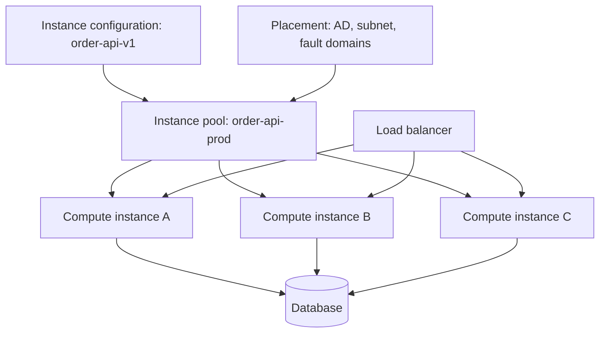

# Instance configurations và instance pools

Khi một API Java cần chạy trên nhiều máy OCI Compute, việc tạo từng máy rồi cài đặt thủ công dễ dẫn đến khác biệt về image, shape, phiên bản ứng dụng và cấu hình mạng. Khi cần tăng số máy hoặc thay một máy hỏng, nhóm vận hành phải lặp lại các bước đó và kiểm tra lại kết quả.

Trong Oracle Cloud Infrastructure, **instance configuration** mô tả cách tạo instance; **instance pool** quản lý một nhóm instance dựa trên cấu hình đó. Hai tài nguyên này giúp biến việc triển khai nhiều máy thành một quy trình có thể lặp lại, kết hợp được với phân quyền IAM, mạng VCN, cân bằng tải, giám sát và tự động hóa.

Sau bài học, bạn có thể phân biệt trách nhiệm của configuration và pool, thiết kế một nhóm máy cho ứng dụng Java, giải thích tác động của việc thay cấu hình, và kiểm tra kết quả triển khai ở cả tầng hạ tầng lẫn ứng dụng.

## 1. Ba khái niệm cần tách rõ

| Khái niệm | Vai trò | Ví dụ trong một hệ thống đặt hàng |
| --- | --- | --- |
| Instance configuration | Mẫu các thiết lập dùng khi tạo Compute instance | Image hệ điều hành, shape, metadata và thiết lập tài nguyên liên quan |
| Instance pool | Nhóm Compute instance được quản lý cùng nhau | Nhóm máy `order-api-prod` với số lượng mong muốn và các vị trí triển khai |
| Compute instance | Máy cụ thể chạy workload | Một máy có OCID, địa chỉ mạng, hệ điều hành và tiến trình Java riêng |

Một configuration có thể được dùng cho nhiều pool. Mỗi pool gắn với một configuration tại một thời điểm. Pool quản lý các instance trong cùng region; không dùng một pool để trải máy qua nhiều region. Khi cần phục hồi liên vùng, phải thiết kế thêm các thành phần triển khai và chuyển lưu lượng tương ứng. [Oracle: Managing Instance Pools](https://docs.oracle.com/en-us/iaas/Content/Compute/Concepts/instance-pools.htm)



Sơ đồ minh họa một phương án triển khai. Database và load balancer là các thành phần được thiết kế riêng; việc tạo pool không tự cung cấp toàn bộ kiến trúc này.

## 2. Instance configuration mô tả những gì?

Configuration lưu các thiết lập khởi tạo, có thể gồm image nguồn, shape, metadata, cấu hình mạng và gắn block volume. Nó cũng có thể liên kết với capacity reservation. Cần kiểm tra các trường hỗ trợ cho loại instance và phương thức tạo cấu hình đang dùng. [Oracle: Managing Instance Configurations](https://docs.oracle.com/en-us/iaas/Content/Compute/Concepts/instancemanagement.htm)

Với một API Java, nên rà soát các nhóm thiết lập sau:

| Nhóm | Câu hỏi thiết kế |
| --- | --- |
| Hệ điều hành và ứng dụng | Image nào được dùng? JDK và bản ứng dụng đến từ đâu? Có thể xác định chính xác phiên bản không? |
| Tài nguyên tính toán | CPU, RAM và kiến trúc có phù hợp với JVM, thư viện native và tải đã đo không? |
| Khởi động | Máy mới lấy cấu hình ở đâu, khởi chạy service thế nào và báo sẵn sàng bằng cơ chế nào? |
| Truy cập mạng | Máy có cần public IP không? Subnet, NSG và tuyến mạng nào cho phép truy cập đúng các dịch vụ phụ thuộc? |
| Danh tính | Người tạo pool và ứng dụng trên máy cần những quyền nào? |
| Lưu trữ | Dữ liệu nào có thể tạo lại, dữ liệu nào phải tồn tại khi thay instance? |
| Quan sát | Làm sao nhận biết phiên bản đang chạy, lỗi khởi động và mức sử dụng tài nguyên? |

### 2.1. Hai cách chuẩn bị cấu hình

Bạn có thể tạo configuration bằng cách cung cấp các thiết lập, hoặc dựa trên một instance có sẵn. Điểm dễ nhầm là cách thứ hai **không sao chép các file, binary và phần mềm vừa cài trên boot volume**; nội dung block volume gắn với máy cũng không được sao chép vào configuration. Nếu muốn giữ phần thiết lập trên đĩa, cần chuẩn bị custom image hoặc một quy trình cài đặt có thể chạy lại. [Oracle: Creating an Instance Configuration](https://docs.oracle.com/en-us/iaas/Content/Compute/Tasks/creatinginstanceconfig.htm)

Ví dụ, bạn SSH vào một máy thử nghiệm và chép `order-api.jar` lên `/opt/order-api/`. Việc tạo configuration từ máy đó chưa chứng minh rằng instance tiếp theo sẽ có file JAR. Phải tạo một instance mới từ quy trình đã chọn và kiểm tra thực tế.

Hai phương án thường dùng cho ứng dụng:

- **Image đã chuẩn bị:** chứa hệ điều hành, runtime và các thành phần đã được kiểm thử. Mỗi lần phát hành có một định danh image hoặc quy trình xác định rõ bản ứng dụng.
- **Image nền cùng bootstrap:** máy mới tải artifact có phiên bản cụ thể, lấy cấu hình cần thiết rồi chạy service. Khi dùng phương án này, đường mạng, quyền truy cập và khả năng cung cấp artifact đều nằm trên đường khởi động.

Không phụ thuộc vào một đường dẫn tải mang ý nghĩa “bản mới nhất” nếu cần tái tạo chính xác bản phát hành. Cũng không nhúng mật khẩu cơ sở dữ liệu hoặc khóa bí mật vào image, tên tài nguyên hay script được chia sẻ rộng. Chọn cơ chế cấp danh tính và lấy secret phù hợp với chính sách của hệ thống.

### 2.2. Compartment của cấu hình và của instance

Không suy ra nơi đặt instance chỉ từ compartment chứa configuration. Với cấu hình được tạo từ một instance có sẵn, các instance mới được đặt trong compartment của instance gốc, kể cả khi configuration nằm ở compartment khác. Kiểm tra phạm vi tài nguyên thực tế trước khi áp dụng policy và phân bổ chi phí. [Oracle: Creating an Instance Configuration](https://docs.oracle.com/en-us/iaas/Content/Compute/Tasks/creatinginstanceconfig.htm)

## 3. Instance pool bổ sung điều gì?

Pool cho phép quản lý số lượng instance và vị trí đặt máy ở cấp nhóm. Bạn có thể thay đổi kích thước pool, quản lý thành viên và tích hợp với load balancer hoặc network load balancer. Tuy nhiên, trạng thái pool phải được đọc cùng danh sách thành viên và kết quả vận hành; không coi riêng một nhãn trạng thái là bằng chứng đủ rằng ứng dụng đã phục vụ đúng. [Oracle: Managing Instance Pools](https://docs.oracle.com/en-us/iaas/Content/Compute/Concepts/instance-pools.htm)

### 3.1. Placement quyết định nơi tạo máy

Khi tạo pool, placement chỉ định availability domain và subnet cho các máy. Có thể chọn fault domain phù hợp để phân bố workload. Với instance được pool tạo, thiết lập availability domain và subnet của pool được ưu tiên so với các thiết lập tương ứng trong configuration. [Oracle: Creating an Instance Configuration](https://docs.oracle.com/en-us/iaas/Content/Compute/Tasks/creatinginstanceconfig.htm)

Ví dụ thiết kế cho API Java:

- Đặt ứng dụng trong private subnet.
- Dùng NSG và tuyến mạng cho phép truy cập load balancer, database và các dịch vụ cần thiết.
- Phân bố các bản sao theo các vị trí đã chọn, có xét khả năng hỗ trợ của region.
- Đảm bảo khi một vị trí không phục vụ được, những bản sao còn lại vẫn đáp ứng tải chấp nhận được.

Số lượng máy và cách phân bố phải được xác định cùng nhau. Ba máy nằm ở một vị trí có cùng miền lỗi không mang lại cùng khả năng chịu lỗi với một thiết kế đã chủ động phân tán và kiểm thử.

### 3.2. Kết hợp với cân bằng tải

Khi đã cấu hình liên kết load balancer cho pool, instance mới có thể được tự động đưa vào backend set. Lưu lượng được chuyển đến khi backend đạt điều kiện khỏe theo kiểm tra đã cấu hình. Tạo pool cũng đòi hỏi instance configuration và hạ tầng mạng phù hợp; tài liệu OCI nêu rằng pool không được tạo từ configuration có nguồn image là boot volume. [Oracle: Creating Instance Pools](https://docs.oracle.com/en-us/iaas/Content/Compute/Tasks/creatinginstancepool.htm)

Ở tầng ứng dụng, cần phân biệt:

1. Máy đã được tạo và hệ điều hành chạy.
2. Tiến trình Java đã khởi động.
3. Ứng dụng đã hoàn tất các bước cần thiết để phục vụ request.
4. Đường mạng và health check của load balancer đã xác nhận backend sẵn sàng.

Một cổng TCP mở chưa chắc chứng minh API đã dùng được. Nếu chọn HTTP health check, thiết kế endpoint và điều kiện sẵn sàng phù hợp với ứng dụng, đồng thời tránh để việc kiểm tra gây tải lớn hoặc phụ thuộc vòng lặp vào chính hệ thống đang lỗi.

## 4. Tăng giảm số máy và autoscaling

**Scale out** là tăng số instance; **scale in** là giảm số instance. Với một API stateless, thêm máy có thể phân chia tải xử lý request. Đối với công việc nền, nhiều worker chỉ hữu ích khi hàng đợi và cơ chế nhận việc hỗ trợ phối hợp an toàn.

Pool không tự hiểu rằng đơn hàng đang xử lý đã hoàn tất hay một job dài có thể dừng ở thời điểm nào. Ứng dụng phải có cơ chế phù hợp cho retry, xử lý trùng lặp, hoàn trả công việc hoặc khôi phục tiến độ.

OCI cung cấp autoscaling dựa trên metric hoặc lịch cho instance pool. Chính sách autoscaling là tài nguyên điều khiển riêng, không được bật chỉ vì bạn đã tạo pool. Scale in có thể terminate instance; với metric-based autoscaling cần tính đến dữ liệu Monitoring và cooldown. [Oracle: Autoscaling](https://docs.oracle.com/en-us/iaas/Content/Compute/Tasks/autoscalinginstancepools.htm)

Ví dụ giả định: nhóm `order-api-prod` có ba máy, được phép tăng đến sáu máy khi tải xử lý cao. Quyết định này cần đi kèm kiểm tra:

- Có đủ quota, capacity và địa chỉ IP cho số máy lớn nhất không?
- Máy mới mất bao lâu để tải artifact, khởi động JVM và đạt readiness?
- Khi tăng số máy, database có chịu được tổng số kết nối không?
- Khi giảm số máy, request đang chạy và công việc nền được hoàn tất hoặc khôi phục thế nào?
- Nếu thay kích thước thủ công, chính sách tự động nào có thể tiếp tục điều chỉnh kích thước đó?

Một phép tính đơn giản cho thấy ảnh hưởng tới database: nếu mỗi máy được phép mở tối đa 20 kết nối, ba máy có thể mở tới 60 kết nối; sáu máy có thể mở tới 120. Đây là trần cấu hình của ví dụ, không phải số kết nối thực tế đo được. Phải dành thêm ngân sách cho các dịch vụ khác và các bản sao tạm thời trong lúc triển khai.

CPU thấp hoặc số máy tăng không đủ để kết luận hệ thống khỏe. Theo dõi thêm throughput, độ trễ, tỷ lệ lỗi, hàng đợi và thời gian chờ ở các dịch vụ phụ thuộc.

## 5. Đổi configuration không triển khai lại máy đang chạy

Để thay image, shape hoặc thiết lập khởi tạo, tạo configuration mới rồi gắn nó với pool. Việc cập nhật này chỉ tác động tới **các lần tạo instance về sau**; nó không tự thay, reboot hoặc chuyển đổi những máy đang có. Tên hiển thị và tag có thể được cập nhật trên configuration hiện hữu, nhưng không nên hiểu thao tác đó là thay đổi nội dung triển khai. [Oracle: Updating the Instance Configuration for an Instance Pool](https://docs.oracle.com/en-us/iaas/Content/Compute/Tasks/updatinginstancepool-updating-instance-configuration.htm)

Xét tình huống minh họa sau:

| Thời điểm | Configuration gắn với pool | Các instance đang chạy |
| --- | --- | --- |
| T0 | `order-api-v1` | A, B, C được tạo từ v1 |
| T1: gắn configuration mới | `order-api-v2` | A, B, C vẫn chạy như trước |
| T2: tăng kích thước từ 3 lên 4 | `order-api-v2` | D mới được tạo từ v2; A, B, C vẫn từ v1 |

Ở T2, pool có thể chứa nhiều thế hệ cấu hình. Vì vậy, tên configuration hiện gắn với pool không đủ để kết luận phiên bản ứng dụng trên từng thành viên.

Một kế hoạch thay thế có kiểm soát nên xác định rõ:

1. Cấu hình và artifact v2 đã được kiểm tra trên một máy mới.
2. Năng lực tạm thời cần có để duy trì phục vụ trong lúc thay máy.
3. Điều kiện health check, thời gian quan sát và ngưỡng lỗi để tiếp tục.
4. Cách rút lưu lượng, chờ công việc đang chạy và thay từng thành viên.
5. Cách quay lại cấu hình cũ và tạo lại các instance cần thiết nếu v2 lỗi.

Chỉ đổi tham chiếu của pool về v1 cũng không tự biến các máy v2 đã có thành v1. Việc phục hồi phiên bản ứng dụng vẫn cần một quy trình triển khai hoặc thay thế cụ thể.

Không áp dụng kế hoạch này như một cam kết tự động không gián đoạn. Kết quả còn phụ thuộc ứng dụng, dữ liệu, số bản sao khỏe và cách điều khiển lưu lượng. Với database migration, phải xét riêng khả năng cùng chạy của các phiên bản ứng dụng và schema.

## 6. Ví dụ CLI: tạo pool từ configuration đã chuẩn bị

Ví dụ dưới đây dùng **Bash**, dành cho môi trường thử nghiệm đã cấu hình OCI CLI và xác thực. Các OCID và tên availability domain là placeholder, phải thay bằng tài nguyên thật trong đúng region. Các lệnh trong bài là hướng dẫn thực hành; kết quả dưới đây không phải báo cáo một lần triển khai đã chạy.

Chuẩn bị một instance configuration đã được kiểm thử, một subnet phù hợp và quyền tạo các tài nguyên liên quan. Kiểm tra chi phí, giới hạn dịch vụ và khả năng cung cấp trước khi tạo máy.

```bash
export COMPARTMENT_OCID='ocid1.compartment.oc1..REPLACE_ME'
export CONFIG_OCID='ocid1.instanceconfiguration.oc1.REGION.REPLACE_ME'

# Đọc lại cấu hình mà pool sẽ dùng.
oci compute-management instance-configuration get \
  --instance-configuration-id "$CONFIG_OCID"
```

Trong thư mục thực hành của bạn, tạo `placements.json` với ví dụ một placement:

```json
[
  {
    "availabilityDomain": "REPLACE_WITH_EXACT_AVAILABILITY_DOMAIN_NAME",
    "primarySubnetId": "ocid1.subnet.oc1.REGION.REPLACE_ME"
  }
]
```

Sau khi thay các giá trị, tạo pool hai máy:

```bash
oci compute-management instance-pool create \
  --compartment-id "$COMPARTMENT_OCID" \
  --instance-configuration-id "$CONFIG_OCID" \
  --placement-configurations file://placements.json \
  --size 2 \
  --display-name order-api-lab
```

Lệnh tạo pool cần compartment, configuration, placement và size. Một placement được cung cấp cho mỗi availability domain được chọn. Ví dụ một placement ở đây giúp học luồng tạo tài nguyên; nó chưa chứng minh khả năng phục vụ khi availability domain gặp lỗi. [Oracle CLI: instance-pool create](https://docs.oracle.com/en-us/iaas/tools/oci-cli/latest/oci_cli_docs/cmdref/compute-management/instance-pool/create.html)

Ghi lại OCID của pool từ kết quả tạo rồi kiểm tra chi tiết và danh sách thành viên:

```bash
export POOL_OCID='ocid1.instancepool.oc1.REGION.REPLACE_ME'

oci compute-management instance-pool get \
  --instance-pool-id "$POOL_OCID"

oci compute-management instance-pool list-instances \
  --compartment-id "$COMPARTMENT_OCID" \
  --instance-pool-id "$POOL_OCID" \
  --all
```

`list-instances` nhận OCID pool và compartment; `--all` lấy đủ các trang kết quả. Đối chiếu danh sách này với số máy mong muốn trước khi tiếp tục kiểm tra ở tầng ứng dụng. [Oracle CLI: instance-pool list-instances](https://docs.oracle.com/en-us/iaas/tools/oci-cli/latest/oci_cli_docs/cmdref/compute-management/instance-pool/list-instances.html)

Kết quả API của thao tác tạo chưa đồng nghĩa mọi máy và backend đều đã sẵn sàng. Tiếp tục xem tiến trình xử lý, lỗi triển khai, log bootstrap và health check trong môi trường của bạn. Nếu máy nằm trong private subnet, dùng đường truy cập quản trị được thiết kế cho môi trường đó để kiểm tra ứng dụng.

Sau thực hành, kiểm kê các instance, boot volume, block volume và tài nguyên liên quan trước khi dọn. Chỉ xóa tài nguyên thử nghiệm thuộc phạm vi của bạn và kiểm tra riêng dữ liệu cần giữ; thao tác xóa Compute không thay cho kế hoạch sao lưu hoặc quản lý dữ liệu.

## 7. Kiểm tra một pool cho ứng dụng Java

Một phiếu nghiệm thu hữu ích nên kết hợp bằng chứng từ nhiều tầng:

| Tầng kiểm tra | Bằng chứng cần thu thập | Ví dụ lỗi có thể phát hiện |
| --- | --- | --- |
| Cấu hình | OCID configuration, image và artifact dự kiến | Dùng nhầm image hoặc không xác định được phiên bản |
| Hạ tầng | Thành viên, trạng thái, placement và tài nguyên thực tế | Thiếu máy, lỗi capacity hoặc đặt sai subnet |
| Bootstrap | Log tải artifact và khởi động service | Không tới được kho artifact hoặc thiếu cấu hình |
| Ứng dụng | Phiên bản, readiness, request thử và log | JVM chạy nhưng API chưa dùng được |
| Cân bằng tải | Backend khỏe, luồng request và tỷ lệ lỗi | Sai port, health check hoặc quy tắc mạng |
| Dịch vụ phụ thuộc | Kết nối database, hàng đợi và thời gian chờ | Tăng số máy làm cạn connection budget |
| Phục hồi | Hành vi khi một bản sao ngừng phục vụ | Mất session hoặc công việc không được xử lý lại |

Ví dụ, nếu pool có đủ ba máy nhưng một backend không khỏe, hãy kiểm tra tiến trình và log của máy đó, cấu hình port, đường mạng và health check. Tăng pool lên sáu máy trước khi biết nguyên nhân có thể tạo thêm các máy lỗi giống hệt.

Nếu tất cả backend đều khỏe nhưng độ trễ tăng mạnh ở truy vấn database, tập trung đo thời gian chờ và tải database. Thêm máy ứng dụng trong tình huống đó có thể tăng số truy vấn đồng thời mà không giải quyết nút thắt.

Với ứng dụng giữ session trong bộ nhớ cục bộ, việc chuyển request sang một máy khác có thể làm mất trạng thái người dùng. Cần thiết kế quản lý session phù hợp; việc các máy cùng thuộc một pool không khiến bộ nhớ của chúng được chia sẻ.

## 8. Các lỗi hiểu sai thường gặp

| Hiểu sai | Cách hiểu và hành động đúng |
| --- | --- |
| Tạo configuration từ máy đã cài ứng dụng là có ngay bản sao đầy đủ | Kiểm tra image và bootstrap; tạo máy mới để xác nhận phần mềm thực sự có mặt |
| Đổi configuration là cả pool lập tức chạy phiên bản mới | Kiểm kê thế hệ của từng thành viên và thực hiện kế hoạch thay thế |
| Pool đang chạy thì API chắc chắn khỏe | Kiểm tra thêm readiness, backend và request thực tế |
| Đặt size lớn hơn luôn tăng thông lượng | Đo nút thắt và năng lực của database, hàng đợi, mạng cùng các phụ thuộc |
| Scale in chỉ tạm dừng máy để dùng lại | Thiết kế với khả năng instance bị terminate và công việc cần khôi phục |
| Có nhiều máy là đã giải quyết khả năng chịu lỗi | Kiểm tra placement, các thành phần dùng chung và tải khi mất bản sao |
| Cấu hình giống nhau thì dữ liệu trên đĩa hoặc trong RAM cũng giống nhau | Quản lý dữ liệu và trạng thái ứng dụng bằng cơ chế riêng |

## 9. Bài tập vận dụng

Thiết kế một pool cho API đặt hàng Java với ba bản sao ban đầu. Yêu cầu của bài tập là có thể tạo lại một máy mà không cần SSH cài ứng dụng thủ công.

Viết lại các quyết định sau:

1. Cách tạo image hoặc bootstrap, định danh bản ứng dụng và điều kiện khởi động thành công.
2. Placement, đường mạng và quyền cần có để máy mới phục vụ được request.
3. Nơi lưu session, dữ liệu nghiệp vụ và tiến độ công việc nền.
4. Số kết nối database tối đa khi chạy bình thường, scale out và thay thế phiên bản.
5. Bằng chứng phân biệt máy đã chạy với ứng dụng đã sẵn sàng.
6. Kế hoạch chuyển v1 sang v2 và quay lại nếu v2 phát sinh lỗi.

Sau đó xét tình huống: pool đang có ba máy v1; bạn gắn configuration v2 rồi tăng kích thước lên năm. Hãy lập bảng phiên bản dự kiến của năm máy, nêu cách xác minh trên thực tế và chỉ ra các bước còn thiếu để toàn bộ nhóm dùng v2.

Một thiết kế đạt yêu cầu phải cho thấy cả cách tạo máy mới lẫn cách duy trì hoạt động khi máy cũ được thay. Configuration giúp lặp lại thiết lập khởi tạo; pool giúp quản lý nhóm; khả năng phục vụ và phục hồi của ứng dụng cần được thiết kế và kiểm chứng ở những tầng còn lại.
