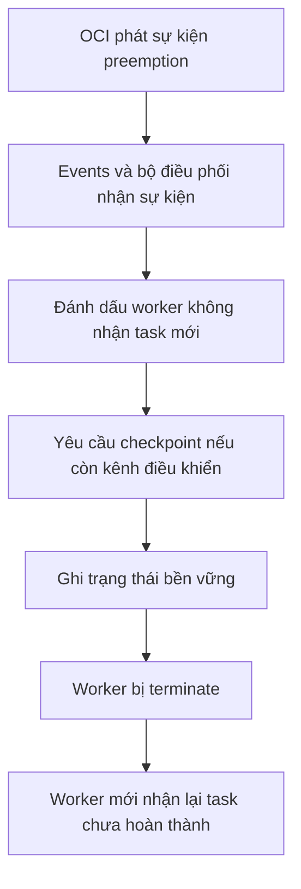

# Capacity reservations, dedicated hosts và preemptible instances

Trong chương **Compute và máy chủ ảo** của module Oracle Cloud Infrastructure (OCI), việc chọn image và số OCPU mới giải quyết phần cấu hình máy. Người vận hành còn phải quyết định lấy năng lực tính toán theo cách nào: tạo khi cần, giữ sẵn để có thể triển khai sau, dùng máy chủ vật lý dành riêng cho tenancy, hay chấp nhận bị thu hồi để giảm chi phí.

Bài học tập trung vào ba lựa chọn **capacity reservation**, **dedicated virtual machine host** và **preemptible instance**. Ta đặt chúng trong bối cảnh triển khai OCI có compartment, IAM, mạng VCN, giám sát, tự động hóa và trách nhiệm chi phí rõ ràng.

Sau bài học, người học có thể:

- Chọn loại capacity theo nhu cầu sẵn có, cách ly phần cứng và khả năng chịu gián đoạn.
- Phân biệt dung lượng yêu cầu với dung lượng thực sự được giữ trong reservation.
- Giải thích chi phí của capacity để trống, host sử dụng chưa đầy và công việc phải chạy lại.
- Thiết kế worker chịu được preemption bằng trạng thái bền vững và xử lý lặp an toàn.
- Thực hành kiểm tra liên kết instance với reservation/host và thu hồi đúng tài nguyên.

## 1. Bốn cách cung cấp capacity giải quyết những yêu cầu nào?

**Capacity** ở đây là năng lực Compute nền tảng có thể cấp cho instance. Nó khác với giới hạn tài khoản, quyền IAM và dung lượng lưu trữ. Có quota không có nghĩa vùng đặt máy đang còn đủ phần cứng; có phần cứng cũng không thay thế quyền tạo instance.

| Lựa chọn | Mục tiêu chính | Đơn vị cần quản lý | Trường hợp minh họa |
|---|---|---|---|
| On-demand | Tạo máy theo nhu cầu hiện tại | Instance được tạo khi có capacity | Máy ứng dụng thông thường |
| Capacity reservation | Giữ trước năng lực phù hợp cho lần triển khai cần thiết | Reservation và các capacity configuration | Dung lượng dự phòng cho khôi phục hoặc đợt ra mắt |
| Dedicated VM host | Đặt VM trên server dành riêng cho tenancy | Host và những VM được đặt lên host | Yêu cầu cách ly hoặc mô hình cấp phép theo host |
| Preemptible | Giảm chi phí cho công việc chịu được việc mất máy | Instance có thể bị thu hồi | Worker xử lý batch có checkpoint |

On-demand là mặc định; OCI không bảo đảm luôn có capacity khi cần khởi tạo một workload lớn. Ba lựa chọn còn lại thay đổi cách cấp hoặc sử dụng capacity. [Nguồn: tổng quan các capacity type của OCI Compute](https://docs.oracle.com/en-us/iaas/Content/Compute/Concepts/computeoverview.htm).

Một hệ thống có thể dùng nhiều loại capacity cho **các nhóm máy khác nhau**. Ví dụ, API chính chạy trên on-demand, lớp dự phòng dùng reservation và batch nền dùng preemptible. Không suy rằng có thể bật đồng thời mọi lựa chọn trên cùng một instance.

Trước khi chọn, xác định ba yêu cầu độc lập:

1. **Có cần giữ chắc năng lực khởi tạo vào một thời điểm hoặc địa điểm cụ thể?**
2. **Có bắt buộc dành riêng server vật lý cho tenancy?**
3. **Công việc có thể tiếp tục đúng khi instance bị mất đột ngột?**

Tên gọi “reserved” không tự biểu thị một hợp đồng giảm giá dài hạn. Dedicated host cũng không tự tạo thêm bản sao ứng dụng hay cấu hình sẵn sàng cao.

## 2. Capacity reservation: giữ trước khả năng cấp máy

### 2.1. Reservation và capacity configuration

Một reservation gắn với tenancy và một availability domain (AD). Nó có một hoặc nhiều **capacity configuration**, mô tả loại instance và số lượng cần giữ; có thể ràng buộc fault domain (FD). Khi tạo máy sử dụng reservation, cấu hình yêu cầu phải phù hợp với phần đã giữ. Reservation không trải rộng qua mọi AD hoặc region. [Nguồn: OCI capacity reservations](https://docs.oracle.com/en-us/iaas/Content/Compute/Tasks/reserve-capacity.htm).

Ví dụ lập kế hoạch cho nhóm dịch vụ thanh toán:

| Thuộc tính | Giá trị minh họa |
|---|---|
| Reservation | `payment-dr-capacity` |
| Compartment | `ComputeLab` hoặc compartment dự phòng được giao |
| AD | Một AD cụ thể trong region dự phòng |
| VM shape | Shape Flex được hỗ trợ và có capacity |
| Cấu hình mỗi VM | 2 OCPU, 16 GB RAM |
| Số lượng mong muốn | 4 VM |
| Fault domain | Theo phương án chịu lỗi đã chọn |

Đây là kế hoạch giữ chỗ cho cấu hình cụ thể, không phải một túi RAM/OCPU có thể tự do đổi sang mọi shape hoặc kiến trúc CPU. Dùng image tương thích và chọn subnet phù hợp với AD vẫn là trách nhiệm của luồng triển khai instance.

### 2.2. Tạo được tài nguyên reservation chưa có nghĩa đã giữ đủ capacity

OCI có thể tạo reservation với số lượng thấp hơn yêu cầu khi capacity không đủ, kể cả số lượng bằng 0. Vì vậy, sau khi yêu cầu hoàn tất, phải kiểm tra dung lượng được cấp thực tế và work request, thay vì chỉ kiểm tra reservation có OCID. [Nguồn: tạo capacity reservation](https://docs.oracle.com/en-us/iaas/Content/Compute/Tasks/capacity-reservations-create_tabs.htm).

Giả sử nhóm yêu cầu 4 VM nhưng hệ thống chỉ giữ được 3:

```text
requested_instances = 4
actual_reserved_instances = 3
used_instances = 1
unused_reserved_instances = 2
missing_instances_for_plan = 1
```

Kế hoạch dự phòng vẫn thiếu một VM. Báo cáo “reservation đã tạo thành công” là chưa đủ để kết luận bài toán năng lực đã được giải quyết.

Với nhiều capacity configuration, đọc riêng từng cấu hình. Tổng OCPU bằng nhau không chứng minh các yêu cầu shape, RAM và FD đều được đáp ứng.

### 2.3. Sử dụng và vòng đời

Luồng sử dụng thông thường:


Khi tạo instance, chọn reservation ở phần placement/capacity hoặc chỉ định reservation OCID trong API/CLI. Sau đó kiểm tra liên kết trên instance. [Nguồn: tạo instance trong reservation](https://docs.oracle.com/en-us/iaas/Content/Compute/Tasks/capacity-reservations-create-instance_tabs.htm).

Terminate instance trả capacity về reservation; reservation vẫn tồn tại và phần trống tiếp tục được tính phí. Stop một instance đang dùng reservation giữ capacity cho instance đó khởi động lại. Capacity reservation hiện không kết hợp với preemptible, dedicated VM host hoặc burstable; tài khoản Free Tier không có tính năng reservation này. [Nguồn: vòng đời và giới hạn reservation](https://docs.oracle.com/en-us/iaas/Content/Compute/Tasks/reserve-capacity.htm).

Trong lab, chọn reservation tường minh giúp dễ chứng minh kết quả. Tùy chọn default reservation có phạm vi rộng hơn một lần tạo máy; chỉ dùng khi thiết kế tenancy đã xác định cách áp dụng và quyền liên quan.

### 2.4. Tính phí: phần đã dùng và phần chưa dùng

Theo tài liệu tính phí OCI được đối chiếu khi soạn bài, phần reserved capacity chưa dùng được tính ở mức **85%**, còn instance dùng capacity được tính ở mức tiêu chuẩn **100%** của shape. Đây là cơ chế giữ năng lực, không phải tự động giảm giá các VM đang chạy. Mức phí tiền tệ thực tế còn phụ thuộc shape và điều kiện tài khoản. [Nguồn: OCI capacity reservation billing](https://docs.oracle.com/en-us/iaas/Content/Compute/Tasks/reserve-capacity.htm).

Mô hình đơn giản cho một giờ, với các VM giống nhau và không thay đổi trạng thái trong giờ:

```text
N = số slot VM thực sự được giữ
U = số slot đang được instance chạy sử dụng
P = chi phí Compute tiêu chuẩn của một VM mỗi giờ

Compute_cost = U × P + (N - U) × 0,85 × P
```

Ví dụ `N = 4`, `U = 1`, `P = 1 đơn vị/giờ`:

```text
Phần đang dùng:   1 × 1        = 1,00
Phần chưa dùng:   3 × 0,85 × 1 = 2,55
Tổng:                          3,55 đơn vị/giờ
```

Nếu chỉ giữ được 3 slot, dùng `N = 3` để lập mô hình, đồng thời vẫn báo thiếu một slot so với kế hoạch. Không cộng thêm phí reservation cho cả 4 slot rồi lại cộng toàn bộ phí VM cho slot đã dùng.

Mô hình trên bỏ qua volume, backup, mạng, giấy phép và thay đổi sử dụng trong giờ. Nó cũng không dùng để suy chi phí cho mọi trường hợp stop/start. Khi lập ngân sách thật, đọc usage report theo từng loại tài nguyên và trạng thái.

## 3. Dedicated virtual machine host: dành server cho tenancy

### 3.1. Host và instance là hai tài nguyên riêng

Dedicated VM host (DVH) cho phép chạy VM trên server không dùng chung với khách hàng khác. Một host có thể chứa nhiều VM của tenancy. Dedicated VM host vẫn là môi trường đặt VM; nó khác với việc triển khai một bare metal instance cho một hệ điều hành sử dụng trực tiếp server. [Nguồn: Oracle Compute FAQ về dedicated hosts](https://www.oracle.com/cloud/compute/faq/).

```text
Một dedicated VM host
├── VM ứng dụng A
├── VM ứng dụng B
└── VM tiện ích C

Các VM vẫn cần image, VNIC, subnet, volume và cấu hình bảo mật riêng.
```

Cách ly phần cứng giúp đáp ứng một số yêu cầu triển khai. Đối với phần mềm cấp phép theo host/node, phải đối chiếu điều khoản cấp phép cụ thể; việc chọn dedicated host không tự chứng minh mọi yêu cầu cấp phép đã được đáp ứng.

Tất cả VM trên một host vẫn cùng chịu rủi ro hỏng host đó. Đặt hai bản sao dịch vụ trên cùng host không loại bỏ được điểm lỗi vật lý chung.

### 3.2. Tạo host trước, rồi đặt VM lên host

Khi tạo host, chọn compartment, AD, FD và host shape. Những VM đặt lên host sẽ nằm tại AD/FD đó; compartment của VM có thể khác compartment host nếu quyền cho phép. Host phải đạt trạng thái `ACTIVE` trước khi tạo VM trên nó. [Nguồn: tạo dedicated VM host](https://docs.oracle.com/en-us/iaas/Content/Compute/Concepts/dedicatedvmhosts_topic-Creating_a_Dedicated_Virtual_Machine_Host.htm).

Khi tạo instance:

1. Chọn image và VM shape được host hỗ trợ.
2. Chọn capacity type **Dedicated host** trong placement.
3. Chọn host còn capacity phù hợp.
4. Hoàn tất cấu hình mạng, khóa truy cập và volume.
5. Đọc lại dedicated host OCID trên instance.

Host shape quyết định những VM shape nào đặt được. Có thể lọc danh sách host theo shape và dung lượng tối thiểu; xem chi tiết host để kiểm tra capacity. [Nguồn: đặt instance lên dedicated VM host](https://docs.oracle.com/en-us/iaas/Content/Compute/Concepts/dedicatedvmhosts_topic-Placing_an_Instance_on_a_Dedicated_Virtual_Machine_Host.htm).

### 3.3. Dung lượng còn tổng cộng chưa chắc đặt được VM mới

Khả năng đặt VM còn phụ thuộc cách tài nguyên vật lý được phân bố. Billed OCPU của host và OCPU có thể phân bổ cho VM cũng không nhất thiết bằng nhau vì cần tài nguyên quản lý ảo hóa. Với các workload có VM lớn, cần lập kế hoạch placement và ưu tiên xem khả năng đặt VM lớn trước. [Nguồn: tối ưu capacity trên dedicated VM host](https://docs.oracle.com/en-us/iaas/Content/Compute/Concepts/dedicatedvmhosts.htm).

Ví dụ khái niệm về hai vùng placement độc lập, mỗi vùng còn 8 OCPU:

```text
Vùng A còn 8 OCPU
Vùng B còn 8 OCPU
Tổng còn 16 OCPU

Một VM cần 12 OCPU trong cùng vùng placement có thể không đặt được.
```

Ví dụ này giải thích hiện tượng phân mảnh; số vùng và quy tắc placement thật phụ thuộc host shape. Không dùng phép cộng OCPU đơn thuần để cam kết số lượng VM lớn.

### 3.4. Chi phí và giới hạn vận hành

Phí Compute gắn với host; không tính thêm phí Compute cho từng VM trên host, nhưng phí image license có thể vẫn áp dụng. Host ít VM vẫn giữ nguyên bài toán chi phí host. Xóa hết VM chưa làm tài nguyên host biến mất; cần thu hồi host để kết thúc chi phí host theo vòng đời tương ứng. [Nguồn: Oracle Compute FAQ về tính phí host](https://www.oracle.com/cloud/compute/faq/).

Mô hình ngân sách cho một nhóm VM:

```text
Chi phí nhóm = phí dedicated host
            + volume và backup
            + giấy phép có áp dụng
            + mạng và dịch vụ liên quan
```

Không lấy phí host cộng thêm toàn bộ phí VM on-demand tiêu chuẩn như thể những VM đó còn chạy trên shared capacity.

Dedicated VM host hiện không hỗ trợ autoscaling, instance pools, capacity reservations, burstable instances và live migration. Cần thiết kế bảo trì với các phương án reboot migration hoặc manual migration được hỗ trợ. [Nguồn: giới hạn dedicated VM hosts](https://docs.oracle.com/en-us/iaas/Content/Compute/Concepts/dedicatedvmhosts.htm).

Vì vậy, khi cần một nhóm worker tự mở rộng liên tục, phải kiểm tra thiết kế tương thích trước khi chọn host riêng. Yêu cầu cách ly vật lý có thể làm thay đổi cả cách tự động hóa và cách bảo trì ứng dụng.

## 4. Preemptible instances: nhận chi phí thấp cùng khả năng bị thu hồi

### 4.1. Điều ứng dụng phải chấp nhận

Preemptible instance có thể bị OCI thu hồi capacity và **terminate** bất kỳ lúc nào; không có thời gian chạy tối thiểu được bảo đảm. Theo tài liệu OCI, giá preemptible capacity thấp hơn on-demand **50%**. Workload cần phục hồi được từ việc mất worker. [Nguồn: OCI preemptible instances](https://docs.oracle.com/en-us/iaas/Content/Compute/Concepts/preemptible.htm).

Các ví dụ phù hợp về thiết kế:

| Công việc | Điều kiện để cân nhắc preemptible |
|---|---|
| Xử lý ảnh hoặc chuyển mã | Đầu vào và kết quả nằm ngoài worker; công việc có thể làm lại |
| Kiểm thử tự động | Có thể chạy lại job và chấp nhận thời gian hoàn thành biến động |
| Batch phân tích dữ liệu | Chia nhỏ được task, có checkpoint và theo dõi task hoàn thành |
| Tạo artifact | Bước công bố artifact có kiểm tra trùng và tính toàn vẹn |

Một database duy nhất giữ dữ liệu ở ổ cục bộ, một bộ điều phối duy nhất hoặc một dịch vụ có yêu cầu không gián đoạn cần được đánh giá rất khác. Đặt tên workload là “batch” chưa chứng minh nó chịu được mất máy: một task 10 giờ không checkpoint vẫn có thể phải làm lại gần 10 giờ.

### 4.2. Các giới hạn cần đưa vào kế hoạch

Preemptible hiện không hỗ trợ start, stop hoặc reboot; không đổi shape hay chuyển trực tiếp thành on-demand. Không dùng với instance pools, dedicated VM hosts hoặc capacity reservations. Chỉ chọn shape trong danh sách được hỗ trợ tại thời điểm triển khai. [Nguồn: giới hạn preemptible](https://docs.oracle.com/en-us/iaas/Content/Compute/Concepts/preemptible.htm).

Một preemptible bị terminate phải được thay bằng **instance mới** nếu hệ thống vẫn cần worker. Scheduler hoặc bộ điều phối bên ngoài quản lý việc cấp worker, retry và fallback; không giả định cơ chế autoscaling instance pool dùng cho on-demand sẽ áp dụng nguyên vẹn.

Nếu cần chuyển workload sang on-demand, triển khai worker on-demand mới rồi chuyển hoặc tiếp tục công việc từ trạng thái bền vững. Khả năng chuyển công việc phụ thuộc ứng dụng và dữ liệu, không chỉ thuộc lựa chọn capacity.

### 4.3. Thông báo thu hồi và đường phản ứng

OCI phát sự kiện `instancepreemptionaction` trước hai phút tính từ lúc bắt đầu terminate. Sự kiện có thể được xử lý qua Events để gửi thông báo hoặc gọi automation. Đây là thông báo ở lớp dịch vụ; thời gian xử lý thực tế còn bị ảnh hưởng bởi đường nhận và xử lý sự kiện. [Nguồn: thông báo preemption trước hai phút](https://docs.oracle.com/en-us/iaas/releasenotes/changes/5120d35b-05be-4ef2-9e72-7ce2dcffb947/).

Event type đầy đủ:

```text
com.oraclecloud.computeapi.instancepreemptionaction
```

Có thể lọc theo loại sự kiện và compartment, rồi đọc instance OCID trong dữ liệu sự kiện để xác định worker cần xử lý. [Nguồn: OCI instance event types](https://docs.oracle.com/en-us/iaas/Content/Events/Reference/eventsproducers.htm).

Thiết kế phản ứng đề xuất:



Luồng này là đề xuất ở cấp ứng dụng. Chỉ tạo Events rule không tự khiến process trong máy ngừng nhận job, không tự chuyển event thành `SIGTERM` cho process và không tự lưu dữ liệu.

Phải có cơ chế phục hồi ngay cả khi ứng dụng không kịp xử lý event: ghi checkpoint định kỳ, phát hiện worker mất liên lạc và cho phép task được nhận lại sau khi quyền xử lý hết hạn.

### 4.4. Trạng thái bền vững và xử lý lặp an toàn

Một worker nên giữ phần trạng thái có thể mất trên máy, còn dữ liệu quyết định khả năng phục hồi nằm ngoài worker:

```text
Nguồn công việc bền vững
    -> worker nhận task với thời hạn xử lý
    -> đọc input từ kho bền vững
    -> xử lý và ghi checkpoint định kỳ
    -> công bố kết quả theo job_id
    -> xác nhận task hoàn thành
```

Nếu worker biến mất trước bước xác nhận, task có thể chạy lại. Vì vậy, cần bảo đảm lần chạy lại không tạo kết quả trùng hoặc tác dụng phụ sai:

- Dùng `job_id` ổn định thay cho ID ngẫu nhiên của mỗi lần thử.
- Ghi kết quả theo cơ chế commit hoặc điều kiện cập nhật phù hợp.
- Chỉ xác nhận task sau khi kết quả bền vững đã được ghi thành công.
- Phân biệt task chưa làm xong với task đã hoàn thành nhưng mất phản hồi.
- Đặt giới hạn retry và đường xử lý task lỗi kéo dài.

Đây là nguyên tắc thiết kế, không phải cam kết mọi queue hoặc kho dữ liệu có cùng ngữ nghĩa. Nếu thao tác tạo kết quả và xác nhận task nằm ở hai hệ thống khác nhau, cần phân tích cửa sổ lỗi giữa hai bước.

Ví dụ, worker xử lý 100 đoạn dữ liệu, checkpoint sau mỗi 5 đoạn. Khi worker mới bắt đầu, nó đọc checkpoint đã commit rồi tiếp tục phần còn lại. Checkpoint chỉ ghi trên boot volume của worker sẽ không đủ nếu volume bị xóa hoặc không thể gắn kịp khi phục hồi.

### 4.5. Chọn cách xử lý boot volume

Khi tạo preemptible, có lựa chọn giữ hoặc xóa boot volume khi capacity bị thu hồi. Trong mô hình API, hành động terminate có trường `preserveBootVolume`. [Nguồn: OCI TerminatePreemptionAction](https://docs.oracle.com/en-us/iaas/tools/java/latest/com/oracle/bmc/core/model/TerminatePreemptionAction.html).

| Lựa chọn | Hệ quả cần quản lý |
|---|---|
| Giữ boot volume | Có thể hỗ trợ điều tra hoặc phục hồi, nhưng volume còn chi phí và cần quy trình thu hồi |
| Xóa boot volume | Phù hợp worker tái tạo được; dữ liệu cần giữ phải nằm ở nơi khác |

Giữ volume không giữ lại instance đang chạy và cũng không tự biến nó thành một worker thay thế. Hệ thống vẫn phải cấp máy, nối dữ liệu và khôi phục công việc theo quy trình đã thiết kế.

## 5. So sánh chi phí theo công việc hoàn thành

Giảm đơn giá Compute chưa đủ để kết luận tổng chi phí hệ thống giảm cùng tỷ lệ. Với preemptible, tính cả thời gian chạy lại và khởi tạo worker:

```text
C_preemptible_compute ≈ 0,5 × P × (T_huu_ich + T_chay_lai + T_khoi_tao)
```

Trong đó `P` là đơn giá on-demand tương đương, các giá trị `T` là **tổng VM-giờ được tính phí**, không chỉ là thời gian trên đồng hồ. Sau đó cộng chi phí trạng thái bền vững, volume, mạng và bộ điều phối.

Ví dụ minh họa, giữ nguyên hiệu năng và cùng khối lượng đầu ra:

| Thành phần | On-demand cơ sở | Thiết kế preemptible giả định |
|---|---:|---:|
| VM-giờ hữu ích | 100 | 100 |
| VM-giờ chạy lại | 0 | 20 |
| VM-giờ khởi tạo bổ sung | 0 | 10 |
| Hệ số đơn giá Compute | 1 | 0,5 |
| Chi phí Compute chuẩn hóa | 100 | 65 |

Phần Compute trong ví dụ giảm 35%, vì có thêm công việc lặp. Các số là giả định để giải thích mô hình, không phải dự báo mức thu hồi của OCI.

Tương tự, với reservation, theo dõi tỷ lệ sử dụng so với nhu cầu giữ chỗ. Với dedicated host, theo dõi số workload thực sự đặt được và tải CPU/RAM của chúng. Đừng chỉ nhìn phần tài nguyên “đã cấp” mà bỏ qua việc workload có đang tạo giá trị hay không.

Mỗi phương án nên được đánh giá theo cùng một mục tiêu: chi phí cho công việc hoàn thành, thời gian hoàn thành, mức gián đoạn chấp nhận được và khả năng phục hồi.

## 6. IAM, quota và phạm vi trách nhiệm

### 6.1. Tách người giữ capacity và người sử dụng capacity

Nhóm vận hành nền tảng có thể quản lý reservation/host; nhóm ứng dụng chỉ được dùng chúng để tạo instance. Tách các vai trò này giúp tránh việc người triển khai ứng dụng vô tình xóa hoặc thay đổi tài nguyên dùng chung.

Ví dụ bổ sung quyền cho reservation trong compartment lab:

```text
Allow group ComputeLabUsers to use compute-capacity-reservations in compartment ComputeLab
Allow group CapacityOperators to manage compute-capacity-reservations in compartment ComputeLab
```

Thay tên group/compartment theo môi trường thực. Hai dòng này chỉ minh họa quyền đối với reservation; người dùng vẫn cần các quyền Compute, mạng, volume và image tương ứng để hoàn thành việc tạo máy. [Nguồn: IAM cho capacity reservations](https://docs.oracle.com/en-us/iaas/Content/Compute/Tasks/reserve-capacity.htm).

Với host nằm khác compartment VM, kiểm tra quyền ở cả hai phạm vi. Quyền SSH bên trong VM không cấp quyền quản lý host trên OCI.

### 6.2. Quota và năng lực vật lý

Phân biệt ba câu hỏi:

| Lớp | Câu hỏi |
|---|---|
| IAM | Identity này có được phép thực hiện thao tác? |
| Limit/quota | Tenancy và compartment có được phân bổ thêm lượng tài nguyên này? |
| Capacity | Nền tảng có thể đáp ứng cấu hình tại vị trí đã chọn? |

OCI có các quota liên quan đến capacity có thể reserve và instance được tạo từ reserved capacity. Đọc đúng quota theo shape, OCPU/RAM và phạm vi áp dụng. Tăng quota không tự tạo thêm phần cứng. [Nguồn: OCI Compute quotas](https://docs.oracle.com/en-us/iaas/Content/Quotas/Concepts/resourcequotas_topic-Compute_Quotas.htm).

Khi một lần tạo máy thất bại, giữ nguyên lỗi và request ID để phân biệt ba lớp trên. Không chọn đại một loại capacity khác chỉ để che mất nguyên nhân ban đầu.

## 7. Thực hành có bằng chứng

Thực hiện nhánh được cấp tài nguyên và ngân sách. Với tài khoản không hỗ trợ tính năng hoặc không có ngân sách cho dedicated host, dùng kế hoạch cấu hình và kết quả đọc tài nguyên mẫu do người hướng dẫn cung cấp; không ghi nhận một lần triển khai thật nếu chưa tạo tài nguyên.

Chuẩn bị chung: compartment lab, IAM phù hợp, một image Linux tương thích, subnet có đường quản trị, SSH public key và tag xác định người chịu trách nhiệm. Những lựa chọn capacity không thay thế cấu hình mạng hoặc bước bootstrap hệ điều hành.

### 7.1. Nhánh A: reservation nhỏ

1. Trong Compute, mở Capacity Reservations và chọn tạo reservation.
2. Chọn compartment, AD và một capacity configuration nhỏ được giao; không tự bật default reservation cho lab.
3. Chờ yêu cầu xử lý xong, ghi số lượng yêu cầu và số lượng giữ được thực tế.
4. Tạo một VM dùng đúng reservation, shape, OCPU/RAM và FD phù hợp.
5. Đọc instance để xác nhận reservation OCID; đọc reservation để ghi phần đã dùng/chưa dùng.
6. Lưu thời điểm sử dụng để có thể đối chiếu usage report sau đó.

Ví dụ mẫu ghi nhận:

| Bằng chứng | Kết quả người học phải điền |
|---|---|
| Reservation OCID và AD | Giá trị thực tế |
| Capacity configuration | Shape, OCPU, RAM, FD |
| Số lượng yêu cầu/thực cấp | Hai giá trị riêng |
| Instance OCID | Instance đã sử dụng |
| Liên kết reservation | OCID đọc từ instance |
| Capacity sau thao tác | Phần dùng và phần còn lại |

Chứng minh được liên kết này quan trọng hơn việc chỉ thấy một máy đang `RUNNING`.

### 7.2. Nhánh B: dedicated host

1. Tạo host với host shape và vị trí được giao.
2. Chờ host `ACTIVE` rồi tạo VM shape tương thích trên host đó.
3. Đọc dedicated host OCID của VM và danh sách Hosted Instances.
4. Ghi khả năng cấp còn lại cùng chi phí host trong khoảng thời gian lab.
5. Giải thích hai VM trên cùng host chia sẻ rủi ro vật lý nào.

Không dùng toàn bộ billed OCPU làm số OCPU chắc chắn phân bổ được. Khi một VM mới không đặt được, kiểm tra shape và capacity chi tiết trước khi mua thêm host.

### 7.3. Nhánh C: worker preemptible

1. Trong luồng tạo instance, chọn **Preemptible capacity** và shape được hỗ trợ.
2. Chọn rõ giữ/xóa boot volume khi thu hồi.
3. Dùng một task thử nhỏ có input, checkpoint và kết quả nằm ngoài worker.
4. Xác nhận task đã tiến triển và checkpoint được commit.
5. Thực hiện phép thử mất worker có kiểm soát trên tài nguyên lab, rồi cấp worker mới để nhận lại task.
6. Kiểm tra task kết thúc với kết quả đúng và không tạo tác dụng phụ trùng.
7. Kiểm tra riêng Events rule và đường xử lý preemption.

Các lựa chọn tạo preemptible và boot volume nằm trong luồng tạo instance của OCI. [Nguồn: tạo preemptible instance](https://docs.oracle.com/en-us/iaas/Content/Compute/Concepts/preemptible.htm).

Terminate chủ động kiểm tra đường khôi phục khi worker mất; để chứng minh hệ thống phản ứng với event preemption, phải kiểm chứng thêm bộ nhận/xử lý loại event tương ứng. Không coi phép terminate chủ động là bằng chứng đã nhận một sự kiện OCI thu hồi capacity thật.

## 8. Đọc cấu hình bằng OCI CLI

Các lệnh dưới đây chỉ đọc tài nguyên đã có. Chạy trong môi trường OCI CLI đã cấu hình xác thực; thay placeholder bằng OCID thực và chọn đúng region/profile.

```bash
oci compute capacity-reservation get \
  --capacity-reservation-id '<RESERVATION_OCID>'

oci compute dedicated-vm-host get \
  --dedicated-vm-host-id '<DEDICATED_VM_HOST_OCID>'

oci compute instance get \
  --instance-id '<INSTANCE_OCID>'
```

Đối chiếu các nhóm thông tin sau trong phản hồi:

| Tài nguyên | Cần đối chiếu |
|---|---|
| Reservation | AD, capacity configuration, số lượng thực tế và sử dụng |
| Dedicated host | Lifecycle, host shape và thông tin capacity được trả về |
| Instance | Reservation ID, dedicated host ID hoặc preemptible config tùy loại máy |

Lệnh `get` giúp lấy cấu hình từ dịch vụ, không chứng minh ứng dụng trong VM đã sẵn sàng. Để xác nhận ứng dụng cần thêm kiểm tra service, log và đầu ra công việc. [Nguồn: reservation get](https://docs.oracle.com/en-us/iaas/tools/oci-cli/latest/oci_cli_docs/cmdref/compute/capacity-reservation/get.html), [host get](https://docs.oracle.com/en-us/iaas/tools/oci-cli/latest/oci_cli_docs/cmdref/compute/dedicated-vm-host/get.html), [instance get](https://docs.oracle.com/en-us/iaas/tools/oci-cli/latest/oci_cli_docs/cmdref/compute/instance/get.html).

Khi tự động hóa tạo instance, các tham số phân biệt gồm `--capacity-reservation-id`, `--dedicated-vm-host-id` và `--preemptible-instance-config`. Chúng mô tả các cách cấp capacity tương ứng; không ghép các lựa chọn không tương thích vào một yêu cầu launch. [Nguồn: OCI CLI instance launch](https://docs.oracle.com/en-us/iaas/tools/oci-cli/latest/oci_cli_docs/cmdref/compute/instance/launch.html).

## 9. Giám sát theo rủi ro của từng loại capacity

| Loại | Theo dõi gì | Dấu hiệu cần hành động |
|---|---|---|
| Reservation | Dung lượng thực cấp so với kế hoạch, đã dùng/chưa dùng và tuổi reservation | Chưa giữ đủ hoặc giữ trống lâu không còn mục đích |
| Dedicated host | Sức khỏe host/VM, khả năng placement và mức dùng thực tế | Thiếu chỗ cho VM quan trọng, phân mảnh hoặc tải thấp kéo dài |
| Preemptible | Số lần mất worker, retry, checkpoint, backlog và thời gian hoàn thành | Retry tăng, task không tiến triển hoặc có nguy cơ trễ hạn |
| Cả ba | Usage/cost theo compartment, owner và mục đích | Tài nguyên không có người chịu trách nhiệm hoặc vượt ngân sách |

Đây là tập tín hiệu vận hành đề xuất. Không mặc định mọi chỉ số trong bảng đều là metric OCI có sẵn cùng tên; một số cần lấy từ ứng dụng, scheduler hoặc hệ thống báo cáo.

Tag nên thể hiện người sở hữu, môi trường và mục đích, chẳng hạn `owner`, `environment`, `workload`. Với capacity dự phòng, ghi rõ ai quyết định tiếp tục giữ hay thu hồi. Một resource còn trống có thể là chủ ý cho DR, nhưng phải có yêu cầu kinh doanh cụ thể để đánh giá chi phí đó.

Đối với batch có hạn chót, bộ điều phối có thể dùng preemptible khi còn dư thời gian, rồi chuyển sang on-demand cho phần chưa hoàn tất khi cần. Phương án fallback cũng phải kiểm tra limit, quota, capacity và ngân sách; không thể hứa on-demand luôn cấp ngay.

## 10. Tìm lỗi và những suy luận dễ sai

| Hiện tượng hoặc suy luận | Cách kiểm tra |
|---|---|
| “Reservation tồn tại nên đủ 4 VM” | Đọc actual capacity từng configuration và so với yêu cầu |
| Có reservation nhưng VM không tạo được | Kiểm tra shape/OCPU/RAM/AD/FD, quyền và dung lượng còn dùng được |
| Đã terminate VM nên hết phí reservation | Kiểm tra reservation còn tồn tại và phần capacity trở lại chưa dùng |
| Host còn tổng OCPU nhưng VM lớn không đặt được | Kiểm tra shape hỗ trợ và cách phân bố capacity |
| Đã xóa các VM nên host không còn phí | Kiểm tra host còn tồn tại và vòng đời thu hồi host |
| Preemptible bị terminate nên chỉ cần start | Cấp instance mới và khôi phục task theo trạng thái bền vững |
| Đã có Events rule nên checkpoint sẽ tự chạy | Kiểm tra action, bộ nhận, đường điều khiển và logic checkpoint |
| Giảm đơn giá 50% nên tổng chi phí cũng giảm 50% | Tính lại VM-giờ chạy lại cùng storage, mạng và điều phối |
| Dedicated host làm ứng dụng sẵn sàng cao | Kiểm tra các bản sao có cùng phụ thuộc một host hay không |

Lỗi thiếu IAM, vượt quota và thiếu capacity cần những hành động khác nhau. Lưu thông báo dịch vụ, OCID và thời điểm; tránh thử tạo lặp nhanh khi chưa biết tài nguyên ở lần trước đã được tạo hay chưa.

## 11. Thu hồi tài nguyên theo thứ tự phụ thuộc

Với reservation, trước khi xóa phải terminate các instance thuộc reservation hoặc chuyển chúng ra khỏi capacity configuration. Sau đó xóa reservation và xác nhận kết quả. Xóa instance đơn lẻ không thay thế bước xóa reservation. [Nguồn: xóa capacity reservation](https://docs.oracle.com/en-us/iaas/Content/Compute/Tasks/capacity-reservations-delete.htm).

Với dedicated host, thu hồi các VM trên host trước rồi xóa host. Nếu workload còn cần chạy, hoàn thành phương án thay thế/phục hồi và kiểm tra ứng dụng trước khi thu hồi các VM cũ. [Nguồn: xóa dedicated VM host](https://docs.oracle.com/en-us/iaas/Content/Compute/Concepts/dedicatedvmhosts_topic-Deleting_a_Dedicated_Virtual_Machine_Host.htm).

Với preemptible lab, ngừng luồng tự tạo worker mới trước khi terminate worker, nếu không bộ điều phối có thể tạo lại máy. Kiểm tra những boot volume đã chọn giữ và dữ liệu còn cần cho điều tra.

Cuối cùng, đối chiếu volume, backup, tài nguyên mạng và automation dành riêng cho lab. Chỉ thu hồi tài nguyên có đúng ownership; một subnet hoặc queue dùng chung có thể phục vụ workload khác. Lưu bằng chứng hoàn thành và người chịu trách nhiệm cho các tài nguyên cố ý giữ lại.

## 12. Tiêu chí hoàn thành

Bài thực hành đạt mục tiêu khi người học giải thích và chứng minh được:

- Vì sao workload chọn một loại capacity cụ thể và chấp nhận giới hạn nào.
- Với reservation, số lượng yêu cầu/thực cấp/sử dụng được ghi riêng và instance tham chiếu đúng reservation.
- Với dedicated host, host/VM liên kết đúng, shape phù hợp và chi phí host được tính vào ngân sách.
- Với preemptible, task phục hồi được trên worker mới và có biện pháp xử lý trùng.
- Thông báo preemption, checkpoint và tự động cấp worker là những phần cần tích hợp thành một luồng hoàn chỉnh.
- Phương án theo dõi, fallback và thu hồi có người chịu trách nhiệm.

Lựa chọn capacity phải xuất phát từ yêu cầu của workload: thời điểm cần năng lực, ranh giới cách ly và khả năng phục hồi khi máy mất. Các bằng chứng kỹ thuật cùng mô hình chi phí giúp quyết định đó có thể kiểm tra được trước khi mở rộng triển khai OCI.
