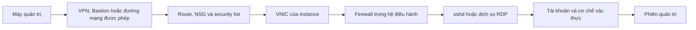

# Console connections và phục hồi instance mất kết nối

## 1. Mục tiêu và phạm vi

Trong chương **Compute và máy chủ ảo** của module **CLOUD_PROVIDERS_ORACLE**, bạn cần biết cách xử lý khi một instance Oracle Cloud Infrastructure không còn truy cập được qua SSH hoặc Remote Desktop. Trạng thái `RUNNING` trong giao diện quản trị chưa đủ để khẳng định hệ điều hành, mạng và ứng dụng đều hoạt động.

Bài học gắn thao tác phục hồi Compute với compartment, IAM, VCN, boot volume và giám sát OCI. Mục tiêu là khôi phục quyền quản trị và dịch vụ có căn cứ, giữ dữ liệu cần thiết, đồng thời kiểm soát thời gian gián đoạn và chi phí tài nguyên cứu hộ.

Sau bài này, bạn có thể:

- Phân loại lỗi đường mạng, xác thực, dịch vụ đăng nhập, hệ điều hành và hạ tầng.
- Chọn giữa console history, serial console, VNC console và các đường quản trị khác.
- Hiểu ba lớp quyền: quyền IAM, key của console connection và tài khoản trong guest OS.
- Lập quy trình sửa cấu hình hoặc phục hồi boot volume khi không thể đăng nhập.
- Xác minh dịch vụ đã phục hồi và thu hồi quyền truy cập tạm thời.

Ví dụ Linux chủ yếu dành cho Oracle Linux dùng systemd. Ubuntu, Windows và image tùy chỉnh có thể khác tên tài khoản, dịch vụ và cách vào chế độ phục hồi. Các lệnh bên dưới là nội dung thực hành cho môi trường OCI được phép quản trị; không phải yêu cầu chạy trên máy đang chứa tài liệu. OCID, địa chỉ IP và tên tài nguyên minh họa cần được thay bằng giá trị thật của bài lab.

## 2. Mất kết nối là một triệu chứng, chưa phải nguyên nhân

Một đường SSH thông thường gồm nhiều lớp:



Đây là mô hình để suy luận. Nếu một lớp bị hỏng, phiên đăng nhập có thể thất bại dù các lớp khác vẫn tốt. Ví dụ, sửa sai quyền `authorized_keys` khác với xóa nhầm rule NSG; hai trường hợp cần cách sửa khác nhau.

| Biểu hiện | Điều có thể suy ra | Điều chưa thể kết luận |
| --- | --- | --- |
| SSH timeout | Chưa hoàn thành kết nối trong thời gian chờ | Máy đã tắt hoặc boot volume hỏng |
| Connection refused | Có phản hồi từ một điểm trên đường kết nối | Tất cả cấu hình mạng và xác thực đều đúng |
| Permission denied khi xác thực SSH | Đã đến bước xác thực của một SSH server | Key đang dùng khớp tài khoản, hoặc server đó chắc chắn là đúng máy |
| Host key changed | Danh tính SSH server khác bản đã lưu | Có thể bỏ qua cảnh báo mà không kiểm tra |
| Console hiển thị login prompt | Hệ điều hành đã chạy đến một điểm có giao diện đăng nhập | Ứng dụng, database và mọi filesystem đều sẵn sàng |
| Console có lỗi mount hoặc emergency mode | Có căn cứ tập trung vào boot và storage | Mọi lỗi đều phải sửa bằng công cụ filesystem |

Hướng dẫn chẩn đoán SSH của OCI cũng tách các nhóm lỗi như timeout, sai thông tin truy cập và quyền file. Hãy bắt đầu từ lỗi thực tế thay vì lập tức tạo lại máy. [Oracle: Troubleshooting the SSH Connection](https://docs.oracle.com/en-us/iaas/Content/Compute/Tasks/troubleshooting-ssh-connection.htm).

## 3. Chọn đúng công cụ quan sát và truy cập

### Console history: bằng chứng tại một thời điểm

Console history cho phép chụp dữ liệu serial gần nhất, bao gồm thông điệp khởi động. Nó là bản ghi tại thời điểm capture, không phải phiên tương tác và không phải kho lưu trữ đầy đủ mọi lần boot. Một bản chụp trước thay đổi có thể hữu ích khi cần đối chiếu lần boot thất bại với lần boot thành công. [Oracle: Displaying the Instance Console History](https://docs.oracle.com/en-us/iaas/Content/Compute/Tasks/displayingconsole.htm).

Trong thiết kế vận hành, nên lưu kèm thời điểm capture, OCID và nhận xét ngắn về những dòng liên quan. Log khởi tạo có thể chứa dữ liệu nội bộ; chỉ chia sẻ đoạn cần thiết và lọc thông tin nhạy cảm.

### Serial console: đường tương tác phục vụ chẩn đoán

Serial console cho phép quan sát và tương tác với giao diện serial của instance. Nó hữu ích khi đường SSH của guest bị hỏng hoặc cần quan sát quá trình boot. Console connection phục vụ chẩn đoán; SSH và RDP vẫn là đường quản trị thường ngày. [Oracle: Instance Console Connection](https://docs.oracle.com/en-us/iaas/Content/Compute/References/serialconsole.htm).

Đừng coi serial console là một phiên root được cấp sẵn. Có thể xem thông điệp boot mà chưa đăng nhập, còn chạy lệnh trong hệ điều hành cần cơ chế truy cập phù hợp.

### VNC console: quan sát màn hình của máy

VNC console cho phép quan sát giao diện màn hình, hữu ích với thông báo boot hoặc màn hình phục hồi Windows. OCI sử dụng SSH tunnel cho kết nối này; đó không phải là yêu cầu mở VNC công khai vào VNIC của guest. Cần kiểm tra loại instance có hỗ trợ và dùng client tương thích. [Oracle: thực hành VNC console](https://docs.oracle.com/en/learn/troubleshooting-compute-instance/index.html).

### Run Command: khi agent vẫn làm việc

Compute Instance Run Command có thể chạy script trong instance dù không mở inbound SSH. Nó phụ thuộc Oracle Cloud Agent và plugin tương ứng, image hỗ trợ, quyền IAM cùng khả năng giao tiếp với dịch vụ OCI. Vì vậy nó có thể giúp sửa một dịch vụ SSH lỗi, nhưng không thay thế console khi hệ điều hành không boot hoặc agent không chạy. [Oracle: Running Commands on an Instance](https://docs.oracle.com/en-us/iaas/Content/Compute/Tasks/runningcommands.htm).

Đừng dùng kết quả Run Command để xuất mật khẩu hoặc private key. Hãy chọn script nhỏ, có mục đích rõ và ghi nhận thao tác đã thực hiện.

### Bastion, VPN và console giải quyết những việc khác nhau

Bastion hoặc VPN cung cấp đường quản trị đến guest qua mạng. Nếu guest không chạy dịch vụ đăng nhập, bổ sung đường mạng chưa đủ để sửa máy. Ngược lại, nếu chỉ thiếu đường vào private subnet, console có thể giúp xác minh guest vẫn khỏe nhưng biện pháp lâu dài là sửa đường quản trị đúng thiết kế.

## 4. Chuẩn bị quyền và nhận dạng trước khi kết nối

### Quyền IAM trên tài nguyên OCI

Để tạo console connection, người vận hành cần quyền quản lý `instance-console-connection` và đọc instance. Ví dụ cho compartment lab:

```text
Allow group ComputeRecoveryOperators to manage instance-console-connection in compartment compute-lab
Allow group ComputeRecoveryOperators to read instances in compartment compute-lab
```

Tên group và compartment là minh họa; tenancy có identity domain cần dùng định danh group thích hợp. Policy phải nằm ở phạm vi bao phủ compartment đích. [Oracle: Core Services policy reference](https://docs.oracle.com/en-us/iaas/Content/Identity/Reference/corepolicyreference.htm).

Hai dòng trên phục vụ quản lý console connection, không phải bộ quyền hoàn chỉnh cho mọi việc cứu hộ. Capture console history, reboot, backup, attach volume hoặc tạo helper instance có thể cần quyền bổ sung. Khi gặp lỗi quyền, xác định đúng thao tác và tài nguyên trước khi bổ sung policy; không thay bằng quyền quản trị toàn tenancy chỉ để thử.

### Ba lớp xác thực cần phân biệt

| Lớp | Đối tượng được xác thực | Không thay thế cho |
| --- | --- | --- |
| IAM của OCI | Người hoặc công cụ gọi API quản trị | Tài khoản đăng nhập trong guest OS |
| SSH key của console connection | Client truy cập dịch vụ console | Public key trong `authorized_keys` của guest |
| Tài khoản guest OS | Người chạy lệnh trên Linux hoặc Windows | Quyền tạo, xóa tài nguyên OCI |

Nạp một public key vào console connection không tự thêm key đó vào tài khoản `opc`, `ubuntu` hoặc một tài khoản ứng dụng. Tương tự, OCID của console connection không phải tên đăng nhập Linux.

OCI không đặt sẵn mật khẩu mặc định cho `opc`. Nếu guest yêu cầu mật khẩu và tài khoản chưa có mật khẩu dùng được, tạo console connection thành công vẫn chưa đủ để đăng nhập. Cần quy trình maintenance hoặc cứu hộ được phép, thay vì thử một “mật khẩu OCI mặc định”. [Điều kiện đăng nhập từ console](https://docs.oracle.com/en-us/iaas/Content/Compute/References/serialconsole.htm).

### Chuẩn bị hồ sơ ngắn cho ca phục hồi

Trước khi thay đổi máy, ghi nhận:

- Tenancy, region, compartment và OCID instance đích.
- Private IP, public IP nếu có, VNIC và boot volume liên quan.
- Image, hệ điều hành, kiến trúc CPU và thay đổi gần nhất.
- Dịch vụ bị ảnh hưởng, thời gian bắt đầu, người đang xử lý cùng máy.
- Bản backup hoặc phương án quay lại trạng thái trước thay đổi.

Đây là thông tin để tránh sửa nhầm máy và để bàn giao, không phải lý do trì hoãn việc đọc trạng thái hoặc thu thập log.

## 5. Kết nối serial console

### Cách dùng Cloud Shell tích hợp

Trên trang chi tiết instance, tìm khu vực **Console connection**, có thể nằm trong phần **OS Management** hoặc **Resources** tùy giao diện. Chọn **Launch Cloud Shell connection**. Tích hợp này tự chuẩn bị console connection và key tạm cho phiên serial; nó không dùng để mở VNC console. [Oracle: kết nối console qua Cloud Shell](https://docs.oracle.com/en-us/iaas/Content/Compute/References/serialconsole.htm).

Khi giao diện đề nghị xóa connection đã tồn tại, trước hết xác nhận connection đó có phải của phiên xử lý hiện tại hay không. Trong một sự cố nhiều người cùng tham gia, việc xóa connection của người khác có thể cắt đường truy cập đang dùng để phục hồi.

Kết nối đến được console nhưng chưa thấy output không chứng minh máy đã hỏng. Thử nhấn Enter, kiểm tra đang vào đúng instance và xem console history. Nếu cần theo dõi một lần reboot, hãy kết nối sẵn rồi thực hiện reboot trong cửa sổ thay đổi phù hợp.

### Cách dùng local client và OCI CLI

Với local serial console, dùng RSA key theo yêu cầu của OCI. Tạo một key riêng cho bài lab giúp phân biệt mục đích sử dụng; chọn tên file chưa tồn tại và bảo vệ private key bằng passphrase theo quy trình của môi trường.

```bash
# Chạy trên máy quản trị Linux/macOS có OpenSSH.
# Không ghi đè key đang dùng.
ssh-keygen -t rsa -b 3072 -f "$HOME/.ssh/oci-console-lab"
```

Tạo console connection bằng public key vừa chuẩn bị:

```bash
# Chạy tại môi trường quản trị đã cấu hình OCI CLI và region.
INSTANCE_OCID='ocid1.instance.oc1..EXAMPLE'

oci compute instance-console-connection create \
  --instance-id "$INSTANCE_OCID" \
  --ssh-public-key-file "$HOME/.ssh/oci-console-lab.pub" \
  --wait-for-state ACTIVE \
  --max-wait-seconds 60 \
  --output json
```

`ACTIVE` ở đây xác nhận tài nguyên console connection đã sẵn sàng, chưa khẳng định guest boot được hoặc đã có phiên đăng nhập. Nếu lệnh hết thời gian chờ, kiểm tra tài nguyên vừa tạo trước khi tạo lặp lại. [OCI CLI: tạo instance console connection](https://docs.oracle.com/en-us/iaas/tools/oci-cli/latest/oci_cli_docs/cmdref/compute/instance-console-connection/create.html).

Ghi lại OCID connection được trả về rồi có thể đọc trạng thái của nó:

```bash
CONNECTION_OCID='ocid1.instanceconsoleconnection.oc1..EXAMPLE'

oci compute instance-console-connection get \
  --instance-console-connection-id "$CONNECTION_OCID" \
  --output json
```

Dùng chuỗi kết nối được OCI cung cấp cho đúng instance và loại client. Không tự ghép hostname console hoặc lấy nhầm OCID connection làm guest username. Với OpenSSH, khi chỉ định private key riêng, cần chú ý cả lệnh SSH ngoài và lệnh proxy bên trong. Windows/PuTTY có định dạng key và cách chạy khác. [OCI CLI: đọc thông tin connection](https://docs.oracle.com/en-us/iaas/tools/oci-cli/latest/oci_cli_docs/cmdref/compute/instance-console-connection/get.html).

Client phải có đường đến dịch vụ console; OCI dùng SSH qua port 443 cho chặng console server. Port 443 ở đây không biến nó thành một request HTTPS thông thường, nên proxy hoặc firewall doanh nghiệp vẫn có thể chặn. Dùng endpoint và cú pháp mà OCI trả về cho môi trường thật.

### Kiểm tra host key và các lỗi của đường console

Đối chiếu fingerprint của console server với thông tin OCI cung cấp trước khi chấp nhận host key mới. Một cảnh báo thay đổi key cần được xác minh; không tắt kiểm tra host key trên toàn bộ SSH client chỉ để kết nối nhanh.

Phân loại lỗi ở đúng lớp:

| Lỗi | Hướng kiểm tra đầu tiên |
| --- | --- |
| Không tạo được connection | Region, compartment, IAM, giới hạn tài nguyên và connection đã tồn tại |
| Tài nguyên có nhưng SSH console bị timeout | Đường từ máy quản trị đến console server, proxy hoặc firewall |
| Console từ chối public key | Key local có khớp public key của connection không |
| Thông báo chỉ cho một client truy cập | Phiên khác còn dùng hoặc phiên cũ chưa được giải phóng |
| Đã vào console nhưng guest từ chối login | Tài khoản và xác thực của hệ điều hành |

Đừng sửa NSG của guest để xử lý một lỗi xác thực key xảy ra trên dịch vụ console.

## 6. Chẩn đoán trước khi sửa

### Kiểm tra từ phía OCI

Đọc lifecycle state, địa chỉ IP hiện tại và các thay đổi gần đây. Nếu kết nối qua public IP, kiểm tra đúng public IP, route và phạm vi nguồn được phép. Nếu dùng private IP, kiểm tra đường VPN, Bastion hoặc mạng liên kết theo thiết kế, không biến private subnet thành public chỉ để thử.

Một ví dụ đo khả năng mở TCP từ Windows:

```powershell
# 203.0.113.20 là địa chỉ tài liệu, phải thay bằng IP đích của lab.
Test-NetConnection -ComputerName '203.0.113.20' -Port 22
```

Kết quả TCP thành công không chứng minh đăng nhập SSH thành công. Ping thất bại cũng không chứng minh máy chết, vì ICMP có thể không được cho phép.

OCI có các tín hiệu sức khỏe riêng:

| Namespace và metric | Ý nghĩa phục vụ chẩn đoán |
| --- | --- |
| `oci_compute_infrastructure_health` / `instance_status` | Với VM đang chạy, phản ánh khả dụng liên quan đến hạ tầng; `1` cho biết không khả dụng do vấn đề hạ tầng |
| `oci_compute_instance_health` / `instance_accessibility_status` | `1` cho biết instance không phản hồi phép kiểm tra khả dụng của OCI; không chỉ ra chính xác nguyên nhân |

Nguồn: [Infrastructure Health Metrics](https://docs.oracle.com/en-us/iaas/Content/Compute/References/infrastructurehealthmetrics.htm), [Compute Instance Health Metrics](https://docs.oracle.com/en-us/iaas/Content/Compute/References/compute-health-metrics.htm).

Một metric không phát hiện bất thường không thay thế kiểm tra SSH, ứng dụng hoặc truy vấn database. Cũng cần đọc đúng region, OCID và khoảng thời gian; thiếu dữ liệu không đồng nghĩa trạng thái tốt.

### Đọc dấu hiệu trong console

Chú ý mốc cuối cùng máy đạt tới: firmware, bootloader, kernel, mount root filesystem, khởi động dịch vụ hay login prompt. Ghi lại lỗi đầu tiên có liên quan và thay đổi gần nhất.

Một thông báo `read-only filesystem` có thể giải thích vì sao nhiều dịch vụ cùng lỗi ghi file. Trong tình huống này, đuổi theo từng service fail có thể làm mất thời gian vì tất cả đều chịu chung một nguyên nhân ở lớp lưu trữ.

Ngược lại, một login prompt ổn định cùng ứng dụng vẫn phục vụ request là căn cứ tập trung vào đường quản trị hoặc SSH, thay vì thực hiện phục hồi boot volume ngay.

### Khi đã có shell hợp lệ trong guest

Với Oracle Linux dùng systemd, có thể bắt đầu bằng nhóm lệnh quan sát:

```bash
# Chạy trong guest đang được phục hồi, sau khi đã đăng nhập hợp lệ.
whoami
uptime
ip -br addr
ip route
sudo ss -lntp
sudo systemctl status sshd --no-pager
sudo journalctl -u sshd -b --no-pager -n 80
df -hT
df -i
findmnt -no SOURCE,FSTYPE,OPTIONS /
```

Với Ubuntu, dịch vụ có thể mang tên `ssh` thay vì `sshd`. Đọc lệnh như một bộ câu hỏi: mạng đang có IP nào, route nào được chọn, có tiến trình lắng nghe không, filesystem có đầy hoặc chỉ đọc không.

Không công khai toàn bộ output nếu chứa IP nội bộ, tên tài khoản hoặc dữ liệu ứng dụng. Giữ bằng chứng đủ để giải thích quyết định sửa.

## 7. Sửa lỗi khi hệ điều hành vẫn truy cập được

### Trường hợp SSH bị lỗi cấu hình

Giả sử thay đổi gần nhất là chỉnh cấu hình OpenSSH và dịch vụ không khởi động. Dùng kiểm tra cú pháp trước khi áp dụng lại:

```bash
# Oracle Linux, đường dẫn binary có thể khác ở image tùy chỉnh.
sudo /usr/sbin/sshd -t
```

`sshd -t` kiểm tra tính hợp lệ cấu hình và các điều kiện cần của daemon; không tạo phiên SSH cho bạn. Hãy sửa đúng lỗi được báo, kiểm tra lại rồi mới reload hoặc start dịch vụ theo trạng thái thực tế. [OpenSSH: sshd manual](https://man.openbsd.org/sshd.8).

Với dịch vụ `sshd` đang chạy và hỗ trợ reload:

```bash
sudo systemctl reload sshd
sudo systemctl status sshd --no-pager
```

Giữ console hoặc phiên dự phòng đang dùng. Từ máy quản trị, mở một phiên SSH mới để kiểm tra. Một phiên SSH cũ còn sống không chứng minh cấu hình mới cho phép đăng nhập.

### Trường hợp public key hoặc quyền file sai

Trước hết xác minh đúng username, home directory, key và đường dẫn `AuthorizedKeysFile`. Với ví dụ Oracle Linux có tài khoản `opc` cùng home `/home/opc`:

```bash
getent passwd opc
sudo ls -ld /home/opc /home/opc/.ssh
sudo ls -l /home/opc/.ssh/authorized_keys
```

Chỉ sau khi xác nhận các đường dẫn đó đúng và file cần thiết tồn tại, có thể sửa quyền của đúng đối tượng:

```bash
sudo chown opc:opc /home/opc/.ssh /home/opc/.ssh/authorized_keys
sudo chmod 700 /home/opc/.ssh
sudo chmod 600 /home/opc/.ssh/authorized_keys
```

Đây là ví dụ cho tài khoản và group `opc`, không phải lệnh dùng nguyên trạng cho mọi image. OpenSSH áp dụng kiểm tra quyền chặt chẽ đối với thư mục và file liên quan. [Oracle Linux: Validating Configuration Permissions](https://docs.oracle.com/en/operating-systems/oracle-linux/openssh/openssh-ValidatingConfigurationPermissions.html).

Nếu cần thay key, thêm public key được phép theo quy trình quản lý truy cập, giữ nguyên các mục hợp lệ khác và kiểm tra đăng nhập mới trước khi thu hồi key cũ. Không sao chép private key vào guest. Với SELinux, cần kiểm tra context theo chính sách của hệ điều hành; không tắt SELinux toàn cục để che lỗi quyền.

Sửa metadata SSH key trong OCI không phải bằng chứng rằng `authorized_keys` trên một máy đã khởi tạo được cập nhật. Phải kiểm tra trạng thái thật trong guest.

### Trường hợp firewall hoặc route sai

So sánh cấu hình hiện tại với bản thay đổi gần nhất. Nếu thiếu rule cho nguồn quản trị, khôi phục đúng nguồn và đúng port theo thiết kế. Nếu đã thay firewall trong guest, dùng công cụ quản lý firewall đang được hệ thống sử dụng để sửa đúng rule.

Không flush toàn bộ firewall và không mở mọi port cho mọi nguồn. Hai cách đó có thể làm một phép kiểm tra kết nối thành công nhưng để lại thay đổi khó kiểm soát. Sau khi sửa, kiểm tra cả hiệu lực hiện tại và cấu hình sẽ được nạp sau reboot.

### Trường hợp dung lượng hoặc inode cạn

Phân biệt filesystem đầy dung lượng với hết inode. Kiểm tra log và cơ chế rotation trước khi xóa file. Với database Oracle hoặc dịch vụ có file dữ liệu riêng, không xóa datafile, redo log hoặc nội dung không rõ mục đích để lấy chỗ cho SSH.

Một phiên quản trị quay lại được chỉ là bước đầu; cần tìm nguyên nhân tăng dữ liệu và đặt giám sát để lỗi không lặp lại.

## 8. Khi không đăng nhập được: maintenance và cứu hộ boot volume

### Chọn cách phục hồi theo bằng chứng

Nếu console cho thấy guest boot được nhưng không có tài khoản phù hợp, có thể dùng quy trình maintenance của đúng OS/image. Với Oracle Linux, OCI có hướng dẫn vào chế độ bảo trì để sửa cấu hình hoặc khôi phục key. Các bước bootloader thay đổi theo phiên bản và firmware, nên không áp dụng chuỗi phím hoặc tham số kernel của một image cho mọi máy.

Việc vào maintenance, reboot hoặc sửa file làm thay đổi trạng thái máy. Đề xuất cho một ca thực hành là chụp bằng chứng, xác định mục tiêu sửa duy nhất và chuẩn bị cách quay lại trước khi thực hiện.

Nếu không thể vào maintenance hoặc cần sửa ổ đĩa ngoài guest, dùng helper instance để truy cập boot volume như data volume. Oracle mô tả hướng phục hồi Linux bằng cách tách boot volume rồi gắn vào máy thứ hai có hệ điều hành gần tương ứng, cùng availability domain và region. [Oracle: Linux boot volume recovery](https://docs.oracle.com/en-us/iaas/Content/Block/Tasks/recoveringlinuxbootvolume.htm).

### Chuẩn bị điểm phục hồi

Trước thao tác sửa có ghi dữ liệu, ưu tiên có backup hoặc bản sao phù hợp. Boot volume backup của OCI là crash-consistent; nó không tự chứng minh tính nhất quán nghiệp vụ của database hoặc một tập nhiều volume. Nếu cần phục hồi Oracle Database, phải xét phương án backup và recovery của database, cùng những volume chứa dữ liệu liên quan. [Oracle: Boot Volume Backups](https://docs.oracle.com/en-us/iaas/Content/Block/Concepts/bootvolumebackups.htm).

Ghi rõ bạn đang sửa volume gốc hay một bản sao. Với dữ liệu quan trọng, thử quy trình trên bản sao giúp đánh giá hậu quả trước khi thay đổi bản đang cần bảo toàn.

### Quy trình cứu hộ offline

1. Xác minh OCID của instance, boot volume và mục tiêu phục hồi; lưu lại cấu hình attachment.
2. Dừng instance đích và chờ trạng thái dừng trước khi detach boot volume. OCI yêu cầu instance dừng để detach boot volume. [Oracle: Detaching a Boot Volume](https://docs.oracle.com/en-us/iaas/Content/Block/Tasks/detach-compute-boot-volume-attachment.htm).
3. Chuẩn bị helper instance phù hợp; nếu cần chạy chương trình trong filesystem được cứu hộ, xét cả tương thích kiến trúc CPU và hệ điều hành.
4. Ghi nhận danh sách đĩa của helper trước khi attach; gắn volume cần cứu như data volume, theo hướng dẫn attachment của OCI.
5. Xác định đúng thiết bị, partition, filesystem và lớp LVM nếu có. Không đoán rằng thiết bị mới luôn là `/dev/sdb`.
6. Kiểm tra theo chế độ hạn chế ghi khi có thể; nếu cần bảo toàn nguyên trạng, xét bản sao và hành vi replay journal của filesystem trước khi mount.
7. Chỉ sửa đúng lỗi đã xác định, lưu lại thay đổi và xác minh kết quả của thao tác sửa.
8. Unmount filesystem, giải phóng những tài nguyên OS liên quan và detach khỏi helper theo đúng attachment type.
9. Reattach boot volume về instance gốc, boot và kiểm tra kết quả qua console. [Oracle: Attaching a Boot Volume](https://docs.oracle.com/en-us/iaas/Content/Block/Tasks/attach-compute-boot-volume-attachment.htm).

Nhóm lệnh quan sát trên helper có thể gồm:

```bash
# Chạy trên helper để nhận diện đĩa, không phải để sửa filesystem.
sudo lsblk -o NAME,SIZE,TYPE,FSTYPE,MOUNTPOINT,UUID
sudo blkid
findmnt
```

Chụp kết quả trước và sau attachment giúp phân biệt boot disk của helper với volume được cứu hộ. Nếu mount volume cần cứu tại `/mnt/oci-recovery`, mọi thao tác sửa phải trỏ đúng filesystem đó; sửa nhầm `/etc/fstab` của helper sẽ không sửa máy đích.

Không cung cấp một lệnh `fsck -y` dùng cho mọi trường hợp. XFS, ext4, LVM và filesystem đang mount cần cách xử lý khác nhau. Công cụ sửa filesystem có thể thay đổi cấu trúc và làm mất phần dữ liệu không thể khôi phục; phải chọn theo loại filesystem, trạng thái mount và mục tiêu bảo toàn dữ liệu.

Nếu có LVM với tên volume group trùng hoặc volume dùng khóa mã hóa riêng, cần xử lý theo runbook tương ứng. Đừng đổi UUID, đổi tên volume group hoặc bỏ cơ chế bảo vệ chỉ vì không nhìn thấy filesystem ngay sau attach.

### Ví dụ suy luận: lỗi `fstab` sau khi tháo data volume

Giả sử máy lab chỉ có một thay đổi: tháo data volume nhưng giữ một dòng mount bắt buộc dùng UUID của volume đó. Lần boot tiếp theo vào emergency mode và console cho thấy không tìm thấy thiết bị cần mount.

Mục tiêu sửa là đối chiếu UUID thật với cấu hình và điều chỉnh dòng mount của data volume theo yêu cầu nghiệp vụ. Không chỉnh dòng root filesystem khi bằng chứng chỉ đến data volume. Một mount tùy chọn có thể cần chính sách boot khác mount bắt buộc; lựa chọn phải phản ánh việc ứng dụng có được phép chạy khi thiếu dữ liệu hay không.

Sau khi sửa, kiểm tra cú pháp và hành vi boot trong môi trường lab. Nếu thiếu volume khiến ứng dụng có nguy cơ ghi dữ liệu vào thư mục mount rỗng trên root disk, phải ngăn dịch vụ khởi động cho đến khi dữ liệu được mount đúng.

## 9. Những điểm riêng của Windows

Mất RDP có thể do đường mạng, dịch vụ Remote Desktop, tài khoản, chính sách đăng nhập hoặc hệ điều hành. VNC console hữu ích để xem màn hình đăng nhập, màn hình lỗi hoặc tiến độ phục hồi. Thấy Windows vẫn đang sửa filesystem là lý do cần đánh giá tiến độ trước khi ngắt quá trình bằng các lần reset liên tiếp.

Windows cũng có cơ chế serial như Special Administration Console khi image và cấu hình hỗ trợ, nhưng không nên giả định nó đã bật hoặc có đầy đủ quyền sẵn dùng trên mọi máy.

Quy trình detach và cứu hộ boot volume Windows có lưu ý về Boot Configuration Data, viết tắt BCD. Oracle cảnh báo việc detach có thể làm thay đổi BCD và có thể cần khôi phục trước khi boot lại. Do đó không sao chép nguyên runbook cứu hộ Linux sang Windows. [Oracle: Windows boot volume recovery](https://docs.oracle.com/en-us/iaas/Content/Block/Tasks/recoveringwindowsbootvolume.htm).

Khi sửa offline, phải xác định đúng Windows volume, partition EFI và khóa giải mã nếu có. Không coi ký tự ổ `C:` trên helper là bằng chứng đó chính là ổ hệ thống của máy đang cứu hộ. Với lỗi vượt phạm vi bài lab, tập hợp log, trạng thái volume và những thay đổi đã thực hiện để phối hợp bộ phận hỗ trợ.

## 10. Phân biệt reboot, diagnostic reboot và dựng lại máy

| Phương án | Khi nào cân nhắc | Điều cần xác minh |
| --- | --- | --- |
| Restart dịch vụ | Lỗi đã khoanh vùng vào một daemon hoặc cấu hình của nó | Cấu hình hợp lệ, có đường quản trị dự phòng |
| Reboot hệ điều hành | Cần áp dụng thay đổi hoặc quan sát lại boot sau chẩn đoán | Ảnh hưởng ứng dụng, log cần giữ, khả năng khởi động lại |
| Stop/start hoặc thao tác nguồn | Không thể điều khiển guest theo cách thông thường | Hành vi theo loại instance, storage cục bộ và địa chỉ liên quan |
| Diagnostic reboot | VM không thể truy cập sau các bước chẩn đoán thích hợp | Điều kiện hỗ trợ, quyền thực hiện và thời gian gián đoạn |
| Dựng instance thay thế | Cấu hình có thể tái lập hoặc sửa máy cũ không đạt mục tiêu thời gian | Dữ liệu, IAM, mạng, DNS, load balancer và nguy cơ chạy hai bản ghi dữ liệu |

Diagnostic reboot của OCI dừng, rebuild và khởi động lại VM; nó được đề xuất khi những bước chẩn đoán khác không thành công. Nó không tương đương sửa một file cấu hình sai trong guest. Cần đọc điều kiện và đặc tính được giữ lại trong tài liệu của thao tác, thay vì suy luận từ tên “reboot”. [Oracle: Performing a Diagnostic Reboot](https://docs.oracle.com/en-us/iaas/Content/Compute/Tasks/diagnostic-reboot.htm).

Nếu ứng dụng Java được triển khai bằng image và IaC có thể tái lập, dựng máy thay thế có thể là lựa chọn vận hành hợp lý. Tuy nhiên, máy mới vẫn cần đúng dynamic group, policy, secret, route và cấu hình truy cập database. Khôi phục CPU và RAM chưa đồng nghĩa phục hồi toàn bộ hệ thống.

Với workload có ghi dữ liệu, cần ngăn hai instance cùng hoạt động như một chủ sở hữu độc lập của cùng dữ liệu. Quy trình chuyển traffic và quyền ghi phải rõ ràng, nhất là khi máy cũ có thể bất ngờ hoạt động lại.

## 11. Xác minh phục hồi ở cả ba lớp

### Lớp quản trị

Mở một phiên SSH hoặc RDP mới từ nguồn được phép. Kiểm tra đúng instance và danh tính server, đúng tài khoản, mức quyền cần có và cách kết nối sẽ dùng sau khi đóng console.

Nếu lỗi liên quan cấu hình bền vững, xác minh nó vẫn đúng sau một lần restart hoặc reboot đã lên kế hoạch. Không reboot bổ sung chỉ để tạo cảm giác chắc chắn nếu chưa có lý do kiểm tra và cửa sổ phù hợp.

### Lớp hệ điều hành và lưu trữ

Xác nhận filesystem được mount đúng, không còn trạng thái chỉ đọc ngoài dự kiến, dung lượng và inode đủ, các dịch vụ cần thiết ổn định. Đối chiếu UUID và mount point khi đã thao tác volume.

Một máy có shell hoạt động nhưng đang dùng sai data volume vẫn chưa phục hồi đúng. Một máy còn lỗi ghi log hoặc khởi động không đủ dịch vụ cũng cần được xử lý tiếp theo phạm vi sự cố.

### Lớp nghiệp vụ

Kiểm tra health endpoint của ứng dụng, trạng thái backend trong load balancer và ít nhất một luồng nghiệp vụ phù hợp. Với ứng dụng dùng Oracle Database, xác minh kết nối và quyền ứng dụng bằng thao tác kiểm tra được thiết kế cho môi trường đó.

Theo dõi lỗi sau khi mở traffic, không chỉ trước khi mở. Ghi nhận thời gian dịch vụ mất khả dụng và dữ liệu có thể bị ảnh hưởng để đánh giá mục tiêu phục hồi.

**RTO** là mục tiêu thời gian khôi phục; **RPO** là mục tiêu về khoảng dữ liệu có thể mất tính theo thời gian. Console giúp chẩn đoán và thao tác, nhưng không tự đảm bảo hai mục tiêu này. Chúng còn phụ thuộc backup, kiến trúc ứng dụng và khả năng tái lập hạ tầng.

## 12. Đóng phiên cứu hộ và kiểm soát chi phí

Khi đã xác nhận đường quản trị thường dùng hoạt động, kết thúc phiên console và xóa console connection tạm của ca phục hồi. Không xóa một connection của phiên xử lý khác.

```bash
# Chạy tại môi trường quản trị, sau khi xác minh đúng connection tạm.
oci compute instance-console-connection delete \
  --instance-console-connection-id "$CONNECTION_OCID"
```

Lệnh sẽ hỏi xác nhận theo hành vi mặc định của CLI. Đây là xóa tài nguyên console connection, không phải xóa instance. [OCI CLI: xóa console connection](https://docs.oracle.com/en-us/iaas/tools/oci-cli/latest/oci_cli_docs/cmdref/compute/instance-console-connection/delete.html).

Tiếp tục kiểm tra những thay đổi tạm thời: tài khoản cứu hộ, key trong guest, policy bổ sung, firewall rule và file cấu hình dự phòng. Thu hồi theo quy trình sau khi đã bảo đảm không cắt mất đường truy cập hợp lệ.

Đối với helper instance, volume clone và backup được tạo trong sự cố, ghi rõ chủ sở hữu, mục đích và thời điểm hết nhu cầu. Chỉ dọn tài nguyên đã xác nhận không còn dùng và nằm trong phạm vi được phép; lưu lại bản cần thiết cho điều tra hoặc rollback theo chính sách.

Không giả định dừng helper đã làm mọi chi phí biến mất. Boot volume, data volume, backup và các tài nguyên mạng giữ lại vẫn cần được kiểm tra theo mô hình tính phí hiện hành của môi trường. Bài lab nên dùng tài nguyên vừa đủ và tránh tạo thêm database chỉ để thử console.

## 13. Bài thực hành có thể tái lập

Dùng một Oracle Linux instance lab không chứa dữ liệu sản xuất, có backup hoặc cách dựng lại, một nguồn quản trị được phép và quyền console phù hợp. Chuẩn bị sẵn console trước khi đưa vào một lỗi kiểm soát được.

Một kịch bản phù hợp là cố ý làm sai quyền file SSH của đúng tài khoản lab trong khi vẫn giữ đường console hợp lệ. Chỉ thực hiện khi đã có cách đăng nhập hoặc maintenance được thử trước; không tạo tình huống khóa truy cập mà chưa chuẩn bị đường phục hồi.

Trình tự đề xuất:

1. Ghi trạng thái tốt ban đầu: SSH mới thành công, dịch vụ ứng dụng ổn và cấu hình truy cập đã biết.
2. Capture console history và chuẩn bị serial console, xác minh đúng instance.
3. Tạo một thay đổi lỗi duy nhất theo kế hoạch lab; ghi lại thay đổi và cách đảo ngược.
4. Thử kết nối SSH mới, ghi lại triệu chứng mà không đổi thêm lớp cấu hình khác.
5. Dùng console để xác minh guest còn hoạt động, kiểm tra đúng tài khoản và quyền file.
6. Sửa đúng nguyên nhân, kiểm tra đăng nhập mới và dịch vụ ứng dụng.
7. Đóng console connection, thu hồi truy cập tạm và cập nhật cấu hình triển khai nếu cần.

Biên bản thực hành nên thể hiện nguyên nhân, bằng chứng, thao tác sửa, cách kiểm tra và tài nguyên cần dọn. Nếu muốn luyện cứu hộ boot volume, thực hiện một bài riêng trên máy hoặc bản sao chuyên cho phục hồi, với thiết bị được nhận diện rõ trước mọi thao tác ghi.

## 14. Những nguyên tắc cần ghi nhớ

Console connection mở thêm một đường chẩn đoán, còn quyền chạy lệnh và quyền dữ liệu vẫn phải được kiểm soát. Chọn công cụ theo lớp lỗi giúp tránh biến lỗi đăng nhập thành một cuộc sửa chữa storage không cần thiết.

Một quy trình phục hồi tốt giữ được bằng chứng trước thay đổi, sửa đúng nguyên nhân, có phương án quay lại và xác minh tới lớp nghiệp vụ. Khi máy hoạt động trở lại, hoàn thiện nguồn cấu hình tự động, giám sát và tài liệu vận hành để lần tạo máy tiếp theo không lặp lại cùng lỗi.
