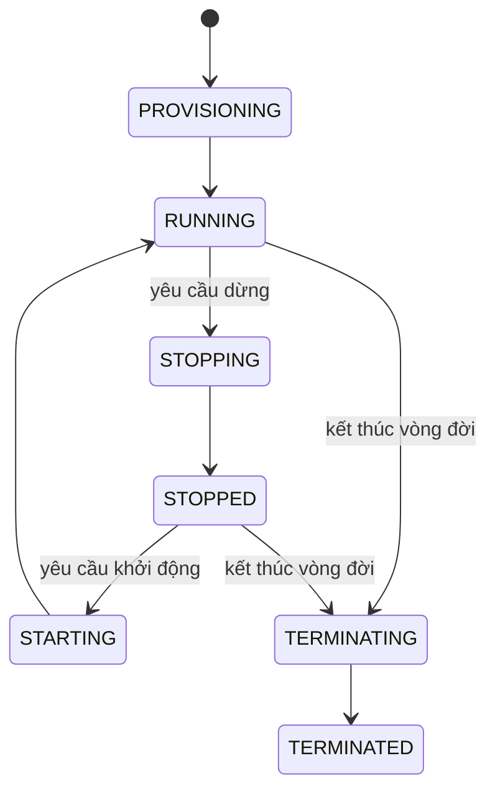

# Bảo trì, thay đổi shape và kết thúc vòng đời instance

Một Compute instance trên Oracle Cloud Infrastructure (OCI) cần được quản lý từ lúc đưa vào sử dụng đến khi ngừng phục vụ. Trong giai đoạn vận hành, bạn có thể phải vá hệ điều hành, xử lý thông báo bảo trì hạ tầng, tăng hoặc giảm tài nguyên, chuyển workload sang máy khác và cuối cùng terminate instance.

Mỗi thao tác có tác động khác nhau đến khả năng phục vụ, dữ liệu và chi phí. Một quy trình tốt cần xác định rõ điều gì sẽ thay đổi, điều gì phải được giữ lại, khi nào dịch vụ được coi là phục hồi và cách xử lý nếu thao tác không đạt yêu cầu.

Bài học thuộc chương **Compute và máy chủ ảo**, tập trung vào vận hành instance trong OCI với quyền phù hợp, quan sát được trạng thái, tự động hóa có kiểm soát và kế hoạch bảo vệ dữ liệu.

## Mục tiêu học tập

Sau bài học, bạn có thể:

- Phân biệt stop, start, reboot, migration và terminate.
- Chuẩn bị một cửa sổ bảo trì với phương án khôi phục và kiểm thử sau thay đổi.
- Đánh giá khả năng đổi shape dựa trên image, tài nguyên, quota và capacity.
- Thực hiện quy trình đổi cấu hình VM có downtime được lên kế hoạch.
- Kiểm tra hệ điều hành, mạng, volume và ứng dụng sau khi instance hoạt động trở lại.
- Lựa chọn giữ hoặc xóa boot volume, data volume và các tài nguyên phụ thuộc khi kết thúc vòng đời.
- Giải thích vì sao instance đã dừng hoặc đã terminate vẫn có thể còn chi phí liên quan.

## Phân biệt các thao tác vòng đời

| Thao tác | Mục đích | Cần lưu ý |
|---|---|---|
| Stop | Dừng instance nhưng giữ tài nguyên và cấu hình cần cho lần khởi động sau | Ứng dụng ngừng phục vụ; chi phí phụ thuộc loại tài nguyên |
| Start | Khởi động một instance đang dừng | Phải kiểm tra cả OS và dịch vụ sau khi trạng thái OCI trở lại RUNNING |
| Reboot | Khởi động lại instance | Có gián đoạn; phải xử lý shutdown của ứng dụng |
| Đổi shape | Điều chỉnh cấu hình Compute được hỗ trợ | Có thể thay CPU, RAM, khả năng mạng và giới hạn attachment |
| Migration để bảo trì | Xử lý việc hạ tầng đang chạy instance cần bảo trì hoặc thay thế | Cách thực hiện phụ thuộc loại instance và sự kiện cụ thể |
| Terminate | Kết thúc và xóa instance | Không thể start lại chính instance đã terminate; dữ liệu còn hay mất phụ thuộc loại lưu trữ và lựa chọn giữ lại |

Stop không có nghĩa là xóa instance. Ngược lại, giữ boot volume khi terminate không có nghĩa là instance cũ vẫn tồn tại để khởi động lại. Nếu khôi phục từ volume hoặc backup, bạn đang thực hiện một quy trình khôi phục hoặc tạo instance khác.

Các trạng thái thường gặp có thể minh họa như sau:



Sơ đồ chỉ biểu diễn các luồng phổ biến. Trạng thái chuyển tiếp không phải lúc nào cũng được người quan sát nhìn thấy. Cần phân biệt yêu cầu đã được API tiếp nhận, thao tác hạ tầng đã hoàn thành và ứng dụng đã sẵn sàng phục vụ.

## Xác định loại bảo trì và trách nhiệm

### Bảo trì trong hệ điều hành và ứng dụng

Nhóm vận hành thường chịu trách nhiệm đối với:

- Bản vá OS, kernel và các package bên trong instance.
- Cập nhật runtime, thư viện và ứng dụng.
- Cấu hình khởi động dịch vụ sau reboot.
- Quy trình backup, phục hồi và kiểm thử dữ liệu.
- Drain traffic, xử lý session và theo dõi trải nghiệm người dùng.

Một đợt bảo trì host của OCI không tự chứng minh rằng kernel hoặc ứng dụng bên trong VM đã được vá. Tương tự, vá OS không giải quyết được mọi vấn đề của host vật lý.

Khi thực hành, có thể chọn một instance Linux chạy dịch vụ Java để theo dõi tác động của reboot đến service, heap, kết nối cơ sở dữ liệu và thời gian warm-up. Các nguyên tắc vẫn áp dụng cho workload khác.

### Bảo trì hạ tầng của OCI

OCI có các phương thức như live migration, reboot migration, rebuild in place và manual migration. Phương thức áp dụng được xác định từ đặc điểm tài nguyên và sự kiện bảo trì. Xem [tổng quan Instance Maintenance](https://docs.oracle.com/en-us/iaas/Content/Compute/References/infrastructure-maintenance.htm).

| Phương thức | Điều cần hiểu về vận hành |
|---|---|
| Live migration | VM đủ điều kiện được chuyển host trong khi tiếp tục chạy; ứng dụng nhạy độ trễ vẫn cần quan sát |
| Reboot migration | Có giai đoạn dừng, chuyển sang host khác và khởi động lại |
| Rebuild in place | Bảo trì trên phần cứng hiện tại; có thể cần cửa sổ dài hơn |
| Manual migration | Nhóm vận hành phải thực hiện quy trình chuyển hoặc dựng lại workload theo hướng dẫn |
| Non-Terminating Repair trên bare metal được hỗ trợ | Loại sửa chữa quyết định có cần dừng instance hay không |

Non-Terminating Repair là một cơ chế riêng cho bare metal được hỗ trợ, có cả trường hợp cần downtime và trường hợp sửa khi instance tiếp tục chạy. Không suy rằng tên cơ chế này bảo đảm mọi hoạt động bảo trì đều không gián đoạn. Xem [Non-Terminating Repair](https://docs.oracle.com/en-us/iaas/Content/Compute/Tasks/non-terminating-repair.htm).

Đối với VM, kiểm tra trường hỗ trợ live migration và các incompatibility của chính instance. Shape, image, launch options và các tính năng đang bật có thể ảnh hưởng khả năng migration; không dựa riêng vào tên shape để kết luận.

## Tiếp nhận và xử lý thông báo bảo trì

Khi có thông báo, trước hết ghi nhận:

1. Instance OCID, region, compartment và workload bị ảnh hưởng.
2. Loại sự kiện, hành động dự kiến và hạn xử lý nếu có.
3. Múi giờ của lịch bảo trì và người chịu trách nhiệm thực hiện.
4. Khả năng chủ động chọn lịch trong phạm vi OCI cho phép.
5. Tác động đến traffic, dữ liệu local và các instance phụ thuộc.
6. Hành vi recovery đã cấu hình cho instance.
7. Bằng chứng phải kiểm tra để xác nhận sự kiện đã được xử lý.

Live migration có thể giảm mức gián đoạn nhưng không thay thế dự phòng ở cấp ứng dụng. Reboot migration có downtime. Với manual migration hoặc instance có local NVMe, phải lập kế hoạch dữ liệu và các bước riêng theo tài liệu. Xem [các phương thức chuyển instance khi bảo trì](https://docs.oracle.com/en-us/iaas/Content/Compute/Tasks/movinganinstance.htm).

Một lệnh reboot trong OS không đủ để kết luận instance đã được chuyển host hoặc sự kiện bảo trì đã đóng. Khi sự kiện yêu cầu một hành động cụ thể, thực hiện đúng hành động được hỗ trợ rồi kiểm tra lại trạng thái bảo trì.

Cấu hình availability còn quyết định trạng thái sau recovery. Chẳng hạn, `RESTORE_INSTANCE` hướng tới phục hồi lifecycle state trước sự kiện, còn `STOP_INSTANCE` giữ instance ở trạng thái dừng sau recovery. Việc instance được phục hồi cũng chưa chứng minh dịch vụ ứng dụng đã hoạt động. Xem [ngữ nghĩa recovery action](https://docs.oracle.com/en-us/iaas/tools/python/latest/api/core/models/oci.core.models.UpdateInstanceAvailabilityConfigDetails.html).

## Chuẩn bị một thay đổi có thể khôi phục

### Lập hồ sơ tài nguyên và phụ thuộc

Không chỉ ghi display name vì tên có thể trùng. Cần xác định tài nguyên bằng OCID và phạm vi của nó:

| Nhóm thông tin | Nội dung cần ghi nhận |
|---|---|
| Compute | Instance OCID, shape, OCPU, RAM, AD, fault domain, image và launch options |
| Mạng | VNIC, MAC, private/public IP, subnet, NSG, route đặc thù và DNS |
| Lưu trữ | Boot volume, block volume, attachment type, mount point và local disk |
| Ứng dụng | Phiên bản, cấu hình, cách khởi động, health endpoint và phụ thuộc |
| Lưu lượng | Load balancer backend, kết nối đang mở, worker và lịch tác vụ |
| Khôi phục | Backup đã hoàn tất, retention, khóa mã hóa và hướng dẫn restore |
| Điều phối | Instance pool, autoscaling, Terraform hoặc công cụ quản lý cấu hình |
| Quan sát | Dashboard, log, alarm và mốc số liệu trước thay đổi |

Việc điều chỉnh instance nằm trong pool hoặc do pipeline quản lý cần phối hợp với lớp điều phối đó. Một hệ thống tự động duy trì số lượng máy có thể tạo lại tài nguyên bạn vừa xóa, hoặc thay đổi thủ công có thể bị lần chạy tiếp theo ghi đè.

### Xác định quyền cần thiết

Quyền vào SSH hoặc RDP không thay thế quyền API của OCI. Tách rõ các nhu cầu:

- Đọc instance, attachment và metadata phục vụ kiểm tra.
- Thực hiện power action hoặc cập nhật cấu hình instance.
- Tạo và khôi phục backup trong phạm vi lưu trữ liên quan.
- Sử dụng khóa mã hóa khi tài nguyên dùng customer-managed key.
- Terminate instance hoặc xóa volume khi đã đến giai đoạn thu hồi.

Compartment của instance, mạng, volume và backup có thể khác nhau. Cấp quyền theo phạm vi công việc; việc một người đổi shape không có nghĩa họ cần được xóa mọi volume trong tenancy.

### Định nghĩa kết quả và ngưỡng dừng

Một kế hoạch thay đổi cần trả lời được:

- Sau thay đổi, cấu hình và hành vi nào phải đạt?
- Khi nào bắt đầu tính downtime?
- Thời gian tối đa dành cho từng bước là bao nhiêu?
- Điều kiện nào cho phép đưa node trở lại phục vụ?
- Khi nào phải dừng xử lý theo hướng hiện tại để khôi phục?
- Nếu cấu hình cũ cũng không có capacity, dịch vụ sẽ chạy ở đâu?

Ví dụ: một API có hai node sau load balancer. Chỉ bảo trì một node mỗi lần; node còn lại phải chịu được tải dự kiến. Node đang bảo trì chỉ được đưa lại vào backend khi qua kiểm tra nội bộ và thử giao dịch từ đường truy cập thực tế.

Nếu workload chỉ có một node, phải chấp nhận và thông báo downtime theo quy trình của nhóm. Health check không tự tạo ra một bản sao thay thế.

## Backup phải phù hợp với loại dữ liệu

### Phân loại trước khi chọn cách sao lưu

| Vị trí dữ liệu | Chuẩn bị cần thiết |
|---|---|
| Boot volume | Backup hoặc phương án dựng lại OS và cấu hình |
| Remote block volume | Backup, volume group hoặc cơ chế sao lưu riêng của ứng dụng |
| Local NVMe | Sao chép dữ liệu quan trọng sang nơi lưu bền vững trước hành động có thể làm mất local disk |
| Database tự quản lý | Quy trình nhất quán dữ liệu và khôi phục do database hỗ trợ |
| Database hoặc dịch vụ dữ liệu bên ngoài | Xác nhận lưu giữ, kết nối lại và trách nhiệm của dịch vụ đó |
| Dữ liệu chỉ trong bộ nhớ | Checkpoint hoặc chấp nhận mất theo thiết kế |

Backup boot volume không bao gồm mọi data volume, dữ liệu trong RAM hoặc tài nguyên ở dịch vụ khác. Custom image cũng cần được đánh giá đúng phạm vi trước khi coi là bản sao của toàn bộ workload.

### Crash-consistent và application-consistent

Backup volume phản ánh dữ liệu trên đĩa. Volume group giúp tạo backup nhất quán theo thời điểm trên các volume trong nhóm, còn ứng dụng có thể cần quiesce, flush transaction hoặc cơ chế riêng để đạt application consistency. Xem [khuyến nghị về tính nhất quán khi backup Block Volume](https://docs.oracle.com/en-us/iaas/Content/Block/Concepts/blockvolumebackups.htm).

Với dịch vụ có ghi dữ liệu, quy trình có thể gồm ngừng nhận yêu cầu ghi mới, chờ tác vụ đang xử lý kết thúc, dừng hoặc quiesce ứng dụng, rồi tạo backup theo hướng dẫn của cơ chế được chọn. Không coi một lệnh `sync` là bằng chứng rằng transaction của mọi ứng dụng đã nhất quán.

Trước thay đổi, xác nhận backup đã hoàn thành ở trạng thái có thể sử dụng và nhóm biết cách restore. Một mã yêu cầu tạo backup chưa phải bằng chứng có thể phục hồi. Nếu backup được mã hóa bằng khóa do bạn quản lý, khả năng phục hồi còn phụ thuộc quyền truy cập và vòng đời của khóa đó.

## Thực hiện bảo trì OS có kế hoạch

Một chuỗi vận hành điển hình:

1. Xác nhận node khác đủ sức phục vụ hoặc cửa sổ downtime đã bắt đầu.
2. Đưa node ra khỏi luồng traffic mới và drain kết nối theo khả năng của hệ thống.
3. Tạm dừng scheduler, consumer hoặc worker cần tránh xử lý trùng.
4. Tạo điểm khôi phục phù hợp và ghi lại cấu hình hiện tại.
5. Dừng ứng dụng theo đúng thứ tự phụ thuộc.
6. Cập nhật OS hoặc phần mềm theo hướng dẫn dành cho image.
7. Reboot nếu bản vá hoặc cấu hình yêu cầu.
8. Kiểm tra OS, network, storage, ứng dụng và dữ liệu.
9. Đưa node trở lại phục vụ từng bước rồi theo dõi.

Các lệnh Linux sau là ví dụ kiểm tra, không phải script vá tự động cho mọi image:

```bash
uname -r
uptime
systemctl --failed
ip -br address
ip route
lsblk -f
findmnt
```

Sau reboot, kiểm tra kernel đang chạy, thay vì chỉ kiểm tra package kernel đã được cài. Đối với Windows, cần kiểm tra trạng thái cập nhật, yêu cầu restart, dịch vụ và log tương ứng trong OS.

Tránh gộp vá OS, đổi shape, đổi kiểu networking và chỉnh storage vào một thao tác lớn nếu không có lý do rõ ràng. Thực hiện từng thay đổi có mốc xác minh giúp xác định nguyên nhân và chọn đúng phương án khôi phục.

## Khi nào nên thay đổi shape?

Thay đổi shape là một dạng scale dọc. Nó hữu ích khi workload cần thêm CPU hoặc RAM, hoặc khi cấu hình đang dư tài nguyên và có thể giảm chi phí.

Dựa vào số liệu theo thời gian:

- CPU cao cùng hàng đợi xử lý và latency tăng có thể gợi ý thiếu CPU.
- Memory pressure, swap hoặc OOM cần được phân tích cùng mức sử dụng thực của ứng dụng.
- I/O wait cao có thể xuất phát từ storage, không được giải quyết chỉ bằng thêm CPU.
- Throughput mạng có thể bị giới hạn bởi shape, đường mạng hoặc phía đối tác.
- Database chậm hoặc downstream quá tải có thể tiếp tục giới hạn API dù instance đã lớn hơn.

Với ứng dụng Java, sau khi tăng RAM cần kiểm tra JVM thực tế có sử dụng cấu hình mong muốn không. Khi giảm RAM, `-Xmx`, native memory, thread stack và giới hạn container phải còn phù hợp. Một heap cấu hình quá lớn có thể khiến dịch vụ không khởi động dù OCI đã resize thành công.

Đối với workload stateless, so sánh scale dọc với việc thêm node. Tăng kích thước một máy không tạo thêm khả năng chịu lỗi khi chính máy đó dừng.

## Điều kiện và giới hạn trước khi đổi shape

Shape hiện tại và image quyết định tập shape đích được hỗ trợ. Image phải tương thích, cấu hình OCPU/RAM phải hợp lệ và cần đủ service limits. Kiểm tra cả quota của compartment và capacity ở vị trí triển khai. Xem [Changing the Shape of an Instance](https://docs.oracle.com/en-us/iaas/Content/Compute/Tasks/resizinginstances.htm).

Các điểm phải đánh giá:

| Câu hỏi | Vì sao cần kiểm tra? |
|---|---|
| Đang thao tác VM hay bare metal? | Không áp dụng quy trình đổi shape VM cho mọi loại instance |
| Đổi trong cùng family hay sang family khác? | Có thể thay đổi bộ xử lý, driver, hiệu năng và giới hạn |
| Kiến trúc CPU có tương thích với image và binary không? | Chuyển x86 sang Arm cần kế hoạch ứng dụng phù hợp |
| Có license gắn với image hoặc cấu hình không? | Marketplace và phần mềm thương mại có thể có ràng buộc |
| Shape nhỏ hơn có đủ VNIC và tài nguyên mạng không? | Scale down có thể đòi hỏi điều chỉnh attachment |
| Có nhiều block volume hoặc cấu hình topology đặc biệt không? | Có thể cần các bước chuẩn bị bổ sung trước resize |
| Có local disk hoặc tính năng chuyên biệt không? | Cần quy trình phù hợp với loại tài nguyên |
| Có đủ capacity đích và phương án dự phòng không? | Được phép sử dụng không đồng nghĩa tài nguyên vật lý đang sẵn có |

Tài liệu đổi shape hiện yêu cầu xử lý attachment trước một số thay đổi, bao gồm detach block volumes khi instance có nhiều hơn một block volume; nếu giảm xuống shape hỗ trợ ít VNIC hơn thì phải xử lý VNIC vượt giới hạn. Việc detach phải đi kèm dừng I/O, unmount và reconnect đúng quy trình, không chỉ bấm tháo tài nguyên.

OCI cũng công bố vấn đề resize có thể làm thay đổi thứ tự VNIC hoặc block device trong OS và các cơ chế chặn một số thao tác để bảo vệ topology. Vì vậy, cần đối chiếu [Known Issues for Compute](https://docs.oracle.com/en-us/iaas/Content/Compute/known-issues.htm), dùng định danh volume và interface ổn định, đồng thời không bỏ qua lỗi chỉ để cố tiếp tục resize.

Nếu image hoặc shape không cho đổi trực tiếp, phương án phù hợp có thể là dựng instance mới, chuyển dữ liệu và chuyển traffic. Không coi mọi cặp shape là có thể hoán đổi tại chỗ.

## Ví dụ thay đổi một VM Standard Flex

### Phạm vi bài thực hành

Giả sử một VM Linux thử nghiệm có:

| Thuộc tính | Cấu hình |
|---|---|
| Shape | `VM.Standard.E4.Flex` |
| Trước thay đổi | 1 OCPU, 8 GB RAM |
| Mục tiêu | 2 OCPU, 16 GB RAM |
| Lưu trữ | Boot volume, không dùng local NVMe cho dữ liệu quan trọng |
| Mạng | Một VNIC chính, cấu hình guest đã được ghi nhận |
| Ứng dụng | Dịch vụ ví dụ `orders-api` |
| Phương pháp | Chủ động dừng, đổi cấu hình khi STOPPED rồi khởi động lại |

Đây là cấu hình minh họa, không bảo đảm region hoặc tenancy của bạn đang có capacity cho shape đó. Chỉ thực hành trên tài nguyên đã xác nhận được phép thay đổi.

Quy trình dưới đây có downtime. Khái niệm flexible shape không có nghĩa mọi lần đổi CPU/RAM đều diễn ra mà không reboot. Tham chiếu UpdateInstance mô tả ảnh hưởng đến instance đang chạy và các tùy chọn cập nhật. Xem [OCI CLI instance update](https://docs.oracle.com/en-us/iaas/tools/oci-cli/latest/oci_cli_docs/cmdref/compute/instance/update.html).

### Bước 1: Ghi nhận baseline

Trong Linux, trước khi dừng:

```bash
lscpu
free -h
ip -br address
ip route
lsblk -f
findmnt
systemctl --failed
```

Ghi thêm số liệu ứng dụng ở mức tải đại diện: throughput, p95 latency, tỷ lệ lỗi và mức sử dụng memory. Số liệu lúc máy hoàn toàn nhàn rỗi không đủ để quyết định scale down hoặc chứng minh scale up có hiệu quả.

Các ví dụ OCI CLI trong bài sử dụng Bash trên máy quản trị đã cài và xác thực CLI. OCID có dấu `...` phải được thay bằng định danh thật. Các lệnh chỉ được trình bày để học và không được bài viết tự thực thi.

```bash
INSTANCE_ID='ocid1.instance.oc1...'
COMPARTMENT_ID='ocid1.compartment.oc1...'
IMAGE_ID='ocid1.image.oc1...'
AVAILABILITY_DOMAIN='TENANCY_PREFIX:REGION-AD-1'

oci compute instance get --instance-id "$INSTANCE_ID"

oci compute shape list \
  --compartment-id "$COMPARTMENT_ID" \
  --availability-domain "$AVAILABILITY_DOMAIN" \
  --image-id "$IMAGE_ID" \
  --all
```

Các biến phải được lấy từ tài nguyên thật, trong đúng region của CLI profile. Danh sách shape tương thích không phải cam kết capacity. Có thể dùng capacity report hoặc phương án reservation phù hợp khi yêu cầu triển khai cần được bảo đảm tốt hơn.

### Bước 2: Drain và dừng ứng dụng

Đưa node ra khỏi traffic mới theo thiết kế của load balancer hoặc nền tảng triển khai. Sau khi xử lý các kết nối và công việc đang chạy, dừng dịch vụ theo hướng dẫn của ứng dụng.

Ví dụ với service giả định:

```bash
sudo systemctl stop orders-api
systemctl is-active orders-api
```

Thay tên service bằng tên thật. Kết quả `inactive` có thể đi kèm exit code khác 0; một hệ thống tự động cần diễn giải đúng trạng thái mong muốn.

Nếu ứng dụng chạy lâu mới dừng, phải hoàn thành shutdown của ứng dụng trước power action. Soft action vẫn có giới hạn thời gian chờ, nên không thể dùng nó thay cho logic đóng transaction hoặc kết thúc worker.

### Bước 3: Dừng instance qua OCI

```bash
oci compute instance action \
  --instance-id "$INSTANCE_ID" \
  --action SOFTSTOP \
  --wait-for-state STOPPED \
  --max-wait-seconds 1200
```

`SOFTSTOP` gửi yêu cầu shutdown tới OS; theo tham chiếu hiện tại, sau thời gian chờ 15 phút instance có thể bị tắt cưỡng bức nếu OS chưa dừng. `STOP` là power off, còn `SOFTRESET` và `RESET` khác nhau ở cơ chế shutdown. Xem [tham chiếu instance action](https://docs.oracle.com/en-us/iaas/tools/oci-cli/latest/oci_cli_docs/cmdref/compute/instance/action.html).

Trước khi tiếp tục, xác nhận lifecycle state là `STOPPED`. Nếu waiter timeout, truy vấn trạng thái và log trước khi thử lại; timeout phía client không chứng minh yêu cầu trước đã thất bại.

### Bước 4: Cập nhật shape configuration

Chỉ thực hiện khi đã xác nhận đúng instance đang dừng và đã có kế hoạch khôi phục:

```bash
oci compute instance update \
  --instance-id "$INSTANCE_ID" \
  --shape 'VM.Standard.E4.Flex' \
  --shape-config '{"ocpus":2,"memoryInGBs":16}'

oci compute instance get --instance-id "$INSTANCE_ID"
```

Đọc lại kết quả để đối chiếu shape, `shape-config` và trạng thái. Không coi HTTP thành công hoặc việc lệnh đã kết thúc là bằng chứng ứng dụng đã được cấp đủ tài nguyên và hoạt động tốt.

Một số trường hợp có thể đổi shape trực tiếp khi instance đang chạy và OCI xử lý reboot. Bài thực hành chọn dừng chủ động để có một mốc rõ ràng cho drain, backup và shutdown.

### Bước 5: Khởi động và kiểm tra

```bash
oci compute instance action \
  --instance-id "$INSTANCE_ID" \
  --action START \
  --wait-for-state RUNNING \
  --max-wait-seconds 1200
```

Sau khi có thể vào OS, kiểm tra lại:

```bash
lscpu
free -h
ip -br address
ip route
lsblk -f
findmnt
systemctl --failed
systemctl status orders-api --no-pager
```

Nếu ứng dụng được cấu hình tự khởi động, xác nhận nó thực sự hoạt động. Nếu quy trình yêu cầu khởi động thủ công, chỉ làm sau khi volume, cấu hình và các phụ thuộc đã sẵn sàng.

Health endpoint, nếu ứng dụng có triển khai theo ví dụ, có thể được kiểm tra như sau:

```bash
curl --fail \
  --connect-timeout 3 \
  --max-time 10 \
  http://127.0.0.1:8080/health
```

Kiểm tra loopback xác nhận một phần trạng thái local. Cần kiểm thử thêm từ đường truy cập của người dùng hoặc load balancer, cùng một thao tác nghiệp vụ đại diện, trước khi đưa node trở lại phục vụ.

### Thực hiện bằng Console

Nếu dùng Console thay cho CLI, có thể theo cùng các mốc:

1. Mở đúng instance và kiểm tra OCID.
2. Drain và dừng ứng dụng.
3. Dừng instance rồi xác nhận trạng thái.
4. Mở thao tác chỉnh shape, chọn shape và cấu hình hợp lệ.
5. Lưu, đọc lại cấu hình và khởi động.
6. Kiểm tra OS, ứng dụng và luồng traffic thực tế.

Chỉ chọn một phương thức thực hiện cho cùng thay đổi, phối hợp với pipeline nếu có. Vị trí nút thao tác có thể thay đổi theo giao diện Console.

## Kiểm tra sau bảo trì hoặc resize

Không nghiệm thu chỉ từ dòng `RUNNING`. Một ma trận xác minh hữu ích gồm:

| Lớp | Cần chứng minh |
|---|---|
| OCI | Đúng instance, shape, OCPU/RAM và lifecycle state |
| OS | Boot hoàn tất, không có service hệ thống quan trọng bị lỗi |
| Mạng | Interface, IP, route, DNS và kết nối quản trị hoạt động |
| Storage | Đúng volume được mount, đúng filesystem và quyền truy cập |
| Ứng dụng | Dịch vụ sẵn sàng, kết nối dependency và xử lý yêu cầu được |
| Dữ liệu | Kiểm tra đọc/ghi, transaction hoặc checkpoint phù hợp |
| Hiệu năng | Đạt mục tiêu throughput, latency và tỷ lệ lỗi trong mức tải đại diện |
| Quan sát | Metrics và log tiếp tục được thu thập, alarm phản ánh đúng trạng thái |
| Điều phối | Load balancer, pool và cấu hình mong muốn không còn lệch |

Với volume, tránh dựa vào việc `/dev/sdb` vẫn tồn tại để kết luận đúng đĩa. Đối chiếu định danh, filesystem UUID hoặc consistent device path phù hợp với thiết kế. Với VNIC, đối chiếu MAC và địa chỉ thực tế nếu tên interface thay đổi.

Đổi shape không tự tăng dung lượng boot volume, không tự mở rộng filesystem và không tự điều chỉnh mọi giới hạn của ứng dụng. Cần đo lại từng giới hạn liên quan trước khi đưa ra kết luận về hiệu quả.

## Khôi phục khi thay đổi không đạt yêu cầu

### Quay lại cấu hình cũ

Nếu OS hoặc ứng dụng không hoạt động sau resize:

1. Giữ node ngoài traffic.
2. Thu thập lỗi boot, console, log và trạng thái attachment.
3. Xác định lỗi do shape, networking, storage hay cấu hình ứng dụng.
4. Nếu phù hợp, dừng node và đưa về shape/OCPU/RAM trước thay đổi.
5. Khởi động, kiểm tra lại rồi mới đưa về phục vụ.

Quay lại cấu hình cũ là một thao tác Compute khác, có thể có downtime và yêu cầu capacity. Không bảo đảm host hoặc tài nguyên cũ vẫn được dành riêng chỉ vì instance từng chạy ở đó.

### Khi cần phục hồi dữ liệu hoặc dựng node khác

Nếu lỗi liên quan bản vá, cấu hình filesystem hoặc dữ liệu, đổi lại shape không hoàn tác các thay đổi đó. Có thể phải restore backup hoặc triển khai node mới từ image và cấu hình đã biết.

Kế hoạch khôi phục cần chỉ rõ:

- Bản backup nào được sử dụng.
- Dữ liệu nào có thể mất kể từ thời điểm backup.
- Cách khôi phục các data volume và khóa truy cập liên quan.
- Cách gắn lại mạng, service discovery và load balancer.
- Cách tránh hai node cùng xử lý một vai trò độc quyền hoặc cùng ghi dữ liệu không an toàn.

RTO là mục tiêu thời gian phục hồi; RPO là mục tiêu mức mất dữ liệu chấp nhận được. Phải kiểm chứng quy trình restore thực tế để đánh giá hai mục tiêu đó, thay vì chỉ ước lượng thời gian gọi lệnh tạo instance.

## Quan sát bảo trì và trạng thái phục hồi

Trong namespace `oci_compute_infrastructure_health`, `maintenance_status` hỗ trợ theo dõi lịch bảo trì, còn `instance_status` phản ánh trạng thái hạ tầng của VM đang chạy. Metric `instance_status` dùng 0 cho khả dụng, 1 cho không khả dụng do vấn đề hạ tầng; instance đã dừng không có giá trị cho metric này. Xem [Infrastructure Health Metrics](https://docs.oracle.com/en-us/iaas/Content/Compute/References/infrastructurehealthmetrics.htm).

Không diễn giải khoảng trống metrics là hệ thống chắc chắn khỏe. Đối chiếu lifecycle state, trạng thái agent và chính sách phát metric.

Các lớp quan sát nên bổ sung cho nhau:

- Maintenance event và thông báo giúp biết hành động hạ tầng dự kiến.
- Metrics CPU, memory, disk và network cho thấy thay đổi tài nguyên và tải.
- Log hệ điều hành giúp phân tích boot, service và driver.
- Health check và số liệu nghiệp vụ cho thấy dịch vụ thực tế có phục vụ được hay không.
- Audit và request ID hỗ trợ truy lại thao tác thay đổi.

Đặt mốc thời gian bắt đầu và kết thúc thay đổi để so sánh số liệu trước/sau. Nếu tạm xử lý thông báo cho downtime có kế hoạch, cần khôi phục cơ chế cảnh báo khi kết thúc; không bỏ qua lỗi ngoài phạm vi bảo trì.

## Khi nào nên kết thúc vòng đời instance?

Một instance có thể được retire khi workload đã chuyển sang nơi khác, môi trường thử nghiệm hết hạn, máy được thay bằng image mới hoặc tài nguyên không còn chủ sở hữu sử dụng.

Cần có bằng chứng workload đã được chuyển hoặc ngừng hợp lệ:

- Traffic không còn trỏ vào instance.
- Scheduler và worker không còn vai trò cần giữ.
- Dữ liệu cần giữ đã chuyển hoặc được lưu theo chính sách.
- Khả năng khôi phục đã được xác nhận nếu còn yêu cầu.
- Người quản lý dữ liệu đã xác định retention và lịch xóa.

CPU thấp không đủ để kết luận instance không cần thiết. Nó có thể là máy dự phòng, máy chạy lịch theo tháng hoặc endpoint phục vụ ít lưu lượng nhưng quan trọng.

## Quyết định giữ hoặc xóa tài nguyên

| Tài nguyên | Quyết định cần đưa ra trước terminate |
|---|---|
| Instance | Xác nhận đúng OCID và workload đã có nơi phục vụ thay thế hoặc được ngừng |
| Boot volume | Giữ để phục hồi hoặc xóa khi đã đủ điều kiện |
| Data volume tạo cùng instance | Chọn rõ giữ hay xóa bằng cơ chế tương ứng |
| Data volume gắn thêm về sau | Kiểm kê và xử lý vòng đời riêng |
| Local NVMe | Sao lưu dữ liệu cần giữ trước khi tài nguyên bị hủy |
| VNIC và IP | Cập nhật các phụ thuộc mạng và kế hoạch địa chỉ |
| DNS và load balancer backend | Xóa hoặc chuyển sang endpoint mới |
| Backup và custom image | Áp dụng retention riêng, có người chịu trách nhiệm |
| Log và alarm | Giữ bằng chứng cần thiết và loại bỏ cấu hình không còn mục đích |
| Khóa, certificate và quyền truy cập | Thu hồi phần dành riêng cho máy, giữ dependency cần cho restore |

Terminate sẽ kết thúc instance và tháo các attachment liên quan. Dữ liệu local NVMe sẽ bị xóa khi terminate, vì vậy phải chuyển dữ liệu cần giữ ra khỏi local disk trước đó. Xem [Terminating an Instance](https://docs.oracle.com/en-us/iaas/Content/Compute/Tasks/terminatinginstance.htm).

Private IP, ephemeral public IP hoặc reserved public IP có vòng đời và cách quản lý khác nhau. Không giả định tạo máy mới cùng tên sẽ lấy lại mọi địa chỉ cũ. Với endpoint cần ổn định, thiết kế DNS, load balancer hoặc cơ chế địa chỉ phù hợp trước khi xóa node.

Giữ boot volume không giữ nguyên toàn bộ danh tính của máy cũ: instance mới có OCID và attachment cần được kiểm tra lại. Khi tạo từ boot volume, còn phải xét tương thích shape, vị trí tài nguyên và mọi cấu hình bên ngoài OS.

## Ví dụ terminate với lựa chọn bảo toàn dữ liệu rõ ràng

Đây là thao tác xóa instance, chỉ thực hiện sau khi đã hoàn thành kế hoạch thu hồi. Ví dụ Bash sau chủ động giữ boot volume và data volumes được tạo lúc launch:

```bash
# Kiểm tra lại đúng đối tượng ngay trước thao tác xóa.
oci compute instance get --instance-id "$INSTANCE_ID"

# Ví dụ kết thúc instance và giữ các volume được chỉ định.
oci compute instance terminate \
  --instance-id "$INSTANCE_ID" \
  --preserve-boot-volume true \
  --preserve-data-volumes-created-at-launch true \
  --wait-for-state SUCCEEDED \
  --max-wait-seconds 1200
```

Không dựa vào giá trị mặc định để quyết định giữ dữ liệu. Tham chiếu CLI hiện mô tả `--preserve-boot-volume` mặc định là false, còn `--preserve-data-volumes-created-at-launch` mặc định là true. Ví dụ truyền rõ cả hai. `SUCCEEDED` ở waiter của lệnh terminate là trạng thái work request theo tham chiếu này; đối chiếu phiên bản CLI đang dùng. Xem [OCI CLI instance terminate](https://docs.oracle.com/en-us/iaas/tools/oci-cli/latest/oci_cli_docs/cmdref/compute/instance/terminate.html).

Sau đó, xác minh instance đã kết thúc và từng volume cần giữ vẫn tồn tại. Instance có thể còn xuất hiện trong danh sách ở trạng thái `TERMINATED` một thời gian; đó không phải lý do chạy lại thao tác xóa.

Hai cờ preserve không tạo backup, không bảo vệ dữ liệu chỉ nằm trong RAM hoặc local NVMe và không tự áp dụng retention cho tài nguyên còn lại. Việc xóa các volume được giữ là quyết định vòng đời riêng.

## Dọn phụ thuộc sau terminate

Sau khi xác nhận workload đã ngừng và dữ liệu được bảo quản đúng:

1. Xử lý DNS, backend, service discovery và route còn tham chiếu máy cũ.
2. Kiểm tra public IP được quản lý riêng và các tài nguyên mạng dành riêng cho workload.
3. Dọn cấu hình giám sát không còn sử dụng nhưng giữ log theo thời hạn cần thiết.
4. Thu hồi quyền, credential hoặc certificate chỉ dành cho instance đó.
5. Cập nhật cấu hình hạ tầng và danh mục tài sản để tránh tự tạo lại ngoài ý muốn.
6. Gắn chủ sở hữu, ngày hết hạn và mục đích cho volume hoặc backup còn giữ.
7. Kiểm tra lại chi phí theo tag, compartment và dịch vụ.

Không xóa NSG, gateway hoặc khóa mã hóa chỉ vì instance đã bị terminate nếu tài nguyên đó còn phục vụ workload hoặc backup khác. Việc dọn phải dựa trên dependency thực tế.

Với quy trình khôi phục còn trong thời hạn lưu giữ, bản backup và quyền giải mã cần tiếp tục sử dụng được. Nếu xóa dependency trước hạn, khả năng restore có thể mất dù bản backup vẫn xuất hiện trong danh sách.

## Hiểu đúng chi phí khi stop và terminate

Billing khi instance dừng phụ thuộc shape. Standard shapes thường tạm ngừng tính phí Compute khi stop, nhưng instance vẫn tính vào service limits. Dense I/O, HPC và một số GPU hoặc bare metal có quy tắc khác. Shutdown chỉ từ OS không tự ngừng billing; cần thực hiện stop qua OCI theo quy trình. Xem [Resource Billing for Stopped Instances](https://docs.oracle.com/en-us/iaas/Content/Compute/Tasks/resource-billing-stopped-instances.htm).

Ngoài Compute, hãy kiểm tra riêng:

- Boot volume và block volume được giữ lại.
- Backup, custom image và log lưu trữ.
- Load balancer, gateway hoặc appliance còn tồn tại.
- Tài nguyên ở các dịch vụ phụ thuộc.
- License và mô hình thương mại áp dụng cho workload.

Có thể nhìn chi phí còn lại theo công thức vận hành:

```text
Chi phí sau thu hồi instance
  = chi phí tài nguyên cố ý giữ
  + chi phí dependency chưa thu hồi
  + chi phí lưu giữ backup, log và dữ liệu
```

Mục tiêu không phải xóa mọi tài nguyên ngay lập tức, mà là biết khoản nào đang được giữ có chủ đích, ai chịu trách nhiệm và khi nào sẽ được xem xét lại. Một volume được giữ cho phục hồi cần có thời hạn; một volume bị quên cần được phát hiện và xử lý.

## Tự động hóa quy trình vận hành

Một pipeline bảo trì hoặc resize nên thể hiện các trạng thái có điều kiện:

```text
Xác minh tài nguyên và điều kiện thay đổi
  -> kiểm tra điểm khôi phục
  -> drain và dừng ứng dụng
  -> thực hiện thao tác OCI
  -> chờ kết quả và đọc lại cấu hình
  -> kiểm tra OS, dữ liệu và ứng dụng
  -> đưa lại traffic
  -> theo dõi và cập nhật hồ sơ
```

Tự động hóa cần xử lý tình huống request timeout nhưng thao tác vẫn chạy, node không qua health check, cấu hình đã đổi nhưng không start được, hoặc công cụ điều phối tạo thêm node ngoài kế hoạch.

Các nguyên tắc thực tế gồm:

- Chọn tài nguyên bằng OCID và điều kiện trạng thái, không chỉ display name.
- Kiểm tra trạng thái trước khi retry thao tác.
- Giới hạn thời gian chờ và ghi lại request ID để điều tra.
- Xác minh hậu điều kiện thay vì chỉ kiểm tra exit code của lệnh gọi API.
- Giữ node ngoài traffic nếu bước kiểm tra ứng dụng chưa đạt.
- Phân biệt rollback cấu hình với restore dữ liệu.
- Đối với decommission, khai báo rõ lựa chọn preserve và lịch xử lý tài nguyên còn giữ.

Terraform hoặc Resource Manager có thể quản lý trạng thái tài nguyên; công cụ cấu hình guest quản lý OS và ứng dụng. Một bản plan hợp lệ không thay thế drain, shutdown và kiểm tra nghiệp vụ trong cửa sổ bảo trì.

## Tiêu chí hoàn thành

| Loại công việc | Bằng chứng hoàn thành |
|---|---|
| Bảo trì OS | Phiên bản và trạng thái boot đúng, dịch vụ và giao dịch đại diện hoạt động |
| Bảo trì hạ tầng | Sự kiện được xử lý theo yêu cầu, trạng thái hạ tầng và ứng dụng được kiểm tra |
| Tăng hoặc giảm shape | Cấu hình OCI và guest khớp mục tiêu, ứng dụng đạt yêu cầu dưới tải phù hợp |
| Khôi phục | Dữ liệu, kết nối và vai trò dịch vụ được phục hồi theo mục tiêu đã thống nhất |
| Kết thúc vòng đời | Đúng instance đã terminate, dữ liệu giữ/xóa được xác nhận, dependency và chi phí còn lại có người quản lý |

Quản lý vòng đời instance cần kết hợp trạng thái hạ tầng với khả năng phục vụ của ứng dụng và vòng đời dữ liệu. Mỗi lần bảo trì, đổi shape hoặc thu hồi tài nguyên đều cần kết quả đo được và phương án xử lý khi thực tế khác kế hoạch.
