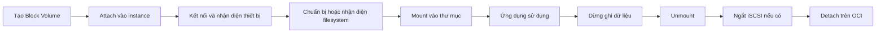

# Tạo, gắn và tách Block Volume

Một ứng dụng Java chạy trên OCI Compute có thể cần thêm không gian cho file tải lên, dữ liệu xử lý hoặc các thành phần lưu trữ do nhóm vận hành quản lý. Đặt mọi dữ liệu lên boot volume khiến vòng đời hệ điều hành và dữ liệu gắn chặt với nhau. Block Volume cung cấp thiết bị lưu trữ khối có thể tạo riêng rồi gắn vào instance phù hợp.

Để ứng dụng sử dụng được volume, cần hoàn thành cả thao tác trên OCI lẫn cấu hình trong hệ điều hành. Bài học đi qua luồng tạo volume, attach, nhận diện thiết bị, chuẩn bị filesystem, mount và detach; ví dụ tập trung vào một Linux VM cùng một volume dữ liệu mới.

## 1. Phân biệt volume, attachment và mount

| Thành phần hoặc thao tác | Thuộc tầng nào? | Ý nghĩa |
| --- | --- | --- |
| Block volume | OCI Block Volume | Tài nguyên lưu trữ có OCID, dung lượng, vị trí và cấu hình riêng |
| Volume attachment | OCI Compute | Quan hệ gắn một volume với một instance; attachment có OCID riêng |
| Connect | Hệ điều hành và giao thức lưu trữ | Làm thiết bị có thể được truy cập từ hệ điều hành; iSCSI có bước kết nối riêng |
| Filesystem | Bên trong thiết bị khối | Tổ chức dữ liệu theo định dạng như ext4 hoặc XFS |
| Mount | Hệ điều hành | Đưa filesystem vào cây thư mục, chẳng hạn `/srv/order-data` |
| Detach | OCI Compute | Gỡ quan hệ attachment sau khi đã chuẩn bị ở tầng hệ điều hành |

Block Volume hỗ trợ tạo, gắn, kết nối và chuyển volume giữa các instance phù hợp. Volume và instance phải ở cùng availability domain để gắn trực tiếp; chúng có thể thuộc các compartment khác nhau nếu quyền cho phép. [Oracle: Overview of Block Volume](https://docs.oracle.com/en-us/iaas/Content/Block/Concepts/overview.htm), [Oracle CLI: volume create](https://docs.oracle.com/en-us/iaas/tools/oci-cli/latest/oci_cli_docs/cmdref/bv/volume/create.html)



Luồng trên áp dụng cho filesystem thông thường. Volume dùng làm thiết bị thô, swap, thành phần LVM hoặc lưu trữ cho một hệ thống cụm cần quy trình riêng cho lớp đang quản lý thiết bị đó.

## 2. Chuẩn bị trước khi tạo

Giả sử bạn cần một volume cho thư mục dữ liệu của API Java. Trước khi thao tác, xác định:

- **Instance đích:** OCID, region, availability domain và hệ điều hành.
- **Phạm vi quản lý:** compartment chứa volume và nhóm chịu trách nhiệm vận hành.
- **Nhu cầu:** dung lượng, đặc điểm I/O, khả năng mở rộng và mức hiệu năng cần thiết.
- **Dữ liệu:** đây là ổ mới hay ổ đã có dữ liệu; yêu cầu sao lưu và phục hồi là gì?
- **Quyền:** người dùng OCI có quyền tạo volume và quản lý attachment; người thao tác trên Linux có quyền quản trị cần thiết.
- **Vòng đời:** volume sẽ được giữ, chuyển hay xóa khi instance được thay thế?

Quyền IAM để attach tài nguyên và quyền Linux để mount hoặc ghi file là hai lớp độc lập. Một attachment thành công không tự cấp quyền ghi filesystem cho tài khoản chạy Java.

Không chọn hiệu năng chỉ theo dung lượng còn trống. Với workload thực tế, xem đồng thời IOPS, throughput, độ trễ và giới hạn của instance. Dung lượng được cấp phát và các lựa chọn hiệu năng cũng cần được đưa vào kế hoạch chi phí, kể cả khi volume chưa được ứng dụng sử dụng.

## 3. Tạo Block Volume trên OCI

Trong Console, mở khu vực Block Storage, chọn Block Volumes rồi tạo volume. Chọn compartment, tên dễ nhận biết, availability domain trùng với instance, dung lượng và mức hiệu năng phù hợp. Có thể cấu hình thêm khóa mã hóa, backup policy và tag theo yêu cầu môi trường. Chờ volume sẵn sàng trước khi attach. [Oracle: Creating a Block Volume](https://docs.oracle.com/en-us/iaas/Content/Block/Tasks/creatingavolume.htm)

### 3.1. Ví dụ bằng OCI CLI

Các lệnh trong bài dùng **Bash**, với OCI CLI đã được cấu hình xác thực. Đây là hướng dẫn thực hành, chưa được chạy trên tenancy của bạn. Thay toàn bộ placeholder bằng giá trị thật và thực hiện trong môi trường thử nghiệm được cấp quyền.

```bash
export COMPARTMENT_OCID='ocid1.compartment.oc1..REPLACE_ME'
export INSTANCE_OCID='ocid1.instance.oc1.REGION.REPLACE_ME'
export AVAILABILITY_DOMAIN='REPLACE_WITH_EXACT_AVAILABILITY_DOMAIN_NAME'

oci bv volume create \
  --compartment-id "$COMPARTMENT_OCID" \
  --availability-domain "$AVAILABILITY_DOMAIN" \
  --display-name order-data-lab \
  --size-in-gbs 50 \
  --wait-for-state AVAILABLE
```

Ví dụ chọn dung lượng 50 GB cho bài thực hành. Kiểm tra cấu hình hiệu năng và các giá trị mặc định trước khi áp dụng vào workload khác. Lưu `data.id` trong kết quả làm **OCID của volume**; OCID này sẽ được dùng khi tạo attachment. [Oracle CLI: volume create](https://docs.oracle.com/en-us/iaas/tools/oci-cli/latest/oci_cli_docs/cmdref/bv/volume/create.html)

```bash
export VOLUME_OCID='ocid1.volume.oc1.REGION.REPLACE_ME'

oci bv volume get --volume-id "$VOLUME_OCID"
```

Đối chiếu lại compartment, availability domain, dung lượng và trạng thái. Không dùng tên hiển thị làm định danh duy nhất vì các tài nguyên có thể có cùng tên.

## 4. Attach: chọn kiểu gắn phù hợp

Hai kiểu gắn thường gặp là **paravirtualized** và **iSCSI**. Với paravirtualized, thiết bị được kết nối tự động sau khi attach thành công. Với iSCSI, hệ điều hành cần có kết nối iSCSI; có thể thực hiện qua các lệnh được OCI cung cấp hoặc cơ chế tự động phù hợp của Block Volume Management plugin. Dù dùng kiểu nào, filesystem vẫn cần được chuẩn bị và mount nếu ứng dụng muốn truy cập bằng đường dẫn file. [Oracle: Attaching a Block Volume to an Instance](https://docs.oracle.com/en-us/iaas/Content/Block/Tasks/attach-compute-volume-attachment.htm)

| Tiêu chí | Paravirtualized | iSCSI |
| --- | --- | --- |
| Kết nối trong guest OS | Tự kết nối khi attachment hoàn tất | Có phiên iSCSI cần được thiết lập |
| Công cụ kiểm tra bổ sung | Công cụ thiết bị khối của Linux | Công cụ thiết bị khối và `iscsiadm` |
| Chuẩn bị trước detach | Dừng sử dụng thiết bị, unmount các filesystem liên quan | Các bước tương ứng, sau đó ngắt đúng phiên iSCSI |
| Lựa chọn sử dụng | Kiểm tra hỗ trợ của shape, image và yêu cầu workload | Kiểm tra hỗ trợ, agent/plugin và cấu hình iSCSI |

Ví dụ gắn volume vào VM hỗ trợ paravirtualized:

```bash
oci compute volume-attachment attach \
  --instance-id "$INSTANCE_OCID" \
  --volume-id "$VOLUME_OCID" \
  --type paravirtualized \
  --wait-for-state ATTACHED
```

Ghi lại `data.id` của kết quả này làm **OCID của attachment**. Nó khác OCID của volume. Các thao tác quản lý attachment, bao gồm detach, dùng định danh attachment. [Oracle CLI: volume-attachment attach](https://docs.oracle.com/en-us/iaas/tools/oci-cli/latest/oci_cli_docs/cmdref/compute/volume-attachment/attach.html)

### 4.1. Nếu chọn iSCSI

Sau khi attach, mở mục iSCSI Commands and Information của đúng attachment để lấy IQN, địa chỉ IP, port và các lệnh tương ứng. Các bước có thể gồm đăng ký node, cấu hình kết nối lại sau reboot, thiết lập CHAP nếu bật và đăng nhập target. Dùng thông tin của chính attachment đó; không sao chép target từ một máy hoặc volume khác. [Oracle: Connecting to iSCSI-Attached Block Volumes](https://docs.oracle.com/en-us/iaas/Content/Block/Tasks/connectingtoavolume_topic-Connecting_to_iSCSIAttached_Volumes.htm)

Nếu plugin đã thực hiện kết nối tự động, kiểm tra trạng thái thực tế trước khi chạy lại lệnh. Đối với cấu hình multipath hoặc hiệu năng đặc thù, sử dụng quy trình tương ứng của OCI thay vì suy ra từ ví dụ một đường kết nối trong bài này.

## 5. Nhận diện đúng thiết bị trong Linux

Trước khi attach, nên lưu lại danh sách thiết bị đang có. Sau attach và connect, kiểm tra lại:

```bash
lsblk -o NAME,PATH,SIZE,TYPE,FSTYPE,MOUNTPOINTS,SERIAL
findmnt /
```

Đối chiếu kết quả với OCID volume, dung lượng, thông tin attachment và device path được OCI cung cấp. Với môi trường hỗ trợ consistent device paths, có thể có đường dẫn dưới `/dev/oracleoci/`; cần xác nhận nó trỏ tới đúng volume. Không mặc định `/dev/sdb` hoặc `/dev/sdc` là ổ dữ liệu vừa gắn. Thứ tự tên thiết bị có thể đổi khi khởi động lại. [Oracle: Traditional fstab Options](https://docs.oracle.com/en-us/iaas/Content/Block/References/fstaboptions.htm), [Oracle: Consistent Device Paths and fstab](https://docs.oracle.com/en-us/iaas/Content/Block/References/fstaboptionsconsistentdevicepaths.htm)

Ví dụ, nếu thấy một ổ 50 GB mới xuất hiện, kích thước chỉ là một bằng chứng đối chiếu. Nó chưa đủ để kết luận có thể format: máy có thể đã có một ổ khác cùng dung lượng hoặc thiết bị đang được một lớp lưu trữ khác quản lý.

Trong các lệnh sau, biến `DEVICE` phải trỏ tới thiết bị đã xác nhận:

```bash
DEVICE='/dev/REPLACE_WITH_CONFIRMED_NEW_VOLUME'

lsblk -f "$DEVICE"
sudo blkid "$DEVICE"
sudo wipefs --no-act "$DEVICE"
```

Các lệnh này phục vụ kiểm tra; `wipefs --no-act` không xóa chữ ký dữ liệu. Nếu công cụ không tìm thấy filesystem, vẫn phải đối chiếu lịch sử volume: dữ liệu có thể thuộc phân vùng, LVM, mã hóa hoặc phần mềm dùng thiết bị thô. Không coi kết quả trống là giấy phép format một volume chưa rõ nguồn gốc.

## 6. Tạo filesystem và mount volume mới

Phần này chỉ áp dụng cho **volume mới tạo trong bài thực hành, chưa có dữ liệu**, đã xác nhận không phải boot volume và không thuộc LVM, RAID hoặc multipath. Ví dụ tạo ext4 trực tiếp trên toàn bộ thiết bị. Nếu môi trường dùng bảng phân vùng, filesystem sẽ được tạo trên phân vùng được chọn và các đường dẫn phải điều chỉnh tương ứng.

**`mkfs` ghi cấu trúc filesystem lên thiết bị và có thể phá hủy dữ liệu cũ. Chỉ chạy sau khi đã xác nhận đúng volume mới.**

```bash
sudo mkfs.ext4 -L orderdata "$DEVICE"
sudo mkdir -p /srv/order-data
sudo mount "$DEVICE" /srv/order-data

findmnt --mountpoint /srv/order-data
df -hT /srv/order-data
```

Nếu volume đã có filesystem hợp lệ, bỏ qua bước `mkfs`. Khi gắn lại một volume dữ liệu, cần nhận diện filesystem hoặc phân vùng đang có rồi mount chúng theo yêu cầu vận hành.

Trước khi mount, thư mục đích phải được kiểm tra để tránh che khuất các file có sẵn bên dưới. Sau khi mount, xác nhận `findmnt` cho thấy đúng nguồn thiết bị và đúng loại filesystem; `df` chỉ hiện dung lượng tại một đường dẫn chưa đủ để chứng minh đó là volume mong muốn.

### 6.1. Cấp quyền cho ứng dụng Java

Giả sử service chạy dưới tài khoản `orderapp` và nhóm `orderapp` đã được tạo đúng trong máy. Chỉ sau khi xác nhận mount thành công mới tạo thư mục dữ liệu:

```bash
mountpoint -q /srv/order-data && \
  sudo install -d -o orderapp -g orderapp -m 0750 \
  /srv/order-data/uploads
```

Ứng dụng sử dụng `/srv/order-data/uploads` theo cấu hình của nó. Cần kiểm tra bằng chính tài khoản chạy service, đồng thời xem các chính sách bổ sung như SELinux nếu môi trường sử dụng. Không mở quyền ghi toàn bộ filesystem cho mọi tài khoản để xử lý nhanh một lỗi permission.

Block volume của một máy cũng chưa tự giải quyết việc nhiều bản sao API cần cùng thấy file tải lên. Trước khi tăng số máy ứng dụng, xác định dữ liệu nào nằm cục bộ và dữ liệu nào cần một cơ chế chia sẻ hoặc dịch vụ lưu trữ phù hợp.

## 7. Mount lại sau reboot

Mount thủ công không tự tạo cấu hình cho lần khởi động tiếp theo. Với cách cấu hình truyền thống, OCI hướng dẫn dùng UUID filesystem trong `/etc/fstab` cùng các tùy chọn phù hợp, gồm `_netdev` và `nofail`. Nếu dùng consistent device paths, làm theo hướng dẫn dành riêng cho cơ chế đó. [Oracle: Traditional fstab Options](https://docs.oracle.com/en-us/iaas/Content/Block/References/fstaboptions.htm), [Oracle: Consistent Device Paths and fstab](https://docs.oracle.com/en-us/iaas/Content/Block/References/fstaboptionsconsistentdevicepaths.htm)

Lấy UUID của filesystem đã tạo:

```bash
sudo blkid "$DEVICE"
```

Ví dụ một dòng `/etc/fstab` cho filesystem ext4 trong bài thực hành:

```fstab
UUID=REPLACE_WITH_ACTUAL_FILESYSTEM_UUID /srv/order-data ext4 defaults,_netdev,nofail 0 2
```

UUID filesystem khác OCID volume và OCID attachment. Nếu filesystem nằm trên một phân vùng, dùng UUID của filesystem trên phân vùng đó. Bảo toàn các dòng cấu hình khác, kiểm tra dòng mới và mount thử có kiểm soát trước khi thử reboot trong thời điểm cho phép.

### 7.1. Ứng dụng phải kiểm tra volume bắt buộc

`nofail` giúp tránh biến một volume tùy chọn thành điều kiện bắt buộc của quá trình boot. Nhưng với dữ liệu bắt buộc của API, cần bảo đảm service không ghi nhầm xuống thư mục nằm trên boot filesystem khi volume chưa mount.

Ví dụ một phần cấu hình systemd cho service:

```ini
[Unit]
RequiresMountsFor=/srv/order-data

[Service]
ExecStartPre=/usr/bin/mountpoint -q /srv/order-data
```

Đây là đoạn bổ sung cho unit của ứng dụng, chưa phải một service hoàn chỉnh. Kiểm tra đường dẫn công cụ `mountpoint` trên hệ điều hành đích và nạp lại cấu hình systemd sau khi chỉnh sửa. `RequiresMountsFor` thiết lập phụ thuộc vào các mount cần cho đường dẫn; kiểm tra trước khi khởi chạy giúp phát hiện trường hợp thiếu mount dữ liệu. [systemd: Unit configuration](https://www.freedesktop.org/software/systemd/man/latest/systemd.unit.html)

## 8. Tách volume theo đúng thứ tự

Detach không có nghĩa là xóa volume. Bạn có thể gỡ attachment để chuyển volume sang một instance phù hợp khác, nhưng phải xử lý xong việc sử dụng thiết bị ở hệ điều hành trước. Với iSCSI, OCI đặc biệt yêu cầu unmount và ngắt kết nối trước khi detach để tránh nguy cơ mất dữ liệu. [Oracle: Detaching a Volume](https://docs.oracle.com/en-us/iaas/Content/Block/Tasks/detachingavolume.htm)

### 8.1. Dừng các tác vụ đang ghi

Với ví dụ API Java, dừng hoặc chuyển lưu lượng theo kế hoạch vận hành, chờ các tác vụ ghi hoàn tất rồi dừng service:

```bash
sudo systemctl stop order-api.service
```

Tên service chỉ là ví dụ. Kiểm tra cả job nền, tác vụ sao chép và các tiến trình khác dùng thư mục. Nếu dữ liệu thuộc database, thực hiện quy trình dừng hoặc quiesce do database yêu cầu; `sync` không thay cho cơ chế đảm bảo nhất quán của database.

### 8.2. Xử lý mount và cấu hình tự động mount

Trước khi tháo lâu dài, cập nhật dòng tương ứng trong `/etc/fstab`, mount unit hoặc công cụ quản lý cấu hình để máy không tiếp tục chờ hay tự mount volume đó. Không xóa cấu hình của các volume khác. Nếu dùng systemd, nạp lại cấu hình khi cần.

Sau đó kiểm tra và unmount:

```bash
cd /
sudo fuser -vm /srv/order-data
sync
sudo umount /srv/order-data
```

Nếu có các mount con hoặc bind mount liên quan, xử lý chúng trước theo thứ tự phù hợp. Nếu `umount` báo bận, tìm tiến trình, file đang mở hoặc thư mục làm việc đang giữ mount rồi xử lý nguyên nhân. Không dùng lazy unmount hoặc force unmount để bỏ qua việc xác minh trong quy trình thông thường.

Kiểm tra lại:

```bash
if mountpoint -q /srv/order-data; then
  printf '%s\n' 'Volume vẫn đang mount; chưa được detach.'
else
  printf '%s\n' 'Mount point đã được tháo; tiếp tục kiểm tra thiết bị liên quan.'
fi
```

Một mount point đã tháo chưa chứng minh toàn bộ thiết bị không còn được dùng. Đối chiếu lại `lsblk` và các lớp lưu trữ liên quan trước khi gỡ attachment.

### 8.3. Ngắt kết nối iSCSI nếu có

Với attachment iSCSI đã unmount và không còn được sử dụng, dùng đúng IQN cùng địa chỉ portal của attachment:

```bash
IQN='REPLACE_WITH_THIS_ATTACHMENTS_IQN'
PORTAL='REPLACE_WITH_ISCSI_IP:PORT'

sudo iscsiadm -m node -T "$IQN" -p "$PORTAL" -u
```

Xác nhận phiên tương ứng đã logout thành công. Lệnh này không áp dụng cho attachment paravirtualized. Nếu dùng plugin hoặc multipath, thực hiện quy trình ngắt kết nối tương ứng, không logout hàng loạt các target khác. [Oracle: Disconnecting From a Volume](https://docs.oracle.com/en-us/iaas/Content/Block/Tasks/disconnectingfromavolume.htm)

### 8.4. Detach trên OCI

Trong Console, chọn đúng instance, đúng attached block volume rồi thực hiện Detach. Với CLI, dùng **OCID attachment** đã ghi lại:

```bash
export ATTACHMENT_OCID='ocid1.volumeattachment.oc1.REGION.REPLACE_ME'

oci compute volume-attachment detach \
  --volume-attachment-id "$ATTACHMENT_OCID" \
  --wait-for-state DETACHED
```

Sau khi hoàn tất, xác minh attachment đã được gỡ và volume vẫn tồn tại nếu mục tiêu là giữ dữ liệu. Thao tác xóa volume là quyết định riêng, chỉ thực hiện khi đã xác định rõ dữ liệu và các yêu cầu phục hồi. [Oracle: Detaching a Volume](https://docs.oracle.com/en-us/iaas/Content/Block/Tasks/detachingavolume.htm)

## 9. Gắn lại volume sang một instance khác

Giả sử instance A cần được thay bằng B trong cùng availability domain. Quy trình minh họa:

1. Ghi lại OCID volume, UUID filesystem, mount point và quyền truy cập trên A.
2. Dừng ghi, unmount, ngắt iSCSI nếu có rồi detach khỏi A.
3. Attach volume vào B và hoàn thành connect nếu cần.
4. Nhận diện lại thiết bị, partition và filesystem trên B.
5. Mount filesystem hiện hữu, không format lại.
6. Kiểm tra dữ liệu, quyền Linux, cấu hình tự mount và điều kiện khởi động service.
7. Cho ứng dụng truy cập trở lại và kiểm tra chức năng liên quan.

UID/GID số của tài khoản giữa hai máy có thể khác nhau dù tên tài khoản giống nhau. Vì vậy, sau khi chuyển máy cần kiểm tra quyền thực tế trước khi sửa ownership. Với volume có dữ liệu nghiệp vụ quan trọng, đối chiếu thêm bằng chứng sao lưu và tính nhất quán phù hợp với ứng dụng.

Không gắn cùng một filesystem ext4 hoặc XFS thông thường ở chế độ ghi trên nhiều máy chỉ vì OCI cho phép tạo nhiều attachment. Truy cập ghi đồng thời cần hệ thống filesystem hoặc lớp phối hợp được thiết kế cho việc đó; nếu không, có nguy cơ hỏng dữ liệu. [Oracle: Attaching a Volume to Multiple Instances](https://docs.oracle.com/en-us/iaas/Content/Block/Tasks/attach-to-multiple-instances-compute-volume-attachment.htm)

## 10. Chẩn đoán lỗi theo từng tầng

| Hiện tượng | Kiểm tra đầu tiên | Hướng xử lý |
| --- | --- | --- |
| Không attach được | Region, availability domain, quyền và trạng thái volume | Đối chiếu tài nguyên, xử lý lỗi OCI cụ thể trước khi thao tác trong Linux |
| OCI báo attached nhưng chưa thấy thiết bị | Kiểu attachment, phiên iSCSI hoặc trạng thái agent/plugin | Hoàn thành connect và nhận diện lại thiết bị |
| Có thiết bị nhưng chưa có thư mục dữ liệu | Filesystem, partition và mount | Phân biệt ổ mới với ổ chứa dữ liệu trước khi chọn thao tác |
| Java báo permission denied | Tài khoản service, UID/GID, quyền và SELinux | Cấp quyền đúng thư mục, kiểm tra bằng tài khoản ứng dụng |
| Reboot xong thiếu dữ liệu tại đường dẫn | Mount thực tế, UUID, fstab và kết nối iSCSI | Kiểm tra nguồn filesystem trước khi cho ứng dụng ghi |
| Unmount báo target is busy | File đang mở, shell, service, mount con | Dừng đúng tác vụ hoặc rời thư mục rồi thử lại |
| Đã gắn lại nhưng tên thiết bị khác | Ánh xạ attachment và device path | Dùng định danh ổn định, không dựa vào thứ tự `/dev/sdX` |

## 11. Bài tập thực hành và điều kiện đạt

Trong một Linux VM thử nghiệm, tạo một volume dữ liệu riêng, attach, tạo filesystem mới và mount tại `/srv/order-data`. Ghi một file kiểm tra có nội dung dễ nhận biết sau khi xác nhận mount đúng. Sau đó dừng mọi tác vụ liên quan, tháo an toàn rồi gắn lại volume và đọc lại file.

Lưu bằng chứng cho các bước sau:

| Mốc | Bằng chứng cần có |
| --- | --- |
| Tạo | OCID volume, compartment, availability domain và dung lượng |
| Attach | OCID attachment, instance đích và kiểu gắn |
| Nhận diện | Device path đã đối chiếu cùng UUID filesystem |
| Sử dụng | Mount source đúng, tài khoản ứng dụng có quyền cần thiết |
| Detach | Đã dừng ghi, unmount, ngắt iSCSI nếu có và gỡ attachment |
| Gắn lại | File kiểm tra vẫn còn, filesystem và quyền được nhận diện đúng |

Giải thích thêm ba tình huống: vì sao attached chưa đồng nghĩa ứng dụng đã dùng được volume; vì sao gắn lại ổ cũ không được format; và vì sao `nofail` cần đi cùng kiểm tra mount trước khi một ứng dụng ghi dữ liệu bắt buộc.

Hoàn thành bài thực hành khi bạn theo dõi được toàn bộ quan hệ **volume → attachment → thiết bị → filesystem → mount point → ứng dụng**, rồi tháo và gắn lại mà vẫn giữ đúng dữ liệu cùng cấu hình vận hành.
