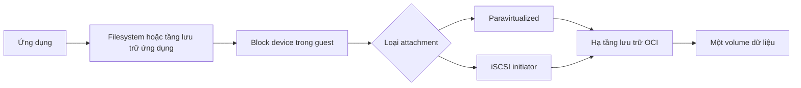
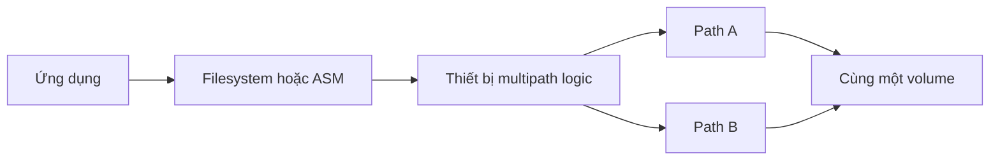

# Paravirtualized attachment, iSCSI và multipath

Trong chương **Block Volume và Boot Volume** của module Oracle Cloud Infrastructure (OCI), lựa chọn volume attachment quyết định cách hệ điều hành nhìn thấy và truy cập ổ đĩa từ xa. Cùng một nhu cầu lưu trữ có thể cần những bước vận hành khác nhau tùy instance, image và mức hiệu năng.

Bài này trình bày paravirtualized attachment, iSCSI và multipath trong bối cảnh triển khai OCI có phân quyền, mạng, giám sát và kiểm soát chi phí. Ví dụ tập trung vào block volume dữ liệu của một máy Linux chạy ứng dụng; các điểm khác biệt của Windows và boot volume được nêu riêng.

## Mục tiêu và kiến thức cần có

Sau bài học, bạn có thể:

- Chọn giữa paravirtualized và iSCSI theo khả năng hỗ trợ và yêu cầu workload.
- Phân biệt attach trong OCI, connect trong hệ điều hành và mount filesystem.
- Kết nối một iSCSI attachment thông thường theo thông tin do OCI cung cấp.
- Giải thích nhiều path đến cùng một volume và cách nhận diện thiết bị multipath.
- Kiểm tra điều kiện Ultra High Performance (UHP), đường truy cập API của agent và trạng thái attachment.
- Chuẩn bị mount sau reboot và tháo volume theo thứ tự phù hợp.

Bạn nên biết region, availability domain (AD), compartment, Compute instance, VCN và thao tác Linux cơ bản. Những lệnh trong bài là ví dụ để chạy trong môi trường thực hành riêng; cần thay thông tin attachment bằng giá trị của chính volume đang thao tác.

## Ba lớp trạng thái phải phân biệt

Một volume có thể đã hiện là **Attached** trong OCI nhưng ứng dụng chưa đọc được dữ liệu. Hãy kiểm tra lần lượt ba lớp:

| Lớp | Việc xảy ra | Bằng chứng cần tìm |
| --- | --- | --- |
| OCI control plane | Tạo quan hệ giữa instance và volume | Volume attachment đúng OCID, instance, loại kết nối và trạng thái |
| Kết nối thiết bị trong guest OS | Hệ điều hành nhận được block device | Thiết bị, iSCSI session hoặc multipath map tương ứng |
| Filesystem và ứng dụng | Filesystem được mount, quyền truy cập phù hợp | Mount point, loại filesystem, owner và hoạt động của ứng dụng |

Paravirtualized tự kết nối thiết bị sau khi attach. iSCSI cần khâu kết nối do người vận hành hoặc Oracle Cloud Agent thực hiện. Sau đó vẫn cần xử lý filesystem/mount nếu workload dùng filesystem. Xem [Connecting to a Block Volume](https://docs.oracle.com/en-us/iaas/Content/Block/Tasks/connectingtoavolume.htm).

Ví dụ: volume dữ liệu của ứng dụng đơn hàng đã được attach vào máy. Nếu chỉ thiếu mount, việc attach lại nhiều lần không giải quyết phần cấu hình filesystem. Ngược lại, nếu iSCSI chưa login thành công thì sửa owner của thư mục mount cũng chưa tạo được đường truy cập đến volume.

## Paravirtualized và iSCSI khác nhau ở đâu?

**Paravirtualized attachment** đưa thiết bị lưu trữ đến VM qua cơ chế ảo hóa. Người dùng không phải tự thiết lập iSCSI session trong guest để kết nối volume đó.

**iSCSI attachment** sử dụng giao thức truyền lệnh SCSI qua TCP/IP. Guest có initiator làm việc với target do OCI cung cấp. Một attachment có thông tin nhận diện target, địa chỉ portal và tùy chọn xác thực.

| Tiêu chí | Paravirtualized | iSCSI |
| --- | --- | --- |
| Môi trường chính | VM và image có hỗ trợ | VM hoặc bare metal có hỗ trợ |
| Sau thao tác attach | Thiết bị tự kết nối | Cần login, thủ công hoặc qua agent |
| Thành phần cần quan sát trong guest | Block device và filesystem | Initiator, session, thiết bị và filesystem |
| Độ phức tạp vận hành | Ít bước thiết lập kết nối hơn | Cần quản lý thêm cấu hình và trạng thái iSCSI |
| Khi đánh giá hiệu năng | Đối chiếu giới hạn cho đúng shape/attachment | Đối chiếu giới hạn cho đúng shape/attachment |

Bare metal dùng iSCSI cho block volume. Với VM, khả năng dùng paravirtualized phụ thuộc image; không mặc định image nhập từ ngoài OCI có đầy đủ hỗ trợ. Phạm vi attachment được mô tả trong [Overview of Block Volume](https://docs.oracle.com/en-us/iaas/Content/Block/Concepts/overview.htm).

Không nên chọn chỉ từ nhận định “loại này luôn nhanh hơn”. Kết quả thực tế còn chịu giới hạn của volume, instance, số OCPU, workload và cấu hình đường truy cập. Quy trình lựa chọn nên bắt đầu từ khả năng hỗ trợ, tiếp đến yêu cầu hiệu năng, rồi đánh giá chi phí vận hành.

### Những thuộc tính không nên gộp làm một

- **Attachment type:** cơ chế kết nối paravirtualized hoặc iSCSI.
- **Access type:** quyền đọc/ghi của attachment và khả năng chia sẻ theo cấu hình.
- **Multipath:** nhiều đường I/O được quản lý như đường truy cập đến cùng thiết bị.
- **Filesystem:** cách tổ chức dữ liệu trên block device, nếu workload cần filesystem.

Multipath không có nghĩa là nhiều máy đồng thời ghi dữ liệu vào cùng filesystem. Với multi-attach read/write, cần một giải pháp có khả năng điều phối truy cập giữa các máy; một filesystem thông thường không tự trở thành cluster filesystem. Xem [Attaching a Block Volume to an Instance](https://docs.oracle.com/en-us/iaas/Content/Block/Tasks/attach-compute-volume-attachment.htm).

## Hình dung đường I/O



Trong sơ đồ này, nhiều đường kết nối chưa được thể hiện. Khi có multipath, nhiều path cùng dẫn đến **một volume**. Dung lượng mà ứng dụng có thể sử dụng vẫn là dung lượng của volume đó.

Với ứng dụng kết nối Oracle Database được quản lý, các thao tác storage nội bộ của dịch vụ database thuộc quy trình riêng của dịch vụ. Những ví dụ ở đây áp dụng cho volume gắn vào Compute mà bạn trực tiếp quản lý.

## Chuẩn bị trước khi attach

Trước khi thao tác, ghi nhận instance OCID, volume OCID, region, AD, compartment và mục đích volume. Volume cần nằm trong cùng AD với instance có quyền truy cập; việc hai tài nguyên ở cùng tenancy không đủ để bảo đảm có thể attach. Xem [Regions and Availability Domains của Block Volume](https://docs.oracle.com/en-us/iaas/Content/Block/Concepts/overview.htm).

Sau đó chuẩn bị:

1. Kiểm tra quyền IAM của người hoặc pipeline thực hiện attach.
2. Chọn attachment type và access type theo workload.
3. Đối chiếu shape, image, driver và mức hiệu năng dự định sử dụng.
4. Chọn consistent device path nếu instance và quy trình hỗ trợ.
5. Xác định ai quản lý kết nối iSCSI: người vận hành hay agent.
6. Nếu thử UHP, kiểm tra riêng các điều kiện multipath trước khi attach.
7. Xác định volume trống hay đã có dữ liệu để quyết định bước filesystem.

Lập một bảng ánh xạ giúp tránh nhầm thiết bị:

| Thuộc tính | Ví dụ ghi nhận |
| --- | --- |
| Mục đích | Dữ liệu tạm của dịch vụ xử lý đơn hàng |
| Volume OCID | OCID lấy từ tài nguyên Block Volume |
| Attachment OCID | OCID của quan hệ gắn với instance cụ thể |
| Device path dự kiến | Đường dẫn đã chọn khi attach |
| Filesystem và mount point | Loại filesystem thực tế, thư mục phục vụ workload |
| Chủ sở hữu | Nhóm ứng dụng và người chịu trách nhiệm vận hành |

Attachment OCID và volume OCID là hai giá trị khác nhau. Khi một volume được tháo rồi attach lại, hãy đọc lại thông tin attachment thay vì tái sử dụng portal hoặc credential từ một quan hệ cũ.

## Quy trình paravirtualized attachment

Trong Console, vào instance cần gắn volume, mở **Attached block volumes** hoặc phần **Storage** tương ứng, rồi chọn **Attach block volume**. Chọn volume, attachment type **Paravirtualized**, access type và device path phù hợp. Khi attachment hoàn tất, kiểm tra thiết bị trong guest. Quy trình được mô tả tại [Attaching a Block Volume](https://docs.oracle.com/en-us/iaas/Content/Block/Tasks/attach-compute-volume-attachment.htm).

Các lệnh quan sát Linux:

```bash
lsblk -o NAME,TYPE,SIZE,FSTYPE,UUID,MOUNTPOINTS
findmnt
ls -l /dev/oracleoci/
```

Đường dẫn `/dev/oracleoci/` chỉ áp dụng khi image/instance hỗ trợ consistent device paths. Nếu không có, đối chiếu cách nhận diện thiết bị của hệ điều hành đang dùng.

Không kết luận một volume là trống chỉ vì chưa có mount point. Nó có thể có filesystem, partition hoặc cấu trúc LVM đã tồn tại. Nếu volume chứa dữ liệu, xác định đúng lớp lưu trữ rồi mount hoặc kích hoạt theo quy trình của dữ liệu đó.

Một volume mới chưa có filesystem cần được khởi tạo theo thiết kế của ứng dụng. Việc tạo partition hoặc filesystem có thể thay đổi dữ liệu trên thiết bị, nên phải hoàn tất ánh xạ volume–device trước bước này.

## Quy trình iSCSI thông thường trên Linux

Phần này dành cho **attachment iSCSI một đường được quản lý thủ công**, chưa cấu hình auto-connect và không thuộc quy trình UHP do plugin quản lý. Không dùng các bước này như cấu hình multipath tổng quát.

### Đọc thông tin của đúng attachment

Trong danh sách volume của instance, mở **iSCSI Commands and Information**. OCI cung cấp:

- IQN: định danh target.
- IP và port: portal cần kết nối.
- CHAP username/password nếu attachment bật CHAP.
- Các lệnh đăng ký và login dành cho attachment đó.

Hãy lấy lệnh từ Console để có giá trị chính xác. Tài liệu [Connecting to iSCSI-Attached Block Volumes](https://docs.oracle.com/en-us/iaas/Content/Block/Tasks/connectingtoavolume_topic-Connecting_to_iSCSIAttached_Volumes.htm) mô tả thứ tự thao tác.

### Đăng ký target và cấu hình khởi động

Dưới đây là cấu trúc lệnh để hiểu các thành phần; thay placeholder bằng thông tin thật:

```bash
export TARGET_IQN='REPLACE_WITH_ATTACHMENT_IQN'
export TARGET_PORTAL='REPLACE_WITH_ATTACHMENT_IP:PORT'

sudo iscsiadm -m node \
  -o new \
  -T "$TARGET_IQN" \
  -p "$TARGET_PORTAL"

sudo iscsiadm -m node \
  -T "$TARGET_IQN" \
  -p "$TARGET_PORTAL" \
  -o update \
  -n node.startup \
  -v automatic
```

Nếu bật CHAP, áp dụng các lệnh xác thực của Console trước bước login. Credential CHAP gắn với cặp volume/instance và cần được xử lý như thông tin xác thực. CHAP xác thực kết nối; nó không đồng nghĩa dữ liệu đã được mã hóa khi truyền. Thông tin CHAP và cấu hình initiator nằm trong [iSCSI Commands and Information](https://docs.oracle.com/en-us/iaas/Content/Block/Concepts/iscsiinformation.htm).

### Login và xác minh thiết bị

```bash
sudo iscsiadm -m node \
  -T "$TARGET_IQN" \
  -p "$TARGET_PORTAL" \
  --login

sudo iscsiadm -m session
lsblk -o NAME,TYPE,SIZE,FSTYPE,UUID,MOUNTPOINTS
```

Đối chiếu session và thiết bị với attachment vừa đăng ký. Không dùng lệnh login toàn bộ target như một cách sửa mọi sự cố: các node record trên máy có thể thuộc nhiều volume khác nhau.

Khi cần kiểm tra service, xem trạng thái initiator và log theo bản phân phối. Tránh restart hàng loạt dịch vụ storage trên máy đang phục vụ nhiều volume chỉ để thử sửa một attachment.

### Khi dùng Oracle Cloud Agent

Nếu chọn auto-connect và môi trường đáp ứng điều kiện, Block Volume Management plugin thực hiện lệnh kết nối iSCSI. Không lặp lại khâu cấu hình thủ công cho cùng attachment như thể plugin chưa tham gia.

Plugin thuộc Oracle Cloud Agent; cần phiên bản agent, trạng thái plugin, quyền API của instance và đường truy cập Oracle services phù hợp. Với máy private, tài liệu hướng dẫn service gateway và route đến Oracle Services Network. Xem [Enabling the Block Volume Management Plugin](https://docs.oracle.com/en-us/iaas/Content/Block/Tasks/enablingblockvolumemanagementplugin.htm).

Cần tách hai câu hỏi khi chẩn đoán:

- **Guest có kết nối được target storage không?**
- **Agent có gọi được API để đọc cấu hình và báo trạng thái không?**

Một lỗi quyền API của agent không được giải quyết bằng cách sửa UUID của filesystem. Ngược lại, agent đang chạy cũng chưa chứng minh ứng dụng đã mount đúng dữ liệu.

## Multipath: nhiều path, một thiết bị logic

Trên Linux, Device Mapper Multipath có thể gom nhiều đường đến cùng thiết bị thành một block device logic. Các path thành viên không phải những ổ độc lập để ứng dụng sử dụng riêng. Tùy cấu hình, multipath có thể phân phối I/O hoặc chuyển sang đường còn hoạt động khi một đường lỗi. Xem [Using Multipathing for Efficient Storage](https://docs.oracle.com/en/operating-systems/oracle-linux/8/stordev/stordev-UsingMultipathingforEfficientStorage.html).



Ví dụ minh họa: nếu hai path cùng dẫn đến volume 200 GiB, thiết bị logic vẫn có dung lượng 200 GiB. Không tạo hai filesystem trên hai path rồi coi đó là hai nơi lưu dữ liệu khác nhau.

Multipath cũng khác với những cơ chế sau:

| Cơ chế | Vấn đề chính được giải quyết |
| --- | --- |
| Multipath | Quản lý nhiều đường I/O đến cùng volume |
| Multi-attach | Cho nhiều instance có quan hệ attachment với volume |
| Backup | Tạo điểm phục hồi dữ liệu |
| Replication | Duy trì bản sao theo khả năng của dịch vụ |
| HA ứng dụng | Duy trì phục vụ khi thành phần của hệ thống gặp lỗi |

Một path còn hoạt động không khôi phục file đã bị xóa nhầm. Tương tự, multipath không giúp một instance đã dừng tiếp tục xử lý request. Kế hoạch tính sẵn sàng phải xét cả đường I/O, máy chủ, ứng dụng và dữ liệu.

## Điều kiện multipath trong OCI và UHP

Để đạt hiệu năng tối ưu của volume UHP, attachment cần multipath. OCI đánh giá khả năng bật multipath trong lúc attach; tăng mức hiệu năng của volume chưa tự chứng minh các điều kiện còn lại đã đáp ứng.

| Trường hợp | Điều kiện cần lưu ý |
| --- | --- |
| iSCSI UHP | Chọn shape và image được hỗ trợ; bài thực hành nên dùng Oracle Linux phù hợp |
| Paravirtualized UHP | Có hỗ trợ trên những VM/image phù hợp, gồm Oracle Linux, Ubuntu, CentOS và Windows theo danh mục |
| Bare metal UHP | Dùng iSCSI |
| Oracle Autonomous Linux | Không thuộc phạm vi hỗ trợ attachment multipath trong tài liệu này |

Đối chiếu danh mục hiện hành tại [Configuring Attachments to Ultra High Performance Volumes](https://docs.oracle.com/en-us/iaas/Content/Block/Tasks/configuringmultipathattachments.htm). Không áp dụng khả năng multipath của paravirtualized cho Windows sang iSCSI UHP trên Windows.

Số OCPU, giới hạn IOPS, throughput và số attachment phải được kiểm tra cho đúng cấu hình instance. Dùng cột **Supports Ultra High Performance (UHP)** trong [Block Volume Performance](https://docs.oracle.com/en-us/iaas/Content/Block/Concepts/blockvolumeperformance.htm), thay vì chỉ nhìn tên họ shape.

### Chuẩn bị nhánh iSCSI UHP

Ngoài shape/image phù hợp, cần:

1. Bật Block Volume Management plugin và kiểm tra nó thực sự chạy.
2. Cấu hình quyền cho instance/agent gọi API cần thiết.
3. Cung cấp đường truy cập Oracle services theo hướng dẫn của plugin.
4. Chọn consistent device path khi attach.
5. Để plugin thiết lập kết nối, rồi kiểm tra kết quả trong OCI và guest.

Custom image phải có kernel hỗ trợ; tài liệu troubleshooting nêu Oracle Linux UEK6U1 trở lên và capability `Storage.Iscsi.MultipathDeviceSupported=true` cho trường hợp tương ứng. Bật capability không cài driver còn thiếu. Xem [Troubleshooting Ultra High Performance Volume Attachments](https://docs.oracle.com/en-us/iaas/Content/Block/Tasks/troubleshootingmultipathattachments.htm).

Không dùng đồng thời `oci-utils` và `oci-iscsi-config` để thay nhau quản lý cùng volume. Tài liệu cấu hình UHP cảnh báo việc trộn hai công cụ có thể gây trạng thái multipath bị báo sai. Cũng không áp dụng hàng loạt `node.startup=automatic` của ví dụ một đường vào node record do quy trình multipath quản lý.

Nếu phải đổi shape, image hoặc bổ sung device path, có thể cần detach/reattach theo quy trình tương ứng. Đây là thay đổi phải lên kế hoạch dừng I/O; không dùng thao tác tháo/gắn như bước thử ngẫu nhiên trên volume đang phục vụ.

## Kiểm tra multipath ở hai lớp

### Trạng thái do OCI báo cáo

Trong danh sách attachment, xem cột **Multipath**:

| Giá trị | Cách hiểu |
| --- | --- |
| Yes | Volume UHP và attachment đã được đánh dấu multipath-enabled |
| No, không có cảnh báo | Volume không ở UHP nên không cần điều kiện multipath để đạt mức đang cấu hình |
| No, có cảnh báo | Volume UHP nhưng attachment chưa multipath-enabled; kiểm tra prerequisites |

Có thể lấy chi tiết bằng OCI CLI:

```bash
export OCI_REGION='REPLACE_WITH_REGION'
export ATTACHMENT_OCID='REPLACE_WITH_VOLUME_ATTACHMENT_OCID'

oci compute volume-attachment get \
  --region "$OCI_REGION" \
  --volume-attachment-id "$ATTACHMENT_OCID"
```

Đọc `is-multipath` và xác nhận đúng attachment đang xét. Tham số cần là **volume attachment OCID**, không phải volume OCID hay volume group OCID. Xem [Checking If a Volume Attachment is Multipath-Enabled](https://docs.oracle.com/en-us/iaas/Content/Block/Tasks/get-multipath-enable-check-compute-volume-attachment.htm).

### Topology trong Linux với iSCSI multipath

Sau khi plugin hoàn tất, xem thiết bị và map:

```bash
sudo multipath -ll
lsblk -o NAME,TYPE,SIZE,FSTYPE,UUID,MOUNTPOINTS
sudo iscsiadm -m session
```

Khi đọc kết quả, tìm:

- Một thiết bị logic và WWID nhận diện volume.
- Các path thành viên dẫn đến thiết bị đó.
- Trạng thái path, path group và dung lượng phù hợp.
- Filesystem hoặc tầng lưu trữ của ứng dụng đặt trên thiết bị logic.

Tên có thể ở dạng `/dev/mapper/<WWID>` hoặc alias tùy cấu hình. Alias `mpathN` là tên thuận tiện trong môi trường đó; đừng coi số N là danh tính nghiệp vụ cố định của volume. Các thành phần tên và cách quan sát được giải thích trong [Device Multipathing Sample Setup](https://docs.oracle.com/en/operating-systems/oracle-linux/10/stordev/stordev-DeviceMultipathingSampleSetup.html) và [Configuring Multipathing](https://docs.oracle.com/en/operating-systems/oracle-linux/10/stordev/stordev-ConfiguringMultipathing.html).

Ví dụ **sơ đồ đọc kết quả**, không phải output chuẩn bắt buộc của OCI:

```text
Thiết bị logic /dev/mapper/<WWID>
  ├─ path A → cùng volume
  └─ path B → cùng volume
```

Số lượng path, tên thiết bị và policy thực tế phụ thuộc cấu hình được hỗ trợ. Không thêm target hoặc ép một số path từ ví dụ để làm cho kết quả trông giống sơ đồ.

Với iSCSI UHP, cần đối chiếu cả trạng thái OCI và topology trong guest nếu nghi có báo cáo sai. Nếu `multipath -ll` không có map phù hợp, thu thập thêm cấu hình và log trước khi kết luận. Với **paravirtualized**, không dùng việc thiếu iSCSI session hay thiếu map iSCSI trong guest làm bằng chứng tự động rằng attachment không hỗ trợ multipath.

### Chọn thiết bị để filesystem hoặc ứng dụng sử dụng

Với iSCSI multipath, thao tác trên thiết bị logic tương ứng, không trên riêng từng path thành viên. Có thể xem symlink consistent device path để lần đến thiết bị đúng, rồi đối chiếu friendly name/map. Hướng dẫn nhận diện nằm trong [Working with Multipath-Enabled iSCSI-Attached Volumes](https://docs.oracle.com/en-us/iaas/Content/Block/Tasks/connectingtouhpvolumes.htm).

Trong môi trường dùng LVM hoặc Oracle ASM, phải theo thiết kế của tầng đó. Đừng tạo filesystem trên một disk đã được dùng làm thành viên ASM hoặc physical volume của LVM chỉ vì lệnh liệt kê không hiện mount point.

## Device path, WWID và filesystem UUID

Ba loại định danh thường xuất hiện ở những lớp khác nhau:

| Định danh | Vai trò |
| --- | --- |
| Consistent device path | Đường dẫn OCI cung cấp trên Linux tương thích để tham chiếu volume qua reboot |
| WWID | Nhận diện thiết bị lưu trữ mà multipath dùng để nhóm các path |
| Filesystem UUID | Nhận diện filesystem dùng cho cấu hình mount |

Tên như `/dev/sdb` có thể thay đổi thứ tự nhận diện sau reboot. Không dùng “ổ thứ hai” làm cách xác định volume chứa dữ liệu production.

Khi được hỗ trợ, chọn consistent device path trong lúc attach rồi đối chiếu đường dẫn đó trên máy. Tính năng này không áp dụng mặc định cho mọi custom image và không áp dụng cho Windows. Boot volume gắn như data volume vào máy thứ hai cũng có giới hạn riêng về device path. Xem [Connecting to Volumes With Consistent Device Paths](https://docs.oracle.com/en-us/iaas/Content/Block/References/consistentdevicepaths.htm).

Ví dụ quan sát đường dẫn đã chọn:

```bash
ls -l /dev/oracleoci/oraclevdb
readlink -f /dev/oracleoci/oraclevdb
```

Chỉ dùng ví dụ khi `oraclevdb` đúng là device path của attachment cần kiểm tra. Nếu đường dẫn không tồn tại, kiểm tra hỗ trợ của image và cấu hình attachment trước khi chọn ngẫu nhiên một thiết bị khác.

Nếu dùng UUID để mount, lưu ý bản clone của filesystem có thể mang UUID giống nguồn. Khi có nhiều bản cùng xuất hiện trên một máy, cần xử lý định danh theo quy trình clone/khôi phục để tránh mount nhầm.

## Mount sau reboot và phụ thuộc của ứng dụng

Có thiết bị ở thời điểm hiện tại chưa bảo đảm filesystem tự mount đúng sau reboot. Cấu hình cần tính thứ tự khởi động kết nối storage và mount.

OCI hướng dẫn dùng các tùy chọn `_netdev` và `nofail` cho block volume dữ liệu theo loại device path. `_netdev` giúp thể hiện phụ thuộc storage qua mạng; `nofail` cho phép máy tiếp tục boot nếu mount không thành công. Xem [fstab với consistent device paths](https://docs.oracle.com/en-us/iaas/Content/Block/References/fstaboptionsconsistentdevicepaths.htm).

Ví dụ dòng cấu hình cho **filesystem ext4 đã tồn tại**, sau khi thay UUID và xác minh đúng thiết bị:

```fstab
UUID=REPLACE_WITH_FILESYSTEM_UUID /srv/orders-data ext4 defaults,_netdev,nofail 0 2
```

Loại filesystem và trường kiểm tra cuối dòng phải phù hợp hệ thống thực tế. Nếu chưa dùng consistent device path, tham khảo cách mount theo UUID trong [Traditional fstab Options](https://docs.oracle.com/en-us/iaas/Content/Block/References/fstaboptions.htm).

Đối với iSCSI multipath, thứ tự khởi động còn phải tính `multipathd`. Trong một tình huống báo multipath sai được mô tả, OCI hướng dẫn bổ sung dependency `x-systemd.requires=multipathd.service`; hãy đối chiếu đúng tình huống thay vì thêm tùy chọn như một cách sửa mọi lỗi. Xem [troubleshooting attachment UHP](https://docs.oracle.com/en-us/iaas/Content/Block/Tasks/troubleshootingmultipathattachments.htm).

Một điểm vận hành quan trọng: `nofail` giúp máy boot nhưng không chứng minh dữ liệu sẵn sàng. Nếu ứng dụng ghi vào thư mục `/srv/orders-data` khi filesystem chưa mount, nó có thể ghi xuống boot volume.

Vì vậy, quy trình khởi động ứng dụng nên:

1. Xác nhận mount point là filesystem dự kiến.
2. Xác nhận quyền truy cập của tài khoản ứng dụng.
3. Chỉ khởi động workload khi điều kiện dữ liệu đã đạt.
4. Báo lỗi hoặc giảm trạng thái sẵn sàng nếu mount biến mất.

Sau khi thay cấu hình mount, kiểm tra cú pháp và mount trong cửa sổ phù hợp, rồi thử một lần reboot có kiểm soát trên máy lab. Ghi lại trạng thái kết nối, map, mount và service sau reboot.

## Windows và boot volume: giới hạn phạm vi thao tác

Với Windows iSCSI thông thường, lấy portal/IQN từ OCI, dùng **iSCSI Initiator**, kết nối đúng target và giữ cấu hình kết nối qua reboot theo hướng dẫn. Sau đó kiểm tra disk bằng công cụ quản lý lưu trữ của Windows. Không tự initialize/format một disk đã có dữ liệu. Xem [Connecting to iSCSI-Attached Block Volumes](https://docs.oracle.com/en-us/iaas/Content/Block/Tasks/connectingtoavolume_topic-Connecting_to_iSCSIAttached_Volumes.htm).

Khái niệm MPIO của Windows và khả năng hỗ trợ iSCSI UHP trong OCI phải được phân biệt. Việc hệ điều hành có tính năng multipath không thay thế ma trận hỗ trợ của nhà cung cấp.

Boot volume chứa hệ điều hành đang hoạt động nên không dùng quy trình tháo data volume như một hướng dẫn tháo root disk trực tiếp. Khi cần điều tra hoặc phục hồi boot volume, thực hiện theo quy trình dừng, detach và attach tương ứng trong [Working with Boot Volumes](https://docs.oracle.com/en-us/iaas/Content/Block/Concepts/bootvolumes.htm).

## Disconnect và detach theo thứ tự

**Disconnect** kết thúc đường kết nối ở guest. **Detach** gỡ quan hệ attachment trong OCI. Với iSCSI, cần chuẩn bị phía guest trước khi detach để tránh mất dữ liệu.

Một trình tự cho data volume là:

1. Dừng workload đang ghi vào volume; hoàn tất checkpoint hoặc bước làm yên phù hợp.
2. Xác nhận các tầng filesystem, LVM hoặc ASM không còn sử dụng thiết bị theo quy trình của chúng.
3. Unmount filesystem nếu có; cập nhật cấu hình khởi động không còn phù hợp.
4. Với iSCSI thủ công một đường, logout đúng target/portal.
5. Với multipath hoặc agent quản lý, xử lý toàn bộ đường của đúng volume theo công cụ/quy trình đang dùng.
6. Kiểm tra kết nối đã kết thúc rồi detach trong OCI.
7. Khi attach sang máy khác, đọc lại thông tin mới và kiểm tra trước khi chạy workload.

Cấu trúc logout cho **iSCSI thủ công một đường**, dùng sau khi đã dừng I/O và unmount:

```bash
sudo iscsiadm -m node \
  -T "$TARGET_IQN" \
  -p "$TARGET_PORTAL" \
  --logout
```

Một lần logout một portal không đại diện cho mọi path của attachment multipath. Với Windows, quy trình tương ứng có bước offline disk và disconnect target. Xem [Disconnecting From a Volume](https://docs.oracle.com/en-us/iaas/Content/Block/Tasks/disconnectingfromavolume.htm).

Paravirtualized không có iSCSI session trong guest cần logout cho volume đó, nhưng vẫn phải dừng I/O và chuẩn bị filesystem trước khi detach. Không dùng force detach làm bước vận hành thường xuyên thay cho việc chuẩn bị ứng dụng.

## Hiệu năng, giám sát và chi phí

Chỉ nâng volume lên UHP khi đã xác định storage là phần cần cải thiện. Một mô hình đánh giá là:

```text
Hiệu năng đạt được bị chặn bởi giới hạn thấp nhất trong:
volume → attachment/đường I/O → instance → filesystem → workload
```

Ví dụ minh họa: nếu một bước xử lý đơn hàng chỉ gửi một lượng I/O nhỏ và chờ dependency khác, tăng số path có thể không làm thời gian phản hồi giảm. Cần đo đúng loại I/O, kích thước block, mức song song và trạng thái cache của workload.

Giới hạn của instance và volume đều ảnh hưởng IOPS/throughput; bảng hiệu năng dịch vụ không phải cam kết mọi filesystem/ứng dụng tự đạt con số đó. Xem [Block Volume Performance](https://docs.oracle.com/en-us/iaas/Content/Block/Concepts/blockvolumeperformance.htm).

Theo dõi tối thiểu:

| Nhóm tín hiệu | Mục đích |
| --- | --- |
| Read/write operations và throughput | Biết workload thực sự tạo bao nhiêu I/O |
| Throttled operations | Phát hiện dấu hiệu chạm giới hạn phía dịch vụ |
| I/O latency và queue trong guest | Quan sát trải nghiệm tại instance |
| Path/map hoặc log initiator | Phát hiện mất đường, reconnect và lỗi thiết bị |
| Mount và health của ứng dụng | Xác nhận dữ liệu thực sự phục vụ workload |

OCI công bố metric trong namespace `oci_blockstore`, gồm `VolumeReadOps`, `VolumeWriteOps`, throughput và `VolumeThrottledIOs`. Các counter hoạt động được mô tả theo interval; khi tính IOPS hoặc bytes/giây cần xét khoảng thời gian và phép tổng hợp. Xem [Block Volume Metrics Reference](https://docs.oracle.com/en-us/iaas/Content/Block/References/volumemetrics-reference.htm).

Tăng VPUs hoặc nâng shape để đáp ứng UHP làm thay đổi cấu hình tính phí. Sau thử nghiệm, đối chiếu lợi ích đo được với chi phí và giới hạn thực tế, rồi trả tài nguyên lab về kế hoạch đã định. Không giữ máy lớn hoặc volume hiệu năng cao chỉ vì đã cấu hình xong multipath.

## Chẩn đoán theo lớp lỗi

| Hiện tượng | Bằng chứng và hướng kiểm tra |
| --- | --- |
| Attach bị từ chối | OCID, region/AD, IAM, giới hạn và điều kiện tài nguyên |
| Attached nhưng chưa có thiết bị iSCSI | Session, target/portal, CHAP hoặc tiến trình plugin |
| Auto-connect không hoàn tất | Trạng thái agent, quyền API và đường đến Oracle services |
| Thiết bị có nhưng không mount được | Filesystem, UUID, cấu trúc partition/LVM và log mount |
| UHP có cảnh báo multipath | Shape, image, device path và prerequisites của nhánh attachment |
| OCI báo Yes nhưng iSCSI topology không đúng | Đối chiếu map trong guest và công cụ đã dùng để cấu hình |
| Sau reboot không thấy dữ liệu | Kết nối tự động, thứ tự multipath/mount và cấu hình ứng dụng |
| Throughput thấp | Giới hạn từng lớp và đặc tính workload, không chỉ trạng thái multipath |

Với nhánh iSCSI do plugin quản lý, một nguồn chẩn đoán là:

```text
/var/log/oracle-cloud-agent/plugins/oci-blockautoconfig/oci-blockautoconfig.log
```

`NotAuthorizedOrNotFound` trong log cần được đối chiếu quyền và khả năng báo trạng thái của plugin; không tự kết luận volume đã mất. Tài liệu [Troubleshooting Ultra High Performance Volume Attachments](https://docs.oracle.com/en-us/iaas/Content/Block/Tasks/troubleshootingmultipathattachments.htm) mô tả các lỗi quyền và mạng thường gặp.

Thu thập instance OCID, attachment OCID, mốc thời gian, trạng thái OCI và bằng chứng guest trước khi thay đổi. Thay từng yếu tố theo một giả thuyết rõ ràng giúp giữ được khả năng giải thích nguyên nhân.

## Bài thực hành tổng hợp

Dùng một instance lab và volume dữ liệu riêng, không dùng boot volume đang chạy cho bài thử tháo/gắn.

1. Ghi nhận cấu hình instance, image và những volume hiện có.
2. Attach một volume bằng paravirtualized nếu được hỗ trợ; kiểm tra thiết bị và trạng thái filesystem.
3. Dừng I/O, chuẩn bị guest và detach theo quy trình.
4. Thực hiện nhánh iSCSI một đường với volume phù hợp; đối chiếu thông tin target, session và thiết bị.
5. Nếu có môi trường đáp ứng UHP, dùng volume lab cho nhánh plugin/multipath; kiểm tra cả OCI lẫn topology iSCSI trong guest.
6. Chuẩn bị mount và điều kiện khởi động ứng dụng; thử reboot có kiểm soát.
7. Disconnect/detach, rồi dọn những tài nguyên không còn cần dùng.

Không cần nâng một môi trường nhỏ lên cấu hình tốn kém chỉ để hoàn tất nhánh UHP. Nếu thiếu shape, image hoặc quyền phù hợp, ghi lại điều kiện còn thiếu và giới hạn thực hành đó.

Bằng chứng hoàn thành gồm bảng ánh xạ volume–attachment–device, cách quản lý kết nối, kết quả sau reboot và thứ tự tháo volume. Với nhánh multipath, bổ sung trạng thái OCI cùng WWID/map đã quan sát. Mục tiêu là giải thích được từng lớp đường I/O và vận hành volume một cách có thể lặp lại.
