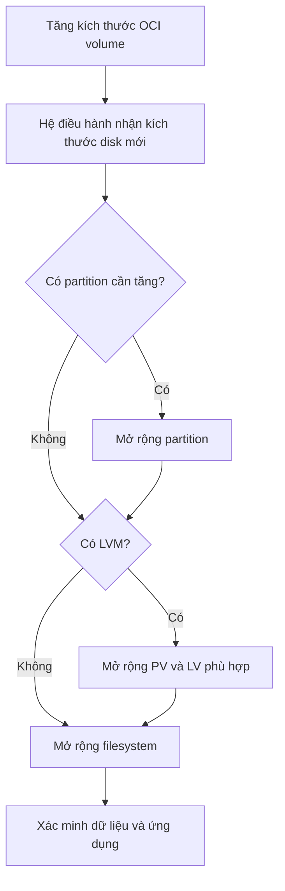

# Mở rộng volume, partition và filesystem

Trong chương **Block Volume và Boot Volume** của module Oracle Cloud Infrastructure (OCI), một tình huống thường gặp là đã tăng kích thước volume trên Console nhưng ứng dụng vẫn báo thiếu chỗ. Nguyên nhân là dung lượng ở lớp dịch vụ lưu trữ chưa được sử dụng hết bởi các lớp bên trong hệ điều hành.

Bài này hướng dẫn mở rộng theo thứ tự từ OCI volume đến thiết bị đĩa, partition, LVM nếu có và cuối cùng là filesystem. Phần thực hành chính dùng một Linux instance với block volume dữ liệu; boot volume và Windows được trình bày theo nhánh riêng. Mục tiêu là tăng dung lượng sử dụng được, giữ dữ liệu hiện có và có bằng chứng kiểm tra tại từng lớp.

Sau bài học, người học có thể:

- Giải thích vì sao tăng volume chưa tự làm `df` tăng.
- Đối chiếu volume OCID với attachment, thiết bị hệ điều hành và mount point.
- Chọn đúng luồng cho filesystem trên partition, toàn bộ disk hoặc logical volume.
- Mở rộng XFS/ext4 bằng đúng công cụ và sử dụng `oci-growfs` cho root filesystem được hỗ trợ.
- Xác minh dữ liệu, mount, dịch vụ và chi phí sau thao tác.

## 1. Những lớp nào cần được mở rộng?

Với một block volume có partition và filesystem trực tiếp trên partition:

```text
OCI Block Volume
  -> đĩa mà hệ điều hành nhìn thấy, ví dụ /dev/sdb
  -> partition, ví dụ /dev/sdb1
  -> filesystem XFS hoặc ext4
  -> mount point, ví dụ /srv/data
  -> thư mục dữ liệu của ứng dụng
```

Với LVM, có thêm các lớp:

```text
OCI volume -> disk -> partition nếu có -> physical volume (PV)
           -> volume group (VG) -> logical volume (LV)
           -> filesystem -> mount point
```

Không phải máy nào cũng có đủ mọi lớp. Một filesystem có thể nằm trực tiếp trên toàn bộ disk; một PV cũng có thể dùng toàn bộ disk thay vì partition.

| Lớp | Câu hỏi cần trả lời | Công cụ xem trên Linux |
|---|---|---|
| OCI volume | Dịch vụ đã cấp kích thước mới chưa? | Console hoặc OCI CLI |
| Disk | Kernel đã nhận dung lượng mới chưa? | `lsblk`, `blockdev --getsize64` |
| Partition | Vùng phân chia đã phủ phần cần dùng chưa? | `lsblk`, `sfdisk --dump` |
| PV/VG | LVM đã nhận thêm extents chưa? | `pvs`, `vgs` |
| LV | Logical volume mục tiêu đã lớn hơn chưa? | `lvs` |
| Filesystem | Dung lượng sử dụng được đã tăng chưa? | `df`, công cụ riêng của filesystem |
| Ứng dụng | Đọc/ghi và hoạt động nghiệp vụ còn bình thường không? | Kiểm tra của ứng dụng |

Ví dụ, volume và disk đã là 150 GB nhưng partition còn khoảng 100 GB thì filesystem vẫn bị giới hạn bởi partition. Với LVM, partition đã lớn hơn nhưng LV chưa tăng thì filesystem trên LV cũng chưa có thêm chỗ.



## 2. Xác định phạm vi và chuẩn bị trước khi thay đổi

### Chọn đúng đối tượng

Tình huống lab chính:

| Thành phần | Giả định của ví dụ |
|---|---|
| Máy | Linux instance thuộc compartment lab |
| Loại volume | Block volume dữ liệu, gắn một máy theo kiểu read/write |
| Dung lượng trên OCI | Tăng từ 100 lên 150 GB theo giao diện dịch vụ |
| Thiết bị Linux | Đã xác minh là `/dev/sdb` |
| Partition | `/dev/sdb1`, nằm cuối disk và có thể tăng vào vùng trống phía sau |
| Filesystem | XFS hoặc ext4, chọn đúng một nhánh |
| Mount point | `/srv/data`, đã mount đúng volume |

Tên `/dev/sdb`, partition số `1` và `/srv/data` chỉ là giá trị minh họa. Không suy ra thiết bị dữ liệu chỉ từ việc nó là disk thứ hai. Trên máy khác có thể là `/dev/sdc`, `/dev/vdb`, thiết bị NVMe hoặc đường dẫn device-mapper.

### Backup, quyền và phương án phục hồi

Trước khi resize, tạo backup của volume và xác nhận backup hoàn tất. OCI chỉ hỗ trợ tăng kích thước volume, không hỗ trợ giảm kích thước tại chỗ. Khi cần quay về cấu hình cũ, kế hoạch phục hồi thường liên quan đến khôi phục hoặc di chuyển dữ liệu sang volume khác, không phải nhập lại kích thước nhỏ hơn. [Nguồn: OCI resizing a volume](https://docs.oracle.com/en-us/iaas/Content/Block/Tasks/resizingavolume.htm).

Với database hoặc ứng dụng nhiều bước ghi, cần xác định mức nhất quán của bản sao và cách phục hồi ứng dụng. Một backup ở lớp block không tự chứng minh mọi giao dịch đang xử lý đều đã được ứng dụng ghi hoàn chỉnh. Chọn thời điểm, cơ chế quiesce hoặc công cụ backup phù hợp với workload.

Phân biệt hai phạm vi quyền:

- **IAM OCI** cho phép cập nhật volume trong compartment được giao.
- **Quyền guest OS** cho phép rescan, sửa partition/LVM và mở rộng filesystem.

Có quyền trên Console không tự cấp `sudo`; có `sudo` không tự cấp quyền sửa tài nguyên OCI. Ghi rõ volume nào đang được giữ cho ứng dụng nào, người thực hiện và thời gian thay đổi.

Kiểm tra thêm nếu volume có replication, nhiều attachment, multipath, mã hóa trong guest, RAID, thin provisioning hoặc Oracle ASM. Các cấu trúc này cần luồng tương ứng; không áp dụng nguyên ví dụ một disk, một partition, một filesystem.

Theo tài liệu OCI, volume đang bật cross-region replication cần tắt replication trước khi resize và có thể bật lại sau đó. Lập kế hoạch riêng cho khoảng thời gian bảo vệ dữ liệu bị thay đổi. [Nguồn: lưu ý replication khi resize](https://docs.oracle.com/en-us/iaas/Content/Block/Tasks/resizingavolume.htm).

## 3. Ghi lại trạng thái ban đầu và nhận diện disk

Chạy các lệnh quan sát trên Linux instance mục tiêu:

```bash
lsblk -o NAME,PATH,SIZE,TYPE,FSTYPE,MOUNTPOINTS
findmnt --mountpoint /srv/data -o TARGET,SOURCE,FSTYPE,OPTIONS
df -hT /srv/data
df -i /srv/data
```

`findmnt --mountpoint` ở đây kiểm tra đúng mount point. Nếu `/srv/data` chưa được mount, dừng để xác định lại; nếu chỉ chạy `df /srv/data`, kết quả có thể thuộc filesystem cha đang chứa thư mục đó.

Nếu máy có LVM và dữ liệu nằm trên LV, xem thêm:

```bash
sudo pvs
sudo vgs
sudo lvs -o lv_path,lv_size,vg_name,devices
```

Đối chiếu với attachment trên OCI: instance OCID, volume OCID, device path hoặc thông tin iSCSI. Nếu image hỗ trợ consistent device paths, có thể xem liên kết:

```bash
ls -l /dev/oracleoci/
readlink -f /dev/oracleoci/oraclevdb
```

Chỉ dùng đường dẫn đó khi nó thực sự tương ứng attachment mục tiêu. OCI hỗ trợ consistent device paths trên các Linux image tương thích; boot volume thường có đường dẫn nhất quán `/dev/oracleoci/oraclevda`. [Nguồn: OCI consistent device paths](https://docs.oracle.com/en-us/iaas/Content/Block/References/consistentdevicepaths.htm).

Sau khi đã chứng minh disk là `/dev/sdb`, ghi lại kích thước và cấu trúc:

```bash
sudo blockdev --getsize64 /dev/sdb
sudo sfdisk --dump /dev/sdb
sudo blkid /dev/sdb1
```

Lưu bản ghi partition table và kết quả lệnh vào nơi được phép ngoài volume đang chỉnh sửa. Nếu có một file lab bất biến đã chuẩn bị, ghi checksum trước thay đổi:

```bash
sha256sum /srv/data/resize-sample.dat
```

File này phải tồn tại và không bị ứng dụng chỉnh sửa trong thời gian đối chiếu. Checksum của một file mẫu giúp phát hiện thay đổi ở file đó; nó không chứng minh tính toàn vẹn của toàn bộ dữ liệu.

Trước khi thực hiện, cần trả lời được một câu đầy đủ: “Volume OCID này gắn vào instance này, được Linux nhận là disk này, chứa partition/LV này và đang mount tại đường dẫn này.”

## 4. Tăng kích thước volume trên OCI

### Online hoặc offline

Online resizing tăng volume khi còn attached; sau đó cần làm cho guest OS nhận dung lượng mới và mở rộng các lớp phía trên. Offline resizing thực hiện khi volume đã được tháo khỏi instance; khi gắn lại, hệ điều hành nhận disk với dung lượng mới, nhưng partition/filesystem vẫn cần xử lý. [Nguồn: online resizing](https://docs.oracle.com/en-us/iaas/Content/Block/Tasks/update-online-resize-block-boot-volume.htm), [offline resizing](https://docs.oracle.com/en-us/iaas/Content/Block/Tasks/update-offline-resize-block-boot-volume.htm).

Nếu chọn offline với volume dữ liệu, dừng các tiến trình dùng volume, unmount và tháo kết nối theo attachment type trước khi detach. Boot volume cần quy trình dừng máy và tháo/gắn boot volume phù hợp. Không rút một volume đang có filesystem ghi dữ liệu như thể chỉ đang sửa một thuộc tính trên Console.

### Qua Console

Với volume dữ liệu, mở **Storage → Block Storage → Block Volumes**. Với boot volume, mở danh sách **Boot Volumes**. Chọn đúng compartment, AD và volume OCID, rồi sửa kích thước bằng **Edit Size or Performance** hoặc mục tương ứng trong giao diện hiện tại.

Đặt dung lượng đích là `150 GB` cho lab, rà lại volume và lưu. Đợi thao tác cập nhật hoàn tất, kiểm tra kích thước mới trên dịch vụ và lưu các lệnh rescan nếu Console hiển thị chúng. Đừng đồng thời thay đổi nhiều thuộc tính không liên quan khi mục tiêu thực hành chỉ là dung lượng.

### Qua OCI CLI

Có thể thay thao tác Console bằng một trong hai lệnh sau, chạy ở môi trường OCI CLI đã cấu hình xác thực và đúng region/profile.

Với **block volume**:

```bash
oci bv volume update \
  --volume-id '<BLOCK_VOLUME_OCID>' \
  --size-in-gbs 150
```

Với **boot volume**:

```bash
oci bv boot-volume update \
  --boot-volume-id '<BOOT_VOLUME_OCID>' \
  --size-in-gbs 150
```

Hai loại tài nguyên dùng cờ định danh khác nhau. Chỉ chạy lệnh phù hợp với volume mục tiêu; `--size-in-gbs` là kích thước đích, không phải lượng cộng thêm. [Nguồn: block volume update](https://docs.oracle.com/en-us/iaas/tools/oci-cli/latest/oci_cli_docs/cmdref/bv/volume/update.html), [boot volume update](https://docs.oracle.com/en-us/iaas/tools/oci-cli/latest/oci_cli_docs/cmdref/bv/boot-volume/update.html).

Ở thời điểm này, mới chứng minh được lớp OCI đã thay đổi. Không lấy kết quả cập nhật API làm bằng chứng filesystem đã tăng.

## 5. Rescan để Linux nhận kích thước disk mới

Trước tiên xem lại disk:

```bash
lsblk -o NAME,PATH,SIZE,TYPE,FSTYPE,MOUNTPOINTS
sudo blockdev --getsize64 /dev/sdb
```

Nếu vẫn thấy kích thước cũ, dùng hướng dẫn rescan cho attachment và image đang dùng. Với disk SCSI đã xác minh là `sdb`, cặp lệnh OCI hướng dẫn có dạng:

```bash
sudo dd iflag=direct if=/dev/sdb of=/dev/null count=1
printf '1\n' | sudo tee /sys/class/block/sdb/device/rescan
```

Trong lệnh đầu, dữ liệu được đọc từ disk và đầu ra đi tới `/dev/null`. Giữ đúng `if` và `of`. Lệnh thứ hai yêu cầu kernel rescan thiết bị. [Nguồn: OCI rescanning the disk](https://docs.oracle.com/en-us/iaas/Content/Block/Tasks/rescanningdisk.htm).

Sau đó đọc lại:

```bash
sudo blockdev --getsize64 /dev/sdb
lsblk -o NAME,PATH,SIZE,TYPE,FSTYPE,MOUNTPOINTS
```

Nếu đã có dung lượng mới, chuyển sang lớp partition hoặc lớp tiếp theo thực sự tồn tại.

Những điểm cần phân biệt:

- `/sys/class/block/sdb/device/rescan` dùng **tên disk của kernel**, không phải `/dev/sdb1` hay tên LV.
- Nếu đường dẫn rescan không tồn tại, xác định driver và attachment thực tế; không thay bằng một disk khác để thử.
- Một attachment iSCSI cần session và kết nối hoạt động; không logout một session đang phục vụ filesystem chỉ để thử rescan.
- Với multipath, cần quy trình cho cả các path và mapping; ví dụ một disk SCSI đơn trong bài không bao phủ cấu trúc đó.

Disk đã lớn hơn nhưng `df` chưa thay đổi là trạng thái có thể dự đoán được. Rescan không tự mở rộng partition hoặc filesystem.

## 6. Mở rộng partition nếu cấu trúc có partition

### Điều kiện của ví dụ

Chỉ thực hiện phần này nếu đã xác nhận:

- Filesystem hoặc PV mục tiêu nằm trên `/dev/sdb1`.
- Partition số `1` thuộc disk `/dev/sdb`.
- Có vùng trống liền sau partition và không phải di chuyển partition khác.
- Công cụ `growpart` đã có và hỗ trợ partition table đang dùng.
- Disk hiện được kernel nhận với kích thước mới.

Trước tiên xem kế hoạch thay đổi:

```bash
sudo growpart -N /dev/sdb 1
```

`-N` của `growpart` là dry run. Đối số là **disk** rồi đến **số partition**, không phải chỉ đưa `/dev/sdb1`. Công cụ tăng partition tới giới hạn vùng có thể dùng trước partition kế tiếp hoặc cuối disk. [Nguồn: growpart manual](https://manpages.ubuntu.com/manpages/jammy/man1/growpart.1.html).

Nếu kết quả đúng với kế hoạch đã kiểm tra, thực hiện:

```bash
sudo growpart /dev/sdb 1
```

Đọc lại cả cấu trúc và kích thước partition mà kernel đang thấy:

```bash
lsblk -o NAME,PATH,SIZE,TYPE,FSTYPE,MOUNTPOINTS
sudo blockdev --getsize64 /dev/sdb1
sudo sfdisk --dump /dev/sdb
```

Chỉ chuyển tiếp khi partition đã có dung lượng cần thiết ở lớp kernel. Nếu bảng partition trên disk đã đổi nhưng kernel chưa nhận, xử lý cập nhật partition table theo công cụ/driver hoặc bố trí reboot có kế hoạch. Không ép thao tác tiếp khi chưa xác minh trạng thái.

Ví dụ với NVMe, cách tách đối số vẫn tương tự:

```text
Disk:      /dev/nvme1n1
Partition: /dev/nvme1n1p1
Cú pháp:   growpart /dev/nvme1n1 1
```

Đây chỉ là minh họa cú pháp; không xác định disk dữ liệu từ tên NVMe đó.

### Khi không áp dụng growpart

Nếu `lsblk` cho thấy filesystem trực tiếp trên toàn bộ disk thì bỏ qua mở rộng partition. Nếu mục tiêu nằm trước một partition khác, vùng trống ở cuối disk không tự trở thành vùng trống ngay sau mục tiêu. Khi đó cần kế hoạch bố trí hoặc di chuyển dữ liệu khác.

Nếu gặp thông báo `NOCHANGE`, xem lại kích thước disk, khoảng trống và việc partition đã được mở rộng từ trước. Không kết luận rằng filesystem cũng đã hoàn tất.

Trong quy trình này không tạo filesystem mới bằng `mkfs`, không xóa rồi tạo lại partition bằng cách đoán start sector, và không đổi kiểu filesystem. Đó là các thay đổi khác với tăng dung lượng hiện có.

## 7. Mở rộng filesystem trực tiếp trên partition hoặc disk

Xác định chính xác filesystem đang mount:

```bash
findmnt --mountpoint /srv/data -o TARGET,SOURCE,FSTYPE,OPTIONS
```

Chọn **một** nhánh tương ứng với kết quả. Các lệnh dưới giả định cấu trúc bên dưới filesystem đã được mở rộng và kernel đã nhận.

### XFS

Với XFS đang mount tại `/srv/data`:

```bash
sudo xfs_growfs -d /srv/data
df -hT /srv/data
```

`xfs_growfs` nhận mount point trong ví dụ; nó sử dụng dung lượng sẵn có trên thiết bị bên dưới. XFS cần được mount để grow và thao tác này không tăng disk, partition hay LV thay cho các bước trước. [Nguồn: Oracle Linux 9 growing XFS](https://docs.oracle.com/en/operating-systems/oracle-linux/9/xfs/xfs-GrowinganXFSFileSystem.html).

Không chạy `resize2fs` trên XFS. Nếu XFS không còn mount hoặc báo lỗi metadata/I/O, xử lý nguyên nhân và quy trình phục hồi trước khi tăng dung lượng; không thêm tùy chọn ép để bỏ qua lỗi.

### ext4

Với ext4 trên `/dev/sdb1`, trong cấu hình hỗ trợ online growth:

```bash
sudo resize2fs /dev/sdb1
df -hT /srv/data
```

Không chỉ định kích thước để công cụ sử dụng phần dung lượng thiết bị có thể chứa filesystem. Ext4 có thể tăng khi đang mount trong môi trường hỗ trợ; nếu phải kiểm tra/sửa filesystem offline, bố trí unmount và bảo trì trước. [Nguồn: Oracle Linux 9 resizing Ext](https://docs.oracle.com/en/operating-systems/oracle-linux/9/ext/ext-ResizinganExtFileSystem.html).

Nếu filesystem nằm trực tiếp trên disk, ví dụ đã xác minh ext4 trên `/dev/sdb`, đối tượng của `resize2fs` là `/dev/sdb`; không tự tạo thêm partition. Với XFS trên toàn bộ disk, vẫn grow theo mount point XFS tương ứng.

### Kiểm tra và sửa lỗi filesystem là thao tác riêng

Không chạy `e2fsck` sửa ext4 hoặc `xfs_repair` lên filesystem đang được mount và sử dụng. Cũng không thêm bước repair cưỡng bức vào mọi lần resize bình thường. Nếu phát hiện lỗi, dừng luồng tăng dung lượng, chuẩn bị bảo trì và dùng quy trình đúng với filesystem đó.

Phân biệt rõ: công cụ mở rộng filesystem sử dụng thêm vùng trống; công cụ repair kiểm tra hoặc thay đổi cấu trúc để xử lý lỗi. Chúng giải quyết các vấn đề khác nhau.

## 8. Nhánh LVM: cần mở rộng cả PV và LV

Phần này thay cho nhánh filesystem trực tiếp khi cấu trúc thực tế là:

```text
/dev/sdb
└─/dev/sdb1       LVM PV
  └─vgdata
    └─lvdata      XFS hoặc ext4, mount /srv/data
```

Giả sử LV ban đầu khoảng 100 GiB, mục tiêu là **140 GiB**, disk đã tăng lên mức đủ chứa và partition đã mở rộng. Giữ một phần extents chưa cấp trong VG nếu kế hoạch yêu cầu. Tên VG/LV và kích thước phải thay theo kết quả đọc thực tế.

### Cho LVM nhận thêm dung lượng PV

```bash
sudo pvresize /dev/sdb1
sudo pvs
sudo vgs
```

`pvresize` cập nhật kích thước PV sau khi thiết bị hoặc partition bên dưới đã lớn hơn; PV có thể đang thuộc VG có LV hoạt động. Nó chưa tự chọn LV nào sẽ nhận phần mới. [Nguồn: pvresize manual](https://manpages.ubuntu.com/manpages/noble/man8/pvresize.8.html).

Nếu PV nằm trực tiếp trên disk, dùng đúng disk PV đã xác minh, ví dụ `/dev/sdb`, và bỏ qua lớp partition.

### Cấp thêm extents cho đúng LV

Xem LV hiện tại và phần VG còn trống:

```bash
sudo lvs -o lv_path,lv_size,vg_name,devices
sudo vgs
```

Khi LV hiện nhỏ hơn 140 GiB và VG đủ extents phù hợp, đặt kích thước đích:

```bash
sudo lvextend -L 140G /dev/vgdata/lvdata
sudo lvs -o lv_path,lv_size,vg_name,devices
```

`-L 140G` là kích thước đích; `-L +40G` là cộng thêm 40 GiB. Lệnh `lvextend` cấp extents từ VG cho LV. Chọn kích thước theo kế hoạch thay vì mặc định dùng toàn bộ `%FREE` của VG dùng chung. [Nguồn: lvextend manual](https://manpages.ubuntu.com/manpages/jammy/man8/lvextend.8.html).

Sau khi LV đã lớn hơn, mở rộng filesystem **bên trong LV**.

Nếu là XFS tại `/srv/data`:

```bash
sudo xfs_growfs -d /srv/data
```

Nếu là ext4 trên LV đó:

```bash
sudo resize2fs /dev/vgdata/lvdata
```

Không chạy `resize2fs /dev/sdb1` khi `/dev/sdb1` là LVM PV. Trường `FSTYPE=LVM2_member` chỉ ra đây là lớp chứa LVM, không phải ext4 để grow trực tiếp.

Một số phiên bản/cấu hình LVM hỗ trợ `lvextend -r` để mở rộng cả LV và filesystem. Trong bài này tách hai thao tác để quan sát được trạng thái từng lớp. Nếu dùng lệnh gộp trong automation, vẫn phải kiểm tra kết quả cả LV và filesystem.

Các LV dạng thin, snapshot, RAID hoặc volume nhiều PV có thêm yêu cầu về metadata và chính sách cấp extents. Không dùng ví dụ linear LV đơn ở trên để suy toàn bộ quy trình cho chúng.

## 9. Nhánh boot volume và root filesystem

Boot volume có thể chứa EFI, `/boot`, partition LVM và nhiều LV. Dung lượng boot volume tăng không có nghĩa mọi filesystem như `/`, `/boot` và `/var` tự tăng cùng nhau.

Trước thao tác, đọc cấu trúc:

```bash
findmnt --mountpoint / -o TARGET,SOURCE,FSTYPE,OPTIONS
lsblk -o NAME,PATH,SIZE,TYPE,FSTYPE,MOUNTPOINTS
df -hT /
```

Với Oracle Linux image có OCI Utilities và root layout được hỗ trợ, sau khi tăng boot volume và xác nhận kernel nhận kích thước disk mới, có thể dùng:

```bash
sudo /usr/libexec/oci-growfs --help
sudo /usr/libexec/oci-growfs
```

Đọc thông tin về root filesystem, partition và LVM được công cụ nhận diện, rồi trả lời các bước xác nhận theo cấu trúc đã kiểm tra. Công cụ có lựa chọn `-y` để trả lời đồng ý các prompt, nhưng luồng tương tác giúp quan sát kế hoạch trong bài thực hành.

`oci-growfs` là công cụ trong guest thuộc OCI Utilities, khác với lệnh OCI CLI sửa tài nguyên dịch vụ. Nó hỗ trợ root filesystem XFS/ext4 và có thể xử lý các lớp liên quan trong root layout được hỗ trợ. [Nguồn: OCI Utilities reference](https://docs.oracle.com/en-us/iaas/oracle-linux/oci/oci-utilities-reference.htm).

Sau đó xác minh:

```bash
lsblk -o NAME,PATH,SIZE,TYPE,FSTYPE,MOUNTPOINTS
df -hT /
```

Nếu root nằm trên LVM, xem thêm `pvs`, `vgs` và `lvs`. Nếu thư mục bị đầy thuộc filesystem riêng như `/var`, kiểm tra mount point đó; tăng riêng `/` có thể không giải quyết vấn đề.

Không giả định Ubuntu, custom image hay mọi Oracle Linux image đều có sẵn utility và cùng một layout. Nếu công cụ không có hoặc không hỗ trợ cấu trúc, dùng luồng phù hợp với image sau khi xác định các lớp, hoặc thực hiện kế hoạch bảo trì được quản trị viên cung cấp. Không đoán rằng root luôn là partition số 1 hoặc số 3.

Với root đang dùng, không unmount `/` từ một phiên SSH bình thường để chạy các lệnh sửa offline. Khi thực sự cần thao tác offline, chuẩn bị đường quản trị/phục hồi và thời gian bảo trì phù hợp.

## 10. Nhánh Windows: rescan và Extend Volume

Trên Windows, sau khi tăng volume ở OCI, mở Disk Management bằng quyền quản trị và chọn **Action → Rescan Disks**. Đối chiếu đúng disk, partition và ký tự ổ trước khi sửa. [Nguồn: OCI rescan trên Windows](https://docs.oracle.com/en-us/iaas/Content/Block/Tasks/rescanningdisk.htm).

Với một basic volume NTFS có vùng Unallocated liền ngay sau trên cùng disk, chọn **Extend Volume** và chỉ định phần dung lượng cần thêm. Windows có các điều kiện về filesystem và vị trí vùng trống; partition recovery nằm giữa ổ hệ thống và vùng trống có thể làm thao tác không khả dụng. [Nguồn: Microsoft Extend a basic volume](https://learn.microsoft.com/en-us/windows-server/storage/disk-management/extend-a-basic-volume).

Có thể quan sát bằng PowerShell quản trị:

```powershell
Get-Disk
Get-Partition
Get-Volume
```

Ví dụ sau chỉ áp dụng khi đã xác minh ổ `D:` là volume lab cần mở rộng:

```powershell
$labPartition = Get-Partition -DriveLetter D
$labSize = Get-PartitionSupportedSize -DiskNumber $labPartition.DiskNumber -PartitionNumber $labPartition.PartitionNumber
$labSize
```

Xem `SizeMax` và đối chiếu mục tiêu trước khi resize. Để dùng toàn bộ phần có thể mở rộng trong trường hợp lab này:

```powershell
Resize-Partition -DiskNumber $labPartition.DiskNumber -PartitionNumber $labPartition.PartitionNumber -Size $labSize.SizeMax
Get-Volume -DriveLetter D
```

Nếu `Extend Volume` bị mờ hoặc `SizeMax` không tăng, kiểm tra bố cục partition và dung lượng disk mà Windows nhận. Không xóa recovery partition, chuyển disk sang dynamic hay format lại chỉ để làm nút mở rộng xuất hiện.

## 11. Kiểm chứng sau mở rộng

Đối với mount point dữ liệu trên Linux:

```bash
findmnt --mountpoint /srv/data -o TARGET,SOURCE,FSTYPE,OPTIONS
lsblk -o NAME,PATH,SIZE,TYPE,FSTYPE,MOUNTPOINTS
df -hT /srv/data
df -i /srv/data
sha256sum /srv/data/resize-sample.dat
```

Đối chiếu checksum với bản ghi trước nếu file mẫu được giữ bất biến. Sau đó thực hiện một phép đọc/ghi nhỏ do bài lab hoặc ứng dụng quy định và kiểm tra log dịch vụ. Không tạo file khổng lồ để lấp đầy volume vừa mở rộng.

Bằng chứng hoàn thành nên có:

| Mốc | Điều cần chứng minh |
|---|---|
| OCI | Đúng volume OCID đã có dung lượng đích |
| Guest disk | Kernel nhận dung lượng mới trên đúng disk |
| Partition | Partition mục tiêu đã tăng nếu cấu trúc có lớp này |
| LVM | PV, VG và LV phù hợp đã cập nhật nếu dùng LVM |
| Filesystem | Tổng dung lượng tăng trên đúng mount point |
| Dữ liệu | File mẫu giữ nguyên và dữ liệu cần thiết vẫn đọc được |
| Ứng dụng | Tác vụ kiểm tra thành công, không có lỗi lưu trữ mới |
| Vận hành | Mount và phương án khôi phục vẫn được quản lý |

OCI Console, `lsblk` và `df` có thể không hiển thị cùng một con số vì cách trình bày đơn vị, metadata, partition khác và phần dành riêng của filesystem. Dùng số byte khi cần so sánh chính xác; không coi mọi chênh lệch là mất dung lượng.

Không cần sửa `/etc/fstab` chỉ vì filesystem hiện có được mở rộng. Kiểm tra source/UUID và mount option vẫn đúng, đặc biệt sau detach/reattach có thể đổi tên thiết bị. Nếu cần chứng minh mount sau reboot, chỉ reboot theo lịch kiểm tra đã chuẩn bị và xác nhận ứng dụng sau khi máy trở lại. [Nguồn: quản lý filesystem mount table trên Oracle Linux](https://docs.oracle.com/en/operating-systems/oracle-linux/9/fsadmin/fsadmin-AbouttheFileSystemMountTable.html).

## 12. Tìm lỗi theo lớp và kết thúc thay đổi

| Hiện tượng | Lớp cần xem trước | Hướng xử lý |
|---|---|---|
| Console chưa có kích thước mới | OCI | Kiểm tra đúng OCID, kết quả cập nhật, quyền và trạng thái volume |
| Console tăng, disk còn cũ | Guest/attachment | Kiểm tra rescan, driver và đường kết nối đúng disk |
| Disk tăng, partition còn cũ | Partition | Xem vùng trống liền kề, số partition và kết quả growpart |
| Partition table đổi, kernel còn kích thước cũ | Kernel partition view | Chưa grow filesystem; xử lý nhận lại bảng partition hoặc bảo trì |
| Partition tăng, VG chưa có thêm chỗ | LVM PV | Kiểm tra đúng PV và kết quả pvresize |
| VG còn free, LV chưa tăng | LVM LV | Cấp đúng extents cho đúng LV theo mục tiêu |
| LV/partition tăng, `df` còn cũ | Filesystem | Kiểm tra loại filesystem và chạy đúng lệnh grow |
| `df` tăng nhưng ứng dụng vẫn hết chỗ | Mount/ứng dụng | Kiểm tra đường dữ liệu thực, quota, inode, file đã xóa còn mở và giới hạn ứng dụng |
| XFS báo không được mount | Filesystem/mount | Xác định mount và tình trạng filesystem trước khi grow |
| Windows không có Extend Volume | Layout | Kiểm tra vùng trống cùng disk và liền sau partition |
| Có lỗi I/O hoặc metadata | Tính toàn vẹn lưu trữ | Dừng thay đổi tiếp, giữ log và xử lý phục hồi theo lỗi |

Nếu lỗi ở một lớp, giữ nguyên bằng chứng các lớp đã thành công và xử lý tại lớp đang thiếu. Không tăng volume thêm lần nữa chỉ vì `df` chưa thay đổi.

Dung lượng mở rộng làm thay đổi tài nguyên được cấp và chi phí tương ứng. Rà lại ước tính, mức hiệu năng và dự báo tăng trưởng; đừng mặc định volume lớn hơn sẽ giải quyết mọi giới hạn I/O. Theo dõi mức sử dụng, độ trễ và thời gian còn lại tới ngưỡng đầy để lên kế hoạch trước.

Khi kết thúc lab, ghi dung lượng trước/sau, các lớp đã thay đổi, kết quả dữ liệu/ứng dụng và backup được giữ. Nếu tài nguyên dành riêng cho lab không còn dùng, thu hồi theo ownership và yêu cầu lưu dữ liệu. Với volume dùng thật, kết thúc thay đổi bằng việc bàn giao trạng thái đã kiểm chứng cùng người chịu trách nhiệm theo dõi.

Một lần mở rộng chỉ hoàn tất khi ứng dụng sử dụng được phần dung lượng mới trên đúng filesystem. Thứ tự **volume → disk → partition/PV/LV nếu có → filesystem → ứng dụng** giúp xác định chính xác việc đã làm và lớp còn cần xử lý.
