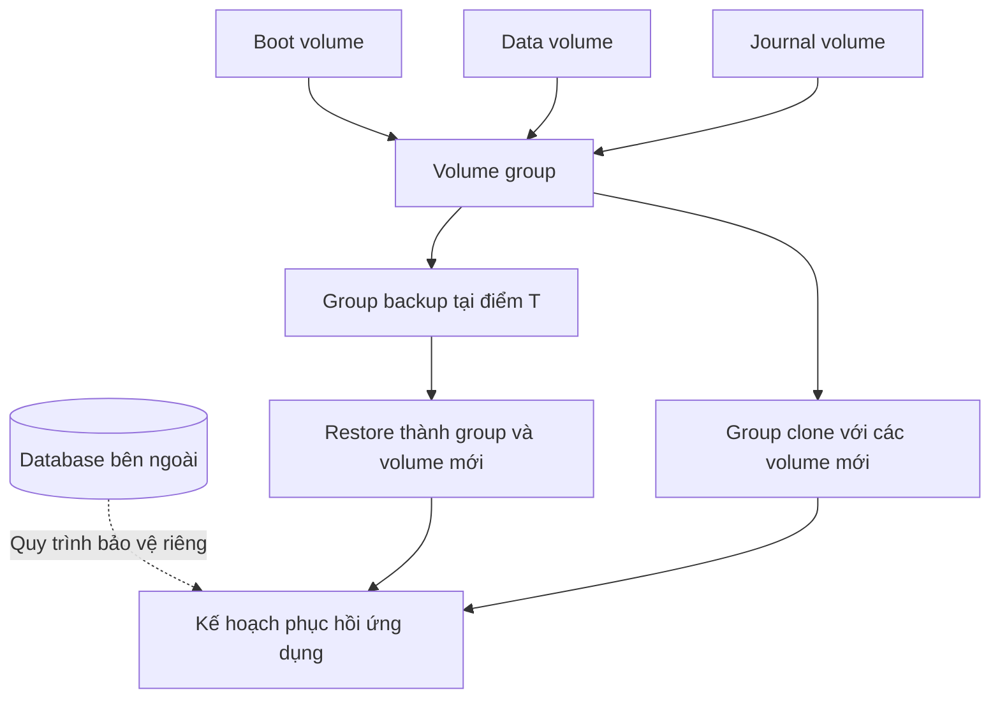

# Backup, clone và volume groups

Một volume vẫn hoạt động tốt không có nghĩa dữ liệu ứng dụng luôn an toàn trước thao tác xóa nhầm, lỗi phần mềm hoặc một lần nâng cấp thất bại. Khi cần phục hồi hoặc dựng môi trường kiểm thử trên Oracle Cloud Infrastructure, bạn phải chọn đúng loại bản sao và xác định rõ phạm vi dữ liệu cần giữ cùng nhau.

Trong OCI Block Volume, **backup** lưu một điểm phục hồi để khôi phục về sau; **clone** tạo một volume bản sao để sử dụng; **volume group** gom các volume liên quan để thực hiện backup hoặc clone có phối hợp. Việc chọn cơ chế cần gắn với yêu cầu phục hồi, tính nhất quán, phân quyền và chi phí vận hành.

Bài học dùng ví dụ một ứng dụng Java quản lý đơn hàng. Ứng dụng có thể cần boot volume cho hệ điều hành, một block volume cho dữ liệu và một volume khác cho các file liên quan. Database bên ngoài instance, hàng đợi và cấu hình mạng phải được xét riêng trong kế hoạch phục hồi.

## 1. Phân biệt mục tiêu của ba cơ chế

| Cơ chế | Bạn nhận được gì? | Tình huống sử dụng |
| --- | --- | --- |
| Backup | Tài nguyên backup đại diện cho dữ liệu ở một thời điểm, dùng cho thao tác phục hồi | Giữ các điểm trước khi nâng cấp hoặc phục hồi sau khi dữ liệu bị thay đổi sai |
| Clone | Volume mới chứa bản sao tại thời điểm clone | Tạo môi trường thử nghiệm hoặc phân tích dữ liệu trên bản sao |
| Volume group | Nhóm các volume được quản lý như một đơn vị cho những thao tác được hỗ trợ | Sao lưu hoặc nhân bản nhiều volume có quan hệ dữ liệu |

Backup và clone đều cần một quyết định về thời điểm lấy dữ liệu. Một clone được tạo sau khi ứng dụng đã ghi dữ liệu sai sẽ chứa chính dữ liệu sai đó. Một backup cũ có thể hợp lệ về mặt lưu trữ nhưng không đáp ứng mức mất dữ liệu mà nghiệp vụ cho phép.

Volume group cũng không phải một bản sao. Tạo group chỉ xác định tập volume; bạn vẫn cần tạo backup, clone hoặc cấu hình cơ chế bảo vệ phù hợp.

## 2. Backup: giữ một điểm phục hồi

Backup của volume có vòng đời riêng và được lưu qua dịch vụ Block Volume trong Object Storage. Khi cần phục hồi, bạn có thể tạo volume mới từ backup. Đây là tài nguyên backup do dịch vụ quản lý, không phải một file JAR hay thư mục mà ứng dụng tự chép lên bucket. [Oracle: Creating a Block Volume Backup](https://docs.oracle.com/en-us/iaas/Content/Block/Tasks/create-bv-backup.htm)

Ví dụ, trước khi thay đổi quy trình xử lý file đính kèm, nhóm tạo một backup của volume dữ liệu. Nếu bản phát hành mới làm hỏng nội dung file, nhóm có một điểm dữ liệu trước thay đổi để đánh giá và khôi phục. Tuy nhiên, dữ liệu phát sinh sau thời điểm đó cần có phương án đối soát riêng.

### 2.1. Full và incremental

OCI hỗ trợ backup full và incremental. Incremental lưu các thay đổi so với backup trước, nhưng khi phục hồi một điểm backup hợp lệ, dịch vụ khôi phục đầy đủ nội dung tại điểm đó. Người vận hành không phải tự phục hồi lần lượt một chuỗi full rồi incremental như một quy trình ghép file thủ công. Các bản backup cần giữ được lựa chọn theo những thời điểm phục hồi cần thiết. [Oracle: Block Volume Backups](https://docs.oracle.com/en-us/iaas/Content/Block/Concepts/blockvolumebackups.htm)

Điều này không có nghĩa có thể xóa mọi backup tùy ý. Bạn vẫn phải bảo toàn những điểm cần cho nghiệp vụ, kiểm tra retention và quyền xóa, đồng thời thử phục hồi. Dung lượng backup cũng không nên được suy ra chỉ từ số file còn thấy trong filesystem.

### 2.2. Restore cần tạo lại đường sử dụng dữ liệu

Trong luồng phục hồi sang volume mới, chọn backup, compartment và availability domain đích. Sau khi volume mới sẵn sàng, còn các bước attach, kết nối thiết bị nếu cần, nhận diện filesystem và cấu hình ứng dụng. Backup của block volume có thể được phục hồi sang availability domain khác trong cùng region; phục hồi ở region khác cần có bản backup phù hợp tại region đích, chẳng hạn qua thao tác copy. [Oracle: Restoring a Backup to a New Volume](https://docs.oracle.com/en-us/iaas/Content/Block/Tasks/create-restore-to-new-volume-bv-volume-backup.htm), [Oracle: Overview of Block Volume](https://docs.oracle.com/en-us/iaas/Content/Block/Concepts/overview.htm)

Không coi volume mới ở trạng thái sẵn sàng là đã hoàn tất phục hồi hệ thống. Ứng dụng còn phụ thuộc cấu hình, danh tính, database, endpoint và các dịch vụ bên ngoài tập dữ liệu vừa khôi phục.

## 3. Clone: tạo bản sao để sử dụng

Clone là bản sao tại một thời điểm, tạo trực tiếp từ volume nguồn mà không phải đi qua bước backup rồi restore. Những thay đổi về sau trên nguồn không tự đồng bộ sang clone. Với block volume, clone trực tiếp được tạo trong cùng region, availability domain và tenancy; có thể chọn compartment khác nếu quyền cho phép. Khi trạng thái chuyển sang `AVAILABLE`, clone có thể được sử dụng trong khi quá trình sao chép dữ liệu nền tiếp tục. [Oracle: Cloning a Block Volume](https://docs.oracle.com/en-us/iaas/Content/Block/Tasks/cloningavolume.htm)

Ví dụ, nhóm phát triển muốn thử một batch chuyển đổi file. Họ tạo clone từ volume dữ liệu thử nghiệm, gắn clone vào máy thử rồi chạy batch trên bản sao. Sau đó so sánh kết quả với dữ liệu ban đầu mà không sửa volume nguồn.

Các quyết định vẫn cần ghi rõ:

- Bản clone được lấy từ điểm nào và dữ liệu nguồn lúc đó ở trạng thái gì?
- Ai được truy cập dữ liệu trên clone?
- Máy thử có bị cấu hình nhầm để gọi database, hàng đợi hoặc dịch vụ thật không?
- Khi nào clone được dọn và ai chịu trách nhiệm cho chi phí lưu trữ?

Clone không thay cho lịch giữ nhiều điểm backup. Nếu cần khôi phục lịch sử nhiều ngày, phải thiết kế các điểm giữ dữ liệu và kiểm tra chúng theo yêu cầu đó.

Boot volume cũng có cơ chế clone. Bản sao boot volume giúp giữ dữ liệu hệ điều hành trên đĩa tại thời điểm lấy bản sao; nó không chứa bộ nhớ của tiến trình Java đang chạy. Việc dựng instance và kiểm tra cấu hình ứng dụng vẫn là các bước tiếp theo. [Oracle: Cloning a Boot Volume](https://docs.oracle.com/en-us/iaas/Content/Block/Tasks/create-clone-bv-boot-volume.htm)

## 4. Volume groups: xác định tập dữ liệu phải đi cùng nhau

Một volume group có thể gồm cả boot volume và block volume. Backup hoặc clone của group cung cấp điểm sao chép có phối hợp, crash-consistent cho các volume thành viên. Mỗi volume chỉ thuộc một group tại một thời điểm. [Oracle: Working with Volume Groups](https://docs.oracle.com/en-us/iaas/Content/Block/Concepts/volumegroups.htm)

Xét một hệ thống tự quản lý sau:

| Volume | Nội dung giả định | Quan hệ cần xét |
| --- | --- | --- |
| Boot | Hệ điều hành, runtime và file cấu hình cục bộ | Có thể cần cùng thế hệ triển khai với dữ liệu |
| Data | Dữ liệu ứng dụng hoặc file dữ liệu database tự quản lý | Có thể phụ thuộc các file trên volume khác |
| Journal | Journal, log phục hồi hoặc thành phần liên quan của workload | Cần được phục hồi đúng tập và đúng quy trình |

Tên và vai trò trong bảng là ví dụ. Không phải mọi file log đều bắt buộc nằm trong cùng tập phục hồi; phải dựa trên cách ứng dụng hoặc database thực sự quản lý dữ liệu.

Nếu lấy ba backup độc lập ở ba thời điểm khác nhau rồi ghép lại, bạn có thể tạo ra một tổ hợp chưa từng tồn tại trong hệ thống nguồn. Group giúp xử lý việc phối hợp điểm sao chép ở tầng lưu trữ, nhưng tính nhất quán nghiệp vụ vẫn cần thiết kế ở tầng ứng dụng.



Khi tạo group, chọn availability domain và các volume tương ứng; kiểm tra trạng thái volume, assignment backup policy và các cấu hình liên quan trước khi thêm. Không suy ra rằng mọi volume nhìn thấy trong tenancy đều có thể đưa vào cùng một group. [Oracle: Creating a Volume Group](https://docs.oracle.com/en-us/iaas/Content/Block/Concepts/create-volume-group.htm)

Group backup có thể được phục hồi thành một group, hoặc phục hồi các volume thành viên qua các volume backup tương ứng. Nếu ứng dụng cần toàn bộ tập nhất quán, việc chỉ phục hồi một thành viên phải được đánh giá riêng. [Oracle: Volume Group Backups](https://docs.oracle.com/en-us/iaas/Content/Block/Concepts/volumegroups_topic-Volume_Group_Backups.htm)

## 5. Crash-consistent và application-consistent

**Crash-consistent** có thể hình dung như trạng thái dữ liệu bền vững trên đĩa khi một hệ thống đột ngột dừng. Các cấu trúc hỗ trợ journal hoặc log phục hồi có thể cần chạy recovery khi mở lại. Snapshot không tự lưu mọi buffer còn nằm trong bộ nhớ ứng dụng.

**Application-consistent** yêu cầu ứng dụng phối hợp để đưa dữ liệu về một điểm phục hồi đã xác định: dừng nhận tác vụ ghi khi cần, hoàn tất hoặc xử lý giao dịch đang chạy, flush buffer và sử dụng cơ chế quiesce/backup được workload hỗ trợ.

Ví dụ, API Java lưu file lên block volume và ghi metadata vào một database bên ngoài. Group backup của các volume trên VM không chụp database đó. Nếu metadata và file cần khớp nhau, phải có quy trình phối hợp, cơ chế đối soát hoặc một thiết kế dữ liệu cho phép phục hồi phù hợp.

### 5.1. Mốc snapshot khác mốc hoàn tất backup

OCI hướng dẫn quiesce ứng dụng và đồng bộ dữ liệu cần thiết trước khi khởi tạo backup. Với backup một volume, có thể tiếp tục ghi sau khi trạng thái chuyển từ `REQUEST_RECEIVED` sang `CREATING`. Với group backup, mốc tiếp tục ghi là `COMMITTED`, xác nhận các snapshot thành viên đã được lấy có phối hợp. `AVAILABLE` là mốc backup sẵn sàng đầy đủ; không đồng nhất các trạng thái này. [Oracle: Block Volume Backups — best practices](https://docs.oracle.com/en-us/iaas/Content/Block/Concepts/blockvolumebackups.htm)

Trong runbook, ghi rõ trạng thái cần chờ, cách kiểm tra và cách khôi phục hoạt động nếu thao tác thất bại. Không giữ một filesystem ở trạng thái freeze vô thời hạn chỉ vì một lệnh chờ bị mất kết nối. Với database tự quản lý, làm theo quy trình của database; một lệnh `sync` ở Linux chưa đủ để chứng minh application-consistent.

Backup policy định kỳ cũng không tự chứng minh đã chạy các bước quiesce của ứng dụng. Cần xác định rõ điểm nào chỉ crash-consistent và điểm nào có sự phối hợp của workload.

## 6. Ví dụ CLI cho backup, clone và restore một volume

Các ví dụ dùng **Bash** và OCI CLI đã cấu hình xác thực. Chúng mô tả thao tác thực hành, chưa được chạy trên tenancy của bạn. Thay placeholder bằng tài nguyên thử nghiệm được cấp quyền; xác định tính nhất quán và chi phí trước khi tạo bản sao.

```bash
export COMPARTMENT_OCID='ocid1.compartment.oc1..REPLACE_ME'
export SOURCE_VOLUME_OCID='ocid1.volume.oc1.REGION.REPLACE_ME'
export AVAILABILITY_DOMAIN='REPLACE_WITH_EXACT_AVAILABILITY_DOMAIN_NAME'
```

### 6.1. Tạo backup thủ công

Sau khi chuẩn bị dữ liệu theo quy trình đã chọn:

```bash
oci bv backup create \
  --volume-id "$SOURCE_VOLUME_OCID" \
  --display-name order-data-before-release \
  --type FULL \
  --wait-for-state AVAILABLE
```

Ghi lại `data.id` của kết quả làm OCID backup. Ví dụ chờ `AVAILABLE` để thuận tiện cho bài thực hành; trong vận hành, thời gian tạm dừng ghi được quản lý theo các mốc snapshot ở phần trước. [Oracle CLI: backup create](https://docs.oracle.com/en-us/iaas/tools/oci-cli/latest/oci_cli_docs/cmdref/bv/backup/create.html)

Nếu lệnh chờ timeout, truy vấn tài nguyên đã tạo trước khi gửi yêu cầu mới. Timeout của CLI không tự chứng minh tác vụ trên dịch vụ đã thất bại hoặc bị hủy.

### 6.2. Tạo clone từ volume nguồn

```bash
oci bv volume create \
  --compartment-id "$COMPARTMENT_OCID" \
  --availability-domain "$AVAILABILITY_DOMAIN" \
  --source-volume-id "$SOURCE_VOLUME_OCID" \
  --display-name order-data-test-clone \
  --wait-for-state AVAILABLE
```

Với clone trực tiếp trong ví dụ, availability domain phải là nơi volume nguồn đang tồn tại. Lưu OCID của volume clone, không dùng lại OCID volume nguồn để attach vào máy thử. Tham số `--source-volume-id` xác định nguồn của thao tác clone. [Oracle: Cloning a Block Volume](https://docs.oracle.com/en-us/iaas/Content/Block/Tasks/cloningavolume.htm)

### 6.3. Restore backup sang volume mới

```bash
export BACKUP_OCID='ocid1.volumebackup.oc1.REGION.REPLACE_ME'

oci bv volume create \
  --compartment-id "$COMPARTMENT_OCID" \
  --availability-domain "$AVAILABILITY_DOMAIN" \
  --volume-backup-id "$BACKUP_OCID" \
  --display-name order-data-restore-test \
  --wait-for-state AVAILABLE
```

Lệnh này tạo một volume mới từ backup được chỉ định. Ghi lại OCID mới rồi thực hiện quy trình attach và kiểm tra dữ liệu trên máy thử. Volume đã có filesystem thì không format lại. [Oracle: Restoring a Backup to a New Volume](https://docs.oracle.com/en-us/iaas/Content/Block/Tasks/create-restore-to-new-volume-bv-volume-backup.htm)

Clone hoặc restore có thể mang theo các định danh bên trong đĩa như UUID filesystem, partition ID hoặc metadata LVM. Để giảm nhầm lẫn trong bài thực hành, dùng instance thử riêng; nếu cần gắn bản gốc cùng bản sao vào một máy, phải xử lý định danh theo hướng dẫn hệ điều hành và công nghệ lưu trữ đang dùng.

## 7. Ví dụ tạo và sao lưu volume group

Giả sử hai block volume dữ liệu thử nghiệm cần được bảo vệ cùng nhau. Trong thư mục thực hành của bạn, chuẩn bị `group-source.json` với OCID thật:

```json
{
  "type": "volumeIds",
  "volumeIds": [
    "ocid1.volume.oc1.REGION.REPLACE_WITH_DATA_VOLUME",
    "ocid1.volume.oc1.REGION.REPLACE_WITH_JOURNAL_VOLUME"
  ]
}
```

Tạo group sau khi xác nhận các volume đáp ứng điều kiện thêm vào group:

```bash
oci bv volume-group create \
  --compartment-id "$COMPARTMENT_OCID" \
  --availability-domain "$AVAILABILITY_DOMAIN" \
  --source-details file://group-source.json \
  --display-name order-stack-lab \
  --wait-for-state AVAILABLE
```

`type: volumeIds` biểu thị tạo group từ các volume có sẵn; thao tác này không tạo bản sao dữ liệu. Kiểm kê lại thành viên và lưu OCID group trước khi backup. [Oracle CLI: volume-group create](https://docs.oracle.com/en-us/iaas/tools/oci-cli/latest/oci_cli_docs/cmdref/bv/volume-group/create.html)

```bash
export GROUP_OCID='ocid1.volumegroup.oc1.REGION.REPLACE_ME'

oci bv volume-group-backup create \
  --volume-group-id "$GROUP_OCID" \
  --display-name order-stack-before-change \
  --type FULL \
  --wait-for-state AVAILABLE
```

Đây là yêu cầu backup ở cấp group. Ghi lại OCID group backup và trạng thái, đồng thời bảo toàn thông tin thành viên tại điểm backup để phục vụ đối chiếu về sau. [Oracle CLI: volume-group-backup create](https://docs.oracle.com/en-us/iaas/tools/oci-cli/latest/oci_cli_docs/cmdref/bv/volume-group-backup/create.html)

### 7.1. Khôi phục group backup

Chuẩn bị một file `group-restore-source.json` trong môi trường thực hành:

```json
{
  "type": "volumeGroupBackupId",
  "volumeGroupBackupId": "ocid1.volumegroupbackup.oc1.REGION.REPLACE_ME"
}
```

```bash
oci bv volume-group create \
  --compartment-id "$COMPARTMENT_OCID" \
  --availability-domain "$AVAILABILITY_DOMAIN" \
  --source-details file://group-restore-source.json \
  --display-name order-stack-restore-test \
  --wait-for-state AVAILABLE
```

Restore tạo group và các volume phục hồi; bạn vẫn phải ánh xạ đúng vai trò boot, data và các volume liên quan vào môi trường đích. Nó không tự dựng toàn bộ instance, network, IAM và luồng ứng dụng. [Oracle: Restoring a Volume Group from a Volume Group Backup](https://docs.oracle.com/en-us/iaas/Content/Block/Tasks/create-restore-bv-volume-group.htm)

Nếu mục tiêu là clone trực tiếp một group hiện hữu, nguồn của lệnh tạo group dùng `type: volumeGroupId` cùng trường `volumeGroupId`. Phân biệt nguồn này với `volumeGroupBackupId`, vốn dùng cho restore từ backup. [Oracle: Cloning a Volume Group](https://docs.oracle.com/en-us/iaas/Content/Block/Concepts/clone-volume-group.htm)

## 8. Đánh giá phục hồi bằng RPO và RTO

**RPO** là mục tiêu về khoảng dữ liệu có thể mất khi phục hồi. **RTO** là mục tiêu về thời gian đưa dịch vụ trở lại mức phục vụ đã xác định. Cả hai phải được đo theo quy trình ứng dụng, không chỉ theo thời gian một lệnh tạo volume hoàn tất.

Ví dụ giả định:

- Điểm dữ liệu mới nhất đã được backup thành công là 14:00.
- Lỗi làm dữ liệu không còn dùng được xảy ra lúc 14:17.
- Nếu chỉ phục hồi điểm 14:00 và không có cơ chế lấy lại giao dịch về sau, khoảng dữ liệu có nguy cơ mất là 17 phút.

Nếu mục tiêu RPO là 15 phút, tình huống trên chưa đáp ứng mục tiêu, dù vẫn có một backup tốt. Cần đánh giá lịch, độ trễ thực tế, thời gian hoàn tất và các cơ chế bảo vệ bổ sung phù hợp.

Một lần diễn tập có thể ghi thời gian giả định như sau:

| Công đoạn | Thời gian minh họa |
| --- | --- |
| Phát hiện và quyết định điểm phục hồi | 3 phút |
| Restore dữ liệu | 12 phút |
| Attach, mount và xử lý cấu hình | 5 phút |
| Recovery của workload và khởi động Java | 8 phút |
| Kiểm tra nghiệp vụ, mở lại lưu lượng | 4 phút |
| Tổng | 32 phút |

Các số này chỉ minh họa cách tính. Dùng kết quả đo trên môi trường của bạn để xác định khả năng đáp ứng RTO, bao gồm cả quyền truy cập, khả năng cấp phát tài nguyên và các phụ thuộc.

## 9. Lịch backup, retention, quyền và chi phí

Backup policy giúp xác định lịch và thời gian giữ các điểm backup. OCI hỗ trợ policy định sẵn và policy do người dùng tạo cho volumes và volume groups. Thời điểm bắt đầu thực tế có thể chậm hơn lịch; vì vậy cần quan sát các điểm backup thành công thay vì chỉ kiểm tra rằng tài nguyên đã được gán policy. [Oracle: Backup Policies](https://docs.oracle.com/en-us/iaas/Content/Block/Tasks/schedulingvolumebackups.htm)

Các quyết định vận hành cần có người chịu trách nhiệm:

| Nội dung | Câu hỏi cần trả lời |
| --- | --- |
| Lịch | Bao lâu lấy một điểm và dữ liệu nào cần phối hợp? |
| Retention | Giữ các điểm nào, trong bao lâu và điểm trước thay đổi quan trọng được giữ ra sao? |
| Theo dõi | Ai nhận lỗi backup, phát hiện điểm backup quá cũ và kiểm tra restore? |
| Phân quyền | Ai có quyền tạo, phục hồi, copy và xóa bản sao? |
| Mã hóa | Có cần quyền sử dụng khóa do khách hàng quản lý tại nơi phục hồi không? |
| Chi phí | Có bao nhiêu backup, clone và volume phục hồi đang được giữ? |

Backup thủ công hiện có tùy chọn retention có thể cấu hình; không suy ra thời gian tồn tại chỉ từ nhãn “manual”. Kiểm tra thiết lập của chính tài nguyên và yêu cầu vận hành trước khi dựa vào nó như một điểm phục hồi dài hạn. [Oracle: Creating a Block Volume Backup](https://docs.oracle.com/en-us/iaas/Content/Block/Tasks/create-bv-backup.htm)

Với kế hoạch liên vùng, cần kiểm tra cả bản sao backup tại region đích, quyền và cấu hình khóa mã hóa phù hợp. Không mặc định rằng khóa Vault sẽ tự được sao chép cùng policy backup. [Oracle: Backup Policies — cross-region copies](https://docs.oracle.com/en-us/iaas/Content/Block/Tasks/schedulingvolumebackups.htm)

Clone dùng để thử nghiệm nên có thời hạn sử dụng và người sở hữu rõ ràng. Môi trường restore thử cũng cần được kiểm kê sau diễn tập; tài nguyên không còn được ứng dụng truy cập vẫn có thể tiếp tục chiếm dung lượng được cấp phát.

### 9.1. Cẩn trọng khi đổi thành viên hoặc dọn group

Khi cập nhật thành viên group qua CLI/API, danh sách gửi lên phải chứa đầy đủ những volume muốn giữ; volume bị bỏ khỏi danh sách sẽ rời group. Xóa một volume group không tự xóa các volume thành viên. Ngược lại, xóa group backup sẽ xóa các volume backup nằm trong group backup đó. [Oracle: Working with Volume Groups](https://docs.oracle.com/en-us/iaas/Content/Block/Concepts/volumegroups.htm)

Phân biệt ba đối tượng trong biên bản dọn dữ liệu: group nguồn, các volume đang dùng và group backup. Mỗi đối tượng có mục đích và tác động xóa khác nhau.

## 10. Các lỗi thường gặp

| Nhận định | Hệ quả hoặc cách xử lý |
| --- | --- |
| Có clone là đủ thay cho backup lịch sử | Clone phản ánh một điểm; cần thiết kế và giữ các điểm phục hồi theo yêu cầu |
| Backup group tự đảm bảo mọi giao dịch ứng dụng | Xác định cơ chế quiesce và các dữ liệu nằm ngoài group |
| Ba backup riêng gần cùng giờ là một tập nhất quán | Dùng cơ chế phối hợp phù hợp và kiểm tra quy trình recovery |
| `REQUEST_RECEIVED` nghĩa là backup đã hoàn tất | Phân biệt mốc nhận yêu cầu, snapshot và sẵn sàng phục hồi |
| Restore volume xong là dịch vụ đã trở lại | Kiểm tra attach, mount, recovery, cấu hình và chức năng ứng dụng |
| Clone hoặc restore đã là ổ trống | Nhận diện dữ liệu hiện hữu; không chạy format lại |
| Có policy nghĩa là chắc chắn đáp ứng RPO | Theo dõi thời điểm dữ liệu thực tế của các backup thành công |
| Xóa group sẽ dọn hết tài nguyên | Kiểm kê riêng volume, attachment, backup và môi trường thử |

## 11. Bài tập vận dụng

Trong môi trường thử nghiệm, chuẩn bị hai volume có dữ liệu kiểm tra liên quan, chẳng hạn một file dữ liệu và một file mô tả phiên bản. Đưa chúng vào volume group rồi tạo group backup ở một điểm đã xác định. Sau đó thay đổi dữ liệu nguồn và restore group backup sang các volume mới để đối chiếu.

Ghi lại:

1. OCID volume nguồn, group nguồn và group backup.
2. Thành viên group cùng vai trò của từng volume tại điểm backup.
3. Dữ liệu hoặc giao dịch kiểm tra đại diện cho điểm phục hồi.
4. Mức nhất quán đã chọn và các bước phối hợp workload.
5. OCID các volume phục hồi, cách attach và mount trên máy thử.
6. Kết quả đọc lại dữ liệu và thời gian đưa chức năng thử trở lại.
7. Các phụ thuộc chưa nằm trong backup và cách bảo vệ chúng.

Làm thêm một clone của volume dữ liệu thử, sửa một file trên clone rồi kiểm tra nguồn. Giải thích vì sao sự độc lập của bản sao không tự tạo ra lịch sử phục hồi nhiều thời điểm.

Đầu ra của bài tập là một runbook xác định được **dữ liệu cần bảo vệ, điểm nhất quán, bản sao được giữ và các bước khôi phục ứng dụng**. Một backup chỉ trở thành bằng chứng phục hồi hữu ích khi bạn đã xác nhận có thể dùng nó để đưa dữ liệu và chức năng cần thiết trở lại.
