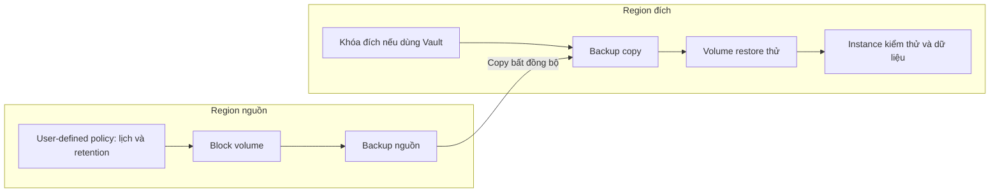

# Chính sách backup và sao chép volume giữa các region

Một volume đang hoạt động tốt chưa đủ để bảo đảm dữ liệu có thể phục hồi khi có lỗi ứng dụng, thao tác xóa nhầm hoặc sự cố ảnh hưởng cả region. Trong Oracle Cloud Infrastructure (OCI), backup policy giúp tạo các điểm khôi phục theo lịch, còn cross-region backup copy đưa các điểm khôi phục đó sang một region khác.

Để vận hành đúng, cần quản lý đồng thời lịch backup, thời gian lưu giữ, quyền IAM, khóa mã hóa, độ trễ sao chép và quy trình restore. Bài học thuộc chương **Block Volume và Boot Volume**, tập trung vào thiết kế và thực hành cơ chế này cho cả dữ liệu ứng dụng và đĩa khởi động của instance.

## Mục tiêu học tập

Sau bài học, bạn có thể:

- Phân biệt backup, bản copy backup, clone và replication.
- Chọn backup policy theo nhu cầu phục hồi và thời gian lưu giữ.
- Giải thích full backup và incremental backup trong OCI.
- Tạo policy có lịch và cross-region copy, rồi gán đúng tài nguyên.
- Chuẩn bị quyền sao chép và khóa mã hóa tại region đích.
- Xác minh bản copy bằng định danh, trạng thái và thời điểm dữ liệu.
- Restore thử một volume tại region đích và kiểm tra dữ liệu.
- Theo dõi độ mới của backup, phát hiện lỗi và kiểm soát chi phí.

## Phân biệt các cơ chế bảo vệ dữ liệu

| Cơ chế | Đối tượng tạo ra | Công dụng chính |
|---|---|---|
| Volume backup | Điểm khôi phục của volume tại một thời điểm | Quay lại dữ liệu ở thời điểm đã chọn |
| Cross-region backup copy | Bản backup ở region khác | Phục hồi khi region nguồn không sử dụng được, hoặc chuẩn bị chuyển vùng |
| Volume clone | Volume mới từ dữ liệu nguồn theo phạm vi hỗ trợ | Tạo bản sao làm việc mà không đi qua toàn bộ chu trình backup/restore |
| Volume replication | Replica được cập nhật bất đồng bộ | Chuẩn bị dữ liệu mới hơn cho các kịch bản DR |
| Backup ở cấp ứng dụng | Bản sao theo ngữ nghĩa của ứng dụng | Khôi phục transaction, đối tượng hoặc dữ liệu theo cơ chế ứng dụng hỗ trợ |

Replication và backup phục vụ các nhu cầu bổ sung cho nhau. Replica theo sát thay đổi có thể nhận cả thay đổi không mong muốn; backup lưu các điểm lịch sử để lựa chọn. Xem [Block Volume Replication](https://docs.oracle.com/en-us/iaas/Content/Block/Concepts/volumereplication.htm).

Trong bài này, “sao chép volume giữa các region” chủ yếu là chuỗi:

```text
Volume ở region nguồn
  -> tạo backup
  -> copy backup sang region đích
  -> restore thành volume mới tại region đích
```

Đây không phải thao tác đổi thuộc tính region của volume đang attach. Volume được tạo lại ở đích có OCID, attachment và vòng đời riêng.

## Phạm vi của backup

### Block volume và boot volume

Block volume thường chứa dữ liệu ứng dụng, filesystem hoặc dữ liệu cơ sở dữ liệu. Boot volume chứa OS và những dữ liệu được ghi lên đĩa khởi động. Backup boot volume có thể được tạo thủ công hoặc theo policy và có khả năng copy sang region khác. Xem [Boot Volume Backups](https://docs.oracle.com/en-us/iaas/Content/Block/Concepts/bootvolumebackups.htm).

Backup boot volume không tự bao gồm mọi block volume gắn thêm, local NVMe, RAM hoặc dữ liệu ở một dịch vụ khác. Khi bảo vệ một instance, cần xác định dữ liệu nào nằm ở đâu thay vì chỉ bật policy cho đĩa khởi động.

### Volume và backup có phạm vi vị trí khác nhau

Volume dùng với instance trong cùng availability domain theo mô hình attachment của Block Volume. Backup có thể được restore vào AD phù hợp trong region chứa backup. Muốn restore ở region khác, trước hết cần có backup ở region đó. Xem [phạm vi region và AD của Block Volume](https://docs.oracle.com/en-us/iaas/Content/Block/Concepts/overview.htm).

Một bản copy ở region đích không tạo sẵn:

- Compute instance với shape phù hợp.
- VCN, subnet, NSG, route hoặc kết nối riêng.
- Cấu hình load balancer và DNS phục vụ người dùng.
- Secret, certificate và quyền truy cập của ứng dụng.
- Các dịch vụ dữ liệu bên ngoài volume.

Vì vậy, cross-region backup là một phần của phương án phục hồi hệ thống.

## Full backup và incremental backup

OCI hỗ trợ full và incremental backup. Incremental ghi nhận thay đổi kể từ backup trước, nhưng khi restore, người vận hành chọn một backup để khôi phục nội dung volume tại thời điểm đó. Không phải tự tải và ghép từng file trong một chuỗi incremental. Xem [ngữ nghĩa các loại Block Volume backup](https://docs.oracle.com/en-us/iaas/Content/Block/Concepts/blockvolumebackups.htm).

Cần phân biệt:

| Khía cạnh | Cách hiểu |
|---|---|
| Dữ liệu được lưu thêm ở một lần backup | Phụ thuộc loại backup và các block thay đổi |
| Nội dung được phục hồi | Trạng thái của volume tại điểm khôi phục đã chọn |
| Số backup đang giữ | Do retention, các thao tác thủ công và cơ chế bảo vệ liên quan |
| Dung lượng tính phí | Không thể suy đơn giản từ số backup nhân dung lượng đang dùng trong filesystem |

Không xóa backup chỉ vì thấy tên “full” và cho rằng nó chắc chắn dư thừa, cũng không giữ vô hạn mọi bản “incremental” vì nghĩ phải tự duy trì chuỗi. Hãy quản lý qua retention và kiểm chứng restore theo cơ chế của dịch vụ.

Sau khi thay đổi dung lượng volume hoặc dữ liệu thay đổi lớn, đánh giá lại thời gian backup, dung lượng lưu và khả năng copy trong cửa sổ mong muốn.

## Tính nhất quán dữ liệu

Backup volume bảo vệ dữ liệu trên đĩa tại một thời điểm. Nó không tự hiểu mọi transaction, bộ đệm trong RAM hoặc thứ tự ghi của ứng dụng.

Đối với boot volume, OCI mô tả backup theo mô hình crash-consistent. Với dữ liệu cần application consistency, nhóm vận hành phải thực hiện quy trình phù hợp: quiesce, flush, checkpoint hoặc cơ chế backup của ứng dụng. Không coi việc backup được tạo khi instance đang chạy là bằng chứng tất cả transaction đã nhất quán.

Nếu dữ liệu trải trên nhiều volume, một lịch gán riêng cho từng volume không tạo ra một điểm khôi phục đồng bộ cho toàn bộ dữ liệu. Cần xem xét volume group và backup ở cấp nhóm, cùng cách phối hợp với ứng dụng.

Khi quản lý policy ở cấp volume group, phải xử lý các assignment ở cấp volume theo quy trình hỗ trợ. Không để hai mô hình bảo vệ chồng chéo mà nhóm vận hành không biết policy nào thực sự áp dụng. Xem [gán backup policy cho volume group](https://docs.oracle.com/en-us/iaas/Content/Block/Concepts/create-assign-to-group-bv-volume-backup-policy-assignment.htm).

Ví dụ với một database tự quản lý:

1. Xác định datafile, log và cấu hình nằm trên các volume nào.
2. Chọn cơ chế tạo điểm khôi phục được database hỗ trợ.
3. Phối hợp backup volume hoặc volume group nếu dùng ở lớp lưu trữ.
4. Copy bộ tài nguyên cần thiết sang region đích.
5. Kiểm thử phục hồi database, không chỉ kiểm tra mount filesystem.

## Thiết kế policy từ yêu cầu phục hồi

Trước khi cấu hình, cần trả lời các câu hỏi:

| Câu hỏi | Quyết định cần đưa ra |
|---|---|
| Có thể chấp nhận mất bao nhiêu dữ liệu? | RPO mục tiêu |
| Có thể ngừng phục vụ bao lâu? | RTO mục tiêu |
| Cần quay lại bao xa trong lịch sử? | Retention và các lớp điểm khôi phục |
| Sự cố nào cần được xử lý? | Hỏng dữ liệu, xóa nhầm, mất instance hoặc mất region |
| Dữ liệu nào phải nhất quán với nhau? | Volume riêng, volume group hoặc backup ứng dụng |
| Ai có thể tạo, copy, restore và xóa? | Quyền IAM theo vai trò |
| Ai chịu chi phí và duy trì quy trình? | Chủ sở hữu, tag và lịch rà soát |

RPO là mục tiêu về độ mất dữ liệu chấp nhận được. RTO là mục tiêu thời gian phục hồi dịch vụ. Hai mục tiêu này cần được đo bằng điểm khôi phục và quy trình restore thực tế.

Chẳng hạn, backup mỗi ngày không tự bảo đảm RPO tại region đích nhỏ hơn 24 giờ. Backup còn phải hoàn thành, được copy, có khóa sử dụng được và có thể restore.

## Chọn Oracle-defined hay user-defined policy

OCI có các policy định sẵn như Bronze, Silver và Gold. Chúng có lịch và retention do Oracle quy định. User-defined policy cho phép nhóm tự cấu hình. Việc tự động copy backup theo lịch sang region khác cần user-defined policy; có thể nhân bản policy sẵn có rồi điều chỉnh. Xem [Backup Policies](https://docs.oracle.com/en-us/iaas/Content/Block/Tasks/schedulingvolumebackups.htm).

| Lựa chọn | Phù hợp khi |
|---|---|
| Oracle-defined policy | Lịch và retention có sẵn đáp ứng nhu cầu, không cần tự động cross-region copy theo policy |
| User-defined policy | Cần chủ động thời gian, retention hoặc region đích |
| Manual backup | Cần một điểm khôi phục cho thay đổi cụ thể hoặc một lần kiểm thử |
| Kết hợp các cơ chế | Có yêu cầu vận hành khác nhau và đã quản lý rõ vòng đời từng loại backup |

Backup policy ở đây là chính sách **lập lịch bảo vệ dữ liệu**. IAM policy là chính sách **cấp quyền truy cập**. Có quyền tạo backup không có nghĩa volume đã được gán lịch; đã có lịch cũng không chứng minh mọi quyền cross-region đã đầy đủ.

## Lịch, múi giờ và retention

### Ghi rõ múi giờ

Một schedule cần thể hiện tần suất, thời điểm và múi giờ. Ví dụ:

| Thành phần | Giá trị minh họa |
|---|---|
| Tần suất | Mỗi ngày |
| Giờ | 18:00 UTC |
| Quy đổi sang Việt Nam | 01:00 UTC+7 của ngày kế tiếp |
| Loại backup yêu cầu | Incremental |
| Retention | 14 ngày |
| Copy | Tự động sang region đích đã chọn |

Đây là lịch thực hành để minh họa cách diễn giải, không phải thời điểm phù hợp cho mọi workload. Chọn cửa sổ theo tải, quy trình ứng dụng và thời gian hoàn thành quan sát được.

Khi dùng các field có cấu trúc như `hourOfDay`, cần đặt `offsetType` phù hợp. Với `STRUCTURED`, các field lịch được dùng theo loại period; không trộn ý nghĩa với offset tính bằng giây. Xem [mô hình VolumeBackupSchedule](https://docs.oracle.com/en-us/iaas/tools/java/latest/com/oracle/bmc/core/model/VolumeBackupSchedule.html).

### Retention không phải tần suất

“Backup mỗi ngày, giữ 14 ngày” khác với “backup mỗi 14 ngày”. Tần suất quyết định cơ hội tạo điểm khôi phục; retention quyết định điểm đó được giữ trong bao lâu.

Khi thiết kế nhiều lớp lưu giữ, có thể cần các điểm ngắn hạn và dài hạn khác nhau. Tuy nhiên, phải đối chiếu giới hạn lịch, quy tắc xử lý lịch trùng và năng lực copy của dịch vụ. Không tự suy rằng API có trường thời gian nào đó thì mọi tổ hợp lịch đều hoạt động như mong muốn.

Đối với bản copy tự động, retention của bản đích theo retention của backup nguồn. Việc copy chậm không có nghĩa bản đích tự được thêm một thời hạn đầy đủ tính từ lúc bạn nhìn thấy nó. Cần đọc trạng thái và thông tin hết hạn thực tế của tài nguyên.

### Retention lock và các cơ chế giữ dữ liệu

Các chức năng retention hiện có thể bao gồm thời gian lưu, prevent deletion, retention lock hoặc indefinite hold, tùy tài nguyên và thao tác được hỗ trợ.

- Retention xác định thời hạn lưu dữ liệu.
- Prevent deletion kiểm soát việc xóa trong điều kiện được cấu hình.
- Retention lock ngăn giảm hoặc bỏ thời hạn bảo vệ sau khi được bật.
- Indefinite hold giữ backup cho đến khi hold được gỡ theo quyền tương ứng.

Không coi prevent deletion là cách tự động kéo dài một backup đã đến hạn. Các cơ chế này có quyền IAM riêng và ảnh hưởng đến việc sửa hoặc xóa tài nguyên. Xem [thiết lập retention cho schedule](https://docs.oracle.com/en-us/iaas/Content/Block/Tasks/create-schedule-bv-volume-backup-policy.htm) và [quản lý retention của backup](https://docs.oracle.com/en-us/iaas/Content/Block/Tasks/bv-backup-edit.htm).

Lab bên dưới chỉ minh họa lịch và retention cơ bản. Việc bật cơ chế khóa cần là một quyết định riêng theo yêu cầu lưu giữ và trách nhiệm quản lý dữ liệu.

## Chuẩn bị region đích và quyền IAM

### Kiểm tra tài nguyên và phạm vi

Trước khi bật copy, ghi nhận:

1. Volume OCID, loại block hoặc boot và compartment nguồn.
2. Region nguồn và region đích được hỗ trợ, đã sẵn sàng cho tenancy sử dụng.
3. Backup policy hiện tại và cấp áp dụng: volume hay volume group.
4. Các quyền tạo backup nguồn, copy và tạo backup ở đích.
5. Khóa mã hóa nguồn và khóa đích nếu dùng customer-managed keys.
6. Quota, service limits và tài nguyên cần cho lần restore thử.
7. Chủ sở hữu, lịch vận hành và nơi ghi bằng chứng khôi phục.

Region khác không đồng nghĩa tài khoản hoặc tenancy khác. Ví dụ trong bài xử lý copy giữa các region trong phạm vi quyền đã chuẩn bị; không mặc định đây là quy trình cross-tenancy.

### Phân biệt quyền block backup và boot backup

Đối với copy block volume backup, cần các quyền nguồn như `VOLUME_BACKUP_READ`, `VOLUME_BACKUP_COPY` và quyền tạo backup ở đích như `VOLUME_BACKUP_CREATE`. Tài liệu lưu ý aggregate resource type `volume-family` không tự bao gồm quyền copy này. Xem [quyền copy block volume backup](https://docs.oracle.com/en-us/iaas/Content/Block/Tasks/copy-bv-backup.htm).

Boot volume backup có nhóm quyền tương ứng như `BOOT_VOLUME_BACKUP_READ`, `BOOT_VOLUME_BACKUP_COPY` và `BOOT_VOLUME_BACKUP_CREATE`. Không dùng quyền block backup để suy rằng boot backup đã được cấp đủ.

Các tên quyền trên dùng để đối chiếu với IAM; chúng chưa phải một bộ policy triển khai hoàn chỉnh. Phạm vi cấp quyền còn cần giới hạn theo compartment, region và vai trò. Quyền restore, attach volume và sử dụng khóa cũng phải được kiểm tra riêng.

## Chuẩn bị khóa mã hóa tại region đích

Khóa Vault của volume nguồn không tự được copy cùng backup sang region khác. Nếu dùng customer-managed encryption ở đích, phải chỉ định khóa hợp lệ tại region đích và cấu hình quyền sử dụng khóa cho Block Volume. Nếu không chỉ định customer-managed key, cơ chế mặc định dùng Oracle-managed key theo thao tác. Xem [khóa mã hóa cho các thao tác cross-region](https://docs.oracle.com/en-us/iaas/Content/Block/Tasks/assign-encryption-key.htm).

Ba vấn đề cần xác minh độc lập:

| Vấn đề | Cần kiểm tra |
|---|---|
| Định danh | OCID là key, thuộc đúng region và đúng tài nguyên |
| Quyền | Người hoặc pipeline được phép cấu hình; dịch vụ được phép thực hiện thao tác mật mã cần thiết |
| Vòng đời | Key và quyền giải mã vẫn sử dụng được trong toàn thời gian cần phục hồi |

Khóa của bản copy là thuộc tính cần đọc lại ở backup đích. Không chỉ nhìn khóa của volume nguồn rồi kết luận bản copy đã dùng cùng chính sách mã hóa.

Với tự động cross-region copy, khóa đích có thể được chỉ định khi **gán policy** cho tài nguyên. Với manual copy, tham số khóa nằm trên thao tác copy. Hai vị trí cấu hình này dễ bị nhầm.

Nếu khóa bị vô hiệu hóa hoặc lên lịch xóa, bản backup còn hiển thị chưa đủ để bảo đảm restore thành công. Kế hoạch DR phải bao gồm khả năng sử dụng khóa ở region đích khi region nguồn không hoạt động.

## Mô hình thực hành

Giả sử bạn có một block volume thử nghiệm chứa dữ liệu mẫu, cần backup mỗi ngày và copy sang một region khác:



Dữ liệu mẫu nên có giá trị có thể đối chiếu, chẳng hạn một tập file có checksum hoặc một tập bản ghi thử với mốc thời gian. Không dùng trạng thái “volume đã attach” làm kết quả kiểm thử dữ liệu.

Các lệnh tiếp theo là ví dụ **Bash** trên môi trường đã cài và xác thực OCI CLI. Các giá trị có dấu `...` hoặc nằm trong `<...>` là placeholder. Đây là nội dung hướng dẫn; bài viết không thực thi lệnh cloud hoặc tạo các tài nguyên thật.

## Tạo policy bằng Console

Một quy trình điển hình:

1. Chọn đúng region và phạm vi quản lý.
2. Mở phần **Block Storage → Backup Policies**.
3. Tạo user-defined policy và đặt tên thể hiện mục đích.
4. Chọn cross-region copy target phù hợp.
5. Thêm schedule: tần suất, giờ, múi giờ, loại backup và retention.
6. Đọc lại lịch theo múi giờ vận hành.
7. Mở volume hoặc boot volume cần bảo vệ và gán policy.
8. Nếu cần customer-managed key cho bản đích, chọn khóa thuộc region đích tại bước assignment.
9. Xác minh policy assignment sau khi lưu.

Tạo policy chưa đủ để phát sinh backup cho một volume. Policy cần có lịch hợp lệ và được gán đúng asset. Xem [tạo user-defined policy](https://docs.oracle.com/en-us/iaas/Content/Block/Tasks/create-bv-volume-backup-policy.htm) và [gán policy cho volume](https://docs.oracle.com/en-us/iaas/Content/Block/Tasks/create-bv-volume-backup-policy-assignment.htm).

Đối với volume group, dùng quy trình ở cấp nhóm. Không lặp lại thao tác gán riêng cho các volume thành viên để thay thế policy nhóm.

## Tạo và gán policy bằng OCI CLI

### Ghi nhận assignment hiện tại

```bash
SOURCE_REGION='<source-region>'
DEST_REGION='<destination-region>'
POLICY_COMPARTMENT_ID='ocid1.compartment.oc1...'
BLOCK_VOLUME_ID='ocid1.volume.oc1...'

oci bv volume get \
  --region "$SOURCE_REGION" \
  --volume-id "$BLOCK_VOLUME_ID"

oci bv volume-backup-policy-assignment \
  get-volume-backup-policy-asset-assignment \
  --region "$SOURCE_REGION" \
  --asset-id "$BLOCK_VOLUME_ID"
```

Đối chiếu volume và assignment trước khi sửa. Mỗi volume chỉ có một backup policy assignment; lệnh gán policy khác có thể thay thế assignment hiện tại. Không coi thao tác đó là bổ sung thêm một lớp lịch độc lập. Xem [ngữ nghĩa policy assignment](https://docs.oracle.com/en-us/iaas/tools/oci-cli/latest/oci_cli_docs/cmdref/bv/volume-backup-policy-assignment/create.html).

Nếu bài thực hành thay thế policy cũ, ghi lại policy OCID và các tùy chọn liên quan để có thể khôi phục cấu hình ban đầu.

### Tạo một lịch hằng ngày

Ví dụ sau yêu cầu incremental backup lúc 18:00 UTC, giữ 14 ngày:

```bash
oci bv volume-backup-policy create \
  --region "$SOURCE_REGION" \
  --compartment-id "$POLICY_COMPARTMENT_ID" \
  --display-name 'daily-14d-cross-region' \
  --destination-region "$DEST_REGION" \
  --schedules '[
    {
      "backupType": "INCREMENTAL",
      "period": "ONE_DAY",
      "offsetType": "STRUCTURED",
      "hourOfDay": 18,
      "retentionSeconds": 1209600,
      "timeZone": "UTC"
    }
  ]'
```

`1209600 = 14 × 24 × 60 × 60` giây. Đọc lại nội dung API trả về và đối chiếu lịch, retention, region đích. Ví dụ dùng `retentionSeconds`; khi bổ sung các tính năng retention mới, đối chiếu schema và phiên bản CLI thay vì tự phối hợp các field có thể chồng ý nghĩa. Xem [OCI CLI volume-backup-policy create](https://docs.oracle.com/en-us/iaas/tools/oci-cli/latest/oci_cli_docs/cmdref/bv/volume-backup-policy/create.html).

Sau khi tạo, lấy OCID policy từ kết quả:

```bash
BACKUP_POLICY_ID='ocid1.volumebackuppolicy.oc1...'

oci bv volume-backup-policy get \
  --region "$SOURCE_REGION" \
  --policy-id "$BACKUP_POLICY_ID"
```

### Gán policy và chọn khóa đích

Nếu dùng Oracle-managed encryption cho bản copy, có thể gán như sau:

```bash
oci bv volume-backup-policy-assignment create \
  --region "$SOURCE_REGION" \
  --asset-id "$BLOCK_VOLUME_ID" \
  --policy-id "$BACKUP_POLICY_ID"
```

Nếu yêu cầu dùng Vault key tại region đích, thực hiện phương án assignment tương ứng với khóa đã chuẩn bị:

```bash
DEST_KEY_ID='ocid1.key.oc1...'

oci bv volume-backup-policy-assignment create \
  --region "$SOURCE_REGION" \
  --asset-id "$BLOCK_VOLUME_ID" \
  --policy-id "$BACKUP_POLICY_ID" \
  --xrc-kms-key-id "$DEST_KEY_ID"
```

Hai khối trên là hai lựa chọn, không phải hai bước bắt buộc chạy liên tiếp. `--xrc-kms-key-id` cấu hình khóa cho bản backup copy ở đích; nó không thay khóa volume nguồn.

Với boot volume, dùng đúng boot volume OCID ở asset assignment và kiểm tra policy áp dụng cho tài nguyên đó. Việc bảo vệ boot volume và block volume bằng cùng policy không làm hai lần backup riêng trở thành một snapshot đồng bộ.

## Quan sát lần chạy theo lịch đầu tiên

Sau khi gán policy:

1. Xác nhận assignment đúng và schedule vẫn còn hiệu lực.
2. Đến chu kỳ thực tế, kiểm tra backup nguồn đã được tạo.
3. Chờ backup và copy hoàn tất theo trạng thái dịch vụ.
4. Chuyển sang region đích để tra cứu bản copy.
5. Đối chiếu nguồn gốc, thời điểm dữ liệu, retention và khóa mã hóa.
6. Chọn bản copy đó cho một lần restore thử.

Lịch là thời điểm yêu cầu bắt đầu theo cơ chế dịch vụ, không phải cam kết mọi tài nguyên hoàn tất đúng phút đó. Tài liệu OCI lưu ý copy backup hằng ngày sang đích có thể mất tới 24 giờ. Vì vậy, thiết kế cảnh báo theo chu trình thực tế và RPO mục tiêu thay vì chỉ kiểm tra có một backup nguồn hôm nay.

Nếu cần thử đường copy sớm, có thể tạo và copy một backup thủ công như phần dưới. Kết quả đó kiểm chứng một số quyền và khả năng khôi phục, nhưng **không chứng minh schedule tự động đã chạy**.

## Tạo backup và copy thủ công để kiểm thử

### Tạo backup nguồn

Chuẩn bị dữ liệu nhất quán của volume thử nghiệm trước khi gọi backup:

```bash
oci bv backup create \
  --region "$SOURCE_REGION" \
  --volume-id "$BLOCK_VOLUME_ID" \
  --display-name 'manual-dr-test' \
  --type INCREMENTAL
```

Lấy backup OCID từ kết quả rồi tra cứu:

```bash
SOURCE_BACKUP_ID='ocid1.volumebackup.oc1...'

oci bv backup get \
  --region "$SOURCE_REGION" \
  --volume-backup-id "$SOURCE_BACKUP_ID"
```

Backup có thể đi qua `REQUEST_RECEIVED` và `CREATING`; `AVAILABLE` là mốc sẵn sàng cần kiểm tra trước bước tiếp theo. Xem [OCI CLI backup create](https://docs.oracle.com/en-us/iaas/tools/oci-cli/latest/oci_cli_docs/cmdref/bv/backup/create.html).

Manual backup có vòng đời riêng. Đọc retention và hold thực tế của nó; không giả định nó sẽ tự được policy gán cho volume thu hồi cùng các backup theo lịch.

### Copy sang region đích

Với customer-managed key tại region đích:

```bash
oci bv backup copy \
  --region "$SOURCE_REGION" \
  --volume-backup-id "$SOURCE_BACKUP_ID" \
  --destination-region "$DEST_REGION" \
  --display-name 'manual-dr-test-copy' \
  --kms-key-id "$DEST_KEY_ID"
```

Nếu phương án sử dụng Oracle-managed key, bỏ tùy chọn `--kms-key-id`. Cần quyết định rõ theo yêu cầu mã hóa, không bỏ tham số chỉ để vượt một lỗi quyền.

`--region` chọn endpoint region nguồn cho request. `--destination-region` chọn nơi nhận bản copy. Sau khi submit, lấy backup OCID của tài nguyên đích theo kết quả trả về và tra cứu tại region đích. Xem [tham chiếu backup copy](https://docs.oracle.com/en-us/iaas/tools/oci-cli/latest/oci_cli_docs/cmdref/bv/backup/copy.html).

```bash
DEST_BACKUP_ID='ocid1.volumebackup.oc1...'

oci bv backup get \
  --region "$DEST_REGION" \
  --volume-backup-id "$DEST_BACKUP_ID"
```

Không dùng OCID nguồn để kiểm tra bản copy và không chỉ kiểm tra trạng thái nguồn. Hai backup là hai tài nguyên cần đối chiếu riêng.

### Xử lý timeout và retry

Nếu client timeout:

- Tra cứu request, tài nguyên nguồn và danh sách backup ở đích.
- Xác định thao tác cũ còn chạy hay đã tạo bản copy.
- Chỉ retry khi đã hiểu kết quả, tránh tạo bản copy không cần thiết.
- Ghi request ID, source backup OCID và destination backup OCID để theo dõi.

Display name giúp nhận biết, nhưng không phải định danh duy nhất để bảo đảm chống tạo trùng.

## Khác biệt khi copy boot volume backup

Boot volume backup dùng nhóm lệnh riêng, ví dụ:

```bash
SOURCE_BOOT_BACKUP_ID='ocid1.bootvolumebackup.oc1...'

oci bv boot-volume-backup copy \
  --region "$SOURCE_REGION" \
  --boot-volume-backup-id "$SOURCE_BOOT_BACKUP_ID" \
  --destination-region "$DEST_REGION" \
  --display-name 'boot-dr-test-copy' \
  --kms-key-id "$DEST_KEY_ID"
```

Các giới hạn cần xem trước gồm loại image được hỗ trợ, khả năng tương thích shape ở đích và số copy đồng thời theo boot volume. Tài liệu hiện nêu hỗ trợ boot backup của instance từ platform image hoặc custom image xây dựng từ platform image; không suy rằng mọi Marketplace image đều copy được. Xem [copy boot volume backup giữa các region](https://docs.oracle.com/en-us/iaas/Content/Block/Tasks/copyingbootvolumebackupcrossregion.htm).

Sau copy, quy trình phục hồi boot volume còn cần tạo instance phù hợp, cấu hình mạng và kiểm tra ứng dụng. Không lấy kết quả restore block volume để thay cho kiểm thử khởi động từ boot backup.

Với volume group backup, dùng thao tác dành cho group. Không truyền group backup OCID cho lệnh copy một block volume backup riêng.

## Tính RPO từ bản copy thực sự dùng được

Với kịch bản mất region nguồn, một cách đo thực tế là:

```text
Độ cũ của điểm khôi phục DR tại thời điểm t
  = t - thời điểm dữ liệu của backup mới nhất
        đã có ở region đích và đủ điều kiện phục hồi
```

“Đủ điều kiện” bao gồm trạng thái phù hợp, quyền truy cập và khóa có thể sử dụng. Thời điểm hoàn thành copy không biến nội dung backup thành dữ liệu mới hơn.

Ví dụ minh họa, tất cả mốc dùng UTC:

| Thời điểm | Sự kiện |
|---|---|
| Ngày 1, 18:00 | Điểm dữ liệu của backup nguồn được ghi nhận |
| Ngày 1, 20:00 | Bản copy của điểm đó AVAILABLE ở đích |
| Ngày 2, 18:00 | Có điểm backup nguồn mới, bản copy mới chưa sẵn sàng |
| Ngày 2, 19:00 | Region nguồn gặp sự cố |

Nếu bản dùng được mới nhất ở đích vẫn là điểm 18:00 ngày 1, dữ liệu phục hồi cũ **25 giờ** tại lúc sự cố. Không phải 23 giờ tính từ lúc copy xong, cũng không phải một giờ tính từ lịch backup gần nhất.

Ví dụ này cho thấy RPO DR chịu ảnh hưởng của cả khoảng cách các điểm backup và độ trễ copy. Khi mục tiêu yêu cầu mất dữ liệu rất ít, cần đánh giá replication hoặc cơ chế cấp ứng dụng phù hợp, đồng thời vẫn giữ backup lịch sử cần thiết.

## Restore thử một block volume tại region đích

### Chuẩn bị môi trường phục hồi

Trước khi restore:

1. Chọn đúng backup đích đang dùng được.
2. Chuẩn bị compartment và AD cho volume mới.
3. Chuẩn bị instance kiểm thử cùng AD.
4. Chuẩn bị quyền và khóa cần thiết.
5. Cách ly workload thử khỏi production traffic và tác vụ nền.
6. Xác định dữ liệu, checksum hoặc giao dịch sẽ dùng để đối chiếu.

Một backup có dữ liệu đúng nhưng không được giải mã hoặc không có nơi attach vẫn chưa tạo ra khả năng phục hồi hoàn chỉnh.

### Tạo volume từ backup đích

```bash
RESTORE_COMPARTMENT_ID='ocid1.compartment.oc1...'
DEST_AD='<destination-availability-domain>'

oci bv volume create \
  --region "$DEST_REGION" \
  --compartment-id "$RESTORE_COMPARTMENT_ID" \
  --availability-domain "$DEST_AD" \
  --volume-backup-id "$DEST_BACKUP_ID" \
  --display-name 'dr-restore-validation'
```

Đây là tạo volume mới từ backup, không ghi đè volume nguồn. Ghi lại volume OCID, chờ trạng thái phù hợp và đọc lại cấu hình trước khi attach. Xem [tham số tạo volume từ backup](https://docs.oracle.com/en-us/iaas/tools/oci-cli/latest/oci_cli_docs/cmdref/bv/volume/create.html).

Nếu chọn khóa cho volume restore, đó còn là một lựa chọn mã hóa của tài nguyên mới. Phân biệt nó với khóa đang bảo vệ backup đích.

### Attach, mount và kiểm tra dữ liệu

Attach volume mới theo kiểu kết nối phù hợp với instance kiểm thử. Trong OS:

- Đối chiếu định danh volume và thiết bị.
- Kiểm tra partition, filesystem và mount point.
- Không format volume restore chỉ vì nó vừa được tạo trên OCI.
- Mount theo quy trình filesystem phù hợp và hạn chế ghi ngoài mục đích kiểm thử.
- Đối chiếu checksum, số bản ghi hoặc dữ liệu nghiệp vụ đã chọn.
- Kiểm tra ứng dụng thực tế nếu mục tiêu là khôi phục dịch vụ.

Nếu gắn volume gốc và bản restore lên cùng máy, có thể gặp xung đột UUID, partition ID hoặc cấu hình filesystem. Dùng môi trường thử riêng và xử lý theo hướng dẫn OS. Xem [Restoring a Backup to a New Volume](https://docs.oracle.com/en-us/iaas/Content/Block/Tasks/create-restore-to-new-volume-bv-volume-backup.htm).

Không đo RTO chỉ bằng thời gian gọi API tạo volume. Tính cả phát hiện sự cố, lựa chọn điểm khôi phục, tạo tài nguyên, attach, khởi động ứng dụng, kiểm tra dữ liệu và chuyển traffic. Đo đường găng của quy trình thực tế vì một số bước có thể chạy song song.

## Giám sát chính sách bảo vệ dữ liệu

Một danh sách có nhiều backup chưa đủ để kết luận chính sách đang đạt mục tiêu. Các chỉ số vận hành cần theo dõi gồm:

| Chỉ số hoặc trạng thái | Câu hỏi cần trả lời |
|---|---|
| Tuổi điểm backup nguồn gần nhất | Lịch nguồn còn tạo điểm mới không? |
| Tuổi điểm backup dùng được ở đích | RPO DR đang ở mức nào? |
| Thời gian tạo backup | Có vượt ngưỡng quan sát thông thường không? |
| Độ trễ copy | Bản nguồn mới đã đến đích chưa? |
| Assignment hiện tại | Volume hoặc group còn được gán đúng policy không? |
| Retention và hold | Backup có thể hết hạn hoặc bị giữ ngoài kế hoạch không? |
| Key và quyền | Lần copy hoặc restore tiếp theo có thể sử dụng được không? |
| Lần restore thử gần nhất | Có bằng chứng dữ liệu và ứng dụng phục hồi được không? |
| Chi phí theo vùng và tag | Tài nguyên lưu giữ có đúng mục đích không? |

Có thể kết hợp kiểm tra qua API, Audit, Events và Notifications tùy khả năng của sự kiện hoặc dịch vụ đang dùng. Đặt cảnh báo dựa trên điều kiện cần đạt, chẳng hạn “không có điểm copy dùng được mới trong khoảng chấp nhận”, thay vì chỉ “request tạo backup đã được gửi”.

Cần có người xử lý cảnh báo và quy trình kiểm tra tại region đích. Alarm không có người chịu trách nhiệm không giúp rút ngắn thời gian phục hồi.

## Những lỗi thường gặp

| Hiện tượng | Nguyên nhân cần kiểm tra | Hướng xử lý |
|---|---|---|
| Policy có tồn tại nhưng không có backup | Chưa gán asset, chưa đến lịch hoặc schedule không như dự kiến | Đọc assignment, schedule và múi giờ |
| Backup nguồn thành công nhưng không có copy mới | Chưa bật cross-region, copy còn chờ hoặc thiếu quyền | Kiểm tra policy, tài nguyên đích và request liên quan |
| Không tìm thấy backup | Sai region, compartment, loại tài nguyên hoặc OCID | Tra cứu đúng endpoint và định danh |
| Copy bị từ chối | Thiếu quyền copy/create hoặc điều kiện region của IAM | Đối chiếu cả quyền nguồn và đích |
| Lỗi Vault | Sai key region, key không khả dụng hoặc thiếu quyền sử dụng | Kiểm tra key đích và quyền dịch vụ |
| Boot backup không copy được | Image không thuộc loại được hỗ trợ hoặc có giới hạn liên quan | Đối chiếu hướng dẫn boot backup |
| Restore được volume nhưng ứng dụng lỗi | Thiếu tính nhất quán, dependency hoặc cấu hình guest | Kiểm tra ở cấp ứng dụng |
| Chi phí tăng sau thử nghiệm | Manual backup, bản copy, volume hoặc VM thử còn giữ | Kiểm kê và áp dụng lịch thu hồi |
| Backup cũ vẫn có expiry ngoài mong muốn | Nhầm việc sửa schedule với sửa mọi tài nguyên đã tạo | Đọc thuộc tính retention của từng backup |
| Dữ liệu ở đích quá cũ | Chỉ kiểm tra nguồn hoặc bỏ qua độ trễ copy | Đo tuổi điểm khôi phục tại đích |

Không xóa một bản tốt chỉ để “làm lại từ đầu” khi bản copy mới còn chưa sẵn sàng. Giữ các điểm khôi phục phù hợp theo policy trong lúc điều tra.

## Chi phí và vòng đời dữ liệu

Bật cross-region copy làm phát sinh lưu trữ backup ở cả nguồn và đích, và có thể có chi phí truyền dữ liệu liên vùng. Restore thử còn tạo volume, Compute và các tài nguyên mạng liên quan. Cần ước tính theo mô hình giá hiện hành của các dịch vụ và region thực tế.

Các yếu tố ảnh hưởng gồm:

- Lượng block thay đổi và lịch backup.
- Retention, các lớp lưu giữ và hold.
- Số bản copy và dữ liệu truyền.
- Thời gian giữ backup thủ công.
- Tài nguyên tạo trong các lần diễn tập.
- Log và dữ liệu quan sát.

Dung lượng backup không nhất thiết bằng giá trị `df` trong OS. Theo dõi dung lượng được dịch vụ báo cáo và chi phí thực tế, đặc biệt khi có thay đổi lớn hoặc các bản cũ hết hạn.

Khi volume nguồn bị xóa hoặc workload ngừng hoạt động, phải tiếp tục quản lý các backup còn giữ. Xác định ai sở hữu, thời hạn lưu, khóa cần duy trì và điều kiện thu hồi. Việc gỡ assignment không tự là bằng chứng mọi backup cũ đã được xử lý.

Sau diễn tập, thu hồi VM và volume thử theo kế hoạch, đồng thời xử lý manual backup và bản copy thử bằng vòng đời riêng. Chỉ xóa khi không còn cần bằng chứng phục hồi hoặc tài nguyên phục vụ việc kiểm chứng.

## Tự động hóa có thể kiểm chứng

Một pipeline bảo vệ dữ liệu nên theo dõi các bước:

```text
Kiểm kê volume và yêu cầu bảo vệ
  -> xác minh policy và assignment
  -> tạo backup theo lịch
  -> xác nhận backup nguồn
  -> copy và xác nhận tài nguyên đích
  -> đo tuổi điểm khôi phục
  -> restore thử định kỳ
  -> quản lý retention, key và chi phí
```

Để tránh cấu hình lệch:

- Quản lý policy và assignment bằng công cụ có chủ sở hữu rõ ràng.
- Ghi nhận source asset, policy, source backup và destination backup bằng OCID.
- Kiểm tra trạng thái trước khi retry.
- Không coi tên tài nguyên là khóa duy nhất.
- Theo dõi các thay đổi quyền IAM, key và region đích.
- Xác minh tài nguyên thực tế sau khi pipeline chạy.
- Diễn tập restore sau các thay đổi lớn của OS, ứng dụng hoặc cách lưu dữ liệu.

Nếu thay policy, sao lưu cấu hình assignment cũ trong hệ thống quản lý thay đổi phù hợp và đối chiếu tác động lên các asset liên quan. Một policy dùng chung có thể bảo vệ nhiều workload; sửa lịch của nó cần đánh giá toàn bộ phạm vi sử dụng.

## Tiêu chí hoàn thành

| Tiêu chí | Bằng chứng cần có |
|---|---|
| Đúng phạm vi dữ liệu | Danh sách boot volume, block volume hoặc group cần bảo vệ |
| Đúng policy | Lịch, múi giờ, retention và destination được đọc lại |
| Đúng assignment | Asset thực sự gắn policy mong muốn |
| Đúng quyền và khóa | Copy thành công và key đích được đối chiếu |
| Lịch tự động hoạt động | Có backup nguồn và bản copy từ chu kỳ theo lịch thực tế |
| Điểm DR đủ mới | Tuổi dữ liệu tại đích đáp ứng mục tiêu đã đặt |
| Restore được | Có volume phục hồi và bằng chứng kiểm tra dữ liệu hoặc ứng dụng |
| Vòng đời được quản lý | Backup, key và tài nguyên thử có chủ sở hữu cùng kế hoạch lưu giữ |

Một chính sách backup có giá trị khi tạo được điểm khôi phục phù hợp và nhóm vận hành có thể sử dụng điểm đó trong điều kiện sự cố. Lịch đúng, bản copy ở đúng region, khóa sử dụng được và lần restore đã kiểm chứng là các bằng chứng cần đi cùng nhau.
