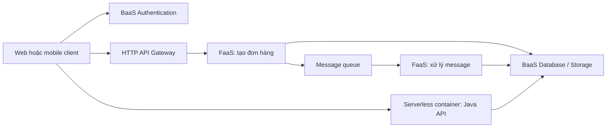

# Phân biệt FaaS, BaaS và container serverless

Serverless là cách sử dụng dịch vụ điện toán mà nhà cung cấp quản lý phần lớn máy chủ, hệ điều hành, cấp phát tài nguyên và khả năng mở rộng. Nhà phát triển tập trung vào mã ứng dụng hoặc cấu hình dịch vụ. “Serverless” không có nghĩa là ứng dụng không chạy trên máy chủ; nó có nghĩa là nhóm phát triển không phải trực tiếp quản lý máy chủ theo cách truyền thống.

Ba thuật ngữ FaaS, BaaS và serverless container thường xuất hiện cùng nhau vì đều giảm công việc vận hành hạ tầng. Tuy nhiên, chúng giải quyết ba nhu cầu khác nhau:

- **FaaS (Function as a Service)** cung cấp nơi chạy một đơn vị mã khi có HTTP request, thông điệp hoặc sự kiện.
- **BaaS (Backend as a Service)** cung cấp sẵn các năng lực backend như xác thực, cơ sở dữ liệu và lưu trữ tệp qua API hoặc SDK.
- **Serverless container** chạy một ứng dụng đã được đóng gói thành container image; nền tảng quản lý việc cấp phát và mở rộng các container đó.

Có thể kết hợp cả ba trong cùng một hệ thống. Để chọn đúng, cần nhìn vào đơn vị mà nhóm triển khai, phần việc nhóm phải quản lý và cách ứng dụng được kích hoạt.

## 1. FaaS: chạy hàm khi có yêu cầu hoặc sự kiện

FaaS là mô hình triển khai trong đó nhà phát triển đưa một function (hàm xử lý) lên nền tảng. Nền tảng gọi hàm khi nhận được trigger đã cấu hình. Nhóm phát triển thường không cần tạo máy chủ HTTP, quản lý hệ điều hành hay tự điều phối số lượng tiến trình cho từng lần gọi.

### Cách hoạt động

Một function có thể được kích hoạt bởi nhiều loại trigger:

- **HTTP:** API Gateway hoặc endpoint của nền tảng nhận request rồi chuyển request đến function.
- **Thông điệp:** một message được đưa vào queue hoặc stream có thể kích hoạt function.
- **Sự kiện:** một tệp được tải lên object storage, một bản ghi thay đổi hoặc một lịch chạy đến thời điểm có thể tạo sự kiện gọi function.

Luồng xử lý tổng quát:

1. Một hệ thống phát sinh request, message hoặc event.
2. Dịch vụ trigger chuyển dữ liệu và ngữ cảnh đến function.
3. Nền tảng cấp môi trường thực thi nếu cần, rồi gọi handler.
4. Handler xử lý dữ liệu, gọi các dịch vụ cần thiết và trả kết quả hoặc xác nhận việc xử lý.
5. Nền tảng kết thúc hoặc tái sử dụng môi trường thực thi theo chính sách của mình.

Đơn vị triển khai ở đây là **hàm xử lý và cấu hình trigger**. Nhà phát triển tập trung vào logic của handler, hợp đồng dữ liệu đầu vào/đầu ra, quyền truy cập và cách xử lý lỗi.

### Ví dụ Java với HTTP trigger

Ví dụ sau dùng giao diện RequestHandler của AWS Lambda để minh họa một handler nhận request tạo đơn hàng. API Gateway có thể ánh xạ HTTP request đến handler này; chi tiết cấu hình và kiểu dữ liệu sự kiện phụ thuộc nền tảng.

```java
import com.amazonaws.services.lambda.runtime.Context;
import com.amazonaws.services.lambda.runtime.RequestHandler;

public class CreateOrderHandler
        implements RequestHandler<CreateOrderRequest, CreateOrderResponse> {

    @Override
    public CreateOrderResponse handleRequest(
            CreateOrderRequest request,
            Context context) {

        if (request == null || request.customerId == null
                || request.items == null || request.items.isEmpty()) {
            return new CreateOrderResponse(400, "Invalid order");
        }

        // Kiểm tra quyền, xác thực dữ liệu và áp dụng quy tắc nghiệp vụ.
        // Lưu đơn hàng bằng một dịch vụ lưu trữ bên ngoài.
        return new CreateOrderResponse(201, "Order accepted");
    }
}
```

Đây là ví dụ rút gọn: các lớp DTO CreateOrderRequest và CreateOrderResponse cùng cấu hình dependency chưa được hiển thị. Với API Gateway ở chế độ Lambda proxy, handler thường nhận một event object chứa headers, path và body; ứng dụng cần đọc body rồi kiểm tra dữ liệu. Ví dụ dùng DTO trực tiếp khi đã cấu hình ánh xạ payload tương ứng.

Trong ví dụ, nền tảng gọi handleRequest khi có request phù hợp. Handler không cần tự mở cổng HTTP hoặc tự quản lý web server. Một API Gateway thường đảm nhiệm việc định tuyến, xác thực ở lớp gateway (nếu được cấu hình), giới hạn request và chuyển đổi giao thức.

Với message trigger, handler nhận một message hoặc một batch message. Với event trigger, handler nhận payload mô tả sự kiện, chẳng hạn thông tin đối tượng vừa được tạo trong storage. Mỗi loại trigger có hợp đồng dữ liệu và cơ chế xác nhận khác nhau; không nên giả định payload HTTP, queue và event có cùng cấu trúc.

### Đặc điểm cần hiểu khi dùng FaaS

**Vòng đời và trạng thái.** Function nên được thiết kế để mỗi lần gọi có thể xử lý độc lập. Một số nền tảng tái sử dụng môi trường thực thi giữa nhiều lần gọi để giảm thời gian khởi tạo, nhưng ứng dụng không được dựa vào việc môi trường đó luôn tồn tại. Biến trong bộ nhớ, biến static hoặc tệp tạm không phải nơi lưu trạng thái nghiệp vụ lâu dài. Hãy lưu trạng thái cần bảo toàn vào database, object storage hoặc dịch vụ chuyên dụng.

Có thể khởi tạo client dùng chung ở ngoài handler để tận dụng môi trường được tái sử dụng, nhưng cần bảo đảm client an toàn khi có nhiều lần gọi đồng thời và xử lý được kết nối hết hạn. Không lưu dữ liệu riêng của một request vào biến dùng chung rồi để request khác đọc được.

**Mở rộng.** Nền tảng thường tăng hoặc giảm số môi trường thực thi theo lượng request hay message. Khi tải tăng đột ngột, nhiều instance có thể chạy song song. Điều đó giúp xử lý tải biến động, nhưng cũng có nghĩa là database và dịch vụ phía sau có thể nhận nhiều kết nối đồng thời. Cần đặt giới hạn concurrency, connection pool và quota phù hợp.

**Cold start.** Nếu chưa có môi trường sẵn sàng, nền tảng phải khởi tạo môi trường trước khi gọi function. Thời gian khởi tạo bổ sung này thường được gọi là cold start. Kích thước gói triển khai, thư viện, runtime, cấu hình mạng và lựa chọn nền tảng có thể ảnh hưởng đến thời gian khởi tạo. Với Java, khởi tạo framework lớn hoặc nạp nhiều thư viện có thể làm cold start đáng kể hơn. Có thể giảm tác động bằng cách giữ gói triển khai gọn, tránh khởi tạo không cần thiết và dùng tùy chọn giữ sẵn instance nếu nền tảng hỗ trợ; các tùy chọn này có thể làm tăng chi phí.

**Retry và idempotency.** Khi function lỗi hoặc không xác nhận được message, nền tảng hoặc dịch vụ gọi có thể thử lại. Quy tắc retry phụ thuộc trigger và nhà cung cấp: HTTP đồng bộ, queue và event bất đồng bộ có thể có hành vi khác nhau. Một message có thể được giao lại, vì vậy handler cần xử lý lặp an toàn. Ví dụ, dùng eventId hoặc idempotency key làm khóa duy nhất, ghi nhận kết quả đã xử lý và bảo đảm thao tác nghiệp vụ không tạo hai đơn hàng khi cùng một sự kiện đến nhiều lần. Với batch message, cần hiểu nền tảng xác nhận cả batch hay từng message để tránh xử lý lại không cần thiết.

**Giới hạn thực thi.** FaaS thường có giới hạn về thời gian chạy, bộ nhớ, CPU, kích thước payload, số lần gọi đồng thời và loại runtime. Những giới hạn cụ thể khác nhau theo nhà cung cấp và gói dịch vụ. Công việc kéo dài, cần giữ kết nối liên tục hoặc cần kiểm soát tiến trình ở mức thấp có thể không phù hợp.

### Khi nào FaaS phù hợp?

FaaS phù hợp khi logic có ranh giới rõ ràng, được kích hoạt bởi request hoặc sự kiện và có thể hoàn thành trong giới hạn thực thi của nền tảng. Ví dụ:

- Xử lý HTTP request tạo đơn hàng hoặc tra cứu trạng thái.
- Xử lý message từ queue sau khi đơn hàng được tạo.
- Tạo thumbnail khi ảnh mới xuất hiện trong object storage.
- Chạy tác vụ định kỳ để tổng hợp dữ liệu.
- Gửi thông báo sau khi một sự kiện nghiệp vụ xảy ra.

FaaS đặc biệt hữu ích khi tải không đều hoặc có nhiều tác vụ nhỏ, độc lập. Cần cân nhắc kỹ nếu ứng dụng phụ thuộc vào bộ nhớ tiến trình lâu dài, cần xử lý liên tục hoặc có nhiều công việc nền kéo dài.

## 2. BaaS: sử dụng năng lực backend được cung cấp sẵn

BaaS là mô hình sử dụng các thành phần backend đã được nhà cung cấp xây dựng và vận hành. Thay vì tự viết và triển khai mọi API backend, ứng dụng gọi API hoặc SDK của dịch vụ để sử dụng các năng lực phổ biến.

Các năng lực BaaS thường gặp gồm:

- **Authentication:** đăng ký, đăng nhập, quản lý phiên và nhà cung cấp danh tính.
- **Database:** lưu trữ và truy vấn dữ liệu qua API, SDK hoặc giao thức được hỗ trợ.
- **File/object storage:** tải lên, tải xuống và quản lý quyền truy cập tệp.
- **Realtime và notification:** đồng bộ thay đổi dữ liệu hoặc gửi thông báo.
- **Các dịch vụ backend khác:** ví dụ phân tích, cấu hình từ xa hoặc quản lý nội dung, tùy sản phẩm.

Ví dụ về nền tảng có các năng lực BaaS là Firebase, Supabase và Appwrite. Danh sách tính năng, cách tính phí và mức độ kiểm soát khác nhau giữa các sản phẩm; cần đánh giá từng dịch vụ theo yêu cầu của ứng dụng.

### Cách hoạt động

Ứng dụng web hoặc mobile thường tích hợp SDK hoặc gọi REST API của nhà cung cấp. Nhà phát triển cấu hình dự án, schema dữ liệu, quy tắc truy cập và luồng nghiệp vụ. Nhà cung cấp vận hành phần backend tương ứng.

Ví dụ, một ứng dụng đặt lịch có thể:

1. Dùng dịch vụ Authentication để đăng nhập người dùng.
2. Lưu hồ sơ và lịch hẹn trong database do BaaS cung cấp.
3. Lưu ảnh đại diện trong storage.
4. Đăng ký nhận cập nhật realtime khi lịch hẹn thay đổi.

Nhóm phát triển không phải tự xây dựng toàn bộ hệ thống đăng nhập, API CRUD, lưu tệp và đồng bộ realtime. Tuy vậy, nhóm vẫn phải thiết kế dữ liệu, xác định ai được đọc hoặc sửa từng bản ghi, kiểm tra dữ liệu đầu vào và bảo vệ thông tin nhạy cảm.

### BaaS không đồng nghĩa với FaaS

BaaS cung cấp **năng lực backend hoàn chỉnh hoặc gần hoàn chỉnh** để ứng dụng sử dụng. FaaS cung cấp **môi trường thực thi mã do nhóm phát triển viết**.

Một BaaS có thể tích hợp thêm function để chạy logic tùy chỉnh. Chẳng hạn, khi database phát sinh thay đổi, một function có thể kiểm tra nghiệp vụ rồi gửi thông báo. Điều đó không làm hai khái niệm trở thành một: database và authentication vẫn là dịch vụ BaaS, còn đoạn mã phản ứng với sự kiện là phần FaaS.

### Trách nhiệm vẫn thuộc về nhóm phát triển

BaaS giảm công việc xây dựng và vận hành backend, nhưng không tự động bảo đảm ứng dụng an toàn hoặc đúng nghiệp vụ. Cần chú ý:

- Cấu hình security rules hoặc quyền truy cập ở mức bản ghi và đối tượng.
- Không nhúng khóa bí mật có quyền quản trị vào ứng dụng chạy trên trình duyệt hoặc thiết bị người dùng.
- Kiểm tra quyền ở server-side khi thao tác có rủi ro cao; không chỉ dựa vào việc giao diện đã ẩn nút.
- Thiết kế schema, chỉ mục, quan hệ dữ liệu, backup và chính sách lưu giữ.
- Theo dõi giới hạn API, quota, chi phí truy vấn, lưu trữ và truyền dữ liệu.
- Đánh giá khả năng xuất dữ liệu, chuyển nhà cung cấp và mức độ phụ thuộc vào SDK hoặc API riêng.

### Khi nào BaaS phù hợp?

BaaS phù hợp khi sản phẩm cần các năng lực backend phổ biến và muốn đưa phiên bản đầu tiên đến người dùng nhanh. Ví dụ:

- Ứng dụng mobile cần đăng nhập, hồ sơ người dùng và lưu ảnh.
- Ứng dụng nội bộ cần CRUD, phân quyền và đồng bộ dữ liệu.
- Sản phẩm thử nghiệm cần database và authentication mà chưa cần tự vận hành backend riêng.

BaaS có thể kém phù hợp khi quy tắc nghiệp vụ quá đặc thù, yêu cầu tích hợp phức tạp, cần kiểm soát sâu cách truy vấn hoặc có yêu cầu dữ liệu mà nhà cung cấp không đáp ứng. Trong trường hợp đó, có thể giữ BaaS cho một số chức năng và bổ sung FaaS hoặc dịch vụ container cho logic riêng.

## 3. Serverless container: triển khai ứng dụng dưới dạng container

Container serverless là mô hình triển khai trong đó nhóm đóng gói ứng dụng và các phụ thuộc vào container image, thường theo chuẩn OCI. Nhà cung cấp quản lý hạ tầng chạy container, định tuyến request và khả năng mở rộng. Tùy dịch vụ, nền tảng có thể đưa số instance về 0 khi không có tải rồi khởi động lại khi có request mới.

Ví dụ về dịch vụ thuộc nhóm này gồm Google Cloud Run, Azure Container Apps và AWS App Runner. Tên gọi, trigger, khả năng scale-to-zero, thời gian chạy tối đa và cách tính phí không hoàn toàn giống nhau giữa các nền tảng.

### Cách hoạt động

Với container serverless, đơn vị triển khai là **container image chứa ứng dụng**. Nhóm phát triển chịu trách nhiệm xây dựng ứng dụng, chọn runtime, đóng gói thư viện, cấu hình biến môi trường và khai báo cách tiến trình khởi động. Nền tảng chịu trách nhiệm cung cấp máy chạy container, định tuyến lưu lượng và điều chỉnh số instance theo cấu hình.

Ví dụ, một ứng dụng Java dùng Spring Boot có thể chạy như một web service:

```java
@SpringBootApplication
@RestController
public class CatalogApplication {

    @GetMapping("/health")
    public String health() {
        return "ok";
    }

    public static void main(String[] args) {
        SpringApplication.run(CatalogApplication.class, args);
    }
}
```

Các import, cấu hình build và Dockerfile được lược bỏ để tập trung vào tiến trình ứng dụng. Container image cần đóng gói ứng dụng cùng runtime và khởi chạy class này.

Nhóm đóng gói ứng dụng cùng runtime và thư viện vào container image, sau đó triển khai image lên dịch vụ container serverless. Ứng dụng tiếp tục hoạt động theo mô hình web server quen thuộc: khởi động tiến trình, lắng nghe trên cổng được cấu hình và xử lý nhiều request theo khả năng của instance. Nền tảng thường cung cấp URL hoặc tích hợp với load balancer để chuyển request đến container.

### Khác biệt so với FaaS

Ở FaaS, nhóm triển khai handler và khai báo trigger; nền tảng gọi handler theo hợp đồng của trigger. Ở serverless container, nhóm triển khai cả ứng dụng và tiến trình chạy bên trong image. Ứng dụng có thể chứa nhiều route HTTP, middleware, thư viện native hoặc nhiều thành phần xử lý liên quan.

Serverless container thường cho phép kiểm soát runtime và cấu trúc ứng dụng nhiều hơn. Nhóm có thể tái sử dụng ứng dụng Spring Boot hiện có với ít thay đổi hơn so với việc tách toàn bộ logic thành các function nhỏ. Đổi lại, nhóm phải quan tâm đến image, kích thước image, thời gian khởi động, cấu hình cổng, health check, concurrency và cách ứng dụng xử lý shutdown.

FaaS và serverless container vẫn có phần giao nhau. Một số nền tảng FaaS dùng container ở bên dưới; một số nền tảng container có thể nhận sự kiện hoặc chạy tác vụ nền. Điểm phân biệt hữu ích là **giao diện triển khai mà nhà phát triển làm việc với**: handler theo trigger hay ứng dụng đóng gói thành image.

### Các điểm vận hành cần cân nhắc

- **Khởi động và scale-to-zero:** khi không có instance sẵn sàng, request đầu tiên có thể phải chờ nền tảng khởi động container. Có thể cấu hình số instance tối thiểu nếu dịch vụ hỗ trợ, nhưng thường phải trả thêm chi phí.
- **Concurrency:** một instance có thể xử lý một hoặc nhiều request cùng lúc tùy cấu hình. Ứng dụng Java phải an toàn khi xử lý đồng thời; không dùng biến mutable dùng chung cho dữ liệu riêng của request.
- **Tài nguyên:** cần đặt CPU, bộ nhớ, số instance tối đa và giới hạn kết nối phù hợp. Mở rộng nhanh có thể làm tăng tải lên database hoặc API phụ thuộc.
- **Trạng thái:** container có bộ nhớ và filesystem tạm trong lúc chạy, nhưng instance có thể bị dừng hoặc thay thế. Dữ liệu cần tồn tại lâu dài phải nằm ở dịch vụ lưu trữ bên ngoài.
- **Thời gian chạy:** một số nền tảng hỗ trợ dịch vụ HTTP chạy lâu dài theo vòng đời instance; một số chế độ job hoặc request có giới hạn thời gian. Cần kiểm tra đúng loại workload và giới hạn của dịch vụ cụ thể.
- **Bảo mật chuỗi cung ứng:** quản lý image base, cập nhật thư viện, quét lỗ hổng, không đưa secret vào image và cấp quyền tối thiểu cho service identity.

### Khi nào serverless container phù hợp?

Serverless container phù hợp khi cần triển khai một ứng dụng hoặc web service hoàn chỉnh nhưng không muốn tự quản lý cluster hay máy chủ. Ví dụ:

- Chuyển một ứng dụng Spring Boot hiện có lên nền tảng quản lý container.
- Chạy REST API có nhiều endpoint và middleware.
- Sử dụng thư viện native, runtime tùy chỉnh hoặc cấu trúc tiến trình mà FaaS khó đáp ứng.
- Chạy worker hoặc tác vụ đóng gói thành container nếu nền tảng hỗ trợ loại workload đó.

Nếu tác vụ chỉ là một handler nhỏ, được kích hoạt bởi một message và kết thúc nhanh, FaaS thường có mô hình đơn giản hơn. Nếu cần một backend dựng sẵn như authentication hoặc database, BaaS có thể giảm nhiều công việc hơn.

## 4. So sánh trực tiếp

| Tiêu chí | FaaS | BaaS | Serverless container |
|---|---|---|---|
| Nhu cầu chính | Chạy logic tùy chỉnh theo lần gọi hoặc sự kiện | Dùng các năng lực backend có sẵn | Chạy một ứng dụng được đóng gói thành container |
| Đơn vị nhóm triển khai | Function/handler và trigger | Cấu hình dịch vụ, schema, quyền và tích hợp | Container image và cấu hình chạy |
| Cách kích hoạt | HTTP, queue, event, lịch chạy | SDK/API, subscription hoặc cơ chế của dịch vụ | Thường là HTTP/gRPC; có thể có event hoặc job tùy nền tảng |
| Phần nhóm kiểm soát | Logic handler, hợp đồng sự kiện, dependency và quyền | Dữ liệu, schema, quy tắc truy cập, cách tích hợp | Mã ứng dụng, runtime, thư viện, image và tiến trình |
| Quản lý máy chủ | Nhà cung cấp | Nhà cung cấp | Nhà cung cấp |
| Trạng thái lâu dài | Lưu ở dịch vụ bên ngoài | Thường dùng database/storage của BaaS | Lưu ở dịch vụ bên ngoài |
| Mở rộng | Theo lần gọi hoặc lượng sự kiện | Do dịch vụ backend quản lý theo sản phẩm | Theo request, tải hoặc cấu hình của nền tảng |
| Điểm cần chú ý | Cold start, retry, idempotency, timeout và concurrency | Quyền dữ liệu, quota, chi phí dịch vụ và phụ thuộc nhà cung cấp | Image, startup, concurrency, tài nguyên và vòng đời instance |
| Ví dụ sử dụng | Xử lý đơn hàng từ queue | Đăng nhập và lưu hồ sơ người dùng | Triển khai REST API Spring Boot |

Bảng này mô tả khác biệt ở mức khái niệm. Một sản phẩm cụ thể có thể cung cấp nhiều mô hình cùng lúc; cần đọc giới hạn và cách tính phí của đúng dịch vụ trước khi thiết kế.

## 5. Kết hợp ba mô hình trong một kiến trúc

Không cần chọn duy nhất một mô hình cho toàn bộ hệ thống. Một ứng dụng có thể dùng BaaS cho năng lực phổ biến, FaaS cho xử lý theo sự kiện và serverless container cho một API hoặc dịch vụ cần chạy như ứng dụng hoàn chỉnh.

Ví dụ hệ thống đặt hàng:

1. Ứng dụng web dùng BaaS Authentication để xác thực người dùng và BaaS Database để lưu dữ liệu hồ sơ.
2. Client gọi HTTP endpoint. API Gateway chuyển request đến FaaS để kiểm tra dữ liệu và tạo yêu cầu đặt hàng.
3. Function ghi dữ liệu cần thiết vào database rồi phát message vào queue.
4. Một function khác nhận message để gửi email hoặc cập nhật trạng thái xử lý.
5. Một dịch vụ Java/Spring Boot chạy trên serverless container đảm nhiệm API danh mục có nhiều endpoint hoặc logic cần thư viện hiện có.



Trong kiến trúc này, mỗi thành phần có một trách nhiệm rõ ràng. BaaS xử lý những năng lực backend phổ biến; FaaS xử lý logic ngắn, được kích hoạt theo request hoặc event; container serverless chạy ứng dụng Java như một service. Cách kết hợp cụ thể còn phụ thuộc yêu cầu bảo mật, độ trễ, dữ liệu và giới hạn của các dịch vụ được chọn.

## 6. Cách chọn mô hình phù hợp

Có thể bắt đầu bằng ba câu hỏi:

**1. Bạn cần dùng một năng lực backend có sẵn hay cần tự viết logic?**

Nếu cần đăng nhập, database, lưu tệp hoặc realtime và sản phẩm của nhà cung cấp đáp ứng yêu cầu, hãy cân nhắc BaaS. Nếu cần thực thi quy tắc nghiệp vụ riêng khi có request hoặc event, hãy cân nhắc FaaS. Nếu cần chạy cả ứng dụng với runtime và tiến trình riêng, hãy cân nhắc container serverless.

**2. Đơn vị triển khai tự nhiên của công việc là gì?**

- Một thao tác độc lập, có đầu vào và kết quả rõ ràng: function.
- Một năng lực backend tiêu chuẩn được nhiều màn hình hoặc client dùng: BaaS.
- Một web service, worker hoặc ứng dụng có cấu trúc và phụ thuộc riêng: container image.

**3. Giới hạn vận hành nào quan trọng nhất?**

Kiểm tra thời gian xử lý, độ trễ cold start, tải đột biến, concurrency, kết nối database, kích thước payload, yêu cầu chạy nền và cách tính phí. Đặc biệt với Java, hãy đo thời gian khởi động thực tế của framework và ứng dụng thay vì chỉ dựa vào mô tả chung của nền tảng.

Một số gợi ý thực tế:

| Tình huống | Hướng cân nhắc | Lý do |
|---|---|---|
| Xử lý một HTTP request ngắn để tạo bản ghi | FaaS | Logic có ranh giới rõ và được kích hoạt theo request |
| Xử lý message đơn hàng từ queue | FaaS | Phù hợp với xử lý bất đồng bộ và mở rộng theo lượng message |
| Cần đăng nhập, lưu hồ sơ và ảnh cho ứng dụng mobile | BaaS | Dùng các năng lực backend phổ biến đã được quản lý |
| Đưa REST API Spring Boot hiện có lên môi trường managed | Serverless container | Có thể đóng gói ứng dụng thành image và giữ mô hình web service |
| Có API riêng và cần thêm đăng nhập, database managed | Kết hợp BaaS với FaaS hoặc container | Mỗi mô hình đảm nhiệm phần việc phù hợp |

## 7. Các nguyên tắc vận hành áp dụng cho cả ba mô hình

Dù chọn mô hình nào, ứng dụng serverless vẫn cần được thiết kế và vận hành có chủ đích.

**Quản lý trạng thái.** Không dựa vào bộ nhớ của function hoặc container để lưu dữ liệu nghiệp vụ cần tồn tại sau khi instance kết thúc. Chọn database, object storage, cache hoặc queue theo đặc tính dữ liệu.

**Cấp quyền tối thiểu.** Mỗi function, container và client chỉ nên có quyền cần thiết. Tách danh tính của từng workload, quản lý secret bằng dịch vụ chuyên dụng và tránh nhúng khóa quản trị vào mã nguồn hoặc image.

**Thiết kế xử lý lặp an toàn.** Với event và message, giả định rằng một sự kiện có thể được giao lại. Dùng idempotency key, ràng buộc duy nhất hoặc transaction phù hợp để tránh tác dụng phụ bị lặp. Xác định rõ thời điểm xác nhận message và cách chuyển message lỗi sang dead-letter queue nếu nền tảng hỗ trợ.

**Quan sát được hệ thống.** Ghi log có cấu trúc, correlation ID, thời gian xử lý, số lần retry và mã lỗi. Theo dõi metric như số invocation, lỗi, độ trễ, cold start, số instance, độ sâu queue và mức sử dụng database. Không ghi token, mật khẩu hoặc dữ liệu cá nhân nhạy cảm vào log.

**Kiểm soát chi phí.** Chi phí có thể đến từ số lần gọi, thời gian CPU, bộ nhớ, số instance tối thiểu, truy vấn database, dung lượng lưu trữ và truyền dữ liệu. Scale-to-zero không có nghĩa là toàn hệ thống miễn phí khi không có request; database, storage và các dịch vụ nền vẫn có thể phát sinh phí. Đặt quota, cảnh báo ngân sách và giới hạn mở rộng phù hợp.

**Đo kiểm trước khi chọn.** Tạo một workload đại diện và đo độ trễ, thông lượng, cold start, chi phí, khả năng retry và tải lên dịch vụ phụ thuộc. Với Java, cần đo cả thời gian khởi động, mức tiêu thụ bộ nhớ và hiệu năng khi chạy đồng thời.

## 8. Những nhầm lẫn thường gặp

- **“Serverless nghĩa là không có server.”** Ứng dụng vẫn chạy trên máy chủ hoặc container; nhà cung cấp chịu trách nhiệm quản lý phần hạ tầng đó.
- **“BaaS và FaaS giống nhau.”** BaaS cung cấp năng lực backend dựng sẵn; FaaS chạy mã tùy chỉnh theo lần gọi hoặc sự kiện.
- **“FaaS luôn rẻ hơn container.”** Chi phí phụ thuộc số lần gọi, thời gian chạy, tài nguyên, lưu lượng và các dịch vụ phụ trợ. Workload chạy liên tục có thể có cấu trúc chi phí khác workload ngắt quãng.
- **“Function chỉ chạy một lần nên không cần xử lý trùng.”** Retry và giao nhận message có thể khiến cùng một sự kiện được xử lý lại. Idempotency vẫn cần thiết.
- **“Container serverless giữ trạng thái vì có filesystem.”** Filesystem và bộ nhớ của instance có thể bị mất khi instance dừng hoặc thay thế. Trạng thái lâu dài cần được lưu bên ngoài.
- **“Dùng serverless thì không cần vận hành.”** Nhóm vẫn phải quản lý quyền, dữ liệu, retry, quan sát, giới hạn, hiệu năng và chi phí.

## 9. Ghi nhớ

FaaS, BaaS và serverless container khác nhau ở phần việc mà chúng cung cấp cho nhà phát triển:

- Chọn **FaaS** khi cần chạy logic tùy chỉnh theo HTTP request, message hoặc event.
- Chọn **BaaS** khi cần dùng các năng lực backend phổ biến đã được quản lý như authentication, database và storage.
- Chọn **serverless container** khi cần chạy một ứng dụng được đóng gói thành container image, chẳng hạn một Java/Spring Boot service.

Có thể phối hợp chúng trong cùng một kiến trúc. Quyết định cuối cùng nên dựa trên đơn vị triển khai, yêu cầu về trạng thái và thời gian chạy, giới hạn của nhà cung cấp, mức kiểm soát cần thiết và tổng chi phí của cả hệ thống.

