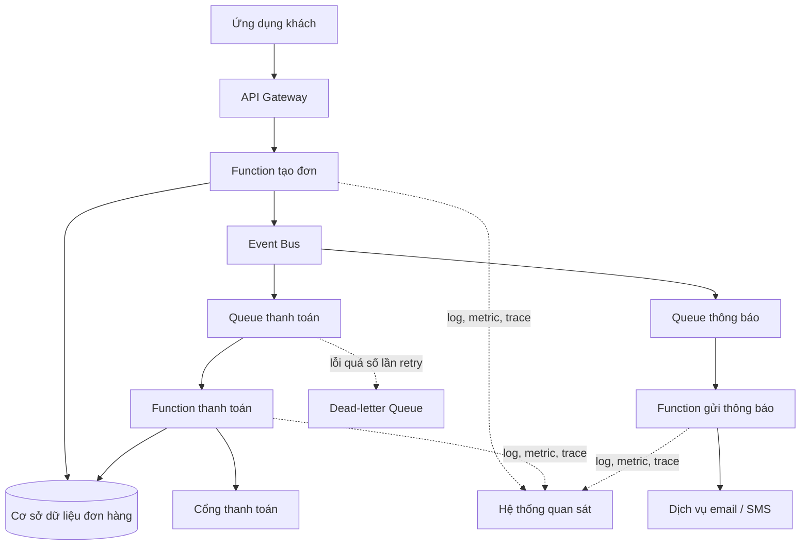

# Các thành phần của một ứng dụng serverless

## 1. Nhìn ứng dụng serverless như một hệ thống

Serverless là mô hình xây dựng và vận hành ứng dụng trong đó nhà cung cấp cloud quản lý phần lớn hạ tầng máy chủ, hệ điều hành và khả năng cấp phát tài nguyên. Nhóm phát triển tập trung vào mã ứng dụng, dữ liệu, sự kiện và chính sách vận hành. “Không máy chủ” không có nghĩa là ứng dụng không chạy trên máy chủ; điều đó có nghĩa là nhóm phát triển không phải tự quản lý máy chủ theo cách truyền thống.

Một ứng dụng serverless thường kết hợp nhiều dịch vụ được quản lý. Hàm FaaS (Function as a Service) thực thi phần logic ngắn khi nhận HTTP request, thông điệp hoặc sự kiện. API gateway, hàng đợi, event bus, cơ sở dữ liệu, kho đối tượng, dịch vụ định danh và công cụ quan sát phối hợp để tạo thành một hệ thống hoàn chỉnh. Vì vậy, không nên xem một function đơn lẻ là toàn bộ ứng dụng.

Trong phạm vi CLOUD_SERVERLESS, trọng tâm là cách phát triển và triển khai ứng dụng serverless, đặc biệt là Java function được kích hoạt bởi HTTP, thông điệp hoặc sự kiện. Khi thiết kế, cần xem xét đồng thời trigger, trạng thái, quyền truy cập, retry, idempotency, cold start, khả năng mở rộng và chi phí để quyết định FaaS có phù hợp hay không.

## 2. Các thành phần chính

### 2.1. Điểm vào và nguồn kích hoạt (trigger)

Trigger xác định khi nào một phần xử lý được gọi và dữ liệu đầu vào được chuyển đến function theo cách nào. Các nhóm trigger thường gặp gồm:

| Loại trigger | Ví dụ | Đặc điểm thiết kế |
| --- | --- | --- |
| HTTP | Người dùng gọi REST API, webhook từ đối tác | Thường cần xác thực, kiểm tra đầu vào, giới hạn thời gian phản hồi và ánh xạ lỗi HTTP |
| Hàng đợi (queue) | Có thông điệp `OrderCreated` hoặc `SendEmail` | Hấp thụ tải đột biến, tách bên gửi khỏi bên xử lý; cần xử lý thông điệp trùng lặp và thông điệp lỗi |
| Event bus | Sự kiện nghiệp vụ được phát đến nhiều dịch vụ | Định tuyến theo loại sự kiện hoặc thuộc tính; hỗ trợ nhiều subscriber độc lập |
| Lịch (schedule) | Chạy tác vụ tổng hợp mỗi đêm | Kích hoạt theo thời gian; cần tính đến múi giờ, lịch chạy trùng và lần chạy bị bỏ lỡ |
| Sự kiện lưu trữ | Một tệp được tải lên object storage | Thường truyền bucket, khóa đối tượng và metadata; cần kiểm tra kích thước, định dạng và quyền truy cập |
| Luồng dữ liệu (stream) | Bản ghi mới từ luồng sự kiện hoặc thay đổi dữ liệu | Có thể xử lý theo batch hoặc partition; cần chú ý thứ tự, checkpoint và độ trễ |

Với HTTP, API gateway thường đứng trước function. Gateway tiếp nhận kết nối, định tuyến request, áp dụng xác thực hoặc giới hạn lưu lượng, rồi chuyển request đến function. Function xử lý nghiệp vụ và trả kết quả để gateway ánh xạ thành HTTP response. Gateway và function có thể có giới hạn timeout khác nhau; thời gian xử lý phải nằm trong giới hạn của toàn tuyến.

Với xử lý bất đồng bộ, nguồn phát gửi thông điệp đến queue hoặc event bus. Dịch vụ kích hoạt function khi có dữ liệu sẵn sàng. Bên gửi có thể hoàn tất sớm mà không phải chờ toàn bộ nghiệp vụ phía sau, nhưng hệ thống phải chấp nhận khả năng xử lý trễ và trạng thái nhất quán cuối cùng (eventual consistency).

### 2.2. Lớp tính toán: function FaaS

Function là đơn vị thực thi logic nghiệp vụ. Nền tảng thường chịu trách nhiệm khởi tạo môi trường chạy, phân bổ CPU và bộ nhớ, nhận invocation, quản lý vòng đời instance và mở rộng số instance theo tải.

Một function tốt thường có phạm vi rõ ràng, thời gian thực thi hữu hạn và giao diện đầu vào/đầu ra xác định. Ví dụ: xác thực yêu cầu tạo đơn, xử lý một thông điệp thanh toán, tạo thumbnail sau khi ảnh được tải lên hoặc gửi thông báo khi trạng thái đơn hàng thay đổi.

Function nên hạn chế giữ trạng thái nghiệp vụ trong bộ nhớ giữa các lần gọi. Instance có thể bị dừng sau khi xử lý xong, được tái sử dụng trong một khoảng thời gian hoặc chạy đồng thời trên nhiều môi trường. Biến tĩnh, singleton hay bộ nhớ cục bộ chỉ phù hợp cho dữ liệu tạm thời trong một môi trường thực thi; chúng không phải kho lưu trữ dùng chung và không bảo đảm dữ liệu tồn tại ở lần gọi tiếp theo.

Với Java, mã nghiệp vụ nên tách khỏi adapter của nhà cung cấp cloud. Adapter chuyển request hoặc event thành đối tượng miền, gọi service nghiệp vụ rồi chuyển kết quả thành response. Cách tách này giúp kiểm thử logic bằng unit test và giảm phụ thuộc vào API của một nền tảng FaaS cụ thể.

### 2.3. Điều phối quy trình (orchestration)

Một quy trình nghiệp vụ có thể gồm nhiều bước: kiểm tra đơn hàng, giữ hàng, thu tiền, cập nhật trạng thái và gửi thông báo. Có thể nối các function bằng event, nhưng khi cần theo dõi tiến trình nhiều bước, nhánh điều kiện, timeout, chờ tín hiệu hoặc xử lý bù, một dịch vụ workflow/orchestration thường phù hợp hơn.

Orchestrator lưu trạng thái tiến trình và quyết định bước tiếp theo. Function tập trung thực hiện một bước công việc; workflow quản lý thứ tự và trạng thái tổng thể. Với quy trình phân tán, không nên giả định có một transaction ACID bao trùm tất cả dịch vụ. Có thể dùng mô hình Saga: mỗi bước cập nhật một phần trạng thái và định nghĩa hành động bù khi bước sau thất bại. Hành động bù là nghiệp vụ riêng, không nhất thiết đảo ngược được mọi tác động đã xảy ra.

### 2.4. Lớp dữ liệu và lưu trữ trạng thái

Ứng dụng serverless vẫn cần nơi lưu dữ liệu bền vững. Các lựa chọn thường gồm:

- **Cơ sở dữ liệu quan hệ hoặc NoSQL:** lưu đơn hàng, tài khoản, cấu hình nghiệp vụ và trạng thái xử lý.
- **Object storage:** lưu ảnh, tài liệu, bản xuất dữ liệu và tệp đầu vào/đầu ra dung lượng lớn.
- **Cache:** giảm độ trễ hoặc tải đọc cho dữ liệu có thể tái tạo; cache không nên là nguồn dữ liệu chuẩn nếu không có cơ chế bảo đảm phù hợp.
- **Queue, event bus hoặc stream:** lưu giữ và chuyển tiếp dữ liệu cần xử lý bất đồng bộ; chúng bổ sung cho cơ sở dữ liệu chứ không tự động thay thế cơ sở dữ liệu nghiệp vụ.

Do function có thể chạy đồng thời, tầng dữ liệu phải chịu được số kết nối và tốc độ ghi tăng đột ngột. Tạo một kết nối database mới trong mọi invocation có thể làm cạn connection limit. Tùy nền tảng, có thể dùng connection pool được quản lý, proxy kết nối, API truy cập dữ liệu hoặc giới hạn concurrency của function.

Trạng thái nghiệp vụ cần được lưu ở hệ thống bền vững. Ví dụ, trạng thái đơn hàng `PENDING`, `PAID` hoặc `CANCELLED` phải nằm trong database; không nên chỉ lưu trong biến của function. Cũng cần xác định nguồn dữ liệu chuẩn, quy tắc cập nhật đồng thời, thời hạn lưu trữ và cách xử lý dữ liệu hết hạn.

### 2.5. Giao tiếp bất đồng bộ: queue, event bus và stream

Ba thành phần này đều chuyển dữ liệu giữa các phần của hệ thống, nhưng phục vụ mục đích khác nhau:

| Thành phần | Mục đích chính | Câu hỏi thiết kế |
| --- | --- | --- |
| Queue | Phân phối công việc cho một hoặc nhiều consumer; làm bộ đệm khi tải tăng | Thông điệp có thể được nhận lại bao nhiêu lần? Khi nào chuyển sang dead-letter queue? |
| Event bus | Định tuyến sự kiện đến một hoặc nhiều subscriber theo rule | Những subscriber nào cần nhận sự kiện? Schema và version sự kiện được quản lý ra sao? |
| Stream | Tiếp nhận chuỗi bản ghi liên tục, thường được chia partition | Thứ tự được bảo đảm trong phạm vi nào? Consumer lưu checkpoint và xử lý lại ra sao? |

Queue giúp điều tiết tốc độ xử lý: producer có thể gửi nhanh trong khi consumer xử lý theo năng lực hiện tại. Event bus giúp một sự kiện nghiệp vụ kích hoạt nhiều phản ứng độc lập, chẳng hạn `OrderPaid` được dùng cho cập nhật kho, gửi email và ghi nhận phân tích. Stream phù hợp với dữ liệu liên tục hoặc cần đọc lại theo offset.

Khi thiết kế giao tiếp bất đồng bộ, cần định nghĩa schema thông điệp, phiên bản, khóa tương quan (correlation ID), thời hạn xử lý và chính sách lỗi. Không nên đưa dữ liệu bí mật hoặc payload quá lớn vào thông điệp nếu có thể truyền một tham chiếu an toàn đến dữ liệu lưu trữ.

### 2.6. Định danh, xác thực và phân quyền

Ứng dụng cần kiểm soát cả người gọi function lẫn quyền mà function sử dụng khi truy cập dịch vụ khác.

- **Xác thực (authentication):** xác định người dùng hoặc hệ thống gọi API là ai, ví dụ qua OAuth 2.0, OpenID Connect, JWT hoặc cơ chế xác thực do nền tảng cung cấp.
- **Ủy quyền (authorization):** quyết định chủ thể được phép thực hiện hành động nào trên tài nguyên nào.
- **Execution role/service identity:** danh tính mà function dùng để gọi database, queue, object storage hoặc dịch vụ cloud.
- **Quản lý bí mật:** API key, mật khẩu và chứng thư cần được lưu trong secret manager hoặc cơ chế tương đương, sau đó cấp quyền đọc tối thiểu cho function cần dùng.

Áp dụng nguyên tắc quyền tối thiểu: function gửi email chỉ cần quyền gửi email và đọc cấu hình liên quan; không nên có quyền quản trị toàn bộ tài khoản cloud. Tách quyền của runtime, quyền triển khai và quyền của người dùng cuối. Không nhúng access key dài hạn vào mã nguồn, file cấu hình được commit hoặc biến môi trường không được bảo vệ.

### 2.7. Cấu hình và quản lý môi trường

Endpoint, tên queue, feature flag, giới hạn nghiệp vụ và thông tin môi trường cần được quản lý tách khỏi mã nguồn. Cấu hình không bí mật có thể được cung cấp qua biến môi trường hoặc dịch vụ cấu hình. Bí mật cần đi qua secret manager và có chính sách xoay vòng.

Phân tách môi trường phát triển, kiểm thử và production giúp tránh dùng nhầm tài nguyên hoặc dữ liệu. Khi thay đổi cấu hình, cần biết phiên bản function nào nhận cấu hình đó và có thể khôi phục về giá trị trước hay không.

### 2.8. Quan sát và vận hành

Một ứng dụng gồm nhiều dịch vụ phân tán khó chẩn đoán nếu chỉ xem log của từng function. Tối thiểu cần ba nhóm tín hiệu:

- **Logs:** ghi sự kiện có cấu trúc, mức độ log, mã tương quan và thông tin đủ để điều tra. Không ghi token, mật khẩu hoặc dữ liệu cá nhân không cần thiết.
- **Metrics:** theo dõi số invocation, tỷ lệ lỗi, thời gian thực thi, concurrency, số thông điệp tồn đọng, tuổi thông điệp lâu nhất, timeout và throttling.
- **Traces:** nối các request qua gateway, function, queue và dịch vụ phụ thuộc để xác định bước gây chậm hoặc lỗi.

Nên bổ sung chỉ số nghiệp vụ như số đơn tạo thành công, số thanh toán thất bại hoặc thời gian hoàn tất một quy trình. Chỉ số hạ tầng có thể vẫn bình thường trong khi người dùng không hoàn thành được nghiệp vụ. Cảnh báo cần gắn với ngưỡng có ý nghĩa và có người chịu trách nhiệm xử lý.

### 2.9. Triển khai và quản lý hạ tầng

Mã function chỉ là một phần của bản triển khai. Ứng dụng còn có gateway, trigger, queue, rule định tuyến, database, role, secret reference, log group, cảnh báo và cấu hình scaling. Infrastructure as Code (IaC) mô tả các tài nguyên này bằng mã để có thể review, tái tạo và triển khai nhất quán.

Pipeline CI/CD thường thực hiện biên dịch, kiểm thử, đóng gói artifact, triển khai tài nguyên và phát hành phiên bản function. Nên tách phát hành phiên bản khỏi việc chuyển toàn bộ lưu lượng sang phiên bản mới; có thể dùng canary hoặc rollout theo tỷ lệ nếu nền tảng hỗ trợ. Cần có phương án rollback cả mã lẫn thay đổi cấu hình tương thích.

## 3. Cách các thành phần phối hợp

Sơ đồ dưới đây minh họa một ứng dụng xử lý đơn hàng. Luồng HTTP tiếp nhận yêu cầu tạo đơn; luồng sự kiện xử lý thanh toán và thông báo sau đó.



Trình tự xử lý có thể diễn ra như sau:

1. Ứng dụng khách gửi `POST /orders` đến API gateway. Gateway xác thực request và chuyển dữ liệu đến function tạo đơn.
2. Function kiểm tra dữ liệu, áp dụng quy tắc nghiệp vụ, ghi đơn hàng ở trạng thái `PENDING` vào database và phát sự kiện `OrderCreated`.
3. Event bus định tuyến sự kiện đến queue thanh toán và queue thông báo theo cấu hình. Hai consumer có thể xử lý độc lập.
4. Function thanh toán đọc thông điệp, gọi cổng thanh toán với khóa idempotency ổn định, rồi cập nhật trạng thái đơn hàng. Function thông báo gửi email hoặc SMS theo trạng thái thích hợp.
5. Nếu thông điệp lỗi tạm thời, hệ thống thử lại theo chính sách. Nếu vượt quá số lần hoặc thời gian cho phép, thông điệp được chuyển đến dead-letter queue để điều tra và xử lý lại có kiểm soát.
6. Log, metric và trace giúp vận hành theo dõi toàn tuyến bằng correlation ID hoặc event ID.

Đây là ví dụ kiến trúc, không phải cấu hình bắt buộc của mọi nền tảng. Một số cloud provider dùng tên dịch vụ hoặc cách ánh xạ trigger khác nhau; các vai trò kiến trúc vẫn tương tự.

## 4. Các mối quan tâm xuyên suốt khi thiết kế FaaS

### 4.1. Trạng thái và tính lặp an toàn (idempotency)

Hệ thống bất đồng bộ thường có thể giao một thông điệp nhiều lần. Một consumer có thể đã thực hiện tác động nhưng bị lỗi trước khi xác nhận thông điệp; lần giao tiếp theo sẽ khiến function chạy lại. Do đó, không nên giả định mỗi event chỉ được xử lý đúng một lần.

Idempotency nghĩa là việc xử lý lặp lại cùng một yêu cầu hoặc sự kiện không tạo thêm tác động nghiệp vụ ngoài dự kiến. Có thể dùng event ID hoặc request ID làm khóa idempotency, lưu kết quả xử lý trong kho bền vững và kiểm tra khóa trước khi thực hiện tác động. Việc ghi dấu đã xử lý và cập nhật trạng thái nghiệp vụ cần được thiết kế nguyên tử khi có thể. Với tác động đến hệ thống bên ngoài, hãy truyền cùng khóa idempotency cho nhà cung cấp nếu họ hỗ trợ; nếu không, cần có cơ chế đối soát hoặc xử lý bù.

Ví dụ minh họa bằng Java (các interface lưu trữ là thành phần ứng dụng, không phải API chuẩn của một cloud provider):

```java
public final class PaymentHandler {
    private final IdempotencyStore idempotencyStore;
    private final PaymentGateway paymentGateway;
    private final OrderRepository orderRepository;

    public PaymentHandler(
            IdempotencyStore idempotencyStore,
            PaymentGateway paymentGateway,
            OrderRepository orderRepository) {
        this.idempotencyStore = idempotencyStore;
        this.paymentGateway = paymentGateway;
        this.orderRepository = orderRepository;
    }

    public PaymentResult handle(PaymentRequested event) {
        return idempotencyStore.executeOnce(event.eventId(), () -> {
            paymentGateway.charge(event.payment(), event.eventId());
            orderRepository.markPaid(event.orderId());
            return PaymentResult.success(event.orderId());
        });
    }
}
```

`executeOnce` biểu diễn một cơ chế cần được triển khai bằng lưu trữ bền vững, có xử lý cạnh tranh giữa các invocation và trạng thái đang xử lý. Đoạn mã chỉ minh họa ranh giới trách nhiệm; nó không tự bảo đảm transaction phân tán giữa kho idempotency, cổng thanh toán và database. Trong thực tế, cần xử lý trường hợp cổng thanh toán đã thu tiền nhưng function mất kết nối trước khi ghi nhận kết quả.

### 4.2. Retry, backoff và dead-letter queue

Retry giúp vượt qua lỗi tạm thời như timeout mạng, throttling hoặc dịch vụ phụ thuộc gián đoạn. Nên đặt số lần thử tối đa, khoảng chờ tăng dần (exponential backoff), thêm jitter để tránh nhiều invocation thử lại cùng lúc và phân loại lỗi có thể thử lại với lỗi vĩnh viễn.

Lỗi dữ liệu không hợp lệ thường không tự hết khi thử lại. Lặp vô hạn có thể làm tăng chi phí, gây nghẽn queue và tạo tải lớn hơn cho dịch vụ đang gặp sự cố. Sau khi vượt ngưỡng, chuyển thông điệp sang dead-letter queue (DLQ) hoặc cơ chế lưu lỗi tương đương. DLQ cần có cảnh báo, quy trình kiểm tra nguyên nhân và cách phát lại an toàn sau khi đã khắc phục.

Đối với HTTP đồng bộ, client hoặc gateway có thể là bên thực hiện retry. Chỉ retry request có ngữ nghĩa an toàn hoặc có khóa idempotency; nếu client gửi lại thao tác tạo thanh toán mà không có khóa ổn định, có thể phát sinh giao dịch trùng.

### 4.3. Cold start và thời gian phản hồi

Cold start là độ trễ phát sinh khi nền tảng phải chuẩn bị môi trường thực thi mới trước khi function xử lý invocation, ví dụ khởi tạo runtime, nạp class và thư viện hoặc thiết lập kết nối. Java có thể chịu ảnh hưởng bởi kích thước artifact, số lượng dependency, thời gian khởi tạo framework và công việc chạy trong static initializer.

Có thể giảm cold start bằng cách giữ artifact gọn, loại bỏ dependency không cần thiết, trì hoãn khởi tạo tài nguyên nặng đến khi thực sự cần và đo thời gian khởi tạo riêng với thời gian xử lý nghiệp vụ. Một số nền tảng cung cấp cấu hình giữ sẵn môi trường hoặc cơ chế khởi tạo trước; chúng có thể giảm độ trễ nhưng thường làm tăng chi phí. Cần đo p95/p99 trong điều kiện tải thực tế thay vì chỉ dựa vào thời gian trung bình.

### 4.4. Mở rộng, concurrency và giới hạn

FaaS có thể tăng hoặc giảm số instance theo lượng invocation hay thông điệp. Khả năng mở rộng tự động không đồng nghĩa tài nguyên là vô hạn. Account quota, concurrency limit, tốc độ nhận thông điệp, giới hạn kết nối database và quota của API bên ngoài đều có thể trở thành nút thắt.

Nếu function mở rộng nhanh hơn khả năng chịu tải của database, hệ thống có thể chuyển từ thiếu năng lực xử lý sang quá tải database. Hãy đặt giới hạn concurrency phù hợp, cấu hình batch size và tốc độ consumer, dùng queue để hấp thụ đỉnh tải và theo dõi độ sâu queue. Với stream, cần xem xét số partition và năng lực xử lý của từng partition.

### 4.5. Chi phí

Chi phí serverless thường gồm nhiều phần: số lần gọi và thời gian thực thi function, bộ nhớ hoặc cấu hình tài nguyên, API gateway, queue/event bus, database, object storage, log/trace, truyền dữ liệu và các tính năng giữ sẵn môi trường. Cách tính cụ thể phụ thuộc nhà cung cấp và khu vực triển khai.

FaaS có thể tiết kiệm khi tải không liên tục vì không cần duy trì máy chủ luôn chạy cho phần xử lý đó. Với tải cao và ổn định, function chạy liên tục, thời gian khởi tạo lớn hoặc nhiều dịch vụ phụ trợ có thể khiến tổng chi phí cao hơn dự kiến. Log quá chi tiết, retry không giới hạn, batch size không hợp lý và truy vấn database kém hiệu quả cũng làm tăng chi phí.

Nên ước lượng theo kịch bản tải thấp, trung bình và đỉnh; đo số invocation, thời gian thực thi, bộ nhớ, số lần retry và chi phí dịch vụ phụ trợ. Tối ưu chi phí phải đi cùng yêu cầu độ trễ, độ tin cậy và khả năng khôi phục.

## 5. Quy trình thiết kế một ứng dụng serverless

Khi bắt đầu một tính năng, có thể đi theo trình tự sau:

1. **Xác định sự kiện hoặc request khởi đầu:** ai gọi, dữ liệu nào được gửi, cần phản hồi đồng bộ hay có thể xử lý bất đồng bộ?
2. **Chia ranh giới function:** mỗi function thực hiện một trách nhiệm có thể mô tả và kiểm thử rõ ràng; xác định bước nào cần workflow điều phối.
3. **Chọn nơi lưu trạng thái:** dữ liệu nghiệp vụ nào phải bền vững, dữ liệu nào chỉ là cache, thông điệp nào cần được giữ lại?
4. **Định nghĩa hợp đồng giao tiếp:** schema request/event, event ID, correlation ID, phiên bản schema và quy tắc tương thích.
5. **Thiết kế lỗi trước khi triển khai:** timeout, retry, backoff, idempotency, DLQ, hành động bù và cách phát lại.
6. **Thiết lập quyền và bí mật:** danh tính cho từng function, quyền tối thiểu, secret manager và xác thực người gọi.
7. **Đặt giới hạn vận hành:** memory, timeout, concurrency, batch size, quota và ngưỡng cảnh báo.
8. **Đưa hạ tầng vào IaC và CI/CD:** quản lý version, cấu hình môi trường, phát hành có kiểm soát và rollback.
9. **Đo trong điều kiện gần thực tế:** độ trễ p95/p99, cold start, tỷ lệ lỗi, backlog, khả năng phục hồi và tổng chi phí.

## 6. Khi nào nên dùng FaaS?

FaaS thường phù hợp khi công việc được kích hoạt bởi request hoặc event, có thời gian thực thi hữu hạn, có thể chia thành các đơn vị xử lý độc lập và không cần giữ tiến trình chạy liên tục. Ví dụ gồm API backend có tải biến động, xử lý tệp sau khi upload, consumer cho queue, webhook, tác vụ theo lịch và tự động hóa theo sự kiện.

FaaS có thể không phù hợp nếu workload chạy liên tục với tải ổn định và rất cao, cần tiến trình dài vượt giới hạn runtime, giữ kết nối hai chiều lâu dài, phụ thuộc mạnh vào bộ nhớ cục bộ hoặc yêu cầu kiểm soát sâu hệ điều hành và runtime. Các trường hợp này có thể phù hợp hơn với container, máy ảo hoặc dịch vụ chạy dài hạn. Một hệ thống thực tế có thể kết hợp FaaS với container và dịch vụ managed khác.

Trước khi quyết định, hãy trả lời các câu hỏi sau:

- Công việc có thể được kích hoạt bằng HTTP, message, event hoặc schedule không?
- Thời gian xử lý có nằm trong giới hạn runtime của nền tảng không?
- Có thể lưu trạng thái bên ngoài và làm cho thao tác an toàn khi chạy lặp không?
- Dịch vụ phụ thuộc có chịu được mức concurrency dự kiến không?
- Cold start và giới hạn timeout có đáp ứng yêu cầu độ trễ không?
- Tổng chi phí của function cùng gateway, messaging, database, quan sát và truyền dữ liệu có hợp lý không?
- Nhóm có thể vận hành retry, DLQ, cảnh báo, phân quyền và triển khai phiên bản một cách tin cậy không?

## 7. Những lỗi thiết kế thường gặp

| Lỗi | Hậu quả | Cách xử lý |
| --- | --- | --- |
| Lưu trạng thái nghiệp vụ trong biến hoặc bộ nhớ function | Mất trạng thái khi instance bị dừng; các instance không nhìn thấy dữ liệu của nhau | Lưu trạng thái bền vững trong database hoặc kho phù hợp |
| Giả định event chỉ đến một lần | Tạo đơn, thu tiền hoặc gửi thông báo trùng | Dùng khóa idempotency và thao tác cập nhật có kiểm soát |
| Retry mọi loại lỗi | Lặp vô ích, tăng chi phí và làm nghẽn hệ thống | Phân loại lỗi, giới hạn lần thử, backoff và DLQ |
| Cho phép concurrency không giới hạn theo khả năng database | Cạn kết nối hoặc vượt quota dịch vụ phụ thuộc | Đặt giới hạn concurrency, dùng proxy/pool và theo dõi backlog |
| Cấp quyền rộng cho mọi function | Tăng phạm vi ảnh hưởng khi có lỗi hoặc lộ thông tin xác thực | Dùng execution role riêng và quyền tối thiểu |
| Chỉ quan sát log từng function | Khó nối một request qua nhiều dịch vụ | Dùng correlation ID, metric và distributed tracing |
| Chỉ tính chi phí invocation | Bỏ sót database, gateway, messaging, log và truyền dữ liệu | Ước lượng tổng chi phí theo kịch bản tải |

## 8. Kết luận

Một ứng dụng serverless là sự phối hợp giữa điểm vào, trigger, function, dịch vụ điều phối, lưu trữ, giao tiếp bất đồng bộ, bảo mật, cấu hình, quan sát và quy trình triển khai. Function thực hiện logic; các dịch vụ xung quanh cung cấp khả năng tiếp nhận request, lưu trạng thái, truyền sự kiện, kiểm soát truy cập và vận hành hệ thống.

Thiết kế tốt cần làm rõ trạng thái nằm ở đâu, sự kiện có thể được giao lại thế nào, lỗi được retry và cách ly ra sao, quyền nào được cấp cho từng function, hệ thống mở rộng đến giới hạn nào và chi phí được tạo ra ở từng thành phần. Khi các câu hỏi đó có lời giải phù hợp với yêu cầu thực tế, FaaS trở thành một lựa chọn có cơ sở cho workload tương ứng.
