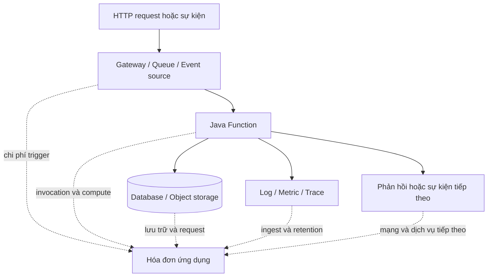

# Mô hình tính phí theo lượt gọi và tài nguyên sử dụng

Serverless giúp đội phát triển triển khai chức năng mà không phải tự quản lý máy chủ. Với mô hình Function as a Service (FaaS), nền tảng nhận sự kiện, cấp tài nguyên để chạy function, mở rộng số phiên thực thi khi tải tăng và thu hồi tài nguyên khi công việc kết thúc. Vì vậy, chi phí thường gắn với số lần function được gọi và lượng tài nguyên đã dùng trong mỗi lần chạy.

Đây là một lợi thế khi lưu lượng không đều hoặc ứng dụng có nhiều khoảng thời gian nhàn rỗi. Tuy nhiên, “chỉ trả tiền khi chạy” không có nghĩa toàn bộ ứng dụng chỉ có một khoản phí theo lượt gọi. API gateway, hàng đợi, cơ sở dữ liệu, mạng, log và các dịch vụ mà function sử dụng đều có thể tạo chi phí riêng. Muốn quyết định FaaS có phù hợp hay không, cần tính chi phí của cả luồng xử lý và đo chi phí trên mỗi tác vụ nghiệp vụ hoàn tất.

## 1. Hai thành phần tính phí cốt lõi

Các nền tảng có bảng giá và cách làm tròn khác nhau, nhưng mô hình FaaS thường có hai nhóm chi phí chính: số lượt gọi và tài nguyên thực thi.

### Lượt gọi (invocation/request)

Một lượt gọi là một lần nền tảng khởi chạy function để xử lý đầu vào. Lượt gọi có thể bắt nguồn từ HTTP request, một thông điệp trong queue, một bản ghi trong stream, lịch chạy hoặc một sự kiện từ dịch vụ khác.

Không nên mặc định một yêu cầu của người dùng tương ứng với đúng một lượt gọi:

- Một HTTP request có thể gọi nhiều function ở các bước khác nhau.
- Một function xử lý theo lô có thể nhận nhiều thông điệp trong một invocation.
- Một thông điệp được retry hoặc đưa từ dead-letter queue (DLQ) trở lại xử lý có thể tạo thêm invocation.
- Một sự kiện có thể kích hoạt nhiều subscriber, mỗi subscriber chạy function riêng.

Do đó, khi ước tính số lượt gọi, hãy lần theo toàn bộ luồng sự kiện và tính cả retry, redrive hoặc lần chạy lại do vận hành.

### Thời gian và cấu hình tài nguyên thực thi

Function thường được tính phí theo thời gian chạy và lượng tài nguyên được cấp. Một số nền tảng biểu diễn tài nguyên bằng GB-second; nền tảng khác có thể tính riêng bộ nhớ, CPU hoặc vCPU-second. Bộ nhớ được cấu hình cũng có thể quyết định mức CPU function được cấp.

Với mô hình tính theo GB-second, có thể ước tính lượng tài nguyên bằng công thức:

```text
GB-second = bộ nhớ được cấp (GB) × thời gian tính phí (giây)
Chi phí thực thi = GB-second × đơn giá cho mỗi GB-second
```

Nếu function có nhiều mức cấu hình hoặc thời gian chạy khác nhau, tính riêng từng nhóm rồi cộng lại. Thời gian tính phí có thể được làm tròn theo đơn vị tối thiểu hoặc quy tắc riêng của nhà cung cấp. Một số nền tảng tính cả một phần thời gian khởi tạo, một số nền tảng có quy tắc riêng cho giai đoạn khởi tạo. Vì vậy, cần kiểm tra tài liệu giá của đúng dịch vụ, khu vực và runtime đang dùng.

Thời gian phản hồi mà người dùng quan sát được cũng không nhất thiết bằng thời gian tính phí. Ví dụ, thời gian chờ ở API gateway hoặc mạng có thể làm tăng độ trễ đầu cuối nhưng không nằm trong thời gian thực thi function; ngược lại, phần khởi tạo runtime có thể được tính theo quy tắc riêng của nền tảng.

## 2. Công thức ước tính chi phí

Một mô hình tổng quát để lập dự toán là:

```text
Chi phí function
  = chi phí lượt gọi
  + chi phí tài nguyên thực thi

Tổng chi phí ứng dụng serverless
  = chi phí function
  + chi phí trigger và dịch vụ tích hợp
  + chi phí dữ liệu và mạng
  + chi phí log, metric và tracing
  + chi phí năng lực được giữ sẵn (nếu có)
  - phần miễn phí hoặc chiết khấu đủ điều kiện
```

Nếu nhà cung cấp công bố đơn giá theo một triệu lượt gọi và theo GB-second, công thức có thể viết:

```text
Chi phí function
  = (số invocation tính phí / 1.000.000) × đơn giá mỗi triệu invocation
  + tổng GB-second × đơn giá mỗi GB-second
```

Đây là công thức dự toán. Khi đối chiếu hóa đơn, cần áp dụng đúng mức miễn phí, bậc giá, khu vực, kiến trúc CPU, quy tắc làm tròn và các khoản phụ thu của nhà cung cấp.

### Ví dụ tính toán

Giả sử một function Java có các số liệu trung bình trong một tháng:

| Thông số | Giá trị giả định |
| --- | ---: |
| Số invocation | 2.000.000 |
| Bộ nhớ cấu hình | 512 MiB (xấp xỉ 0,5 GiB; phép tính giả định quy đổi thành 0,5 đơn vị GB) |
| Thời gian tính phí trung bình | 250 ms = 0,25 giây |
| GB-second ước tính | 2.000.000 × 0,5 × 0,25 = 250.000 |

Khi đó, phần chi phí function được biểu diễn như sau:

```text
Chi phí function
  = 2 × đơn giá mỗi triệu invocation
  + 250.000 × đơn giá mỗi GB-second
```

Ví dụ này chưa gán số tiền cụ thể vì đơn giá thay đổi theo nền tảng, khu vực và thời điểm. Nó cũng chưa bao gồm API gateway, queue, cơ sở dữ liệu, log hoặc truyền dữ liệu.

Giả sử thêm 2% invocation lỗi và mỗi lần lỗi được retry đúng một lần. Nếu thời gian chạy trung bình của lần retry cũng là 250 ms, hệ thống có thêm khoảng 40.000 invocation và 5.000 GB-second. Đây chỉ là phép xấp xỉ để thấy retry tác động lên hóa đơn; trên thực tế, lần chạy lỗi có thể kết thúc sớm hơn, chạy lâu hơn hoặc được retry nhiều lần tùy cấu hình.

## 3. Những khoản phí nằm ngoài function

Một kiến trúc serverless thường ghép nhiều dịch vụ quản lý. Các khoản dưới đây có thể xuất hiện tùy thiết kế:

| Thành phần | Yếu tố có thể tạo chi phí |
| --- | --- |
| HTTP gateway hoặc load balancer | Số request, dữ liệu truyền, thời gian hoặc năng lực gateway |
| Queue, event bus, stream và scheduler | Số thao tác gửi/nhận, sự kiện, dung lượng lưu, thời gian lưu hoặc cơ chế polling |
| Cơ sở dữ liệu và object storage | Request đọc/ghi, dung lượng lưu, throughput, backup và truy vấn |
| Mạng | Egress, truyền liên vùng, NAT gateway, địa chỉ hoặc tài nguyên mạng được giữ hoạt động |
| Log, metric và tracing | Dữ liệu ingest, lưu trữ, truy vấn và thời gian lưu giữ |
| Năng lực thực thi được giữ sẵn | Provisioned concurrency, minimum instance hoặc cấu hình luôn sẵn sàng |
| Bộ nhớ tạm | Dung lượng và thời gian sử dụng vượt mức đã bao gồm, tùy nền tảng |

Ví dụ, một function HTTP có thể chạy rất ít thời gian nhưng tạo nhiều truy vấn cơ sở dữ liệu hoặc gửi lượng dữ liệu lớn ra Internet. Khi đó, hóa đơn của cơ sở dữ liệu hoặc mạng có thể lớn hơn phần compute của function. Tương tự, bật log chi tiết cho từng thông điệp có thể làm chi phí quan sát tăng nhanh khi queue có lưu lượng lớn.



Không phải kiến trúc nào cũng phát sinh tất cả khoản phí trên. Hãy kiểm tra bảng giá của từng dịch vụ tích hợp, vì phí polling, truyền dữ liệu và lưu trữ có thể được tính theo cách khác nhau giữa các nhà cung cấp.

## 4. Retry, lỗi và tính idempotent ảnh hưởng đến chi phí

Với xử lý bất đồng bộ, nền tảng có thể giao lại thông điệp khi function lỗi, timeout hoặc không xác nhận xử lý thành công. Cơ chế này giúp tăng độ tin cậy nhưng có thể làm tăng invocation và thời gian compute. Một thông điệp lỗi lặp lại nhiều lần còn có thể tạo ra chuỗi lần chạy tốn kém mà không tạo thêm kết quả nghiệp vụ.

Hãy thiết kế đồng thời ba lớp:

1. **Giới hạn retry:** cấu hình số lần thử, backoff và thời hạn xử lý phù hợp. Dùng DLQ hoặc cơ chế lưu thông điệp lỗi để điều tra thay vì để một thông điệp độc hại lặp vô hạn.
2. **Idempotency:** gắn khóa idempotency hoặc mã sự kiện duy nhất với thao tác nghiệp vụ. Nếu cùng một sự kiện được giao nhiều lần, hệ thống nhận diện và không thực hiện lại tác động như trừ tiền hoặc tạo đơn hàng lần thứ hai.
3. **Quan sát lỗi:** theo dõi tỷ lệ lỗi, timeout, số lần retry, số thông điệp trong DLQ và tuổi của thông điệp lâu nhất.

Idempotency ngăn tác động nghiệp vụ bị lặp, nhưng không làm mất chi phí của invocation đã chạy. Muốn giảm chi phí retry, cần xử lý nguyên nhân lỗi, giới hạn số lần thử và đưa thông điệp không thể xử lý sang luồng điều tra.

Với batch, hãy xem xét cách nền tảng xử lý khi chỉ một bản ghi trong lô bị lỗi. Nếu cả lô bị giao lại, các bản ghi đã xử lý thành công có thể bị chạy lại và tạo thêm compute. Cơ chế báo lỗi từng phần, kích thước batch và timeout phải được chọn cùng nhau.

## 5. Cold start, bộ nhớ và concurrency

### Cold start

Cold start xảy ra khi nền tảng cần chuẩn bị một môi trường thực thi mới trước khi function xử lý sự kiện. Với Java, thời gian này có thể đến từ khởi động JVM, nạp class, quét dependency, khởi tạo framework hoặc tạo kết nối ban đầu.

Cold start trước hết ảnh hưởng đến độ trễ. Ảnh hưởng lên chi phí phụ thuộc cách nền tảng tính thời gian khởi tạo và cách nó quản lý môi trường thực thi. Nếu phần khởi tạo được tính phí, cold start có thể làm tăng compute; nếu không, nó vẫn có thể ảnh hưởng SLA và khiến người dùng chờ lâu. Không nên giả định mọi nền tảng tính phần này giống nhau.

Có thể giảm thời gian khởi động bằng cách giữ dependency gọn, hạn chế khởi tạo không cần thiết, tránh quét class quá rộng và chọn framework phù hợp. Các giải pháp như snapshot runtime, Java SnapStart hoặc native image chỉ có trên một số nền tảng và có giới hạn tương thích riêng; cần đo lại cả thời gian khởi động, mức dùng bộ nhớ và hành vi sau khi restore.

### Bộ nhớ và CPU

Tăng bộ nhớ có thể đồng thời tăng lượng CPU được cấp. Vì vậy, cấu hình bộ nhớ lớn hơn đôi khi giúp function chạy nhanh hơn đủ để tổng GB-second giảm, dù đơn giá trên mỗi giây cao hơn. Ngược lại, cấp quá nhiều bộ nhớ cho tác vụ chờ I/O có thể làm chi phí tăng mà thời gian không cải thiện đáng kể.

Hãy thử một số mức bộ nhớ trên cùng bộ dữ liệu đại diện, rồi so sánh:

- thời gian thực thi trung bình và p95;
- lượng bộ nhớ thực tế và nguy cơ hết bộ nhớ;
- GB-second hoặc CPU-second tính phí;
- tỷ lệ timeout, lỗi và cold start.

Chọn cấu hình đáp ứng SLA với chi phí trên mỗi tác vụ thành công thấp, thay vì mặc định chọn mức bộ nhớ thấp nhất.

### Concurrency và năng lực giữ sẵn

Concurrency là số invocation đang chạy đồng thời. Với mô hình on-demand, concurrency thường không phải một hệ số nhân chi phí độc lập; hóa đơn compute chủ yếu phụ thuộc số invocation và tổng thời gian tài nguyên đã dùng. Nếu concurrency tăng vì hệ thống nhận thêm nhiều công việc, tổng invocation và compute cũng có thể tăng. Concurrency cao còn làm tăng áp lực lên database, giới hạn kết nối và downstream service.

Provisioned concurrency hoặc minimum instance giúp giữ môi trường sẵn sàng để giảm độ trễ khởi động, nhưng có thể phát sinh phí ngay cả khi lượng request thấp. Reserved concurrency thường được dùng để giới hạn hoặc dành năng lực theo quy tắc của nền tảng; cần phân biệt giới hạn concurrency với loại năng lực được tính phí. Chỉ bật năng lực giữ sẵn khi lợi ích về độ trễ hoặc độ ổn định xứng đáng với chi phí duy trì.

## 6. Tối ưu chi phí cho Java function

Các bước sau thường đem lại hiệu quả rõ ràng và có thể kiểm chứng:

1. **Đo trước khi tối ưu.** Thu thập invocation, billed duration, memory, CPU nếu có, cold start, concurrency, error và retry theo từng function. Phân tích p50 và p95 để không chỉ tối ưu trường hợp trung bình.
2. **Benchmark bộ nhớ.** Chạy cùng tải thử ở nhiều mức bộ nhớ. Đánh giá đồng thời tốc độ, GB-second và tỷ lệ lỗi để chọn điểm cân bằng.
3. **Giảm phần khởi tạo Java.** Loại dependency không dùng, giảm công việc trong static initializer và constructor, tránh khởi tạo client hoặc framework nặng nếu invocation không cần đến.
4. **Tái sử dụng tài nguyên an toàn.** Có thể tái sử dụng HTTP client, SDK client hoặc connection pool giữa các invocation nếu runtime hỗ trợ và đối tượng an toàn với cách thực thi đồng thời. Không lưu dữ liệu request hoặc trạng thái nghiệp vụ có thể thay đổi vào biến static; môi trường function có thể được tái sử dụng ngoài dự đoán.
5. **Chọn batch hợp lý.** Gom thông điệp có thể giảm số invocation và overhead, nhưng batch quá lớn có thể làm tăng thời gian, bộ nhớ, độ trễ và phạm vi phải retry khi có lỗi.
6. **Đặt timeout và giới hạn retry có chủ đích.** Timeout quá ngắn làm tăng retry; timeout quá dài có thể giữ tài nguyên lâu khi downstream bị treo. Phân tích thời gian xử lý thực tế và giới hạn số lần thử.
7. **Giảm chi phí quan sát không cần thiết.** Dùng log có cấu trúc, tránh ghi payload nhạy cảm hoặc dữ liệu lặp lại, đặt retention phù hợp và cân nhắc sampling cho trace hoặc log khối lượng lớn.
8. **Kiểm soát downstream.** Tái sử dụng kết nối, gom truy vấn khi phù hợp, giới hạn concurrency để bảo vệ database và tránh egress hoặc truyền dữ liệu liên vùng không cần thiết.
9. **Đánh giá năng lực luôn sẵn sàng.** So sánh chi phí provisioned concurrency với tổn thất do cold start và yêu cầu SLA trước khi bật ở mọi thời điểm.

Với Java, việc tái sử dụng client và kết nối có thể giảm thời gian khởi tạo, nhưng không được xem bộ nhớ của function là nơi lưu trạng thái bền vững. Dữ liệu nghiệp vụ cần được lưu ở database, object storage hoặc dịch vụ trạng thái phù hợp; khoản lưu trữ và truy cập đó phải nằm trong dự toán.

## 7. Đo chi phí trên mỗi tác vụ nghiệp vụ thành công

Chỉ nhìn chi phí compute của function có thể dẫn đến quyết định sai. Ví dụ, một thay đổi làm function chạy nhanh hơn nhưng tạo thêm nhiều truy vấn database có thể khiến tổng chi phí tăng. Chỉ số phù hợp hơn là chi phí để hoàn tất một tác vụ nghiệp vụ.

```text
Chi phí trên 1.000 tác vụ thành công
  = tổng chi phí của luồng xử lý
    / số tác vụ nghiệp vụ hoàn tất thành công
    × 1.000
```

Khi tính, xác định rõ phạm vi chi phí gồm function, trigger, database, storage, mạng và observability nào. Đếm tác vụ thành công theo mã nghiệp vụ duy nhất để tránh coi retry thành công nhiều lần là nhiều kết quả khác nhau.

Một bảng theo dõi hữu ích cho mỗi function hoặc luồng xử lý gồm:

| Chỉ số | Câu hỏi cần trả lời |
| --- | --- |
| Invocation và request | Lưu lượng thực tế là bao nhiêu? Có tăng bất thường không? |
| Billed duration và GB-second | Mỗi tác vụ tiêu thụ bao nhiêu tài nguyên? |
| Memory và CPU | Cấu hình hiện tại có phù hợp với tải không? |
| Error, timeout và retry | Bao nhiêu chi phí đang dành cho lần chạy không tạo kết quả? |
| Cold start và p95 latency | SLA có cần giữ sẵn năng lực không? |
| Downstream request và egress | Chi phí đang phát sinh ở function hay ở dịch vụ tích hợp? |
| DLQ và tuổi thông điệp | Có backlog hoặc thông điệp lỗi bị mắc kẹt không? |
| Chi phí trên tác vụ thành công | Mỗi kết quả nghiệp vụ đang tiêu tốn bao nhiêu? |

Đặt ngân sách và cảnh báo theo function, môi trường, dịch vụ hoặc nhóm nghiệp vụ nếu nền tảng hỗ trợ. Khi chi phí tăng, đối chiếu thay đổi lưu lượng, cấu hình, tỷ lệ lỗi, retry, log và downstream để tìm nguyên nhân trước khi thay đổi tài nguyên.

## 8. Khi nào mô hình FaaS có lợi về chi phí?

FaaS thường phù hợp với tác vụ ngắn, stateless, được kích hoạt bởi sự kiện và có lưu lượng thay đổi theo thời gian. Các hệ thống có đỉnh tải ngắn hoặc thời gian nhàn rỗi dài có thể hưởng lợi từ khả năng tự mở rộng và giảm tài nguyên về gần không khi không có việc.

Với tải cao và ổn định liên tục, tác vụ chạy dài, xử lý nền thường trực hoặc cần giữ nhiều kết nối, dịch vụ container hay máy chủ chạy liên tục đôi khi có chi phí tài nguyên thấp hơn. Tuy vậy, cần tính cả công sức vận hành, khả năng tự mở rộng, độ sẵn sàng và chi phí quản trị của phương án đó. Không có một ngưỡng invocation cố định áp dụng cho mọi ứng dụng; điểm hòa vốn phụ thuộc thời gian chạy, cấu hình tài nguyên, tải, dịch vụ phụ trợ và đơn giá ở từng nền tảng.

Trước khi chọn FaaS, hãy trả lời các câu hỏi sau:

- Một tác vụ nghiệp vụ tạo ra bao nhiêu invocation và bao nhiêu lần truy cập dịch vụ phụ trợ?
- Thời gian tính phí và cấu hình bộ nhớ/CPU trung bình, p95 là bao nhiêu?
- Tỷ lệ lỗi, retry, redrive và batch failure có thể làm tăng số lần chạy đến mức nào?
- Có cần provisioned concurrency hoặc minimum instance để đáp ứng SLA không?
- Database, queue, gateway, mạng và observability chiếm bao nhiêu trong tổng chi phí?
- Với tải ổn định dự kiến, FaaS có còn kinh tế hơn container hoặc máy chủ chạy liên tục không?

Khi có số liệu thực tế, hãy lập dự toán cho tải thấp, tải bình thường và đỉnh tải; sau triển khai, đối chiếu dự toán với hóa đơn và chi phí trên tác vụ thành công. Cách làm này giúp đánh giá FaaS dựa trên hiệu quả của toàn bộ ứng dụng, đồng thời phát hiện sớm các vấn đề do retry, cold start, cấu hình tài nguyên hoặc dịch vụ tích hợp.
