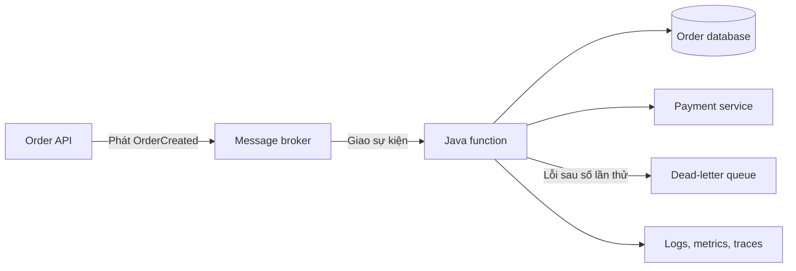

# Trách nhiệm chia sẻ khi vận hành serverless

Serverless giúp đội phát triển tập trung vào chức năng nghiệp vụ mà không phải tự quản lý máy chủ, hệ điều hành hay bộ điều phối máy ảo. Tuy vậy, serverless không có nghĩa là nhà cung cấp đám mây chịu trách nhiệm cho toàn bộ ứng dụng. Khi vận hành một dịch vụ serverless, nhà cung cấp và đội phát triển cùng chịu trách nhiệm ở những lớp khác nhau.

Trong phạm vi **CLOUD_SERVERLESS**, trọng tâm là phát triển và triển khai ứng dụng theo mô hình serverless, đặc biệt là Java function được kích hoạt bởi HTTP, thông điệp hoặc sự kiện. Để vận hành an toàn và ổn định, người phát triển cần hiểu ai quản lý trigger, trạng thái, quyền truy cập, retry, idempotency, cold start, khả năng mở rộng và chi phí. Đây chính là cách áp dụng mô hình trách nhiệm chia sẻ vào công việc hằng ngày.

## 1. Mô hình trách nhiệm chia sẻ là gì?

Mô hình trách nhiệm chia sẻ (*shared responsibility model*) phân định những việc nhà cung cấp dịch vụ đám mây phải bảo vệ và vận hành với những việc khách hàng phải cấu hình, phát triển và giám sát.

- **Nhà cung cấp** thường chịu trách nhiệm bảo vệ hạ tầng vật lý, trung tâm dữ liệu, mạng nền tảng, máy chủ và lớp thực thi được quản lý. Với FaaS, nền tảng còn điều phối việc khởi tạo môi trường thực thi, nhận sự kiện và phân bổ tài nguyên theo cơ chế của dịch vụ.
- **Đội phát triển** chịu trách nhiệm về mã nguồn, thư viện phụ thuộc, dữ liệu, danh tính và quyền mà ứng dụng sử dụng, cấu hình trigger, quy tắc xử lý lỗi, cũng như cách ứng dụng đáp ứng yêu cầu nghiệp vụ và bảo mật.
- **Hai bên cùng tạo nên độ tin cậy của hệ thống**: nhà cung cấp duy trì dịch vụ nền tảng theo cam kết; đội phát triển phải thiết kế ứng dụng để sử dụng nền tảng đúng cách, theo dõi hành vi thực tế và xử lý các tình huống nằm trong phạm vi kiểm soát của mình.

Ranh giới cụ thể phụ thuộc vào sản phẩm, gói dịch vụ, cấu hình và hợp đồng. Vì vậy, không nên suy luận rằng mọi dịch vụ mang nhãn “serverless” đều có cùng một ranh giới trách nhiệm. Cần đọc tài liệu trách nhiệm chia sẻ và tài liệu vận hành của đúng dịch vụ đang sử dụng.

## 2. Trách nhiệm thay đổi theo mức độ quản lý của dịch vụ

Khi chuyển từ hạ tầng tự quản lý sang dịch vụ được quản lý nhiều hơn, nhà cung cấp đảm nhận thêm công việc vận hành nền tảng. Trách nhiệm đối với ứng dụng và dữ liệu vẫn thuộc về khách hàng.

| Lớp công việc | IaaS | PaaS | FaaS |
|---|---|---|---|
| Trung tâm dữ liệu, máy chủ vật lý, mạng nền tảng | Nhà cung cấp | Nhà cung cấp | Nhà cung cấp |
| Hệ điều hành và máy chủ chạy ứng dụng | Khách hàng thường quản lý | Nhà cung cấp thường quản lý | Nhà cung cấp quản lý môi trường thực thi nền tảng |
| Cấp phát và mở rộng tài nguyên thực thi | Khách hàng cấu hình, vận hành phần lớn | Dịch vụ hỗ trợ hoặc tự động hóa một phần | Nền tảng điều phối theo mô hình function và giới hạn dịch vụ |
| Mã ứng dụng và thư viện của ứng dụng | Khách hàng | Khách hàng | Khách hàng |
| Dữ liệu, quy tắc nghiệp vụ và quyền ứng dụng | Khách hàng | Khách hàng | Khách hàng |
| Cấu hình tích hợp, trigger và xử lý lỗi | Khách hàng | Khách hàng | Khách hàng, với một số cơ chế do nền tảng cung cấp |

Bảng trên thể hiện xu hướng chung, không thay thế tài liệu của từng nhà cung cấp. Chẳng hạn, nền tảng FaaS có thể vá hệ điều hành của máy chủ thực thi, nhưng đội phát triển vẫn phải cập nhật phiên bản Java được hỗ trợ, thư viện bên thứ ba và mã nguồn dễ bị tổn thương. Một dịch vụ có thể mã hóa dữ liệu ở tầng lưu trữ, nhưng khách hàng vẫn phải quyết định dữ liệu nào được lưu, ai được đọc dữ liệu và khóa mã hóa được cấp quyền ra sao.

## 3. Phân định trách nhiệm trong một ứng dụng Java FaaS

Một Java function thường gồm nhiều phần phối hợp: nguồn phát sự kiện, cấu hình trigger, môi trường chạy, mã xử lý, dịch vụ lưu trữ hoặc dịch vụ bên ngoài, và hệ thống quan sát. Cần xác định chủ thể chịu trách nhiệm ở từng phần.

| Thành phần | Nhà cung cấp nền tảng thường đảm nhận | Đội phát triển phải đảm nhận |
|---|---|---|
| Hạ tầng thực thi | Máy chủ vật lý, mạng và lớp cô lập của dịch vụ | Chọn cấu hình phù hợp với yêu cầu và giới hạn của dịch vụ |
| Runtime | Vận hành hạ tầng runtime được quản lý theo cam kết dịch vụ | Chọn phiên bản Java được hỗ trợ; kiểm thử tương thích; cập nhật dependency và xử lý cảnh báo bảo mật trong ứng dụng |
| Mã function | Cung cấp cơ chế triển khai và thực thi | Viết, kiểm thử, review, phát hành và bảo trì mã; kiểm tra đầu vào; xử lý lỗi nghiệp vụ |
| Trigger và tích hợp | Cung cấp API, event source, queue hoặc cơ chế kết nối | Cấu hình nguồn gọi, bộ lọc, định tuyến, xác thực, giới hạn lưu lượng, timeout và cách xác nhận đã xử lý |
| Danh tính và quyền | Cung cấp IAM hoặc cơ chế quản lý danh tính | Gán quyền tối thiểu cho function; bảo vệ secret; rà soát quyền truy cập dữ liệu và dịch vụ đích |
| Trạng thái và dữ liệu | Vận hành hạ tầng của dịch vụ lưu trữ được quản lý | Chọn nơi lưu trạng thái; thiết kế schema, vòng đời, tính nhất quán, sao lưu và quyền truy cập phù hợp |
| Retry và thông điệp lỗi | Cung cấp cơ chế giao nhận, retry hoặc hàng đợi lỗi theo đặc tính dịch vụ | Chọn chính sách retry; xử lý thông điệp trùng hoặc lỗi; theo dõi và xử lý dead-letter queue |
| Khả năng mở rộng | Tạo hoặc thu hồi môi trường thực thi theo cơ chế nền tảng | Đặt giới hạn concurrency phù hợp; bảo vệ cơ sở dữ liệu và dịch vụ phụ thuộc; kiểm soát tải đột biến |
| Quan sát và chi phí | Cung cấp metric nền tảng, log hoặc dữ liệu tính phí | Ghi log có cấu trúc; tạo metric nghiệp vụ, trace và cảnh báo; phân tích hóa đơn và tối ưu cách sử dụng |

Điểm quan trọng là **dịch vụ được quản lý không tự động quản lý thay cấu hình của ứng dụng**. Nền tảng có thể cung cấp một trigger HTTP, nhưng đội phát triển vẫn phải quyết định endpoint có yêu cầu xác thực không, giới hạn request thế nào và phản hồi lỗi ra sao. Nền tảng có thể giao thông điệp lại, nhưng đội phát triển phải bảo đảm một lần giao lại không làm nghiệp vụ bị thực hiện hai lần.

## 4. Trigger: nền tảng kích hoạt, ứng dụng định nghĩa cách phản hồi

Trigger xác định sự kiện nào làm function chạy. Ba nhóm thường gặp là HTTP, thông điệp và sự kiện từ dịch vụ khác.

### HTTP trigger

Với HTTP, nền tảng thường tiếp nhận request và chuyển request đến function theo cấu hình tích hợp. Đội phát triển cần xác định:

- Endpoint nào được công khai và endpoint nào cần xác thực hoặc phân quyền.
- Cách kiểm tra dữ liệu đầu vào, kích thước payload, kiểu nội dung và giới hạn tần suất.
- Timeout phù hợp với hợp đồng API; không giả định request có thể chờ vô hạn.
- Mã trạng thái và cấu trúc phản hồi cho trường hợp thành công, lỗi xác thực, dữ liệu không hợp lệ hoặc dịch vụ phụ thuộc không khả dụng.
- Cách bảo vệ các thao tác có tác động nghiệp vụ khi client gửi lại request do timeout hoặc mất kết nối.

Ví dụ, function tạo đơn hàng có thể đã ghi đơn thành công nhưng phản hồi HTTP bị thất lạc. Client gửi lại request sẽ tạo nguy cơ có hai đơn hàng. API cần một khóa idempotency do client cung cấp hoặc một định danh nghiệp vụ ổn định để nhận diện lần yêu cầu lặp.

### Message trigger

Với message trigger, broker hoặc hàng đợi thường chịu trách nhiệm lưu trữ và giao thông điệp theo cơ chế của dịch vụ. Đội phát triển phải hiểu rõ thông điệp được xác nhận vào thời điểm nào, thời gian xử lý tối đa là bao lâu, khi nào hệ thống giao lại và điều gì xảy ra sau khi vượt số lần thử.

Không nên mặc định rằng một thông điệp chỉ được giao đúng một lần. Nhiều hệ thống sử dụng giao nhận *at-least-once*: cùng một thông điệp có thể đến function nhiều lần, chẳng hạn khi function xử lý xong nhưng việc xác nhận bị lỗi hoặc quá thời hạn. Vì vậy, logic xử lý phải chịu được việc nhận trùng.

### Event trigger

Event trigger có thể xuất phát từ thao tác lưu trữ, thay đổi bản ghi, lịch chạy hoặc một dịch vụ khác. Đội phát triển cần kiểm tra schema và phiên bản sự kiện, thứ tự sự kiện có được bảo đảm không, có thể nhận sự kiện đến muộn không, và cách xử lý khi nguồn phát thay đổi cấu trúc payload.

Trong cả ba loại trigger, nhà cung cấp cung cấp cơ chế kích hoạt và tích hợp; đội phát triển chịu trách nhiệm về ý nghĩa nghiệp vụ của request hoặc event, tính hợp lệ của dữ liệu và kết quả xử lý.

## 5. Trạng thái: function có thể tạm thời, dữ liệu nghiệp vụ phải bền vững

FaaS thường tạo môi trường thực thi theo nhu cầu. Một function có thể được khởi tạo mới, tái sử dụng hoặc kết thúc sau một khoảng thời gian. Không được xem bộ nhớ của tiến trình, biến static hay tệp tạm trong môi trường thực thi là nơi lưu trạng thái nghiệp vụ lâu dài.

Ví dụ, một biến `static Map<String, Order>` trong Java có thể tồn tại khi cùng một instance được tái sử dụng, nhưng có thể mất khi instance bị thu hồi; một instance khác cũng không nhìn thấy bản sao của biến đó. Điều này khiến dữ liệu phụ thuộc vào số lượng instance và lịch sử khởi tạo, dẫn đến lỗi khó tái hiện khi hệ thống mở rộng.

Đội phát triển nên lưu trạng thái cần tồn tại qua nhiều lần gọi vào dịch vụ lưu trữ phù hợp, chẳng hạn cơ sở dữ liệu, kho khóa-giá trị hoặc object storage. Cần thiết kế thêm:

- Khóa định danh và ràng buộc duy nhất để tránh tạo bản ghi trùng.
- Giao dịch hoặc cơ chế cập nhật có điều kiện khi nhiều function cùng thay đổi một dữ liệu.
- Chính sách hết hạn, lưu trữ và xóa dữ liệu theo nhu cầu nghiệp vụ.
- Sao lưu, phục hồi và kiểm tra khả năng khôi phục nếu dữ liệu quan trọng.
- Quyền đọc/ghi tách biệt theo từng function hoặc từng vai trò.

Nền tảng lưu trữ được quản lý có thể chịu trách nhiệm về phần cứng, tính sẵn sàng và các cơ chế bảo vệ ở tầng dịch vụ. Đội phát triển vẫn phải chọn cấu hình, thiết kế dữ liệu, kiểm soát quyền và kiểm tra khả năng phục hồi phù hợp với mục tiêu của ứng dụng.

## 6. Retry và idempotency: giao lại không được làm sai nghiệp vụ

Retry giúp hệ thống vượt qua lỗi tạm thời, ví dụ dịch vụ phụ thuộc bị gián đoạn trong thời gian ngắn. Tuy nhiên, retry cũng có thể làm một thao tác được thực hiện nhiều lần. Vì thế, chính sách retry và thiết kế idempotency phải được xem xét cùng nhau.

### Chọn retry có chủ đích

Đội phát triển cần phân biệt lỗi tạm thời với lỗi không thể khắc phục bằng cách thử lại:

- Lỗi mạng tạm thời, giới hạn tốc độ hoặc dịch vụ phụ thuộc quá tải có thể phù hợp với retry có giới hạn và backoff.
- Dữ liệu sai định dạng, thiếu trường bắt buộc hoặc vi phạm quy tắc nghiệp vụ thường cần đưa vào luồng xử lý lỗi để điều tra, không nên retry liên tục.
- Số lần thử, khoảng chờ, thời hạn xử lý và dead-letter queue cần được cấu hình theo khả năng của nguồn sự kiện và yêu cầu nghiệp vụ.
- Log và cảnh báo phải giúp nhận ra thông điệp đang retry nhiều lần hoặc bị đưa vào dead-letter queue.

Retry có thể làm tăng thời gian hoàn tất, số lần thực thi và chi phí. Nếu function gọi một dịch vụ phụ thuộc đang quá tải, retry dồn dập còn có thể làm tình trạng quá tải nghiêm trọng hơn. Backoff, giới hạn số lần thử và cơ chế điều tiết tải giúp giảm rủi ro này.

### Thiết kế idempotency

Một thao tác là idempotent khi thực hiện lặp lại với cùng một định danh hoặc đầu vào vẫn tạo ra cùng một kết quả nghiệp vụ như thực hiện một lần. Ví dụ, “đặt trạng thái đơn hàng thành ĐÃ XÁC NHẬN” có thể được thiết kế idempotent; “cộng thêm 100.000 đồng vào số dư” sẽ không idempotent nếu cứ cộng lại mỗi lần nhận thông điệp.

Với message hoặc event, có thể dùng event ID hoặc khóa nghiệp vụ ổn định làm khóa idempotency. Việc kiểm tra và ghi nhận khóa phải được thực hiện nguyên tử trong kho dữ liệu dùng chung; một biến trong bộ nhớ function không đủ để chống xử lý trùng giữa nhiều instance.

Ví dụ minh họa một handler Java dùng một thành phần idempotency có lưu trữ bền vững:

```java
public final class OrderCreatedHandler {
    private final IdempotencyExecutor idempotency;
    private final OrderService orders;

    public OrderCreatedHandler(
            IdempotencyExecutor idempotency,
            OrderService orders) {
        this.idempotency = idempotency;
        this.orders = orders;
    }

    public void handle(OrderCreated event) {
        String key = "order-created:" + event.eventId();

        idempotency.executeOnce(key, () ->
                orders.confirm(event.orderId())
        );
    }
}
```

`IdempotencyExecutor` ở đây là giao diện minh họa. Phần triển khai phải dùng thao tác ghi có điều kiện hoặc giao dịch để phối hợp giữa các instance, lưu được trạng thái hoàn tất và có cách phục hồi khi một lần xử lý dở dang bị gián đoạn. Không nên triển khai nó bằng một `HashSet` trong bộ nhớ. Nếu thao tác gọi hệ thống bên ngoài, hãy kiểm tra xem hệ thống đó có hỗ trợ khóa idempotency hay không; nếu cần phối hợp cập nhật dữ liệu và phát sự kiện, có thể dùng transactional outbox để tránh ghi dữ liệu thành công nhưng mất sự kiện.

## 7. Quyền truy cập và bảo vệ dữ liệu

Nhà cung cấp cung cấp cơ chế IAM, secret manager, mã hóa và các ranh giới mạng. Đội phát triển phải cấu hình các cơ chế đó cho đúng ứng dụng.

Các nguyên tắc thực hành gồm:

1. **Quyền tối thiểu:** mỗi function chỉ có quyền cần thiết để đọc hoặc ghi đúng tài nguyên mà nó sử dụng. Function xử lý ảnh không nên có quyền quản trị toàn bộ cơ sở dữ liệu nếu chỉ cần đọc một bucket và ghi một bucket khác.
2. **Tách danh tính:** dùng danh tính thực thi riêng cho từng function hoặc nhóm chức năng có cùng yêu cầu quyền; tránh dùng chung một tài khoản đặc quyền cho mọi thành phần.
3. **Quản lý secret:** không nhúng mật khẩu, token hoặc khóa truy cập vào mã nguồn, image hay file cấu hình công khai. Dùng dịch vụ quản lý secret và giới hạn quyền đọc secret.
4. **Bảo vệ dữ liệu:** xác định dữ liệu nhạy cảm, giới hạn dữ liệu ghi vào log, cấu hình mã hóa và thời hạn lưu trữ theo yêu cầu.
5. **Kiểm tra đường gọi:** xác thực người gọi HTTP, xác minh chữ ký hoặc danh tính của nguồn event khi dịch vụ yêu cầu, và không tin payload chỉ vì nó đến từ một trigger.
6. **Rà soát dependency:** cập nhật thư viện Java, kiểm tra lỗ hổng và loại bỏ dependency không còn cần thiết.

Một nền tảng an toàn không thể bù cho function có quyền quá rộng, secret bị lộ hoặc logic xác thực sai. Cấu hình quyền và cách xử lý dữ liệu là trách nhiệm trực tiếp của đội phát triển.

## 8. Cold start và khả năng mở rộng

FaaS có thể cần khởi tạo môi trường thực thi trước khi xử lý một yêu cầu. Khoảng thời gian tăng thêm này thường được gọi là *cold start*. Cold start phụ thuộc vào nền tảng, runtime, kích thước gói triển khai, cấu hình tài nguyên, số lượng thư viện cần nạp và cách ứng dụng khởi tạo.

Với Java, quá trình nạp class, khởi tạo framework, tạo kết nối và nạp cấu hình có thể làm tăng thời gian khởi động. Đội phát triển có thể đo riêng thời gian khởi tạo và thời gian xử lý, giảm dependency không cần thiết, trì hoãn khởi tạo thành phần chưa dùng và chọn cấu hình runtime phù hợp. Một số nền tảng có cơ chế giữ sẵn môi trường hoặc concurrency được cấp trước; các cơ chế này có thể giảm độ trễ nhưng thường làm thay đổi chi phí.

Nền tảng thường tự động tạo thêm instance khi lượng sự kiện tăng, trong giới hạn dịch vụ. Đội phát triển vẫn phải bảo vệ các thành phần phụ thuộc. Ví dụ, nếu function tăng từ 5 lên 200 instance nhưng cơ sở dữ liệu chỉ chịu được 30 kết nối đồng thời, việc mở rộng function có thể làm cơ sở dữ liệu quá tải.

Do đó, cần:

- Đặt concurrency tối đa hoặc giới hạn tốc độ khi dịch vụ đích có năng lực hữu hạn.
- Dùng connection pool và thời gian sống kết nối phù hợp với vòng đời instance; tránh mở kết nối mới không kiểm soát trong mỗi lần gọi.
- Thiết kế backpressure, hàng đợi hoặc cơ chế điều tiết để hấp thụ tải đột biến.
- Kiểm thử tải với cả thời điểm khởi tạo mới và thời điểm instance đã chạy ổn định.
- Theo dõi độ trễ p95/p99, số instance, số lần throttling, lỗi và độ sâu hàng đợi.

Nhà cung cấp chịu trách nhiệm về cơ chế mở rộng của nền tảng; đội phát triển chịu trách nhiệm bảo đảm toàn bộ chuỗi xử lý vẫn ổn định khi tải thay đổi.

## 9. Quan sát, độ tin cậy và xử lý sự cố

Log, metric và trace là công cụ để đội phát triển kiểm chứng ứng dụng đang hoạt động đúng như thiết kế. Dịch vụ serverless thường phân tán một luồng nghiệp vụ qua nhiều lần gọi function và nhiều dịch vụ quản lý, vì vậy cần có định danh tương quan để nối các bước xử lý.

Một bộ quan sát tối thiểu nên có:

- **Log có cấu trúc:** ghi correlation ID, event ID, loại trigger, kết quả xử lý và mã lỗi; không ghi token, mật khẩu hoặc dữ liệu cá nhân không cần thiết.
- **Metric kỹ thuật:** số invocation, tỷ lệ lỗi, thời gian thực thi, timeout, throttling, cold start và số lần retry.
- **Metric nghiệp vụ:** số đơn được xử lý, số giao dịch thất bại, thời gian từ lúc nhận sự kiện đến lúc hoàn tất.
- **Trace phân tán:** truyền trace context qua function và dịch vụ phụ thuộc khi có hỗ trợ.
- **Cảnh báo có hành động:** cảnh báo khi tỷ lệ lỗi vượt ngưỡng, hàng đợi tăng liên tục, dead-letter queue có thông điệp hoặc chi phí tăng bất thường.

Nhà cung cấp có thể bảo đảm khả năng quan sát ở tầng nền tảng và cung cấp dữ liệu thô. Đội phát triển phải chọn chỉ số có ý nghĩa, đặt ngưỡng, trực sự cố và xây dựng quy trình khôi phục. Cũng cần kiểm tra giới hạn lưu trữ log, quyền truy cập log và chi phí phát sinh do ghi log quá nhiều.

## 10. Chi phí: nhà cung cấp đo đếm, đội phát triển kiểm soát cách sử dụng

FaaS thường tính phí theo các yếu tố như số lần gọi, thời gian thực thi, mức tài nguyên được cấp, concurrency được giữ sẵn và dịch vụ đi kèm. Cách tính cụ thể thay đổi theo nhà cung cấp và sản phẩm.

Chi phí không chỉ đến từ function. Một function chạy ngắn nhưng gọi cơ sở dữ liệu nhiều lần, truyền lượng dữ liệu lớn, ghi log dày đặc hoặc retry liên tục vẫn có thể tạo hóa đơn đáng kể. Đội phát triển nên:

- Ước tính số invocation và thời gian thực thi theo lưu lượng thực tế.
- Chọn memory/CPU và timeout dựa trên đo đạc, không chỉ dựa vào cấu hình mặc định.
- Theo dõi chi phí của API gateway, queue, database, storage, log, network egress và các dịch vụ được gọi.
- Phát hiện vòng lặp retry, event bị phát lặp hoặc function chạy quá thường xuyên.
- Dùng budget, cảnh báo ngân sách và phân bổ chi phí theo môi trường hoặc nhóm nghiệp vụ nếu nền tảng hỗ trợ.
- So sánh chi phí với độ trễ, độ tin cậy và công sức vận hành; FaaS không mặc nhiên rẻ hơn mọi mô hình khác.

Nhà cung cấp chịu trách nhiệm đo đếm và công bố cách tính phí theo dịch vụ. Đội phát triển và đơn vị sở hữu sản phẩm chịu trách nhiệm hiểu mức tiêu thụ, dự báo và điều chỉnh thiết kế.

## 11. Ví dụ tổng hợp: xử lý sự kiện tạo đơn hàng

Giả sử một dịch vụ thương mại điện tử phát sự kiện `OrderCreated`. Một Java function nhận sự kiện, xác nhận đơn hàng và gửi yêu cầu sang dịch vụ thanh toán.



Trong luồng này, nhà cung cấp vận hành hạ tầng broker, môi trường thực thi function và hạ tầng của dịch vụ lưu trữ được quản lý. Đội phát triển phải xác định các hành vi sau:

1. Function có danh tính riêng và chỉ được đọc sự kiện, cập nhật đơn hàng, gọi dịch vụ thanh toán cần thiết.
2. Handler kiểm tra schema và event ID trước khi xử lý. Nếu broker giao lại cùng sự kiện, khóa idempotency ngăn việc xác nhận đơn hoặc tạo yêu cầu thanh toán lặp.
3. Việc cập nhật trạng thái đơn hàng và ghi nhận kết quả xử lý phải có cơ chế nhất quán. Nếu thanh toán là một hệ thống bên ngoài, cần dùng khóa idempotency mà dịch vụ thanh toán hỗ trợ hoặc một quy trình đối soát phù hợp.
4. Lỗi tạm thời được retry với giới hạn và backoff. Sự kiện không thể xử lý sau số lần thử được chuyển vào dead-letter queue để điều tra và phát lại có kiểm soát.
5. Concurrency của function được giới hạn theo năng lực database và payment service. Tải tăng không được phép làm các dịch vụ phụ thuộc quá tải.
6. Log và trace chứa event ID/correlation ID để tìm được một đơn hàng qua các bước. Cảnh báo được tạo khi tỷ lệ lỗi hoặc số lượng thông điệp trong dead-letter queue vượt ngưỡng.
7. Dashboard chi phí theo dõi invocation, thời gian chạy, retry, lưu trữ, log và các lời gọi đến dịch vụ phụ thuộc.

Ví dụ cho thấy trách nhiệm chia sẻ không dừng ở việc xác định ai quản lý máy chủ. Đội phát triển phải thiết kế luồng nghiệp vụ an toàn trước giao nhận lặp, lỗi một phần, tải tăng và sự cố của dịch vụ phụ thuộc.

## 12. Checklist trước khi đưa function vào production

| Câu hỏi cần kiểm tra | Bằng chứng hoặc cấu hình cần có |
|---|---|
| Ai có thể kích hoạt function? | Danh sách trigger, cấu hình xác thực và quyền gọi |
| Function có quyền gì? | IAM role/policy theo nguyên tắc quyền tối thiểu; secret được quản lý an toàn |
| Trạng thái được lưu ở đâu? | Kho lưu trữ bền vững, schema, chính sách vòng đời và sao lưu phù hợp |
| Nếu nhận cùng event hai lần thì sao? | Khóa idempotency bền vững và kiểm thử xử lý đồng thời |
| Khi function thất bại thì điều gì xảy ra? | Timeout, retry, backoff, dead-letter queue và quy trình phát lại |
| Khi tải tăng thì hệ thống có chịu được không? | Giới hạn concurrency, kiểm thử tải và giới hạn của dịch vụ phụ thuộc |
| Cold start ảnh hưởng ra sao? | Đo thời gian khởi tạo và độ trễ đầu cuối; cấu hình tối ưu có căn cứ |
| Làm sao phát hiện sự cố? | Log, metric, trace, dashboard, ngưỡng cảnh báo và người chịu trách nhiệm xử lý |
| Làm sao kiểm soát chi phí? | Ước tính lưu lượng, theo dõi các thành phần tính phí và cảnh báo ngân sách |
| Runtime và thư viện có được cập nhật? | Phiên bản Java được hỗ trợ, quy trình vá dependency và kiểm tra lỗ hổng |

## 13. Cách xác định ranh giới trách nhiệm khi chọn dịch vụ

Trước khi triển khai, hãy thực hiện lần lượt các bước sau:

1. **Xác định dịch vụ cụ thể:** ghi rõ sản phẩm FaaS, event source, kho dữ liệu và các dịch vụ tích hợp được dùng. Tên gọi “serverless” chung chung chưa đủ để xác định trách nhiệm.
2. **Đọc tài liệu trách nhiệm và SLA:** xác định nhà cung cấp quản lý lớp nào, giới hạn nào được áp dụng, dịch vụ bảo đảm điều gì và những trường hợp nào nằm ngoài cam kết.
3. **Liệt kê cấu hình do ứng dụng sở hữu:** trigger, IAM, secret, runtime, timeout, retry, concurrency, lưu trữ và quan sát.
4. **Gắn người chịu trách nhiệm:** mỗi cấu hình quan trọng cần có nhóm hoặc vai trò sở hữu, người nhận cảnh báo và quy trình xử lý.
5. **Kiểm chứng bằng tình huống lỗi:** thử request không hợp lệ, event trùng, function timeout, dịch vụ phụ thuộc gián đoạn, tải tăng và phục hồi từ dead-letter queue.
6. **Rà soát định kỳ:** cập nhật ranh giới khi nhà cung cấp thay đổi tính năng, runtime hết hỗ trợ, quyền ứng dụng thay đổi hoặc kiến trúc được mở rộng.

Trách nhiệm chia sẻ chỉ có ý nghĩa khi được chuyển thành cấu hình, kiểm thử và quy trình có người sở hữu. Với Java FaaS, nhà cung cấp giúp đội phát triển giảm gánh nặng quản lý hạ tầng; đội phát triển vẫn phải chịu trách nhiệm về mã nguồn, dữ liệu, quyền truy cập và cách hệ thống phản ứng trước lỗi, tải và chi phí. Hiểu rõ ranh giới này giúp quyết định đúng khi nào nên dùng FaaS và vận hành function một cách có kiểm soát.
