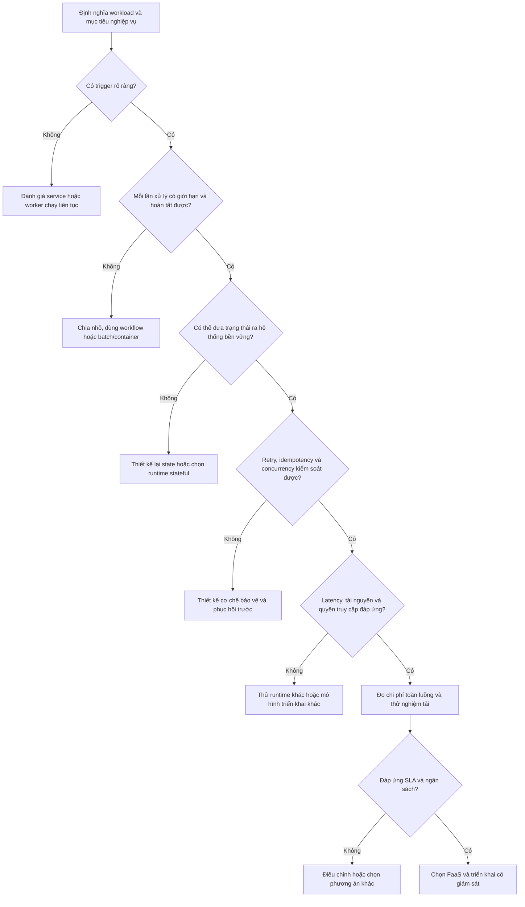
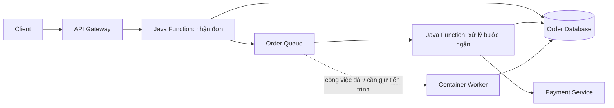

# Lựa chọn workload phù hợp và nhận diện trường hợp không phù hợp

Serverless, đặc biệt là Function as a Service (FaaS), phù hợp khi một phần công việc có thể được kích hoạt bởi HTTP request, thông điệp hoặc sự kiện, thực thi trong một khoảng thời gian hữu hạn rồi kết thúc. Nền tảng chịu trách nhiệm cấp phát tài nguyên và điều chỉnh số lượng phiên thực thi theo tải. Nhờ đó, nhóm phát triển có thể tập trung vào logic nghiệp vụ thay vì vận hành máy chủ.

Tuy nhiên, serverless không tự động làm mọi hệ thống rẻ hơn, nhanh hơn hay đơn giản hơn. Một function vẫn có giới hạn thời gian, bộ nhớ, khả năng kết nối và mô hình retry riêng. Việc nền tảng tự mở rộng cũng có thể tạo ra quá nhiều kết nối đồng thời đến cơ sở dữ liệu hoặc dịch vụ phía sau. Vì vậy, quyết định đúng không phải là chuyển toàn bộ ứng dụng sang FaaS, mà là xác định workload nào có đặc điểm phù hợp, workload nào cần mô hình khác và ranh giới nào nên đặt giữa chúng.

Trong bài này, *workload* là một đơn vị công việc có đầu vào, mục tiêu xử lý, yêu cầu vận hành và đặc điểm tải tương đối rõ ràng. Một ứng dụng có thể chứa nhiều workload khác nhau: API nhận yêu cầu, xử lý đơn hàng từ queue, tạo ảnh thu nhỏ sau khi upload, hoặc tổng hợp báo cáo định kỳ. Mỗi workload cần được đánh giá riêng.

## 1. FaaS phù hợp với kiểu công việc nào?

FaaS tổ chức việc thực thi quanh một lần gọi function. Một trigger chuyển đầu vào đến function; function kiểm tra dữ liệu, thực hiện công việc và trả kết quả hoặc phát sinh tác động phụ. Trigger thường thuộc một trong các nhóm sau:

- **HTTP:** API Gateway, webhook hoặc HTTP endpoint gọi function khi có request.
- **Thông điệp:** queue hoặc message broker chuyển thông điệp đến function để xử lý.
- **Sự kiện:** object được tạo trong storage, bản ghi thay đổi, sự kiện từ event bus hoặc một hành động trong dịch vụ khác kích hoạt function.
- **Lịch:** bộ lập lịch gọi function theo thời điểm hoặc chu kỳ đã cấu hình.

Đơn vị thực thi này thường có vòng đời ngắn và độc lập. Sau khi xử lý xong, function trả kết quả và môi trường thực thi có thể được tái sử dụng hoặc thu hồi. Không nên giả định một instance sẽ luôn tồn tại giữa hai lần gọi, cũng không nên dựa vào bộ nhớ cục bộ để lưu trạng thái nghiệp vụ lâu dài.

Một workload thường có độ phù hợp cao khi hội tụ các đặc điểm sau:

1. **Có điểm kích hoạt rõ ràng.** Công việc bắt đầu khi nhận request, message, event hoặc lịch chạy; không cần một tiến trình luôn thức để chờ việc.
2. **Có thể chia thành lần xử lý hữu hạn.** Mỗi lần gọi có thể hoàn thành trong giới hạn thời gian và tài nguyên của nền tảng.
3. **Có ranh giới đầu vào và đầu ra rõ.** Dữ liệu cần thiết có thể truyền qua request/event hoặc đọc từ dịch vụ lưu trữ; kết quả có thể trả về hoặc ghi sang một hệ thống khác.
4. **Có thể xử lý tính độc lập và đồng thời.** Nhiều lần gọi có thể chạy song song, hoặc có thể kiểm soát thứ tự và mức đồng thời bằng queue, khóa hay cơ chế điều phối.
5. **Không cần giữ trạng thái trong tiến trình.** Trạng thái cần tồn tại qua nhiều lần gọi được lưu trong database, object storage, cache hoặc dịch vụ trạng thái bên ngoài.
6. **Tải có biến động hoặc khó dự đoán.** Khả năng tăng giảm số lần thực thi theo nhu cầu có giá trị rõ ràng, đặc biệt khi không cần duy trì tài nguyên tính toán nhàn rỗi.

Không nhất thiết workload phải có tải thất thường mới dùng được FaaS. Một API có lưu lượng tương đối ổn định vẫn có thể phù hợp nếu cách vận hành, độ trễ, giới hạn nền tảng và tổng chi phí đáp ứng yêu cầu. Biến động tải là một lợi thế thường gặp, không phải điều kiện bắt buộc.

## 2. Những dấu hiệu cho thấy workload phù hợp

### 2.1. Công việc được kích hoạt theo sự kiện

Một function xử lý webhook khi đối tác gửi thông báo, tạo thumbnail khi có ảnh mới hoặc tiêu thụ message khi đơn hàng được xác nhận thường có thời điểm bắt đầu tự nhiên. Không cần duy trì một máy chủ chỉ để kiểm tra liên tục xem có việc mới hay không.

Ví dụ, khi người dùng upload ảnh vào object storage, một sự kiện `ObjectCreated` có thể kích hoạt function tạo thumbnail. Function nhận định danh object, đọc ảnh gốc, tạo phiên bản nhỏ và ghi kết quả. Mỗi ảnh là một đơn vị xử lý tương đối độc lập, dễ quan sát và có thể chạy đồng thời.

### 2.2. Thời gian xử lý có giới hạn và có thể dự đoán

FaaS phù hợp với công việc hoàn thành trong giới hạn timeout của nhà cung cấp. Hãy đo thời gian xử lý thực tế ở cả trường hợp bình thường và trường hợp xấu, bao gồm thời gian gọi dịch vụ ngoài, truy vấn database và tải dữ liệu. Đừng chỉ đo phần CPU của logic function.

Nếu một công việc đôi khi kéo dài hàng chục phút hoặc hàng giờ, cần kiểm tra giới hạn timeout, khả năng gián đoạn, cách checkpoint và chi phí giữ tài nguyên. Có thể chia công việc thành nhiều bước nhỏ, điều phối bằng workflow hoặc chuyển phần xử lý dài sang container/job phù hợp hơn.

### 2.3. Có thể mở rộng mà không gây nghẽn hệ thống phía sau

Nền tảng có thể tạo nhiều lần thực thi khi lượng event tăng. Điều đó giúp xử lý song song, nhưng không có nghĩa mọi thành phần phụ thuộc đều mở rộng theo cùng tốc độ. Một function có thể tăng từ vài instance lên hàng trăm instance trong thời gian ngắn, trong khi database chỉ chịu được một số lượng kết nối nhỏ hơn nhiều.

Trước khi chọn FaaS, hãy xác định:

- Mức đồng thời tối đa mà workload cần hoặc nền tảng có thể tạo ra.
- Khả năng chịu tải của database, API bên ngoài và các dịch vụ phụ thuộc.
- Cách giới hạn concurrency, batch size hoặc tốc độ tiêu thụ queue.
- Hành vi khi backlog tăng: tăng worker, giảm tốc độ nhận message, hay đưa message lỗi sang dead-letter queue.

FaaS phù hợp hơn khi có thể đặt giới hạn đồng thời và điều tiết tải để bảo vệ các hệ thống phía sau.

### 2.4. Trạng thái có thể đặt bên ngoài function

Một function có thể xử lý một request mà không cần nhớ request trước đó. Nếu nghiệp vụ cần ghi nhớ trạng thái đơn hàng, tiến độ xử lý hoặc kết quả đã tạo, hãy lưu trạng thái trong một hệ thống bền vững. Lần gọi tiếp theo đọc trạng thái bằng khóa nghiệp vụ hoặc mã tương quan.

Việc tách trạng thái khỏi vòng đời instance giúp function có thể chạy trên instance khác, được retry hoặc mở rộng ngang. Đổi lại, thiết kế phải tính đến độ trễ truy cập state store, giao dịch, tính nhất quán, khóa và chi phí của dịch vụ lưu trữ.

### 2.5. Nhóm muốn giảm công việc quản trị hạ tầng

FaaS có thể giảm trách nhiệm quản lý máy chủ, hệ điều hành và cơ chế mở rộng. Điều này hữu ích với nhóm muốn tập trung vào nghiệp vụ hoặc có tải không đủ lớn để biện minh cho việc tự vận hành một cụm máy chủ.

Nhưng serverless không loại bỏ trách nhiệm vận hành. Nhóm vẫn phải quản lý quyền truy cập, cấu hình trigger, giới hạn tài nguyên, secrets, logging, tracing, cảnh báo, retry, dead-letter queue và quy trình triển khai. Mức độ đơn giản chỉ tăng khi nhóm thiết kế các phần này có chủ đích.

## 3. Những trường hợp FaaS thường không phù hợp

Không có một danh sách cấm tuyệt đối cho mọi nhà cung cấp. Các giới hạn về thời gian, bộ nhớ, CPU, kích thước gói triển khai, mạng và concurrency khác nhau theo nền tảng. Những trường hợp dưới đây là tín hiệu cần so sánh kỹ với container, virtual machine, managed service hoặc hệ thống xử lý luồng chuyên dụng.

### 3.1. Tiến trình phải chạy liên tục hoặc giữ kết nối lâu dài

Ví dụ gồm worker luôn lắng nghe socket, game server duy trì phiên, tiến trình điều phối thiết bị hoặc dịch vụ cần giữ kết nối TCP lâu dài. FaaS được thiết kế quanh các lần gọi có điểm bắt đầu và kết thúc, vì vậy việc duy trì một tiến trình liên tục thường khó tự nhiên và có thể phát sinh chi phí hoặc giới hạn không phù hợp.

Có thể dùng một dịch vụ chạy liên tục để giữ kết nối, sau đó phát event hoặc message đến function cho các tác vụ ngắn. Cách kết hợp này giữ FaaS ở nơi nó có lợi thế.

### 3.2. Công việc dài hơn giới hạn thực thi hoặc cần tiến độ liên tục

Một tác vụ xử lý video dài, mô phỏng, huấn luyện mô hình hoặc xuất dữ liệu lớn có thể vượt timeout hoặc bộ nhớ của function. Nếu chia nhỏ được, hãy tạo các bước có checkpoint và trạng thái tiến độ bền vững. Nếu không thể chia nhỏ hoặc cần tài nguyên liên tục, container/job hoặc nền tảng batch thường phù hợp hơn.

Không nên giả định rằng tăng timeout hoặc cấp thêm bộ nhớ sẽ giải quyết mọi vấn đề. Giới hạn nền tảng vẫn tồn tại và chi phí có thể tăng mạnh theo thời gian thực thi.

### 3.3. Độ trễ phải ổn định ở mức rất thấp

Một function có thể gặp *cold start*: nền tảng phải chuẩn bị môi trường thực thi trước khi xử lý request. Với Java, thời gian khởi động JVM, nạp class, khởi tạo framework và tạo kết nối có thể góp phần vào độ trễ này. Mức ảnh hưởng phụ thuộc runtime, kích thước ứng dụng, cấu hình mạng, nhà cung cấp và cách triển khai.

Nếu yêu cầu nghiệp vụ có ngưỡng latency nghiêm ngặt ở cả percentile cao, cần đo cold start trong điều kiện gần sản xuất. Có thể giảm tác động bằng cách rút gọn dependency, tối ưu khởi tạo, dùng native image khi phù hợp hoặc cấu hình giữ sẵn môi trường thực thi nếu nền tảng hỗ trợ. Những biện pháp này có thể tăng độ phức tạp hoặc chi phí. Một dịch vụ luôn chạy có thể dễ đáp ứng latency ổn định hơn.

### 3.4. Tải cao, đều và kéo dài

FaaS vẫn có thể phục vụ workload lớn, nhưng khi tải cao liên tục, chi phí theo request và thời gian thực thi có thể vượt mô hình container hoặc máy chủ có công suất ổn định. Khi đó, một cụm worker chạy liên tục có thể tận dụng tài nguyên hiệu quả hơn.

Không nên quyết định chỉ dựa trên nhãn “lưu lượng lớn”. Hãy đo mức sử dụng thực tế, thời lượng mỗi lần gọi, yêu cầu dự phòng, chi phí vận hành và chi phí của dịch vụ phụ trợ. Một workload tải lớn nhưng xử lý ngắn, không đều vẫn có thể phù hợp với FaaS.

### 3.5. Cần tài nguyên hoặc quyền kiểm soát đặc biệt

Workload cần GPU chuyên dụng, bộ nhớ rất lớn, thiết bị gắn trực tiếp, kernel tùy chỉnh, quyền quản trị hệ điều hành hoặc thư viện native không tương thích có thể không chạy được trên runtime FaaS đã chọn. Cần xác minh kiến trúc CPU, hệ điều hành, runtime Java, giới hạn package, thư viện native và quyền truy cập mạng trước khi cam kết.

### 3.6. Phụ thuộc vào trạng thái trong bộ nhớ hoặc thứ tự xử lý toàn cục

Nếu logic giả định mọi request luôn đến cùng một instance, dựa vào biến static để lưu giỏ hàng hoặc yêu cầu tất cả sự kiện được xử lý tuần tự, thiết kế đó không tương thích tự nhiên với mô hình mở rộng ngang của FaaS.

Có thể chuyển trạng thái sang database, dùng khóa phân tán, partition theo khóa nghiệp vụ hoặc thiết kế workflow. Tuy nhiên, nếu thứ tự toàn cục và trạng thái trong tiến trình là cốt lõi, một dịch vụ chạy liên tục có thể đơn giản và dễ kiểm soát hơn.

## 4. Đánh giá theo loại workload

| Loại workload | Mức độ phù hợp thường gặp | Điều cần kiểm tra |
| --- | --- | --- |
| HTTP API stateless | Cao | Latency, cold start, timeout, xác thực, giới hạn concurrency và kết nối database |
| Webhook từ đối tác | Cao | Xác minh chữ ký, chống gửi lặp, phản hồi nhanh và chuyển xử lý nặng sang queue |
| Xử lý message trong queue | Cao | Retry, idempotency, thứ tự, visibility timeout, batch và dead-letter queue |
| Xử lý event từ object storage | Cao | Kích thước object, quyền đọc/ghi, event trùng và vòng lặp trigger |
| Công việc định kỳ ngắn | Cao | Lịch chạy trùng, múi giờ, thời lượng và khả năng chạy bù |
| Tạo thumbnail hoặc chuyển đổi tệp nhỏ | Cao | Bộ nhớ, thời gian, kích thước tệp và giới hạn thư viện |
| Báo cáo lớn hoặc export kéo dài | Thấp đến trung bình | Có thể chia bước, checkpoint, lưu kết quả và giới hạn timeout hay không |
| Worker giữ kết nối liên tục | Thấp | Nên xem xét container hoặc dịch vụ chạy liên tục |
| Xử lý stream tốc độ cao, trạng thái phức tạp | Tùy trường hợp | Cân nhắc nền tảng stream processing chuyên dụng; FaaS có thể xử lý event theo batch |
| Tác vụ cần GPU hoặc tài nguyên đặc thù | Thấp trên FaaS thông thường | Kiểm tra runtime và giới hạn phần cứng; cân nhắc dịch vụ chuyên dụng |

Các mức trên chỉ là định hướng ban đầu. Một API stateless có thể không phù hợp nếu cần latency cực thấp nhưng nền tảng có cold start đáng kể. Một báo cáo lớn vẫn có thể phù hợp nếu chia thành các bước ngắn, có checkpoint và được điều phối đúng cách.

## 5. Các câu hỏi cần trả lời trước khi chọn FaaS

### 5.1. Trigger và hình dạng dữ liệu

- Sự kiện nào bắt đầu công việc? Ai phát sự kiện và ai chịu trách nhiệm khi phát thất bại?
- Đầu vào là dữ liệu đầy đủ hay chỉ là tham chiếu đến dữ liệu cần đọc từ nơi khác?
- Kích thước payload tối đa là bao nhiêu? Có nên đưa dữ liệu lớn qua object storage thay vì nhét vào message?
- Một trigger có thể phát nhiều lần cho cùng một nghiệp vụ không?

Payload nên chứa đủ thông tin để định danh và tiếp tục xử lý, nhưng không nên chứa dữ liệu lớn vượt giới hạn của dịch vụ truyền tin. Với tệp lớn, thường chỉ cần truyền bucket, object key, version hoặc URI đã được kiểm soát quyền truy cập.

### 5.2. Thời gian, bộ nhớ và giới hạn runtime

- Thời gian xử lý trung vị và percentile cao là bao nhiêu?
- Công việc có thể hoàn thành trong timeout tối đa không?
- Bộ nhớ đỉnh có thể dự đoán được không?
- Có thư viện native, thao tác file lớn hoặc khởi tạo framework nặng không?
- Khi function bị dừng giữa chừng, công việc có thể tiếp tục an toàn không?

Hãy thử nghiệm với dữ liệu đại diện và cả trường hợp biên. Một lần chạy thành công trên máy phát triển không chứng minh function sẽ đáp ứng giới hạn runtime trong môi trường triển khai.

### 5.3. Trạng thái, retry và idempotency

Nền tảng có thể retry khi function lỗi, timeout hoặc không xác nhận message đúng hạn. Một số nguồn event có thể giao cùng một sự kiện nhiều lần; ngữ nghĩa giao nhận cụ thể tùy dịch vụ. Vì vậy, hãy thiết kế theo giả định một sự kiện có thể được xử lý lặp, trừ khi hợp đồng của nguồn phát đảm bảo khác và hệ thống đã kiểm chứng điều đó.

**Idempotency** là tính chất một thao tác được thực hiện nhiều lần với cùng một khóa nghiệp vụ nhưng tạo ra kết quả cuối tương đương một lần thực hiện. Ví dụ, khi nhận `OrderPaid` hai lần, hệ thống không được ghi nhận thanh toán hai lần. Có thể dùng `eventId`, `paymentId` hoặc khóa nghiệp vụ ổn định để lưu dấu đã xử lý bằng thao tác nguyên tử trong database.

Khi xử lý message, cần xác định rõ:

- Khi nào message được xác nhận đã xử lý?
- Lỗi nào được retry và lỗi nào cần chuyển sang dead-letter queue?
- Retry có backoff và giới hạn số lần không?
- Nếu function đã gọi dịch vụ thanh toán thành công nhưng lỗi trước khi ghi trạng thái hoàn tất thì lần retry có gây tác động lặp không?
- Có thể tra cứu, phát lại và xử lý thủ công message lỗi hay không?

Không nên nuốt exception rồi trả về thành công khi nghiệp vụ chưa hoàn tất. Hành vi đó có thể khiến nền tảng xác nhận message và mất cơ hội retry. Ngược lại, retry vô hạn một lỗi dữ liệu không thể khắc phục có thể tạo vòng lặp và tăng chi phí. Cần phân loại lỗi, giới hạn retry và lưu thông tin để điều tra.

Ví dụ minh họa dưới đây dùng các interface giả định để thể hiện ý tưởng; tên API và cách xác nhận message phải được điều chỉnh theo nhà cung cấp:

```java
public final class OrderCreatedHandler {
    private final InboxRepository inbox;
    private final PaymentService payments;

    public OrderCreatedHandler(
            InboxRepository inbox,
            PaymentService payments) {
        this.inbox = inbox;
        this.payments = payments;
    }

    public void handle(OrderCreated event) {
        // claim() phải là thao tác nguyên tử dựa trên eventId.
        ClaimResult claim = inbox.claim(event.eventId());

        if (claim == ClaimResult.ALREADY_COMPLETED) {
            return; // Sự kiện đã hoàn tất: lần giao lặp không tạo tác động mới.
        }

        if (claim == ClaimResult.IN_PROGRESS) {
            throw new RetryLaterException("Event is being processed");
        }

        try {
            // Dùng cùng idempotency key ở dịch vụ phía sau nếu dịch vụ hỗ trợ.
            payments.capture(
                    event.orderId(),
                    event.amount(),
                    event.eventId());

            inbox.markCompleted(event.eventId());
        } catch (RuntimeException error) {
            inbox.releaseForRetry(event.eventId());
            throw error; // Để adapter của trigger áp dụng chính sách retry.
        }
    }
}
```

Trong triển khai thật, `claim()` cần xử lý đồng thời bằng unique constraint, transaction hoặc cơ chế khóa có lease. Trạng thái `IN_PROGRESS` cần có thời hạn để có thể phục hồi nếu instance chết. Ví dụ cũng cho thấy một ranh giới giao dịch quan trọng: dịch vụ thanh toán có thể đã thành công trước khi `markCompleted()` thất bại. Vì vậy, khóa idempotency phải được truyền đến dịch vụ thanh toán nếu dịch vụ hỗ trợ; chỉ ghi dấu ở inbox là chưa đủ để bảo đảm không lặp tác động ngoài hệ thống.

### 5.4. Concurrency và sức chịu tải của dependency

Khả năng scale nhanh của function phải được ghép với giới hạn của hệ thống phụ thuộc. Hãy đặt giới hạn concurrency phù hợp, dùng connection pool có kích thước hợp lý, cân nhắc batch message và theo dõi số kết nối database. Với tải đột biến, queue có thể làm bộ đệm để worker xử lý theo tốc độ mà dependency chịu được.

Nếu nhiều function cùng cập nhật một bản ghi hoặc một tài nguyên, cần thiết kế transaction, optimistic locking, partition key hoặc cơ chế tuần tự hóa. Mở rộng số instance không giải quyết được tranh chấp dữ liệu.

### 5.5. Latency và cold start

Đo latency tổng từ lúc trigger phát sinh đến khi nghiệp vụ hoàn tất, không chỉ thời gian chạy phần code chính. Với HTTP API, cần xem xét cả percentile cao như p95 hoặc p99. Với xử lý bất đồng bộ, thời gian chờ trong queue và thời gian backlog được giải phóng cũng là một phần của trải nghiệm và SLA.

Đối với Java, có thể giảm thời gian khởi tạo bằng cách giảm dependency không cần thiết, trì hoãn việc tạo client không dùng đến, tránh quét classpath quá rộng và đo ảnh hưởng của framework. Chỉ dùng native image hoặc cấu hình giữ sẵn instance sau khi kiểm tra tính tương thích, thời gian build, bộ nhớ và tổng chi phí.

### 5.6. Bảo mật và quyền truy cập

Mỗi function nên có quyền tối thiểu cần thiết cho đúng nhiệm vụ: đọc đúng bucket, ghi đúng bảng hoặc gửi đến đúng queue. Không dùng chung một quyền quản trị rộng cho mọi function. Bí mật như API key nên lấy từ secret manager hoặc cơ chế cấu hình an toàn của nền tảng, không hard-code trong mã nguồn hay payload.

Đầu vào từ HTTP, webhook và message đều cần được xác thực, kiểm tra schema và giới hạn kích thước. Với webhook, cần xác minh chữ ký hoặc cơ chế xác thực của đối tác. Cũng cần kiểm soát quyền gọi function, quyền truy cập mạng và dữ liệu nhạy cảm trong log.

### 5.7. Quan sát và xử lý sự cố

Mỗi lần thực thi nên có log có cấu trúc và các trường tương quan như `requestId`, `eventId`, `correlationId` hoặc `orderId` phù hợp. Theo dõi ít nhất số lần gọi, lỗi, timeout, duration, cold start nếu có metric, concurrency, retry, số message trong dead-letter queue và độ trễ backlog.

Một function “chạy thành công” ở cấp hạ tầng chưa chắc nghiệp vụ đã hoàn tất. Ví dụ, function có thể trả HTTP 200 sau khi chỉ ghi nhận request vào queue; trạng thái hoàn tất thực sự nằm ở worker phía sau. Cần phân biệt metric tiếp nhận với metric hoàn thành nghiệp vụ.

## 6. Đánh giá chi phí theo toàn bộ luồng

Serverless thường tính phí dựa trên số lần gọi, thời gian thực thi và tài nguyên được cấp phát; cách tính cụ thể phụ thuộc nhà cung cấp. Ngoài chi phí FaaS, một luồng thực tế có thể phát sinh chi phí API Gateway, queue, event bus, database, object storage, log, tracing, truyền dữ liệu và egress mạng.

Một ước lượng ban đầu có thể biểu diễn như sau:

```text
Tổng chi phí workload trong kỳ
  = chi phí số lần gọi function
  + chi phí thời gian thực thi và bộ nhớ
  + chi phí trigger / gateway / queue / event bus
  + chi phí database / storage / cache
  + chi phí log / monitoring / tracing
  + chi phí truyền dữ liệu và dịch vụ liên quan
```

Đây là khung phân tích, không phải công thức tính giá thống nhất. Cần lấy đơn giá và quy tắc tính từ nhà cung cấp đang dùng. Khi so sánh FaaS với container hoặc VM, hãy đặt cùng một giả định về lưu lượng, mức dự phòng, độ sẵn sàng, vùng triển khai, dữ liệu truyền và chi phí nhân lực vận hành.

Một workload ít request nhưng mỗi lần chạy rất lâu hoặc cấp nhiều bộ nhớ có thể tốn kém. Một workload nhiều request nhưng mỗi lần xử lý rất ngắn có thể kinh tế. Ngược lại, một dịch vụ container luôn chạy có thể hiệu quả hơn khi tải đều và mức sử dụng tài nguyên cao. Không thể kết luận FaaS rẻ hơn chỉ từ việc không phải quản lý máy chủ.

Nên lập ít nhất ba kịch bản: tải thấp, tải trung bình và tải đỉnh. Với mỗi kịch bản, ước lượng số lần gọi, thời gian chạy, bộ nhớ, số lần retry, dữ liệu đọc/ghi, lưu lượng mạng và mức sử dụng dependency. Đừng bỏ qua retry storm hoặc event tăng đột biến vì chúng có thể làm chi phí và tải hệ thống tăng cùng lúc.

## 7. Quy trình ra quyết định

Có thể dùng quy trình sau để sàng lọc một workload trước khi chọn công nghệ:



Trong thực tế, hãy đi qua các bước sau:

1. **Định nghĩa ranh giới công việc.** Ghi rõ trigger, đầu vào, đầu ra, tác động phụ, người sở hữu và tiêu chí hoàn tất.
2. **Kiểm tra giới hạn kỹ thuật.** Đối chiếu timeout, memory, CPU, package, runtime Java, mạng và concurrency với giới hạn của nền tảng dự kiến.
3. **Thiết kế failure path.** Mô tả retry, idempotency, timeout, dead-letter queue, xử lý message độc hại và cách chạy lại an toàn.
4. **Kiểm tra dependency.** Xác định database, API ngoài và dịch vụ lưu trữ có chịu được mức đồng thời dự kiến hay không.
5. **Đo latency và cold start.** Thử trên môi trường gần sản xuất với dữ liệu đại diện, cả tải bình thường lẫn tải đỉnh.
6. **So sánh tổng chi phí.** Đưa cả chi phí dịch vụ phụ trợ và vận hành vào cùng mô hình so sánh.
7. **Thử nghiệm có giới hạn.** Bắt đầu bằng một workload nhỏ, đặt cảnh báo, giới hạn concurrency và tiêu chí rollback rõ ràng.

Nếu một tiêu chí quan trọng chưa có câu trả lời, hãy xem đó là rủi ro cần thử nghiệm hoặc làm rõ trước khi mở rộng. Không nên dùng điểm số tổng hợp để che khuất một giới hạn cứng như timeout không đáp ứng hoặc yêu cầu latency không thể đạt.

## 8. Ví dụ lựa chọn trong thực tế

### Ví dụ A: Tạo thumbnail khi người dùng upload ảnh

**Đặc điểm:** Storage phát sự kiện khi có object mới. Mỗi ảnh có thể được xử lý độc lập, thời gian xử lý tương đối ngắn và kết quả được ghi thành một object khác.

**Đánh giá:** Đây là workload phù hợp với FaaS. Trigger rõ, đơn vị xử lý hữu hạn và dễ mở rộng theo số ảnh. Function nên nhận object key thay vì nhận toàn bộ nội dung ảnh trong event. Cần giới hạn kích thước ảnh, xác thực loại tệp, kiểm soát concurrency và bảo đảm đầu ra có tên ổn định để xử lý event trùng. Cũng cần tránh việc thumbnail được ghi vào cùng vùng theo dõi trigger rồi kích hoạt function lặp vô hạn.

### Ví dụ B: Xử lý đơn hàng từ queue

**Đặc điểm:** Khi đơn hàng được tạo, hệ thống phát `OrderCreated`. Worker kiểm tra tồn kho, tính phí hoặc gọi dịch vụ thanh toán rồi cập nhật trạng thái.

**Đánh giá:** FaaS có thể phù hợp vì mỗi message đại diện cho một đơn vị công việc. Tuy nhiên, đây là nghiệp vụ có tác động phụ và yêu cầu tính đúng đắn cao. Cần idempotency theo event hoặc order, transaction/locking phù hợp, timeout cho dịch vụ ngoài, retry có giới hạn và dead-letter queue. Nếu quy trình gồm nhiều bước cần chờ lâu hoặc bù trừ khi một bước thất bại, nên xem xét workflow orchestration thay vì nhồi toàn bộ quy trình vào một function.

### Ví dụ C: Tạo báo cáo lớn mỗi đêm

**Đặc điểm:** Một lịch chạy bắt đầu truy vấn dữ liệu nhiều tháng, tổng hợp hàng triệu bản ghi và tạo tệp lớn.

**Đánh giá:** Trigger theo lịch phù hợp với serverless, nhưng khối lượng và thời gian xử lý có thể không phù hợp với một lần gọi FaaS. Nếu có thể phân vùng theo ngày, khách hàng hoặc nhóm dữ liệu, mỗi function có thể xử lý một phần và ghi checkpoint; workflow sẽ tổng hợp kết quả. Nếu tác vụ cần bộ nhớ lớn, chạy liên tục hoặc không thể chia nhỏ, batch service hoặc container job có thể phù hợp hơn.

### Ví dụ D: Máy chủ WebSocket giữ phiên chat

**Đặc điểm:** Máy chủ phải duy trì kết nối của người dùng trong thời gian dài, quản lý phiên và gửi dữ liệu hai chiều theo thời gian thực.

**Đánh giá:** Một function ngắn hạn không phải nơi tự nhiên để giữ kết nối liên tục. Có thể dùng dịch vụ WebSocket hoặc container để quản lý kết nối, rồi phát event đến function để xử lý tác vụ độc lập như lưu lịch sử, phân loại nội dung hoặc gửi thông báo. Đây là ví dụ điển hình cho kiến trúc kết hợp.

## 9. Kiến trúc kết hợp thường là lựa chọn hợp lý

Một hệ thống không cần chọn duy nhất FaaS hoặc máy chủ truyền thống. Có thể dùng API Gateway và function cho request ngắn, queue để tách tải, function cho các bước xử lý độc lập, database để lưu trạng thái, và container cho worker dài hạn hoặc thành phần cần giữ kết nối.

Ví dụ luồng xử lý đơn hàng:



Trong luồng này, function tiếp nhận request và ghi nhận đơn hàng nhanh. Queue tách thời điểm nhận đơn khỏi thời điểm xử lý. Function xử lý các bước ngắn, có thể retry và idempotent; container worker đảm nhận phần việc dài nếu có. Database giữ trạng thái nghiệp vụ xuyên suốt các lần thực thi.

Kiến trúc kết hợp cũng có chi phí: thêm dịch vụ, thêm điểm lỗi, thêm cơ chế quan sát và thêm độ trễ giữa các bước. Chỉ tách thành nhiều thành phần khi lợi ích về mở rộng, cô lập lỗi, bảo trì hoặc quyền sở hữu đủ lớn để bù cho độ phức tạp đó.

## 10. Checklist trước khi đưa workload lên FaaS

- [ ] Trigger và hợp đồng đầu vào/đầu ra đã được xác định.
- [ ] Thời gian xử lý, bộ nhớ và kích thước payload nằm trong giới hạn đã kiểm chứng.
- [ ] Trạng thái dài hạn được lưu bên ngoài function.
- [ ] Event trùng và retry không gây lặp tác động nghiệp vụ.
- [ ] Có chính sách timeout, backoff, retry và dead-letter queue.
- [ ] Concurrency được giới hạn theo khả năng của database và dịch vụ phụ thuộc.
- [ ] Quyền truy cập tuân theo nguyên tắc quyền tối thiểu; secrets được quản lý an toàn.
- [ ] Có log, metric, tracing và cảnh báo đủ để theo dõi kết quả nghiệp vụ.
- [ ] Cold start và latency đã được đo trên môi trường gần sản xuất.
- [ ] Tổng chi phí đã tính cả trigger, lưu trữ, database, mạng và quan sát.
- [ ] Có cách phát lại hoặc xử lý thủ công các event thất bại.
- [ ] Có tiêu chí để chuyển workload sang workflow, container, batch hoặc dịch vụ chạy liên tục khi giới hạn bị vượt.

## Kết luận

FaaS là lựa chọn tốt khi workload có trigger rõ ràng, mỗi lần xử lý hữu hạn, trạng thái có thể lưu bên ngoài và các lần thực thi có thể mở rộng trong giới hạn kiểm soát được. Những workload cần tiến trình liên tục, kết nối lâu dài, tài nguyên đặc thù, thời gian chạy vượt giới hạn hoặc latency rất ổn định cần được đánh giá kỹ với mô hình khác.

Quyết định nên dựa trên phép đo về thời gian, tải, concurrency, failure mode và tổng chi phí. Với Java, cần kiểm chứng thêm thời gian khởi động runtime và ảnh hưởng của dependency. Trong nhiều hệ thống, phương án tốt nhất là kết hợp FaaS với queue, workflow, database và container để mỗi thành phần chạy trên mô hình phù hợp với đặc điểm công việc của nó.
