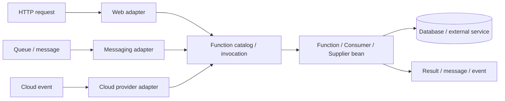

# Mô hình Function, Consumer và Supplier trong Spring Cloud Function

Spring Cloud Function cung cấp một mô hình lập trình dựa trên các functional interface của Java để xây dựng logic có thể chạy qua nhiều kiểu đầu vào khác nhau. Thay vì viết nghiệp vụ gắn chặt với HTTP controller, message listener hoặc API riêng của một nhà cung cấp cloud, ứng dụng khai báo các bean theo dạng `Function`, `Consumer` hoặc `Supplier`. Adapter tương ứng sẽ kết nối function đó với HTTP, messaging hoặc môi trường triển khai serverless.

Ba kiểu này mô tả ba hợp đồng xử lý cơ bản:

- `Function<I, O>` nhận dữ liệu kiểu `I`, xử lý và trả kết quả kiểu `O`.
- `Consumer<I>` nhận dữ liệu kiểu `I` và thực hiện side effect, không trả kết quả nghiệp vụ.
- `Supplier<O>` không nhận đầu vào và tạo dữ liệu kiểu `O`.

Các ví dụ dùng Java `record` để viết DTO ngắn gọn (cần Java 16 trở lên). Với project dùng Java thấp hơn, có thể thay record bằng class/POJO có constructor, getter và kiểu dữ liệu tương ứng.

Việc chọn đúng hợp đồng giúp tách logic nghiệp vụ khỏi trigger. Trong mô hình Cloud Serverless, cùng một function có thể được gọi bởi HTTP request, message hoặc event; trạng thái dài hạn vẫn phải nằm trong kho dữ liệu bền vững, còn quyền truy cập, retry, idempotency, cold start, concurrency và chi phí cần được xử lý ở ranh giới triển khai phù hợp.

## 1. Spring Cloud Function đứng ở đâu?

Spring Cloud Function là lớp trừu tượng cho logic xử lý. Ứng dụng định nghĩa functional bean; runtime hoặc adapter tìm bean, chuyển dữ liệu đầu vào sang kiểu Java tương ứng, gọi logic và chuyển kết quả ra giao thức bên ngoài.



Các thành phần có trách nhiệm khác nhau:

- **Functional bean:** chứa logic ứng dụng và khai báo kiểu input/output.
- **Function catalog/runtime:** phát hiện, tra cứu và kết hợp function theo tên hoặc definition.
- **Adapter:** chuyển HTTP request, message hoặc event thành lời gọi function; ánh xạ kết quả và lỗi về giao thức tương ứng.
- **Hệ thống bên ngoài:** database, queue, event bus, API đối tác hoặc object storage giữ trạng thái và thực hiện tích hợp.

Spring Cloud Function không tự biến mọi ứng dụng thành serverless. Nó cung cấp mô hình function thống nhất; để nhận HTTP hoặc message, ứng dụng vẫn cần adapter phù hợp. Khi triển khai lên một nền tảng FaaS, cần dùng adapter/runtime được hỗ trợ cho nền tảng và phiên bản Spring Cloud Function đang chọn.

## 2. Ba functional interface cốt lõi

| Kiểu | Hợp đồng | Kết quả | Ví dụ nghiệp vụ |
|---|---|---|---|
| `Function<I, O>` | Input → Output | Trả dữ liệu mới | Tính giá đơn hàng, chuẩn hóa event, chuyển DTO |
| `Consumer<I>` | Input → side effect | Không trả giá trị nghiệp vụ | Lưu audit, gửi thông báo, cập nhật projection |
| `Supplier<O>` | Không input → Output | Tạo dữ liệu mới | Đọc batch công việc, phát snapshot, tạo event theo lịch |

Đây là các interface trong `java.util.function`, vì vậy có thể kiểm thử trực tiếp mà không cần khởi động web server hoặc message broker.

### Function<I, O>

`Function<I, O>` phù hợp khi mỗi lần gọi có một đầu vào và cần một kết quả. Ví dụ, nhận một lệnh tạo đơn hàng, xác thực dữ liệu và trả về kết quả đã tạo. Hàm `apply` có chữ ký logic `O apply(I input)`.

```java
import org.springframework.context.annotation.Bean;
import java.util.function.Function;

public record PriceRequest(long unitPrice, int quantity) {}
public record PriceResult(long subtotal) {}

@Bean
Function<PriceRequest, PriceResult> calculatePrice() {
    return request -> {
        if (request.quantity() <= 0 || request.unitPrice() < 0) {
            throw new IllegalArgumentException("Invalid price request");
        }
        return new PriceResult(
                Math.multiplyExact(request.unitPrice(), request.quantity()));
    };
}
```

Function nên tập trung vào một chuyển đổi hoặc use case có đầu ra xác định. Nếu logic cần ghi database hoặc gọi hệ thống ngoài, vẫn có thể dùng `Function`, nhưng cần làm rõ rằng đầu ra là kết quả của use case và side effect được quản lý an toàn.

### Consumer<I>

`Consumer<I>` phù hợp khi mục đích chính là thực hiện một side effect. Chữ ký logic là `void accept(I input)`. Ví dụ, một event `OrderConfirmed` kích hoạt consumer cập nhật read model hoặc gửi một thông báo.

Về mặt kiểu dữ liệu, có thể viết `Function<I, Void>`, nhưng `Consumer<I>` diễn đạt rõ hơn rằng caller không nhận output nghiệp vụ và không cần trả về `null`.

```java
import org.springframework.context.annotation.Bean;
import java.util.function.Consumer;

public record OrderConfirmed(String orderId, String customerId) {}

@Bean
Consumer<OrderConfirmed> updateOrderProjection(OrderProjection projection) {
    return event -> projection.markConfirmed(
            event.orderId(), event.customerId());
}
```

Consumer không trả payload nghiệp vụ. Trong trigger messaging, adapter thường dựa vào việc consumer hoàn tất hay ném exception để quyết định message được xác nhận hay xử lý lỗi. Chi tiết ack, retry và dead-letter phụ thuộc adapter/broker. Với HTTP, Consumer không phù hợp nếu client cần nhận một kết quả nghiệp vụ; có thể dùng Function hoặc thiết kế endpoint tiếp nhận bất đồng bộ trả mã theo dõi.

### Supplier<O>

`Supplier<O>` tạo dữ liệu mà không cần đầu vào. Chữ ký logic là `O get()`. Ví dụ, lấy một batch công việc đến hạn hoặc tạo snapshot trạng thái.

```java
import org.springframework.context.annotation.Bean;
import java.util.List;
import java.util.function.Supplier;

public record PendingJob(String jobId, String type) {}

@Bean
Supplier<List<PendingJob>> loadPendingJobs(JobRepository repository) {
    return repository::findNextBatch;
}
```

Supplier không có nghĩa là tự chạy theo lịch. Một adapter hoặc cơ chế lập lịch phải quyết định khi nào gọi `get()`. Với nguồn message pollable, Spring Cloud Stream hoặc scheduler có thể cung cấp cơ chế polling; cấu hình poller thuộc lớp tích hợp tương ứng, không phải bản thân `Supplier`.

Không nên tạo một Supplier luôn trả lại cùng một object mutable hoặc dùng nó làm nơi giữ trạng thái giữa các invocation. Mỗi lần gọi nên tạo hoặc lấy một kết quả mới từ nguồn dữ liệu phù hợp. Nếu Supplier lấy công việc chờ xử lý, thao tác chọn/claim batch cần nguyên tử hoặc có lease để hai invocation đồng thời không nhận cùng công việc ngoài ý muốn.

## 3. Khai báo functional bean trong Spring

Các function thường được khai báo bằng `@Bean` trong một class cấu hình Spring. Tên method bean là tên function có thể được runtime/catalog sử dụng để lựa chọn.

```java
import org.springframework.context.annotation.Bean;
import org.springframework.context.annotation.Configuration;
import java.util.Locale;
import java.util.function.Function;

@Configuration
public class TextFunctions {

    @Bean
    public Function<String, String> normalizeText() {
        return value -> value == null
                ? ""
                : value.trim().toLowerCase(Locale.ROOT);
    }
}
```

Một ứng dụng có thể khai báo nhiều bean function, consumer và supplier. Khi có nhiều bean, cấu hình adapter cần chọn đúng function hoặc definition. Không nên dựa vào thứ tự bean được phát hiện để suy ra function mặc định.

Với các dependency nghiệp vụ, inject service/repository vào method bean hoặc class cấu hình. Tránh tạo kết nối database mới trong mỗi lần gọi function nếu SDK client có thể được tái sử dụng an toàn trong vòng đời instance.

## 4. Phân biệt Function với Controller và Message Listener

Spring MVC controller nhận `HttpServletRequest`/DTO và trả HTTP response. Message listener nhận message theo API của broker. Functional bean mô tả hợp đồng xử lý thuần hơn; adapter chịu trách nhiệm chuyển giao thức sang hợp đồng đó.

| Thành phần | Biết về giao thức nào? | Vai trò |
|---|---|---|
| `@RestController` | HTTP, path, status, header | Xây API HTTP trực tiếp |
| `@KafkaListener` hoặc listener tương tự | Broker và message API | Nhận message trực tiếp từ broker |
| Spring Cloud Function bean | Kiểu input/output Java | Mô tả logic có thể được gọi qua adapter |
| Web/messaging/cloud adapter | Giao thức cụ thể | Nối trigger với function và ánh xạ kết quả |

Functional model hữu ích khi muốn dùng lại logic giữa nhiều trigger hoặc triển khai cùng code trên nhiều môi trường. Nếu endpoint cần nhiều tính năng HTTP đặc thù như streaming response phức tạp, multipart upload hoặc mapping route chi tiết, controller chuyên biệt có thể phù hợp hơn; controller vẫn có thể gọi cùng application service mà function sử dụng.

## 5. Dùng Message<I> để truy cập header và metadata

Khi chỉ truyền payload `I`, function không nhìn thấy trực tiếp metadata của transport. Spring Messaging `Message<T>` bao gồm payload và headers. Đây là cách nhận correlation ID, tenant context, event ID hoặc metadata cần thiết từ adapter.

```java
import org.springframework.context.annotation.Bean;
import org.springframework.messaging.Message;
import org.springframework.messaging.support.MessageBuilder;
import java.util.function.Function;

public record CreateOrderRequest(String customerId, long total) {}
public record CreateOrderResult(String orderId, String status) {}

@Bean
Function<Message<CreateOrderRequest>, Message<CreateOrderResult>> createOrder(
        OrderApplicationService service) {
    return message -> {
        CreateOrderRequest request = message.getPayload();
        String correlationId = message.getHeaders()
                .get("correlationId", String.class);

        CreateOrderResult result = service.create(request, correlationId);

        return MessageBuilder.withPayload(result)
                .setHeader("correlationId", correlationId)
                .setHeader("orderId", result.orderId())
                .build();
    };
}
```

Header names và kiểu dữ liệu cần được thống nhất với adapter. Không phải mọi transport đều cho phép mọi header; adapter có thể lọc, đổi tên hoặc serialize header theo quy tắc riêng. Nếu header bắt buộc để xử lý nghiệp vụ, hãy kiểm tra nó ở biên và trả lỗi rõ ràng khi thiếu.

Khi tạo message đầu ra, chỉ sao chép các header cần thiết. Không chuyển tiếp toàn bộ header đầu vào một cách mù quáng vì chúng có thể chứa thông tin nội bộ, credential hoặc dữ liệu không hợp lệ với đích. Correlation ID là metadata truy vết, không phải bằng chứng xác thực hay quyền truy cập.

## 6. Composition: ghép nhiều Function

Các function tương thích kiểu có thể được kết hợp thành một pipeline. Nếu function đầu ra kiểu `B` và function tiếp theo nhận kiểu `B`, ta có thể ghép chúng bằng `andThen` của Java hoặc function composition mà Spring Cloud Function hỗ trợ qua function definition.

### Ghép trực tiếp trong Java

```java
Function<String, String> trim = String::trim;
Function<String, String> uppercase = String::toUpperCase;

Function<String, String> normalize = trim.andThen(uppercase);

String result = normalize.apply("  serverless  ");
// SERVERLESS
```

`andThen` chạy function bên trái trước rồi đưa kết quả sang function bên phải. `compose` chạy function được truyền vào trước function hiện tại. Cần kiểm tra kiểu generic của hai bước để tránh lỗi chuyển đổi runtime.

### Ghép bằng function definition

Spring Cloud Function hỗ trợ biểu diễn composition theo tên bean, ví dụ:

```properties
spring.cloud.function.definition=normalizeText|addPrefix
```

Trong ví dụ, output của `normalizeText` phải tương thích với input của `addPrefix`. Cú pháp và cách adapter chọn definition cần được xác minh theo phiên bản Spring Cloud Function đang dùng. Khi triển khai nhiều function, hãy chỉ rõ function/definition cần expose để tránh vô tình công khai bean nội bộ.

Composition hữu ích cho các bước chuyển đổi dữ liệu nhỏ, có thứ tự rõ. Với workflow nghiệp vụ dài có retry, trạng thái, chờ event hoặc compensation, không nên cố ghép tất cả thành một chuỗi function đồng bộ; dùng workflow orchestration hoặc event-driven process phù hợp hơn.

## 7. Function, Consumer và Supplier trong messaging

Trong tích hợp messaging, function bean có thể được kết nối với input/output binding. Tùy phiên bản Spring Cloud Stream và binder, tên binding, cách cấu hình destination, consumer group, partition, retry và DLQ sẽ khác nhau.

Một cách hiểu cơ bản:

- `Function<I, O>` tiêu thụ message đầu vào và phát kết quả ra output binding.
- `Consumer<I>` chỉ tiêu thụ và thực hiện side effect; không có output binding nghiệp vụ.
- `Supplier<O>` tạo message để adapter publish ra output binding hoặc lấy dữ liệu từ nguồn khi được poll.

Ví dụ function xử lý đơn hàng:

```java
import org.springframework.context.annotation.Bean;
@Bean
Function<OrderSubmitted, OrderAccepted> acceptOrder(
        OrderApplicationService service) {
    return event -> service.accept(event);
}
```

Adapter messaging nhận `OrderSubmitted`, chuyển payload thành Java record, gọi `acceptOrder` rồi gửi `OrderAccepted` đến destination đầu ra đã cấu hình. Function không cần tự tạo Kafka consumer hoặc SQS client nếu binder/adapter đã quản lý phần đó.

Ví dụ Consumer cập nhật projection:

```java
import org.springframework.context.annotation.Bean;
@Bean
Consumer<OrderAccepted> updateProjection(OrderProjection projection) {
    return event -> projection.apply(event);
}
```

Ví dụ Supplier phát snapshot:

```java
import org.springframework.context.annotation.Bean;
@Bean
Supplier<InventorySnapshot> inventorySnapshot(
        InventoryQueryService queryService) {
    return queryService::currentSnapshot;
}
```

Supplier cần một cơ chế gọi hoặc poll. Nếu poll liên tục, phải đặt tần suất, batch size và giới hạn tải phù hợp; nếu không, function có thể đọc lặp dữ liệu hoặc tạo tải không cần thiết.

## 8. Reactive Function và xử lý luồng dữ liệu

Spring Cloud Function có thể làm việc với kiểu reactive như `Flux` và `Mono` khi ứng dụng dùng Reactor. Thay vì xử lý một payload đơn lẻ, function có thể nhận hoặc trả một publisher để biểu diễn luồng dữ liệu bất đồng bộ.

```java
import org.springframework.context.annotation.Bean;
import reactor.core.publisher.Flux;
import java.util.function.Function;

@Bean
Function<Flux<String>, Flux<String>> normalizeStream() {
    return values -> values
            .map(String::trim)
            .filter(value -> !value.isEmpty())
            .map(String::toLowerCase);
}
```

Reactive type hữu ích khi adapter hỗ trợ streaming hoặc khi xử lý nhiều record theo luồng. Tuy nhiên, việc dùng `Flux` không tự động làm mọi I/O non-blocking. Nếu bên trong vẫn gọi JDBC blocking hoặc SDK blocking, cần scheduler/adapter phù hợp hoặc dùng client non-blocking. Cần hiểu backpressure, concurrency và cách adapter xác nhận từng record/batch.

Không gom một luồng vô hạn vào bộ nhớ bằng `collectList()` nếu dữ liệu có thể lớn không giới hạn. Chọn batch size, giới hạn concurrency và chiến lược checkpoint rõ ràng. Với nguồn event có thể phát lại, consumer phải idempotent vì record có thể được phát lại sau lỗi.

## 9. Lỗi và retry theo ranh giới trigger

Functional interface chỉ định nghĩa kiểu xử lý; nó không tự quy định toàn bộ chính sách retry. Khi function ném exception, adapter quyết định cách biểu diễn lỗi:

- Web adapter có thể ánh xạ lỗi sang HTTP status/response.
- Messaging adapter có thể không ack message để broker giao lại, retry theo policy hoặc chuyển sang DLQ.
- Cloud function adapter có thể trả lỗi invocation để nền tảng áp dụng retry theo trigger.
- Supplier có thể thất bại khi đọc nguồn; scheduler/poller cần quyết định lần gọi tiếp theo.

Không bắt mọi exception rồi trả một kết quả thành công giả. Điều đó khiến broker ack message hoặc HTTP client nhận response thành công trong khi nghiệp vụ chưa hoàn tất. Nếu lỗi là lỗi nghiệp vụ có thể biểu diễn bình thường, trả một result có trạng thái rõ ràng; nếu lỗi hạ tầng hoặc dữ liệu khiến xử lý chưa hoàn tất, ném exception để adapter áp dụng cơ chế lỗi đã cấu hình.

### Idempotency

Với message/event, mặc định hãy giả định at-least-once delivery trừ khi nền tảng và cấu hình bảo đảm khác trong phạm vi cụ thể. Consumer nên lưu `eventId` đã xử lý cùng thay đổi nghiệp vụ trong một transaction. Với HTTP, thao tác tạo tài nguyên có thể dùng `Idempotency-Key`. Không dùng correlation ID thay event ID hoặc idempotency key.

Function không nên tự tạo ID mới mỗi lần retry cho cùng một thao tác logic. Operation ID phải ổn định để downstream có thể phát hiện request trùng. Side effect ở hệ thống ngoài cần idempotency key của API đích hoặc một quy trình bù phù hợp.

## 10. Stateless function và quản lý dependency

Functional bean thường là Spring bean singleton. Vì vậy, object function có thể được dùng đồng thời bởi nhiều invocation hoặc nhiều thread tùy adapter. Không lưu dữ liệu theo request trong field mutable của singleton:

```java
// Không an toàn: trạng thái dùng chung giữa các invocation.
import org.springframework.context.annotation.Bean;
import java.util.ArrayList;
import java.util.List;
@Bean
Function<OrderRequest, OrderResult> unsafeFunction() {
    List<String> processedOrders = new ArrayList<>();
    return request -> {
        processedOrders.add(request.orderId());
        return process(request);
    };
}
```

Thay vào đó, giữ function stateless và lưu trạng thái nghiệp vụ vào database/cache/queue/workflow state phù hợp. Có thể inject thread-safe client hoặc repository dùng chung nếu chúng được thiết kế cho concurrency. Nếu một dependency không thread-safe, tạo scope hoặc synchronization phù hợp và đo ảnh hưởng hiệu năng.

Trong môi trường serverless, tái sử dụng client ở phạm vi instance có thể giảm cold start và chi phí kết nối. Tuy nhiên, instance có thể bị thu hồi bất kỳ lúc nào; không dùng static field, local filesystem hoặc bộ nhớ heap làm kho dữ liệu bền vững.

## 11. Bảo mật ở biên và trong function

Adapter có thể thực hiện xác thực giao thức, nhưng function/service vẫn cần kiểm tra quyền nghiệp vụ trên tài nguyên. Ví dụ, gateway xác minh JWT không có nghĩa người dùng được quyền đọc mọi order ID mà họ gửi.

Các nguyên tắc:

- Xác thực caller tại gateway/adapter theo cơ chế của hệ thống.
- Truyền principal/tenant context qua cơ chế đáng tin cậy; không tin header do client tùy ý đặt.
- Kiểm tra quyền trên tài nguyên và tenant trong application service.
- Chỉ cấp IAM permission cần thiết cho function để đọc/ghi database hoặc publish/consume message.
- Lấy secret từ secret manager; không đưa token hoặc credential vào payload/log.
- Xác thực schema và nguồn event trước khi thực thi side effect.
- Giới hạn payload và loại bỏ header không cần thiết khi chuyển tiếp message.

## 12. Kiểm thử functional bean

Một lợi thế của mô hình Function/Consumer/Supplier là có thể kiểm thử trực tiếp bằng cách gọi interface. Unit test không cần khởi động web server hoặc broker.

Ví dụ kiểm thử Function:

```java
import static org.junit.jupiter.api.Assertions.assertEquals;
import org.junit.jupiter.api.Test;
import java.util.function.Function;

class PriceFunctionTest {
    @Test
    void calculatesSubtotal() {
        Function<PriceRequest, PriceResult> function = request ->
                new PriceResult(request.unitPrice() * request.quantity());

        PriceResult result = function.apply(new PriceRequest(1200, 3));

        assertEquals(3600, result.subtotal());
    }
}
```

Ví dụ kiểm thử Consumer với dependency giả:

```java
@Test
void updatesProjectionForAcceptedOrder() {
    FakeOrderProjection projection = new FakeOrderProjection();
    Consumer<OrderAccepted> consumer = projection::apply;

    consumer.accept(new OrderAccepted("order-1"));

    assertTrue(projection.contains("order-1"));
}
```

Ngoài unit test, cần integration test adapter để kiểm tra serialization, header mapping, function selection, HTTP response, message ack/retry và DLQ. Test concurrency nên xác nhận bean không chia sẻ mutable request state. Test contract nên kiểm tra schema input/output khi producer và consumer triển khai độc lập.

## 13. Đặt tên và chọn function cần expose

Tên bean trở thành một phần cấu hình vận hành. Hãy dùng tên mô tả hành động và miền nghiệp vụ, chẳng hạn `createOrder`, `updateProjection`, `loadPendingJobs`. Tránh tên chung chung như `process`, `handler1` hoặc `functionA` khi ứng dụng có nhiều function.

Khi ứng dụng có nhiều function, cấu hình `spring.cloud.function.definition` hoặc cơ chế chọn function của adapter để chỉ rõ function cần chạy/expose. Với composition, tên definition có thể biểu diễn chuỗi function tương thích. Không expose Supplier nội bộ hoặc function quản trị ra HTTP công khai nếu không có nhu cầu và kiểm soát bảo mật.

Function catalog giúp tra cứu function theo tên và hỗ trợ composition/routing trong mô hình Spring Cloud Function. Nếu truy cập catalog trực tiếp trong code, hãy giữ logic tra cứu ở lớp adapter hoặc orchestration; nghiệp vụ cốt lõi nên phụ thuộc vào interface/service ổn định, không phụ thuộc tên bean dạng chuỗi.

## 14. Triển khai qua HTTP, messaging và FaaS

Cùng một functional bean có thể được tái sử dụng với các adapter khác nhau qua cấu hình triển khai phù hợp; cách đóng gói và cấu hình vẫn phụ thuộc môi trường:

| Trigger | Adapter thường dùng | Lưu ý triển khai |
|---|---|---|
| HTTP | Spring Cloud Function web adapter hoặc web integration phù hợp | Chọn function/route được expose, cấu hình security, timeout và response mapping |
| Queue/message | Spring Cloud Stream binder hoặc adapter messaging | Cấu hình destination, group, ack, retry, DLQ, concurrency và batch |
| Event từ cloud provider | Adapter/runtime dành cho provider | Ánh xạ event envelope, quyền invoke, timeout và retry của nền tảng |
| Polling/source | Supplier kết hợp scheduler/poller hoặc connector | Cấu hình lịch, batch, checkpoint và giới hạn tải |

Khi triển khai FaaS, function adapter phải phù hợp với contract của runtime. Một số nền tảng yêu cầu handler hoặc adapter đặc thù; một số hỗ trợ Spring Cloud Function qua runtime adapter. Không giả định chỉ cần thêm `@Bean Function` là mọi cloud provider tự nhận diện function.

Kiểm tra các yếu tố sau trước khi deploy:

- Phiên bản Java, Spring Boot, Spring Cloud Function và adapter tương thích với nhau.
- Artifact, dependency và classpath phù hợp runtime.
- Handler/adapter được cấu hình đúng và function definition được chọn rõ.
- IAM role cho database, queue, event bus, secret và logging là tối thiểu.
- Memory/CPU, timeout, concurrency và batch size phù hợp workload.
- Cold start được đo với dependency thực tế; giảm dependency không cần thiết.
- Function không giữ state nghiệp vụ trong memory giữa các invocation.
- Có log, metric, trace, correlation ID và cảnh báo lỗi/timeout.

## 15. Chi phí và hiệu năng

Chi phí function không chỉ phụ thuộc số invocation. Cần tính thời gian thực thi, cấu hình memory/CPU, cold start, số lần retry, request gateway, message operation, database read/write, network transfer và log/trace. Một function ngắn nhưng bị retry nhiều lần hoặc gọi database nhiều lần có thể đắt hơn function xử lý batch hợp lý.

Đo các chỉ số:

- Invocation count và duration p50/p95/p99.
- Error, timeout, throttling và retry rate.
- Cold start/init duration nếu runtime cung cấp.
- Concurrency và số connection đến database.
- Message backlog, age of oldest message và DLQ depth.
- Số record xử lý mỗi invocation và tỷ lệ batch failure.
- Chi phí theo một đơn vị nghiệp vụ, ví dụ một đơn hàng xử lý thành công.

Với Supplier polling, poll quá thường xuyên có thể tạo invocation và query rỗng. Với Consumer, concurrency quá cao có thể làm quá tải database hoặc API đối tác. Với Function trả output, payload lớn có thể tăng serialization, memory và network cost. Chọn batch size và concurrency dựa trên số đo, không chỉ dựa trên khả năng autoscaling.

## 16. Những lỗi thiết kế thường gặp

| Lỗi | Hậu quả | Cách xử lý |
|---|---|---|
| Dùng Consumer khi client cần kết quả | Không có output nghiệp vụ để trả | Dùng Function hoặc HTTP API bất đồng bộ trả mã theo dõi |
| Nghĩ Supplier tự chạy theo lịch | Không có trigger thực tế | Cấu hình poller/scheduler/adapter rõ ràng |
| Đặt mutable state trong bean singleton | Race condition và rò dữ liệu giữa invocation | Stateless bean, state store bền vững |
| Trộn HTTP/message SDK vào logic nghiệp vụ | Khó tái sử dụng và kiểm thử | Để adapter xử lý transport, service xử lý nghiệp vụ |
| Nuốt exception và trả success | Message có thể ack dù chưa xử lý xong | Phân loại lỗi và để adapter áp dụng retry/DLQ |
| Dùng correlation ID làm idempotency key | Các message khác nhau trong cùng workflow bị coi là trùng | Dùng event ID hoặc operation ID phù hợp |
| Expose mọi bean function | Có thể lộ endpoint hoặc thao tác nội bộ | Chọn definition/route cần công khai |
| Giả định reactive đồng nghĩa non-blocking | Blocking I/O vẫn chiếm thread và tăng latency | Dùng client non-blocking hoặc scheduler phù hợp |
| Không kiểm tra adapter version | Lỗi mapping hoặc function không được phát hiện | Khóa phiên bản và integration test |

## 17. Checklist thiết kế

- [ ] Đã chọn đúng hợp đồng `Function`, `Consumer` hoặc `Supplier` theo input/output của use case.
- [ ] Functional bean có tên rõ ràng và được chọn/expose tường minh.
- [ ] Logic nghiệp vụ tách khỏi HTTP, broker và cloud provider adapter.
- [ ] Header/metadata cần thiết được đọc và truyền có chọn lọc.
- [ ] Correlation ID, event ID và idempotency key được phân biệt.
- [ ] Consumer idempotent và ack chỉ sau khi thay đổi bền vững hoàn tất.
- [ ] Retry, timeout và DLQ được cấu hình ở đúng adapter/trigger.
- [ ] Supplier có scheduler/poller/source cụ thể và giới hạn tần suất.
- [ ] Bean không giữ mutable state theo request trong singleton.
- [ ] Reactive flow có backpressure và không vô tình dùng blocking I/O trên event loop.
- [ ] Unit test gọi trực tiếp functional interface; integration test xác minh adapter.
- [ ] Phiên bản Java, Spring Boot, Spring Cloud Function và adapter tương thích.
- [ ] IAM, secret, concurrency, timeout và observability được cấu hình theo workload.
- [ ] Đã đo cold start, duration, retry, database load và chi phí theo nghiệp vụ.

Spring Cloud Function giúp mô tả logic xử lý bằng hợp đồng Java quen thuộc: Function chuyển input thành output, Consumer thực hiện side effect, Supplier tạo output. Khi giữ functional bean stateless, tách adapter khỏi nghiệp vụ và cấu hình rõ trigger, function có thể được tái sử dụng qua HTTP, messaging và runtime serverless. Hiệu quả triển khai phụ thuộc vào việc quản lý metadata, lỗi, idempotency, concurrency, trạng thái bền vững và giới hạn của adapter thực tế.
