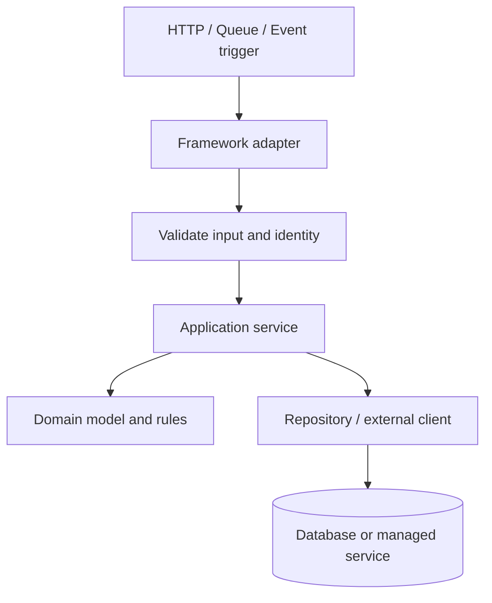

# Tối ưu function với Quarkus và Micronaut

## 1. Vì sao chọn framework phù hợp cho Java serverless?

Java có hệ sinh thái thư viện phong phú, khả năng tối ưu JIT tốt và mô hình lập trình quen thuộc. Tuy nhiên, một ứng dụng Java được thiết kế để chạy liên tục trên máy chủ thường khởi tạo nhiều thành phần khi bắt đầu: dependency injection container, framework web, cấu hình, serializer, connection pool và các client gọi dịch vụ. Trong môi trường Function as a Service (FaaS), thời gian khởi tạo và bộ nhớ của từng execution environment có thể ảnh hưởng trực tiếp đến độ trễ và chi phí.

Quarkus và Micronaut được thiết kế để giảm chi phí runtime bằng cách chuyển nhiều công việc sang thời điểm build hoặc compile. Cả hai hỗ trợ phát triển ứng dụng Java gọn, tích hợp các thư viện cloud và có thể tạo native executable bằng công nghệ GraalVM Native Image. Chúng vẫn có thể chạy trên JVM thông thường; native image là một lựa chọn triển khai chứ không phải điều kiện bắt buộc.

Tối ưu function không chỉ là làm cold start nhanh nhất. Một function còn phải đáp ứng throughput khi warm, độ trễ p95/p99, giới hạn bộ nhớ, khả năng tương thích thư viện, độ tin cậy khi retry, yêu cầu quan sát và chi phí build/vận hành. Cần đo trên workload thật để chọn framework, runtime và cách đóng gói phù hợp.

## 2. Quarkus và Micronaut giảm chi phí runtime như thế nào?

### 2.1. Quarkus: build-time augmentation và extension

Quarkus thực hiện nhiều công việc phân tích ứng dụng ở thời điểm build thông qua cơ chế build-time augmentation. Các extension cung cấp metadata để Quarkus biết thành phần nào được dùng và cần chuẩn bị những gì. Điều này giúp giảm một phần công việc quét classpath, phân tích annotation và khởi tạo động lúc runtime.

Quarkus sử dụng CDI container có tên Arc. Các bean, injection point và phần lớn cấu trúc dependency được xử lý theo mô hình phù hợp với quá trình augmentation. Hệ sinh thái extension bao gồm REST, JSON, messaging, persistence, telemetry và các tích hợp cloud. Chọn extension theo nhu cầu giúp ứng dụng tránh kéo theo cả một stack lớn khi chỉ cần một khả năng nhỏ.

Một điểm cần nhớ là một số cấu hình Quarkus được cố định ở build time, trong khi cấu hình khác có thể thay đổi lúc runtime. Khi triển khai cùng một artifact qua nhiều môi trường, phải kiểm tra phase của từng property. Không nên giả định mọi biến môi trường đều có thể thay đổi mọi hành vi đã được quyết định khi build.

### 2.2. Micronaut: compile-time dependency injection và AOP

Micronaut xử lý dependency injection (DI), aspect-oriented programming (AOP) và bean introspection chủ yếu ở thời điểm compile thông qua annotation processing. Nhờ đó, nhiều hoạt động có thể cần reflection hoặc quét classpath ở runtime trong một số framework khác được thay bằng metadata và class được sinh ra khi biên dịch.

Mô hình này giúp Micronaut khởi động gọn và phù hợp với native image. Tuy nhiên, thư viện bên thứ ba vẫn có thể sử dụng reflection, proxy động, JNI hoặc service loading. Compile-time DI không tự động làm toàn bộ dependency trở nên native-friendly; cần kiểm tra từng thư viện và cấu hình bổ sung khi cần.

### 2.3. Điểm giống và khác nhau

| Khía cạnh | Quarkus | Micronaut |
| --- | --- | --- |
| Tối ưu chính | Build-time augmentation qua extension và Arc CDI | Compile-time DI, AOP và bean introspection |
| Mở rộng | Hệ sinh thái extension tích hợp sâu với build và runtime Quarkus | Module và annotation processing cho nhiều tích hợp, framework và cloud |
| JVM mode | Chạy trên JVM, hỗ trợ tối ưu khởi động và footprint | Chạy trên JVM, tránh nhiều hoạt động DI/scan lúc runtime |
| Native image | Có hỗ trợ GraalVM Native Image/Mandrel qua tooling Quarkus | Có hỗ trợ GraalVM Native Image qua tooling và cấu hình Micronaut |
| Tích hợp function | Có các mô hình và extension cho HTTP, event và cloud provider | Có module function và tích hợp cho các nền tảng cloud |
| Điều cần chú ý | Phase cấu hình build-time/runtime và khả năng của extension | Annotation processing, reflection từ dependency và cấu hình native |

Không có kết luận chung rằng framework nào luôn nhanh hơn hoặc dùng ít RAM hơn. Kết quả phụ thuộc extension, dependency, cấu hình, JDK, chế độ JVM/native, kích thước function và nền tảng FaaS.

## 3. JVM mode và native image

### 3.1. Chạy trên JVM

Ở JVM mode, artifact thường chứa bytecode Java và chạy trên JRE/JDK tương thích của nền tảng. JVM có thể dùng JIT compiler để tối ưu code theo hành vi thực tế khi ứng dụng chạy đủ lâu.

Ưu điểm thường gặp:

- Build và debug đơn giản hơn native image.
- Tương thích tốt với thư viện Java dùng reflection hoặc dynamic class loading.
- Có thể đạt throughput cao sau khi JIT đã tối ưu các đường code nóng.
- Dễ dùng cùng công cụ profiling, diagnostic và thư viện Java truyền thống.

Giới hạn thường gặp là thời gian khởi tạo JVM và framework, mức bộ nhớ nền và chi phí JIT. Với function có thời gian sống ngắn hoặc thường xuyên cold start, chi phí này có thể đáng kể. Framework nhẹ như Quarkus và Micronaut có thể giảm phần khởi tạo ứng dụng nhưng không loại bỏ mọi chi phí của JVM.

### 3.2. Native image

GraalVM Native Image phân tích ứng dụng và tạo executable dành cho một tổ hợp hệ điều hành, kiến trúc CPU và môi trường thư viện cụ thể. Native executable không cần khởi động một JVM đầy đủ theo cách truyền thống. Với ứng dụng phù hợp, thời gian khởi tạo và footprint bộ nhớ có thể giảm đáng kể.

Native image thường phù hợp khi:

- Cold start là yêu cầu quan trọng.
- Function có thời gian thực thi ngắn hoặc tải không liên tục.
- Dependency có thể phân tích và cấu hình cho native image.
- Nhóm có thể chấp nhận build lâu hơn và quy trình kiểm thử chuyên biệt.

Native image có những đánh đổi:

- Build tốn thời gian và tài nguyên hơn.
- Reflection, dynamic proxy, class loading, JNI và resource có thể cần khai báo bổ sung.
- Một số thư viện hoặc driver chưa hỗ trợ đầy đủ.
- Hiệu năng steady-state không mặc định tốt hơn JVM JIT; một số workload dài và nóng có thể đạt throughput tốt hơn trên JVM.
- Binary phụ thuộc target OS/architecture và các thư viện native tương ứng.

### 3.3. Chọn theo đặc tính workload

| Đặc tính | JVM mode thường phù hợp khi | Native image đáng cân nhắc khi |
| --- | --- | --- |
| Thời gian sống của instance | Instance chạy lâu, có nhiều invocation warm | Instance thường xuyên được tạo mới hoặc xử lý tác vụ ngắn |
| Cold start | SLA cho phép thời gian khởi tạo cao hơn | Cold start chi phối trải nghiệm hoặc SLA |
| Throughput dài hạn | JIT có thời gian tối ưu code nóng | Startup và footprint quan trọng hơn throughput tối đa |
| Dependency | Có nhiều thư viện dynamic/reflection khó cấu hình | Dependency hỗ trợ native và có thể kiểm soát |
| Build pipeline | Cần build nhanh, debug và phát hành thường xuyên | Có pipeline native build và test artifact riêng |
| Vận hành | Nền tảng cung cấp JVM phù hợp | Nền tảng hỗ trợ executable/native runtime tương ứng |

Nên tạo một benchmark nhỏ với cả hai chế độ. So sánh cold start, warm latency, p95/p99, memory peak, throughput, package size và chi phí tổng. Chỉ đo thời gian khởi tạo local là chưa đủ để kết luận về FaaS, vì nền tảng còn có thời gian chuẩn bị execution environment, tải artifact và kết nối mạng.

## 4. Tổ chức mã để framework không chi phối nghiệp vụ

### 4.1. Tách adapter khỏi domain service

HTTP controller, function handler hoặc event adapter nên chịu trách nhiệm chuyển dữ liệu từ runtime thành kiểu ứng dụng. Quy tắc nghiệp vụ nằm trong service độc lập để có thể kiểm thử mà không cần khởi động toàn bộ framework.



Tách lớp giúp thay adapter HTTP bằng queue/event trigger mà không phải viết lại domain logic. Nó cũng cho phép benchmark service độc lập với chi phí khởi động framework.

### 4.2. Quản lý bean và trạng thái

Quarkus CDI bean và Micronaut singleton thường được dùng lại trong vòng đời của một execution environment. Điều đó hữu ích cho serializer, HTTP client hoặc repository được thiết kế thread-safe. Tuy nhiên, một execution environment có thể bị dừng bất kỳ lúc nào và nhiều environment có thể chạy đồng thời.

Không lưu trạng thái nghiệp vụ duy nhất trong field của singleton hoặc biến static. Đơn hàng, trạng thái thanh toán, dấu idempotency và checkpoint phải được lưu ở hệ thống bền vững. Cũng không lưu dữ liệu riêng của request trong mutable singleton vì có thể gây rò dữ liệu giữa các invocation đồng thời.

### 4.3. Ví dụ service dùng chung

```java
public record CreateOrderCommand(String customerId, int itemCount) {}

public record CreateOrderResult(String orderId, String status) {}

public interface OrderRepository {
    CreateOrderResult create(CreateOrderCommand command);
}

public final class CreateOrderService {
    private final OrderRepository repository;

    public CreateOrderService(OrderRepository repository) {
        this.repository = repository;
    }

    public CreateOrderResult create(CreateOrderCommand command) {
        if (command == null
                || command.customerId() == null
                || command.customerId().isBlank()
                || command.itemCount() <= 0) {
            throw new IllegalArgumentException("Invalid order command");
        }
        return repository.create(command);
    }
}
```

Đây là Java thuần, không phụ thuộc annotation của framework. Quarkus và Micronaut có thể cung cấp repository/service thông qua DI, còn HTTP hoặc event adapter gọi cùng application service.

## 5. Xây dựng HTTP function với Quarkus

Quarkus có thể cung cấp HTTP endpoint qua extension REST. Ví dụ sau minh họa một endpoint nhận request, gọi application service và trả response. Các import được lược bớt để tập trung vào cấu trúc; tên extension và dependency cần chọn theo phiên bản Quarkus của dự án.

```java
import jakarta.inject.Inject;
import jakarta.ws.rs.Consumes;
import jakarta.ws.rs.POST;
import jakarta.ws.rs.Path;
import jakarta.ws.rs.Produces;
import jakarta.ws.rs.core.MediaType;

@Path("/orders")
@Consumes(MediaType.APPLICATION_JSON)
@Produces(MediaType.APPLICATION_JSON)
public class OrderResource {
    @Inject
    CreateOrderService createOrderService;

    @POST
    public CreateOrderResult create(CreateOrderRequest request) {
        return createOrderService.create(
                new CreateOrderCommand(request.customerId(), request.itemCount()));
    }
}
```

Trong FaaS, endpoint này có thể được kết nối với HTTP gateway hoặc adapter do nền tảng cung cấp. Cần phân biệt một HTTP server chạy trong container với một function runtime nhận request theo giao thức riêng. Cả hai có thể phục vụ HTTP nhưng mô hình lifecycle và deployment không giống nhau.

Quarkus cũng có mô hình function và các extension tích hợp cloud/event. Với event-driven function, adapter chuyển message hoặc event thành kiểu Java rồi gọi service. Hãy dùng đúng extension và contract của provider mục tiêu thay vì đưa logic nghiệp vụ vào một lớp phụ thuộc trực tiếp vào event object của nhà cung cấp.

## 6. Xây dựng HTTP function với Micronaut

Micronaut cung cấp controller và DI compile-time. Ví dụ tương đương:

```java
import io.micronaut.http.annotation.Body;
import io.micronaut.http.annotation.Controller;
import io.micronaut.http.annotation.Post;

@Controller("/orders")
public class OrderController {
    private final CreateOrderService createOrderService;

    public OrderController(CreateOrderService createOrderService) {
        this.createOrderService = createOrderService;
    }

    @Post
    public CreateOrderResult create(@Body CreateOrderRequest request) {
        return createOrderService.create(
                new CreateOrderCommand(request.customerId(), request.itemCount()));
    }
}
```

Constructor injection làm dependency hiển thị rõ và thuận tiện cho unit test. Micronaut có thể xử lý bean definition và một số metadata ở compile time. Khi thêm thư viện sử dụng annotation processing, cần bảo đảm processor được cấu hình đúng trong Maven/Gradle; thiếu processor có thể khiến bean hoặc metadata không được tạo như mong đợi.

Với trigger queue hoặc event, Micronaut có các function/cloud integration module. Adapter nhận event từ runtime, kiểm tra hợp đồng và gọi service. Hãy giữ event ID, correlation ID và thông tin cần thiết cho idempotency xuyên suốt quá trình xử lý.

## 7. Tối ưu thời gian khởi tạo

### 7.1. Đo từng phần khởi tạo

Cold start có thể bao gồm thời gian cấp phát execution environment, tải artifact, khởi tạo runtime, tạo bean, đọc cấu hình, nạp class, thiết lập client và kết nối database. Không nên quy toàn bộ thời gian cold start cho framework.

Đo riêng:

- Thời gian từ lúc nền tảng nhận invocation đến lúc handler bắt đầu.
- Thời gian khởi tạo framework và application context.
- Thời gian khởi tạo bean/client và thiết lập kết nối.
- Thời gian xử lý nghiệp vụ của invocation đầu tiên.
- Độ trễ của các invocation warm tiếp theo.

Theo dõi p50, p95 và p99. Trung bình có thể che khuất một nhóm invocation cold start rất chậm. Dùng cùng payload, cấu hình, region, memory setting và dependency khi so sánh hai framework.

### 7.2. Tránh khởi tạo công việc không cần thiết

Một số thực hành có ích:

- Chỉ thêm extension/module cần dùng.
- Tránh quét package hoặc đọc hàng nghìn file cấu hình nếu không cần.
- Trì hoãn khởi tạo client nặng cho đường code thực sự sử dụng, nhưng cân nhắc tác động lên invocation đầu tiên của nhánh đó.
- Không chạy truy vấn database, gọi API bên ngoài hoặc tải dữ liệu nghiệp vụ lớn trong static initializer.
- Dùng cấu hình và metadata đã được chuẩn bị ở build time khi phù hợp, nhưng không nhúng secret hoặc dữ liệu môi trường vào artifact.
- Hạn chế tạo nhiều serializer, HTTP client hoặc connection pool trùng nhau.

Lazy initialization không luôn luôn tốt hơn. Nếu gần như mọi invocation đều cần client đó, khởi tạo sớm có thể làm thời gian xử lý dễ dự đoán hơn. Hãy đo cả đường invocation đầu tiên và đường warm.

### 7.3. Tận dụng client dùng lại an toàn

HTTP client, JSON mapper và một số SDK client có thể được tạo một lần trong bean singleton rồi dùng lại qua nhiều invocation warm. Cách này giảm chi phí tạo object và handshake. Client phải thread-safe hoặc được quản lý theo đúng mô hình concurrency của runtime.

Kết nối mạng nhàn rỗi có thể bị server hoặc proxy đóng trong lúc function environment bị freeze. Client cần timeout, phát hiện connection stale và retry có kiểm soát. Không giữ một connection được giả định luôn sống vô hạn.

### 7.4. Quarkus build-time và Micronaut compile-time

Với Quarkus, chọn extension phù hợp để tận dụng augmentation và tránh các extension không cần thiết. Xem log build để biết phần nào được xử lý lúc build, và kiểm tra cấu hình nào được cố định ở build time.

Với Micronaut, bảo đảm annotation processor và module compile-time tương ứng được cấu hình đúng. Hạn chế các thư viện buộc framework phải quét classpath hoặc dùng reflection rộng ở runtime. Dùng bean introspection và constructor injection khi phù hợp với mô hình của ứng dụng.

## 8. Tối ưu native image

### 8.1. Reflection, proxy và class động

Native Image phân tích reachable code ở thời điểm build. Class hoặc method chỉ được nạp bằng tên chuỗi, reflection, proxy động hay plugin runtime có thể không được nhận diện tự động. Khi đó cần metadata/configuration phù hợp hoặc thay đổi cách dùng thư viện.

Quarkus extension thường cung cấp metadata để tích hợp các thư viện đã được hỗ trợ. Micronaut cũng sinh metadata compile-time cho nhiều tính năng của framework. Tuy nhiên, các dependency tùy ý trong ứng dụng vẫn có thể cần cấu hình reflection hoặc resource riêng.

Không nên thêm cấu hình reflection quá rộng để làm build pass mà không hiểu tác động. Nó có thể làm binary lớn hơn, tăng thời gian build và che giấu việc dependency chưa phù hợp.

### 8.2. Resource và ServiceLoader

Native image cần biết resource nào phải được đưa vào executable. Các file cấu hình, template, schema, certificate bundle và `META-INF/services` có thể cần cấu hình inclusion tùy thư viện và build tool.

Nếu một provider được nạp qua `ServiceLoader`, hãy kiểm tra provider có được nhận diện và khởi tạo trong native image hay không. Unit test chạy trên JVM có thể pass trong khi native executable không tìm thấy provider.

### 8.3. JNI và thư viện native

Một số driver, codec hoặc SDK phụ thuộc thư viện native. Cần kiểm tra binary tương thích với OS, libc và kiến trúc CPU của deployment target. Native image được build trên môi trường khác có thể không chạy trong container hoặc runtime đích nếu phụ thuộc hệ thống không tương thích.

Nên build native trong container hoặc môi trường tương đương production khi công cụ hỗ trợ. Kiểm tra executable cuối cùng bằng smoke test trên cùng kiến trúc và hệ điều hành mục tiêu.

### 8.4. Kiểm thử native riêng

Pipeline nên có các bước:

1. Unit test và integration test ở JVM mode.
2. Build native executable.
3. Chạy smoke test native với các route hoặc event đại diện.
4. Kiểm tra reflection, serialization, resource và ServiceLoader.
5. Đo startup, memory peak và warm performance.
6. Kiểm tra log lỗi khi thiếu metadata và xác minh artifact đúng OS/architecture.

Không suy ra native image hoạt động đúng chỉ từ việc native build thành công. Build thành công xác nhận quá trình phân tích/biên dịch, còn smoke test xác nhận các đường chạy quan trọng thực sự hoạt động.

## 9. Cấu hình runtime và secrets

Function thường được triển khai ở nhiều môi trường với endpoint, timeout, quota và thông tin xác thực khác nhau. Hãy phân biệt:

- Cấu hình có thể cố định khi build, ví dụ một số lựa chọn cấu trúc framework.
- Cấu hình runtime, ví dụ endpoint dịch vụ, feature flag hoặc giới hạn nghiệp vụ.
- Secret, ví dụ database password, API token và private key.

Quarkus có phân loại cấu hình build-time và runtime; Micronaut hỗ trợ externalized configuration và binding cấu hình vào bean. Dù framework nào, không đưa secret vào source, image layer hoặc native executable. Đọc secret từ secret manager hoặc cơ chế bảo mật của nền tảng và cấp quyền tối thiểu cho function.

Nếu cùng một artifact chạy ở nhiều môi trường, hãy kiểm tra mọi property cần thay đổi có thực sự là runtime-configurable hay không. Với property bị cố định lúc build, cần build artifact riêng cho cấu hình đó hoặc thay thiết kế để chuyển giá trị sang runtime config.

## 10. Database và kết nối dịch vụ trong FaaS

### 10.1. Tránh tạo connection pool quá lớn

Một function có thể scale thành nhiều execution environment. Nếu mỗi environment tạo pool 20 kết nối và nền tảng mở 100 environment, database có thể nhận tới 2.000 kết nối từ một function. Điều này có thể làm cạn connection limit dù mỗi instance riêng lẻ có vẻ hợp lý.

Ước lượng kết nối tối đa theo công thức gần đúng:

\[
\text{Tổng kết nối} \approx \text{Số environment đồng thời} \times \text{Pool size mỗi environment}
\]

Đây là ước lượng đơn giản; còn phải tính function khác, ứng dụng khác, admin connection và proxy. Đặt pool nhỏ theo concurrency thực tế, dùng database proxy hoặc cơ chế kết nối được quản lý nếu nền tảng hỗ trợ, và theo dõi số kết nối đang mở.

### 10.2. Timeout và retry

HTTP client, database driver và function timeout phải tương thích. Nếu function timeout trước khi client nhận kết quả, client có thể retry trong khi thao tác trước vẫn đang hoàn tất. Với thao tác tạo dữ liệu hoặc thanh toán, cần idempotency key và kiểm tra trạng thái trước khi thực hiện lại.

Không retry vô hạn khi database quá tải. Backoff, jitter, giới hạn concurrency và queue giúp tránh tạo thêm tải lên dịch vụ đang gặp sự cố.

### 10.3. Client dùng chung và lifecycle

Bean singleton có thể giữ client để tái sử dụng trên cùng execution environment. Không giả định singleton được chia sẻ giữa các environment hoặc tồn tại sau khi function bị dừng. Dữ liệu nghiệp vụ và dấu đã xử lý phải lưu bền vững bên ngoài process.

## 11. HTTP, event và xử lý bất đồng bộ

### 11.1. HTTP function

HTTP function thường cần kiểm tra input, xác thực principal, áp dụng timeout và trả status code đúng. Framework controller nên làm lớp adapter mỏng. Tránh chạy tác vụ dài trong request đồng bộ nếu client hoặc gateway có timeout ngắn; có thể ghi công việc vào queue và trả `202 Accepted` kèm ID để client tra trạng thái.

### 11.2. Queue consumer và event handler

Với queue hoặc event trigger, handler nên nhận một event đã được adapter chuyển thành kiểu ứng dụng. Cần xử lý event trùng lặp, schema version, lỗi tạm thời và lỗi vĩnh viễn. Nếu function xử lý batch, cần hiểu cơ chế partial batch failure của provider để một message lỗi không khiến mọi message thành công bị giao lại không cần thiết.

Ví dụ handler nghiệp vụ độc lập framework:

```java
public record OrderCreatedEvent(
        String eventId,
        String orderId,
        int schemaVersion) {}

public interface OrderProjectionService {
    void updateProjection(OrderCreatedEvent event);
}

public final class OrderCreatedHandler {
    private final OrderProjectionService projectionService;

    public OrderCreatedHandler(OrderProjectionService projectionService) {
        this.projectionService = projectionService;
    }

    public void handle(OrderCreatedEvent event) {
        if (event == null || event.eventId() == null || event.eventId().isBlank()) {
            throw new IllegalArgumentException("Missing event id");
        }
        if (event.schemaVersion() != 1) {
            throw new IllegalArgumentException("Unsupported schema version");
        }
        projectionService.updateProjection(event);
    }
}
```

Ví dụ chưa thể hiện kho idempotency. Trong production, `updateProjection` cần được bảo vệ bằng unique event ID hoặc transaction/conditional write phù hợp để việc giao lại event không tạo tác động trùng.

### 11.3. Reactive và blocking I/O

Reactive API có thể hữu ích khi function xử lý nhiều I/O đồng thời và framework sử dụng event loop. Tuy nhiên, gọi JDBC blocking hoặc thực hiện CPU-heavy task trên event-loop thread có thể chặn các request khác. Cần chuyển blocking work sang executor phù hợp hoặc dùng client non-blocking khi toàn bộ đường xử lý hỗ trợ.

Reactive không tự động làm function nhanh hơn. Với một request đơn giản, mô hình imperative có thể dễ đọc và đủ hiệu năng. Hãy chọn theo concurrency, đặc tính I/O và khả năng vận hành của nhóm.

## 12. Đo lường và benchmark Quarkus/Micronaut

### 12.1. Ma trận benchmark

Để so sánh công bằng, có thể tạo ma trận:

| Framework | Runtime | Mục tiêu đo |
| --- | --- | --- |
| Quarkus | JVM | Startup, warm latency, throughput, memory |
| Quarkus | Native image | Cold start, memory peak, warm latency, binary size |
| Micronaut | JVM | Startup, warm latency, throughput, memory |
| Micronaut | Native image | Cold start, memory peak, warm latency, binary size |

Giữ cùng logic nghiệp vụ, cùng dependency chức năng, cùng cấu hình memory/CPU và cùng môi trường. Nếu framework cần extension/module khác nhau, ghi lại sự khác biệt để kết quả có thể diễn giải.

### 12.2. Chỉ số cần đo

- **Cold start:** thời gian từ invocation đầu tiên đến khi function sẵn sàng xử lý.
- **Warm latency:** độ trễ của invocation trên environment đã khởi tạo.
- **p95/p99:** thể hiện tail latency thay vì chỉ nhìn trung bình.
- **Memory peak và memory steady-state:** quan trọng với giới hạn memory và giá FaaS.
- **Throughput:** số request/event xử lý được trong một khoảng thời gian.
- **Error rate:** lỗi khởi tạo, timeout, lỗi dependency và lỗi nghiệp vụ.
- **Artifact size và build duration:** ảnh hưởng thời gian triển khai và pipeline.
- **Chi phí tổng:** function duration/memory, concurrency, dịch vụ phụ trợ, log và truyền dữ liệu.

Chạy nhiều lần và tách invocation cold khỏi warm. Kiểm tra cả tải thấp, tải ổn định và burst. Một native image có cold start rất tốt nhưng warm throughput thấp hơn có thể vẫn phù hợp với workload burst; với workload ổn định, JVM có thể kinh tế hơn.

### 12.3. Tránh benchmark sai

Không so sánh một function tối giản với một ứng dụng có REST, JSON, database và telemetry rồi kết luận framework nào nhanh hơn. Không so sánh local startup với cold start trên cloud như cùng một chỉ số. Không bỏ qua việc native image có thể cần cấu hình reflection hoặc build optimization khác nhau.

Hãy benchmark chính artifact triển khai, với runtime và trigger gần production. Đo cả đường code khởi tạo client và đường xử lý request thực tế.

## 13. Chọn Quarkus hay Micronaut cho function

| Nhu cầu | Hướng cân nhắc |
| --- | --- |
| Ứng dụng cần nhiều extension tích hợp và build-time augmentation | Quarkus có thể phù hợp nếu extension đáp ứng các dịch vụ cần dùng |
| Muốn DI/AOP và bean metadata xử lý chủ yếu khi compile | Micronaut là lựa chọn đáng thử |
| Native image là yêu cầu trọng tâm | Cả hai đều đáng benchmark; kiểm tra khả năng native của toàn bộ dependency |
| Dự án đã dùng hệ sinh thái Quarkus | Tiếp tục Quarkus có thể giảm chi phí chuyển đổi và tận dụng extension hiện có |
| Dự án đã dùng Micronaut và function module phù hợp | Tiếp tục Micronaut có thể đơn giản hóa adapter và quy trình build |
| Workload chạy lâu, cần JIT throughput | Benchmark JVM mode của cả hai trước khi chọn native |
| Workload burst, cold start nhạy cảm | Benchmark native image và các tính năng giữ environment của nền tảng |

Framework là một phần của quyết định. Cũng cần xem xét mức độ quen thuộc của nhóm, chất lượng extension cho database/messaging, khả năng quan sát, native compatibility, build pipeline và chính sách hỗ trợ phiên bản.

## 14. Quy trình tối ưu function

1. **Định nghĩa workload:** HTTP hay event, số invocation, burst, thời gian xử lý, SLA và giới hạn memory.
2. **Tạo baseline:** đo cold start, warm latency, p95/p99, memory, throughput và chi phí của phiên bản hiện tại.
3. **Giảm dependency:** chỉ giữ extension/module cần thiết, loại test-only dependency khỏi runtime và kiểm tra dependency tree.
4. **Tách domain khỏi adapter:** giữ controller/handler mỏng, service dễ test và không lưu trạng thái nghiệp vụ trong process.
5. **Chọn JVM hoặc native:** benchmark cả hai với artifact thực tế; xem xét reflection, resource, JNI và thời gian build.
6. **Tối ưu khởi tạo:** tránh I/O trong static initializer, tái sử dụng client thread-safe và giới hạn connection pool.
7. **Kiểm soát cấu hình:** phân biệt build-time/runtime property, đọc secret từ secret manager và tránh nhúng thông tin môi trường vào binary.
8. **Kiểm thử trigger:** kiểm tra HTTP response, queue acknowledgement, retry, duplicate event và timeout.
9. **Đo lại trên cloud:** dùng cùng region, memory, concurrency và dữ liệu; so sánh tail latency cùng tổng chi phí.
10. **Triển khai có kiểm soát:** version artifact, rollout theo tỷ lệ nếu hỗ trợ, theo dõi error rate và chuẩn bị rollback.

## 15. Lỗi tối ưu thường gặp

| Lỗi | Hậu quả | Cách xử lý |
| --- | --- | --- |
| Chọn native chỉ vì nghe nói startup nhanh | Tăng độ phức tạp build và gặp lỗi reflection/resource | Benchmark JVM và native trên dependency thực tế |
| Loại extension/module hàng loạt | Thiếu provider, adapter hoặc cấu hình runtime | Phân tích dependency graph và test trigger sau mỗi thay đổi |
| Đưa I/O nặng vào static initializer | Cold start dài và lỗi khởi tạo khó retry | Tách initialization, đo riêng và xử lý lỗi có kiểm soát |
| Lưu trạng thái nghiệp vụ trong singleton | Mất dữ liệu khi environment dừng, sai khi scale ngang | Dùng database/queue/kho bền vững và idempotency |
| Pool database quá lớn | Scale function làm cạn connection limit | Tính tổng kết nối theo concurrency, giảm pool và dùng proxy khi phù hợp |
| Dùng blocking I/O trên event loop | Chặn các request khác và tăng tail latency | Chuyển sang executor hoặc client non-blocking phù hợp |
| Giả định mọi config thay đổi được sau build | Artifact hoạt động sai giữa các môi trường | Kiểm tra build-time/runtime config của framework |
| Test JVM nhưng không test native artifact | Lỗi chỉ xuất hiện trong production native | Thêm native smoke/integration test vào pipeline |
| Tối ưu cold start nhưng bỏ qua warm throughput | Tăng chi phí khi tải ổn định | Đo cả cold, warm, p95/p99 và tổng chi phí |

## 16. Kết luận

Quarkus và Micronaut giúp Java function giảm một phần chi phí khởi tạo bằng cách xử lý nhiều thông tin ở build time hoặc compile time. Quarkus nổi bật với build-time augmentation và extension; Micronaut tập trung vào compile-time DI, AOP và bean introspection. Cả hai có thể chạy trên JVM hoặc tạo native image, nhưng native image đòi hỏi kiểm tra kỹ reflection, resource, service loading và thư viện native.

Không có framework hay runtime tối ưu nhất cho mọi function. Hãy tách nghiệp vụ khỏi adapter, quản lý dependency gọn, tái sử dụng client an toàn, kiểm soát connection/concurrency, đo cold start cùng warm performance và test artifact cuối cùng trên nền tảng triển khai. Quyết định dựa trên số liệu thực tế sẽ cân bằng tốt hơn giữa độ trễ, throughput, khả năng bảo trì và chi phí.
