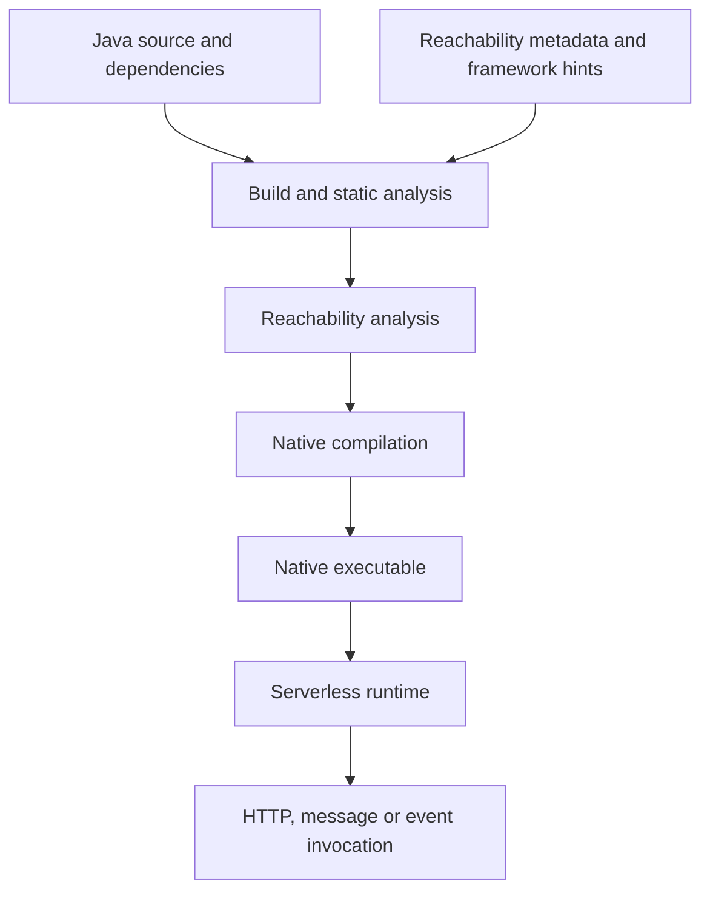
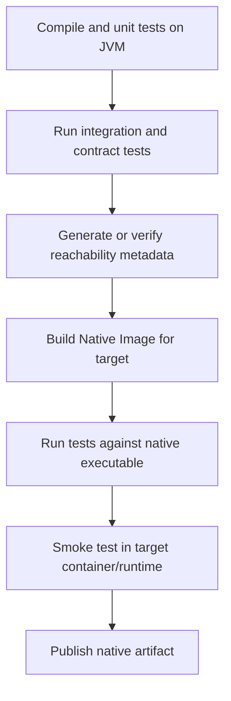

# GraalVM Native Image và yêu cầu cấu hình reflection

Java thường được triển khai trên serverless bằng runtime JVM: nền tảng khởi chạy JVM, nạp class, thực thi bytecode và có thể cần thời gian để JIT compiler tối ưu mã. Với workload có nhiều invocation ngắn hoặc nhạy với cold start, thời gian khởi động và mức bộ nhớ nền của JVM có thể ảnh hưởng đến độ trễ và chi phí.

GraalVM Native Image cung cấp cách biên dịch ứng dụng Java thành executable native trước khi triển khai. Ứng dụng có thể khởi động nhanh và dùng ít bộ nhớ hơn trong một số workload, nhưng quá trình build cần phân tích những thành phần nào có thể được truy cập khi chạy. Đây là điểm khác biệt quan trọng với JVM: các tính năng động như reflection, proxy động, nạp class theo tên, JNI hoặc đọc tài nguyên từ classpath có thể cần metadata để Native Image giữ lại đúng thành phần.

Trong phạm vi **CLOUD_SERVERLESS**, bài học đặt Native Image vào bối cảnh Java function được kích hoạt bởi HTTP, thông điệp hoặc sự kiện. Người phát triển cần cân nhắc cold start, mở rộng, chi phí và khả năng tương thích của framework; đồng thời hiểu cách cấu hình reflection và các reachability metadata khác để function hoạt động đúng trong native executable.

## 1. Native Image là gì?

GraalVM Native Image phân tích ứng dụng và các thư viện phụ thuộc tại thời điểm build, xác định phần mã có thể được gọi, rồi biên dịch phần cần thiết thành executable native cho một hệ điều hành và kiến trúc đích.



Trong ứng dụng chạy trên JVM, nhiều thao tác động được giải quyết khi chương trình đang chạy. Ví dụ, framework có thể đọc tên class từ cấu hình rồi gọi `Class.forName`, quét annotation, tạo proxy hoặc gọi constructor bằng reflection. JVM có thể nạp class và tìm member khi cần.

Native Image cần biết trước phần nào có thể được sử dụng. Phân tích này dựa trên các đường đi có thể xác định tĩnh và metadata được khai báo. Nếu một class hoặc method chỉ được truy cập bằng tên chuỗi hoặc reflection mà không được nhận diện trong quá trình build, nó có thể bị loại khỏi executable hoặc không được phép truy cập theo cách ứng dụng mong đợi.

## 2. Vì sao Native Image dùng closed-world analysis?

Native Image sử dụng mô hình phân tích reachability gần với giả định *closed world*: tại thời điểm build, công cụ cần xác định tập mã và tài nguyên có thể được ứng dụng sử dụng. Công cụ bắt đầu từ các entry point và lần theo các tham chiếu có thể nhận biết.

Ví dụ, nếu handler gọi `OrderService`, service gọi `OrderRepository`, và repository gọi một số method cụ thể, các đường đi này thường được phân tích từ bytecode. Nhưng nếu ứng dụng đọc tên class từ một file cấu hình bên ngoài rồi mới nạp class, đường đi có thể không xuất hiện trong tham chiếu tĩnh.

Các tính năng cần chú ý:

- Reflection: tìm class, constructor, method hoặc field lúc chạy.
- Dynamic proxy: tạo lớp proxy từ interface ở runtime.
- Serialization: tạo object hoặc truy cập field bằng cơ chế serialization.
- JNI: gọi native library hoặc truy cập thành phần Java từ native code.
- Resource loading: đọc file cấu hình, template, schema hoặc chứng chỉ từ classpath.
- Dynamic class loading: nạp class/plugin không biết trước lúc build.
- Service loading: khám phá implementation thông qua `ServiceLoader` hoặc cơ chế framework tương tự.

Không phải mọi ứng dụng dùng các API trên đều thất bại. Một số framework và thư viện đã cung cấp metadata hoặc plugin build để Native Image nhận diện các thành phần cần giữ lại. Điều cần làm là kiểm tra khả năng tương thích của đúng phiên bản framework và dependency đang dùng.

## 3. Reflection trong Java hoạt động ra sao?

Reflection cho phép chương trình xem và tương tác với cấu trúc class khi chạy. Một số API thường gặp:

```java
Class<?> type = Class.forName("com.example.plugins.EmailPlugin");
Constructor<?> constructor = type.getDeclaredConstructor();
Object plugin = constructor.newInstance();

Method method = type.getDeclaredMethod("send", String.class);
method.invoke(plugin, "hello@example.com");
```

Trong JVM thông thường, class và member được tìm thấy khi đoạn mã thực thi. Với Native Image, tên class `com.example.plugins.EmailPlugin`, constructor không tham số và method `send(String)` phải được nhận diện trong quá trình build nếu chúng chỉ được truy cập động.

Reflection có thể được dùng trực tiếp trong ứng dụng, nhưng cũng thường bị framework sử dụng bên dưới. Các trường hợp dễ bị bỏ sót gồm:

- Jackson hoặc thư viện JSON khác tạo object, đọc/ghi field hoặc gọi constructor.
- Dependency injection framework khám phá bean hoặc constructor.
- ORM đọc annotation và truy cập field/entity constructor.
- Validation framework tìm annotation trên field, getter hoặc parameter.
- Framework tìm controller, route, serializer hoặc converter bằng metadata.
- Plugin system nạp implementation theo tên class trong cấu hình.

Do đó, một ứng dụng không có lời gọi reflection rõ ràng vẫn có thể cần reflection metadata vì framework hoặc thư viện đang dùng nó.

## 4. Reflection metadata cho Native Image

Reflection metadata mô tả class nào cần được giữ lại và thành phần nào của class có thể được truy cập động. Định dạng JSON truyền thống thường được đặt trong thư mục `META-INF/native-image` của artifact hoặc dependency.

Ví dụ cấu trúc:

```text
src/main/resources/
└── META-INF/
    └── native-image/
        └── com.example/
            └── orders-function/
                ├── reflect-config.json
                ├── resource-config.json
                └── proxy-config.json
```

Một `reflect-config.json` minh họa:

```json
[
  {
    "name": "com.example.plugins.EmailPlugin",
    "methods": [
      {
        "name": "<init>",
        "parameterTypes": []
      },
      {
        "name": "send",
        "parameterTypes": ["java.lang.String"]
      }
    ]
  }
]
```

Metadata trên cho biết Native Image cần giữ constructor không tham số và method `send(String)` để truy cập qua reflection. Nếu ứng dụng cần field, constructor hoặc method khác, phải khai báo đúng những thành phần đó theo cấu trúc metadata mà phiên bản GraalVM hỗ trợ.

Có thể khai báo rộng hơn, ví dụ `allDeclaredConstructors`, `allDeclaredMethods` hoặc `allDeclaredFields`, nhưng nên giới hạn phạm vi khi có thể. Đăng ký toàn bộ member của nhiều class làm executable lớn hơn và có thể giữ lại mã không cần thiết.

Tên class và kiểu tham số phải chính xác, bao gồm package và tên đầy đủ. Một lỗi chính tả hoặc thay đổi signature có thể khiến metadata không còn khớp sau khi dependency được nâng cấp.

## 5. Các loại reachability metadata khác

Reflection chỉ là một phần. Native Image có các cấu hình khác cho những tính năng động.

| File metadata | Mục đích | Ví dụ tình huống |
|---|---|---|
| `reflect-config.json` | Truy cập class/member bằng reflection | Framework tạo DTO hoặc bean bằng constructor động |
| `resource-config.json` | Đưa tài nguyên classpath vào executable | Đọc template, schema, YAML hoặc file cấu hình |
| `proxy-config.json` | Đăng ký interface dùng để tạo dynamic proxy | Proxy cho client hoặc interface được framework tạo động |
| `serialization-config.json` | Khai báo kiểu dùng với Java serialization | Ứng dụng cần serialize/deserialize object theo cơ chế Java serialization |
| `jni-config.json` | Khai báo thành phần truy cập qua JNI | Thư viện native gọi ngược vào Java hoặc truy cập member động |

Metadata cần thiết phụ thuộc cách thư viện sử dụng API. Ví dụ, một ứng dụng có thể không cần `serialization-config.json` nếu chỉ dùng JSON serializer thông thường; JSON serialization và Java Object Serialization là hai cơ chế khác nhau.

### Cấu hình tài nguyên

Nếu ứng dụng đọc file `templates/report.html` từ classpath lúc chạy, file đó cần được đưa vào native executable. Ví dụ `resource-config.json`:

```json
{
  "resources": {
    "includes": [
      {
        "pattern": "templates/.*\\.html$"
      },
      {
        "pattern": "schemas/order-v[0-9]+\\.json$"
      }
    ]
  }
}
```

Pattern cần khớp đường dẫn tài nguyên thực tế trong classpath. Nên include đúng thư mục hoặc pattern cần dùng, thay vì đưa toàn bộ tài nguyên vào executable mà không có lý do.

### Cấu hình dynamic proxy

Nếu ứng dụng tạo proxy động từ một hoặc nhiều interface, Native Image có thể cần danh sách interface đó. Ví dụ định dạng `proxy-config.json`:

```json
[
  [
    "com.example.spi.PaymentGateway",
    "com.example.spi.Auditable"
  ]
]
```

Đây là ví dụ minh họa; cấu trúc metadata chính xác cần tuân theo tài liệu của phiên bản Native Image đang dùng. Framework hiện đại có thể tự đăng ký proxy thông qua build-time hint.

## 6. Cách đặt metadata và quản lý theo dependency

Với metadata do ứng dụng sở hữu, đặt file trong `META-INF/native-image` để công cụ build có thể phát hiện khi đóng gói. Một dependency có thể tự mang metadata của nó trong JAR. Cách này giúp metadata đi cùng phiên bản thư viện, thay vì buộc mọi ứng dụng phải sao chép cấu hình của thư viện vào repository riêng.

Một số lưu ý:

- Đặt metadata theo namespace của ứng dụng hoặc thư viện để tránh xung đột tên file.
- Ghi rõ class nào cần reflection và vì sao; điều này giúp review khi nâng cấp dependency.
- Không thêm metadata chỉ để làm build pass nếu chưa biết tính năng nào đang cần.
- Kiểm tra metadata được đóng gói trong artifact cuối, không chỉ tồn tại trong thư mục source.
- Khi nâng cấp framework hoặc thư viện, chạy lại native integration tests và xem xét thay đổi reachability metadata.
- Dùng metadata được thư viện công bố hoặc reachability metadata repository khi có sẵn và phù hợp với phiên bản đang dùng.

Các phiên bản GraalVM và framework có thể hỗ trợ thêm định dạng metadata hợp nhất hoặc cơ chế hint riêng. Hãy ưu tiên cơ chế được khuyến nghị bởi phiên bản build plugin hiện tại thay vì sao chép một file mẫu cũ mà không kiểm tra.

## 7. Dùng Native Image agent để phát hiện truy cập động

Native Image tracing agent quan sát ứng dụng khi chạy trên JVM và ghi lại một phần các truy cập động mà nó nhìn thấy, ví dụ reflection, resource, proxy hoặc serialization. Cách này hữu ích khi ứng dụng có nhiều framework và khó liệt kê mọi class cần đăng ký bằng tay.

Một cách chạy minh họa:

```bash
mkdir -p target/native-agent-config

java \
  -agentlib:native-image-agent=config-output-dir=target/native-agent-config \
  -jar target/orders-function.jar
```

Sau đó thực hiện các luồng nghiệp vụ đại diện: gọi endpoint tạo đơn, xử lý message thanh toán, đọc template báo cáo, chạy validation và những nhánh dùng serializer hoặc plugin. Agent ghi metadata dựa trên các đường đi đã được thực thi.

Agent không thể tự suy ra mọi đường đi có thể xảy ra. Nếu test chưa gọi plugin hiếm dùng hoặc chưa xử lý event version cũ, metadata của nhánh đó có thể không được ghi. Vì vậy:

1. Chạy agent với tập test và dữ liệu đại diện đủ rộng.
2. Kiểm tra file được sinh ra, loại bỏ entry thừa và xác nhận entry có ý nghĩa.
3. Thêm test cho các nhánh động ít gặp.
4. Build native image và chạy chính executable native.
5. Khi thay đổi dependency hoặc cấu hình, chạy lại quy trình kiểm tra.

Không nên xem output của agent là metadata hoàn chỉnh chỉ vì ứng dụng JVM chạy thành công.

## 8. Đăng ký reflection bằng framework hints

Các framework Java hiện đại có thể cung cấp abstraction để khai báo reachability ngay trong mã nguồn. Cơ chế cụ thể phụ thuộc framework.

| Framework | Cơ chế thường gặp | Lợi ích |
|---|---|---|
| Spring Framework/Spring Boot | Spring AOT và `RuntimeHints` | Framework phân tích bean và tạo hint cho reflection, resource, proxy và serialization được hỗ trợ |
| Quarkus | Build-time augmentation, extension metadata và `@RegisterForReflection` trong trường hợp cần | Nhiều cấu trúc được xử lý ở build time, giảm nhu cầu reflection động |
| Micronaut | Compile-time dependency injection, introspection và annotation processing | Giảm quét classpath và reflection runtime trong nhiều trường hợp |
| Helidon | Tích hợp và cấu hình native theo phiên bản SE/MP | Cần kiểm tra extension và metadata tương ứng |

Không phải mọi class trong ứng dụng đều cần đăng ký thủ công. Framework có thể đã tự tạo metadata cho phần nó quản lý. Trước khi thêm file JSON, hãy kiểm tra extension, starter hoặc build plugin có cung cấp hint cho thư viện đó hay không.

### Ví dụ Spring RuntimeHints

Với Spring, có thể khai báo runtime hints bằng `RuntimeHintsRegistrar` khi cần đăng ký một class được truy cập động:

```java
public final class PluginRuntimeHints implements RuntimeHintsRegistrar {
    @Override
    public void registerHints(RuntimeHints hints, ClassLoader classLoader) {
        hints.reflection().registerType(
                EmailPlugin.class,
                MemberCategory.INVOKE_DECLARED_CONSTRUCTORS,
                MemberCategory.INVOKE_DECLARED_METHODS);
    }
}
```

Sau đó đăng ký registrar theo cơ chế của Spring, chẳng hạn thông qua annotation `@ImportRuntimeHints` trên cấu hình phù hợp. Tên API và member category cần khớp phiên bản Spring đang dùng. Spring AOT cũng tạo nhiều hints tự động, vì vậy chỉ bổ sung cho phần framework không thể suy ra.

### Ví dụ Quarkus

Với Quarkus, một class cần được truy cập qua reflection có thể được đánh dấu bằng annotation hỗ trợ của framework:

```java
@RegisterForReflection
public class LegacyPaymentPayload {
    public String paymentId;
    public long amountMinor;
}
```

Quarkus có thể xử lý nhiều trường hợp qua extension và build-time augmentation. Annotation trên là ví dụ cho class cần đăng ký; không nên dùng nó thay cho việc tìm hiểu extension đã hỗ trợ thư viện cụ thể hay chưa.

## 9. Framework nào phù hợp với Native Image?

Native Image không tự động làm mọi framework trở nên nhẹ hoặc tương thích. Nên đánh giá framework dựa trên cách nó xử lý dependency injection, configuration, serialization, proxy và reflection.

| Tiêu chí | Framework thiên về build time | Framework dựa nhiều vào runtime discovery |
|---|---|---|
| Dependency injection | Có thể tạo bean graph ở build time | Có thể cần reflection hoặc classpath scanning lúc chạy |
| Serialization | Có thể sinh metadata/codec lúc build | Có thể cần reflection metadata cho DTO |
| Configuration | Có thể xử lý schema và mapping sớm | Có thể nạp class hoặc binder động lúc chạy |
| Startup | Thường giảm công việc khởi tạo runtime | Có thể cần thêm metadata và initialization |
| Tương thích thư viện | Phụ thuộc extension và build-time support | Cần xác minh các thư viện động có metadata |

Spring Boot, Quarkus, Micronaut và Helidon đều có các con đường hỗ trợ native theo phiên bản và extension. Không nên xếp hạng chỉ dựa trên tên framework. Hãy đo ứng dụng thực tế với đúng dependency, endpoint, trigger và database.

## 10. Build Native Image cho Java function

Có thể dùng GraalVM Native Image trực tiếp hoặc build plugin của framework. Trong dự án Maven/Gradle, plugin thường quản lý classpath, metadata và lệnh native compiler tốt hơn việc tự ghép command dài.

Ví dụ lệnh trực tiếp ở mức khái niệm:

```bash
native-image \
  --no-fallback \
  -jar target/orders-function.jar \
  orders-function
```

`--no-fallback` yêu cầu build thất bại nếu không thể tạo native executable theo cấu hình, thay vì tạo fallback image phụ thuộc JVM. Cách gọi chính xác, tên option và hỗ trợ JAR phụ thuộc phiên bản GraalVM; hãy dùng tài liệu tương ứng với toolchain của dự án.

Với build plugin, quy trình thường có dạng:

```bash
# Maven project đã cấu hình native-maven-plugin
mvn -Pnative package

# Gradle project đã cấu hình GraalVM Native Build Tools
./gradlew nativeCompile
```

Hai lệnh trên chỉ chạy được khi dự án đã khai báo plugin, profile/task và native toolchain phù hợp. Framework plugin có thể cung cấp lệnh riêng hoặc tự thực hiện AOT processing trước khi biên dịch native.

Build native thường tốn CPU, RAM và thời gian hơn build JAR JVM. Nên chạy trong CI runner hoặc container có tài nguyên đủ, cache dependency hợp lý và lưu artifact native theo đúng OS/architecture mục tiêu.

## 11. Khởi tạo class ở build time hay runtime?

Native Image có thể khởi tạo một số class ở thời điểm build hoặc để đến lúc executable chạy. Quyết định này ảnh hưởng cả tốc độ khởi động lẫn tính đúng đắn.

- **Build-time initialization:** static initializer được chạy trong quá trình tạo image; trạng thái được tạo có thể trở thành trạng thái ban đầu của executable.
- **Run-time initialization:** class được khởi tạo khi native executable chạy, trong môi trường thực tế của function.

Build-time initialization có thể giảm công việc startup, nhưng không phù hợp với class đọc thời gian hiện tại, environment variable, secret, hostname, random seed, network state hoặc mở file phụ thuộc môi trường triển khai. Nếu những giá trị đó bị ghi vào image, executable có thể chứa giá trị từ máy build hoặc không phản ánh môi trường runtime.

Nguyên tắc thực hành:

1. Chỉ khởi tạo ở build time các class có initializer xác định, không có side effect phụ thuộc môi trường.
2. Để class cần secret, cấu hình runtime, network hoặc clock được khởi tạo khi function chạy.
3. Không đưa credential hoặc dữ liệu nhạy cảm vào quá trình build image.
4. Khi gặp lỗi initialization, đọc thông báo của Native Image để xác định class và side effect liên quan; không thêm hàng loạt package vào build-time initialization để né lỗi.
5. Kiểm thử executable trong môi trường tương đương production.

Các option như `--initialize-at-build-time` và `--initialize-at-run-time` có thể điều khiển phạm vi class tùy phiên bản Native Image. Chỉ áp dụng sau khi hiểu initializer và hệ quả của nó.

## 12. Dynamic class loading và plugin architecture

Native Image phù hợp nhất khi tập class có thể xác định tại build time. Plugin được tải từ JAR tùy ý sau khi function đã triển khai là mô hình khó tương thích vì executable không thể tự bổ sung mã Java mới như một JVM đầy đủ.

Nếu ứng dụng có plugin system, cân nhắc:

- Đóng gói các plugin đã biết vào artifact và đăng ký class cần thiết bằng metadata.
- Dùng `ServiceLoader` với provider được xác định trong build và kiểm tra resource/service metadata.
- Chuyển extension có thể thay đổi độc lập thành dịch vụ bên ngoài giao tiếp qua HTTP hoặc message.
- Dùng JVM runtime cho function cần nạp plugin tùy ý sau triển khai.

Không nên giả định thêm `reflect-config.json` sẽ cho phép tải một class hoàn toàn không có trong executable. Reflection metadata giữ lại và mở quyền truy cập cho các thành phần được build vào image; nó không biến native executable thành một JVM có thể nạp tùy ý bytecode mới.

## 13. Serialization và DTO trong Native Image

Nhiều Java function nhận JSON từ HTTP hoặc message. Framework serializer có thể tạo object bằng constructor, gọi setter hoặc truy cập field. Native Image cần biết cách truy cập đó nếu thư viện không sinh codec ở build time.

Để xử lý:

- Ưu tiên serializer/framework có hỗ trợ Native Image và có extension metadata phù hợp.
- Dùng DTO rõ ràng, tránh cấu trúc class được tạo động theo tên chuỗi nếu không cần.
- Đăng ký constructor, method hoặc field cần thiết nếu serializer dùng reflection.
- Kiểm tra nested DTO, generic type, enum, record, custom serializer và polymorphic type.
- Chạy test serialize/deserialize bằng executable native, không chỉ bằng JVM.
- Với polymorphic deserialization, giới hạn subtype được phép và xác thực input để tránh rủi ro bảo mật.

Ví dụ, nếu JSON library cần constructor và field của `PaymentPayload`, metadata phải khớp với cách library truy cập thực tế. Không nên đăng ký toàn bộ package chỉ vì một DTO chưa deserialize được; trước hết xác định constructor, setter hoặc field nào đang thiếu.

## 14. JNI, native library và dynamic proxy

Một số dependency Java dựa trên thư viện native thông qua JNI. Khi chuyển sang Native Image, cần xác minh:

- Native library có binary cho OS và architecture đích không.
- ABI, libc và phiên bản thư viện hệ thống có tương thích không.
- Các native method và callback vào Java có được Native Image hỗ trợ và đăng ký cần thiết không.
- File `.so`, `.dll` hoặc `.dylib` được đóng gói hoặc tìm thấy trong runtime như thế nào.
- License và cách phân phối native dependency có phù hợp không.

Dynamic proxy cũng cần được xem xét riêng. Framework có thể tạo proxy cho interface repository, HTTP client hoặc AOP. Framework native-aware thường đăng ký proxy ở build time; nếu tự gọi `Proxy.newProxyInstance`, cần kiểm tra metadata tương ứng và chạy test native.

## 15. Build theo đúng OS và kiến trúc triển khai

Native executable gắn với môi trường đích. Binary được build cho Linux x86-64 không mặc nhiên chạy trên Linux ARM64 hoặc Windows. Ngoài architecture, còn phải xét libc và thư viện hệ thống.

Khi build cho serverless, hãy xác định:

- OS image/runtime mà nền tảng cung cấp.
- CPU architecture: x86-64 hay ARM64.
- glibc hay musl và phiên bản tương thích.
- Các native library, CA certificates, timezone data và file hệ thống cần có.
- Cách đóng gói executable và quyền thực thi trong artifact/container.

Thông thường nên build trong container hoặc CI runner tương thích với target runtime. Nếu dùng static linking hoặc musl để giảm phụ thuộc hệ thống, cần kiểm tra hỗ trợ của dependency và runtime; không phải thư viện nào cũng tương thích với mọi cách linking.

Một bài kiểm thử quan trọng là chạy executable trong chính container base image hoặc môi trường tương đương môi trường triển khai, không chỉ chạy trên máy developer.

## 16. Native Image và serverless: lợi ích và trade-off

Native Image có thể cải thiện cold start và mức bộ nhớ cho workload phù hợp, nhưng không phải lúc nào cũng tốt hơn JVM.

| Tiêu chí | JVM runtime | Native Image |
|---|---|---|
| Startup | Thường cần khởi tạo JVM và class; có thể tăng với framework lớn | Thường nhanh hơn khi executable được tối ưu phù hợp |
| Memory footprint | Có thể cao hơn do JVM và heap/runtime overhead | Có thể thấp hơn, tùy ứng dụng và cấu hình |
| Peak throughput | JIT có thể tối ưu mạnh sau khi chạy đủ lâu | AOT có thể phù hợp workload ngắn; cần benchmark workload dài |
| Build time | Thường nhanh hơn | Native compilation thường tốn thời gian và tài nguyên hơn |
| Reflection/dynamic loading | Linh hoạt hơn ở runtime | Cần reachability metadata và có giới hạn với class không biết trước |
| Portability | Bytecode có thể chạy trên JVM tương thích | Executable phụ thuộc OS/architecture và môi trường build |
| Debugging/diagnostics | Hệ sinh thái JVM trưởng thành | Có công cụ native riêng; một số hành vi và công cụ khác biệt |

Native Image thường đáng thử khi function có cold start nhạy cảm, invocation ngắn, lưu lượng tăng giảm mạnh hoặc chi phí memory đáng kể. JVM có thể phù hợp hơn khi ứng dụng dựa vào plugin động, dependency chưa hỗ trợ native, workload chạy dài cần JIT tối ưu hoặc build native làm tăng độ phức tạp quá mức.

Không quyết định chỉ bằng benchmark “hello world”. Hãy đo function thật với framework, serializer, database, trigger, payload và mức concurrency dự kiến.

## 17. Đo cold start, memory và chi phí

Một phép so sánh hữu ích nên ghi nhận:

- Thời gian cold start từ lúc nền tảng bắt đầu khởi tạo đến khi handler sẵn sàng.
- Thời gian xử lý invocation riêng, không gộp với startup.
- p50, p95 và p99 latency ở tải thấp và tải cao.
- Memory peak và cấu hình memory được cấp.
- Kích thước artifact/container image và thời gian tải/khởi chạy.
- Số lỗi khởi động, lỗi reflection và lỗi tương thích native dependency.
- Chi phí build/CI và chi phí vận hành theo mô hình tính phí của nền tảng.

Nên chạy nhiều lần để phân biệt cold invocation và warm invocation. Cần thử cả burst traffic để xem nền tảng tạo nhiều environment mới như thế nào. Nếu Native Image giảm startup nhưng tăng thời gian build hoặc làm artifact lớn, hãy tính tổng tác động đến pipeline và vận hành.

## 18. Quy trình xử lý lỗi reflection trong native executable

Khi ứng dụng chạy tốt trên JVM nhưng lỗi trong Native Image, hãy xử lý theo trình tự:

1. **Tái hiện bằng executable native:** ghi lại invocation, payload và stack trace đầy đủ; xác định class/member/resource không tìm thấy.
2. **Tìm nơi dùng động:** kiểm tra `Class.forName`, `getDeclaredMethod`, framework scanning, serializer, ORM, proxy hoặc ServiceLoader liên quan.
3. **Kiểm tra framework support:** xem extension/build plugin đã sinh metadata chưa và có version nào hỗ trợ dependency đó.
4. **Tạo metadata tối thiểu:** đăng ký đúng class/member/resource/proxy cần thiết.
5. **Chạy lại test native:** xác minh cả nhánh thành công, lỗi và các payload/phiên bản event cần hỗ trợ.
6. **Ghi lại lý do:** chú thích metadata do ứng dụng sở hữu và gắn test để tránh lỗi quay lại.

Một số dấu hiệu thường gặp:

| Triệu chứng | Nguyên nhân có thể | Hướng kiểm tra |
|---|---|---|
| `ClassNotFoundException` hoặc class không thể nạp | Class được chọn bằng tên động nhưng không nằm trong image | Kiểm tra plugin, class name và reachability |
| `NoSuchMethodException` khi reflection | Constructor/method chưa được đăng ký hoặc signature sai | So khớp `reflect-config.json` với API thực tế |
| JSON deserialize thất bại trong native | DTO/member hoặc custom serializer cần metadata | Kiểm tra framework hints và test payload native |
| Không tìm thấy file template/schema | Resource không được đưa vào image | Kiểm tra `resource-config.json` và đường dẫn classpath |
| Lỗi tạo proxy | Interface proxy chưa được đăng ký | Kiểm tra framework hints hoặc proxy metadata |
| JNI symbol/library error | Native library không có hoặc không tương thích target | Kiểm tra ABI, architecture, libc và packaging |
| Giá trị static khác giữa build và runtime | Class khởi tạo ở build time nhưng phụ thuộc môi trường | Điều chỉnh class initialization policy |

Đừng giải quyết lỗi bằng cách đăng ký tất cả class hoặc include mọi resource một cách vô điều kiện. Metadata quá rộng làm tăng kích thước image và che khuất dependency nào thực sự cần cấu hình.

## 19. Kiểm thử và CI/CD cho Native Image

Một pipeline nên kiểm tra cả JVM và native executable vì hai môi trường có hành vi khác nhau.



Các bước cần có:

- Unit test domain/application trên JVM để phản hồi nhanh.
- Adapter và contract test cho HTTP, message/event, serialization và validation.
- Native build trong CI với đúng GraalVM/JDK, framework plugin và target architecture.
- Native integration test gọi các nhánh reflection, resource, proxy và serialization thực tế.
- Smoke test trong container hoặc runtime tương thích production.
- Kiểm tra artifact có executable permission, metadata và resource cần thiết.
- Theo dõi thời gian build, kích thước artifact và benchmark cold/warm start.

Khi metadata được tạo bằng tracing agent, nên review diff trong pull request. Không tự động chấp nhận mọi entry agent sinh ra vì nó có thể phụ thuộc test data và làm metadata tăng dần mà không có lý do.

## 20. Checklist trước khi chọn và triển khai Native Image

| Câu hỏi | Bằng chứng cần có |
|---|---|
| Native Image có cải thiện workload mục tiêu? | Benchmark cold start, warm latency, memory và chi phí |
| Framework và dependency có hỗ trợ native? | Tài liệu phiên bản, extension và reachability metadata |
| Có reflection hoặc dynamic class loading? | Danh sách class/member và test bao phủ các nhánh động |
| DTO/serializer có chạy native? | Native serialization/deserialization tests |
| Resource classpath có được đóng gói? | Kiểm tra template, schema, YAML và file cấu hình trong executable |
| Dynamic proxy/JNI có hoạt động? | Metadata, native library và test trên target architecture |
| Class initialization có an toàn? | Không embed secret, clock hoặc môi trường build vào image |
| Binary đúng môi trường triển khai? | OS, CPU architecture, libc và system library tương thích |
| Build pipeline có đủ tài nguyên? | CI runner/container, thời gian build và cache |
| Có kiểm thử executable native? | Integration test và smoke test trên môi trường tương đương production |
| Metadata có được review? | Entry tối thiểu, lý do và test bảo vệ |
| Có phương án quay lại JVM? | Artifact JVM và cấu hình triển khai có thể dùng khi native không phù hợp |

## 21. Khi nào nên dùng Native Image cho Java FaaS?

Native Image là lựa chọn đáng cân nhắc khi thời gian khởi động ảnh hưởng trực tiếp đến trải nghiệm hoặc chi phí, ứng dụng có thể phân tích reachability rõ ràng và các framework/dependency quan trọng hỗ trợ native. Với function xử lý HTTP ngắn, consumer message có burst traffic hoặc tác vụ event cần scale nhanh, giảm cold start có thể mang lại lợi ích đáng kể.

JVM vẫn là lựa chọn hợp lý khi ứng dụng phụ thuộc nhiều vào plugin động, runtime class loading, thư viện chưa có metadata hoặc workload dài được JIT tối ưu tốt. Cũng cần tính đến chi phí build native, độ phức tạp CI và công sức duy trì metadata khi nâng cấp dependency.

Quyết định nên dựa trên benchmark của chính function và kiểm thử trên runtime đích. Nếu chọn Native Image, hãy coi reachability metadata là một phần của mã nguồn và quy trình phát hành: khai báo đúng reflection, resource, proxy, serialization và JNI; chạy test bằng executable native; theo dõi thay đổi metadata khi framework hoặc thư viện được nâng cấp. Cách làm này giúp tận dụng lợi ích startup của Native Image mà vẫn giữ được tính đúng đắn của ứng dụng Java serverless.
