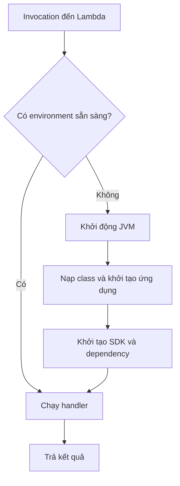
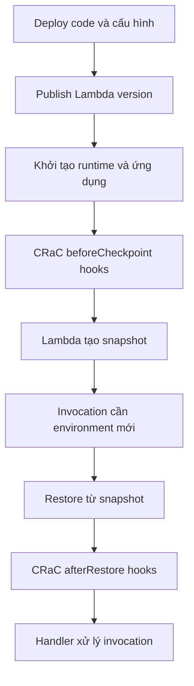

# Snapshot và restore JVM với AWS Lambda SnapStart

Java mang lại hệ sinh thái thư viện phong phú, mô hình lập trình quen thuộc và khả năng xây dựng ứng dụng lớn. Tuy nhiên, khi chạy trên nền tảng Function as a Service (FaaS), thời gian khởi động JVM, nạp class, tạo dependency injection context và khởi tạo framework có thể làm tăng độ trễ của invocation đầu tiên trong một execution environment mới. Hiện tượng này thường được gọi là *cold start*.

AWS Lambda SnapStart giảm phần chi phí khởi tạo bằng cách tạo snapshot của execution environment sau giai đoạn khởi tạo function. Khi cần environment mới, Lambda khôi phục từ snapshot thay vì thực hiện lại toàn bộ quá trình khởi động ứng dụng. Với Java, cơ chế này đặc biệt hữu ích cho function có nhiều class, framework hoặc dependency cần thời gian khởi tạo.

Snapshot và restore cũng tạo ra một yêu cầu quan trọng: trạng thái trong bộ nhớ tại thời điểm snapshot sẽ được sao chép sang nhiều environment được khôi phục. Một số trạng thái có thể tái sử dụng an toàn, nhưng dữ liệu duy nhất theo từng environment như random seed, kết nối mạng, lease hoặc thông tin hết hạn cần được làm mới. Bài học này giải thích vòng đời SnapStart, cách dùng CRaC hooks trong Java và cách kiểm chứng ứng dụng sau restore.

## 1. Cold start trong Java Lambda

Khi Lambda cần một execution environment mới, runtime phải khởi động JVM, nạp class và thực hiện phần initialization của ứng dụng trước khi gọi handler. Với một ứng dụng Java dùng framework, các bước này có thể gồm:

1. Khởi động runtime Java và nạp các class cần thiết.
2. Đọc cấu hình, environment variable và thiết lập logging.
3. Tạo dependency injection container và các bean/service.
4. Khởi tạo SDK client, HTTP transport, serializer và connection pool.
5. Nạp metadata, schema hoặc cache khởi tạo cần cho ứng dụng.
6. Sẵn sàng nhận invocation đầu tiên.

Nếu các bước trên mất nhiều thời gian, người gọi sẽ cảm nhận độ trễ cao ở invocation đầu tiên. Những invocation sau có thể dùng lại environment đang hoạt động nên thường không phải trả lại toàn bộ chi phí khởi động.



Cold start không chỉ là thời gian chạy handler. Nó có thể bao gồm khởi động runtime, initialization của ứng dụng và các công việc chuẩn bị khác. Tối ưu code handler không tự loại bỏ thời gian khởi tạo trước handler.

## 2. SnapStart hoạt động như thế nào?

SnapStart dùng snapshot của execution environment đã được khởi tạo. Khi publish một function version có bật SnapStart, Lambda chạy giai đoạn initialization, tạo snapshot trạng thái bộ nhớ và hệ thống tệp liên quan, rồi lưu snapshot đó. Khi cần environment mới cho version này, Lambda khôi phục snapshot để function có thể nhận invocation nhanh hơn so với khởi động JVM và ứng dụng từ đầu.



Điểm quan trọng:

- SnapStart áp dụng cho **published version** được cấu hình bật SnapStart. `$LATEST` không phải version đã publish để phục vụ theo cơ chế này.
- Alias có thể trỏ tới version đã bật SnapStart; khi triển khai phiên bản mới, cần publish version mới và chuyển alias theo quy trình phát hành.
- Snapshot được tạo từ trạng thái sau initialization. Những object trong heap, static field và dữ liệu đã nạp trước checkpoint có thể xuất hiện trong trạng thái được restore.
- Mỗi environment restore là một bản thực thi riêng từ snapshot. Chúng không chia sẻ cùng một heap sống, nhưng ban đầu có thể mang cùng giá trị đã được snapshot.
- SnapStart giảm công việc khởi động lặp lại; nó không làm cho handler, truy vấn database hoặc lời gọi API vốn chậm tự nhiên nhanh hơn.

SnapStart là tính năng của AWS Lambda. Khả năng hỗ trợ runtime, region, package type, giới hạn và cách cấu hình có thể thay đổi theo thời gian. Khi triển khai, cần kiểm tra ma trận hỗ trợ và hướng dẫn hiện hành của AWS cho runtime Java và loại function đang sử dụng.

### SnapStart không phải là một JVM dùng chung

Snapshot không biến tất cả invocation thành các thread dùng chung một JVM toàn cục. Lambda khôi phục các execution environment riêng từ cùng snapshot. Vì các environment có thể bắt đầu với cùng trạng thái đã snapshot, các giá trị được giả định là duy nhất hoặc chỉ dùng một lần trước checkpoint cần được xem xét cẩn thận.

Ví dụ, nếu ứng dụng tạo một UUID lúc khởi tạo và lưu trong static field, các environment restore có thể bắt đầu với cùng UUID đó. Nếu UUID được dùng làm định danh riêng cho từng environment hoặc phiên làm việc, việc sao chép giá trị sẽ gây xung đột. Hãy tạo giá trị duy nhất sau restore hoặc tại thời điểm xử lý request.

## 3. Phân biệt initialization, checkpoint và restore

Để dùng SnapStart đúng, cần phân biệt ba giai đoạn:

| Giai đoạn | Thời điểm | Việc phù hợp |
|---|---|---|
| Initialization | Lambda chuẩn bị version và chạy code khởi tạo | Nạp class, tạo cấu hình bất biến, tạo object dùng chung an toàn |
| Before checkpoint | Ngay trước khi Lambda chụp snapshot | Đóng hoặc tạm dừng tài nguyên không thể khôi phục an toàn, hoàn tất trạng thái chuẩn bị |
| After restore | Mỗi khi một environment được khôi phục từ snapshot | Làm mới entropy, tạo lại kết nối, refresh dữ liệu phụ thuộc thời gian và tiếp tục tài nguyên đã tạm dừng |

Không phải mọi object đều cần xử lý trong hook. Các object bất biến như cấu hình parse sẵn, biểu thức regex, metadata tĩnh hoặc serializer an toàn thường có thể được snapshot và dùng lại. Các tài nguyên gắn với một kết nối sống hoặc một giá trị chỉ hợp lệ trong một khoảng thời gian cần được đánh giá riêng.

### Trạng thái nên tạo trước checkpoint

Các công việc tốn thời gian nhưng tạo ra kết quả ổn định có thể được thực hiện trong initialization:

- Nạp class và metadata cần thiết.
- Parse cấu hình bất biến.
- Tạo object mapper, validator hoặc schema registry client nếu vòng đời của client phù hợp với restore.
- Khởi tạo dependency injection context.
- Tạo các cấu trúc dữ liệu chỉ đọc và cache tĩnh không chứa dữ liệu theo request.

Mục tiêu là đưa phần khởi tạo có thể tái sử dụng vào snapshot để không phải làm lại ở mỗi environment mới.

### Trạng thái cần xem xét sau restore

Những thứ sau cần được làm mới, kiểm tra hoặc khởi tạo lại tùy cách triển khai:

- Random seed, nonce, token hoặc ID cần duy nhất.
- TCP socket, HTTP connection, database connection và connection pool có thể đã stale hoặc không còn hợp lệ.
- Credential tạm thời hoặc dữ liệu có thời hạn.
- Cache phản ánh trạng thái thay đổi bên ngoài trong thời gian snapshot được lưu.
- Timer, scheduler, background thread và executor có trạng thái cần tiếp tục.
- File tạm hoặc dữ liệu chỉ có ý nghĩa trong một invocation.

Không nên mặc định rằng mọi kết nối đều hỏng sau restore hoặc mọi client đều phải được tạo lại. Hãy dùng hướng dẫn của SDK/framework và kiểm thử trên runtime thật. Điều cần bảo đảm là ứng dụng có thể phục hồi khi tài nguyên bên ngoài đã thay đổi hoặc kết nối đã bị đóng trong thời gian snapshot tồn tại.

## 4. CRaC hooks trong Java

CRaC (Coordinated Restore at Checkpoint) cung cấp API để ứng dụng tham gia vào vòng đời checkpoint/restore. AWS Lambda SnapStart hỗ trợ mô hình hook này cho ứng dụng Java. Một object triển khai `org.crac.Resource` có thể đăng ký với global context để nhận callback trước checkpoint và sau restore.

Hai callback chính:

- `beforeCheckpoint(...)`: chạy trước khi snapshot được tạo. Dùng để đóng hoặc tạm dừng tài nguyên cần được khởi tạo lại sau restore.
- `afterRestore(...)`: chạy sau khi environment được restore và trước khi handler xử lý invocation. Dùng để tái tạo tài nguyên, làm mới trạng thái hoặc khởi động lại thành phần đã dừng.

Để biên dịch các import `org.crac.*`, ứng dụng cần dependency CRaC tương thích với runtime Java/SnapStart đang dùng. Ví dụ khai báo Gradle (thay placeholder bằng phiên bản được AWS/runtime hỗ trợ):

```kotlin
dependencies {
    implementation("org.crac:crac:<compatible-version>")
}
```

Không chọn phiên bản chỉ theo ví dụ trên; hãy kiểm tra hướng dẫn AWS Lambda Java runtime và ma trận tương thích CRaC trước khi khóa dependency.

Ví dụ dưới đây minh họa việc quản lý một connection pool JDBC. Giả sử ứng dụng dùng HikariCP và database connection không nên được giữ qua checkpoint.

```java
import com.zaxxer.hikari.HikariConfig;
import com.zaxxer.hikari.HikariDataSource;
import org.crac.Context;
import org.crac.Core;
import org.crac.Resource;

public final class DatabaseResources implements Resource {
    private volatile HikariDataSource dataSource;

    public DatabaseResources() {
        this.dataSource = createDataSource();
        Core.getGlobalContext().register(this);
    }

    @Override
    public void beforeCheckpoint(Context<? extends Resource> context) {
        closeDataSource();
    }

    @Override
    public void afterRestore(Context<? extends Resource> context) {
        this.dataSource = createDataSource();
    }

    public HikariDataSource dataSource() {
        HikariDataSource current = dataSource;
        if (current == null) {
            throw new IllegalStateException("Database pool is not initialized");
        }
        return current;
    }

    private void closeDataSource() {
        HikariDataSource current = dataSource;
        dataSource = null;
        if (current != null) {
            current.close();
        }
    }

    private HikariDataSource createDataSource() {
        HikariConfig config = new HikariConfig();
        config.setJdbcUrl(System.getenv("JDBC_URL"));
        config.setUsername(System.getenv("DB_USERNAME"));
        config.setPassword(System.getenv("DB_PASSWORD"));
        config.setMaximumPoolSize(2);
        config.setConnectionTimeout(3_000);
        return new HikariDataSource(config);
    }
}
```

Ví dụ minh họa lifecycle; trong hệ thống thực tế, credential nên được lấy qua secret provider/managed identity phù hợp và không nhất thiết được giữ cố định trong environment variable. `beforeCheckpoint` đóng pool và đặt field về `null`, vì trạng thái sau callback là trạng thái được snapshot. `afterRestore` tạo pool mới cho environment được khôi phục. Kích thước pool cần được tính theo concurrency và giới hạn database, không dùng giá trị minh họa như cấu hình mặc định cho production.

Đăng ký resource trong application initialization, ví dụ:

```java
public final class ApplicationResources {
    private static final DatabaseResources DATABASE = new DatabaseResources();

    private ApplicationResources() {}

    public static DatabaseResources database() {
        return DATABASE;
    }
}
```

Khi runtime khởi tạo class này trước checkpoint, resource được đăng ký. Sau restore, callback được gọi để tạo lại pool. Trong ứng dụng dùng dependency injection, có thể tích hợp cùng lifecycle của framework; tránh đăng ký trùng một resource nhiều lần do tạo nhiều instance ngoài ý muốn.

### Thứ tự và lỗi trong hook

Hook là một phần của quá trình chuẩn bị environment. Nếu `beforeCheckpoint` không thể đưa tài nguyên về trạng thái an toàn, snapshot không nên được xem là sẵn sàng. Nếu `afterRestore` không thể tạo lại một dependency bắt buộc, environment không thể phục vụ đúng nghiệp vụ; hãy để lỗi được thể hiện rõ và có thể quan sát.

Giữ callback ngắn, có thể lặp lại an toàn và không tạo side effect nghiệp vụ. Không gửi email, trừ tiền hoặc phát event nghiệp vụ trong hook. Hook có thể được gọi trong vòng đời tạo snapshot/restore, không phải một lần cho mỗi message nghiệp vụ.

## 5. Xử lý random, ID và dữ liệu duy nhất

Snapshot sao chép trạng thái bộ nhớ. Nếu một giá trị ngẫu nhiên được tạo trước checkpoint rồi lưu trong field, nhiều environment restore có thể bắt đầu từ cùng giá trị. Đây là vấn đề với nonce, random seed, session ID, ID instance hoặc bất kỳ giá trị nào được kỳ vọng là duy nhất.

Các nguyên tắc:

- Tạo UUID, nonce và ID nghiệp vụ tại thời điểm cần dùng, không tạo một lần ở static initializer rồi tái sử dụng cho mọi environment.
- Nếu ứng dụng giữ một random generator lâu sống, xác minh cách runtime/SnapStart xử lý entropy và reseed sau restore theo hướng dẫn của AWS/JDK.
- Không tự tạo cryptographic seed bằng timestamp hoặc một giá trị dễ đoán.
- Với ID cần duy nhất toàn hệ thống, dùng nguồn cấp ID có bảo đảm phù hợp hoặc UUID/random generator được hỗ trợ đúng cách.
- Kiểm thử nhiều environment restore từ cùng version và xác nhận không có collision.

Ví dụ tạo ID cho từng thao tác:

```java
import java.util.UUID;

public final class RequestIdFactory {
    public String newRequestId() {
        return UUID.randomUUID().toString();
    }
}
```

Không lưu kết quả `UUID.randomUUID()` vào static field để làm ID cho mọi request. Việc gọi factory trong handler tạo ID tại thời điểm xử lý. Với yêu cầu mật mã, hãy dùng API và nguồn entropy được JDK/runtime hỗ trợ; không tự thay thế bằng `new Random()`.

## 6. Kết nối mạng, database và SDK client

Một snapshot có thể chứa object Java đại diện cho connection, socket hoặc client, nhưng trạng thái bên ngoài snapshot không được đóng băng cùng với heap. Trong lúc snapshot nằm chờ, server có thể đóng connection, DNS record thay đổi, credential hết hạn hoặc database failover sang node khác.

Vì vậy, cần phân loại client:

| Tài nguyên | Cách tiếp cận |
|---|---|
| SDK client không giữ kết nối sống và có khả năng tự reconnect | Có thể tạo trước checkpoint nếu SDK hỗ trợ SnapStart; kiểm thử sau restore |
| HTTP client có pool hoặc socket đang mở | Xem hướng dẫn SDK; đóng/tạm dừng trước checkpoint hoặc kiểm tra khả năng phục hồi sau restore |
| JDBC connection/pool | Thường đóng trước checkpoint và tạo lại sau restore |
| Credential provider có refresh | Ưu tiên provider quản lý credential; tránh snapshot credential tạm thời cố định |
| Custom TCP socket | Đóng trước checkpoint và tạo lại sau restore |
| DNS cache hoặc endpoint cache | Kiểm tra TTL và khả năng cập nhật khi restore |

Với AWS SDK for Java 2.x, service client thường được thiết kế để tái sử dụng và credential provider có thể quản lý việc lấy credential. Tuy nhiên, không nên suy luận rằng mọi custom HTTP transport hoặc mọi client của bên thứ ba đều an toàn qua snapshot. Kiểm tra tài liệu tương thích SnapStart của SDK và thực hiện test kết nối sau restore.

### Ví dụ quản lý socket tùy chỉnh

```java
import java.io.IOException;
import java.net.Socket;
import org.crac.Context;
import org.crac.Core;
import org.crac.Resource;

public final class RemoteSocketResource implements Resource {
    private volatile Socket socket;

    public RemoteSocketResource() {
        Core.getGlobalContext().register(this);
    }

    @Override
    public void beforeCheckpoint(Context<? extends Resource> context) throws IOException {
        closeSocket();
    }

    @Override
    public void afterRestore(Context<? extends Resource> context) throws IOException {
        socket = connect();
    }

    private void closeSocket() throws IOException {
        Socket current = socket;
        socket = null;
        if (current != null) {
            current.close();
        }
    }

    private Socket connect() throws IOException {
        return new Socket(System.getenv("REMOTE_HOST"),
                Integer.parseInt(System.getenv("REMOTE_PORT")));
    }
}
```

Đây là ví dụ minh họa. Ứng dụng thật cần timeout kết nối, TLS, xác thực, retry có giới hạn và xử lý socket đóng bất ngờ. Không mở kết nối trong hook nếu dependency không bắt buộc ngay khi restore; có thể dùng lazy reconnect ở lần truy cập đầu tiên để giảm restore latency, miễn là invocation có thể xử lý lỗi và timeout phù hợp.

### Credential và secret

Không snapshot một access token tạm thời rồi giả định nó còn hiệu lực ở mọi thời điểm restore. Snapshot có thể được dùng sau khi token đã hết hạn. Dùng credential provider có khả năng refresh, secrets manager hoặc managed identity. Nếu một secret được cache, cache cần có thời hạn và khả năng làm mới.

Đối với password database, tránh đọc một lần khi khởi tạo rồi giữ mãi nếu password có thể luân chuyển. Có thể tạo pool sau restore bằng cách lấy secret hiện hành từ provider. Hãy cân bằng restore latency với yêu cầu bảo mật và khả năng refresh; không để hook giữ một token hết hạn khiến mọi invocation đều thất bại.

## 7. Cache và dữ liệu có thể thay đổi

Cache được nạp trước checkpoint có thể giúp giảm thời gian khởi động, nhưng nó có thể cũ khi environment restore sau nhiều phút hoặc lâu hơn. Ví dụ, danh sách quyền, cấu hình feature flag, giá sản phẩm hoặc mapping endpoint có thể đã thay đổi.

Trước khi đưa cache vào snapshot, hãy xác định:

- Dữ liệu có bất biến trong toàn bộ vòng đời version hay không?
- Cache có TTL hoặc version không?
- Nếu cache cũ, hệ thống có thể đọc lại nguồn chính thức không?
- Cache có chứa dữ liệu tenant hoặc người dùng cụ thể không?
- Việc làm mới cache có thể thực hiện lazy ở invocation đầu tiên hay trong `afterRestore`?

Cache dữ liệu tĩnh, dùng chung và không nhạy cảm thường phù hợp để snapshot. Cache thay đổi nhanh hoặc phụ thuộc quyền người dùng nên có TTL/refresh rõ ràng. Không đưa dữ liệu riêng của một request vào static cache trước checkpoint.

## 8. Thread, executor và background task

Một ứng dụng Java có thể tạo scheduler, executor hoặc background thread trong giai đoạn initialization. Snapshot và restore làm thay đổi vòng đời thực tế của các thread này. Một thread đang chờ trên socket, giữ lock hoặc thực hiện tác vụ nền có thể không ở trạng thái phù hợp để tiếp tục sau restore.

Các nguyên tắc:

- Tránh khởi chạy background worker không cần thiết trong static initializer.
- Không để thread thực hiện side effect nghiệp vụ trước hoặc trong checkpoint.
- Nếu executor cần tồn tại, xác định cách dừng/đợi tác vụ trong `beforeCheckpoint` và tạo lại trong `afterRestore`.
- Không giữ lock ở trạng thái khiến invocation sau restore bị treo.
- Dùng scheduler của nền tảng cho tác vụ định kỳ nếu phù hợp, thay vì dựa vào một thread nền trong function ngắn hạn.
- Nếu dùng async SDK, xác minh event loop và HTTP transport có hỗ trợ checkpoint/restore.

Một Lambda invocation không nên phụ thuộc vào việc một thread nền tiếp tục chạy sau khi handler trả kết quả. Nếu công việc phải tồn tại độc lập với invocation, hãy đưa nó vào queue, event bus hoặc workflow có trạng thái.

## 9. Tích hợp với framework Java

Framework có thể làm tăng chi phí cold start vì phải quét classpath, tạo application context, khởi tạo bean và cấu hình thư viện. SnapStart có thể snapshot phần công việc này, nhưng các bean chứa tài nguyên ngoài JVM vẫn cần xử lý đúng lifecycle.

### Spring

Với Spring, application context và bean singleton thường được tạo trong initialization. Bean bất biến và an toàn khi dùng chung có thể được snapshot. Bean quản lý database pool, socket, scheduler hoặc credential cache cần được đánh giá riêng. Có thể dùng các tích hợp CRaC/lifecycle mà phiên bản Spring Boot hỗ trợ thay vì tự đăng ký nhiều hook trùng nhau.

Tránh thực hiện side effect nghiệp vụ trong `@PostConstruct`, constructor bean hoặc application runner nếu side effect chỉ nên xảy ra một lần trong môi trường production. Những callback khởi tạo có thể chạy khi tạo snapshot version; không nên gửi thông báo hoặc tạo dữ liệu nghiệp vụ chỉ vì version được publish.

### Quarkus và Micronaut

Quarkus và Micronaut tối ưu thời gian khởi động bằng build-time processing, dependency injection nhẹ và giảm reflection. SnapStart có thể bổ sung bằng cách snapshot trạng thái đã khởi tạo, nhưng lợi ích thực tế phụ thuộc phần việc còn lại trong runtime. Kiểm tra hướng dẫn của phiên bản framework về CRaC và tài nguyên cần đóng/mở lại.

### Không giả định framework tự xử lý mọi tài nguyên

Một framework có thể quản lý vòng đời bean nhưng không thể biết mọi kết nối hoặc cache tùy chỉnh của ứng dụng. Hãy liệt kê tài nguyên có side effect ngoài JVM: pool, socket, thread, token, file tạm và cache dữ liệu. Đối với mỗi tài nguyên, quyết định rõ nó được snapshot, đóng trước checkpoint, làm mới sau restore hay tạo lazy khi cần.

## 10. Cấu hình SnapStart trong quy trình phát hành

SnapStart được gắn với version đã publish. Quy trình triển khai thường gồm:

1. Đóng gói function artifact và cấu hình runtime Java.
2. Bật SnapStart cho published versions trong cấu hình function.
3. Publish một version mới để Lambda thực hiện initialization và tạo snapshot.
4. Chờ trạng thái version/snapshot sẵn sàng theo nền tảng.
5. Chạy kiểm thử invocation trên version hoặc alias trỏ tới version đó.
6. Chuyển alias production sang version mới sau khi kiểm tra thành công.
7. Theo dõi restore duration, lỗi sau restore, độ trễ và chi phí.

Không kiểm thử chỉ trên `$LATEST` rồi kết luận SnapStart hoạt động. Cần invoke đúng published version hoặc alias đã trỏ đến version bật SnapStart. Khi code hoặc cấu hình thay đổi, publish version mới để tạo snapshot tương ứng.

Ví dụ cấu hình khái niệm trong AWS SAM:

```yaml
Resources:
  JavaFunction:
    Type: AWS::Serverless::Function
    Properties:
      Runtime: java21
      Handler: example.Handler::handleRequest
      CodeUri: target/function.jar
      AutoPublishAlias: live
      SnapStart:
        ApplyOn: PublishedVersions
```

Đây là ví dụ cấu hình khái niệm; cấu trúc template, runtime được hỗ trợ và cách phát hành cần khớp phiên bản AWS SAM/CloudFormation đang dùng. Với công cụ triển khai khác, cấu hình SnapStart tương ứng được đặt trên Lambda function và version publication.

### Rollback

Vì alias trỏ tới một version cụ thể, rollback có thể chuyển alias về version trước nếu version đó còn được giữ và phù hợp với cấu hình hiện tại. Cần giữ artifact/version, kiểm tra tương thích dữ liệu và bảo đảm các thay đổi database có thể hoạt động với cả phiên bản cũ lẫn mới. Snapshot không thay thế chiến lược rollback ứng dụng.

## 11. Đo hiệu quả và so sánh phương án

SnapStart có thể giảm thời gian khởi tạo, nhưng mức cải thiện phụ thuộc vào thời gian initialization, kích thước heap, framework, dependency và restore work. Đo trước và sau khi bật trên cùng loại workload.

Các số liệu nên theo dõi:

| Chỉ số | Mục đích |
|---|---|
| Cold start latency | Độ trễ tổng của invocation đầu trong environment mới |
| Init duration | Thời gian initialization trước checkpoint ở version mới |
| Restore duration | Thời gian khôi phục environment từ snapshot |
| After-restore hook duration | Chi phí làm mới tài nguyên sau restore |
| Handler duration | Thời gian xử lý nghiệp vụ sau khi sẵn sàng |
| Error/throttle rate | Lỗi do kết nối, credential hoặc concurrency |
| Memory usage | Dung lượng heap và tài nguyên sau restore |
| Cost per request | Chi phí tổng thể khi tính cả snapshot, restore và tài nguyên liên quan |

Không chỉ nhìn vào một invocation đầu tiên. Hãy tạo đủ environment mới để có mẫu cold restore, đo p50/p95/p99 và so sánh trong điều kiện tải tương đương. Tách thời gian `afterRestore` khỏi handler để biết việc làm mới tài nguyên có trở thành phần cold start mới hay không.

### SnapStart, tối ưu framework và provisioned capacity

| Phương án | Cách giảm độ trễ | Điểm cần cân nhắc |
|---|---|---|
| Tối ưu initialization | Giảm class, dependency và công việc lúc khởi động | Có thể cần thay đổi cấu trúc ứng dụng |
| SnapStart | Restore từ snapshot đã khởi tạo | Cần xử lý trạng thái không an toàn qua checkpoint/restore |
| Framework/runtime khởi động nhanh | Giảm công việc JVM/framework phải làm | Cần đánh giá compatibility và giới hạn thư viện |
| Provisioned concurrency | Chuẩn bị sẵn environment trước request | Có chi phí duy trì capacity và cần cấu hình theo nhu cầu |

Các phương án có thể có ràng buộc tương thích riêng trên Lambda. Hãy kiểm tra tài liệu AWS hiện hành trước khi kết hợp chúng. Chọn theo SLO, mẫu tải, mức độ ổn định của traffic và chi phí, không chỉ theo con số cold start trong một thử nghiệm nhỏ.

SnapStart cũng không thay thế việc tối ưu handler. Nếu phần lớn độ trễ đến từ truy vấn database, gọi API ngoài hoặc xử lý CPU nặng, snapshot JVM sẽ không giải quyết nút thắt đó.

## 12. Các lỗi thường gặp khi dùng SnapStart

| Lỗi | Hệ quả | Cách khắc phục |
|---|---|---|
| Tạo random ID trước checkpoint rồi lưu static | Nhiều environment restore có thể dùng cùng giá trị | Tạo ID sau restore hoặc tại invocation |
| Giữ JDBC connection qua snapshot | Connection có thể stale hoặc không còn hợp lệ | Đóng trước checkpoint và tạo lại sau restore |
| Cache credential tạm thời cố định | Token có thể hết hạn trước khi environment được dùng | Dùng provider có refresh hoặc lấy lại sau restore |
| Cache dữ liệu thay đổi không có TTL | Environment restore dùng dữ liệu cũ | Thêm version, TTL hoặc refresh |
| Chạy background thread khi khởi tạo | Thread/lock có thể không ở trạng thái an toàn sau restore | Dừng và khởi động lại qua hook hoặc chuyển sang dịch vụ nền |
| Gửi email/tạo tài nguyên nghiệp vụ trong constructor | Side effect có thể xảy ra trong quá trình publish snapshot | Chỉ thực hiện side effect trong invocation hoặc workflow nghiệp vụ |
| Kiểm thử trên `$LATEST` | Không kiểm tra được lifecycle SnapStart của published version | Invoke version/alias bật SnapStart |
| Không xử lý exception trong `afterRestore` | Environment không sẵn sàng nhưng lỗi khó truy vết | Log/metric rõ ràng và fail fast với dependency bắt buộc |
| Cho rằng mọi SDK client đều phải tạo lại | Tăng restore duration không cần thiết | Theo tài liệu SDK và chỉ xử lý resource thực sự cần |
| Cho rằng SnapStart làm handler nhanh hơn | Bỏ qua nút thắt trong xử lý nghiệp vụ | Đo riêng restore/init và handler duration |

## 13. Quy trình kiểm thử trước production

Một bài kiểm thử SnapStart cần xác nhận cả tốc độ lẫn tính đúng đắn sau restore. Có thể thực hiện theo trình tự:

1. **Thiết lập baseline.** Đo cold start và warm latency khi chưa bật SnapStart với workload đại diện.
2. **Bật SnapStart trên version thử nghiệm.** Publish version mới và chờ snapshot sẵn sàng.
3. **Kiểm tra hook.** Ghi log có cấu trúc khi `beforeCheckpoint` và `afterRestore` chạy; không ghi secret.
4. **Kiểm tra uniqueness.** Khởi tạo nhiều environment và xác nhận ID, nonce hoặc random output không bị lặp do trạng thái snapshot.
5. **Kiểm tra kết nối.** Thử database, HTTP, SDK và custom socket sau restore; xác minh reconnect và credential refresh.
6. **Kiểm tra cache.** Thay đổi dữ liệu nguồn sau khi snapshot được tạo rồi xác nhận ứng dụng không dùng dữ liệu cũ ngoài chính sách.
7. **Kiểm tra thread và file tạm.** Xác nhận không có task nền hoặc dữ liệu invocation cũ tiếp tục sau restore.
8. **Kiểm tra lỗi hook.** Giả lập dependency không sẵn sàng và xác minh lỗi được thể hiện, retry/rollback có kiểm soát.
9. **Đo hiệu năng và chi phí.** So sánh init, restore, handler, p95/p99, memory và chi phí trong cùng điều kiện.
10. **Triển khai qua alias.** Chỉ chuyển alias production sau khi version thử nghiệm đáp ứng tiêu chí đã thống nhất.

Một tình huống đặc biệt nên thử là publish version, chờ một khoảng thời gian đủ dài rồi mới invoke. Điều này giúp phát hiện credential hoặc cache đã hết hạn trong thời gian snapshot tồn tại. Cũng nên thử nhiều invocation song song để phát hiện trạng thái static hoặc random bị dùng chung ngoài dự kiến.

## 14. Checklist thiết kế ứng dụng Java với SnapStart

- [ ] Runtime và loại package đang dùng được AWS hỗ trợ SnapStart.
- [ ] SnapStart được bật cho published versions và kiểm thử qua version/alias tương ứng.
- [ ] Initialization chỉ chứa công việc có thể snapshot và tái sử dụng an toàn.
- [ ] Không thực hiện side effect nghiệp vụ trong constructor hoặc static initializer.
- [ ] Random, ID và nonce cần duy nhất được tạo hoặc làm mới đúng thời điểm.
- [ ] Database pool, socket và tài nguyên mạng có kế hoạch checkpoint/restore rõ ràng.
- [ ] Credential provider có thể refresh credential hết hạn.
- [ ] Cache có TTL/version và không chứa dữ liệu riêng của invocation.
- [ ] Background thread, executor và scheduler có lifecycle phù hợp.
- [ ] `beforeCheckpoint` và `afterRestore` ngắn, an toàn và có thể quan sát.
- [ ] Có kiểm thử restore, uniqueness, kết nối, cache stale và lỗi hook.
- [ ] Đã đo cold start, restore duration, handler latency và chi phí trên workload thực tế.

## Kết luận

AWS Lambda SnapStart giảm chi phí cold start Java bằng cách snapshot execution environment sau initialization và restore snapshot cho environment mới. Để sử dụng an toàn, hãy phân biệt trạng thái có thể tái sử dụng với tài nguyên cần làm mới sau restore. CRaC hooks `beforeCheckpoint` và `afterRestore` giúp đóng/mở lại connection pool, socket hoặc tài nguyên có lifecycle đặc biệt. Random ID, credential, cache, background thread và side effect cần được xử lý có chủ đích vì nhiều environment có thể bắt đầu từ cùng trạng thái snapshot. Bật SnapStart trên published version, kiểm thử đúng version/alias, đo restore và handler riêng, rồi mới quyết định triển khai rộng.
