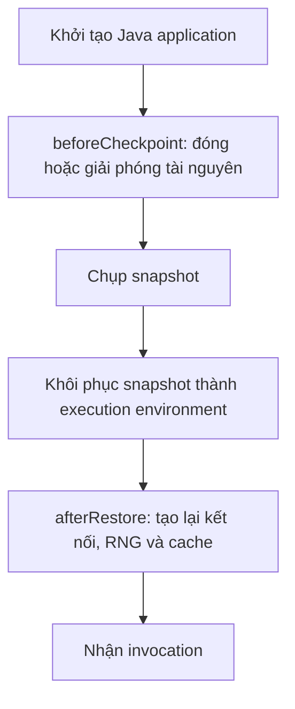

# Tái khởi tạo kết nối, dữ liệu ngẫu nhiên và trạng thái sau restore

Một số nền tảng serverless có thể chụp snapshot môi trường đã khởi tạo rồi khôi phục snapshot đó để tạo execution environment mới nhanh hơn. Với Java, cách này giảm phần công việc phải làm lại khi cold start, nhưng cũng tạo ra một vấn đề quan trọng: **mọi trạng thái trong bộ nhớ tại thời điểm snapshot có thể được sao chép sang nhiều môi trường sau restore**.

Một kết nối TCP đang mở có thể không còn hợp lệ. Connection pool có thể chứa connection trỏ đến phiên mạng cũ. Bộ sinh số ngẫu nhiên đã được khởi tạo trước snapshot có thể mang cùng trạng thái ban đầu sang nhiều bản restore. Cache chứa token hoặc dữ liệu có thời hạn có thể đã cũ. Một biến static có vẻ riêng của một instance có thể trở thành bản sao giống nhau trong nhiều instance.

Vì vậy, ứng dụng Java chạy trên nền tảng có snapshot/restore cần phân biệt trạng thái nào có thể giữ lại và trạng thái nào phải tái tạo sau restore. Bài học tập trung vào vòng đời snapshot, kết nối mạng, dữ liệu ngẫu nhiên, cache và hook khôi phục như CRaC trong Java serverless.

## 1. Snapshot và restore là gì?

Trong cách khởi động serverless thông thường, nền tảng tạo execution environment, khởi động runtime, nạp ứng dụng rồi gọi handler. Nếu môi trường bị loại bỏ, lần khởi động sau phải thực hiện lại các bước đó.

Snapshot/restore thay đổi quy trình:

1. Nền tảng khởi tạo ứng dụng đến một điểm xác định.
2. Runtime hoặc nền tảng chụp trạng thái của tiến trình, bao gồm một phần heap, class đã nạp và trạng thái runtime được hỗ trợ.
3. Khi cần execution environment mới, nền tảng khôi phục snapshot.
4. Ứng dụng tiếp tục từ trạng thái đã chụp và chạy hook sau restore nếu runtime hỗ trợ.
5. Handler bắt đầu xử lý invocation.

Một ví dụ phổ biến là **AWS Lambda SnapStart** cho các runtime Java được hỗ trợ. Java cũng có hệ sinh thái **CRaC (Coordinated Restore at Checkpoint)**, cung cấp API để ứng dụng chuẩn bị trước checkpoint và phục hồi sau restore. Cách tích hợp và phiên bản hỗ trợ phụ thuộc runtime và nhà cung cấp.



Snapshot không phải một lần deploy mới và restore cũng không phải một lần chạy lại toàn bộ ứng dụng từ đầu. Heap được khôi phục từ trạng thái đã chụp, vì vậy những giá trị đã có trong bộ nhớ có thể tiếp tục tồn tại.

## 2. Vì sao trạng thái trước snapshot có thể gây lỗi?

Hãy tưởng tượng một function Java khởi tạo một connection pool, một SecureRandom và một cache token trong giai đoạn init. Sau đó nền tảng tạo snapshot. Khi nền tảng khôi phục snapshot thành nhiều execution environment, mỗi môi trường có thể bắt đầu từ cùng một trạng thái bộ nhớ tại thời điểm chụp.

Điều đó có thể gây ra:

- Nhiều instance cùng giữ tham chiếu đến trạng thái connection đã tồn tại trước snapshot.
- Connection trong pool đã bị server hoặc proxy đóng khi môi trường được khôi phục.
- Các bộ sinh số ngẫu nhiên có cùng trạng thái nội bộ và tạo ra chuỗi kết quả trùng nhau.
- Token, credential hoặc dữ liệu cache đã hết hạn khi snapshot được restore.
- Bộ đếm static hoặc ID tạm trong bộ nhớ bị nhân bản giữa các instance.
- Thread, executor hoặc tác vụ nền mang trạng thái không phù hợp với vòng đời mới.

Đây không phải vấn đề chỉ riêng AWS Lambda. Bất kỳ cơ chế nào sao chép trạng thái tiến trình đều cần xem xét những tài nguyên phụ thuộc vào thời gian, mạng, hệ điều hành hoặc tính duy nhất.

### Trạng thái nào có thể giữ lại?

Những dữ liệu thường phù hợp để giữ trong snapshot:

- Cấu hình bất biến đã kiểm tra.
- Class đã nạp và metadata tĩnh.
- Template, biểu thức đã biên dịch hoặc schema không chứa dữ liệu nhạy cảm và không phụ thuộc thời gian.
- Dữ liệu tra cứu bất biến, nếu chấp nhận được độ cũ của nó.
- Cấu trúc ứng dụng không nắm giữ socket, credential tạm hoặc trạng thái riêng của invocation.

Những dữ liệu thường cần tái tạo hoặc xác minh sau restore:

- TCP/TLS connection và connection pool.
- HTTP client hoặc SDK client có trạng thái connection nội bộ.
- Credential tạm thời, access token và session có thời hạn.
- Bộ sinh số ngẫu nhiên đã được khởi tạo trước snapshot.
- Cache phụ thuộc thời gian hoặc trạng thái từ hệ thống bên ngoài.
- Thread, executor và tác vụ nền phụ thuộc trạng thái runtime.
- Deadline, timestamp hoặc dữ liệu đo thời gian đã lưu trước checkpoint.

Không phải mọi object trong heap đều cần xóa. Mục tiêu là phân loại theo vòng đời và khả năng hợp lệ sau restore.

## 3. Vòng đời của tài nguyên trong Java serverless

Một ứng dụng có thể chia trạng thái thành ba nhóm:

| Nhóm trạng thái | Ví dụ | Cách xử lý |
|---|---|---|
| Bất biến, độc lập môi trường | Cấu hình đã kiểm tra, template, schema | Có thể giữ qua snapshot |
| Tạm thời, phụ thuộc môi trường | Socket, connection pool, HTTP connection | Đóng trước checkpoint và tạo lại sau restore |
| Phụ thuộc thời gian hoặc tính duy nhất | Token, cache TTL, RNG, bộ đếm cục bộ | Làm mới hoặc tái khởi tạo sau restore |

Một biến static không tự động trở thành dữ liệu dùng chung an toàn. Nó chỉ có phạm vi trong một tiến trình. Khi snapshot được khôi phục thành nhiều tiến trình, các tiến trình có thể nhận các bản sao giống nhau của biến static đó.

Ví dụ, một biến đếm:

```java
private static final AtomicLong COUNTER = new AtomicLong();
```

Nếu snapshot được tạo khi COUNTER bằng 100, nhiều execution environment khôi phục từ snapshot có thể cùng bắt đầu ở 100. Mỗi tiến trình tăng bộ đếm riêng, vì vậy có thể tạo cùng giá trị 101. Nếu cần ID duy nhất trên nhiều instance, dùng database sequence, ID service, UUID với nguồn ngẫu nhiên an toàn hoặc cơ chế phân vùng ID phù hợp.

Không dùng bộ nhớ static để lưu trạng thái nghiệp vụ cần duy nhất hoặc nhất quán trên toàn hệ thống.

## 4. Tái khởi tạo kết nối database

Connection pool thường giữ các socket đã mở, trạng thái xác thực và thông tin về connection đang rảnh hoặc đang được sử dụng. Sau restore, những socket này có thể không còn đại diện cho kết nối hợp lệ:

- Database đã đóng connection idle.
- NAT gateway hoặc proxy đã hết thời gian giữ mapping.
- TLS session hoặc socket gắn với môi trường trước snapshot không còn dùng được.
- Server database đã restart hoặc failover.
- Pool lưu thông tin connection đang được mượn nhưng không có request thực tế tương ứng sau restore.

Nếu ứng dụng tiếp tục lấy connection cũ, request đầu tiên có thể thất bại hoặc chờ đến timeout.

Cách xử lý thường dùng:

1. Đóng connection hoặc pool trước checkpoint nếu hook hỗ trợ.
2. Sau restore, tạo pool mới bằng cấu hình và credential hiện tại.
3. Kiểm tra pool có thể tạo connection thật trước khi nhận công việc cần truy cập database.
4. Giữ validation và timeout phù hợp để không làm restore kéo dài vô hạn.
5. Không lưu transaction đang mở hoặc connection đang được mượn qua snapshot.

Không nên chỉ gọi phương thức isClosed để kết luận socket còn hoạt động. Một connection có thể chưa được đánh dấu closed ở client nhưng đã bị đóng ở phía server hoặc trên đường mạng. Health check thực tế hoặc validation query phù hợp mới xác nhận được khả năng sử dụng.

### Ví dụ với HikariCP và CRaC

Ví dụ dưới đây minh họa cách đóng HikariDataSource trước checkpoint và tạo pool mới sau restore. Ứng dụng cần dùng phiên bản CRaC API và runtime có hỗ trợ hook tương ứng.

```java
import com.zaxxer.hikari.HikariDataSource;
import java.security.SecureRandom;
import java.util.Objects;
import java.util.function.Supplier;
import org.crac.Context;
import org.crac.Core;
import org.crac.Resource;

public final class SnapshotResources implements Resource {

    private final Supplier<HikariDataSource> poolFactory;

    private volatile HikariDataSource dataSource;
    private volatile SecureRandom secureRandom;

    public SnapshotResources(
            Supplier<HikariDataSource> poolFactory) {
        this.poolFactory = Objects.requireNonNull(poolFactory);
        this.dataSource = poolFactory.get();
        this.secureRandom = new SecureRandom();

        Core.getGlobalContext().register(this);
    }

    public HikariDataSource dataSource() {
        HikariDataSource current = dataSource;
        if (current == null) {
            throw new IllegalStateException(
                    "Database pool is not ready");
        }
        return current;
    }

    public byte[] newRandomBytes(int size) {
        if (size <= 0) {
            throw new IllegalArgumentException(
                    "Size must be positive");
        }

        byte[] bytes = new byte[size];
        secureRandom.nextBytes(bytes);
        return bytes;
    }

    @Override
    public void beforeCheckpoint(
            Context<? extends Resource> context) {
        HikariDataSource current = dataSource;
        dataSource = null;

        if (current != null) {
            current.close();
        }
    }

    @Override
    public void afterRestore(
            Context<? extends Resource> context) {
        secureRandom = new SecureRandom();
        dataSource = poolFactory.get();
    }
}
```

Trong ví dụ:

- poolFactory tạo một HikariDataSource mới theo cấu hình hiện tại.
- beforeCheckpoint đóng pool cũ và xóa tham chiếu đến pool đó.
- afterRestore tạo lại SecureRandom và pool database.
- volatile giúp các thread nhìn thấy tham chiếu tài nguyên mới sau khi hook cập nhật.
- dataSource() từ chối trả về pool khi tài nguyên chưa sẵn sàng.

Đây là skeleton minh họa. Trong ứng dụng thực tế, cần xử lý lỗi khi tạo pool, đóng tài nguyên đúng thứ tự, cấu hình timeout và quản lý vòng đời pool khi ứng dụng kết thúc. Không nuốt exception khi phục hồi tài nguyên; nếu pool không thể khởi tạo, cần để runtime hoặc ứng dụng báo lỗi rõ ràng thay vì nhận invocation rồi thất bại khó truy vết.

Nếu dùng DataSource khác HikariCP, áp dụng cùng nguyên tắc theo API đóng/mở của thư viện đó. Không gọi close trên một object rồi giả định nó có thể mở lại nếu thư viện không hỗ trợ.

## 5. Tái tạo HTTP client và SDK client

HTTP client có thể giữ connection pool, socket, TLS state, DNS cache hoặc các thông tin nội bộ khác. Sau restore, connection đã mở trước snapshot có thể không còn hợp lệ.

Có hai hướng:

- Đóng client trước checkpoint và tạo client mới sau restore nếu thư viện hỗ trợ đóng và xây dựng lại.
- Giữ cấu hình bất biến, nhưng bỏ các connection cũ hoặc khởi tạo client mới sau restore nếu API của thư viện không cung cấp cách làm mới pool an toàn.

Với JDK HttpClient, API quản lý connection pool khá hạn chế và phụ thuộc phiên bản JDK. Không nên dựa vào API nội bộ để xóa connection. Có thể giữ một factory cấu hình và thay tham chiếu client sau restore nếu cần tạo client mới.

Ví dụ khái niệm:

```java
public final class HttpClients implements Resource {

    private volatile HttpClient client;

    public HttpClients() {
        this.client = buildClient();
        Core.getGlobalContext().register(this);
    }

    public HttpClient current() {
        return client;
    }

    private HttpClient buildClient() {
        return HttpClient.newBuilder()
                .connectTimeout(Duration.ofSeconds(2))
                .build();
    }

    @Override
    public void beforeCheckpoint(
            Context<? extends Resource> context) {
        // Không giữ tham chiếu đến client cũ trong snapshot.
        client = null;
    }

    @Override
    public void afterRestore(
            Context<? extends Resource> context) {
        client = buildClient();
    }
}
```

Ví dụ này minh họa việc thay tham chiếu client. JDK HttpClient không cung cấp close trong các phiên bản Java cũ; do đó không được giả định đoạn code đóng socket cũ một cách đồng bộ. Hành vi cụ thể phụ thuộc JDK và runtime. Nếu cần đóng pool chắc chắn, dùng thư viện có lifecycle API rõ ràng và cấu hình đúng phiên bản.

Với AWS SDK hoặc HTTP client khác, hãy đọc tài liệu của đúng phiên bản để biết client có thể được tái sử dụng, đóng, refresh hay phải xây dựng lại như thế nào.

## 6. Dữ liệu ngẫu nhiên và nguy cơ trùng sau restore

Bộ sinh số ngẫu nhiên giả mã (PRNG) giữ trạng thái nội bộ để tạo chuỗi giá trị. Nếu trạng thái đó được chụp vào snapshot, nhiều bản restore có thể bắt đầu từ cùng trạng thái và tạo cùng chuỗi số tiếp theo.

Ví dụ, ứng dụng khởi tạo:

```java
private static final Random RANDOM = new Random();
```

Nếu RANDOM đã được sử dụng trước checkpoint, trạng thái hiện tại của nó được chụp lại. Khi snapshot được khôi phục nhiều lần, các bản sao có thể tiếp tục từ cùng trạng thái và sinh cùng chuỗi kết quả. Điều này nguy hiểm nếu dùng kết quả để tạo ID, token, nonce hoặc giá trị cần duy nhất.

### Phân biệt random thông thường và random bảo mật

- java.util.Random là PRNG xác định; không dùng cho khóa, token hoặc nonce bảo mật.
- SplittableRandom phù hợp với một số tác vụ mô phỏng và tính toán, nhưng trạng thái cũng có thể bị sao chép qua snapshot.
- ThreadLocalRandom tiện cho random không bảo mật trong ứng dụng đa luồng; không coi nó là nguồn entropy mật mã.
- SecureRandom được thiết kế cho giá trị ngẫu nhiên bảo mật, nhưng trạng thái của provider cũng cần được xem xét khi snapshot/restore.

Đối với dữ liệu cần bảo mật hoặc tính duy nhất, hãy đảm bảo nguồn ngẫu nhiên được khởi tạo hoặc reseed theo hướng dẫn của runtime sau restore. Không tự seed bằng System.currentTimeMillis(), process ID hoặc một giá trị dễ đoán. Thời gian và PID không cung cấp entropy đủ mạnh và các execution environment có thể được tạo gần như đồng thời.

### Tạo SecureRandom sau restore

Trong ví dụ CRaC ở phần trước, SecureRandom được tạo lại trong afterRestore. Ứng dụng cũng có thể tạo generator theo nhu cầu sau restore thay vì giữ generator đã được khởi tạo trước checkpoint.

Với token bảo mật, cần:

- Dùng SecureRandom từ provider được JDK/runtime hỗ trợ.
- Tạo hoặc reseed sau restore theo hướng dẫn của nền tảng.
- Không dùng Random hoặc SplittableRandom để tạo secret.
- Không ghi seed hoặc token vào log.
- Kiểm thử uniqueness và chất lượng nguồn entropy trong môi trường snapshot thực tế.

Không nên giả định chỉ gọi setSeed với thời gian hiện tại sẽ khắc phục vấn đề. setSeed có thể bổ sung entropy theo provider và không có nghĩa là reset generator thành trạng thái an toàn đã biết. Ưu tiên cơ chế khởi tạo/reseed được runtime và provider hỗ trợ.

### ID duy nhất không chỉ phụ thuộc random

Ngay cả khi dùng SecureRandom, ứng dụng vẫn nên thiết kế ID và ràng buộc dữ liệu để chịu được tình huống hiếm khi trùng. Ví dụ, đặt unique constraint ở database và xử lý conflict bằng cách tạo ID khác. Với nghiệp vụ yêu cầu thứ tự hoặc tính duy nhất toàn cục, cân nhắc database sequence, ID service hoặc thuật toán phân vùng ID có node identity được cấp an toàn.

## 7. Cache, credential và dữ liệu có thời hạn

Snapshot lưu giá trị trong bộ nhớ tại một thời điểm. Khi restore xảy ra sau vài phút hoặc lâu hơn, dữ liệu cache có thể đã hết hạn.

Các ví dụ thường gặp:

- OAuth access token có thời hạn ngắn.
- AWS temporary credentials hoặc session token.
- DNS result và endpoint IP đã thay đổi.
- JWKS/public key cache cần refresh khi nhà cung cấp xoay khóa.
- Signed URL hoặc presigned URL đã hết hạn.
- Feature flag hoặc cấu hình động đã được cập nhật.
- Cache trạng thái đơn hàng hoặc tồn kho không còn mới.

Không nên đóng băng credential tạm trong static field trước snapshot rồi tiếp tục dùng sau restore. Dùng credential provider có khả năng refresh, lấy token mới khi cần và tính TTL theo thời gian hiện tại.

Đối với cache, nên lưu thời điểm hết hạn tuyệt đối và kiểm tra lại sau restore. Nếu cache có dữ liệu nhạy cảm hoặc có thể thay đổi nhanh, hãy xóa và tải lại sau restore. Nếu cache chỉ là dữ liệu tra cứu ít thay đổi, có thể giữ lại nhưng phải có TTL và cơ chế invalidation.

### Không lưu thời gian khởi tạo làm thời gian hiện tại

Ví dụ sau dễ sai:

```java
private static final Instant STARTED_AT = Instant.now();
```

Sau restore, STARTED_AT vẫn là thời điểm snapshot được tạo. Không dùng nó để tính tuổi session, thời hạn token hoặc thời gian kể từ invocation. Gọi Instant.now() hoặc dùng Clock tại thời điểm cần tính.

Tương tự, không lưu deadline dựa trên System.nanoTime() trước snapshot rồi dùng lại sau restore. Deadline phải được tạo mới theo invocation hoặc theo thời điểm restore phù hợp. System.nanoTime() dùng để đo elapsed time trong một khoảng sống hiện tại, không phải timestamp bền vững để lưu qua checkpoint.

## 8. Trạng thái static, thread và executor

Snapshot có thể giữ lại biến static, singleton, thread state và các object đang được tham chiếu trong heap. Điều này làm các lỗi vòng đời khó nhận ra vì ứng dụng vẫn chạy và dữ liệu có vẻ hợp lệ.

Các rủi ro thường gặp:

- Static counter được nhân bản giữa nhiều execution environment.
- Singleton giữ credential hoặc connection đã hết hạn.
- Executor chứa thread được tạo trước snapshot.
- Scheduled task dựa vào thời điểm hoặc trạng thái trước checkpoint.
- Thread đang chờ trên lock hoặc condition tại thời điểm snapshot.
- Cache mutable được nhiều invocation cập nhật mà không có cơ chế đồng bộ.

Không nên tạo thread nền trong giai đoạn init nếu runtime snapshot không hỗ trợ an toàn trạng thái đó. Tạo executor sau restore hoặc khởi tạo lười khi thực sự cần. Nếu có scheduler, cần thiết kế để đăng ký lại task đúng một lần sau restore và tránh nhiều instance cùng chạy một tác vụ định kỳ ngoài ý muốn.

Với trạng thái nghiệp vụ, dùng database, queue hoặc workflow store. Với cache cục bộ, xác định rõ nó chỉ là cache có thể tái tạo và không phải nguồn dữ liệu chuẩn.

## 9. Sử dụng CRaC hooks trong Java

CRaC cung cấp giao diện Resource để ứng dụng thực hiện công việc trước checkpoint và sau restore:

- beforeCheckpoint(...): chuẩn bị tài nguyên trước khi snapshot, ví dụ đóng socket hoặc pool.
- afterRestore(...): phục hồi tài nguyên cần thiết, ví dụ tạo lại pool, client và SecureRandom.

Ví dụ cấu trúc:

```java
import org.crac.Context;
import org.crac.Core;
import org.crac.Resource;

public final class MyResource implements Resource {

    public MyResource() {
        Core.getGlobalContext().register(this);
    }

    @Override
    public void beforeCheckpoint(
            Context<? extends Resource> context) throws Exception {
        // Đóng hoặc giải phóng tài nguyên không thể dùng lại.
    }

    @Override
    public void afterRestore(
            Context<? extends Resource> context) throws Exception {
        // Tạo lại tài nguyên phụ thuộc môi trường.
    }
}
```

Để sử dụng, ứng dụng cần dependency CRaC tương thích và runtime/nền tảng có tích hợp checkpoint/restore. Không phải mọi môi trường serverless đều hỗ trợ CRaC hoặc gọi các hook này.

### Nguyên tắc viết hook

**Hook phải idempotent.** Việc gọi lại hook hoặc phục hồi sau lỗi không được tạo nhiều pool, nhiều thread hoặc nhiều scheduler không cần thiết. Kiểm tra và thay thế tài nguyên theo trạng thái rõ ràng.

**Giữ hook ngắn.** Không tải dữ liệu lớn, chạy migration hoặc thực hiện tác vụ nghiệp vụ dài trong afterRestore. Chỉ phục hồi những tài nguyên cần thiết để invocation có thể bắt đầu. Công việc nặng nên chuyển sang handler hoặc worker.

**Không nuốt lỗi.** Nếu kết nối database bắt buộc không thể tạo lại, cần để restore thất bại rõ ràng hoặc đánh dấu readiness không đạt theo contract runtime. Bắt exception rồi tiếp tục với tài nguyên null sẽ tạo lỗi khó hiểu ở invocation đầu tiên.

**Không tạo tác dụng phụ nghiệp vụ.** Hook có thể chạy mỗi lần một snapshot được restore thành môi trường mới. Không gửi email, trừ tiền hoặc phát event nghiệp vụ trong hook. Hook chỉ quản lý vòng đời tài nguyên của tiến trình.

**Đăng ký hook đúng lúc.** Resource phải được đăng ký trong quá trình init trước checkpoint. Nếu đăng ký quá muộn, tài nguyên có thể không được chuẩn bị trước snapshot.

## 10. AWS Lambda SnapStart và CRaC

AWS Lambda SnapStart chụp snapshot môi trường đã khởi tạo cho phiên bản function được publish, sau đó dùng snapshot để tạo execution environment nhanh hơn. Với Java, có thể dùng CRaC hooks để đóng tài nguyên trước snapshot và tạo lại sau restore.

Một số điểm cần nhớ:

- SnapStart được bật ở cấp phiên bản được publish theo quy trình của Lambda; thay đổi cấu hình hoặc code cần publish version mới để tạo snapshot mới.
- beforeCheckpoint chạy trước khi snapshot được tạo.
- afterRestore chạy khi môi trường được khôi phục và trước khi xử lý invocation.
- Mỗi execution environment được restore có bản sao heap từ snapshot; trạng thái mutable trong bộ nhớ không tự chia sẻ giữa các môi trường.
- Secret, credential và connection cần được xử lý theo vòng đời và chính sách của dịch vụ.
- Không phải mọi runtime hoặc loại function đều hỗ trợ SnapStart; kiểm tra tài liệu AWS hiện hành trước khi thiết kế.

SnapStart giúp giảm thời gian khởi tạo nhưng không loại bỏ cold start hoàn toàn. Restore vẫn cần thời gian và các hook sau restore cũng có thể làm tăng latency. Nếu afterRestore tạo pool database lớn hoặc gọi nhiều API đồng bộ, lợi ích khởi động có thể giảm đáng kể.

### Không nhầm restore hook với invocation hook

afterRestore chạy khi execution environment được khôi phục từ snapshot. Nó không phải hook chạy trước mọi lần gọi handler. Một execution environment có thể xử lý nhiều invocation sau cùng một lần restore.

Vì vậy:

- Dùng afterRestore để tái tạo tài nguyên theo vòng đời môi trường.
- Dùng logic trong handler để xử lý dữ liệu riêng của invocation.
- Dùng TTL/refresh để kiểm tra tài nguyên có còn hợp lệ trong những invocation tiếp theo hay không.
- Không giả định chỉ cần refresh một lần sau restore là credential hoặc connection sẽ luôn hợp lệ.

## 11. Kiểm tra tài nguyên sau restore

Một hook chạy xong chưa chắc mọi dịch vụ phụ thuộc đều sẵn sàng. Hãy xác minh những tài nguyên quan trọng bằng cách phù hợp:

| Tài nguyên | Kiểm tra sau restore |
|---|---|
| Database pool | Thử lấy connection và chạy validation query nhẹ |
| HTTP client | Thực hiện health check có timeout hoặc xử lý lỗi connection cũ |
| Credential provider | Kiểm tra có thể lấy credential hợp lệ; tránh log credential |
| SecureRandom | Tạo dữ liệu test trong môi trường kiểm thử và xác nhận không lặp giữa các bản restore |
| Cache | Kiểm tra TTL, version hoặc refresh từ nguồn chuẩn |
| Executor | Xác nhận thread pool được tạo và không có task trùng |
| File handle | Mở lại file hoặc tài nguyên cần thiết theo contract runtime |

Không nhất thiết gọi health check đến mọi dependency trong afterRestore. Nếu dịch vụ ngoài tạm thời unavailable, việc chặn toàn bộ restore có thể làm hệ thống khó phục hồi. Hãy phân loại tài nguyên bắt buộc và không bắt buộc, đặt timeout ngắn và có chiến lược readiness phù hợp.

Một số resource có thể được khởi tạo lười sau restore. Điều này giảm công việc trong hook nhưng cần đảm bảo invocation đầu tiên xử lý lỗi khởi tạo rõ ràng và có timeout.

## 12. Kiểm thử snapshot/restore

Ứng dụng có thể chạy bình thường trong môi trường local nhưng gặp lỗi khi snapshot được restore nhiều lần. Do đó, cần kiểm thử đúng hành vi của runtime.

Các tình huống nên kiểm thử:

- Tạo snapshot sau khi HTTP client và database pool đã khởi tạo.
- Restore nhiều execution environment từ cùng một snapshot.
- Gọi đồng thời nhiều environment và kiểm tra kết nối database.
- Xác nhận không có hai instance tạo cùng ID hoặc token trong tập kiểm thử.
- Kiểm tra token/credential hết hạn trong khoảng thời gian giữa snapshot và restore.
- Kiểm tra cache có được refresh hoặc invalidation đúng cách.
- Kiểm tra hook chạy đúng thứ tự và không đăng ký nhiều lần.
- Mô phỏng database hoặc API ngoài không khả dụng trong afterRestore.
- Kiểm tra thread, executor và scheduler không chạy lặp ngoài ý muốn.
- Đo latency của init, restore hook và invocation đầu tiên.

### Kiểm tra tính duy nhất

Trong môi trường kiểm thử, có thể khôi phục nhiều instance từ cùng snapshot rồi yêu cầu mỗi instance tạo một số lượng ID lớn. Ghi kết quả vào kho dữ liệu có unique constraint để phát hiện trùng. Không chỉ kiểm tra một instance hoặc chạy tuần tự; vấn đề thường chỉ lộ khi nhiều bản restore chạy đồng thời.

### Kiểm tra hook

Ghi metric hoặc log có cấu trúc cho các sự kiện:

- beforeCheckpoint bắt đầu/kết thúc.
- afterRestore bắt đầu/kết thúc.
- Tài nguyên nào được đóng hoặc tạo lại.
- Thời gian tạo connection pool.
- Kết quả health check.
- Lỗi refresh credential hoặc cache.

Không log secret, token, seed hoặc toàn bộ dữ liệu nhạy cảm. Có thể ghi environment identifier do nền tảng cung cấp nếu phù hợp để phân biệt các lần restore.

## 13. Những lỗi thường gặp

- **Giữ database connection qua snapshot:** socket có thể đã chết; đóng pool trước checkpoint và tạo pool mới sau restore.
- **Giữ HTTP connection cũ:** connection có thể bị server hoặc proxy đóng; làm mới client/pool theo khả năng thư viện.
- **Khởi tạo Random trước snapshot:** các bản restore có thể tiếp tục cùng chuỗi PRNG; tái tạo generator sau restore.
- **Dùng thời gian làm seed:** timestamp không phải nguồn entropy an toàn và có thể trùng.
- **Lưu token tạm trong static field:** token có thể hết hạn khi snapshot được restore; dùng provider có refresh.
- **Dùng static counter làm ID toàn cục:** mỗi bản restore có thể bắt đầu cùng giá trị; dùng ID store hoặc cơ chế duy nhất phân tán.
- **Giữ deadline từ trước checkpoint:** deadline không còn phản ánh thời gian invocation hiện tại; tạo lại theo invocation.
- **Chạy tác vụ nghiệp vụ trong afterRestore:** nhiều environment có thể chạy cùng hook; có thể gây tác dụng phụ lặp.
- **Tạo thread nền trước snapshot:** thread state hoặc scheduler có thể không phục hồi đúng; tạo lại theo lifecycle hỗ trợ.
- **Giả định mọi serverless runtime hỗ trợ CRaC:** hook có thể không được gọi nếu runtime không tích hợp; xác minh nền tảng cụ thể.

## 14. Quy trình triển khai thực tế

Khi chuẩn bị Java function cho snapshot/restore, có thể làm theo trình tự:

1. Liệt kê các singleton, static field, cache, client, pool, thread và generator được tạo trong giai đoạn init.
2. Phân loại từng object là bất biến, tạm thời hoặc phụ thuộc thời gian/tính duy nhất.
3. Xác định tài nguyên mạng nào phải đóng trước checkpoint.
4. Tạo factory để xây dựng lại connection pool và client sau restore.
5. Khởi tạo hoặc reseed nguồn random bảo mật theo hướng dẫn runtime sau restore.
6. Làm mới credential, token và cache có TTL; không giữ giá trị tạm như trạng thái bất biến.
7. Tạo lại executor hoặc scheduler cần thiết và bảo đảm không đăng ký task trùng.
8. Đăng ký CRaC Resource hoặc hook tương ứng của nền tảng.
9. Giữ hook ngắn, có timeout và xử lý lỗi rõ ràng.
10. Kiểm thử nhiều bản restore đồng thời, kết nối, tính duy nhất và dữ liệu hết hạn.
11. Theo dõi restore latency, hook duration, lỗi tài nguyên và cold-start latency.
12. Triển khai một phiên bản snapshot mới sau khi thay đổi lifecycle code và xác minh bằng traffic thử nghiệm.

## 15. Ghi nhớ

Snapshot/restore giúp Java serverless khởi động nhanh bằng cách khôi phục trạng thái tiến trình đã được chụp. Nhưng một trạng thái hợp lệ trước snapshot chưa chắc còn hợp lệ sau restore, và trạng thái mutable trong heap có thể được nhân bản sang nhiều execution environment.

Hãy đóng và tạo lại connection pool, làm mới HTTP/SDK client khi cần, tái khởi tạo nguồn random bảo mật, refresh credential và cache có thời hạn, đồng thời tạo lại thread hoặc scheduler theo lifecycle của runtime. Dùng CRaC hooks hoặc cơ chế tương đương nếu nền tảng hỗ trợ.

Dữ liệu nghiệp vụ cần nhất quán và duy nhất phải nằm trong hệ thống lưu trữ hoặc dịch vụ phân tán phù hợp. Kiểm thử nhiều bản restore đồng thời để phát hiện kết nối cũ, token hết hạn, chuỗi random trùng và trạng thái static bị nhân bản trước khi đưa function vào production.

