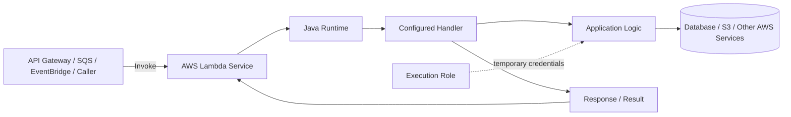

# Tạo Java handler, execution role và cấu hình function Lambda

AWS Lambda chạy mã khi nhận invocation từ một nguồn gọi như API Gateway, function URL, queue, event bus hoặc một lời gọi trực tiếp qua AWS SDK. Với Java, nhóm phát triển cần chuẩn bị ba phần gắn với nhau: **handler** nhận và xử lý sự kiện, **execution role** cấp quyền cho mã đang chạy, và **function configuration** xác định runtime, artifact, tài nguyên cùng cách Lambda vận hành invocation.

Một handler đúng hợp đồng nhưng thiếu quyền đọc S3 vẫn thất bại. Một execution role đủ quyền nhưng gói JAR thiếu class handler cũng không thể khởi động. Một artifact và role hợp lệ nhưng timeout quá ngắn hoặc concurrency vượt sức chịu tải của database vẫn có thể gây lỗi production. Vì vậy, hãy thiết kế ba phần này như một đơn vị triển khai.

Bài học tập trung vào Java trên AWS Lambda. Các ví dụ dùng tên tài nguyên minh họa; cần thay bằng account, region, bucket, function và quyền thực tế của môi trường triển khai.

## 1. Kiến trúc một lần gọi Lambda

Một invocation đi qua các thành phần chính:

1. **Event source hoặc caller** tạo request/event và gọi Lambda.
2. **Lambda service** xác định function version/alias, kiểm tra quyền invoke và chuẩn bị execution environment.
3. **Runtime Java** nạp artifact, khởi tạo class và gọi handler được cấu hình.
4. **Handler** chuyển input thành nghiệp vụ, gọi các service/repository và tạo kết quả.
5. **Execution role** cung cấp credential tạm thời để mã trong function gọi AWS services được cấp quyền.
6. **Lambda service/adapter** trả response, ghi nhận invocation thành công/thất bại hoặc phối hợp acknowledgement/retry theo loại trigger.



Execution role không phải danh tính của người dùng cuối và cũng không phải quyền cho phép nguồn event gọi function. Cần tách quyền gọi function khỏi quyền mà code function sử dụng khi chạy.

## 2. Tạo Java handler

### 2.1. Handler là điểm vào của function

Handler là phương thức mà Lambda runtime gọi khi có invocation. Với Java managed runtime, handler có thể được triển khai theo hai interface phổ biến:

- `RequestHandler<I, O>`: nhận input và trả output dưới dạng đối tượng Java; runtime thực hiện chuyển đổi dữ liệu theo serializer được hỗ trợ.
- `RequestStreamHandler`: nhận `InputStream` và ghi kết quả ra `OutputStream`; phù hợp khi cần kiểm soát trực tiếp việc đọc/ghi payload.

Với phần lớn HTTP, queue và event handler thông thường, `RequestHandler` dễ đọc và dễ kiểm thử hơn. Dùng stream handler khi cần xử lý định dạng hoặc luồng dữ liệu đặc biệt, đồng thời phải tự chịu trách nhiệm đọc input, ghi output và xử lý serialization.

### 2.2. Cấu trúc handler cơ bản

Một handler có thể nhận `Context` để truy cập metadata của invocation:

```java
package com.example.orders;

import com.amazonaws.services.lambda.runtime.Context;
import com.amazonaws.services.lambda.runtime.RequestHandler;

public final class HelloHandler implements RequestHandler<HelloRequest, HelloResponse> {

    @Override
    public HelloResponse handleRequest(HelloRequest input, Context context) {
        String requestId = context.getAwsRequestId();
        String name = input == null || input.name() == null
                ? "guest"
                : input.name();

        return new HelloResponse(
                "Hello, " + name,
                requestId);
    }
}

record HelloRequest(String name) {}

record HelloResponse(String message, String requestId) {}
```

Đây là ví dụ minh họa cho runtime Java hiện đại có hỗ trợ record. Nếu dùng runtime hoặc serializer không hỗ trợ kiểu dữ liệu đang chọn, hãy dùng class Java thông thường với constructor/getter phù hợp. Đầu vào thực tế phải khớp schema của trigger; không giả định mọi event đều có trường `name`.

### 2.3. Lambda Context

Đối tượng `Context` cung cấp metadata hữu ích trong lúc xử lý:

| Thuộc tính/phương thức | Mục đích |
| --- | --- |
| `getAwsRequestId()` | Định danh invocation để nối log và trace |
| `getFunctionName()` | Tên function đang chạy |
| `getFunctionVersion()` | Version của function được invoke |
| `getMemoryLimitInMB()` | Mức memory đã cấu hình |
| `getRemainingTimeInMillis()` | Thời gian invocation còn lại |
| `getLogGroupName()` / `getLogStreamName()` | Thông tin CloudWatch Logs |
| `getInvokedFunctionArn()` | ARN được dùng để invoke |

`getRemainingTimeInMillis()` đặc biệt hữu ích trước một thao tác có thể kéo dài. Handler có thể từ chối bắt đầu bước mới nếu không còn đủ thời gian để hoàn tất và ghi trạng thái. Không dùng giá trị này làm cơ chế duy nhất bảo đảm deadline; HTTP client, database và các dependency vẫn cần timeout riêng.

```java
int remaining = context.getRemainingTimeInMillis();
if (remaining < 1_500) {
    throw new IllegalStateException(
            "Not enough time to start the next operation");
}
```

### 2.4. Cấu hình handler string

Trong Lambda function configuration, handler trỏ đến class và phương thức điểm vào theo định dạng mà Java runtime hỗ trợ, ví dụ:

```text
com.example.orders.HelloHandler::handleRequest
```

Tên package, class và method phải khớp chính xác với artifact đã đóng gói. Nếu handler class nằm trong package khác hoặc method đổi tên mà cấu hình không được cập nhật, invocation có thể thất bại khi runtime tìm điểm vào.

Khi dùng `RequestHandler`, phương thức chuẩn là `handleRequest`. Khi dùng stream handler, class triển khai `RequestStreamHandler` và runtime gọi phương thức `handleRequest(InputStream, OutputStream, Context)`. Luôn đối chiếu handler string với kiểu triển khai thực tế.

## 3. Chọn kiểu input theo nguồn sự kiện

Lambda không tự biến mọi event thành cùng một object. Cấu trúc input phụ thuộc nguồn gọi và adapter.

| Nguồn gọi | Kiểu input thường dùng | Lưu ý |
| --- | --- | --- |
| Lời gọi trực tiếp | POJO hoặc `Map<String, Object>` theo payload caller gửi | Caller và function phải thống nhất schema |
| API Gateway proxy | `APIGatewayProxyRequestEvent` | Có method, path, headers, query, body và request context |
| SQS | `SQSEvent` | Một invocation có thể chứa nhiều record; cần xử lý batch/partial failure đúng cấu hình |
| S3 notification | `S3Event` | Event thường mang bucket/key/version tham chiếu object; cần decode key theo contract |
| EventBridge | `ScheduledEvent` hoặc `EventBridgeEvent` | Payload có envelope và detail schema riêng |
| Function URL | HTTP event model tương ứng runtime/adapter | Cần xác minh cấu trúc event và cơ chế xác thực |

Các kiểu event chuyên biệt thường nằm trong thư viện `aws-lambda-java-events`. Thêm đúng dependency vào project và đóng gói nó trong artifact nếu runtime không cung cấp. Phiên bản thư viện phải tương thích với event schema và runtime đang dùng.

### 3.1. Ví dụ HTTP handler với API Gateway

Đối với API Gateway proxy integration, có thể dùng các kiểu event trong thư viện AWS Lambda Java Events:

```java
package com.example.orders;

import com.amazonaws.services.lambda.runtime.Context;
import com.amazonaws.services.lambda.runtime.RequestHandler;
import com.amazonaws.services.lambda.runtime.events.APIGatewayProxyRequestEvent;
import com.amazonaws.services.lambda.runtime.events.APIGatewayProxyResponseEvent;
import com.fasterxml.jackson.core.JsonProcessingException;
import com.fasterxml.jackson.databind.ObjectMapper;

import java.util.Map;

public final class OrdersHttpHandler implements RequestHandler<
        APIGatewayProxyRequestEvent,
        APIGatewayProxyResponseEvent> {

    private static final ObjectMapper JSON = new ObjectMapper();

    @Override
    public APIGatewayProxyResponseEvent handleRequest(
            APIGatewayProxyRequestEvent request,
            Context context) {

        String orderId = request.getPathParameters() == null
                ? null
                : request.getPathParameters().get("orderId");

        if (orderId == null || orderId.isBlank()) {
            return response(400, "ORDER_ID_REQUIRED");
        }

        // Gọi service nghiệp vụ và kiểm tra quyền trước khi trả dữ liệu.
        return jsonResponse(200, Map.of("orderId", orderId));
    }

    private static APIGatewayProxyResponseEvent response(int status, String code) {
        return jsonResponse(status, Map.of("code", code));
    }

    private static APIGatewayProxyResponseEvent jsonResponse(
            int status,
            Object payload) {
        final String body;
        try {
            body = JSON.writeValueAsString(payload);
        } catch (JsonProcessingException error) {
            throw new IllegalStateException("Could not serialize API response", error);
        }
        return new APIGatewayProxyResponseEvent()
                .withStatusCode(status)
                .withHeaders(Map.of("Content-Type", "application/json"))
                .withBody(body);
    }
}
```

Đoạn mã tập trung minh họa chữ ký handler và response envelope. Trong ứng dụng thật, dùng JSON serializer thay cho tự ghép JSON, xác thực token, kiểm tra scope/tenant/ownership, validate body và xử lý exception theo hợp đồng API. Không tin `orderId` hoặc tenant chỉ vì chúng xuất hiện trong path hay payload.

### 3.2. Queue handler và batch

Với SQS, một invocation có thể chứa nhiều message. Nếu một record lỗi, hành vi mặc định có thể khiến cả batch được giao lại tùy event source mapping. Có thể cấu hình partial batch response để chỉ báo những record thất bại nếu nguồn và cấu hình hỗ trợ.

Handler nên:

- xử lý từng record độc lập khi nghiệp vụ cho phép;
- dùng message ID hoặc business event ID để idempotent;
- không xác nhận record trước khi dữ liệu đã được lưu bền vững;
- ghi nhận lỗi theo từng record;
- chọn batch size và concurrency theo sức chịu tải của database/dependency.

Không áp dụng một handler HTTP proxy cho SQS chỉ bằng cách đổi cấu hình handler string. Input type và response contract khác nhau.

## 4. Tổ chức project và đóng gói Java artifact

### 4.1. Artifact triển khai

Lambda cần artifact chứa class handler và các dependency mà ứng dụng sử dụng. Với Java, thường triển khai một JAR có dependency được đóng gói (fat/uber JAR) hoặc một ZIP chứa JAR và thư viện theo cấu trúc runtime hỗ trợ.

Ví dụ cấu trúc Maven:

```text
orders-lambda/
  pom.xml
  src/
    main/
      java/
        com/example/orders/OrdersHttpHandler.java
      resources/
        application.properties
  target/
    orders-lambda.jar
```

`application.properties` trong artifact chỉ nên chứa cấu hình mặc định không bí mật. Giá trị theo môi trường nên được truyền qua function configuration hoặc configuration service; credential nên lấy từ secret manager/role.

### 4.2. Dependency cần thiết

Một project Java Lambda thường cần:

- AWS Lambda Java Core để có `RequestHandler`, `RequestStreamHandler` và `Context`;
- AWS Lambda Java Events nếu dùng các event class như API Gateway hoặc SQS;
- thư viện JSON nếu cần serializer ngoài mặc định;
- AWS SDK v2 hoặc client phù hợp nếu gọi AWS services;
- thư viện domain và adapter của ứng dụng.

Dependency phải được đưa vào artifact theo cách runtime có thể nạp. Không giả định mọi thư viện đã có sẵn trong Java runtime. Kiểm tra dependency tree và nội dung JAR sau build, đặc biệt khi dùng shading/relocation hoặc framework có resource metadata.

### 4.3. Ví dụ khai báo dependency Maven

```xml
<dependencies>
    <dependency>
        <groupId>com.amazonaws</groupId>
        <artifactId>aws-lambda-java-core</artifactId>
        <version>${lambda.java.core.version}</version>
    </dependency>
    <dependency>
        <groupId>com.amazonaws</groupId>
        <artifactId>aws-lambda-java-events</artifactId>
        <version>${lambda.java.events.version}</version>
    </dependency>
</dependencies>
```

Các property version được quản lý trong `pom.xml` của project. Chọn phiên bản tương thích với runtime và API đang dùng; ví dụ không cố định version để tránh đóng khung vào một bộ thư viện đã cũ.

### 4.4. Build và kiểm tra artifact

Một quy trình build tổng quát:

```bash
mvn clean package
```

Sau build, kiểm tra:

- JAR có tồn tại và kích thước hợp lý;
- class handler xuất hiện đúng package/path;
- dependency cần thiết đã được đóng gói;
- resource cấu hình có mặt;
- không chứa file `.env`, credential, private key hoặc secret;
- handler string trong Lambda trỏ đúng class/method.

Có thể dùng `jar tf target/orders-lambda.jar` để xem nội dung JAR. Với artifact ZIP, kiểm tra cấu trúc thư mục và tên file entrypoint. Không nên upload JAR chưa kiểm tra rồi chờ lỗi class loading mới điều tra.

### 4.5. Tối ưu kích thước và thời gian khởi động

Java cold start chịu ảnh hưởng bởi kích thước artifact, số lượng class, framework bootstrap, khởi tạo client và cấu hình mạng. Một số hướng tối ưu:

- bỏ dependency không dùng;
- hạn chế classpath scanning và auto-configuration không cần thiết;
- tạo AWS SDK/service client dùng chung nếu client thread-safe;
- trì hoãn công việc không cần cho invocation đầu tiên;
- đo startup và memory với dữ liệu/điều kiện gần production;
- cân nhắc Lambda SnapStart hoặc native image khi runtime, framework và yêu cầu ứng dụng hỗ trợ.

Tối ưu cold start không được làm mất tính đúng đắn. Ví dụ, static initializer không nên thực hiện side effect nghiệp vụ hoặc giữ trạng thái người dùng. Nếu dùng SnapStart, cần xem xét cách khởi tạo ngẫu nhiên, kết nối và dữ liệu nhạy cảm theo hướng dẫn runtime của AWS.

## 5. Execution role: danh tính mà function sử dụng khi chạy

### 5.1. Execution role là gì?

Execution role là IAM role được Lambda service assume để cung cấp temporary credentials cho code trong function. Khi function cần đọc object S3, ghi DynamoDB hoặc gửi message đến SQS, AWS SDK sử dụng credential của role này để ký request.

Execution role gồm hai phần logic:

1. **Trust policy:** xác định principal nào được assume role. Với Lambda, principal dịch vụ thường là `lambda.amazonaws.com` và action là `sts:AssumeRole`.
2. **Permissions policies:** xác định những AWS actions mà function được phép thực hiện trên resource nào.

Trust policy không cấp quyền đọc S3. Permissions policy cũng không tự cho phép API Gateway gọi function. Đây là hai câu hỏi IAM khác nhau.

### 5.2. Trust policy cho Lambda

Ví dụ trust relationship tối thiểu:

```json
{
  "Version": "2012-10-17",
  "Statement": [
    {
      "Effect": "Allow",
      "Principal": {
        "Service": "lambda.amazonaws.com"
      },
      "Action": "sts:AssumeRole"
    }
  ]
}
```

Trust policy cho phép Lambda service assume role. Khi tạo function trong console, có thể chọn role có sẵn hoặc tạo role mới với use case Lambda. Khi triển khai bằng IaC, trust policy được khai báo trong resource IAM role.

### 5.3. Quyền ghi log

Function thường cần quyền ghi log vào CloudWatch Logs. Có thể gắn AWS managed policy `AWSLambdaBasicExecutionRole` để cấp các quyền logging cơ bản. Nếu cần kiểm soát chặt hơn, có thể dùng policy tự quản lý với resource ARN phù hợp; khi log group được tạo trước, có thể giới hạn quyền ghi log vào đúng log group.

Các thao tác log thường gồm:

- `logs:CreateLogGroup` nếu function được phép tạo log group;
- `logs:CreateLogStream` để tạo stream;
- `logs:PutLogEvents` để ghi log.

Nếu thiếu quyền, handler có thể vẫn thực hiện một phần logic nhưng log không xuất hiện như mong đợi. Tạo log group trước và cấp quyền đúng phạm vi là cách giúp kiểm soát quyền tốt hơn.

### 5.4. Cấp quyền tối thiểu cho resource cụ thể

Giả sử function chỉ cần đọc object trong prefix `incoming/` của bucket `example-orders`. Policy minh họa:

```json
{
  "Version": "2012-10-17",
  "Statement": [
    {
      "Sid": "ReadIncomingObjects",
      "Effect": "Allow",
      "Action": [
        "s3:GetObject"
      ],
      "Resource": "arn:aws:s3:::example-orders/incoming/*"
    }
  ]
}
```

Nếu code cần liệt kê object, phải cấp `s3:ListBucket` trên ARN bucket và cân nhắc condition giới hạn prefix. Không cấp `s3:*` trên `*` chỉ để tránh lỗi AccessDenied. Hãy xác định action và resource chính xác theo API mà code gọi.

Ví dụ quyền ghi một bảng DynamoDB cụ thể:

```json
{
  "Version": "2012-10-17",
  "Statement": [
    {
      "Sid": "ReadAndUpdateOrders",
      "Effect": "Allow",
      "Action": [
        "dynamodb:GetItem",
        "dynamodb:UpdateItem"
      ],
      "Resource": "arn:aws:dynamodb:ap-southeast-1:123456789012:table/Orders"
    }
  ]
}
```

Account ID, region và tên bảng trong ví dụ chỉ để minh họa. Cần bổ sung action như `PutItem`, `Query` hoặc transaction API nếu code thực sự dùng chúng, và chỉ cấp quyền trên bảng/index cần thiết.

### 5.5. VPC access

Nếu function cần truy cập resource nằm trong VPC, cấu hình subnet và security group phù hợp. Execution role cần các quyền mạng mà Lambda sử dụng để quản lý network interface; AWS có managed policy `AWSLambdaVPCAccessExecutionRole` cho use case này.

Đưa function vào VPC không tự động cấp internet access. Nếu function cần gọi public API, phải thiết kế route/NAT hoặc VPC endpoint theo yêu cầu. Với S3, DynamoDB và một số dịch vụ AWS, VPC endpoint có thể giúp truy cập riêng trong mạng AWS.

Không gán quyền VPC access cho function không cần VPC. Quyền và cấu hình mạng nên tương ứng với kiến trúc thực tế.

### 5.6. Quyền gọi function khác với execution role

Có ba tình huống thường bị nhầm:

| Câu hỏi | Cơ chế chính |
| --- | --- |
| Lambda có được phép đọc S3/DynamoDB/SQS khi chạy không? | Permissions policy gắn với execution role |
| API Gateway/EventBridge/S3 có được phép invoke Lambda không? | Lambda resource-based policy và cấu hình trigger; tùy nguồn có thể có thêm quyền ở phía caller |
| Người triển khai có được phép tạo/cập nhật function và gắn role không? | IAM permissions của deployer, bao gồm `iam:PassRole` khi cần |

Không thêm quyền invoke của API Gateway vào execution role rồi kỳ vọng gateway có thể gọi function. Với service principal, Lambda resource policy thường cần cho phép principal/nguồn cụ thể gọi function, có điều kiện giới hạn source ARN/account phù hợp.

### 5.7. Execution role và quyền người dùng cuối

Execution role thường đại diện cho workload, không tự động mang quyền của người dùng HTTP đang gọi API. Nếu function phục vụ nhiều tenant hoặc người dùng, hãy xác thực access token, kiểm tra scope/tenant/ownership trong ứng dụng và dùng IAM role với quyền tối thiểu ở lớp truy cập AWS. Không tin client gửi một `userId` rồi dùng execution role đọc mọi dữ liệu mà không kiểm tra quyền domain.

## 6. Cấu hình function Lambda

Function configuration quyết định cách runtime chạy và lượng tài nguyên được cấp. Cấu hình phải phù hợp với thời gian xử lý, tải, dependency và SLA.

### 6.1. Runtime và architecture

Chọn managed Java runtime được AWS hỗ trợ tại thời điểm triển khai. Xác định rõ:

- phiên bản Java runtime;
- architecture `x86_64` hoặc `arm64`;
- handler class/method;
- package type và artifact;
- runtime management/update policy theo yêu cầu vận hành.

Không build native library cho một architecture rồi triển khai lên architecture khác. Nếu dùng thư viện native, kiểm tra hệ điều hành, CPU architecture và runtime ABI. Việc đổi runtime version cần được thử nghiệm với dependency, serializer, framework và cold start trước khi áp dụng rộng.

### 6.2. Memory và CPU

Memory setting xác định bộ nhớ cấp cho function; với Lambda, lượng CPU được cấp cũng tăng theo memory. Tăng memory đôi khi giúp giảm duration đủ nhiều để tổng chi phí không tăng, thậm chí giảm, nhưng cần benchmark.

Đo ít nhất:

- memory peak;
- duration trung vị và percentile cao;
- số lần gọi dependency;
- thời gian startup/cold start;
- throughput ở concurrency dự kiến.

Không chọn memory chỉ dựa vào một lần chạy thành công. Dùng dữ liệu đại diện và tải gần production.

### 6.3. Timeout

Timeout giới hạn thời gian một invocation được chạy. Chọn timeout dựa trên SLA và thời gian tối đa của các dependency. Đặt timeout cho HTTP client, database query và các thao tác I/O nhỏ hơn timeout function để handler còn thời gian xử lý lỗi và trả kết quả.

Timeout quá ngắn làm công việc hợp lệ bị dừng. Timeout quá dài có thể giữ concurrency và tăng chi phí khi dependency treo. Với công việc dài, hãy cân nhắc queue/workflow hoặc batch thay vì tăng timeout mà không giới hạn.

### 6.4. Ephemeral storage

Lambda cung cấp vùng lưu trữ tạm tại `/tmp` với dung lượng cấu hình được trong giới hạn runtime hiện hành. Dùng nó cho file trung gian, giải nén hoặc xử lý tệp trong invocation. Nội dung có thể được giữ lại khi môi trường được tái sử dụng nhưng không được xem là nguồn lưu trữ bền vững.

Không lưu session, đơn hàng hoặc dữ liệu nghiệp vụ duy nhất trong `/tmp`. Đặt giới hạn kích thước, dọn dữ liệu tạm và không để dữ liệu nhạy cảm tồn tại lâu hơn cần thiết.

### 6.5. Environment variables và secrets

Environment variables phù hợp với cấu hình không nhạy cảm như tên bảng, bucket, feature flag hoặc endpoint. Không hard-code credential trong JAR và không coi environment variable thông thường là secret store.

Với secret, dùng AWS Secrets Manager hoặc Systems Manager Parameter Store theo yêu cầu. Execution role chỉ được phép đọc đúng secret/parameter cần thiết. Cân nhắc cache secret trong process để giảm request nhưng phải có TTL/rotation strategy và xử lý khi secret bị thu hồi.

### 6.6. Concurrency

Lambda có thể tăng số execution environment để xử lý invocation đồng thời. Các giới hạn quan trọng:

- **Account concurrency quota:** giới hạn đồng thời ở phạm vi account/region.
- **Reserved concurrency:** dành riêng và đồng thời giới hạn concurrency tối đa cho function.
- **Provisioned concurrency:** chuẩn bị sẵn môi trường để giảm cold start cho lượng invocation dự kiến, có chi phí riêng.
- **Event source concurrency/batch settings:** kiểm soát tốc độ một số nguồn queue/stream gọi function.

Scale-out của Lambda có thể làm database hoặc API phía sau quá tải. Đặt concurrency theo sức chịu tải của dependency, connection pool và SLA. Với SQS, batch size và maximum concurrency có thể điều tiết lượng message xử lý song song.

### 6.7. VPC, subnet và security group

Chỉ cấu hình VPC khi function cần truy cập tài nguyên private hoặc có yêu cầu mạng cụ thể. Chọn subnet có route phù hợp và security group chỉ mở cổng cần thiết. Nếu function cần gọi internet, thiết kế NAT hoặc endpoint phù hợp; không mặc định subnet private có thể truy cập public internet.

Kiểm tra DNS, route table, network ACL, security group, VPC endpoint policy và quyền IAM khi gặp lỗi kết nối. Lỗi timeout mạng không nhất thiết là lỗi Lambda runtime.

### 6.8. Ví dụ function configuration bằng CloudFormation

Khai báo dưới đây minh họa các thuộc tính cấu hình cốt lõi. Artifact đã được upload lên S3 trước khi stack được triển khai; role được khai báo riêng và gắn vào function qua ARN.

```yaml
Resources:
  OrdersFunction:
    Type: AWS::Lambda::Function
    Properties:
      FunctionName: orders-api
      Runtime: java21
      Handler: com.example.orders.OrdersHttpHandler::handleRequest
      Code:
        S3Bucket: deployment-artifacts
        S3Key: orders/orders-lambda.jar
      Role: !GetAtt OrdersExecutionRole.Arn
      MemorySize: 1024
      Timeout: 10
      Architectures:
        - arm64
      EphemeralStorage:
        Size: 1024
      Environment:
        Variables:
          ORDERS_TABLE: Orders
          LOG_LEVEL: INFO
      ReservedConcurrentExecutions: 20
```

Các giá trị memory, timeout, architecture, ephemeral storage và concurrency chỉ là ví dụ. `java21` cần được thay bằng runtime Java còn được hỗ trợ và đã được kiểm thử trong môi trường của bạn. Nếu artifact chứa native library, build đúng architecture. `ReservedConcurrentExecutions` vừa giữ một phần quota cho function vừa giới hạn concurrency tối đa; chỉ đặt giá trị sau khi tính tải và sức chịu tải của dependency.

Ví dụ chưa khai báo trigger, VPC hoặc policy chi tiết. Các resource đó nên được thêm theo đúng nguồn event và kiến trúc mạng, đồng thời review riêng quyền invoke và quyền truy cập của execution role.

## 7. Khởi tạo client và tái sử dụng execution environment

Lambda có thể tái sử dụng execution environment giữa các invocation, nhưng không bảo đảm điều đó. Có thể đặt client dùng chung ở cấp class để giảm thời gian tạo client và tận dụng connection reuse nếu SDK/client thread-safe.

```java
package com.example.orders;

import com.amazonaws.services.lambda.runtime.Context;
import com.amazonaws.services.lambda.runtime.RequestHandler;
import software.amazon.awssdk.services.s3.S3Client;

public final class ObjectMetadataHandler implements RequestHandler<ObjectRequest, ObjectResult> {

    // AWS SDK v2 client có thể được tái sử dụng; không lưu trạng thái theo người dùng ở đây.
    private static final S3Client S3 = S3Client.create();

    @Override
    public ObjectResult handleRequest(ObjectRequest input, Context context) {
        var response = S3.headObject(builder -> builder
                .bucket(input.bucket())
                .key(input.key()));

        return new ObjectResult(
                input.bucket(),
                input.key(),
                response.contentLength(),
                context.getAwsRequestId());
    }
}

record ObjectRequest(String bucket, String key) {}
record ObjectResult(String bucket, String key, Long size, String requestId) {}
```

Ví dụ minh họa client dùng chung; cần thêm dependency AWS SDK v2 phù hợp. Với lệnh `headObject`, quyền IAM thường cần là `s3:GetObject` trên object ARN tương ứng. Nếu đổi sang API khác, hãy xác định action cần thiết theo thao tác thực tế. Không dùng bucket/key do client gửi mà chưa kiểm tra tenant và allowlist.

Một số nguyên tắc:

- Tái sử dụng client bất biến/thread-safe khi thư viện hỗ trợ.
- Không giữ `currentUser`, `currentOrder` hoặc mutable request data trong static field.
- Không giữ transaction hoặc database connection đang mở vô thời hạn.
- Không giả định cache cục bộ luôn tồn tại hoặc luôn mới.
- Xử lý `close()` cho client theo vòng đời phù hợp; không đóng client dùng chung sau mỗi invocation nếu định tái sử dụng.

## 8. Trigger và quyền invoke

### 8.1. API Gateway

API Gateway nhận HTTP request rồi invoke Lambda. Cần cấu hình route, method, integration, authorization và response mapping phù hợp. Nếu dùng proxy integration, handler nhận event envelope và trả response envelope đúng cấu trúc.

API Gateway cần được cấp quyền invoke function bằng Lambda resource-based permission hoặc cấu hình tích hợp tương ứng. Execution role của function không phải nơi cấp quyền này.

### 8.2. SQS

SQS event source mapping đọc message và gọi Lambda. Execution role cần quyền đọc/nhận/xóa message và xem thuộc tính queue theo yêu cầu event source mapping. Ngoài ra cần cấu hình queue visibility timeout, batch size, retry/redrive và partial batch response phù hợp.

Nếu dùng queue mã hóa bằng KMS customer-managed key, cần kiểm tra quyền sử dụng key theo mô hình mã hóa của queue. Quyền SQS và quyền KMS là hai lớp khác nhau.

### 8.3. S3 và EventBridge

S3 notification hoặc EventBridge rule có thể kích hoạt Lambda. Cần cấu hình quyền invoke cho nguồn event đúng principal và giới hạn source ARN/account khi có thể. Function cần quyền đọc object hoặc tài nguyên mà event tham chiếu.

Với S3, event thường chỉ chứa metadata và object key. Function phải đọc object bằng quyền execution role, decode key theo encoding của event và kiểm tra prefix/bucket được phép. Tránh tạo vòng lặp nếu function ghi object vào prefix cũng đang kích hoạt chính nó.

### 8.4. Function URL

Function URL cung cấp HTTP endpoint trực tiếp cho Lambda. Chọn chế độ xác thực phù hợp (`AWS_IAM` hoặc `NONE`) và kiểm soát quyền truy cập theo yêu cầu. `NONE` không có nghĩa endpoint an toàn công khai; khi dùng cần tự triển khai xác thực/authorization trong ứng dụng và bảo vệ trước lạm dụng.

## 9. Logging, tracing và cấu hình quan sát

Lambda gửi log đến CloudWatch Logs khi role có quyền cần thiết. Nên ghi log có cấu trúc với các trường:

- `awsRequestId`;
- `functionName`, `functionVersion`;
- `correlationId`, `eventId` hoặc message ID;
- tên bước nghiệp vụ và kết quả;
- loại lỗi, dependency và thời lượng.

Không ghi access token, secret, password hoặc toàn bộ payload nhạy cảm. Dùng mã lỗi ổn định và correlation ID để tìm invocation.

Các metric hữu ích:

| Metric | Ý nghĩa |
| --- | --- |
| Invocations | Số lần function được gọi |
| Errors | Invocation kết thúc với lỗi theo cách Lambda ghi nhận |
| Duration | Thời gian xử lý |
| Throttles | Invocation bị từ chối do giới hạn concurrency/quota |
| ConcurrentExecutions | Số execution đồng thời |
| IteratorAge hoặc queue age | Độ trễ xử lý với nguồn stream/queue tương ứng |
| Thời gian init/cold start | Ảnh hưởng của khởi tạo môi trường |
| DLQ/failure destination count | Event không thể xử lý theo policy |

Metric nền tảng không thay thế metric nghiệp vụ. Một HTTP function có thể trả 200 sau khi đưa yêu cầu vào queue; cần theo dõi thêm tỷ lệ hoàn tất ở consumer.

## 10. Triển khai, version và alias

### 10.1. Tách môi trường cấu hình

Dev, test và production nên có cấu hình riêng cho role, bucket, database, secret, concurrency và network. Tránh dùng cùng một execution role có quyền rộng cho mọi môi trường.

Quản lý cấu hình bằng IaC như AWS SAM, AWS CDK hoặc CloudFormation giúp role, function, permission và trigger có thể được review, tái tạo và kiểm soát phiên bản. Không nhất thiết phải dùng một công cụ duy nhất; điều quan trọng là cấu hình triển khai được quản lý rõ ràng.

### 10.2. Publish version và alias

Lambda version là snapshot bất biến của code và một số cấu hình function tại thời điểm publish. Alias là tên trỏ đến version và có thể được dùng làm đích cho caller/trigger.

Alias như `dev`, `staging` hoặc `prod` giúp tách caller khỏi version cụ thể và hỗ trợ chuyển traffic giữa các version. Có thể dùng weighted alias để triển khai dần nếu kiến trúc và trigger hỗ trợ. Kiểm tra event source mapping, API Gateway integration và resource policy đang trỏ đúng alias/version mong muốn.

### 10.3. Quy trình phát hành

1. Build artifact từ source đã review.
2. Kiểm tra handler class, dependency, resource và không chứa secret.
3. Triển khai function/config/role bằng pipeline hoặc IaC.
4. Cấp quyền invoke cho trigger và quyền truy cập AWS services cho execution role.
5. Chạy smoke test bằng payload đại diện cho trigger.
6. Kiểm tra log, metric, timeout, memory và quyền truy cập.
7. Publish version, cập nhật alias và theo dõi lỗi sau triển khai.
8. Rollback alias về version trước nếu có regression.

Không cập nhật trực tiếp role production với quyền rộng chỉ để xử lý một lỗi AccessDenied. Hãy xác định API/action/resource thực sự cần thiết rồi sửa policy theo nguyên tắc quyền tối thiểu.

## 11. Các lỗi cấu hình thường gặp

| Triệu chứng | Nguyên nhân có thể | Hướng kiểm tra |
| --- | --- | --- |
| `ClassNotFoundException` hoặc handler not found | Sai handler string hoặc thiếu class trong artifact | Kiểm tra package, class path và JAR/ZIP |
| `NoClassDefFoundError` | Thiếu dependency hoặc dependency conflict | Kiểm tra dependency tree và nội dung artifact |
| `AccessDeniedException` khi gọi AWS service | Execution role thiếu action/resource hoặc policy/permission boundary chặn | Xác định API, action, resource ARN, SCP và KMS policy nếu liên quan |
| Lambda không được API Gateway invoke | Thiếu resource-based permission hoặc sai integration/alias | Kiểm tra Lambda permission, source ARN và đích invoke |
| Không ghi được CloudWatch Logs | Role thiếu quyền log hoặc log group/region cấu hình sai | Kiểm tra basic execution policy và log group |
| Timeout khi gọi database private | VPC/subnet/route/security group/DNS hoặc connection issue | Kiểm tra network path và timeout từng dependency |
| Throttle khi tải tăng | Concurrency/quota hoặc reserved concurrency quá thấp | Kiểm tra Throttles, concurrency và downstream capacity |
| Database hết connection | Scale-out nhân số connection pool | Giới hạn concurrency/pool, dùng proxy nếu phù hợp |
| Function dùng cấu hình sai môi trường | Environment variable hoặc alias/version không đồng nhất | Kiểm tra function configuration và deployment target |
| Event xử lý lặp | At-least-once delivery, retry hoặc visibility timeout | Dùng idempotency, kiểm tra event source policy |

## 12. Checklist trước khi đưa Java Lambda vào production

- [ ] Handler class/method tồn tại trong artifact và handler string trỏ đúng.
- [ ] Input/output type khớp schema của trigger.
- [ ] Runtime Java và architecture tương thích với artifact/dependency.
- [ ] Dependency và resource cần thiết đã được đóng gói.
- [ ] Execution role có trust policy cho Lambda service.
- [ ] Execution role chỉ có quyền tối thiểu trên resource cần dùng.
- [ ] Có quyền ghi log vào CloudWatch Logs.
- [ ] Quyền invoke của API Gateway/S3/EventBridge/caller được cấu hình riêng.
- [ ] Deployer có quyền triển khai và `iam:PassRole` đúng phạm vi nếu cần.
- [ ] Memory, timeout và ephemeral storage dựa trên phép đo.
- [ ] Concurrency phù hợp với database và downstream services.
- [ ] VPC/subnet/security group/route được cấu hình nếu function cần mạng private.
- [ ] Secrets được lấy từ secret manager/parameter store và role chỉ đọc đúng secret.
- [ ] Trigger, batch size, retry, DLQ và partial batch response được cấu hình theo workload.
- [ ] Handler idempotent với event có thể được giao lặp.
- [ ] Log/metric có request ID và không làm lộ dữ liệu nhạy cảm.
- [ ] Đã chạy smoke test và có phương án rollback bằng version/alias.

## Kết luận

Để tạo một Java Lambda function, cần triển khai handler đúng contract, đóng gói đầy đủ class/dependency, gắn execution role có trust policy cho Lambda và cấp permissions tối thiểu cho những AWS resources mà code sử dụng. Cấu hình function cần khớp runtime, architecture, memory, timeout, storage, environment, concurrency, VPC và trigger.

Hãy tách ba loại quyền: quyền của Lambda service để assume execution role, quyền của code function khi gọi AWS services và quyền của nguồn/caller để invoke function. Sự phân biệt này giúp xử lý AccessDenied đúng lớp và tránh cấp quyền quá rộng.

Cuối cùng, kiểm thử artifact cùng cấu hình thực tế, quan sát invocation và downstream services, thiết kế retry/idempotency theo trigger, rồi phát hành qua version/alias để có thể triển khai dần và rollback. Một function hoạt động ổn định là kết quả của handler, IAM và configuration được thiết kế đồng bộ.
