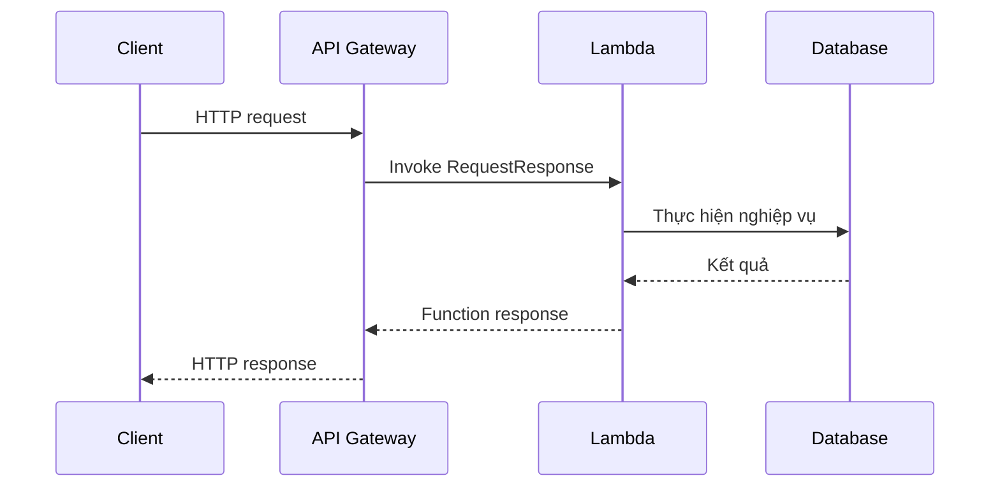
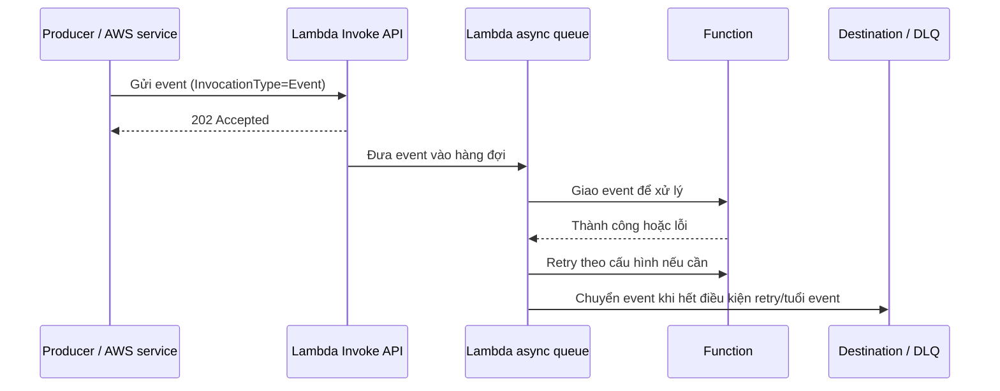
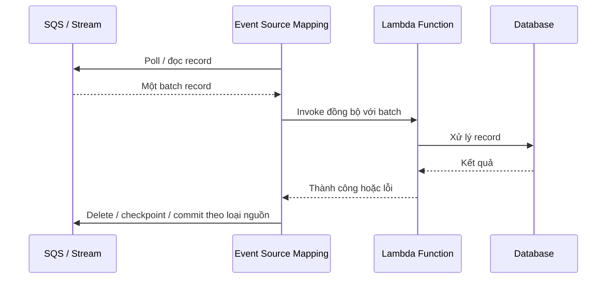
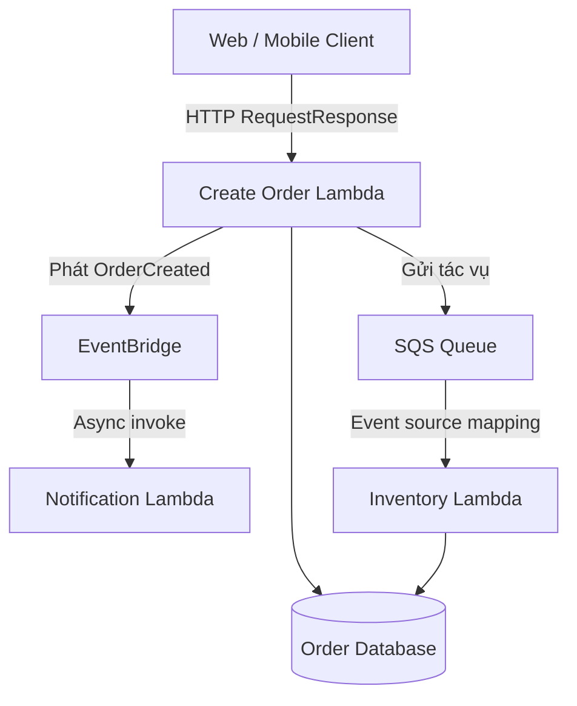

# So sánh lời gọi đồng bộ, bất đồng bộ và event source mapping

AWS Lambda có nhiều cách nhận công việc. Có lúc bên gọi cần kết quả ngay trong cùng request; có lúc chỉ cần gửi một sự kiện để Lambda xử lý sau; có lúc Lambda chủ động đọc message hoặc record từ queue và event stream. Ba cách này tương ứng với **lời gọi đồng bộ**, **lời gọi bất đồng bộ** và **event source mapping (ESM)**.

Điểm dễ nhầm là event source mapping cũng kích hoạt Lambda theo cách đồng bộ ở cấp từng batch, dù producer và consumer được tách rời qua queue hoặc stream. ESM là cơ chế Lambda poll nguồn dữ liệu, tạo batch và gọi function; nó không giống việc một dịch vụ push event vào hàng đợi bất đồng bộ nội bộ của Lambda.

## 1. Ba mô hình nhìn từ luồng dữ liệu

```mermaid
flowchart TD
    subgraph SYNC[Đồng bộ - RequestResponse]
        A[Client / API Gateway] -->|Gọi và chờ| F1[Lambda Function]
        F1 -->|Response hoặc lỗi| A
    end
    subgraph ASYNC[Bất đồng bộ - Event]
        B[EventBridge / S3 / SNS / SDK] -->|Gửi event| Q[Lambda async queue]
        Q -->|Giao event| F2[Lambda Function]
        F2 -->|Retry / destination / DLQ khi cần| Q
    end
    subgraph ESM[Event source mapping - Poll và invoke theo batch]
        S[ SQS / Kinesis / DynamoDB Streams / Kafka ] -->|Lambda poller đọc| P[Event source mapping]
        P -->|Invoke function với batch| F3[Lambda Function]
        F3 -->|Kết quả xử lý batch| P
        P -->|Delete / checkpoint / commit theo nguồn| S
    end
```



| Mô hình | Ai khởi tạo lần gọi? | Bên gửi có chờ kết quả function? | Lambda nhận dữ liệu như thế nào? |
|---|---|---|---|
| Đồng bộ | Client, API Gateway, Function URL, ALB hoặc SDK gọi Lambda | Có | Một request và trả response cho caller |
| Bất đồng bộ | Dịch vụ AWS hoặc SDK gửi event | Không; bên gửi chỉ nhận xác nhận tiếp nhận | Lambda đưa event vào hàng đợi nội bộ rồi xử lý sau |
| Event source mapping | Lambda poller đọc queue/stream được cấu hình | Producer không chờ; poller gọi function và chờ kết quả của batch | Function nhận một hoặc nhiều record trong batch |

Việc chọn mô hình quyết định ai chịu trách nhiệm retry, cách xác định thành công, cách message được xác nhận và nơi cần theo dõi khi có lỗi.

## 2. Lời gọi đồng bộ: RequestResponse

Với lời gọi đồng bộ, caller gửi request và chờ Lambda hoàn tất. AWS Lambda gọi kiểu này là `RequestResponse`. Caller nhận payload trả về nếu function thành công; nếu function ném exception hoặc timeout, caller nhận thông tin lỗi theo giao thức tích hợp.

Các trường hợp thường gặp:

- Client gọi API Gateway, API Gateway chuyển HTTP request vào Lambda và chuyển kết quả thành HTTP response.
- Client gọi Lambda Function URL và chờ response.
- Một Lambda function gọi function khác bằng AWS SDK với `InvocationType.RequestResponse`.
- Ứng dụng backend gọi Lambda trực tiếp bằng quyền `lambda:InvokeFunction`.



### 2.1. Đặc điểm và cách xử lý lỗi

Caller giữ request trong thời gian function chạy. Do đó, độ trễ của function và các dịch vụ mà function gọi nằm trên đường phản hồi. Nếu function chậm, client hoặc gateway có thể timeout trước khi nhận kết quả. Cần đặt timeout hợp lý ở từng lớp, giữ đường xử lý ngắn và không dùng một request HTTP để chờ chuỗi công việc nền kéo dài.

Với Invoke API trực tiếp, caller cần kiểm tra cả trạng thái API và trường `FunctionError` trong kết quả. Một lời gọi Lambda có thể được API chấp nhận thành công ở tầng Invoke nhưng phần thực thi function lại trả lỗi. Với API Gateway, response HTTP cuối cùng còn phụ thuộc loại integration và cách ánh xạ lỗi đã cấu hình.

Lambda không tự động retry một lời gọi đồng bộ chỉ vì function trả lỗi. Caller quyết định có thử lại hay không. Nếu client retry sau timeout, có thể lần chạy trước đã hoàn tất nghiệp vụ nhưng response bị mất trên đường về. Vì vậy, API ghi dữ liệu nên hỗ trợ idempotency key hoặc một định danh thao tác ổn định để request lặp không tạo tác động trùng.

### 2.2. Response trong Java

Với HTTP API Gateway payload format 2.0, một Java handler có thể nhận event và trả response tương ứng. Ví dụ minh họa dùng AWS Lambda Java Events:

```java
import com.amazonaws.services.lambda.runtime.Context;
import com.amazonaws.services.lambda.runtime.RequestHandler;
import com.amazonaws.services.lambda.runtime.events.APIGatewayV2HTTPEvent;
import com.amazonaws.services.lambda.runtime.events.APIGatewayV2HTTPResponse;
import java.util.Map;

public final class HealthHandler implements
        RequestHandler<APIGatewayV2HTTPEvent, APIGatewayV2HTTPResponse> {

    @Override
    public APIGatewayV2HTTPResponse handleRequest(
            APIGatewayV2HTTPEvent request,
            Context context) {

        return APIGatewayV2HTTPResponse.builder()
                .withStatusCode(200)
                .withHeaders(Map.of("content-type", "application/json"))
                .withBody("{\"status\":\"ok\"}")
                .build();
    }
}
```

Đây là ví dụ rút gọn; cần import `java.util.Map` và dùng phiên bản `aws-lambda-java-events` tương thích. Cấu trúc event/response phải khớp payload format đã chọn trong API Gateway. Nếu dùng REST API payload format khác, kiểu event và cách ánh xạ response có thể khác.

## 3. Lời gọi bất đồng bộ: Event

Với lời gọi bất đồng bộ, bên gửi yêu cầu Lambda nhận một event và tiếp tục công việc của nó mà không chờ function hoàn tất. AWS Lambda nhận event, đưa vào hàng đợi nội bộ và xử lý sau. Với Invoke API, kiểu gọi này được chọn bằng `InvocationType.Event`; các tích hợp như EventBridge, S3 và SNS cũng thường kích hoạt Lambda theo kiểu bất đồng bộ.



Mã `202 Accepted` chỉ cho biết Lambda đã tiếp nhận event để xử lý bất đồng bộ. Nó không chứng minh function đã chạy thành công hoặc nghiệp vụ đã hoàn tất. Producer thường không nhận được giá trị `return` của handler. Nếu cần công bố kết quả, function phải ghi trạng thái, phát event kết quả hoặc gọi callback/API đã được thiết kế.

### 3.1. Retry và khả năng giao trùng

Nếu function lỗi, Lambda có thể thử lại theo chính sách async invocation. Với lỗi do function, mặc định Lambda thực hiện thêm các lần thử; lỗi throttling hoặc lỗi hệ thống có thể được retry theo backoff trong thời gian event còn hiệu lực. Có thể cấu hình số lần retry, tuổi tối đa của event và hành vi khi hết hạn. Cần kiểm tra cấu hình thực tế thay vì dựa vào mặc định.

Hàng đợi bất đồng bộ của Lambda có ngữ nghĩa giao nhận at-least-once. Vì vậy, một event có thể được xử lý nhiều lần, kể cả trong một số trường hợp function đã chạy thành công nhưng hệ thống không ghi nhận chắc chắn kết quả giao nhận. Consumer phải idempotent. Dùng event ID hoặc business operation ID ổn định; ghi dấu đã xử lý cùng transaction với cập nhật nghiệp vụ khi có thể.

### 3.2. Destination và dead-letter queue

Đối với async invocation, Lambda hỗ trợ cấu hình destination cho kết quả thành công hoặc thất bại. Destination nhận một bản ghi invocation có metadata và thông tin request/response liên quan. Dead-letter queue (DLQ) là một cách giữ event không xử lý được để điều tra hoặc xử lý lại; DLQ thường được dùng cho luồng thất bại.

Destination và DLQ phục vụ mục đích khác nhau:

- **On-success destination:** ghi nhận invocation thành công để downstream tiếp tục xử lý hoặc lưu audit.
- **On-failure destination:** nhận thông tin invocation thất bại sau khi chính sách retry hoặc tuổi event kết thúc.
- **DLQ:** giữ event gốc không xử lý được; khả năng quan sát metadata và cách redrive khác với destination.

Quyền truy cập, retention, mã hóa và quy trình replay cần được thiết kế cho cả destination lẫn DLQ. Không nên giả định event được giữ vô thời hạn trong hàng đợi nội bộ Lambda.

### 3.3. Khi nào nên dùng async invocation?

Async phù hợp khi caller chỉ cần xác nhận đã tiếp nhận yêu cầu, còn công việc có thể hoàn tất sau. Ví dụ: gửi thông báo, xử lý ảnh, ghi nhận sự kiện nghiệp vụ, tạo báo cáo nền hoặc kích hoạt một bước downstream không cần trả kết quả ngay cho người dùng.

Nếu caller cần theo dõi tiến độ, hãy tạo `jobId` và lưu trạng thái như `PENDING`, `RUNNING`, `SUCCEEDED` hoặc `FAILED`. API tiếp nhận có thể trả `202 Accepted` cùng `jobId`; client truy vấn một endpoint trạng thái riêng. Không dùng response `202` như bằng chứng công việc đã hoàn tất.

## 4. Event source mapping: Lambda poll queue hoặc stream

Event source mapping là tài nguyên cấu hình kết nối một event source với Lambda function. Lambda quản lý poller để đọc dữ liệu từ nguồn, gom record thành batch và gọi function. Mô hình này thường được gọi là *pull-based integration* vì Lambda chủ động lấy dữ liệu từ nguồn.

Các nguồn phổ biến gồm:

- Amazon SQS queue.
- Kinesis Data Streams.
- DynamoDB Streams.
- Amazon MSK hoặc Kafka cluster tự quản lý.
- Amazon MQ và một số nguồn dữ liệu khác được Lambda hỗ trợ.



ESM gọi function theo kiểu đồng bộ cho từng batch: poller chờ kết quả của function để quyết định bước tiếp theo. Tuy nhiên, producer không gọi Lambda trực tiếp và cũng không chờ response của function. Đây là khác biệt quan trọng so với `InvocationType.Event`.

### 4.1. Cấu hình event source mapping

Một ESM có thể có các cấu hình như:

- **Event source ARN và function:** xác định queue/stream và function đích.
- **Starting position:** vị trí bắt đầu đọc với stream, chẳng hạn `TRIM_HORIZON` hoặc `LATEST` tùy nguồn.
- **Batch size:** số record tối đa đưa vào một lần gọi.
- **Maximum batching window:** thời gian poller chờ gom thêm record trước khi gọi function, nếu nguồn hỗ trợ.
- **Enabled:** bật hoặc tạm dừng mapping.
- **Filter criteria:** chỉ chuyển những record phù hợp đến function nếu nguồn và định dạng hỗ trợ.
- **Concurrency controls:** giới hạn mức xử lý song song hoặc số batch đồng thời theo loại nguồn.
- **Failure handling:** retry, tuổi record tối đa, số lần thử và đích lưu record thất bại tùy nguồn.

Batch lớn có thể tăng thông lượng và giảm số invocation, nhưng làm tăng thời gian chờ gom batch, bộ nhớ cần dùng và phạm vi record bị retry khi có lỗi. Cần đo bằng kích thước payload và thời gian xử lý thực tế.

### 4.2. SQS event source mapping

Với SQS, Lambda poll message từ queue và gọi function bằng một batch. Khi function xử lý thành công, Lambda xóa message khỏi queue. Nếu function lỗi hoặc timeout, message không được xóa và có thể xuất hiện lại sau visibility timeout. Đây là cơ chế at-least-once; message có thể được giao nhiều lần.

Nếu một message trong batch lỗi, mặc định cả batch có thể được xem là thất bại và các message đã xử lý thành công cũng có thể được giao lại. Có thể bật **partial batch response** bằng `ReportBatchItemFailures` để function trả danh sách message thất bại; Lambda chỉ thử lại các message đó.

Ví dụ Java minh họa với AWS Lambda Java Events:

```java
import com.amazonaws.services.lambda.runtime.Context;
import com.amazonaws.services.lambda.runtime.RequestHandler;
import com.amazonaws.services.lambda.runtime.events.SQSEvent;
import com.amazonaws.services.lambda.runtime.events.SQSBatchResponse;
import java.util.ArrayList;
import java.util.List;

public final class SqsOrderHandler
        implements RequestHandler<SQSEvent, SQSBatchResponse> {

    @Override
    public SQSBatchResponse handleRequest(SQSEvent event, Context context) {
        List<SQSBatchResponse.BatchItemFailure> failures = new ArrayList<>();

        for (SQSEvent.SQSMessage message : event.getRecords()) {
            try {
                processIdempotently(message.getBody());
            } catch (RetryableProcessingException ex) {
                failures.add(new SQSBatchResponse.BatchItemFailure(
                        message.getMessageId()));
            }
        }

        return new SQSBatchResponse(failures);
    }

    private void processIdempotently(String body) {
        // Parse, validate, then update business state using a stable event ID.
    }
}
```

Đoạn mã là ví dụ minh họa; `RetryableProcessingException` là exception của ứng dụng. Cần thêm dependency `aws-lambda-java-events` tương thích, bật `ReportBatchItemFailures` trong event source mapping và xử lý lỗi không thể retry theo chính sách riêng. Không bắt mọi exception rồi trả batch thành công, vì message lỗi có thể bị xóa khỏi queue. Với FIFO queue, cần giữ thứ tự: khi một message lỗi, dừng xử lý các message tiếp theo trong nhóm phù hợp và báo lỗi cho message chưa xử lý theo quy tắc partial batch response.

SQS queue cũng cần visibility timeout đủ dài so với thời gian chạy function và batching window; nếu quá ngắn, message có thể được giao lại khi invocation trước vẫn đang chạy. Thiết lập redrive policy trên queue để chuyển message vượt quá số lần nhận cho phép sang DLQ.

### 4.3. Kinesis và DynamoDB Streams

Với Kinesis Data Streams và DynamoDB Streams, ESM đọc record theo shard và gọi function theo batch. Lambda chỉ tiến checkpoint sau khi batch được xử lý thành công theo cơ chế của nguồn. Nếu một batch lỗi, mặc định Lambda có thể thử lại batch đó; điều này có thể làm các record phía sau bị chặn trong shard cho đến khi lỗi được xử lý hoặc bị loại bỏ theo cấu hình.

Các tùy chọn quan trọng gồm:

- `BisectBatchOnFunctionError`: chia batch lỗi thành các phần nhỏ để cô lập record gây lỗi.
- `MaximumRetryAttempts`: giới hạn số lần thử lại.
- `MaximumRecordAgeInSeconds`: giới hạn tuổi record được xử lý.
- `DestinationConfig`: cấu hình đích lưu record thất bại khi các điều kiện lỗi kết thúc, tùy nguồn.
- `ReportBatchItemFailures`: cho phép function báo cáo record thất bại một phần; với stream, cần trả đúng sequence number theo định dạng AWS yêu cầu.
- `ParallelizationFactor`: tăng số batch có thể xử lý đồng thời trên mỗi shard trong giới hạn hỗ trợ.

Tăng song song có thể tăng throughput, nhưng cần hiểu thứ tự record theo shard và partition key. Nếu nghiệp vụ yêu cầu xử lý tuần tự, không được tăng concurrency hoặc bỏ qua record lỗi theo cách làm sai thứ tự trạng thái.

### 4.4. Kafka và các nguồn pull khác

Với Amazon MSK hoặc Kafka cluster tự quản lý, ESM quản lý consumer poller, đọc record theo topic/partition rồi gọi Lambda theo batch. Việc tiến offset, retry và lưu record lỗi phụ thuộc cấu hình event source mapping và loại cluster. Cần cung cấp quyền mạng, thông tin xác thực và quyền đọc topic phù hợp; nếu dùng secret để xác thực, quản lý chúng bằng Secrets Manager hoặc cơ chế được hỗ trợ.

Không nên áp dụng nguyên xi quy tắc ACK của SQS cho Kinesis hoặc Kafka. SQS xóa message sau xử lý thành công; stream giữ record trong retention và dùng checkpoint/offset để xác định vị trí đọc. Mỗi nguồn có cơ chế lỗi, thứ tự và khả năng replay khác nhau.

## 5. So sánh chi tiết ba cách kích hoạt

| Tiêu chí | Đồng bộ | Bất đồng bộ | Event source mapping |
|---|---|---|---|
| API/invocation type | `RequestResponse` | `Event` | Poller invoke function theo batch |
| Bên gửi chờ kết quả function | Có | Không | Producer không chờ; poller chờ kết quả batch |
| Cách đưa dữ liệu vào | Một request/event | Một event vào async queue của Lambda | Một batch record từ queue/stream |
| Kết quả thành công | Response được trả cho caller | Event được xử lý; caller không nhận return | Batch được xác nhận/xóa/checkpoint theo nguồn |
| Retry chính | Caller tự quyết định | Lambda async retry policy | ESM và dịch vụ nguồn theo từng loại source |
| Duplicate | Có thể do caller retry sau timeout | Có thể do at-least-once | Có thể do visibility timeout, batch retry hoặc offset chưa commit |
| Theo dõi chính | Latency, timeout, lỗi HTTP/function | Async event age, retry, dropped events, destination/DLQ | Queue age/depth, iterator age/lag, retry, batch failure, DLQ |
| Ví dụ | API đọc/ghi cần phản hồi ngay | EventBridge kích hoạt xử lý nền | SQS kích hoạt worker xử lý đơn hàng |

## 6. Quyền truy cập và cấu hình bảo mật

Quyền truy cập khác nhau theo mô hình:

- **Đồng bộ:** identity của caller cần quyền `lambda:InvokeFunction` khi gọi trực tiếp. Với API Gateway, ALB hoặc dịch vụ tích hợp, Lambda cần resource-based permission cho phép dịch vụ đó invoke function.
- **Bất đồng bộ:** dịch vụ push như S3, SNS hoặc EventBridge cần được cho phép invoke Lambda qua resource-based policy. Caller dùng SDK trực tiếp cần quyền invoke phù hợp.
- **Event source mapping:** Lambda cần quyền đọc nguồn dữ liệu. Với SQS, quyền đọc/xóa message thường nằm trong execution role của function; với stream, role cần quyền đọc shard/record và các quyền phụ trợ tương ứng. Kafka có thể cần quyền truy cập mạng và secret.

Áp dụng least privilege: chỉ cho phép đúng function đọc đúng queue/topic, chỉ cấp quyền publish đến đúng event bus, và giới hạn quyền xem hoặc replay DLQ. Không nhúng access key trong event hoặc artifact; dùng execution role và secret manager.

## 7. Quan sát và xử lý sự cố

Mỗi mô hình cần chỉ số riêng để phát hiện lỗi:

| Mô hình | Chỉ số nên theo dõi | Câu hỏi vận hành |
|---|---|---|
| Đồng bộ | `Duration`, `Errors`, `Throttles`, `ConcurrentExecutions`, API latency và timeout | Request có chậm hoặc thất bại trước khi caller nhận response không? |
| Bất đồng bộ | `AsyncEventsReceived`, `AsyncEventAge`, `AsyncEventsDropped`, retry và số event vào destination/DLQ | Event đang chờ quá lâu, hết tuổi hay bị loại bỏ không? |
| SQS ESM | `ApproximateAgeOfOldestMessage`, queue depth, số message trong DLQ, Lambda errors/throttles | Queue có bị tồn đọng hoặc message bị giao lại liên tục không? |
| Kinesis/DynamoDB Streams | `IteratorAge`, batch failure, retry và shard/consumer lag | Consumer có tụt lại sau producer hoặc bị một record lỗi chặn không? |
| Kafka ESM | Consumer lag, batch processing duration, lỗi poll/auth/network | Poller có đọc được partition và xử lý kịp tốc độ ghi không? |

Log nên chứa request ID của Lambda, event ID hoặc message ID, correlation ID và mã lỗi đã chuẩn hóa. Không ghi toàn bộ payload nếu có dữ liệu nhạy cảm. Với batch, cần log record thất bại riêng để có thể điều tra và replay có kiểm soát.

## 8. Chọn mô hình theo yêu cầu nghiệp vụ

Hãy bắt đầu từ câu hỏi bên gọi cần gì:

1. **Cần phản hồi ngay để hiển thị hoặc quyết định bước tiếp theo?** Dùng đồng bộ. Giữ xử lý ngắn, đặt timeout và thiết kế idempotency cho request ghi.
2. **Chỉ cần tiếp nhận công việc rồi xử lý sau?** Dùng bất đồng bộ. Trả trạng thái tiếp nhận, cấu hình retry/age/destination và theo dõi kết quả qua trạng thái hoặc event khác.
3. **Dữ liệu đã nằm trong queue hoặc stream và cần Lambda tiêu thụ liên tục theo batch?** Dùng event source mapping. Chọn batch size, batching window, concurrency, checkpoint/ACK và chính sách lỗi theo đúng nguồn.

Ví dụ một hệ thống đặt hàng có thể dùng cả ba mô hình:



API tạo đơn dùng đồng bộ để trả mã đơn hàng. EventBridge kích hoạt notification bất đồng bộ vì gửi email không cần nằm trên đường response. SQS và event source mapping kích hoạt worker tồn kho theo batch, với retry và idempotency để xử lý giao trùng. Đây là ví dụ kiến trúc; lựa chọn broker và cách phát event cần bảo đảm nhất quán với transaction tạo đơn.

## 9. Checklist trước khi triển khai

- Đã xác định trigger là direct synchronous invoke, asynchronous invoke hay event source mapping chưa?
- Nếu đồng bộ, caller xử lý timeout và retry thế nào? API ghi có idempotency key chưa?
- Nếu bất đồng bộ, đã cấu hình retry attempts, maximum event age, destination hoặc DLQ chưa?
- Nếu dùng ESM, nguồn là SQS, stream hay Kafka? Ai poll, ai xác nhận và checkpoint được cập nhật lúc nào?
- Batch size, batching window, visibility timeout, function timeout và concurrency có tương thích không?
- Đã bật partial batch response khi cần và trả đúng định dạng theo nguồn chưa?
- Consumer có idempotent khi message hoặc record được giao lại không?
- Quyền invoke, quyền đọc source, quyền publish và quyền replay có theo least privilege không?
- Đã theo dõi latency, async event age, queue age, iterator age/consumer lag, retry và DLQ chưa?
- Có kiểm thử lỗi ở các thời điểm: trước xử lý, trong xử lý, sau commit nghiệp vụ nhưng trước ACK/offset commit không?

## Kết luận

Lời gọi đồng bộ phù hợp khi caller cần response ngay và tự kiểm soát retry. Lời gọi bất đồng bộ phù hợp khi chỉ cần Lambda tiếp nhận event rồi xử lý sau, với retry và destination do Lambda quản lý. Event source mapping phù hợp khi Lambda poll queue hoặc stream, gom record thành batch và gọi function đồng bộ để nhận kết quả xử lý. Chọn đúng mô hình cần hiểu ai chờ ai, ai chịu trách nhiệm retry, khi nào message được xác nhận và cách consumer chống xử lý trùng.
