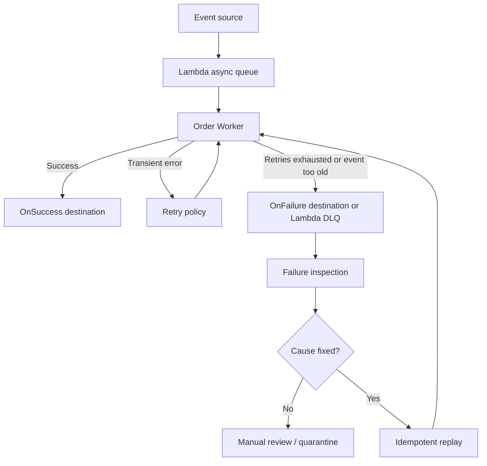

# Cấu hình Lambda destinations và dead-letter queue

## 1. Vì sao cần nơi lưu sự kiện thất bại?

AWS Lambda thường được dùng để xử lý sự kiện từ S3, SNS, EventBridge, SQS, Kinesis hoặc DynamoDB Streams. Khi function gặp lỗi, một số trigger có thể thử lại; một số trigger giữ message trong queue và giao lại sau; còn stream có thể giữ shard ở vị trí lỗi để bảo toàn thứ tự. Nếu việc xử lý vẫn thất bại sau thời gian hoặc số lần cho phép, hệ thống cần giữ lại thông tin để điều tra và phục hồi.

Nếu không cấu hình nơi lưu sự kiện thất bại, event có thể bị loại khỏi luồng xử lý sau khi hết retry hoặc hết thời gian lưu. Khi đó, nhóm vận hành khó biết sự kiện nào bị bỏ, vì sao function thất bại và cần phát lại dữ liệu nào. Dead-letter queue (DLQ) và destination giúp tạo một điểm tiếp nhận cho những sự kiện hoặc invocation không hoàn tất.

Trong AWS Lambda, cần phân biệt ba cơ chế:

1. **Asynchronous invocation destination:** nhận invocation record khi một lần gọi bất đồng bộ thành công hoặc thất bại. Record chứa thông tin request và response.
2. **Lambda dead-letter queue:** nhận nội dung event bị loại khỏi hàng đợi bất đồng bộ của Lambda sau khi hết retry hoặc hết thời gian. DLQ thường là SQS Standard hoặc SNS Standard.
3. **Event source mapping on-failure destination hoặc DLQ của nguồn:** xử lý batch thất bại khi Lambda poll SQS/stream. Cách cấu hình phụ thuộc loại nguồn; với SQS, redrive policy và DLQ nằm trên chính queue nguồn.

Ba cơ chế này không thay thế lẫn nhau. Chọn sai nơi cấu hình có thể khiến event không được giữ như mong đợi hoặc lưu record không đủ dữ liệu để phát lại. <https://docs.aws.amazon.com/lambda/latest/dg/invocation-async-retain-records.html>

## 2. Xác định loại invocation trước khi cấu hình

Lambda có nhiều cách nhận lời gọi. Chính sách retry và nơi lưu lỗi phụ thuộc vào cách function được gọi.

| Cách gọi | Ví dụ | Ai chịu trách nhiệm retry? | Nơi lưu lỗi phù hợp |
|---|---|---|---|
| Đồng bộ (synchronous) | API Gateway gọi Lambda, SDK dùng `RequestResponse` | Caller hoặc dịch vụ gọi | Caller ghi nhận lỗi; có thể dùng workflow/queue riêng nếu cần retry |
| Bất đồng bộ (asynchronous) | S3, SNS, EventBridge hoặc SDK dùng `Event` | Lambda quản lý hàng đợi sự kiện bất đồng bộ | Async destination hoặc Lambda DLQ |
| Event source mapping đọc queue | Lambda poll SQS | Event source mapping và SQS visibility timeout | DLQ trên queue nguồn, partial batch response |
| Event source mapping đọc stream | Kinesis, DynamoDB Streams, Kafka | Event source mapping theo batch/shard/partition | On-failure destination và chính sách retry của mapping |

Với invocation đồng bộ, caller chờ kết quả và nhận response lỗi. Lambda function-level DLQ và asynchronous destinations không tự động áp dụng cho loại gọi này. Nếu API client cần retry, client hoặc API orchestration phải có chính sách retry và idempotency phù hợp.

Với invocation bất đồng bộ, Lambda tiếp nhận event vào hàng đợi nội bộ rồi xử lý sau. Caller chỉ biết event đã được tiếp nhận; caller không nhận kết quả cuối của function. Lambda quản lý retry và có thể gửi record đến destination hoặc DLQ khi event bị loại.

Với event source mapping, Lambda tạo poller đọc queue hoặc stream rồi gửi batch record cho function. Cơ chế này có checkpoint, visibility timeout, batch retry và partial batch response riêng. Không cấu hình Lambda async DLQ cho một SQS source mapping với kỳ vọng nó thay thế redrive policy của SQS.

## 3. Lambda asynchronous invocation hoạt động ra sao?

Khi một dịch vụ gọi Lambda bất đồng bộ, Lambda lưu event vào hàng đợi nội bộ. Function được chạy khi có năng lực xử lý. Nếu function trả lỗi hoặc runtime timeout, Lambda có thể thử lại theo chính sách. Khi event vượt tuổi tối đa hoặc hết số lần retry, Lambda loại event khỏi hàng đợi và gửi đến on-failure destination hoặc DLQ nếu đã cấu hình.

### Retry mặc định

Đối với lỗi do function hoặc runtime, mặc định Lambda thử lại thêm hai lần:

- Lần thử đầu tiên sau khi event được tiếp nhận.
- Lần retry thứ nhất thường sau khoảng một phút.
- Lần retry tiếp theo thường sau khoảng hai phút.

Lỗi throttling (HTTP 429) và lỗi hệ thống 5xx được xử lý khác: Lambda đưa event trở lại hàng đợi và có thể tiếp tục thử trong tối đa sáu giờ theo mặc định. Khoảng chờ tăng theo cấp số nhân, từ khoảng một giây đến tối đa năm phút. Khi hàng đợi dài, Lambda có thể tăng khoảng chờ và giảm tốc độ đọc để hạn chế áp lực lên function.

Ngay cả khi function trả thành công, một event vẫn có thể được giao nhiều lần do hàng đợi bất đồng bộ có tính eventual consistency. Vì vậy, handler phải idempotent và không được xem “async invocation” là bảo đảm exactly-once.

### Hai tham số điều khiển lỗi

| Tham số | Ý nghĩa | Phạm vi cấu hình |
|---|---|---|
| `MaximumRetryAttempts` | Số lần Lambda thử lại khi function trả lỗi | Từ 0 đến 2 lần retry cho async invocation |
| `MaximumEventAgeInSeconds` | Tuổi tối đa Lambda giữ event trong hàng đợi bất đồng bộ trước khi loại bỏ | Từ 60 giây đến 21.600 giây (6 giờ) |

Giá trị mặc định thường là hai lần retry và tuổi tối đa sáu giờ. Tham số tuổi tối đa cũng giới hạn thời gian chờ của event khi hàng đợi bị backlog. Nếu đặt quá thấp, event có thể bị loại dù function chỉ đang chậm tạm thời. Nếu đặt quá cao, event cũ có thể được xử lý sau khi trạng thái nghiệp vụ đã thay đổi.

`MaximumRetryAttempts` điều khiển số lần retry cho lỗi do function/runtime trả về. Lỗi throttling và lỗi hệ thống có cơ chế retry riêng; `MaximumEventAgeInSeconds` vẫn giới hạn thời gian Lambda giữ event trong hàng đợi. Vì vậy, đặt `MaximumRetryAttempts=0` không có nghĩa là mọi lỗi hệ thống đều bị loại ngay lập tức.

Chọn retry và event age theo SLA. Ví dụ, thông báo cập nhật trạng thái có thể chấp nhận vài phút trễ; một event thanh toán cần giới hạn tuổi và có quy trình đối soát để không xử lý một yêu cầu đã hết hiệu lực.

## 4. Async destination là gì?

Destination nhận một **invocation record** khi Lambda xử lý một async invocation theo điều kiện đã cấu hình. Có thể cấu hình hai điều kiện riêng:

- `OnSuccess`: function đã xử lý event thành công.
- `OnFailure`: event đã hết retry hoặc vượt tuổi tối đa mà chưa xử lý thành công.

Destination không chỉ lưu event gốc. Invocation record còn có thông tin về function, request ID, số lần gọi, trạng thái response và payload kết quả. Điều này hữu ích cho audit, điều tra lỗi và điều phối bước tiếp theo.

Các loại destination được hỗ trợ cho async invocation:

| Destination | Điều kiện | Quyền trên execution role | Nội dung nhận |
|---|---|---|---|
| SQS Standard | Success hoặc failure | `sqs:SendMessage` | Invocation record trong message body |
| SNS Standard | Success hoặc failure | `sns:Publish` | Invocation record trong message body |
| Lambda function | Success hoặc failure | `lambda:InvokeFunction` | Invocation record làm payload |
| EventBridge event bus | Success hoặc failure | `events:PutEvents` | Invocation record nằm trong `detail` |
| S3 bucket | Failure only | `s3:PutObject`, `s3:ListBucket` | Invocation record được lưu thành JSON object |

SQS FIFO và SNS FIFO không phải loại đích hợp lệ cho async Lambda destinations. Nếu cần thứ tự FIFO, hãy thiết kế một bước trung gian phù hợp thay vì chọn FIFO queue trực tiếp làm destination.

### Invocation record có cấu trúc gì?

Một record thường chứa các trường:

- `version`: phiên bản định dạng record.
- `timestamp`: thời điểm Lambda tạo record.
- `requestContext`: request ID, ARN function, điều kiện gửi và số lần invocation gần đúng.
- `requestPayload`: event gốc được gửi vào function.
- `responseContext`: status code, version được thực thi và loại lỗi nếu có.
- `responsePayload`: kết quả hoặc thông tin lỗi trả về.

Ví dụ rút gọn:

```json
{
  "version": "1.0",
  "timestamp": "2026-11-17T10:15:30.000Z",
  "requestContext": {
    "requestId": "req-8f21",
    "functionArn": "arn:aws:lambda:ap-southeast-1:123456789012:function:order-worker:prod",
    "condition": "RetriesExhausted",
    "approximateInvokeCount": 3
  },
  "requestPayload": {
    "eventId": "evt-2048",
    "orderId": "ORD-2048",
    "type": "OrderCreated"
  },
  "responseContext": {
    "statusCode": 200,
    "executedVersion": "12",
    "functionError": "Unhandled"
  },
  "responsePayload": {
    "errorMessage": "Database temporarily unavailable"
  }
}
```

Các giá trị trong ví dụ chỉ minh họa. Nội dung cụ thể phụ thuộc kiểu invocation và lỗi. Khi xử lý record, hãy dùng `requestContext.condition` và các trường metadata để phân loại, đồng thời giữ `requestPayload` như dữ liệu đầu vào của lần gọi ban đầu.

## 5. Lambda DLQ khác async destination như thế nào?

Lambda DLQ là một lựa chọn thay thế cho async on-failure destination. Nó nhận event đã bị loại khỏi hàng đợi bất đồng bộ sau khi hết retry hoặc hết tuổi tối đa. DLQ function-level chỉ hỗ trợ:

- Amazon SQS Standard queue.
- Amazon SNS Standard topic.

Không hỗ trợ SQS FIFO queue hoặc SNS FIFO topic làm Lambda function-level DLQ.

Khác biệt quan trọng là nội dung được gửi:

| Tiêu chí | Async on-failure destination | Lambda DLQ |
|---|---|---|
| Dữ liệu chính | Invocation record | Event gốc |
| Thông tin response/error | Có `responseContext`, `responsePayload` và metadata | Không có response payload đầy đủ; có message attributes về lỗi |
| Loại đích | SQS, SNS, Lambda, EventBridge; S3 chỉ khi failure | SQS Standard hoặc SNS Standard |
| Cấu hình | Theo function, version hoặc alias | Ở cấp function |
| Mục đích | Điều tra chi tiết, audit, routing hoặc xử lý tiếp | Giữ event bị loại để phục hồi hoặc điều tra |

Với DLQ, Lambda gửi event gốc và một số message attributes:

- `RequestID`: ID của invocation.
- `ErrorCode`: mã HTTP biểu diễn lỗi.
- `ErrorMessage`: phần đầu thông báo lỗi, tối đa khoảng 1 KB.

Vì DLQ chỉ chứa event gốc và metadata hạn chế, nó không cung cấp đầy đủ response như destination. Nếu cần biết kết quả function trả về hoặc phân tích chi tiết lý do thất bại, on-failure destination thường phù hợp hơn.

AWS mô tả DLQ là lựa chọn thay thế cho on-failure destination. Không cấu hình cả hai với kỳ vọng một event sẽ tự động được gửi đồng thời đến cả hai nơi. Nếu cần fan-out, hãy dùng một destination như SNS hoặc EventBridge rồi định tuyến đến nhiều consumer.

## 6. Chọn SQS hay SNS cho DLQ và destination

### Chọn SQS Standard khi

- Một worker hoặc nhóm worker cần nhận và xử lý event thất bại.
- Muốn điều tiết tốc độ phục hồi và kiểm soát số message đang chờ.
- Cần giữ message cho đến khi consumer xử lý và xóa thành công.
- Muốn dùng redrive task hoặc quy trình phát lại có kiểm soát.

### Chọn SNS Standard khi

- Nhiều hệ thống cần được thông báo về cùng một invocation thất bại.
- Muốn fan-out đến Lambda khác, SQS, HTTP endpoint hoặc email subscription.
- Có một dịch vụ điều phối chịu trách nhiệm phân phối sự kiện tiếp theo.

### Chọn EventBridge khi

- Cần định tuyến invocation record theo thuộc tính, loại lỗi hoặc function.
- Muốn kết nối với nhiều rule/target và giữ mô hình event-driven.
- Cần tách nơi phát record khỏi các consumer downstream.

### Chọn S3 khi

- Cần lưu trữ dài hạn, audit hoặc phân tích batch các invocation thất bại.
- Payload lớn hơn mức phù hợp của SNS.
- Muốn giữ invocation record dưới dạng object để xử lý sau.

S3 chỉ là async destination khi failure. Với destination S3, cần bảo vệ bucket, quyền ghi và encryption. Không xóa bucket đang được cấu hình làm destination mà quên xóa cấu hình Lambda; nếu bucket name được người khác tạo lại trong tài khoản khác, record có thể bị gửi nhầm và làm lộ dữ liệu.

## 7. Cấu hình async invocation destination bằng AWS CLI

Trước khi cấu hình, hãy tạo destination và cấp quyền cho execution role của function. Ví dụ dưới đây gửi invocation record thất bại đến SQS Standard và record thành công đến EventBridge:

```bash
aws lambda update-function-event-invoke-config \
  --function-name order-worker:prod \
  --maximum-event-age-in-seconds 3600 \
  --maximum-retry-attempts 1 \
  --destination-config '{"OnFailure":{"Destination":"arn:aws:sqs:ap-southeast-1:123456789012:order-worker-failures"},"OnSuccess":{"Destination":"arn:aws:events:ap-southeast-1:123456789012:event-bus/order-audit"}}'
```

Giải thích:

- `order-worker:prod` chỉ ra alias `prod` của function.
- `MaximumEventAgeInSeconds=3600` giới hạn tuổi event ở một giờ.
- `MaximumRetryAttempts=1` cho phép một lần retry sau lần chạy đầu.
- `OnFailure` chuyển invocation record thất bại đến SQS.
- `OnSuccess` chuyển invocation record thành công đến EventBridge.

`update-function-event-invoke-config` cập nhật các trường được chỉ định. Nếu dùng `put-function-event-invoke-config`, cần chú ý lệnh này thay thế cấu hình async invocation hiện có; các trường không gửi lên có thể bị đặt về mặc định. Khi chỉ muốn thay đổi một phần cấu hình đang chạy, ưu tiên lệnh `update` và kiểm tra lại bằng `get-function-event-invoke-config`.

Đọc lại cấu hình:

```bash
aws lambda get-function-event-invoke-config \
  --function-name order-worker:prod
```

### Cấu hình Lambda DLQ bằng AWS CLI

Nếu chọn Lambda function-level DLQ, tạo SQS Standard queue hoặc SNS Standard topic trước, sau đó cập nhật cấu hình function:

```bash
aws lambda update-function-configuration \
  --function-name order-worker \
  --dead-letter-config TargetArn=arn:aws:sqs:ap-southeast-1:123456789012:order-worker-dlq
```

Kiểm tra cấu hình:

```bash
aws lambda get-function-configuration \
  --function-name order-worker
```

Trường `DeadLetterConfig.TargetArn` phải trỏ đúng queue hoặc topic. Đừng nhầm `DeadLetterConfig` với `DestinationConfig`: chúng là hai cơ chế khác nhau và có định dạng message khác nhau.

## 8. Cấu hình quyền IAM cho destination

Lambda dùng execution role của function để gửi record đến destination. Quyền tối thiểu phụ thuộc loại đích:

| Destination | IAM action cần có |
|---|---|
| SQS | `sqs:SendMessage` |
| SNS | `sns:Publish` |
| Lambda | `lambda:InvokeFunction` |
| EventBridge | `events:PutEvents` |
| S3 | `s3:PutObject`, `s3:ListBucket` |
| S3 mã hóa bằng customer-managed KMS key | Thêm `kms:GenerateDataKey` và quyền key policy phù hợp |

Ví dụ policy tối thiểu để gửi invocation record đến một SQS queue:

```json
{
  "Version": "2012-10-17",
  "Statement": [
    {
      "Sid": "SendFailureRecords",
      "Effect": "Allow",
      "Action": "sqs:SendMessage",
      "Resource": "arn:aws:sqs:ap-southeast-1:123456789012:order-worker-failures"
    }
  ]
}
```

Policy cần gắn vào execution role đang được function sử dụng. Nếu destination ở tài khoản AWS khác, ngoài identity policy còn cần resource policy trên queue/topic/bucket hoặc cấu hình quyền tương ứng. Nếu destination mã hóa bằng customer-managed KMS key, kiểm tra cả quyền của role và key policy; chỉ cấp quyền SQS/SNS là chưa đủ.

Không cấp `sqs:*`, `sns:*` hoặc `s3:*` trên mọi resource chỉ để làm destination hoạt động. Giới hạn đúng ARN, đúng action và đúng tài khoản. Với S3, có thể dùng điều kiện `s3:ResourceAccount` để giới hạn bucket đích thuộc tài khoản được tin cậy.

## 9. Destination của event source mapping khác async destination

Event source mapping (ESM) là tài nguyên Lambda poll queue hoặc stream rồi gọi function theo batch. Các nguồn thường gặp gồm:

- Amazon SQS.
- Amazon Kinesis Data Streams.
- DynamoDB Streams.
- Amazon MSK và self-managed Kafka.
- Amazon MQ và Amazon DocumentDB.

Khi function xử lý batch thất bại, ESM áp dụng chính sách riêng. Với stream, Lambda có thể retry batch, giới hạn tuổi record, giới hạn số lần thử, chia batch để tìm record lỗi và gửi invocation record đến on-failure destination.

Không dùng `MaximumRetryAttempts` hoặc `MaximumEventAgeInSeconds` của async invocation để suy ra retry của ESM. ESM dùng các thuộc tính riêng như `MaximumRetryAttempts`, `MaximumRecordAgeInSeconds`, `BisectBatchOnFunctionError` và `DestinationConfig.OnFailure` trong cấu hình event source mapping.

### Kinesis và DynamoDB Streams

Với stream, lỗi một record có thể chặn shard cho đến khi xử lý được hoặc record hết hạn. Một số thiết lập thường dùng:

| Tham số ESM | Ý nghĩa |
|---|---|
| `MaximumRetryAttempts` | Số lần retry batch lỗi; `-1` thường biểu thị retry không giới hạn cho loại stream hỗ trợ |
| `MaximumRecordAgeInSeconds` | Tuổi tối đa của record; `-1` dùng giới hạn retention của stream |
| `BisectBatchOnFunctionError` | Chia batch lỗi thành các batch nhỏ hơn để cô lập record gây lỗi |
| `DestinationConfig.OnFailure` | Đích nhận invocation record khi Lambda loại batch sau khi hết chính sách xử lý |
| `FunctionResponseTypes=ReportBatchItemFailures` | Cho phép function báo record đầu tiên thất bại để checkpoint/retry chính xác hơn |

Giới hạn và khả năng hỗ trợ phụ thuộc loại nguồn. DynamoDB Streams giữ record trong 24 giờ. Kinesis Data Streams mặc định giữ record 24 giờ và có thể tăng retention tối đa 365 ngày; thời gian lưu dài hơn 24 giờ có thể phát sinh thêm chi phí. Tăng retention sau khi record đã hết hạn không khôi phục được record cũ. Nếu record đã hết retention, destination metadata có thể không đủ để khôi phục nội dung ban đầu.

Ví dụ cấu hình mapping cho Kinesis:

```bash
aws lambda create-event-source-mapping \
  --function-name order-stream-worker \
  --event-source-arn arn:aws:kinesis:ap-southeast-1:123456789012:stream/orders \
  --starting-position TRIM_HORIZON \
  --maximum-retry-attempts 3 \
  --maximum-record-age-in-seconds 3600 \
  --bisect-batch-on-function-error \
  --destination-config '{"OnFailure":{"Destination":"arn:aws:sqs:ap-southeast-1:123456789012:order-stream-failures"}}'
```

Mapping được tạo hoặc cập nhật bất đồng bộ. Dùng `get-event-source-mapping` để kiểm tra trạng thái và cấu hình sau khi AWS hoàn tất cập nhật.

### Nội dung on-failure destination của stream

Với Kinesis và DynamoDB Streams, invocation record gửi đến SQS hoặc SNS thường chứa metadata như:

- Shard ID.
- Sequence number đầu và cuối của batch.
- Thời điểm record đầu/cuối đến gần đúng.
- Kích thước batch và ARN stream.
- Thông tin function, request ID, condition và số lần invoke gần đúng.

Đối với SQS/SNS destination, record metadata không nhất thiết chứa toàn bộ dữ liệu record gốc. Consumer cần dùng shard/sequence number để đọc lại dữ liệu từ stream trước khi retention hết hạn. Với S3 destination, Lambda còn lưu invocation record đầy đủ cùng payload gốc theo định dạng tài liệu AWS mô tả.

Đây là khác biệt quan trọng khi thiết kế quy trình phục hồi. Nếu cần giữ payload lâu dài độc lập với retention stream, hãy chọn S3 destination hoặc chủ động archive dữ liệu trước khi hết hạn.

## 10. SQS event source mapping: DLQ nằm trên queue nguồn

Khi Lambda poll một SQS queue, message vẫn ở trong queue nhưng tạm thời bị ẩn trong khoảng `VisibilityTimeout`. Nếu function xử lý batch thành công, Lambda xóa message. Nếu invocation thất bại, message có thể hiển thị lại sau khi visibility timeout hết hạn và được giao lại.

Đối với SQS event source mapping, cấu hình DLQ trên **queue nguồn** bằng redrive policy của SQS. Không cấu hình Lambda function-level `DeadLetterConfig` rồi kỳ vọng nó thay thế redrive policy.

Ví dụ redrive policy:

```bash
aws sqs set-queue-attributes \
  --queue-url https://sqs.ap-southeast-1.amazonaws.com/123456789012/orders \
  --attributes '{"RedrivePolicy":"{\"deadLetterTargetArn\":\"arn:aws:sqs:ap-southeast-1:123456789012:orders-dlq\",\"maxReceiveCount\":\"5\"}"}'
```

`maxReceiveCount` xác định số lần message được nhận trước khi SQS chuyển nó sang DLQ. AWS khuyến nghị đặt ít nhất khoảng năm lần để Lambda có cơ hội retry trước khi message bị chuyển đi; giá trị thực tế cần phù hợp với latency và lỗi của ứng dụng.

Loại queue nguồn và DLQ cũng cần tương thích: queue FIFO dùng DLQ FIFO; queue Standard dùng DLQ Standard. Quy tắc này áp dụng cho redrive của SQS, khác với Lambda function-level DLQ vốn chỉ hỗ trợ SQS Standard hoặc SNS Standard.

Visibility timeout của queue nguồn phải đủ dài cho thời gian xử lý batch và retry. Hướng dẫn AWS khuyến nghị đặt visibility timeout ít nhất sáu lần function timeout để có khoảng đệm cho throttling và xử lý lại. Function timeout cũng phải nhỏ hơn hoặc bằng visibility timeout. Kiểm tra thêm batching window nếu có cấu hình.

### Partial batch response cho SQS

Mặc định, nếu một message trong batch lỗi và function ném exception, cả batch có thể được giao lại, kể cả các message đã xử lý thành công. Điều này tạo duplicate và tốn invocation.

Bật `ReportBatchItemFailures` trong event source mapping để function trả về danh sách message thất bại:

```bash
aws lambda update-event-source-mapping \
  --uuid 11111111-2222-3333-4444-555555555555 \
  --function-response-types ReportBatchItemFailures
```

Response có dạng:

```json
{
  "batchItemFailures": [
    { "itemIdentifier": "sqs-message-id-2" }
  ]
}
```

Lambda chỉ làm message thất bại hiển thị lại theo response partial batch. Nếu function ném exception ra ngoài thay vì trả response hợp lệ, toàn batch vẫn có thể được xem là thất bại. Với FIFO queue, nên dừng xử lý sau lỗi đầu tiên và trả cả message lỗi lẫn các message chưa xử lý để giữ thứ tự.

Ví dụ Java với AWS Lambda Java Events:

```java
import com.amazonaws.services.lambda.runtime.Context;
import com.amazonaws.services.lambda.runtime.RequestHandler;
import com.amazonaws.services.lambda.runtime.events.SQSEvent;
import com.amazonaws.services.lambda.runtime.events.SQSBatchResponse;

import java.util.ArrayList;
import java.util.List;

public final class OrdersQueueHandler
        implements RequestHandler<SQSEvent, SQSBatchResponse> {

    private final OrderProcessor processor = new OrderProcessor();

    @Override
    public SQSBatchResponse handleRequest(SQSEvent event, Context context) {
        List<SQSBatchResponse.BatchItemFailure> failures = new ArrayList<>();

        for (SQSEvent.SQSMessage message : event.getRecords()) {
            try {
                // Lấy eventId nghiệp vụ từ body làm khóa idempotency; message ID
                // của SQS chỉ nên dùng để nhận diện item trong partial response.
                processor.processOnce(message.getBody());
            } catch (RetryableProcessingException ex) {
                failures.add(new SQSBatchResponse.BatchItemFailure(
                        message.getMessageId()));
            } catch (PermanentDataException ex) {
                // Chỉ coi là đã xử lý nếu lưu vào quarantine thành công.
                processor.storeInQuarantine(message.getMessageId(), message.getBody(), ex);
            }
        }

        return new SQSBatchResponse(failures);
    }
}
```

Đây là ví dụ minh họa; cần thêm dependency `aws-lambda-java-events` và định nghĩa `OrderProcessor`, exception theo ứng dụng. Nếu `storeInQuarantine` thất bại, hãy để invocation thất bại hoặc thêm message vào danh sách retry; không xác nhận message khi chưa lưu được kết quả cách ly. Với FIFO, dừng tại message lỗi đầu tiên và đánh dấu các message sau là chưa xử lý.

## 11. Partial batch response cho Kinesis và DynamoDB Streams

Với stream, thứ tự record trong shard quan trọng. Khi function xử lý batch, mặc định Lambda chỉ checkpoint đến cuối batch nếu cả batch thành công. Bật `ReportBatchItemFailures` cho phép function trả về sequence number đầu tiên thất bại. Lambda sẽ retry từ vị trí đó trở đi.

Ví dụ response:

```json
{
  "batchItemFailures": [
    { "itemIdentifier": "800000000003126276362" }
  ]
}
```

Với stream, `itemIdentifier` là sequence number theo hợp đồng event source; nó không phải SQS message ID. Nếu có nhiều failure, Lambda dùng sequence number thấp nhất làm checkpoint và retry từ vị trí đó. Vì vậy, xử lý song song trong một shard cần cẩn thận để không đánh dấu các record sau thành công trong khi record trước chưa hoàn tất.

`BisectBatchOnFunctionError` có thể chia batch lỗi thành hai phần và thử lại để cô lập poison record. Có thể kết hợp với partial batch response; khi bật cả hai, Lambda chia batch tại vị trí lỗi được báo và retry phần còn lại theo semantics stream.

## 12. Java handler cần idempotent

Cả async invocation và event source mapping đều có thể giao event hoặc message nhiều lần. Một record vào DLQ cũng có thể được redrive và chạy lại sau khi code đã sửa. Vì vậy, mọi tác động nghiệp vụ quan trọng cần idempotent.

Ví dụ, consumer ghi nhận `eventId` trong cùng transaction với cập nhật đơn hàng:

```java
public void processOnce(String eventId, OrderEvent event) {
    transactionTemplate.executeWithoutResult(status -> {
        boolean firstTime = processedEventRepository.insertIfAbsent(eventId);
        if (!firstTime) {
            return;
        }

        orderRepository.apply(event);
    });
}
```

`insertIfAbsent` phải được bảo vệ bằng unique constraint hoặc thao tác nguyên tử ở database. Không chỉ đọc xem event ID có tồn tại rồi mới insert, vì hai Lambda invocation có thể chạy song song và cùng vượt qua bước kiểm tra. Nếu cập nhật dữ liệu thất bại, transaction phải rollback cả dấu processed để lần retry có thể xử lý lại.

Với API bên ngoài như payment provider, dùng idempotency key ổn định cho cùng một hành động. Nếu function timeout sau khi provider đã thực hiện giao dịch, hãy tra cứu trạng thái bằng khóa trước khi gửi lại. Không tạo idempotency key mới mỗi lần redrive nếu đó vẫn là cùng thao tác nghiệp vụ.

## 13. Phục hồi và redrive event từ DLQ/destination

Đưa event vào DLQ mới chỉ là bước lưu giữ. Cần một quy trình để xác định nguyên nhân, sửa vấn đề và xử lý lại có kiểm soát.

Quy trình đề xuất:

1. **Phát hiện:** cảnh báo khi DLQ có message mới, độ sâu tăng hoặc message cũ nhất vượt ngưỡng.
2. **Điều tra:** đọc event ID, request ID, function version, condition, error type và số lần invoke.
3. **Phân loại:** lỗi dữ liệu, lỗi code, lỗi quyền, dependency tạm thời hay event đã hết hiệu lực.
4. **Sửa nguyên nhân:** deploy code/config đã sửa, cấp quyền đúng hoặc cập nhật dữ liệu nghiệp vụ.
5. **Kiểm tra idempotency:** xác nhận việc chạy lại không tạo giao dịch hoặc side effect trùng.
6. **Chọn cách redrive:** SQS redrive task, consumer đọc DLQ, hoặc bước phục hồi riêng cho invocation record.
7. **Giới hạn tốc độ:** phát lại theo batch nhỏ để không tạo đợt tải mới.
8. **Đối soát:** so sánh số record đã xử lý, record còn lỗi và trạng thái nghiệp vụ cuối.

### Redrive từ Lambda DLQ

Lambda DLQ chứa event gốc. Có thể cấu hình DLQ làm event source cho một function phục hồi hoặc lấy message ra bằng consumer rồi gọi lại handler phù hợp. Khi phát lại, cần giữ event ID và idempotency key ban đầu.

### Redrive từ async on-failure destination

SQS destination chứa invocation record, không phải trực tiếp event gốc ở message body. Consumer phục hồi cần đọc `requestPayload` để lấy event ban đầu, đồng thời giữ metadata như `requestContext.requestId`, `condition` và `approximateInvokeCount` để điều tra. Không gửi nguyên invocation record vào handler nghiệp vụ nếu handler đang mong đợi event payload gốc.

Nếu destination là EventBridge, dùng rule/target hoặc consumer riêng để tách `detail` và đưa `requestPayload` vào luồng xử lý phục hồi. Nếu destination là S3, đọc object JSON và giải mã invocation record trước khi replay.

### Redrive từ stream event source mapping

Với Kinesis hoặc DynamoDB Streams, SQS/SNS on-failure record có thể chỉ chứa shard/sequence metadata. Consumer phải đọc lại record từ stream trước khi retention hết hạn. Nếu record đã bị xóa khỏi stream, cần archive hoặc nguồn dữ liệu chuẩn khác để tái tạo. Không giả định mọi failure destination đều lưu nguyên payload.

## 14. Giám sát destination và DLQ

Một hệ thống có thể xử lý function thành công nhưng lại thất bại khi gửi invocation record đến destination. Cần giám sát cả function và đích lưu lỗi.

Các metric hữu ích:

| Metric | Ý nghĩa | Cần làm gì khi tăng |
|---|---|---|
| `Errors` | Invocation kết thúc bằng lỗi | Xem log, exception và execution version |
| `Throttles` | Lambda không có đủ concurrency | Điều chỉnh concurrency hoặc tải đầu vào |
| `AsyncEventAge` | Tuổi event trong hàng đợi async | Kiểm tra backlog và tốc độ xử lý |
| `AsyncEventsDropped` | Event bị loại khỏi async queue | Kiểm tra retry/age và destination/DLQ |
| `DestinationDeliveryFailures` | Lambda không gửi được invocation record đến destination | Kiểm tra IAM, loại đích, kích thước và resource policy |
| `DeadLetterErrors` | Lambda không gửi được event vào DLQ | Kiểm tra quyền, kích thước message và KMS |
| `DroppedEventCount` | ESM stream loại record do hết retry hoặc max record age | Kiểm tra retry limit, age limit và backlog |
| `OnFailureDestinationDeliveredEventCount` | ESM stream gửi record đến on-failure destination thành công | Đối chiếu với số record bị loại và quy trình phục hồi |
| `ApproximateNumberOfMessagesVisible` | Số message đang chờ trong SQS | Điều tra backlog hoặc consumer ngừng chạy |
| `ApproximateAgeOfOldestMessage` | Tuổi message cũ nhất trong SQS | Kiểm tra retry, visibility timeout và năng lực consumer |
| `IteratorAge` | Độ trễ xử lý record stream | Kiểm tra shard lag, lỗi batch và throughput |

Tên metric và dimension có thể khác theo loại trigger và dịch vụ nguồn. Một số metric chi tiết của event source mapping cần bật nhóm `EventCount` trong `MetricsConfig`; không phải metric nào cũng có sẵn cho mọi loại nguồn. Hãy xem CloudWatch namespace của Lambda, SQS, Kinesis hoặc DynamoDB để cấu hình dashboard đúng.

Nếu Lambda không thể gửi record đến destination do sai ARN, thiếu permission, loại FIFO không được hỗ trợ hoặc payload vượt giới hạn, metric `DestinationDeliveryFailures` sẽ tăng. Nếu Lambda không thể gửi message vào function-level DLQ, metric `DeadLetterErrors` tăng và event có thể bị xóa. Vì vậy, destination/DLQ phải được kiểm thử bằng một invocation thất bại có chủ đích trước khi đưa production.

## 15. Bảo mật và lưu giữ dữ liệu lỗi

DLQ và invocation record thường chứa payload gốc, ID khách hàng, mã đơn hoặc thông tin lỗi. Đây vẫn là dữ liệu nghiệp vụ và có thể chứa dữ liệu cá nhân.

Hãy:

- Mã hóa SQS, SNS hoặc S3 destination khi phù hợp; quản lý KMS key policy.
- Chỉ cấp quyền đọc DLQ cho nhóm hoặc function chịu trách nhiệm phục hồi.
- Dùng retention phù hợp với SLA điều tra và yêu cầu lưu trữ.
- Đặt lifecycle cho S3 destination và xóa dữ liệu khi hết thời hạn.
- Không ghi toàn bộ payload hoặc secret ra log khi đọc DLQ.
- Không gửi invocation record chứa dữ liệu nhạy cảm đến email hoặc HTTP endpoint không được bảo vệ.
- Giới hạn bucket destination theo tài khoản tin cậy và không để bucket name bị tái sử dụng ngoài kiểm soát.
- Kiểm tra resource policy nếu destination ở tài khoản khác.

Với SNS destination, giới hạn message size của SNS là 256 KB. Invocation record còn chứa metadata và response payload nên có thể lớn hơn event gốc. Nếu payload gần giới hạn, cân nhắc SQS hoặc S3 thay vì SNS. Kiểm tra giới hạn message thực tế của SQS queue và cấu hình tài khoản trước khi triển khai.

## 16. Lỗi cấu hình thường gặp

| Lỗi | Hậu quả | Cách khắc phục |
|---|---|---|
| Dùng Lambda function DLQ cho SQS source mapping | Message lỗi vẫn được xử lý theo redrive policy của queue | Cấu hình DLQ trên queue nguồn |
| Dùng async destination cho synchronous invoke | Không nhận được invocation record như mong đợi | Caller/workflow phải xử lý lỗi sync |
| Chọn SQS FIFO hoặc SNS FIFO làm async destination | Destination delivery thất bại | Dùng SQS/SNS Standard hoặc đích được hỗ trợ |
| Thiếu `sqs:SendMessage`/`sns:Publish` | Record không đến destination | Cấp quyền đúng ARN cho execution role |
| Xóa bucket S3 nhưng giữ destination config | Có nguy cơ bucket name bị chiếm và nhận dữ liệu | Xóa destination config trước, sau đó mới xóa bucket |
| Coi invocation record là event gốc | Consumer parse sai schema hoặc gửi payload lồng nhau | Lấy `requestPayload` khi replay |
| Coi stream failure record luôn chứa payload | Không khôi phục được record | Lấy dữ liệu theo shard/sequence hoặc dùng S3 destination/archive |
| Không bật partial batch response | Cả batch bị retry dù chỉ một record lỗi | Bật `ReportBatchItemFailures` và trả đúng item ID/sequence |
| Không có idempotency | Redrive tạo side effect trùng | Lưu event ID/idempotency key bền vững |
| Không theo dõi destination delivery failure | Event có thể bị mất khi không gửi được record | Cảnh báo `DestinationDeliveryFailures`/`DeadLetterErrors` |
| Redrive toàn bộ backlog ngay lập tức | Tạo retry storm và làm quá tải dependency | Replay có giới hạn tốc độ và theo batch |

## 17. Ví dụ luồng xử lý lỗi

Một luồng xử lý đơn hàng bất đồng bộ có thể hoạt động như sau:



Luồng này có một số quy tắc:

1. Event source phát event đến Lambda theo chế độ async.
2. Lambda giữ event và gọi function theo retry/age policy.
3. Khi thành công, `OnSuccess` có thể gửi invocation record đến EventBridge để audit.
4. Khi hết retry hoặc event quá cũ, `OnFailure` chuyển invocation record đến SQS.
5. Consumer failure queue đọc record, phân tích lỗi và lấy `requestPayload`.
6. Sau khi sửa nguyên nhân, consumer phát lại payload gốc bằng một luồng có giới hạn tốc độ.
7. Function dùng event ID/idempotency key để không lặp side effect đã xảy ra trước timeout.

Nếu thay `OnFailure` bằng Lambda DLQ, consumer nhận event gốc và một số message attributes thay vì invocation record đầy đủ. Chọn một cơ chế theo nhu cầu phục hồi và điều tra.

## 18. Quy trình thiết kế và triển khai

Khi cấu hình một Lambda function mới, có thể làm theo các bước:

1. **Xác định invocation mode:** synchronous, asynchronous hay event source mapping.
2. **Xác định lỗi có thể gặp:** lỗi code, timeout, throttling, dependency, dữ liệu không hợp lệ hoặc business rejection.
3. **Chọn retry policy:** số lần thử, event age, visibility timeout, max record age và cách xử lý poison message.
4. **Chọn nơi lưu thất bại:** async destination, Lambda DLQ, SQS source queue DLQ hoặc stream ESM on-failure destination.
5. **Chọn nội dung cần giữ:** event gốc, invocation record đầy đủ hay metadata trỏ về record trong stream.
6. **Tạo destination trước:** queue/topic/bucket/event bus và retention/encryption.
7. **Cấp IAM:** quyền gửi đúng resource ARN; kiểm tra KMS và resource policy.
8. **Cấu hình Lambda/ESM:** dùng API phù hợp với invocation mode; không trộn các tham số async và ESM.
9. **Kiểm thử lỗi:** cố ý tạo function error, timeout, throttling hoặc poison record để xác nhận retry và destination.
10. **Kiểm thử phục hồi:** đọc record, sửa nguyên nhân, redrive với giới hạn tốc độ và xác minh idempotency.
11. **Thiết lập cảnh báo:** theo dõi function errors, age/lag, queue depth, destination delivery failures và DLQ age.
12. **Rà soát bảo mật:** kiểm tra payload nhạy cảm, quyền đọc DLQ, bucket ownership, KMS và retention.

## 19. Checklist trước khi đưa production

- [ ] Đã xác định đúng synchronous, asynchronous hoặc event source mapping.
- [ ] Không dùng Lambda function-level DLQ thay cho SQS source queue redrive policy.
- [ ] Async retry attempts và maximum event age phù hợp SLA.
- [ ] Async destination hoặc DLQ đã được chọn theo dữ liệu cần lưu.
- [ ] Hiểu sự khác nhau giữa invocation record và event gốc.
- [ ] Destination type được hỗ trợ; không dùng SQS FIFO/SNS FIFO cho async destination.
- [ ] Execution role có quyền gửi đúng ARN; KMS/resource policy đã được kiểm tra.
- [ ] Với SQS source, visibility timeout đủ dài và redrive policy có maxReceiveCount hợp lý.
- [ ] Với stream source, retry, max record age, bisect và on-failure destination được cấu hình đúng loại nguồn.
- [ ] Partial batch response được bật và handler trả đúng message ID/sequence number.
- [ ] Handler idempotent và có cơ chế đối soát khi timeout không rõ kết quả.
- [ ] Có quy trình điều tra, quarantine và redrive được giới hạn tốc độ.
- [ ] Có cảnh báo `DestinationDeliveryFailures`, `DeadLetterErrors`, queue age/depth và stream lag.
- [ ] DLQ/destination được mã hóa, giới hạn quyền truy cập và có retention/lifecycle.
- [ ] Đã kiểm thử thất bại thật và xác minh record xuất hiện đúng nơi.

## 20. Tài liệu AWS tham khảo

- [Invoking a Lambda function asynchronously](https://docs.aws.amazon.com/lambda/latest/dg/invocation-async.html)
- [Configuring error handling for asynchronous invocations](https://docs.aws.amazon.com/lambda/latest/dg/invocation-async-configuring.html)
- [Capturing records of asynchronous invocations](https://docs.aws.amazon.com/lambda/latest/dg/invocation-async-retain-records.html)
- [How Lambda handles errors and retries with asynchronous invocation](https://docs.aws.amazon.com/lambda/latest/dg/invocation-async-error-handling.html)
- [How Lambda processes records from stream and queue-based event sources](https://docs.aws.amazon.com/lambda/latest/dg/invocation-eventsourcemapping.html)
- [Handling errors for an SQS event source](https://docs.aws.amazon.com/lambda/latest/dg/services-sqs-errorhandling.html)
- [Retain discarded records for a DynamoDB event source](https://docs.aws.amazon.com/lambda/latest/dg/services-dynamodb-errors.html)
- [Partial batch response for Kinesis Data Streams](https://docs.aws.amazon.com/lambda/latest/dg/services-kinesis-batchfailurereporting.html)
- [Change the data retention period for Kinesis Data Streams](https://docs.aws.amazon.com/streams/latest/dev/kinesis-extended-retention.html)
- [Types of metrics for Lambda Event Functions](https://docs.aws.amazon.com/lambda/latest/dg/monitoring-metrics-types.html)

## Kết luận

Lambda destinations và DLQ giúp giữ lại thông tin khi invocation không hoàn tất, nhưng phải chọn đúng cơ chế theo kiểu gọi. Với async invocation, on-failure destination cung cấp invocation record giàu ngữ cảnh; Lambda DLQ giữ event gốc và là lựa chọn thay thế đơn giản hơn. Với SQS event source mapping, DLQ thuộc redrive policy của queue nguồn; với Kinesis và DynamoDB Streams, dùng retry/checkpoint và on-failure destination của mapping. Trong mọi trường hợp, cần cấp IAM đúng, theo dõi lỗi gửi destination, bảo vệ payload và thiết kế idempotency cùng quy trình redrive. Một DLQ chỉ có giá trị khi tổ chức có thể phát hiện, điều tra, sửa nguyên nhân và phục hồi event một cách an toàn.
