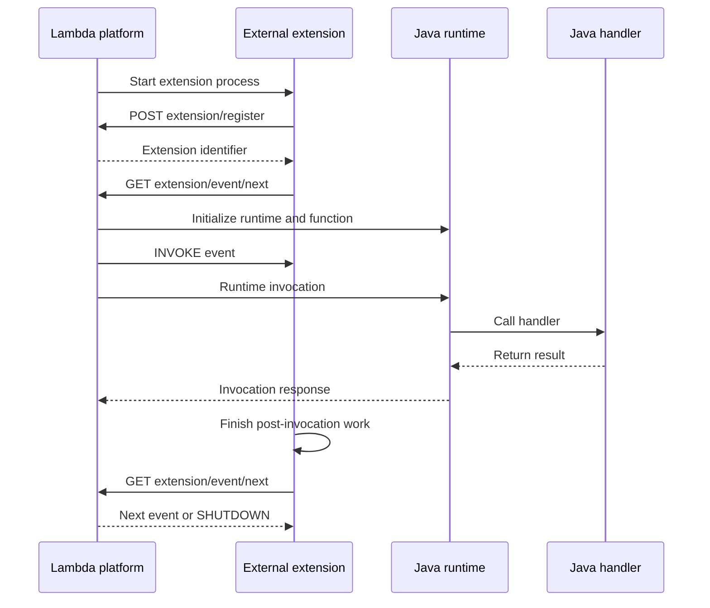

# Sử dụng Lambda extensions và custom runtime

## 1. Hai khả năng mở rộng khác nhau của AWS Lambda

AWS Lambda cung cấp runtime được quản lý cho các ngôn ngữ phổ biến. Với phần lớn function Java, có thể dùng Java managed runtime, triển khai handler và để Lambda quản lý JVM, vòng đời execution environment và giao thức gọi hàm. Khi cần tích hợp thêm công cụ vận hành hoặc thay đổi cách runtime khởi động, Lambda có hai cơ chế đáng chú ý: **Lambda extensions** và **custom runtime**.

**Lambda extension** là một tiến trình hoặc thành phần chạy cùng execution environment với function. Extension thường dùng cho giám sát, thu thập log/metric, bảo mật, quản lý cấu hình hoặc cache secret. Nó có thể nhận thông báo về vòng đời invocation và gửi telemetry ra ngoài.

**Custom runtime** là runtime do nhóm phát triển cung cấp. Runtime chịu trách nhiệm khởi động chương trình, nhận invocation từ Lambda Runtime API, chuyển event đến handler và trả response hoặc error về nền tảng. Custom runtime cho phép kiểm soát sâu hơn quá trình thực thi, nhưng nhóm phải chịu trách nhiệm đóng gói, cập nhật và vận hành runtime đó.

> Extensions và custom runtime giải quyết hai nhu cầu khác nhau. Có thể dùng extension với Java managed runtime mà không cần viết custom runtime. Chỉ nên tự xây custom runtime khi managed runtime không đáp ứng yêu cầu hoặc cần kiểm soát đặc biệt đối với runtime/launcher.

Trong module CLOUD_SERVERLESS, hai cơ chế này cần được đánh giá cùng với cold start, memory, quyền truy cập, concurrency, độ tin cậy và chi phí. Thêm một tiến trình hoặc thay runtime có thể đem lại khả năng vận hành mới, đồng thời làm tăng phần việc phải kiểm thử và bảo trì.

## 2. Lambda execution environment và vòng đời extension

### 2.1. Các giai đoạn chính

Một execution environment của Lambda thường trải qua ba giai đoạn logic:

1. **Init:** Lambda chuẩn bị execution environment, khởi chạy extension, khởi tạo runtime và thực hiện phần khởi tạo ứng dụng cần thiết.
2. **Invoke:** runtime nhận invocation và gọi handler. Extension cũng nhận thông báo vòng đời invocation để thực hiện công việc liên quan.
3. **Shutdown:** khi environment được dừng, extension nhận sự kiện shutdown để giải phóng tài nguyên trong thời hạn nền tảng cho phép. Runtime/process cũng cần kết thúc gọn khi bị yêu cầu dừng.

Một environment có thể được tái sử dụng cho nhiều invocation. Vì vậy, extension và runtime có thể giữ cache hoặc client dùng chung trong process, nhưng không được coi bộ nhớ đó là nơi lưu trạng thái nghiệp vụ bền vững. Lambda có thể dừng environment bất kỳ lúc nào và tạo environment mới cho invocation khác.

### 2.2. Extension khởi động cùng function

Với external extension, Lambda khởi chạy executable extension trong execution environment. Extension đăng ký với Extensions API để khai báo các loại sự kiện vòng đời muốn nhận. Runtime và function sau đó được khởi tạo theo lifecycle của Lambda.

Extension thường cần hoàn tất đăng ký và thiết lập dịch vụ của nó trước khi xử lý invocation. Nếu extension khởi động chậm, nó có thể làm chậm thời điểm environment sẵn sàng. Init time vì thế cần được đo cùng với thời gian khởi tạo runtime và function.

### 2.3. Extension nhận sự kiện INVOKE và SHUTDOWN

Sau khi đăng ký, extension chờ sự kiện từ Extensions API. Các event chính gồm:

| Event | Ý nghĩa | Việc extension có thể làm |
| --- | --- | --- |
| `INVOKE` | Một invocation sắp hoặc đang được xử lý trong environment | Chuẩn bị context, ghi nhận metadata, bắt đầu thu thập hoặc xử lý công việc phụ trợ |
| `SHUTDOWN` | Execution environment sắp kết thúc | Flush buffer, đóng client, ghi nhận trạng thái cuối và giải phóng tài nguyên |

Extension thường thực hiện long-poll đến endpoint sự kiện tiếp theo. Sau khi xử lý xong event, nó tiếp tục chờ event kế tiếp. Với `SHUTDOWN`, payload có thể cung cấp lý do và thời hạn kết thúc; extension cần hoàn tất trong thời hạn đó.

Không dùng shutdown hook làm nơi duy nhất ghi dữ liệu quan trọng. Environment có thể bị kết thúc đột ngột hoặc thời gian shutdown có hạn. Dữ liệu cần bền vững phải được ghi trong quá trình xử lý bình thường.

## 3. External extension và internal extension

### 3.1. External extension

External extension chạy như một process riêng trong cùng execution environment. Nó giao tiếp với Lambda qua Extensions API và có thể đăng ký nhận lifecycle event. Đây là mô hình thường dùng cho agent giám sát, security scanner, telemetry collector hoặc proxy cục bộ.

Đối với deployment dạng ZIP, extension thường được cung cấp qua Lambda layer và đặt executable trong thư mục `/opt/extensions/`. Khi dùng container image, extension được đưa vào image ở vị trí mà Lambda nhận diện. Executable phải phù hợp với hệ điều hành và kiến trúc của Lambda, có quyền chạy và có thể khởi động trong môi trường đó.

Ưu điểm của external extension là tách vòng đời công cụ vận hành khỏi code handler. Extension có thể dùng ngôn ngữ khác với function và được cập nhật qua layer hoặc image. Đổi lại, nó tiêu thụ memory/CPU, cần cấu hình và quyền riêng, đồng thời có thể ảnh hưởng thời gian init và invocation.

### 3.2. Internal extension

Internal extension là thư viện hoặc thành phần chạy bên trong process runtime của function. Nó có thể tích hợp qua API của framework hoặc runtime, ví dụ instrumentation agent, hook hoặc thư viện telemetry. Internal extension không phải một process độc lập và thường không đăng ký lifecycle qua Extensions API giống external extension.

Internal extension có thể truy cập trực tiếp context ứng dụng và ít tốn chi phí giao tiếp giữa process. Tuy nhiên, nó gắn chặt với runtime, framework hoặc ngôn ngữ của function. Một lỗi trong thư viện instrumentation có thể ảnh hưởng trực tiếp đến process handler.

### 3.3. So sánh

| Tiêu chí | External extension | Internal extension |
| --- | --- | --- |
| Process | Process riêng trong execution environment | Cùng process với runtime/function |
| Giao tiếp | Extensions API, Telemetry API hoặc IPC/network cục bộ | API, hook hoặc instrumentation trong runtime |
| Ngôn ngữ | Có thể khác ngôn ngữ của function | Thường gắn với ngôn ngữ/runtime của function |
| Cô lập lỗi | Có ranh giới process, nhưng vẫn chia sẻ environment và tài nguyên | Lỗi có thể ảnh hưởng trực tiếp handler process |
| Trường hợp dùng | Agent bảo mật, collector, proxy, công cụ dùng chung | APM agent, tracing instrumentation, thư viện metrics |

Ranh giới process không phải ranh giới bảo mật. Extension vẫn chạy trong cùng execution environment và thường có quyền truy cập tài nguyên, biến môi trường và credentials của function theo quyền execution role.

## 4. Extensions API

### 4.1. Đăng ký extension

External extension dùng Extensions API để đăng ký tên và những lifecycle event muốn nhận. API được cung cấp qua địa chỉ runtime API trong biến môi trường `AWS_LAMBDA_RUNTIME_API`.

Ví dụ request đăng ký ở dạng HTTP:

```http
POST /2020-01-01/extension/register HTTP/1.1
Host: ${AWS_LAMBDA_RUNTIME_API}
Lambda-Extension-Name: sample-observer
Content-Type: application/json

{"events":["INVOKE","SHUTDOWN"]}
```

Lambda trả về extension identifier trong response header `Lambda-Extension-Identifier`. Extension phải giữ identifier này và gửi kèm trong các request tiếp theo.

### 4.2. Chờ lifecycle event

Extension gọi endpoint event/next và gửi extension identifier:

```http
GET /2020-01-01/extension/event/next HTTP/1.1
Host: ${AWS_LAMBDA_RUNTIME_API}
Lambda-Extension-Identifier: <extension-id>
```

Request này thường chờ cho đến khi có event. Khi nhận `INVOKE` hoặc `SHUTDOWN`, extension xử lý theo loại event rồi tiếp tục polling nếu còn hoạt động.

Một extension nên:

- Đăng ký đúng event cần thiết, tránh nhận thêm event không sử dụng.
- Có timeout và xử lý lỗi mạng phù hợp khi gọi dịch vụ bên ngoài.
- Không để vòng polling bị dừng âm thầm sau một lỗi không được xử lý.
- Xử lý `SHUTDOWN` nhanh, có giới hạn thời gian và đóng tài nguyên.
- Ghi log đủ để điều tra nhưng không ghi token hoặc payload nhạy cảm.

### 4.3. Trình tự hoạt động



Sơ đồ biểu diễn quan hệ tổng quát. Thời điểm chi tiết và cách các process đồng bộ phụ thuộc lifecycle API; extension không nên giả định function luôn chờ mọi tác vụ telemetry hoàn tất trước khi handler bắt đầu.

## 5. Telemetry API và thu thập log/metric

### 5.1. Mục đích

Telemetry API cho phép extension đăng ký nhận telemetry từ Lambda execution environment. Các loại dữ liệu có thể bao gồm log từ platform, function và extension, cùng những sự kiện/metric nền tảng được hỗ trợ. Extension có thể chuyển tiếp dữ liệu đến collector hoặc backend quan sát.

Telemetry API phù hợp khi cần kiểm soát pipeline log, gom dữ liệu từ nhiều function, bổ sung metadata hoặc gửi dữ liệu đến hệ thống giám sát riêng. Với tracing phân tán, có thể kết hợp OpenTelemetry hoặc instrumentation phù hợp; không nên giả định Telemetry API tự thay thế mọi thành phần tracing.

### 5.2. Đăng ký subscription

Extension đăng ký subscription qua Telemetry API bằng extension identifier. Endpoint subscription là:

```http
PUT /2022-07-01/telemetry HTTP/1.1
Host: ${AWS_LAMBDA_RUNTIME_API}
Lambda-Extension-Identifier: <extension-id>
Content-Type: application/json
```

Body khai báo loại telemetry, destination và cấu hình buffering. Ví dụ khái niệm:

```json
{
  "schemaVersion": "2022-07-01",
  "types": ["platform", "function", "extension"],
  "buffering": {
    "timeoutMs": 1000,
    "maxBytes": 262144,
    "maxItems": 1000
  },
  "destination": {
    "protocol": "HTTP",
    "URI": "http://sandbox.localdomain:4243"
  }
}
```

Đây là ví dụ cấu trúc để minh họa. Cần đối chiếu schema và giới hạn buffering của phiên bản Telemetry API đang dùng trước khi triển khai. Với HTTP destination, extension cần cung cấp listener ở địa chỉ có thể được truy cập trong execution environment; với protocol khác, cần đáp ứng yêu cầu endpoint tương ứng.

### 5.3. Buffering và mất dữ liệu

Telemetry được gom theo buffer để cân bằng số lần gửi và độ trễ. Buffer quá lớn có thể làm tăng memory; buffer quá nhỏ có thể tạo nhiều request và overhead. Nếu destination chậm hoặc mất kết nối, extension phải có chiến lược retry, giới hạn queue và xử lý overflow.

Không nên giữ log vô hạn trong memory. Hãy xác định:

- Kích thước tối đa của buffer.
- Thời gian chờ trước khi flush.
- Số lần retry và backoff.
- Hành vi khi destination không khả dụng.
- Cách ghi nhận số event bị drop.
- Chính sách loại bỏ hoặc che dữ liệu nhạy cảm.

Telemetry không nên làm function thất bại chỉ vì backend log tạm thời không sẵn sàng, trừ khi đó là yêu cầu kiểm soát bắt buộc đã được thiết kế rõ. Thông thường nên ưu tiên không chặn đường xử lý nghiệp vụ, đồng thời phát metric cảnh báo khi telemetry bị mất.

## 6. Ví dụ extension tối giản

External extension có thể được viết bằng Java, Go, Rust hoặc shell. Với Java, một process extension có thể dùng `HttpClient` để gọi Extensions API. Pseudocode dưới đây mô tả vòng đời mà không phụ thuộc vào một thư viện HTTP cụ thể:

```java
public final class ExtensionMain {
    public static void main(String[] args) throws Exception {
        String runtimeApi = System.getenv("AWS_LAMBDA_RUNTIME_API");
        if (runtimeApi == null || runtimeApi.isBlank()) {
            throw new IllegalStateException("Missing AWS_LAMBDA_RUNTIME_API");
        }

        // 1. POST /2020-01-01/extension/register
        //    Header Lambda-Extension-Name; body khai báo INVOKE, SHUTDOWN.
        String extensionId = register(runtimeApi);

        // 2. Có thể PUT /2022-07-01/telemetry để đăng ký telemetry.
        subscribeTelemetry(runtimeApi, extensionId);

        // 3. Long-poll lifecycle event cho đến khi nhận SHUTDOWN.
        while (true) {
            ExtensionEvent event = nextEvent(runtimeApi, extensionId);

            if ("INVOKE".equals(event.type())) {
                onInvoke(event);
            } else if ("SHUTDOWN".equals(event.type())) {
                flushWithDeadline(event.deadlineMs());
                break;
            }
        }
    }

    // register, subscribeTelemetry, nextEvent, onInvoke và flushWithDeadline
    // là các hàm cần triển khai với HTTP client, JSON parser và timeout phù hợp.
}
```

Đây là skeleton minh họa, chưa phải chương trình có thể biên dịch độc lập. Trong triển khai thật, phải đọc extension identifier từ response header, gửi identifier ở mọi request tiếp theo, xử lý status code, timeout, JSON schema và deadline shutdown. Không chạy công việc dài trong vòng xử lý lifecycle event nếu nó làm extension bỏ lỡ event kế tiếp.

## 7. Custom runtime là gì?

### 7.1. Runtime được quản lý và custom runtime

Với managed runtime, Lambda cung cấp runtime tương ứng và gọi handler theo contract mà runtime hỗ trợ. Người phát triển chủ yếu đóng gói code và cấu hình handler.

Với custom runtime, người phát triển cung cấp chương trình khởi động tên `bootstrap`. Bootstrap khởi chạy runtime, runtime giao tiếp với Lambda Runtime API và tự điều phối invocation. Runtime có thể được viết bằng bất kỳ ngôn ngữ nào có thể chạy trong môi trường triển khai và thực hiện giao thức cần thiết.

Custom runtime hữu ích khi:

- Ngôn ngữ hoặc phiên bản runtime mong muốn chưa có managed runtime phù hợp.
- Cần dùng runtime/JRE tùy chỉnh hoặc launcher đặc biệt.
- Cần kiểm soát sâu cách nhận invocation, khởi tạo hoặc xử lý lỗi.
- Có yêu cầu tương thích đặc thù mà managed runtime không đáp ứng.

Custom runtime không tự động làm function nhanh hơn. Nếu mục tiêu chỉ là dùng Quarkus, Micronaut hoặc native image, trước tiên hãy kiểm tra managed runtime, container image và integration sẵn có. Viết runtime riêng tạo thêm trách nhiệm cập nhật giao thức, bảo mật và xử lý lifecycle.

### 7.2. Bootstrap

Với custom runtime dạng ZIP, Lambda tìm executable `bootstrap` ở root của deployment package. File cần có quyền thực thi trên Linux. Bootstrap thường khởi chạy runtime process và giữ process đó hoạt động để nhận invocation.

Ví dụ bootstrap shell cho Java chạy cùng Java Runtime Interface Client (RIC):

```bash
#!/bin/sh
set -eu

cd /var/task
exec /opt/java/bin/java \
  -cp "/var/task/app.jar:/var/task/lib/*" \
  com.amazonaws.services.lambda.runtime.api.client.AWSLambda
```

Đây là ví dụ cấu trúc. Đường dẫn Java, classpath, handler configuration và entry point phải khớp với cách đóng gói và phiên bản RIC thực tế. RIC là thư viện triển khai giao thức runtime cho ứng dụng Java; không nhầm nó với Runtime Interface Emulator dùng để thử nghiệm cục bộ.

Với OS-only runtime như `provided.al2023`, môi trường cơ sở không tự cung cấp Java JRE cho function. Nếu dùng Java custom runtime theo cách này, cần đưa Java runtime vào package, layer hoặc image theo đúng yêu cầu tương thích. Container image cũng phải có bootstrap/entrypoint và runtime interface client phù hợp.

### 7.3. Runtime Interface Client (RIC)

Runtime Interface Client là thư viện hoặc thành phần giúp runtime giao tiếp với Lambda Runtime API. Với Java, AWS cung cấp Java Runtime Interface Client để ứng dụng có thể chạy trên custom runtime hoặc container image theo contract Lambda.

RIC đảm nhiệm phần giao thức lặp lại như lấy invocation, chuyển request đến handler và gửi response/error. Nhờ đó, nhóm không phải tự viết toàn bộ HTTP protocol. Cần chọn phiên bản RIC tương thích với Java version, handler model và cách đóng gói.

### 7.4. Runtime Interface Emulator (RIE)

Runtime Interface Emulator mô phỏng một phần môi trường Lambda để chạy thử container/custom runtime ở local. RIE giúp kiểm tra bootstrap, Runtime API flow và handler integration trước khi triển khai.

RIE không thay thế kiểm thử trên Lambda thật. Những khác biệt về IAM, event source mapping, concurrency, extension lifecycle, networking, timeout và quota vẫn cần được xác minh trong môi trường AWS.

## 8. Lambda Runtime API

### 8.1. Invocation loop

Custom runtime dùng địa chỉ từ biến môi trường `AWS_LAMBDA_RUNTIME_API`. Runtime lặp qua các bước:

1. Gửi `GET /2018-06-01/runtime/invocation/next` để chờ invocation tiếp theo.
2. Đọc body event và các header metadata, đặc biệt là `Lambda-Runtime-Aws-Request-Id` và `Lambda-Runtime-Deadline-Ms`.
3. Chuyển event đến handler và tạo kết quả.
4. Gửi kết quả đến endpoint response của invocation.
5. Nếu handler thất bại, gửi thông tin lỗi đến endpoint error.
6. Tiếp tục polling cho invocation tiếp theo.

### 8.2. Các endpoint quan trọng

| Mục đích | HTTP request | Ý nghĩa |
| --- | --- | --- |
| Nhận invocation | `GET /2018-06-01/runtime/invocation/next` | Chờ event và nhận request ID cùng deadline |
| Trả kết quả | `POST /2018-06-01/runtime/invocation/{requestId}/response` | Gửi response body cho invocation hiện tại |
| Báo lỗi invocation | `POST /2018-06-01/runtime/invocation/{requestId}/error` | Gửi lỗi handler/runtime cho invocation hiện tại |
| Báo lỗi khởi tạo | `POST /2018-06-01/runtime/init/error` | Báo lỗi xảy ra trong quá trình khởi tạo runtime |

Runtime cần giữ request ID từ header của lần nhận invocation và dùng đúng ID khi gửi response hoặc error. Không dùng request ID của invocation trước. Body response phải đúng định dạng mà handler contract yêu cầu; với HTTP API, response proxy có thể cần status code, headers và body theo schema integration.

### 8.3. Deadline và timeout

Header `Lambda-Runtime-Deadline-Ms` cho biết thời điểm deadline của invocation theo epoch milliseconds. Runtime có thể dùng giá trị này để đặt timeout cho các bước nội bộ, tránh tiếp tục xử lý sau khi invocation gần hết thời gian.

Timeout của HTTP client, database, function và workflow cần tương thích. Nếu runtime gửi response sau deadline hoặc không gửi response/error, invocation có thể timeout. Cần có log và metric để phân biệt lỗi handler, lỗi runtime API và lỗi dịch vụ phụ thuộc.

### 8.4. Xử lý lỗi

Runtime nên phân biệt:

- **Lỗi khởi tạo:** runtime không thể khởi động, thiếu dependency hoặc handler không nạp được. Báo lỗi init nếu có thể và để platform ghi nhận init failure.
- **Lỗi handler:** event hợp lệ nhưng nghiệp vụ thất bại; gửi error cho invocation theo protocol.
- **Lỗi giao tiếp Runtime API:** không nhận được invocation hoặc không gửi được response; cần xử lý theo khả năng retry và lifecycle của nền tảng.
- **Lỗi fatal của process:** JVM hoặc runtime không thể tiếp tục; để process kết thúc theo cách phù hợp và ghi đủ thông tin chẩn đoán.

Không nên bắt mọi exception rồi trả response thành công. Điều đó làm Lambda và event source hiểu rằng invocation đã hoàn tất dù nghiệp vụ thất bại, ảnh hưởng retry và xử lý DLQ.

## 9. Java custom runtime: nên dùng RIC hay tự triển khai Runtime API?

| Cách làm | Đặc điểm | Khi phù hợp |
| --- | --- | --- |
| Java managed runtime | Lambda cung cấp runtime; function chỉ cần handler theo contract Java | Lựa chọn mặc định cho hầu hết function Java |
| Java custom runtime + RIC | Bootstrap khởi chạy Java và RIC thực hiện Runtime API | Cần custom base/runtime nhưng vẫn muốn dùng Java handler model |
| Java runtime tự triển khai Runtime API | Tự polling invocation, gọi handler và gửi response/error | Chỉ khi có yêu cầu đặc biệt và đủ năng lực duy trì protocol |

Tự triển khai Runtime API làm tăng diện tích lỗi. Runtime phải xử lý request ID, deadline, encoding, error body, init error, HTTP status, retry, interruption và lifecycle. Nếu không có yêu cầu cụ thể buộc phải tự viết, RIC thường giảm rủi ro và chi phí bảo trì.

Một vòng lặp runtime tự triển khai về mặt khái niệm:

```text
while process is running:
    invocation = GET /runtime/invocation/next
    requestId = invocation.header[Lambda-Runtime-Aws-Request-Id]

    try:
        result = handler(invocation.body)
        POST /runtime/invocation/{requestId}/response with result
    catch handlerError:
        POST /runtime/invocation/{requestId}/error with error details
```

Đây là pseudocode mô tả protocol, không phải implementation đầy đủ. Một runtime production còn phải xử lý HTTP failure, giới hạn deadline, serialization, signal, log, memory pressure và cách thoát process an toàn.

## 10. Extensions và custom runtime trong container image

Lambda hỗ trợ container image theo contract của Lambda container runtime. Image cần có runtime interface client hoặc custom runtime tương ứng để nhận invocation. External extension có thể được đưa vào image như executable được Lambda phát hiện trong cấu trúc extension.

Các điểm cần kiểm tra:

- Base image phù hợp với Lambda và kiến trúc CPU mục tiêu.
- Java runtime/JRE có trong image nếu dùng Java custom runtime.
- Bootstrap hoặc entrypoint chạy đúng và có quyền thực thi.
- Handler configuration được truyền đúng cho RIC/runtime.
- Extension executable nằm ở vị trí được Lambda nhận diện.
- Image không chứa build toolchain, secret hoặc file phát triển không cần thiết.
- Image đã được scan và gắn tag bất biến hoặc digest để phát hành có thể tái tạo.

Container image giúp kiểm soát môi trường và thư viện hệ thống, nhưng kích thước image, thời gian pull, build và scan cũng cần được tính vào quy trình. Không giả định container image tự loại bỏ cold start.

## 11. Bảo mật extension và runtime

Extension chạy trong cùng execution environment nên cần được xem như một phần của mã ứng dụng. Một extension bên thứ ba có thể đọc environment variables, truy cập file mà process được phép đọc và dùng quyền AWS execution role của function. Vì vậy:

- Chỉ dùng extension từ nguồn tin cậy và kiểm tra phiên bản.
- Cấp execution role quyền tối thiểu; không dùng role rộng chỉ để extension hoạt động.
- Không đặt secret trong log, command line hoặc file tạm không được bảo vệ.
- Giới hạn endpoint và quyền truy cập mạng của extension khi nền tảng cho phép.
- Kiểm tra extension có gửi dữ liệu ra ngoài account/region hoặc vendor endpoint nào.
- Cập nhật extension và runtime để nhận bản vá bảo mật.
- Theo dõi file tạm và dữ liệu cache để tránh giữ thông tin nhạy cảm lâu hơn cần thiết.

Custom runtime cũng là phần mềm do nhóm chịu trách nhiệm. Cần cập nhật Java/JRE, OS package, RIC và thư viện HTTP/JSON; kiểm tra CVE và rebuild artifact khi có bản vá. Runtime không nên chứa access key tĩnh hoặc secret của môi trường.

## 12. Ảnh hưởng đến cold start, memory và chi phí

### 12.1. Cold start

External extension cần được khởi chạy và đăng ký trước khi environment sẵn sàng. Extension nặng hoặc thực hiện I/O đồng bộ trong init có thể làm tăng cold start. Custom runtime cũng cần khởi chạy bootstrap, JVM hoặc executable, nạp thư viện và khởi tạo handler.

Để giảm init time:

- Chỉ cài extension thực sự cần thiết.
- Giữ extension binary và dependency gọn.
- Tránh gọi dịch vụ bên ngoài trong init nếu không cần.
- Dùng timeout ngắn, retry có giới hạn cho kết nối telemetry/config.
- Đo riêng thời gian extension init, runtime init và function init.
- So sánh managed runtime với custom runtime trên cùng workload.

### 12.2. Memory và CPU

Extension chia sẻ tài nguyên execution environment với function. Process collector có thể dùng memory đáng kể khi buffer log hoặc queue dữ liệu. Nếu function được cấp memory cố định, extension tiêu thụ một phần tài nguyên đó và có thể làm tăng áp lực memory/GC hoặc giảm năng lực xử lý.

Theo dõi memory peak của toàn environment, CPU time, queue depth và số event telemetry bị drop. Không chỉ đo heap của JVM nếu extension là process riêng; cần quan sát tổng mức sử dụng của environment.

### 12.3. Duration và billing

Extension có thể tiếp tục công việc sau khi handler đã trả response, ví dụ flush log hoặc gửi telemetry. Thời gian extension hoạt động có thể làm tăng thời lượng được tính phí của invocation. Thêm extension cũng có thể làm tăng memory cần cấu hình, kéo theo chi phí.

Custom runtime không tự động giảm chi phí. Nếu native runtime giảm memory và thời gian khởi tạo nhưng làm tăng build/maintenance cost hoặc warm duration, cần đánh giá tổng thể. So sánh chi phí function, extension, log/telemetry, layer/image, storage và dịch vụ đích.

## 13. Kiểm thử local và trên AWS

### 13.1. Kiểm thử extension

Kiểm thử extension cần bao gồm:

- Đăng ký thành công và xử lý extension identifier.
- Nhận `INVOKE` nhiều lần trong cùng environment.
- Nhận `SHUTDOWN` và flush trong deadline.
- Telemetry destination chậm, mất kết nối hoặc trả lỗi.
- Buffer đầy và hành vi khi drop event.
- Extension không làm lộ dữ liệu nhạy cảm.
- Memory/CPU khi telemetry tăng đột biến.

Có thể kiểm tra extension trong môi trường local/container để phát hiện lỗi process và protocol, nhưng lifecycle thật, quyền và quota cần được xác nhận trên Lambda.

### 13.2. Kiểm thử custom runtime

Với custom runtime, kiểm thử:

- Bootstrap tồn tại ở đúng vị trí và executable.
- Runtime đọc được `AWS_LAMBDA_RUNTIME_API`.
- Invocation được nhận và request ID được giữ đúng.
- Response và error được gửi đến đúng endpoint.
- Handler timeout và deadline được xử lý.
- Nhiều invocation liên tiếp hoạt động trong cùng process.
- Lỗi init được báo đúng và log đủ thông tin.
- Runtime kết thúc gọn khi environment bị dừng.
- Artifact chạy trên OS/architecture đúng với deployment target.

Runtime Interface Emulator hữu ích để chạy thử container/custom runtime tại local. Tuy vậy, cần triển khai test function trên AWS với một tập event thực tế để kiểm tra IAM, event source mapping, extension lifecycle và telemetry.

### 13.3. Kiểm thử tương thích sau nâng cấp

Khi cập nhật extension, RIC, Java runtime hoặc base image, hãy chạy lại smoke test cho mọi trigger mà function hỗ trợ. Kiểm tra log/metric schema, timeout, memory, cold start và response contract. Nếu extension thay đổi cách gửi telemetry, backend quan sát cũng cần được kiểm tra tương thích.

## 14. Khi nào nên dùng extension hoặc custom runtime?

| Nhu cầu | Lựa chọn phù hợp để đánh giá |
| --- | --- |
| Thu thập log, metric, telemetry hoặc APM cho nhiều function | External extension hoặc internal instrumentation |
| Bổ sung agent bảo mật hoặc secret/config cache | External extension từ nguồn tin cậy, với quyền tối thiểu |
| Tích hợp instrumentation sâu trong Java code | Internal extension/agent hoặc thư viện framework |
| Dùng Java với handler thông thường | Managed Java runtime |
| Muốn dùng custom Java distribution hoặc launcher | Custom runtime với RIC hoặc container image |
| Muốn tự kiểm soát protocol invocation | Custom runtime tự triển khai Runtime API, chỉ khi có lý do mạnh |
| Chỉ muốn giảm cold start | Đo và tối ưu managed runtime trước; benchmark native/custom khi cần |

Một extension không nên được dùng thay cho queue, workflow hoặc service nghiệp vụ. Extension phù hợp với công việc gắn với execution environment như telemetry và agent; xử lý nghiệp vụ nên nằm trong handler/function hoặc dịch vụ được điều phối rõ ràng.

## 15. Checklist thiết kế và triển khai

| Hạng mục | Câu hỏi cần xác minh |
| --- | --- |
| Mục đích | Extension/custom runtime giải quyết vấn đề cụ thể nào? |
| Managed runtime | Đã xác nhận managed Java runtime không đáp ứng yêu cầu chưa? |
| Lifecycle | Extension đăng ký đúng event và xử lý shutdown có deadline chưa? |
| Extensions API | Đã giữ extension identifier và xử lý lỗi polling chưa? |
| Telemetry | Destination, buffer, retry, overflow và dữ liệu nhạy cảm đã được kiểm soát chưa? |
| Runtime API | Custom runtime nhận invocation, giữ request ID và gửi response/error đúng chưa? |
| Bootstrap | Executable, đường dẫn Java, classpath và handler config có đúng không? |
| RIC/RIE | Đã chọn RIC tương thích và dùng RIE cho local test chưa? |
| Security | Extension/runtime có quyền tối thiểu và nguồn cung cấp đáng tin cậy không? |
| Resource | Memory/CPU của extension có ảnh hưởng function không? |
| Cost | Đã tính init time, duration, memory, telemetry và storage chưa? |
| Observability | Có metric init, extension errors, telemetry drops và runtime errors không? |
| Rollback | Có thể quay lại extension/runtime version trước không? |

## 16. Lỗi thường gặp

| Lỗi | Hậu quả | Cách xử lý |
| --- | --- | --- |
| Thêm extension nhưng không đo init | Cold start tăng mà không rõ nguyên nhân | Đo riêng thời gian khởi động và đăng ký extension |
| Extension giữ telemetry trong memory vô hạn | Cạn memory hoặc mất dữ liệu khi environment dừng | Giới hạn buffer, flush định kỳ và theo dõi drop |
| Xem extension là ranh giới bảo mật | Mã extension có thể dùng quyền của function | Kiểm tra nguồn, IAM role, env và dữ liệu truy cập |
| Làm công việc dài trong SHUTDOWN | Không hoàn tất trước deadline | Flush có giới hạn và ghi dữ liệu quan trọng trước đó |
| Dùng custom runtime chỉ vì muốn framework khác | Tăng công việc vận hành không cần thiết | Kiểm tra managed runtime và adapter trước |
| Bootstrap không executable hoặc sai vị trí | Lambda không khởi chạy runtime | Kiểm tra root layout và quyền file trong artifact Linux |
| Dùng `provided.al2023` nhưng không đóng gói Java | Không có Java executable để chạy bootstrap | Đưa JRE vào layer/package/image hoặc dùng managed runtime |
| Runtime gửi response với request ID sai | Invocation không được hoàn tất đúng | Lấy ID từ header của từng invocation và gắn vào endpoint tương ứng |
| Chỉ test runtime trên local | Bỏ sót khác biệt IAM, lifecycle và quota AWS | Chạy smoke/integration test trên Lambda thật |

## 17. Kết luận

Lambda extensions bổ sung khả năng vận hành cho execution environment thông qua process hoặc instrumentation chạy cùng function. Extensions API cung cấp lifecycle event; Telemetry API giúp extension nhận và chuyển tiếp log/metric theo cấu hình. Extension có thể làm tăng cold start, memory, CPU và thời lượng tính phí, đồng thời có quyền truy cập đáng kể trong cùng environment nên cần được quản lý như một phần của ứng dụng.

Custom runtime cho phép nhóm cung cấp bootstrap và runtime riêng để giao tiếp với Lambda Runtime API. Với Java, nên ưu tiên managed runtime khi phù hợp; nếu cần custom runtime, sử dụng Java Runtime Interface Client thường giảm công việc tự triển khai protocol. Chỉ tự viết Runtime API loop khi có yêu cầu đặc biệt và có khả năng kiểm thử, cập nhật, bảo mật và vận hành nó lâu dài.

Quyết định dùng extension hoặc custom runtime cần dựa trên số liệu cold start, memory, latency, reliability và tổng chi phí. Bắt đầu từ nhu cầu cụ thể, giữ thành phần tối thiểu, kiểm thử lifecycle và artifact thực tế, rồi triển khai có quan sát và phương án rollback.
