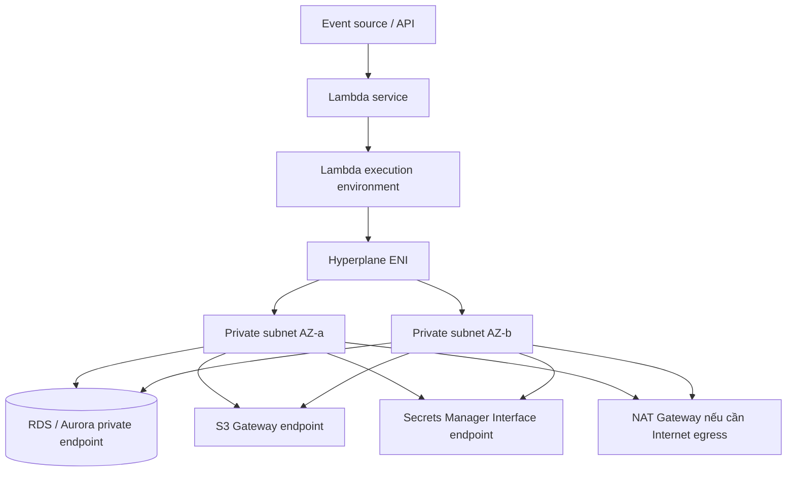

# Truy cập riêng tư từ Lambda với VPC và VPC endpoint

AWS Lambda có thể cần kết nối đến tài nguyên chỉ mở trong mạng riêng, chẳng hạn Amazon RDS, ElastiCache, dịch vụ nội bộ hoặc một máy chủ trong VPC. Function cũng có thể cần gọi S3, DynamoDB, Secrets Manager, SQS hay một AWS service khác mà không muốn đi qua Internet công cộng. Để đáp ứng các nhu cầu này, cần hiểu cách Lambda kết nối vào Amazon VPC, cách route traffic và cách dùng VPC endpoint.

Một điểm dễ nhầm là **đưa Lambda vào VPC không tự động tạo Internet access và cũng không tự động làm mọi AWS API trở thành private**. Lambda dùng network interface trong các subnet được chọn; route table, security group, network ACL, DNS và endpoint quyết định function có thể kết nối đến đâu. Với Java function, AWS SDK thường vẫn dùng hostname dịch vụ theo vùng; nếu endpoint được cấu hình đúng, DNS và routing của VPC sẽ đưa request qua đường riêng.

## 1. Khi nào Lambda cần VPC?

Lambda chạy ngoài VPC do khách hàng quản lý vẫn có thể gọi nhiều AWS service thông qua môi trường mạng do Lambda quản lý. Bạn thường cần cấu hình VPC cho function khi nó phải truy cập tài nguyên có địa chỉ private trong VPC của mình hoặc trong mạng được kết nối với VPC đó.

Các tình huống thường gặp:

- Java function truy vấn RDS hoặc Aurora chỉ có endpoint private.
- Function gọi Redis/ElastiCache, dịch vụ nội bộ hoặc EC2 không có public IP.
- Function truy cập hệ thống ở VPC khác thông qua VPC peering, Transit Gateway hoặc VPN/Direct Connect.
- Function gọi AWS service qua VPC endpoint để traffic không cần đi qua NAT hoặc Internet Gateway.
- Tổ chức yêu cầu kiểm soát egress, route, DNS và security group tập trung trong VPC.

Không nên gắn function vào VPC chỉ vì ứng dụng dùng S3 hoặc DynamoDB. Nếu function không cần truy cập tài nguyên trong VPC và chính sách mạng không yêu cầu, cấu hình mặc định thường đơn giản hơn. Khi gắn vào VPC, function nhận các đường mạng do subnet và route table cung cấp; cần thiết kế thêm NAT hoặc endpoint cho các đích mà nó phải gọi.

## 2. Mô hình mạng của Lambda khi gắn vào VPC

Khi cấu hình VPC cho Lambda, bạn chọn một VPC, một hoặc nhiều subnet và một hoặc nhiều security group. Lambda tạo và quản lý network interface để kết nối execution environment vào mạng của VPC. Traffic từ function đi qua các interface và chịu ảnh hưởng của routing, security group, NACL và DNS trong VPC.

Một kiến trúc thường gặp đặt Lambda trong private subnets ở ít nhất hai Availability Zone, sau đó kết nối tới database và các VPC endpoint:



Trong thực tế, mỗi endpoint và NAT Gateway được triển khai theo cấu hình subnet/AZ riêng. Sơ đồ chỉ thể hiện các đường kết nối logic; không có nghĩa một endpoint hoặc NAT Gateway duy nhất luôn là lựa chọn sẵn sàng cao cho mọi AZ.

### Private subnet và public subnet

Subnet được xem là public khi route table có route ra Internet Gateway (IGW). Subnet private thường không có route trực tiếp tới IGW; nó có thể route egress IPv4 ra NAT Gateway hoặc route tới các VPC endpoint, mạng nội bộ và các đích riêng khác.

Lambda không được cấp public IPv4 address chỉ vì bạn chọn một public subnet. Do đó, đặt Lambda trong subnet có route tới IGW không làm function tự có Internet access. Nếu function cần truy cập Internet công cộng qua IPv4, thường phải đặt Lambda trong private subnet có default route tới NAT Gateway ở public subnet. NAT Gateway có route tới IGW.

Đường đi minh họa:

```text
Lambda ENI trong private subnet
       |
       | route 0.0.0.0/0
       v
NAT Gateway trong public subnet
       |
       | route 0.0.0.0/0
       v
Internet Gateway
       |
       v
Public Internet
```

NAT Gateway hỗ trợ kết nối đi ra; nó không biến Lambda thành endpoint nhận kết nối inbound công khai. Nếu client cần gọi Lambda, hãy dùng cơ chế invoke phù hợp như API Gateway, Function URL, AWS SDK Invoke API hoặc một endpoint nội bộ được thiết kế riêng.

## 3. Lambda Hyperplane ENI và địa chỉ IP trong subnet

Lambda dùng Hyperplane để cung cấp kết nối mạng từ execution environment vào VPC. Các execution environment có thể chia sẻ network interface dựa trên cấu hình subnet và security group phù hợp; không nên hiểu mô hình hiện tại là mỗi invocation luôn chiếm một ENI riêng.

Những điểm cần quan tâm:

- Lambda cần quyền quản lý network interface khi cấu hình VPC và trong các thao tác vòng đời liên quan.
- Một tổ hợp subnet/security group mới có thể cần tạo ENI mới. Subnet cần có đủ địa chỉ IP khả dụng và tài khoản cần nằm trong giới hạn ENI/quota tương ứng.
- Thay đổi VPC configuration có thể cần thời gian để Lambda chuẩn bị hoặc giải phóng tài nguyên mạng.
- Security group gắn với cấu hình Lambda quyết định traffic được phép đi/đến qua ENI.
- Nhiều function có thể chia sẻ cùng một security group, nhưng nên phân tách theo vai trò để giới hạn quyền truy cập và dễ điều tra.

Không tính IP theo công thức “một invocation bằng một IP”. Hãy theo dõi subnet IP capacity, số tổ hợp subnet/security group, ENI và quota thực tế. Tránh dùng subnet quá nhỏ hoặc tạo nhiều tổ hợp mạng không cần thiết.

Execution role thường cần các quyền EC2 để Lambda tạo, mô tả và xóa network interface trong quá trình cấu hình VPC. AWS cung cấp managed policy `AWSLambdaVPCAccessExecutionRole` làm điểm bắt đầu. Các quyền này phục vụ việc quản lý kết nối mạng; chúng không cấp quyền đọc bảng DynamoDB, object S3 hay secret. Các quyền dữ liệu vẫn phải được cấp riêng bằng IAM policy phù hợp. Khi tinh giản policy, cần bảo đảm vòng đời tạo/cập nhật/xóa ENI vẫn hoạt động theo hướng dẫn của AWS.

## 4. VPC endpoint giải quyết vấn đề gì?

VPC endpoint cho phép tài nguyên trong VPC kết nối tới một AWS service hoặc endpoint service thông qua đường mạng riêng được AWS quản lý. Với các endpoint phù hợp, traffic không cần đi qua NAT Gateway hoặc Internet Gateway để đến public service endpoint.

Hai loại endpoint thường dùng khi Lambda truy cập AWS service là **Gateway endpoint** và **Interface endpoint**.

| Đặc điểm | Gateway endpoint | Interface endpoint |
| --- | --- | --- |
| Công nghệ | Route table và prefix list | AWS PrivateLink, network interface trong subnet |
| Dịch vụ phổ biến | Amazon S3, DynamoDB | Secrets Manager, SQS, SNS, KMS, STS, CloudWatch Logs, Lambda API và nhiều dịch vụ khác |
| Cấu hình mạng | Gắn endpoint vào route table cần sử dụng | Chọn subnet/AZ, security group và tùy chọn private DNS |
| Security group của endpoint | Không gắn security group | Có security group kiểm soát inbound đến endpoint ENI |
| DNS | SDK thường dùng hostname service; route table đưa traffic phù hợp tới endpoint | Private DNS có thể ánh xạ hostname service chuẩn về private IP của endpoint |
| Phạm vi | Theo các route table được liên kết | Theo các subnet/AZ và DNS/routing có thể truy cập endpoint ENI |
| Chi phí | Cách tính riêng của gateway endpoint; thường không có phí endpoint theo giờ | Thường có phí theo AZ-hour và dữ liệu xử lý; kiểm tra bảng giá theo vùng/dịch vụ |

Gateway endpoint không tạo ENI trong subnet. Interface endpoint tạo các ENI có private IP trong subnet được chọn. Một số dịch vụ có loại endpoint hoặc giới hạn riêng; luôn kiểm tra danh sách service name và loại endpoint được hỗ trợ tại region đang triển khai.

## 5. Gateway endpoint cho S3 và DynamoDB

Gateway endpoint phù hợp khi Lambda cần truy cập S3 hoặc DynamoDB từ các subnet đã gắn với route table tương ứng. Khi tạo endpoint, bạn chọn VPC và các route table. AWS thêm route tới prefix list của service qua gateway endpoint.

Ví dụ với S3:

1. Tạo S3 Gateway endpoint trong cùng VPC với Lambda.
2. Gắn endpoint vào route table của tất cả private subnet nơi Lambda có thể chạy.
3. Dùng endpoint policy để giới hạn bucket hoặc action cần thiết nếu muốn kiểm soát tại endpoint.
4. Cấp IAM policy cho execution role để thực hiện đúng S3 action trên đúng bucket/prefix.
5. Dùng bucket policy nếu cần ràng buộc request phải đi qua VPC endpoint cụ thể.

Với DynamoDB, quy trình tương tự: tạo Gateway endpoint, gắn route table và cấu hình endpoint policy/IAM policy. Không cần đặt NAT Gateway chỉ để gọi S3 hoặc DynamoDB nếu gateway endpoint đã đáp ứng yêu cầu và không có đích Internet khác.

Ví dụ route table có thể có route logic tới prefix list của S3 qua endpoint ID. Bạn không cần tự quản lý IP public của S3 hoặc hard-code IP service vào route.

### Endpoint policy cho S3

Endpoint policy là lớp kiểm soát những principal và action được phép đi qua endpoint. Một policy giới hạn truy cập vào một bucket cụ thể có thể có dạng:

```json
{
  "Version": "2012-10-17",
  "Statement": [
    {
      "Sid": "AllowReadSpecificBucket",
      "Effect": "Allow",
      "Principal": "*",
      "Action": ["s3:GetObject"],
      "Resource": "arn:aws:s3:::private-reports/*"
    }
  ]
}
```

Đây là ví dụ endpoint policy tối thiểu để minh họa phạm vi. Nó không tự cấp quyền cho Lambda role. Execution role vẫn cần identity policy cho `s3:GetObject`; bucket policy và các policy liên quan cũng phải cho phép request. Nếu endpoint policy không cho phép, request có thể bị chặn dù IAM identity policy đã cho phép.

## 6. Interface endpoint cho Secrets Manager, SQS và các dịch vụ khác

Interface endpoint dùng AWS PrivateLink. Khi tạo endpoint, bạn chọn service name, VPC, subnet ở các AZ cần dùng và security group. AWS tạo endpoint network interface với private IP trong các subnet đó. Nếu bật private DNS và VPC có DNS support phù hợp, hostname service chuẩn trong region có thể resolve về private IP của endpoint.

Ví dụ, Java SDK gọi `secretsmanager.<region>.amazonaws.com`. Khi private DNS cho Secrets Manager interface endpoint được bật và DNS của VPC hoạt động đúng, ứng dụng thường không cần đổi code hoặc hard-code endpoint URL; request được phân giải tới private endpoint.

Một số interface endpoint thường gặp:

| Service | Khi nào Lambda cần endpoint |
| --- | --- |
| Secrets Manager | Đọc secret như credential database hoặc API key |
| Systems Manager Parameter Store | Đọc tham số cấu hình qua API tương ứng |
| SQS | Gửi/nhận message qua API SQS từ private subnet |
| SNS | Publish notification qua API SNS |
| KMS | Gọi API mã hóa/giải mã hoặc thao tác key được phép |
| CloudWatch Logs | Gửi log qua API nếu đường mạng/runtime của ứng dụng cần endpoint này |
| STS | Lấy credential/session qua STS khi luồng xác thực cần gọi API STS |
| Lambda | Client trong VPC gọi Lambda Invoke API qua PrivateLink khi cần private access tới API Lambda |

Danh sách service hỗ trợ interface endpoint và service name phụ thuộc region. Endpoint cho API quản lý của một dịch vụ cũng không đồng nghĩa mọi data plane hoặc mọi hostname phụ của dịch vụ đều tự động đi qua endpoint đó.

### Security group của interface endpoint

Security group gắn với endpoint ENI phải cho phép inbound TCP 443 từ security group hoặc dải CIDR của client cần gọi endpoint. Security group của Lambda phải cho phép outbound TCP 443 tới endpoint. Nếu dùng security group reference, kiểm tra quy tắc tham chiếu được hỗ trợ trong cùng VPC/kiến trúc kết nối.

Ví dụ:

| Security group | Hướng | Protocol/port | Nguồn/đích |
| --- | --- | --- | --- |
| `sg-lambda-app` | Egress | TCP 443 | `sg-vpce-secrets` hoặc CIDR endpoint phù hợp |
| `sg-vpce-secrets` | Ingress | TCP 443 | `sg-lambda-app` |
| `sg-lambda-app` | Egress | TCP 5432 | `sg-db` hoặc CIDR database |
| `sg-db` | Ingress | TCP 5432 | `sg-lambda-app` |

Các rule trên là ví dụ cho PostgreSQL và Secrets Manager. Thay port theo database/service thực tế. Security group là stateful nên response traffic của kết nối được phép sẽ được theo dõi tự động; NACL là stateless và cần cho phép cả chiều đi lẫn chiều về.

## 7. Private DNS và cách AWS SDK phân giải endpoint

Với interface endpoint, private DNS giúp ứng dụng dùng hostname AWS service quen thuộc mà không phải cấu hình endpoint URL riêng. Để hoạt động, VPC cần bật DNS resolution và DNS hostnames theo yêu cầu của dịch vụ; private hosted zone do endpoint quản lý phải được phân giải bởi resolver phù hợp.

Khi bật private DNS cho endpoint, DNS query đến hostname service chuẩn trong region có thể trả về private IP của endpoint ENI. Khi đó:

- Lambda gọi SDK theo region bình thường.
- SDK gửi request đến hostname dịch vụ chuẩn.
- DNS trong VPC trả về địa chỉ private endpoint.
- Route và security group cho phép traffic tới ENI endpoint.

Gateway endpoint có cách hoạt động khác: không tạo private DNS ENI cho S3/DynamoDB theo cùng cơ chế interface endpoint; route table đưa traffic tới prefix list qua gateway endpoint. Vì thế, không nên áp dụng hướng dẫn private DNS của interface endpoint cho gateway endpoint.

Nếu dùng custom DNS server, Route 53 Resolver inbound/outbound endpoint hoặc DNS forwarder, cần bảo đảm query cho service hostname được chuyển đúng tới resolver có thể nhìn thấy private DNS. Cũng cần kiểm tra xung đột private hosted zone, DNS firewall và cấu hình split-horizon.

## 8. Kết nối Lambda tới database trong VPC

Để Lambda kết nối RDS/Aurora private endpoint:

1. Đặt Lambda trong private subnet có route nội bộ tới subnet database.
2. Gắn security group riêng cho Lambda.
3. Security group database cho phép inbound đúng database port từ security group Lambda.
4. Kiểm tra NACL, route table, DNS và subnet group của database.
5. Đặt connection timeout, query timeout và pool size phù hợp.
6. Cân nhắc Amazon RDS Proxy khi concurrency Lambda có thể tạo nhiều kết nối database.

Traffic giữa các subnet trong cùng VPC thường đi qua local route. Không cần NAT hoặc VPC endpoint để kết nối private IP của RDS trong cùng VPC. Nếu database ở VPC khác, cần thêm peering/Transit Gateway/VPN/Direct Connect và kiểm tra route hai chiều, CIDR không chồng lấn, security group và DNS.

### Security group theo hướng tham chiếu

Một cấu hình dễ quản lý là:

- `sg-lambda-orders`: egress TCP 5432 tới `sg-rds-orders`.
- `sg-rds-orders`: ingress TCP 5432 từ `sg-lambda-orders`.

Không mở database port từ `0.0.0.0/0`. Nếu Lambda cần Redis hoặc API nội bộ, tạo rule riêng cho đúng port và đích. Security group chỉ kiểm soát network traffic; database user, password/IAM authentication và quyền SQL vẫn cần được cấu hình độc lập.

### Kết nối và concurrency

Lambda có thể scale concurrency nhanh hơn khả năng tạo connection của database. Mỗi invocation không nhất thiết phải tạo connection mới, nhưng nếu ứng dụng mở nhiều connection song song, database có thể hết giới hạn. Dùng pool nhỏ, tái sử dụng client an toàn trong runtime, đóng connection sau thao tác và cân nhắc RDS Proxy để gom/quản lý connection. RDS Proxy không thay thế việc tối ưu query, timeout và transaction.

## 9. Khi nào vẫn cần NAT Gateway?

VPC endpoint chỉ cung cấp đường private tới các service được hỗ trợ. Nếu function phải gọi API Internet công cộng không có endpoint riêng, chẳng hạn một đối tác SaaS hoặc public API bất kỳ, cần một đường egress phù hợp. Với IPv4, mẫu phổ biến là NAT Gateway trong public subnet và route từ private subnet tới NAT Gateway.

| Nhu cầu | Hướng kết nối thường dùng |
| --- | --- |
| RDS private trong cùng VPC | Local VPC route + security group |
| S3 hoặc DynamoDB | Gateway endpoint |
| Secrets Manager hoặc SQS | Interface endpoint |
| Public API của đối tác không có PrivateLink | NAT Gateway hoặc egress proxy được quản lý |
| Service riêng ở VPC khác | Peering/Transit Gateway/VPN/Direct Connect tùy topology |
| API Lambda Invoke từ client trong VPC | Interface endpoint cho Lambda API nếu cần PrivateLink |

NAT Gateway có chi phí theo thời gian tồn tại và dữ liệu xử lý; traffic liên vùng/AZ và data transfer có thể phát sinh thêm chi phí tùy kiến trúc. Nếu nhiều function chỉ gọi các AWS service có endpoint phù hợp, VPC endpoint có thể giảm phụ thuộc NAT và giữ traffic trong mạng AWS. Tuy nhiên, endpoint interface cũng có phí theo AZ và dữ liệu; cần so sánh theo lưu lượng và số AZ.

Để có tính sẵn sàng cao, thường triển khai NAT Gateway theo từng AZ và để private subnet của AZ đó route tới NAT cùng AZ. Dùng một NAT Gateway duy nhất có thể giảm số tài nguyên nhưng tạo điểm phụ thuộc AZ và có thể phát sinh phí truyền dữ liệu chéo AZ. Chọn theo yêu cầu sẵn sàng, chi phí và topology.

## 10. Phân biệt Lambda truy cập service với client truy cập Lambda

Có hai hướng traffic khác nhau:

**Lambda gọi AWS service:** function trong VPC gọi S3, Secrets Manager, SQS hoặc một dịch vụ khác. Khi cần đường riêng, cấu hình gateway/interface endpoint tương ứng trong VPC của function.

**Client trong VPC gọi Lambda API:** một ứng dụng EC2/ECS/on-premises qua VPN/Direct Connect cần gọi API Lambda như `Invoke`. Khi đó, có thể tạo interface VPC endpoint cho service Lambda (PrivateLink) trong VPC của client. Security group của endpoint cho phép TCP 443 từ client; IAM và resource-based policy của function vẫn quyết định ai được invoke.

Endpoint cho Lambda API không phải là cách đưa một function HTTP thành server nằm trong VPC để nhận kết nối TCP tùy ý. Nếu muốn HTTP private cho người dùng nội bộ, có thể đặt API Gateway private API hoặc một lớp ingress phù hợp trước Lambda; cấu hình resource policy, VPC endpoint policy và authorization theo yêu cầu.

## 11. IAM, endpoint policy và resource policy là các lớp khác nhau

Một kết nối private thành công cần cả đường mạng và quyền truy cập. VPC endpoint không tự cấp quyền IAM. Hãy phân biệt:

| Lớp | Câu hỏi mà lớp này trả lời |
| --- | --- |
| Route table / DNS | Request đi tới địa chỉ nào và qua đường mạng nào? |
| Security group / NACL | Kết nối TCP/IP có được phép đi qua không? |
| Endpoint policy | Request nào được phép đi qua endpoint này? |
| IAM identity policy | Execution role có được gọi action trên resource không? |
| Resource policy | Resource có chấp nhận principal/request này không? |
| KMS key policy | Principal có được dùng key cho thao tác mã hóa/giải mã không? |

Ví dụ Lambda đọc secret cần:

- Route và DNS tới Secrets Manager interface endpoint.
- Security group Lambda cho outbound 443 và endpoint SG cho inbound 443.
- Endpoint policy cho phép action cần thiết nếu endpoint policy được giới hạn.
- Execution role có `secretsmanager:GetSecretValue` trên secret cụ thể.
- Nếu secret dùng customer-managed KMS key, role và key policy phải cho phép quyền KMS tương ứng.

Không dùng `Principal: "*"` và `Action: "*"` như cấu hình production mặc định. Hãy giới hạn theo role, service, resource và action thực sự cần thiết.

### Ràng buộc bucket policy theo VPC endpoint

S3 bucket policy có thể dùng condition `aws:SourceVpce` để yêu cầu request phải đi qua một endpoint ID cụ thể. Ví dụ minh họa:

```json
{
  "Version": "2012-10-17",
  "Statement": [
    {
      "Sid": "DenyRequestsOutsideApprovedEndpoint",
      "Effect": "Deny",
      "Principal": "*",
      "Action": "s3:GetObject",
      "Resource": "arn:aws:s3:::private-reports/*",
      "Condition": {
        "StringNotEquals": {
          "aws:SourceVpce": "vpce-0123456789abcdef0"
        }
      }
    }
  ]
}
```

Đây là ví dụ minh họa, phải thay endpoint ID và kiểm tra toàn bộ đường truy cập trước khi áp dụng. Một explicit Deny có thể chặn cả console, pipeline, service khác hoặc ứng dụng hợp lệ nếu chúng truy cập bucket qua đường không đi qua endpoint đó. Cần có kế hoạch quản trị/khôi phục phù hợp để không tự khóa quyền truy cập dữ liệu.

## 12. Ví dụ Java AWS SDK v2 gọi S3 qua Gateway endpoint

Khi S3 Gateway endpoint đã được gắn vào route table của private subnet, Java SDK v2 thường tiếp tục dùng endpoint S3 chuẩn theo region. Không cần đặt `endpointOverride` chỉ để sử dụng gateway endpoint.

```java
import software.amazon.awssdk.regions.Region;
import software.amazon.awssdk.services.s3.S3Client;
import software.amazon.awssdk.services.s3.model.GetObjectRequest;
import software.amazon.awssdk.core.ResponseInputStream;
import software.amazon.awssdk.services.s3.model.GetObjectResponse;

public final class PrivateS3Reader {
    private final S3Client s3 = S3Client.builder()
            .region(Region.AP_SOUTHEAST_1)
            .build();

    public String readText(String bucket, String key) throws Exception {
        GetObjectRequest request = GetObjectRequest.builder()
                .bucket(bucket)
                .key(key)
                .build();

        try (ResponseInputStream<GetObjectResponse> input =
                     s3.getObject(request)) {
            return new String(input.readAllBytes(),
                    java.nio.charset.StandardCharsets.UTF_8);
        }
    }
}
```

Ví dụ dùng `readAllBytes()` chỉ phù hợp với object nhỏ. Với file lớn, hãy stream theo buffer hoặc ghi ra nơi lưu trữ tạm phù hợp để tránh nạp toàn bộ object vào heap. Region phải khớp bucket và môi trường triển khai. SDK dùng default credential provider chain; execution role của Lambda cấp quyền cần thiết, không nhúng access key vào source.

Nếu DNS, route table và endpoint policy đúng, request đi qua S3 Gateway endpoint. Nếu endpoint không tồn tại hoặc route table không được gắn, SDK có thể thử kết nối qua đường khác nếu có route/NAT phù hợp; điều đó không có nghĩa private endpoint đang hoạt động. Có thể dùng bucket policy `aws:SourceVpce` để bắt buộc request qua endpoint khi yêu cầu bảo mật cần như vậy.

## 13. Ví dụ Java AWS SDK v2 gọi Secrets Manager qua Interface endpoint

Với Secrets Manager interface endpoint bật private DNS, Java SDK có thể gọi hostname regional bình thường:

```java
import software.amazon.awssdk.regions.Region;
import software.amazon.awssdk.services.secretsmanager.SecretsManagerClient;
import software.amazon.awssdk.services.secretsmanager.model.GetSecretValueRequest;

public final class DatabaseSecretProvider {
    private final SecretsManagerClient secrets =
            SecretsManagerClient.builder()
                    .region(Region.AP_SOUTHEAST_1)
                    .build();

    public String load(String secretArn) {
        var response = secrets.getSecretValue(
                GetSecretValueRequest.builder()
                        .secretId(secretArn)
                        .build());
        return response.secretString();
    }
}
```

Không cần hard-code private IP của endpoint ENI hoặc đặt `endpointOverride` khi dùng private DNS theo cách thông thường. Endpoint ENI có thể thay đổi khi endpoint được thay thế hoặc tái cấu hình; ứng dụng nên dùng hostname dịch vụ và để DNS xử lý. Chỉ dùng endpoint override khi có yêu cầu rõ ràng và biết cách quản lý TLS hostname, signing region và endpoint lifecycle.

Secret chứa password hoặc token không nên được log. Có thể cache secret trong runtime trong thời gian phù hợp để giảm số lần gọi, nhưng phải cân nhắc thời hạn secret, rotation và việc runtime có thể tồn tại lâu hơn dự kiến. Cache không thay thế quyền truy cập IAM hoặc quy trình refresh.

## 14. Cấu hình VPC endpoint bằng CloudFormation

Đoạn CloudFormation sau minh họa hai tài nguyên endpoint: S3 Gateway endpoint và Secrets Manager Interface endpoint. Các ID subnet, route table và security group được truyền qua parameter hoặc tham chiếu resource đã định nghĩa trong stack.

```yaml
Resources:
  S3GatewayEndpoint:
    Type: AWS::EC2::VPCEndpoint
    Properties:
      VpcId: !Ref VpcId
      VpcEndpointType: Gateway
      ServiceName: !Sub com.amazonaws.${AWS::Region}.s3
      RouteTableIds:
        - !Ref PrivateRouteTableA
        - !Ref PrivateRouteTableB
      PolicyDocument:
        Version: "2012-10-17"
        Statement:
          - Effect: Allow
            Principal: "*"
            Action:
              - s3:GetObject
            Resource:
              - arn:aws:s3:::private-reports/*

  SecretsManagerEndpoint:
    Type: AWS::EC2::VPCEndpoint
    Properties:
      VpcId: !Ref VpcId
      VpcEndpointType: Interface
      ServiceName: !Sub com.amazonaws.${AWS::Region}.secretsmanager
      PrivateDnsEnabled: true
      SubnetIds:
        - !Ref PrivateSubnetA
        - !Ref PrivateSubnetB
      SecurityGroupIds:
        - !Ref VpcEndpointSecurityGroup
```

Đây là fragment minh họa, chưa phải template độc lập: cần khai báo các parameter/resource được tham chiếu, IAM role cho Lambda, Lambda `VpcConfig`, security group rule, route table và policy đầy đủ cho ứng dụng. Endpoint policy trên S3 chỉ cho phép `GetObject` tới prefix đã nêu; nếu function cần `ListBucket`, `PutObject` hoặc thao tác khác, phải thêm action/resource phù hợp. Endpoint policy không thay thế IAM identity policy.

Lambda function có thể được gắn vào subnet và security group như sau:

```yaml
  OrderFunction:
    Type: AWS::Lambda::Function
    Properties:
      Runtime: java21
      Handler: com.example.orders.PlaceOrderLambdaHandler
      Role: !GetAtt OrderFunctionRole.Arn
      Code:
        S3Bucket: !Ref ArtifactBucket
        S3Key: !Ref ArtifactKey
      VpcConfig:
        SubnetIds:
          - !Ref PrivateSubnetA
          - !Ref PrivateSubnetB
        SecurityGroupIds:
          - !Ref LambdaSecurityGroup
```

Runtime, handler, artifact và các logical ID chỉ là ví dụ. Chọn runtime Java mà Lambda hỗ trợ tại thời điểm triển khai và cấu hình đúng entry point/package của ứng dụng.

## 15. DNS, route table, security group và NACL: kiểm tra theo thứ tự

Một request tới endpoint có thể thất bại dù endpoint đã được tạo. Hãy kiểm tra lần lượt:

1. **DNS:** VPC có bật DNS support/hostnames phù hợp không? Hostname service resolve thành private IP của endpoint khi cần không? Có custom DNS hoặc private hosted zone ghi đè không?
2. **Subnet:** Lambda có thể chạy trong tất cả subnet đã chọn không? Endpoint ENI có nằm ở subnet/AZ có thể truy cập không?
3. **Route table:** private subnet có route local, route gateway endpoint hoặc route tới NAT/đích tương ứng không? Gateway endpoint đã được gắn vào đúng route table chưa?
4. **Lambda security group:** egress có cho phép TCP/port tới database hoặc endpoint không?
5. **Endpoint security group:** interface endpoint có inbound TCP 443 từ Lambda security group không?
6. **Database security group:** inbound port có cho phép từ Lambda security group không?
7. **NACL:** subnet NACL có cho phép traffic đi và response traffic về, gồm ephemeral ports cần thiết không?
8. **Policy:** IAM identity policy, endpoint policy, resource policy và KMS key policy có cho phép request không?
9. **Service/region:** SDK có dùng đúng region, hostname và loại endpoint mà dịch vụ hỗ trợ không?

Security group stateful nên response của kết nối được phép được tự động theo dõi. NACL stateless nên cần rule cho cả chiều request và chiều trả lời. Một NACL quá chặt có thể gây timeout dù security group đã đúng.

## 16. Chẩn đoán lỗi kết nối thường gặp

| Triệu chứng | Nguyên nhân có thể | Hướng kiểm tra |
| --- | --- | --- |
| Lambda timeout khi gọi RDS | SG database thiếu inbound, sai port, route/DNS, database quá tải hoặc connection pool cạn | Kiểm tra hostname resolve, SG hai phía, NACL, query latency và connection count |
| SDK báo timeout khi gọi Secrets Manager | Endpoint SG không mở 443, private DNS sai, endpoint ở subnet không truy cập được | Kiểm tra DNS từ VPC, endpoint ENI, route và SG |
| S3 AccessDenied dù route endpoint đúng | IAM role, endpoint policy hoặc bucket policy chặn | Kiểm tra CloudTrail data event nếu bật, IAM simulator và các policy liên quan |
| S3 request đi qua NAT thay vì endpoint | Route table của subnet Lambda chưa gắn gateway endpoint hoặc request đi qua route khác | Kiểm tra association của route table và prefix-list route |
| Lambda trong public subnet không ra Internet | Lambda không có public IP chỉ vì subnet là public | Dùng private subnet + NAT hoặc endpoint phù hợp |
| Function không truy cập được một AWS API | Chưa tạo endpoint cho service đó và private subnet không có NAT route | Xác định hostname/service API và thêm endpoint hoặc egress phù hợp |
| Một số invocation kết nối được, một số timeout | Khác subnet/AZ, endpoint chỉ có ở một AZ, DNS/cache, quota hoặc downstream quá tải | Kiểm tra mọi subnet/AZ, endpoint coverage, ENI và metric |
| Kết nối hoạt động nhưng bị AccessDenied | Network đã thông nhưng quyền IAM/resource/KMS không đủ | Tách lỗi mạng khỏi lỗi authorization; đọc error code và policy evaluation |

Các công cụ hữu ích gồm VPC Flow Logs, CloudWatch Logs/Metrics, CloudTrail, Route 53 Resolver query logging, Reachability Analyzer và `describe-vpc-endpoints`/`describe-network-interfaces` qua AWS CLI. Flow Logs giúp thấy traffic được accept/reject ở cấp ENI; nó không giải thích toàn bộ quyết định IAM. CloudTrail ghi lại API call phù hợp với loại event và cấu hình logging; S3 object-level data events cần được bật nếu muốn audit chi tiết object access.

### Quy trình debug thực tế

1. Ghi nhận invocation ID, thời gian, hostname, port và lỗi chính xác.
2. Xác định function đang chạy ở subnet/AZ nào và security group nào.
3. Resolve hostname từ môi trường có cùng DNS/VPC path (ví dụ EC2 debug host trong subnet tương ứng hoặc công cụ kiểm tra phù hợp).
4. Kiểm tra endpoint state, subnet association, private DNS và route table.
5. Kiểm tra security group/NACL hai chiều.
6. Nếu TCP kết nối được nhưng API trả AccessDenied, kiểm tra IAM, endpoint policy, resource policy và KMS.
7. Đối chiếu VPC Flow Logs/CloudTrail để phân biệt lỗi network với lỗi authorization.
8. Kiểm tra quota, subnet IP capacity, database connections và concurrency nếu lỗi chỉ xuất hiện khi tải tăng.

Không kết luận “VPC endpoint hỏng” chỉ từ một lỗi AccessDenied; endpoint có thể hoạt động đúng nhưng policy từ chối request. Tương tự, DNS resolve thành private IP chưa chứng minh security group và policy đã cho phép kết nối.

## 17. Bảo mật và thiết kế sẵn sàng cao

Đường mạng riêng giảm phơi bày ra Internet nhưng không thay thế kiểm soát danh tính và dữ liệu. Nên áp dụng:

- Chọn private subnet cho Lambda truy cập tài nguyên nội bộ.
- Tách security group cho function theo vai trò và chỉ mở port/đích cần thiết.
- Dùng endpoint policy và IAM policy theo quyền tối thiểu.
- Dùng resource policy (ví dụ bucket policy) khi cần giới hạn nguồn truy cập, sau khi đánh giá mọi client hợp lệ.
- Bật mã hóa TLS khi truyền và encryption at rest theo yêu cầu.
- Tránh ghi secret, token, private endpoint URL nhạy cảm hoặc payload chứa dữ liệu cá nhân vào log.
- Triển khai interface endpoint ở các AZ phù hợp với subnet Lambda; tránh phụ thuộc một AZ nếu yêu cầu sẵn sàng cao.
- Gắn gateway endpoint vào tất cả route table mà Lambda có thể sử dụng.
- Dự phòng IP subnet, theo dõi ENI/quota và kiểm soát số tổ hợp subnet/security group.
- Với NAT, cân nhắc NAT Gateway theo AZ để giảm phụ thuộc liên AZ và cải thiện resilience.
- Dùng VPC Flow Logs, CloudTrail và cảnh báo cho lỗi kết nối, AccessDenied, throttling và cạn connection.

Nếu dùng IPv6 hoặc dual-stack, phải thiết kế route IPv6, egress-only Internet Gateway, security group IPv6 và khả năng hỗ trợ IPv6 của endpoint/service. Không giả định NAT Gateway IPv4 xử lý luôn egress IPv6; đường đi và dịch vụ hỗ trợ khác nhau.

## 18. Chi phí và lựa chọn giữa endpoint với NAT

Chi phí phụ thuộc region, loại endpoint, số AZ, dữ liệu truyền, NAT Gateway, cross-AZ traffic và service được gọi. Không có một cấu hình rẻ nhất cho mọi workload.

| Lựa chọn | Lợi ích | Chi phí/đổi lại cần cân nhắc |
| --- | --- | --- |
| S3/DynamoDB Gateway endpoint | Đường riêng theo route table, không cần NAT cho traffic tới hai dịch vụ này | Chỉ áp dụng cho service được hỗ trợ và route table phải gắn đúng |
| Interface endpoint | PrivateLink, private DNS và kiểm soát bằng endpoint SG/policy | Phí theo endpoint/AZ và dữ liệu xử lý; cần quản lý endpoint ENI/SG/DNS |
| NAT Gateway | Cho phép private subnet gọi nhiều public IPv4 destinations | Phí theo giờ và dữ liệu; có thể phát sinh cross-AZ/data transfer |
| Egress proxy/firewall | Kiểm soát tập trung, lọc domain và audit egress | Tăng thành phần vận hành, scale và độ phức tạp |

Hãy thống kê hostname/service mà function thực sự gọi. Nếu chỉ gọi S3 và Secrets Manager, gateway endpoint cho S3 cùng interface endpoint cho Secrets Manager có thể đáp ứng mà không cần NAT cho hai luồng đó. Nếu function còn gọi API đối tác công cộng, vẫn cần NAT hoặc egress proxy cho đích này. Đánh giá theo chi phí tổng, yêu cầu private connectivity, availability và chính sách bảo mật.

## 19. Checklist triển khai Lambda private access

- [ ] Xác định rõ Lambda cần truy cập tài nguyên private nào và AWS service nào.
- [ ] Chỉ gắn Lambda vào VPC khi cần hoặc khi chính sách mạng yêu cầu.
- [ ] Chọn private subnet ở nhiều AZ phù hợp và có đủ địa chỉ IP khả dụng.
- [ ] Gắn security group riêng cho Lambda, giới hạn egress theo đích/port.
- [ ] Với database, mở inbound từ Lambda security group tới đúng port; kiểm tra route và DNS.
- [ ] Tạo S3/DynamoDB Gateway endpoint và gắn đúng route table.
- [ ] Tạo Interface endpoint cho Secrets Manager/SQS/KMS/STS hoặc service cần thiết; bật private DNS khi phù hợp.
- [ ] Mở TCP 443 từ Lambda SG tới Interface endpoint SG và kiểm tra NACL.
- [ ] Cấu hình endpoint policy, IAM identity policy, resource policy và KMS key policy tương ứng.
- [ ] Nếu cần public Internet egress, dùng NAT Gateway/egress proxy; không chỉ chọn public subnet cho Lambda.
- [ ] Kiểm tra DNS support, private DNS, custom resolver và route table.
- [ ] Dùng Java SDK với region/default credential provider; không hard-code key hoặc IP endpoint.
- [ ] Giới hạn connection pool, timeout và concurrency; cân nhắc RDS Proxy cho database.
- [ ] Bật logging/flow logs phù hợp và có quy trình debug network so với authorization.
- [ ] Kiểm tra chi phí endpoint/NAT, coverage nhiều AZ và khả năng phục hồi.

Truy cập riêng tư từ Lambda là kết quả của nhiều lớp phối hợp: VPC configuration tạo đường kết nối cho function; subnet và route table xác định đường đi; security group/NACL kiểm soát traffic; VPC endpoint đưa request tới AWS service qua mạng riêng; IAM và resource policy quyết định quyền nghiệp vụ. Khi thiết kế đúng từng lớp, Java function có thể truy cập database và AWS service an toàn mà vẫn giữ được khả năng mở rộng, quan sát và kiểm soát chi phí.
