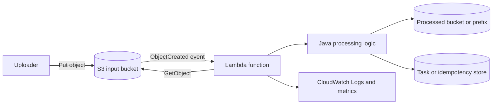
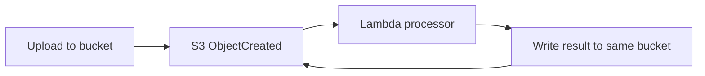

# Xử lý sự kiện S3 và quản lý quyền giữa bucket với Lambda

Amazon S3 có thể phát thông báo khi object được tạo, xóa hoặc thay đổi theo các loại sự kiện được hỗ trợ. AWS Lambda có thể nhận những thông báo này để xử lý file ngay khi được tải lên, ví dụ tạo thumbnail, kiểm tra định dạng, trích xuất dữ liệu CSV, lập chỉ mục tài liệu hoặc khởi chạy một quy trình nghiệp vụ.

Để tích hợp an toàn, cần phân biệt hai quyền độc lập. **S3 cần được Lambda cho phép gọi function** thông qua resource-based policy của Lambda. Sau khi được gọi, **function cần execution role có quyền truy cập object** nếu muốn đọc hoặc ghi dữ liệu trong bucket. Cấu hình đúng một trong hai quyền không thay thế quyền còn lại.

Trong phạm vi **CLOUD_SERVERLESS**, bài học tập trung vào Java function được kích hoạt bởi HTTP, message hoặc event, cùng cách xử lý trigger, quyền truy cập, retry, idempotency, mở rộng và chi phí. Ví dụ S3 và Lambda giúp minh họa cách cấu hình event source, xử lý payload, cấp quyền tối thiểu và bảo vệ hệ thống khi event được giao trùng hoặc sai thứ tự.

## 1. Luồng tích hợp S3 với Lambda

Một luồng xử lý file điển hình gồm các bước:

1. Người dùng hoặc hệ thống tải object lên bucket, thường vào một prefix như `incoming/`.
2. S3 phát event `ObjectCreated` phù hợp với cấu hình notification.
3. S3 gọi Lambda nếu resource policy của function cho phép service principal `s3.amazonaws.com` gọi function từ bucket được chỉ định.
4. Lambda nhận event, đọc bucket/key/version và kiểm tra loại sự kiện.
5. Java handler gọi use case xử lý file; execution role cung cấp quyền `s3:GetObject` hoặc quyền cần thiết khác.
6. Function lưu kết quả ở prefix hoặc bucket đích, ghi trạng thái xử lý và phát metric/log.



S3 giữ vai trò nguồn sự kiện và lưu trữ object. Lambda là compute thực thi mã. Java handler chỉ tồn tại trong thời gian invocation; nếu cần lưu trạng thái xử lý qua nhiều lần gọi, hãy dùng database, object metadata hoặc một kho trạng thái phù hợp thay vì biến trong bộ nhớ.

## 2. S3 Event Notification hoạt động như thế nào?

Bucket notification configuration cho biết S3 cần phát loại event nào, lọc theo prefix/suffix nào và gửi đến destination nào. Với tích hợp trực tiếp, destination có thể là Lambda function, SNS topic hoặc SQS queue. S3 cũng có thể gửi sự kiện sang Amazon EventBridge khi bật tích hợp EventBridge cho bucket.

Các event phổ biến:

| Event type | Ý nghĩa | Ví dụ sử dụng |
|---|---|---|
| `s3:ObjectCreated:Put` | Object được tạo bằng PutObject | Xử lý file tải lên trực tiếp |
| `s3:ObjectCreated:Post` | Object được tạo qua POST | Xử lý upload từ form/browser |
| `s3:ObjectCreated:Copy` | Object được tạo bằng thao tác copy | Đồng bộ hoặc phân loại object mới |
| `s3:ObjectCreated:CompleteMultipartUpload` | Hoàn tất multipart upload | Xử lý file lớn sau khi upload hoàn tất |
| `s3:ObjectCreated:*` | Nhóm các sự kiện tạo object | Xử lý mọi kiểu tạo object được hỗ trợ |
| `s3:ObjectRemoved:Delete` | Object bị xóa | Cập nhật chỉ mục hoặc trạng thái tham chiếu |
| `s3:ObjectRemoved:DeleteMarkerCreated` | Tạo delete marker trong bucket versioning | Cập nhật trạng thái xóa logic |

Không nên đăng ký mọi event nếu nghiệp vụ chỉ cần một loại thay đổi. Event type càng rộng thì function càng dễ nhận những trường hợp không cần xử lý và phát sinh invocation cũng như chi phí không cần thiết.

Với notification trực tiếp đến Lambda, bucket và function phải ở cùng AWS Region. Cần kiểm tra giới hạn và đặc tính của destination theo tài liệu dịch vụ đang sử dụng.

## 3. Lọc event theo prefix và suffix

Prefix/suffix filter giúp chỉ kích hoạt function cho object phù hợp. Ví dụ, chỉ xử lý file CSV được tải vào `incoming/`:

```yaml
NotificationConfiguration:
  LambdaConfigurations:
    - Event: s3:ObjectCreated:*
      Function: arn:aws:lambda:ap-southeast-1:111122223333:function:csv-processor
      Filter:
        S3Key:
          Rules:
            - Name: prefix
              Value: incoming/
            - Name: suffix
              Value: .csv
```

Đây là đoạn cấu hình minh họa cho bucket notification; ARN và Region phải thay bằng tài nguyên thực tế. Prefix và suffix là chuỗi lọc, không phải biểu thức wildcard tổng quát. Chúng phân biệt chữ hoa/chữ thường. Hãy kiểm tra quy tắc lọc của S3 khi có nhiều notification cùng event type vì một số tổ hợp filter chồng lấn không được chấp nhận.

Filter có thể giảm invocation nhưng không thay thế validation trong code. Function vẫn cần kiểm tra event type, bucket, key và loại file trước khi thực hiện nghiệp vụ. Không tin `Content-Type` do client gửi lên như bằng chứng duy nhất về định dạng file; nếu cần, hãy kiểm tra nội dung thực tế.

## 4. Hai lớp quyền khác nhau: invoke và truy cập object

Đây là phần dễ cấu hình nhầm nhất trong tích hợp S3-Lambda.

**1. Lambda resource-based policy:** cho phép S3 gọi Lambda. Principal là `s3.amazonaws.com`; policy giới hạn nguồn bằng bucket ARN và tài khoản nguồn.

**2. Lambda execution role:** cho phép mã đang chạy trong Lambda gọi dịch vụ AWS, ví dụ `s3:GetObject`, `s3:PutObject`, `kms:Decrypt` và ghi log.

Hai policy có mục đích và principal khác nhau:

| Câu hỏi | Policy cần cấu hình | Principal/identity |
|---|---|---|
| S3 có được phép invoke function không? | Lambda resource-based policy | `s3.amazonaws.com` |
| Function có được đọc object không? | IAM policy gắn với execution role | Role mà Lambda assume khi chạy |
| Function có được ghi object đầu ra không? | IAM policy gắn với execution role | Role mà Lambda assume khi chạy |
| Function có được giải mã object SSE-KMS không? | IAM policy và KMS key policy phù hợp | Execution role và key policy |

Bucket policy không tự cấp quyền invoke Lambda. Ngược lại, việc thêm `lambda:InvokeFunction` cho S3 không cấp cho mã Java quyền đọc object. Cần cấu hình từng lớp theo đúng hành động.

## 5. Cho phép S3 gọi Lambda bằng resource-based policy

Lambda cần có resource policy cho phép S3 service principal gọi function. Ví dụ lệnh AWS CLI:

```bash
aws lambda add-permission \
  --function-name csv-processor \
  --statement-id allow-upload-bucket-invoke \
  --action lambda:InvokeFunction \
  --principal s3.amazonaws.com \
  --source-arn arn:aws:s3:::example-upload-bucket \
  --source-account 111122223333
```

Trong ví dụ:

- `--principal s3.amazonaws.com` xác định dịch vụ S3 là bên được phép gọi.
- `--source-arn` giới hạn nguồn ở bucket cụ thể. Đây là bucket ARN, không phải object ARN có `/*` ở cuối.
- `--source-account` giới hạn tài khoản sở hữu bucket, giúp giảm rủi ro confused deputy.
- `--statement-id` là tên duy nhất của statement trong policy.

Không nên dùng principal hoặc source ARN dạng wildcard rộng nếu không có yêu cầu cụ thể. Trong triển khai thực tế, hãy dùng ARN của function/alias đúng với destination được cấu hình trong bucket notification.

Phải thêm quyền invoke trước khi áp dụng bucket notification configuration để S3 có thể xác minh destination. Khi cập nhật hạ tầng bằng CloudFormation hoặc công cụ IaC, cần chú ý quan hệ phụ thuộc: bucket notification tham chiếu Lambda ARN, còn Lambda permission tham chiếu bucket ARN. Hai tham chiếu ngược chiều có thể tạo circular dependency nếu đặt trong cùng một resource graph. Có thể tách việc tạo bucket và việc cấu hình notification thành các bước triển khai, dùng stack/module riêng hoặc custom resource phù hợp.

## 6. Execution role cho Lambda đọc object

Lambda assume execution role khi chạy. Trust policy của role cần cho phép dịch vụ Lambda đảm nhận role, thường có principal `lambda.amazonaws.com`.

Ví dụ trust policy:

```json
{
  "Version": "2012-10-17",
  "Statement": [
    {
      "Effect": "Allow",
      "Principal": {
        "Service": "lambda.amazonaws.com"
      },
      "Action": "sts:AssumeRole"
    }
  ]
}
```

Role policy cho phép đọc object trong một prefix cụ thể:

```json
{
  "Version": "2012-10-17",
  "Statement": [
    {
      "Sid": "ReadIncomingObjects",
      "Effect": "Allow",
      "Action": [
        "s3:GetObject"
      ],
      "Resource": "arn:aws:s3:::example-upload-bucket/incoming/*"
    }
  ]
}
```

Nếu function đọc một object version cụ thể, có thể cần `s3:GetObjectVersion`. Nếu chỉ nhận bucket/key trong event và đọc đúng object, thường không cần `s3:ListBucket`; chỉ cấp quyền list khi code thực sự gọi thao tác liệt kê. Nếu function ghi file kết quả, cấp riêng `s3:PutObject` cho prefix đích, chẳng hạn `arn:aws:s3:::example-output-bucket/processed/*`.

Lambda thường cũng cần quyền ghi log vào CloudWatch Logs. Có thể gắn policy quản lý sẵn như `AWSLambdaBasicExecutionRole` hoặc policy tương đương được tổ chức phê duyệt. Không cấp `s3:*` trên `*` chỉ để làm ví dụ chạy nhanh.

## 7. Quyền khi object được mã hóa bằng SSE-KMS

Nếu bucket dùng SSE-S3, S3 quản lý khóa mã hóa. Nếu object được mã hóa bằng SSE-KMS với customer managed key, Lambda cần được phép giải mã object khi gọi `GetObject`.

Thông thường cần:

- Execution role có quyền `kms:Decrypt` trên đúng KMS key.
- KMS key policy cho phép role đó sử dụng key, trực tiếp hoặc thông qua IAM policy được key policy tin cậy.
- Nếu có điều kiện trong key policy, kiểm tra encryption context và các điều kiện dịch vụ tương ứng.
- Nếu bucket và key thuộc tài khoản khác nhau, phối hợp IAM policy, key policy và bucket policy cho cross-account access.

Ví dụ statement bổ sung cho execution role:

```json
{
  "Sid": "DecryptUploadedObjects",
  "Effect": "Allow",
  "Action": "kms:Decrypt",
  "Resource": "arn:aws:kms:ap-southeast-1:111122223333:key/12345678-1234-1234-1234-123456789012"
}
```

Chỉ thêm quyền KMS nếu object thực sự dùng key đó. Không dùng `Resource: "*"` khi có thể giới hạn vào key cụ thể. Khi kiểm tra lỗi `AccessDenied`, xem cả S3 permission lẫn KMS key policy; có `s3:GetObject` nhưng thiếu `kms:Decrypt` vẫn có thể không đọc được nội dung object.

## 8. Cấu trúc S3 event và dữ liệu cần đọc

S3 event notification thường chứa một mảng `Records`. Mỗi record mô tả một sự kiện, bao gồm nguồn, tên event, thời gian, bucket và object.

Payload rút gọn minh họa:

```json
{
  "Records": [
    {
      "eventVersion": "2.1",
      "eventSource": "aws:s3",
      "eventName": "ObjectCreated:Put",
      "awsRegion": "ap-southeast-1",
      "eventTime": "2026-11-17T08:30:00.000Z",
      "s3": {
        "bucket": {
          "name": "example-upload-bucket",
          "arn": "arn:aws:s3:::example-upload-bucket"
        },
        "object": {
          "key": "incoming/report%20nov.csv",
          "size": 2048,
          "versionId": "3HL4kqtJlcpXroDTDmjVBH40Nrjfkd",
          "sequencer": "00673A1B2C3D4E5F"
        }
      }
    }
  ]
}
```

Đây là payload minh họa, không phải schema đầy đủ cho mọi event version. Một số field có thể không xuất hiện tùy loại sự kiện và cấu hình bucket. Handler nên đọc các field bắt buộc có kiểm tra null, bỏ qua field tùy chọn khi không có và có chiến lược với event version mới.

`eventName` thường không có tiền tố `s3:` trong record, ví dụ `ObjectCreated:Put`. `eventVersion` gồm major/minor; ứng dụng nên kiểm tra major version có được hỗ trợ và không giả định payload chỉ chứa đúng các field đã biết. Có thể chấp nhận minor version mới nếu contract và parser tương thích với phần mở rộng.

## 9. Giải mã object key đúng cách

Trong S3 event notification, object key được mã hóa theo kiểu `application/x-www-form-urlencoded`. Ví dụ dấu cách có thể xuất hiện dưới dạng `+` hoặc `%20`; dấu cộng thực tế được mã hóa thành `%2B`. Nếu dùng key chưa giải mã để gọi `GetObject`, function có thể tìm nhầm object và nhận `NoSuchKey`.

Nếu dùng thư viện AWS Lambda Java Events, object notification cung cấp helper `getUrlDecodedKey()` ở các phiên bản phù hợp. Khi tự xử lý payload, có thể dùng:

```java
String key = URLDecoder.decode(encodedKey, StandardCharsets.UTF_8);
```

Không giải mã hai lần. Nếu thư viện đã trả URL-decoded key, không gọi `URLDecoder` thêm lần nữa vì ký tự `%` hợp lệ trong tên object có thể bị diễn giải sai.

S3 key là tên object, không phải đường dẫn filesystem. Không nối trực tiếp key với thư mục local mà bỏ qua kiểm tra; nếu cần ghi file tạm, hãy tạo tên an toàn và giữ object key như một định danh riêng.

## 10. Java handler nhận S3 event

AWS Lambda Java Events cung cấp kiểu `S3Event` để ánh xạ notification payload. Ví dụ dưới đây minh họa adapter dùng thư viện `aws-lambda-java-events` cùng AWS SDK for Java 2.x. Chữ ký và dependency cần khớp phiên bản thư viện được khai báo trong dự án.

```java
import com.amazonaws.services.lambda.runtime.Context;
import com.amazonaws.services.lambda.runtime.RequestHandler;
import com.amazonaws.services.lambda.runtime.events.S3Event;
import software.amazon.awssdk.services.s3.S3Client;

public final class S3ObjectCreatedHandler
        implements RequestHandler<S3Event, Void> {

    private final ObjectProcessor processor;

    public S3ObjectCreatedHandler() {
        this(S3Client.builder().build());
    }

    S3ObjectCreatedHandler(S3Client s3Client) {
        this.processor = new ObjectProcessor(s3Client);
    }

    @Override
    public Void handleRequest(S3Event event, Context context) {
        if (event == null || event.getRecords() == null) {
            throw new IllegalArgumentException("Missing S3 event records");
        }

        for (var record : event.getRecords()) {
            String eventName = record.getEventName();
            if (eventName == null || !eventName.startsWith("ObjectCreated:")) {
                continue;
            }

            String bucket = record.getS3().getBucket().getName();
            String key = record.getS3().getObject().getUrlDecodedKey();
            String versionId = record.getS3().getObject().getVersionId();
            String sequencer = record.getS3().getObject().getSequencer();

            processor.process(new UploadedObject(
                    bucket, key, versionId, sequencer, eventName));
        }

        return null;
    }
}
```

`ObjectProcessor` và `UploadedObject` là thành phần ứng dụng minh họa. Constructor mặc định ở đây phục vụ cơ chế khởi tạo handler; trong dự án dùng DI, hãy nối dependency tại composition root theo cách framework hỗ trợ. `S3Client` của AWS SDK v2 là client có thể tái sử dụng giữa các invocation trong cùng execution environment; không tạo mới client cho từng record nếu không có lý do.

Handler thực tế cũng cần xử lý test event, record không hợp lệ và các event name ngoài phạm vi. Nếu một invocation chứa nhiều record và một record thất bại, cần hiểu cách Lambda asynchronous retry hoạt động: invocation có thể được chạy lại, khiến các record đã xử lý thành công cũng xuất hiện lần nữa. Thiết kế idempotency theo từng object event.

## 11. Đọc object bằng AWS SDK for Java 2.x

Sau khi lấy được bucket, key và version ID, application adapter có thể gọi S3 SDK để đọc nội dung. Ví dụ:

```java
public final class ObjectProcessor {
    private final S3Client s3;

    public ObjectProcessor(S3Client s3) {
        this.s3 = s3;
    }

    public void process(UploadedObject uploaded) {
        var request = GetObjectRequest.builder()
                .bucket(uploaded.bucket())
                .key(uploaded.key());

        if (uploaded.versionId() != null) {
            request.versionId(uploaded.versionId());
        }

        try (ResponseInputStream<GetObjectResponse> input =
                     s3.getObject(request.build())) {
            // Stream nội dung và xử lý theo từng phần.
            // Không đọc toàn bộ file lớn vào byte[] nếu không cần.
            processStream(input, uploaded);
        } catch (IOException exception) {
            throw new ObjectProcessingException(
                    "Cannot read uploaded object", exception);
        }
    }

    private void processStream(
            InputStream input, UploadedObject uploaded) throws IOException {
        // Parse CSV, kiểm tra định dạng hoặc chuyển dữ liệu theo nghiệp vụ.
    }
}
```

Đoạn code minh họa cần các import và kiểu `UploadedObject`, `GetObjectRequest`, `GetObjectResponse`, `ResponseInputStream` từ AWS SDK v2. Trong production, đặt giới hạn kích thước, thời gian xử lý, số dòng/bản ghi và tài nguyên bộ nhớ; stream file lớn thay vì tải toàn bộ nội dung vào heap.

Nếu bucket bật versioning, đọc đúng `versionId` trong event giúp xử lý đúng phiên bản đã tạo event. Nếu chỉ đọc theo bucket/key hiện tại, một object có thể đã bị ghi đè trước khi Lambda xử lý event cũ; function khi đó có thể đọc nội dung mới thay vì nội dung tương ứng với event ban đầu.

## 12. Event trùng, thứ tự và idempotency

S3 Event Notifications được thiết kế theo mô hình giao nhận *at-least-once*. Một event có thể được giao nhiều lần và thứ tự event không được bảo đảm tuyệt đối. Vì vậy, handler phải an toàn khi xử lý lặp.

Các khóa nhận diện có thể dùng:

- Bucket + key + version ID khi bucket bật versioning.
- Bucket + key + sequencer cho các event của cùng object khi cần phân biệt thứ tự cập nhật.
- Một khóa nghiệp vụ ổn định được tạo từ thông tin object và loại thao tác.

Không nên dùng riêng bucket/key làm idempotency key nếu object có thể được ghi đè nhiều lần; cách đó có thể khiến lần upload mới bị xem là bản trùng của lần cũ.

S3 cung cấp `sequencer` để so sánh thứ tự event cho cùng một object key. Sequencer có dạng hexadecimal và có độ dài khác nhau. Khi so sánh, cần chuẩn hóa độ dài hoặc parse thành số hex; chỉ so sánh sequencer của cùng bucket/key, không dùng nó để xếp thứ tự toàn cục giữa các object.

Ví dụ so sánh bằng `BigInteger`:

```java
public static int compareSequencer(String left, String right) {
    return new BigInteger(left, 16).compareTo(new BigInteger(right, 16));
}
```

Khi cập nhật trạng thái object trong database, có thể lưu sequencer mới nhất và dùng conditional update để event cũ không ghi đè trạng thái mới hơn. Nếu bucket bật versioning, version ID giúp đọc đúng object version; sequencer vẫn hữu ích khi cần sắp thứ tự các sự kiện cho cùng key.

## 13. Retry, lỗi xử lý và dead-letter

S3 gọi Lambda theo cơ chế asynchronous invocation. Lambda có thể retry invocation khi function thất bại theo chính sách asynchronous invocation được cấu hình. Event có thể tiếp tục được giao lại, vì vậy side effect cần idempotent.

Nên phân loại lỗi:

| Lỗi | Hướng xử lý |
|---|---|
| Lỗi mạng, throttling hoặc dịch vụ tạm thời không khả dụng | Retry có giới hạn/backoff theo chính sách phù hợp |
| Object chưa đọc được do lỗi tạm thời | Retry và quan sát số lần thất bại |
| File sai định dạng hoặc schema không hỗ trợ | Đánh dấu lỗi nghiệp vụ, cách ly object hoặc đưa metadata vào luồng xử lý lỗi |
| Thiếu quyền S3/KMS | Sửa IAM/resource policy; retry liên tục không tự giải quyết lỗi cấu hình |
| Object quá lớn hoặc vượt giới hạn xử lý | Chuyển sang xử lý streaming/chia lô hoặc workflow chuyên dụng |

Có thể cấu hình Lambda asynchronous invocation với maximum event age, retry attempts và on-failure destination hoặc dead-letter queue theo nhu cầu. Hãy phân biệt destination của asynchronous invocation với DLQ của SQS event source mapping; đây là hai cơ chế khác nhau.

Nếu một invocation chứa nhiều S3 records, Lambda retry toàn bộ invocation khi handler báo lỗi. Do đó, các record đã xử lý thành công có thể được xử lý lại. Có thể dùng idempotency store cho từng record và ghi nhận kết quả từng object; nếu cần cô lập lỗi theo message và hỗ trợ partial batch response, cân nhắc đặt SQS giữa S3 và Lambda thay vì gọi trực tiếp.

Không nên nuốt exception rồi trả thành công nếu object chưa được xử lý và chưa được lưu vào luồng lỗi bền vững. Nếu handler quyết định cách ly record và trả thành công, phải bảo đảm thông tin lỗi đã được ghi an toàn để có thể điều tra hoặc phát lại.

## 14. Tránh vòng lặp sự kiện S3-Lambda

Một lỗi phổ biến là function được kích hoạt khi object được tạo trong bucket, sau đó function lại ghi object đầu ra vào chính bucket đó. Object đầu ra tiếp tục kích hoạt function, tạo vòng lặp invocation và chi phí tăng nhanh.

Ví dụ luồng nguy hiểm:



Các cách phòng tránh:

- Dùng bucket đầu vào và bucket đầu ra riêng.
- Dùng prefix đầu vào như `incoming/` và prefix đầu ra như `processed/`; notification chỉ lọc `incoming/`.
- Kiểm tra prefix/key ở handler trước khi xử lý.
- Không ghi file tạm hoặc metadata vào vùng được filter kích hoạt lại.
- Có metric/cảnh báo khi invocation tăng bất thường hoặc cùng object bị xử lý lặp liên tục.

Filter phía S3 là lớp giảm sự kiện; kiểm tra trong code vẫn cần thiết để bảo vệ khi cấu hình notification thay đổi.

## 15. Kiểm soát object và dữ liệu đầu vào

Object key và metadata có thể do uploader kiểm soát. Không xem chúng là dữ liệu đáng tin cậy.

- Kiểm tra bucket nằm trong allowlist hoặc đúng nguồn nghiệp vụ.
- Chỉ xử lý prefix và loại event được mong đợi.
- Kiểm tra kích thước object trước khi đọc; đặt giới hạn tài nguyên.
- Kiểm tra định dạng thực tế, không chỉ tin phần mở rộng hoặc `Content-Type`.
- Xác thực schema dữ liệu và giới hạn số bản ghi/dòng.
- Nếu xử lý archive, đặt giới hạn số file giải nén, tổng dung lượng sau giải nén và độ sâu thư mục để tránh archive bomb.
- Không ghép key trực tiếp vào đường dẫn local mà bỏ qua chuẩn hóa tên file.
- Không ghi nội dung nhạy cảm hoặc credential vào log.

Với dữ liệu quan trọng, có thể dùng quarantine prefix/bucket cho file chưa được kiểm tra, sau đó chỉ chuyển sang vùng xử lý tiếp theo khi validation thành công.

## 16. Chọn direct notification hay EventBridge/SQS

Direct S3 notification đến Lambda phù hợp với luồng đơn giản: một nhóm event, một function và không cần buffer riêng. Khi cần định tuyến phức tạp, nhiều consumer hoặc điều tiết tải, có thể chọn trung gian.

| Mô hình | Phù hợp khi | Điểm cần cân nhắc |
|---|---|---|
| S3 → Lambda trực tiếp | Một function xử lý event ngay, cấu hình đơn giản | Lambda nhận asynchronous invoke; cần idempotency và async failure handling |
| S3 → SQS → Lambda | Cần buffer, backpressure, điều chỉnh concurrency và tách producer/consumer | Thêm queue, visibility timeout, retention và DLQ; handler xử lý batch |
| S3 → SNS → nhiều subscriber | Một event cần fan-out đến nhiều hệ thống | Mỗi subscriber có retry và quyền riêng; cần quản lý subscription |
| S3 → EventBridge → rule/targets | Cần lọc/định tuyến nhiều loại event, nhiều target, archive/replay | Cấu hình event bus/rule và permission cho từng target |

EventBridge cần được bật cho bucket và rule được cấu hình để chọn event. Khi EventBridge gọi Lambda, resource policy của Lambda thường cho phép principal `events.amazonaws.com` với source ARN của rule; đây là quyền khác với quyền cho `s3.amazonaws.com` gọi trực tiếp.

S3 direct notifications hỗ trợ SQS standard queue làm destination; nếu cần FIFO queue, có thể cân nhắc EventBridge làm lớp định tuyến tới FIFO target theo khả năng tích hợp. Chọn mô hình dựa trên yêu cầu ordering, throughput, buffering và replay, không chỉ dựa trên số lượng thành phần.

## 17. Cấu hình notification bằng hạ tầng dưới dạng mã

Trong CloudFormation, Lambda permission và bucket notification thường được cấu hình riêng. Ví dụ resource permission:

```yaml
AllowS3Invoke:
  Type: AWS::Lambda::Permission
  Properties:
    FunctionName: !GetAtt ObjectProcessorFunction.Arn
    Action: lambda:InvokeFunction
    Principal: s3.amazonaws.com
    SourceArn: !GetAtt UploadBucket.Arn
    SourceAccount: !Ref AWS::AccountId
```

Bucket notification có thể khai báo dạng:

```yaml
NotificationConfiguration:
  LambdaConfigurations:
    - Event: s3:ObjectCreated:*
      Function: !GetAtt ObjectProcessorFunction.Arn
      Filter:
        S3Key:
          Rules:
            - Name: prefix
              Value: incoming/
            - Name: suffix
              Value: .csv
```

Đây là các đoạn cấu hình rời để minh họa; cần ghép vào template hoàn chỉnh và xử lý quan hệ phụ thuộc giữa bucket, function và permission. Khi dùng AWS SAM hoặc framework IaC khác, kiểm tra xem abstraction có tự tạo permission và notification không để tránh khai báo trùng.

Một quy trình triển khai có kiểm soát:

1. Tạo bucket và Lambda function.
2. Gắn execution role với quyền đọc prefix đầu vào, quyền ghi prefix đầu ra và quyền KMS cần thiết.
3. Thêm Lambda resource permission cho bucket cụ thể.
4. Cấu hình bucket notification sau khi permission tồn tại.
5. Kiểm tra cấu hình đã được áp dụng và gửi một object thử vào prefix được lọc.
6. Xác minh invocation, log, quyền đọc object và kết quả đầu ra.

## 18. Quan sát, mở rộng và chi phí

S3 có thể phát nhiều event trong thời gian ngắn khi một đợt upload lớn hoàn tất. Lambda có thể tăng concurrency để xử lý các invocation. Điều này hữu ích cho throughput nhưng có thể làm quá tải database, dịch vụ ngoài hoặc quota API.

Các metric nên theo dõi:

- Số object/event được phát và số Lambda invocation.
- Concurrent executions, throttles, duration và error count của Lambda.
- Số lần retry, tuổi event khi xử lý và số record trong DLQ/on-failure destination.
- Thời gian đọc object, kích thước object, số bản ghi đã xử lý và tỷ lệ file lỗi.
- Số object đầu ra và số event phát sinh từ prefix không mong muốn.
- Chi phí S3 request/storage, Lambda request/duration, CloudWatch Logs, SQS/EventBridge và KMS request.

Để bảo vệ dependency:

- Đặt reserved concurrency phù hợp để giới hạn số function chạy đồng thời.
- Nếu cần buffer, dùng SQS và điều chỉnh event source mapping concurrency/batch size.
- Đặt timeout, memory và giới hạn kích thước object dựa trên benchmark.
- Stream file lớn và tránh giữ toàn bộ dữ liệu trong heap.
- Dùng backoff cho dịch vụ phụ thuộc và không retry dồn dập.
- Giảm log payload lớn; ghi metadata cần thiết để truy vết.

Reserved concurrency có thể bảo vệ database nhưng cũng làm invocation bị throttling; cần kết hợp với cơ chế retry/destination và buffer thích hợp. Hãy kiểm tra hành vi end-to-end khi tải tăng thay vì chỉ tăng concurrency của Lambda.

## 19. Checklist production cho S3 và Lambda

| Câu hỏi | Bằng chứng hoặc cấu hình cần có |
|---|---|
| Event nào kích hoạt function? | Event type cụ thể và prefix/suffix filter |
| S3 có được phép gọi Lambda? | Lambda resource policy với `s3.amazonaws.com`, SourceArn và SourceAccount |
| Lambda có quyền đọc object? | Execution role có `s3:GetObject` trên prefix cần thiết |
| Có đọc version cụ thể? | `s3:GetObjectVersion` khi cần và version ID từ event |
| Object dùng SSE-KMS? | `kms:Decrypt` và KMS key policy phù hợp |
| Quyền có theo least privilege? | Không dùng `s3:*` hoặc resource `*` nếu không cần |
| Key có được decode đúng? | Dùng `getUrlDecodedKey()` hoặc decode đúng một lần |
| Event trùng/sai thứ tự thì sao? | Idempotency theo object version/event và xử lý sequencer theo cùng key |
| Object bị ghi đè trước khi xử lý? | Versioning hoặc chiến lược xử lý theo phiên bản |
| Handler thất bại thì sao? | Retry policy, on-failure destination/DLQ và quy trình replay |
| Có vòng lặp notification? | Output bucket/prefix nằm ngoài filter đầu vào |
| Object không đáng tin cậy? | Kiểm tra kích thước, định dạng, schema và giới hạn xử lý |
| Tải lớn có bảo vệ database? | Reserved concurrency hoặc SQS buffer/backpressure |
| Hạ tầng có tái triển khai an toàn? | IaC quản lý permission và notification theo đúng thứ tự |
| Có thể điều tra sự cố? | Log, metric, event ID/key, request ID và DLQ |

## 20. Khi nào nên dùng S3 event với Lambda?

S3 event notification phù hợp khi việc tạo hoặc xóa object là tín hiệu khởi động một công việc độc lập, có thể xử lý bất đồng bộ. Ví dụ điển hình gồm xử lý ảnh, kiểm tra file tải lên, tạo bản xem trước, phân tích dữ liệu và đồng bộ metadata.

Trước khi chọn, hãy xem xét kích thước file, thời gian xử lý, thứ tự event, khả năng nhận trùng, mức concurrency và nhu cầu replay. Với xử lý nhanh, direct S3-to-Lambda đơn giản. Với tải lớn hoặc cần kiểm soát tốc độ, queue giúp tách tốc độ upload khỏi tốc độ xử lý. Với nhiều consumer hoặc routing phức tạp, EventBridge có thể phù hợp hơn.

Để tích hợp an toàn, luôn kiểm tra cả hai chiều quyền: resource policy cho phép S3 invoke Lambda; execution role cho phép function thực hiện đúng thao tác trên S3 và KMS. Kết hợp quyền tối thiểu, filter chính xác, idempotency, xử lý retry/DLQ và chống recursion giúp pipeline S3-Lambda hoạt động tin cậy khi số lượng object và invocation tăng lên.
