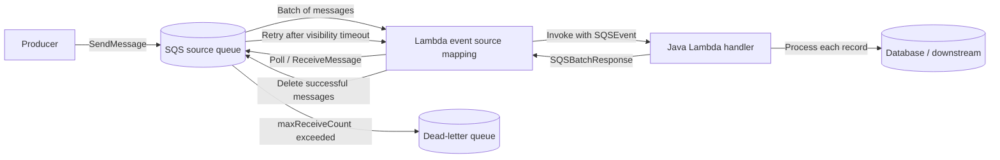

# Kết nối SQS với Lambda và báo lỗi theo từng message

Amazon SQS thường được dùng để tách producer khỏi worker xử lý nền. Producer gửi message vào queue, còn AWS Lambda nhận message thông qua *event source mapping* (ESM), xử lý theo batch rồi xác nhận các message thành công. Cách tích hợp này giúp hấp thụ tải đột biến, điều chỉnh tốc độ tiêu thụ và giảm phụ thuộc đồng bộ giữa các dịch vụ.

Một vấn đề thường gặp là batch có nhiều message nhưng chỉ một message bị lỗi. Nếu handler báo lỗi cho toàn bộ invocation, các message đã xử lý thành công cũng có thể được giao lại. Việc xử lý lại làm tăng tải, độ trễ và nguy cơ tạo side effect trùng lặp. Lambda hỗ trợ **partial batch response** để handler chỉ rõ message nào cần được thử lại. Với Java, handler trả về `SQSBatchResponse` chứa danh sách `BatchItemFailure`.

Bài học này trình bày cách kết nối SQS với Lambda, cấu hình event source mapping, triển khai partial batch response, xử lý khác biệt giữa Standard và FIFO queue, phối hợp visibility timeout, retry, DLQ và idempotency để luồng xử lý đáng tin cậy.

## 1. Kiến trúc SQS và Lambda

Với SQS event source mapping, Lambda quản lý poller đọc message từ queue. Khi có batch, Lambda gọi function và truyền danh sách record trong event. Handler xử lý batch rồi trả kết quả. Nếu xử lý thành công, Lambda xóa message tương ứng khỏi queue; nếu thất bại, message có thể xuất hiện lại sau visibility timeout theo cơ chế giao nhận của SQS.



Producer không gọi Lambda trực tiếp. Event source mapping là thành phần nối queue với function và chịu trách nhiệm polling, batch, retry delivery và xóa message thành công. Lambda execution role cần quyền đọc/xóa message và đọc thuộc tính queue. Với queue mã hóa bằng customer-managed KMS key, role còn cần quyền giải mã phù hợp.

### Các thành phần chính

| Thành phần | Trách nhiệm |
|---|---|
| Producer | Tạo message, định danh sự kiện nghiệp vụ và gửi vào queue |
| SQS source queue | Lưu message bền vững trong thời gian retention và cung cấp delivery |
| Event source mapping | Poll queue, tạo batch, gọi Lambda và xóa message thành công |
| Lambda function | Xác thực, xử lý từng message và báo kết quả |
| Processing state store | Lưu idempotency key và trạng thái xử lý nếu nghiệp vụ cần |
| Dead-letter queue (DLQ) | Giữ message vượt quá số lần nhận cho phép để điều tra hoặc redrive |

SQS là dịch vụ giao nhận message. Nó không tự bảo đảm side effect của consumer chỉ xảy ra một lần. Message có thể được giao lại, vì vậy handler cần xử lý an toàn khi nhận trùng.

## 2. Standard queue và FIFO queue

Chọn queue theo yêu cầu ordering và throughput của nghiệp vụ.

| Đặc điểm | Standard queue | FIFO queue |
|---|---|---|
| Thứ tự | Có thể giao message không theo thứ tự gửi | Giữ thứ tự trong cùng `MessageGroupId` |
| Delivery | At-least-once; có thể có bản giao trùng | Có deduplication khi gửi trong khoảng thời gian hỗ trợ, nhưng consumer vẫn cần idempotency |
| Song song | Có thể xử lý nhiều message đồng thời | Song song giữa các message group; trong một group phải giữ thứ tự |
| Trường hợp phù hợp | Công việc độc lập, cần throughput và chấp nhận xử lý không theo thứ tự | Thao tác cùng đơn hàng/tài khoản cần tuần tự |

Với Standard queue, handler có thể tiếp tục xử lý các message khác trong batch sau khi một message lỗi, miễn là mỗi record được báo kết quả đúng. Với FIFO queue, nếu một message trong group bị lỗi, cần dừng xử lý các message tiếp theo trong cùng batch/group để tránh áp dụng thay đổi sau trước thay đổi trước.

Ví dụ, các event `OrderCreated`, `PaymentAuthorized` và `OrderShipped` của cùng một đơn nên dùng cùng `MessageGroupId = orderId` nếu nghiệp vụ yêu cầu thứ tự. Các đơn hàng khác nhau có thể được xử lý song song.

## 3. Event source mapping và batch

Event source mapping là cấu hình gắn một SQS queue với Lambda function. Lambda poll queue và gom message thành batch trước khi invoke handler. Các thuộc tính quan trọng gồm:

- **Batch size:** số message tối đa gửi trong một invocation.
- **Maximum batching window:** thời gian tối đa chờ gom thêm message trước khi gửi batch, nếu được cấu hình.
- **Function response types:** bật `ReportBatchItemFailures` để Lambda hiểu kết quả lỗi từng message.
- **Concurrency:** giới hạn mức song song để bảo vệ function và dịch vụ phía sau.
- **Queue visibility timeout:** thời gian message bị ẩn sau khi được nhận, nhằm tránh nhiều consumer cùng xử lý message trong một lần giao bình thường.

Batch lớn có thể giảm số invocation và chi phí gọi handler, nhưng làm tăng thời gian chờ gom batch, bộ nhớ cần thiết và phạm vi ảnh hưởng khi handler lỗi toàn batch. Batch nhỏ giúp giảm lượng công việc phải thử lại, nhưng tăng số lần invoke. Hãy chọn theo thời gian xử lý từng message, kích thước payload và năng lực downstream.

### Bật partial batch response

Chỉ trả về `SQSBatchResponse` trong code là chưa đủ. Event source mapping phải bật response type `ReportBatchItemFailures`. Nếu không bật, Lambda không diễn giải danh sách lỗi từng message như mong đợi và invocation có thể bị xử lý theo cơ chế lỗi toàn batch.

Ví dụ cấu hình CloudFormation cho event source mapping:

```yaml
OrderQueueMapping:
  Type: AWS::Lambda::EventSourceMapping
  Properties:
    EventSourceArn: !GetAtt OrderQueue.Arn
    FunctionName: !GetAtt OrderWorker.Arn
    Enabled: true
    BatchSize: 10
    MaximumBatchingWindowInSeconds: 5
    FunctionResponseTypes:
      - ReportBatchItemFailures
```

Đây là ví dụ cấu hình khái niệm; tên resource và cách tham chiếu ARN cần khớp template của dự án. Với AWS SAM, thuộc tính tương ứng có thể được khai báo trong event SQS của function. Khi triển khai, hãy kiểm tra cấu hình thực tế của event source mapping, không chỉ kiểm tra file template.

## 4. Partial batch response hoạt động thế nào?

Khi bật `ReportBatchItemFailures`, handler trả về cấu trúc có dạng:

```json
{
  "batchItemFailures": [
    { "itemIdentifier": "message-id-that-failed" }
  ]
}
```

`itemIdentifier` phải là `messageId` của record SQS bị lỗi. Lambda dùng danh sách này để xác định message nào chưa xử lý thành công. Các record không nằm trong danh sách được xem là đã xử lý thành công và được xóa khỏi queue; các record được báo lỗi sẽ được giao lại theo visibility timeout và chính sách retry.

Các trường hợp cần nhớ:

- Danh sách lỗi rỗng nghĩa là tất cả record trong batch đã xử lý thành công.
- Danh sách có một hoặc nhiều `messageId` nghĩa là chỉ những record đó cần được thử lại.
- Nếu function ném exception, timeout, bị dừng hoặc trả response không hợp lệ, Lambda không nhận được kết quả partial hợp lệ; toàn batch có thể được giao lại.
- Nếu bật response type không đúng hoặc sai định dạng response, hành vi partial failure sẽ không hoạt động như dự kiến.

Partial batch response giảm việc xử lý lại record thành công. Nó không thay thế idempotency, vì một message có thể được giao lại sau timeout hoặc trong các tình huống delivery khác.

## 5. Java handler dùng SQSBatchResponse

Với AWS Lambda Java runtime, có thể dùng `SQSEvent` và `SQSBatchResponse` từ thư viện `aws-lambda-java-events`. Ví dụ Gradle:

```kotlin
dependencies {
    implementation("com.amazonaws:aws-lambda-java-core:<compatible-version>")
    implementation("com.amazonaws:aws-lambda-java-events:<compatible-version>")
}
```

Thay placeholder bằng phiên bản tương thích với runtime Java và dependency policy của dự án. Handler sau minh họa Standard queue: mỗi message được xử lý độc lập, record lỗi được đưa vào danh sách partial failure.

```java
import com.amazonaws.services.lambda.runtime.Context;
import com.amazonaws.services.lambda.runtime.RequestHandler;
import com.amazonaws.services.lambda.runtime.events.SQSEvent;
import com.amazonaws.services.lambda.runtime.events.SQSBatchResponse;

import java.util.ArrayList;
import java.util.List;

public final class OrderQueueHandler
        implements RequestHandler<SQSEvent, SQSBatchResponse> {

    private final OrderProcessor processor = new OrderProcessor();

    @Override
    public SQSBatchResponse handleRequest(SQSEvent event, Context context) {
        List<SQSBatchResponse.BatchItemFailure> failures = new ArrayList<>();

        for (SQSEvent.SQSMessage message : event.getRecords()) {
            try {
                processor.process(message.getBody(), message.getMessageId());
            } catch (Exception exception) {
                context.getLogger().log(
                        "Message processing failed; messageId="
                                + message.getMessageId()
                                + ", errorType=" + exception.getClass().getSimpleName()
                );
                failures.add(new SQSBatchResponse.BatchItemFailure(
                        message.getMessageId()
                ));
            }
        }

        return new SQSBatchResponse(failures);
    }
}
```

`OrderProcessor` đại diện cho logic nghiệp vụ và cần được triển khai với dependency phù hợp. Ví dụ chỉ log loại lỗi, không log toàn bộ body vì message có thể chứa dữ liệu cá nhân hoặc bí mật. Trong code production, nên phân loại lỗi retryable và permanent thay vì retry vô hạn mọi exception.

### Xử lý lỗi vĩnh viễn

Không phải lỗi nào cũng có thể phục hồi bằng retry. Ví dụ JSON sai cấu trúc hoặc loại sự kiện không được hỗ trợ có thể tiếp tục lỗi ở mọi lần thử. Có hai cách xử lý thường dùng:

1. Để message thất bại và sau số lần nhận tối đa, SQS redrive message sang DLQ để điều tra.
2. Nếu nghiệp vụ cho phép loại bỏ message, ghi message và lý do vào kho quarantine bền vững trước; chỉ trả thành công sau khi việc cách ly được xác nhận.

Không bắt exception rồi bỏ qua message mà không lưu dấu hoặc ghi nhận. Cách đó làm message bị xóa khỏi queue dù nghiệp vụ chưa xử lý và không có khả năng phục hồi.

## 6. FIFO queue: dừng sau lỗi đầu tiên

Với FIFO queue, xử lý tiếp các message sau message lỗi có thể làm đảo thứ tự nghiệp vụ. Ví dụ message version 3 thất bại nhưng version 4 vẫn được áp dụng; khi version 3 được thử lại, trạng thái có thể không còn hợp lệ.

Một cách triển khai là khi gặp lỗi đầu tiên, thêm message đó và tất cả record chưa xử lý phía sau vào danh sách thất bại, sau đó kết thúc vòng lặp:

```java
import com.amazonaws.services.lambda.runtime.events.SQSEvent;
import com.amazonaws.services.lambda.runtime.events.SQSBatchResponse;
import java.util.ArrayList;
import java.util.List;

List<SQSBatchResponse.BatchItemFailure> failures = new ArrayList<>();
List<SQSEvent.SQSMessage> records = event.getRecords();

for (int index = 0; index < records.size(); index++) {
    SQSEvent.SQSMessage message = records.get(index);
    try {
        processor.process(message.getBody(), message.getMessageId());
    } catch (Exception exception) {
        // Giữ thứ tự: báo lỗi message hiện tại và các message chưa xử lý.
        for (int remaining = index; remaining < records.size(); remaining++) {
            failures.add(new SQSBatchResponse.BatchItemFailure(
                    records.get(remaining).getMessageId()
            ));
        }
        break;
    }
}

return new SQSBatchResponse(failures);
```

Đoạn code minh họa giả định batch được xử lý theo thứ tự record do Lambda cung cấp. Với FIFO, cần giữ nguyên thứ tự trong từng message group và tuân theo semantics của event source mapping. Nếu một batch có nhiều group, việc tiếp tục hay dừng các group khác cần được thiết kế theo yêu cầu ordering của ứng dụng; cách đơn giản và an toàn là dừng batch sau lỗi đầu tiên.

DLQ trên FIFO queue cần được cân nhắc kỹ: khi message lỗi bị chuyển sang DLQ và message tiếp theo được xử lý, chuỗi nghiệp vụ có thể bị gián đoạn. Nếu yêu cầu giữ thứ tự tuyệt đối, cần chính sách block/cách ly group và quy trình sửa/replay phù hợp thay vì mặc định đưa message lỗi đi rồi tiếp tục.

## 7. Visibility timeout và retry

Khi Lambda nhận message, SQS đặt message vào trạng thái invisible trong khoảng visibility timeout. Nếu Lambda xử lý thành công và event source mapping xóa message, message kết thúc vòng đời trong queue. Nếu function không xác nhận thành công, message sẽ hiển thị lại sau timeout và có thể được nhận lần nữa.

Visibility timeout cần đủ dài cho cả việc xử lý batch và retry ở cấp function. AWS khuyến nghị đặt visibility timeout của queue ít nhất bằng **sáu lần timeout của Lambda function**, cộng thêm maximum batching window nếu có. Đây là hướng dẫn cấu hình để giảm khả năng message xuất hiện lại khi invocation vẫn đang chạy; hãy kiểm tra tài liệu AWS hiện hành và thời gian xử lý thực tế của workload.

Ví dụ, nếu function timeout là 30 giây và batching window là 5 giây, visibility timeout cần được đặt lớn hơn hoặc bằng mức khuyến nghị tương ứng (6 × 30 + 5 giây), rồi điều chỉnh theo đặc điểm hệ thống. Không đặt timeout quá ngắn vì có thể tạo concurrent duplicate processing. Cũng không nên đặt tùy tiện quá dài nếu cần phục hồi nhanh sau khi consumer chết.

### Retry ở hai tầng

Trong tích hợp SQS-Lambda có hai cơ chế thường bị nhầm:

- **Retry của SDK hoặc logic trong handler:** lặp lại một lời gọi dịch vụ trong cùng invocation.
- **Redelivery của SQS:** message chưa được xác nhận sẽ xuất hiện lại sau visibility timeout và Lambda có thể nhận nó trong invocation mới.

Nếu cả hai tầng đều retry nhiều lần, tổng số lần gọi downstream có thể tăng đáng kể. Hãy đặt timeout và retry budget có giới hạn, phân loại lỗi, dùng backoff khi gọi dịch vụ phụ thuộc và dựa vào redelivery của queue cho lần thử tiếp theo khi phù hợp.

### Partial failure giảm retry không cần thiết

Giả sử một batch có 10 message, 9 message xử lý thành công và 1 message lỗi tạm thời. Nếu handler ném exception cho toàn invocation, cả 10 message có thể được giao lại. Nếu handler trả `BatchItemFailure` cho đúng message lỗi, 9 message thành công được xác nhận và chỉ message lỗi cần thử lại. Điều này giảm tải database/API và tránh chạy lại side effect của 9 record đã xong.

Nếu function timeout trước khi trả response, Lambda không biết record nào đã hoàn tất. Vì vậy, ngay cả khi dùng partial batch response, các thao tác nghiệp vụ vẫn cần idempotent.

## 8. DLQ và redrive policy

DLQ là queue riêng để giữ message đã được nhận quá số lần cho phép mà vẫn thất bại. Với SQS, redrive policy của source queue thường cấu hình:

- `deadLetterTargetArn`: ARN của DLQ.
- `maxReceiveCount`: số lần nhận tối đa trước khi chuyển message sang DLQ.

Ví dụ cấu hình khái niệm:

```yaml
OrderQueue:
  Type: AWS::SQS::Queue
  Properties:
    VisibilityTimeout: 185
    RedrivePolicy:
      deadLetterTargetArn: !GetAtt OrderDlq.Arn
      maxReceiveCount: 5

OrderDlq:
  Type: AWS::SQS::Queue
  Properties:
    MessageRetentionPeriod: 1209600
```

Các con số chỉ là ví dụ. Với FIFO source queue, DLQ cũng cần là FIFO. Cần bảo đảm queue policy, KMS policy và retention phù hợp. `maxReceiveCount` quá thấp có thể đẩy message lỗi tạm thời sang DLQ sớm; quá cao có thể khiến poison message chiếm tài nguyên lâu.

DLQ không tự sửa message. Cần quy trình vận hành để xem nguyên nhân, quyết định sửa dữ liệu hoặc code, rồi redrive có kiểm soát về source queue hoặc queue xử lý lại. Trước khi redrive, xác minh consumer đã idempotent và side effect trước đó không bị lặp. Với FIFO, đánh giá tác động tới thứ tự message group.

## 9. Idempotency và trạng thái nghiệp vụ

SQS Standard cung cấp at-least-once delivery; cùng một message có thể được giao nhiều lần. Ngay cả khi handler trả partial response, function có thể timeout sau khi ghi database nhưng trước khi Lambda nhận được response. Khi đó message sẽ được giao lại.

Idempotency giúp một message được xử lý lặp mà không tạo thêm side effect. Một cách triển khai là lưu event ID hoặc business key trong database với ràng buộc duy nhất.

Ví dụ luồng xử lý:

1. Producer đưa `eventId` ổn định vào payload nghiệp vụ.
2. Consumer kiểm tra bảng `processed_events` xem event đã hoàn tất chưa.
3. Consumer claim event bằng conditional insert hoặc unique constraint.
4. Consumer thực hiện cập nhật nghiệp vụ trong cùng transaction nếu có thể.
5. Consumer ghi trạng thái hoàn tất và commit.
6. Handler trả success cho record.

Nếu side effect nằm ở hệ thống ngoài database, dùng idempotency token mà hệ thống đó hỗ trợ. Nếu không có, cần outbox, đối soát hoặc hành động bù trừ phù hợp.

### Chọn khóa idempotency

`messageId` là định danh của message SQS và hữu ích cho việc chống redelivery của cùng một message. Nhưng nếu producer gửi cùng một sự kiện nghiệp vụ thành hai message khác nhau, hai `messageId` có thể khác nhau. Vì vậy:

- Dùng `messageId` để nhận diện một bản message cụ thể.
- Dùng `eventId` hoặc business key do producer tạo ổn định để chống trùng nghiệp vụ.
- Nếu nghiệp vụ có version, lưu `aggregateId` và sequence/version để phát hiện event cũ hoặc sai thứ tự.

Không dùng biến static trong Lambda để lưu danh sách message đã xử lý. Execution environment có thể bị thu hồi và nhiều environment có thể xử lý song song.

## 10. IAM và bảo mật khi nối SQS với Lambda

Với event source mapping SQS, Lambda poll queue bằng execution role của function. Role cần các quyền cần thiết, thường gồm:

- `sqs:ReceiveMessage` để nhận message.
- `sqs:DeleteMessage` để xóa message đã xử lý.
- `sqs:GetQueueAttributes` để đọc thuộc tính queue.
- `kms:Decrypt` nếu queue dùng customer-managed KMS key và policy yêu cầu quyền này.

Không cấp `sqs:*` trên mọi queue nếu function chỉ đọc một queue. Resource ARN nên giới hạn vào queue được giao. Nếu function cần gửi message sang queue khác, chỉ cấp `sqs:SendMessage` cho queue đích.

Không nhầm execution role với resource-based policy dùng cho một số kiểu invoke trực tiếp. Với SQS event source mapping, quyền poll chủ yếu được cấp cho role của Lambda; cấu hình queue policy/KMS policy vẫn cần phù hợp nếu có cross-account hoặc mã hóa.

Message body có thể chứa dữ liệu nhạy cảm. Không ghi toàn bộ body vào CloudWatch Logs khi debug. Log `messageId`, `eventId`, correlation ID và mã lỗi đã phân loại thường đủ để truy vết. Bảo đảm DLQ có quyền truy cập và retention tương xứng với mức nhạy cảm của dữ liệu.

## 11. Kiểm soát concurrency và backpressure

Lambda có thể tăng số invocation khi queue có backlog. Điều này giúp tiêu thụ nhanh nhưng có thể làm quá tải database hoặc API phía sau. Hãy kiểm soát concurrency ở event source mapping hoặc function, đồng thời đặt connection pool và giới hạn downstream phù hợp.

Các điểm cần xem xét:

- `MaximumConcurrency` của event source mapping có thể giới hạn số invocation đồng thời từ queue (tùy loại mapping và cấu hình).
- Reserved concurrency của function giới hạn tổng concurrency của function, có thể ảnh hưởng các trigger khác nếu dùng chung function.
- Với FIFO, số message group đang hoạt động giới hạn mức song song hữu ích; một group không thể xử lý đồng thời theo cách phá thứ tự.
- Batch size lớn làm tăng số message trong một invocation và bộ nhớ cần thiết.
- Queue depth và age of oldest message cho biết consumer có theo kịp producer hay không.

Nếu function gọi database, tính tổng connection tiềm năng theo số environment và pool size. Đừng tăng concurrency chỉ để làm queue rỗng nhanh hơn nếu downstream bắt đầu throttling hoặc lỗi.

## 12. Quan sát và cảnh báo

Để vận hành được tích hợp SQS-Lambda, cần theo dõi cả queue, event source mapping và function.

| Metric | Ý nghĩa |
|---|---|
| `ApproximateNumberOfMessagesVisible` | Số message đang chờ được nhận |
| `ApproximateAgeOfOldestMessage` | Thời gian message lâu nhất đã chờ |
| `NumberOfMessagesReceived` | Số message được nhận |
| `NumberOfMessagesDeleted` | Số message đã xóa sau xử lý |
| `NumberOfMessagesSent` | Số message producer gửi |
| Lambda `Invocations` | Số lần function được gọi |
| Lambda `Errors` và `Throttles` | Lỗi handler và giới hạn concurrency |
| DLQ visible messages | Message cần điều tra hoặc redrive |
| Partial batch failures | Tỷ lệ record lỗi so với tổng record xử lý |

Có thể tạo metric tùy chỉnh cho số message thành công, retryable failure, permanent failure, duplicate được bỏ qua và thời gian xử lý từng loại nghiệp vụ. Dùng correlation ID/event ID để nối log producer, Lambda và downstream. Không đưa nội dung nhạy cảm vào log hoặc metric dimension có cardinality quá cao.

### Dấu hiệu cần điều tra

- Queue depth tăng liên tục: producer nhanh hơn consumer hoặc downstream đang chậm.
- Age of oldest message tăng: backlog có thể làm vi phạm SLA xử lý.
- Lambda errors tăng nhưng số message deleted thấp: handler lỗi hoặc partial response sai.
- DLQ tăng nhanh: poison message, lỗi schema, IAM hoặc downstream kéo dài.
- Throttles tăng: concurrency cap, reserved concurrency hoặc quota downstream không phù hợp.
- Một message group FIFO bị kẹt: một message lỗi đang chặn các message sau trong group.

## 13. Các lỗi thường gặp

| Lỗi | Hệ quả | Cách khắc phục |
|---|---|---|
| Không bật `ReportBatchItemFailures` | Lambda xử lý lỗi theo toàn batch | Cấu hình `FunctionResponseTypes` trên event source mapping |
| Trả `itemIdentifier` sai | Lambda không xác định đúng record cần retry | Dùng chính `messageId` của record SQS |
| Catch exception rồi trả danh sách rỗng | Message lỗi bị xem là thành công và bị xóa | Chỉ trả success sau khi xử lý hoặc quarantine bền vững |
| Ném exception cho một record trong Standard batch | Các record thành công có thể bị giao lại | Bắt lỗi theo từng record và trả partial response |
| Tiếp tục xử lý message sau lỗi trong FIFO group | Có thể phá thứ tự nghiệp vụ | Dừng tại lỗi đầu tiên và báo lỗi cả record chưa xử lý |
| Visibility timeout quá ngắn | Message xuất hiện lại khi invocation còn chạy | Điều chỉnh theo timeout function và batching window |
| Không có DLQ/redrive policy | Poison message lặp lại và giữ backlog | Cấu hình DLQ, maxReceiveCount và runbook |
| Không idempotent | Redelivery tạo side effect trùng | Dùng event ID/business key và conditional write |
| Concurrency quá cao | Quá tải database/API downstream | Giới hạn concurrency và điều tiết queue |
| Log toàn bộ message body | Có thể lộ dữ liệu nhạy cảm | Log ID, correlation và mã lỗi đã phân loại |

## 14. Quy trình triển khai và kiểm thử

Khi xây dựng tích hợp SQS-Lambda, có thể đi theo trình tự:

1. **Chọn loại queue.** Xác định Standard hay FIFO dựa trên yêu cầu ordering, throughput và deduplication.
2. **Thiết kế message contract.** Có event ID, schema version, correlation ID và dữ liệu đủ để xử lý; tránh payload nhạy cảm không cần thiết.
3. **Tạo Lambda event source mapping.** Chọn batch size, batching window, concurrency và bật `ReportBatchItemFailures`.
4. **Triển khai Java handler.** Dùng `SQSEvent`, xử lý từng record và trả `SQSBatchResponse` với đúng `messageId` lỗi.
5. **Thiết kế idempotency.** Lưu business event ID hoặc khóa nghiệp vụ bền vững; bảo đảm side effect an toàn khi retry.
6. **Cấu hình visibility và DLQ.** Đặt timeout phù hợp, maxReceiveCount và retention; thiết kế quy trình redrive.
7. **Cấp quyền tối thiểu.** Cho execution role quyền nhận/xóa message và giải mã KMS nếu cần.
8. **Thiết lập observability.** Theo dõi queue age, backlog, Lambda errors/throttles, partial failures và DLQ.
9. **Kiểm thử lỗi.** Kiểm tra message lỗi đơn lẻ, timeout toàn batch, duplicate delivery, poison message và downstream unavailable.

### Ma trận kiểm thử tối thiểu

| Tình huống | Kết quả mong đợi |
|---|---|
| Batch có tất cả message hợp lệ | Handler trả danh sách lỗi rỗng; các message được xóa |
| Một message lỗi tạm thời trong Standard batch | Chỉ message đó được báo lỗi và thử lại |
| Nhiều message lỗi trong batch | Tất cả `messageId` lỗi được trả về |
| Handler timeout trước khi trả response | Toàn batch có thể được giao lại; idempotency ngăn side effect trùng |
| Message lỗi vĩnh viễn | Được chuyển DLQ theo redrive hoặc quarantine bền vững theo chính sách |
| Cùng message được giao lại | Consumer nhận diện duplicate và không lặp side effect |
| FIFO message đầu tiên lỗi | Message lỗi và message chưa xử lý phía sau được báo lỗi để giữ thứ tự |
| Downstream throttling | Retry có giới hạn, queue hấp thụ backlog và concurrency không làm quá tải thêm |
| KMS permission thiếu | Lỗi được phát hiện qua metric/log và role/policy được sửa đúng phạm vi |

## Kết luận

SQS event source mapping giúp Lambda xử lý message bất đồng bộ theo batch. Để một message lỗi không buộc toàn bộ batch chạy lại, hãy bật `ReportBatchItemFailures` và trả `SQSBatchResponse` chứa đúng `messageId` của các record thất bại. Với Standard queue, có thể tiếp tục xử lý các record độc lập; với FIFO queue, phải giữ thứ tự trong message group và dừng sau lỗi đầu tiên theo chính sách phù hợp. Visibility timeout, retry, DLQ, idempotency, IAM và concurrency cần được thiết kế cùng nhau. Partial batch response giảm công việc xử lý lại, còn idempotency bảo vệ nghiệp vụ khi message vẫn được giao nhiều lần.
