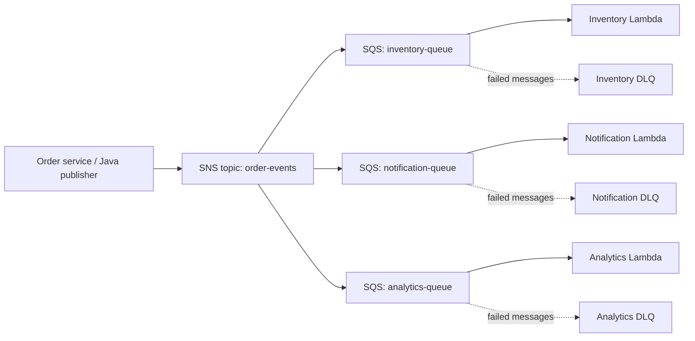
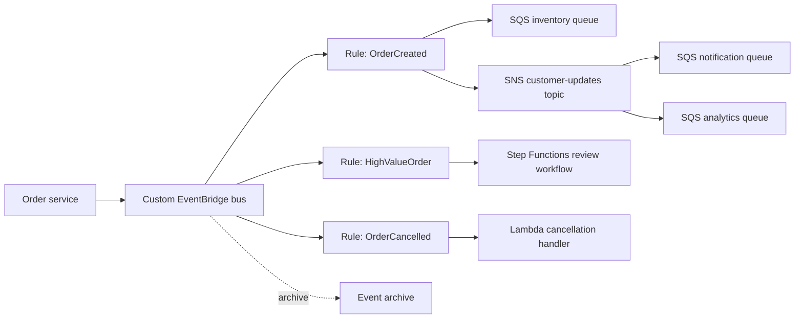

# Fan-out bằng SNS và định tuyến sự kiện bằng EventBridge

Trong kiến trúc serverless trên AWS, một sự kiện nghiệp vụ thường cần được gửi đến nhiều thành phần độc lập. Khi đơn hàng được tạo, hệ thống có thể cần cập nhật tồn kho, gửi email, cập nhật chỉ mục tìm kiếm, ghi dữ liệu phân tích và khởi chạy một workflow. Nếu producer gọi trực tiếp từng consumer, nó phải biết địa chỉ, trạng thái và giao thức của mọi consumer. Mỗi lần thêm consumer lại buộc producer thay đổi, làm các service phụ thuộc chặt vào nhau.

Amazon Simple Notification Service (SNS) và Amazon EventBridge giải quyết hai nhu cầu liên quan nhưng khác nhau. **SNS** là dịch vụ publish-subscribe phù hợp để fan-out một thông báo đến nhiều subscription. **EventBridge** là event bus có khả năng lọc và định tuyến sự kiện theo rule đến nhiều target. Cả hai có thể kích hoạt AWS Lambda, gửi đến SQS và kết nối các dịch vụ khác; việc chọn dịch vụ phụ thuộc vào cách producer và consumer cần phối hợp.

Trong phạm vi Cloud Serverless, các dịch vụ này giúp Java function nhận HTTP, message hoặc event mà không cần producer gọi trực tiếp function. Tuy vậy, delivery có thể được retry hoặc lặp, các bước bất đồng bộ có thể hoàn tất ở thời điểm khác nhau và function có thể chạy đồng thời trên nhiều instance. Vì vậy, thiết kế cần bao gồm event contract, idempotency, quyền truy cập, DLQ, quan sát và giới hạn tải.

## 1. SNS và EventBridge giải quyết bài toán nào?

### SNS: publish một lần, phân phối đến nhiều subscription

SNS cung cấp topic làm điểm publish. Producer gửi một message đến topic; SNS phân phối message đến các subscription đã đăng ký. Subscription có thể là SQS queue, Lambda function, HTTP/S endpoint, email, SMS hoặc các giao thức được SNS hỗ trợ.

Mỗi subscription nhận một bản giao riêng theo giao thức của endpoint. Nếu một topic có ba SQS queue, mỗi queue có backlog và consumer độc lập. Consumer thông báo có thể chậm mà không buộc consumer phân tích phải xử lý cùng tốc độ. Producer chỉ cần biết topic ARN, không cần biết worker cụ thể.

SNS phù hợp khi ý nghĩa chính là: “Thông báo này cần được chuyển đến những subscriber quan tâm”. Ví dụ `OrderCreated` được gửi đến queue tồn kho, queue analytics và Lambda gửi thông báo.

### EventBridge: nhận event và định tuyến theo rule

EventBridge cung cấp event bus để nhận sự kiện từ ứng dụng, dịch vụ AWS hoặc đối tác SaaS. Producer gửi event vào bus; các rule so khớp `source`, `detail-type` và nội dung `detail`, rồi chuyển event đến một hoặc nhiều target như Lambda, SQS, SNS, Step Functions, Kinesis hoặc API Destination.

EventBridge phù hợp khi ý nghĩa chính là: “Đây là một sự kiện đã xảy ra; hãy định tuyến nó đến các đích có rule phù hợp”. Producer không cần biết consumer. Đội vận hành có thể thêm rule để mở rộng luồng tích hợp mà không sửa producer, miễn là event contract có đủ dữ liệu để lọc.

### So sánh nhanh

| Tiêu chí | SNS | EventBridge |
|---|---|---|
| Mô hình chính | Topic và subscription | Event bus, rule và target |
| Mục tiêu | Fan-out thông báo | Lọc và định tuyến sự kiện |
| Lọc message | Subscription filter policy theo attribute hoặc body | Event pattern theo source, detail-type và detail |
| Nguồn event | Producer publish vào topic | Ứng dụng, dịch vụ AWS và partner event source |
| Đích phổ biến | SQS, Lambda, HTTP/S, email, SMS | Lambda, SQS, SNS, Step Functions, Kinesis, API Destination |
| Lưu lịch sử và replay | Không phải chức năng log/replay chính | Có archive và replay nếu được cấu hình |
| Ordering | Standard best-effort; FIFO theo message group | Không cung cấp thứ tự toàn cục |
| Dùng khi | Một message cần nhiều subscriber | Nhiều loại event cần định tuyến theo điều kiện |

Hai dịch vụ không loại trừ nhau. Một rule EventBridge có thể gửi event đến SNS topic; SNS sau đó fan-out đến các subscription. Ngược lại, SNS có thể phân phối thông báo đến một queue mà consumer tiếp tục xử lý qua Lambda.

## 2. Kiến trúc SNS fan-out với SQS và Lambda

Một mẫu phổ biến là tạo một queue riêng cho mỗi consumer. SNS phân phối cùng message đến các queue; Lambda event source mapping poll từng queue và gọi function tương ứng.



Mỗi queue có visibility timeout, retention, redrive policy, batch size và giới hạn concurrency riêng. Nếu notification service bị chậm, queue thông báo tăng backlog nhưng consumer tồn kho vẫn có thể tiếp tục. Đây là lợi ích quan trọng của việc đặt queue ở giữa SNS và Lambda: các subscriber được cô lập về tốc độ và lỗi xử lý.

### Khi nào nên subscribe Lambda trực tiếp?

SNS cũng có thể subscribe trực tiếp Lambda. Đây là cách đơn giản khi message chỉ cần kích hoạt một function và không cần backlog riêng cho subscriber. SNS gửi invocation bất đồng bộ đến Lambda; sau khi Lambda nhận invocation, việc thực thi và retry lỗi function tuân theo cơ chế asynchronous invocation của Lambda.

Chọn SNS → Lambda trực tiếp khi:

- Xử lý ngắn và không cần điều tiết tải bằng queue riêng.
- Có thể chấp nhận cơ chế retry và thời hạn lưu event của Lambda async invocation.
- Không cần nhiều worker cùng chia một backlog có kiểm soát.

Chọn SNS → SQS → Lambda khi:

- Muốn tách delivery khỏi thời gian xử lý nghiệp vụ.
- Cần backlog bền vững, kiểm soát tốc độ consumer và quan sát message cũ nhất.
- Mỗi subscriber cần retry, retention, DLQ và concurrency riêng.
- Muốn chủ động redrive message sau khi sửa lỗi consumer.

SQS event source mapping poll queue và gom message thành batch cho Lambda. Function chỉ nên để message được xác nhận sau khi side effect đã bền vững. Nếu một record trong batch lỗi, hãy cấu hình partial batch response khi phù hợp để chỉ retry record lỗi thay vì xử lý lại toàn bộ batch.

## 3. SNS topic, subscription và filter policy

### Tạo topic và đăng ký subscription

Producer publish vào topic ARN. Subscriber đăng ký endpoint vào topic. Đối với SQS, queue policy phải cho phép SNS topic tương ứng gửi message. Đối với Lambda, resource-based policy của function phải cho phép principal `sns.amazonaws.com` invoke function, giới hạn bằng `SourceArn` của topic. Với HTTP/S endpoint, subscription thường cần xác nhận (confirmation) trước khi SNS gửi message.

Một topic có thể có nhiều loại subscription. Ví dụ:

| Subscription | Mục đích |
|---|---|
| `inventory-queue` | Xử lý reservation |
| `notification-queue` | Gửi email/SMS bất đồng bộ |
| `analytics-queue` | Đưa event vào pipeline phân tích |
| `order-webhook` | Gửi webhook đến hệ thống đối tác |

Mỗi subscription nên có tên và chủ sở hữu rõ ràng. Tránh dùng một queue chung cho các consumer có SLA hoặc quyền truy cập khác nhau nếu điều đó khiến chúng phụ thuộc vào cùng một backlog và retry policy.

### Filter theo message attributes

Subscription filter policy giúp SNS chỉ gửi message phù hợp đến subscriber. Mặc định, filter policy đánh giá message attributes. Ví dụ producer gắn `eventType=OrderCreated` và `region=ap-southeast-1`; subscription chỉ nhận event ở loại và vùng mong muốn.

Ví dụ filter policy:

```json
{
  "eventType": ["OrderCreated", "OrderPaid"],
  "region": ["ap-southeast-1"],
  "priority": [
    { "numeric": [">=", 5] }
  ]
}
```

Policy trên minh họa điều kiện: loại event là `OrderCreated` hoặc `OrderPaid`, vùng là `ap-southeast-1`, và priority từ 5 trở lên. Attribute `priority` cần được publish với data type `Number` để toán tử numeric hoạt động đúng. Một subscription không có filter policy thường nhận mọi message mà topic phân phối đến nó.

### Filter theo message body

SNS hỗ trợ chọn phạm vi filter theo body trong cấu hình subscription. Khi dùng body scope, filter policy đánh giá cấu trúc JSON của message body thay vì message attributes. Cần bảo đảm message body là JSON hợp lệ và thống nhất schema giữa producer và subscriber.

Filter policy là một phần của hợp đồng tích hợp. Nếu producer đổi tên attribute hoặc chuyển field từ attribute vào body, subscriber có thể ngừng nhận message mà không có lỗi compile-time. Hãy version hóa schema, kiểm thử policy bằng message mẫu và giám sát số message được phân phối đến từng subscription.

### Raw message delivery với SQS

Khi SNS gửi đến SQS, mặc định message body của queue chứa một SNS notification envelope, trong đó payload gốc nằm ở trường `Message`. Nếu bật raw message delivery cho subscription, SNS gửi payload gốc trực tiếp vào SQS message body và một số message attributes được chuyển thành SQS attributes theo giới hạn của dịch vụ.

Chọn một định dạng rõ ràng và thống nhất với consumer. Nếu dùng envelope mặc định, Lambda đọc SQS record rồi parse SNS envelope trước khi parse domain event. Nếu bật raw delivery, consumer parse trực tiếp domain payload. Thay đổi cài đặt raw delivery mà không cập nhật consumer có thể gây lỗi parse hàng loạt.

## 4. SNS Standard và SNS FIFO

SNS có hai loại topic chính:

| Đặc điểm | Standard topic | FIFO topic |
|---|---|---|
| Throughput | Cao, mở rộng linh hoạt | Có giới hạn và cấu hình throughput riêng |
| Thứ tự | Best-effort, không bảo đảm thứ tự | Theo từng message group |
| Duplicate | Có thể giao trùng | Có cơ chế deduplication trong phạm vi được hỗ trợ |
| Subscription | Hỗ trợ nhiều giao thức như SQS, Lambda, HTTP/S, email | Dùng với SQS FIFO subscriptions |
| Trường hợp dùng | Fan-out chung, không cần thứ tự nghiêm ngặt | Chuỗi message cần thứ tự theo nhóm |

Với FIFO, publisher cung cấp `MessageGroupId` để xác định nhóm thứ tự và `MessageDeduplicationId` hoặc dùng content-based deduplication theo cấu hình. Message trong cùng group được giữ thứ tự; các group khác có thể xử lý song song. Subscriber phải dùng SQS FIFO tương thích.

Không diễn giải deduplication ở tầng broker thành exactly-once end-to-end. Consumer vẫn có thể thực hiện side effect rồi mất acknowledgement hoặc gặp lỗi ở hệ thống downstream. Hãy dùng idempotency key trong application service và lưu dấu xử lý cùng transaction nghiệp vụ.

## 5. Định dạng event và hợp đồng message

Một message nên mô tả sự kiện đã xảy ra, không chứa lệnh mơ hồ khiến mỗi consumer tự suy luận ý nghĩa. Ví dụ `OrderCreated` cho biết đơn hàng đã được tạo; command `CreateOrder` mới là yêu cầu thực hiện thao tác.

Payload có thể dùng envelope thống nhất:

```json
{
  "eventId": "evt-01J9Q7M2",
  "eventType": "OrderCreated",
  "schemaVersion": 1,
  "occurredAt": "2026-11-17T12:00:00Z",
  "correlationId": "flow-77",
  "aggregateId": "order-1052",
  "data": {
    "orderId": "order-1052",
    "customerId": "customer-42",
    "total": 125000,
    "region": "ap-southeast-1"
  }
}
```

`eventId` nhận diện event nghiệp vụ; `correlationId` nhóm các bước cùng quy trình; `aggregateId` nhận diện đối tượng đang thay đổi. Khi message được retry hoặc redeliver, giữ nguyên event ID. Khi tạo một event mới do nghiệp vụ mới xảy ra, tạo event ID mới.

Không dùng SNS `MessageId` hoặc EventBridge envelope `id` làm khóa nghiệp vụ duy nhất nếu publisher có thể phát lại cùng một thay đổi bằng một publish request mới. Tốt hơn là mang một `eventId` ổn định trong domain envelope và dùng nó cho inbox/idempotency. SNS `MessageId` và EventBridge `id` vẫn hữu ích để điều tra một lần publish cụ thể.

Đối với schema evolution, thêm field tùy chọn theo hướng tương thích ngược, giữ `schemaVersion`, và có kế hoạch chuyển consumer. Không đổi ý nghĩa một field hiện có mà không version hóa hợp đồng. Payload chỉ nên chứa dữ liệu consumer cần; tránh đưa token, secret hoặc thông tin cá nhân không cần thiết vào message.

## 6. EventBridge event bus, rule và target

### Các loại event bus

EventBridge có các loại bus phục vụ nguồn event khác nhau:

- **Default event bus:** nhận nhiều sự kiện do dịch vụ AWS phát ra trong tài khoản.
- **Custom event bus:** dành cho sự kiện do ứng dụng hoặc service tự phát.
- **Partner event bus:** nhận sự kiện từ đối tác SaaS tích hợp với EventBridge.

Tạo custom bus theo miền nghiệp vụ hoặc ranh giới tích hợp giúp quản lý quyền publish, rule và ownership rõ ràng. Không cần tạo một bus cho mỗi event type; hãy chọn ranh giới theo chủ sở hữu và nhu cầu vận hành.

### EventBridge event envelope

Một event được gửi đến bus thường có các trường envelope như `version`, `id`, `source`, `account`, `time`, `region`, `resources`, `detail-type` và `detail`.

```json
{
  "version": "0",
  "id": "b7e2c8d0-8e18-4e5c-9a5a-123456789abc",
  "source": "com.example.orders",
  "account": "123456789012",
  "time": "2026-11-17T12:00:00Z",
  "region": "ap-southeast-1",
  "detail-type": "OrderCreated",
  "resources": [],
  "detail": {
    "eventId": "evt-01J9Q7M2",
    "schemaVersion": 1,
    "correlationId": "flow-77",
    "orderId": "order-1052",
    "total": 125000,
    "region": "ap-southeast-1"
  }
}
```

`source` định danh producer hoặc miền phát event; `detail-type` phân loại sự kiện; `detail` chứa payload nghiệp vụ. Không nên nhầm `region` trong envelope (vùng AWS nơi event được phát/định tuyến) với thuộc tính vùng kinh doanh nằm trong `detail`.

### Rule và event pattern

Rule mô tả event nào cần được chuyển đến target. Event pattern có thể so khớp `source`, `detail-type` và các field trong `detail`.

Ví dụ rule chỉ chọn đơn hàng mới tạo có tổng tiền từ 100.000 trở lên:

```json
{
  "source": ["com.example.orders"],
  "detail-type": ["OrderCreated"],
  "detail": {
    "total": [
      { "numeric": [">=", 100000] }
    ],
    "region": ["ap-southeast-1"]
  }
}
```

Rule có thể có nhiều target. Một event có thể khớp nhiều rule; mỗi rule có thể chuyển event đến một hoặc nhiều target. EventBridge hỗ trợ input transformer/input path để chọn hoặc biến đổi phần dữ liệu gửi đến target. Cần tránh tạo target payload không tương thích với handler đang chạy.

### Ví dụ kiến trúc định tuyến



EventBridge định tuyến sự kiện theo rule. SNS topic sau đó fan-out thông báo `OrderCreated` đến các subscription của khách hàng và analytics. Mỗi queue cho phép consumer xử lý theo tốc độ và retry policy riêng.

## 7. Kết hợp EventBridge và SNS

Một lựa chọn phổ biến là dùng EventBridge làm điểm nhận domain event, sau đó rule gửi những event phù hợp đến SNS topic để fan-out. Mẫu này hữu ích khi nhiều service phát event vào bus nhưng một nhóm consumer cần nhận cùng một loại thông báo.

Ví dụ:

1. Order Service phát `OrderCreated` vào custom event bus.
2. Rule `OrderCreated` khớp event và gửi đến `customer-updates` SNS topic.
3. SNS fan-out đến queue thông báo, queue analytics và endpoint đối tác.
4. Một rule khác của EventBridge gửi event có giá trị cao đến workflow kiểm tra rủi ro.

Kết hợp hai dịch vụ tạo thêm một hop, một ranh giới quyền truy cập và chi phí publish/delivery tương ứng. Chỉ dùng khi cần cả rule-based routing lẫn subscription fan-out. Nếu chỉ cần nhiều subscriber nhận một thông báo giống nhau, SNS có thể đủ. Nếu cần định tuyến theo event content từ nhiều producer, EventBridge thường phù hợp hơn.

## 8. Java publisher: gửi event vào EventBridge

Java service có thể dùng AWS SDK for Java 2.x để gọi `PutEvents`. Tầng nghiệp vụ tạo event envelope; adapter chuyển envelope thành `detail` JSON và chọn event bus, source, detail type.

```java
import com.fasterxml.jackson.core.JsonProcessingException;
import com.fasterxml.jackson.databind.ObjectMapper;
import software.amazon.awssdk.services.eventbridge.EventBridgeClient;
import software.amazon.awssdk.services.eventbridge.model.PutEventsRequest;
import software.amazon.awssdk.services.eventbridge.model.PutEventsRequestEntry;
import software.amazon.awssdk.services.eventbridge.model.PutEventsResponse;

public final class OrderEventPublisher {
    private final EventBridgeClient eventBridge;
    private final ObjectMapper objectMapper;
    private final String eventBusName;

    public OrderEventPublisher(
            EventBridgeClient eventBridge,
            ObjectMapper objectMapper,
            String eventBusName) {
        this.eventBridge = eventBridge;
        this.objectMapper = objectMapper;
        this.eventBusName = eventBusName;
    }

    public void publish(OrderCreatedDetail detail) {
        try {
            String json = objectMapper.writeValueAsString(detail);
            PutEventsRequestEntry entry = PutEventsRequestEntry.builder()
                    .eventBusName(eventBusName)
                    .source("com.example.orders")
                    .detailType("OrderCreated")
                    .detail(json)
                    .build();

            PutEventsResponse response = eventBridge.putEvents(
                    PutEventsRequest.builder().entries(entry).build());

            if (response.failedEntryCount() != null
                    && response.failedEntryCount() > 0) {
                var failure = response.entries().get(0);
                throw new IllegalStateException(
                        "EventBridge publish failed: " + failure.errorCode());
            }
        } catch (JsonProcessingException ex) {
            throw new IllegalArgumentException("Cannot serialize order event", ex);
        }
    }
}
```

Ví dụ lược giản chỉ gửi một entry. Khi gửi batch, phải kiểm tra từng response entry vì `PutEvents` có thể trả kết quả một phần thành công và một phần thất bại. Chỉ retry các entry lỗi, giữ nguyên domain `eventId` trong detail và tránh publish lại toàn bộ batch đã thành công. Client `EventBridgeClient` nên được tạo và tái sử dụng an toàn trong vòng đời application instance, không tạo mới cho mỗi message.

Nếu thay đổi database và publish event phải nhất quán, không chỉ ghi database rồi gọi `PutEvents` như hai thao tác không liên quan. Dùng transactional outbox: ghi thay đổi nghiệp vụ và event record trong cùng transaction; relay đọc outbox và publish. Relay có thể publish lại nếu dừng trước khi đánh dấu đã gửi, do đó consumer vẫn cần idempotent.

## 9. Java publisher: publish message vào SNS

AWS SDK for Java 2.x cung cấp `SnsClient` để publish vào topic. Message attributes có thể được dùng bởi subscription filter policy.

```java
import com.fasterxml.jackson.core.JsonProcessingException;
import com.fasterxml.jackson.databind.ObjectMapper;
import software.amazon.awssdk.services.sns.SnsClient;
import software.amazon.awssdk.services.sns.model.MessageAttributeValue;
import software.amazon.awssdk.services.sns.model.PublishRequest;
import java.util.Map;

public final class SnsOrderPublisher {
    private final SnsClient sns;
    private final ObjectMapper objectMapper;
    private final String topicArn;

    public SnsOrderPublisher(
            SnsClient sns, ObjectMapper objectMapper, String topicArn) {
        this.sns = sns;
        this.objectMapper = objectMapper;
        this.topicArn = topicArn;
    }

    public void publish(OrderEvent event) {
        try {
            sns.publish(PublishRequest.builder()
                    .topicArn(topicArn)
                    .message(objectMapper.writeValueAsString(event))
                    .messageAttributes(Map.of(
                            "eventType", MessageAttributeValue.builder()
                                    .dataType("String")
                                    .stringValue(event.eventType())
                                    .build(),
                            "region", MessageAttributeValue.builder()
                                    .dataType("String")
                                    .stringValue(event.region())
                                    .build()))
                    .build());
        } catch (JsonProcessingException ex) {
            throw new IllegalArgumentException("Cannot serialize order event", ex);
        }
    }
}
```

Đoạn mã cần import thêm `java.util.Map` và các kiểu `OrderEvent` do ứng dụng định nghĩa. Với SNS FIFO, request còn cần `messageGroupId` và `messageDeduplicationId` hoặc cấu hình content-based deduplication. Message attribute dùng để lọc phải được publish đúng kiểu dữ liệu mà filter policy mong đợi.

## 10. Java Lambda handler cho SNS

Khi SNS subscribe trực tiếp Lambda, Lambda nhận event theo cấu trúc SNS. Với AWS Java Events library, handler có thể dùng `SNSEvent` để truy cập từng record.

```java
import com.amazonaws.services.lambda.runtime.Context;
import com.amazonaws.services.lambda.runtime.RequestHandler;
import com.amazonaws.services.lambda.runtime.events.SNSEvent;
import com.fasterxml.jackson.databind.ObjectMapper;

public final class SnsOrderHandler implements RequestHandler<SNSEvent, Void> {
    private final ObjectMapper mapper = new ObjectMapper();
    private final OrderApplicationService service = ApplicationServices.orders();

    @Override
    public Void handleRequest(SNSEvent event, Context context) {
        for (SNSEvent.SNSRecord record : event.getRecords()) {
            String message = record.getSNS().getMessage();
            try {
                OrderEvent orderEvent = mapper.readValue(message, OrderEvent.class);
                service.handle(orderEvent);
            } catch (Exception ex) {
                // Throw so the asynchronous invocation is reported as failed.
                throw new IllegalStateException("Cannot process SNS record", ex);
            }
        }
        return null;
    }
}
```

`ApplicationServices.orders()` đại diện cho cơ chế khởi tạo dependency của ứng dụng; không nên tạo lại database client hoặc HTTP client trong mỗi record. Nếu một record trong invocation lỗi sau khi các record trước đã tạo side effect, lần retry có thể chạy lại toàn bộ event batch. Consumer phải idempotent theo domain event ID.

Đối với SNS → SQS → Lambda, handler nhận `SQSEvent` chứ không phải `SNSEvent`. Nếu raw message delivery tắt, `record.getBody()` chứa SNS notification envelope và cần parse trường `Message`. Nếu bật raw delivery, body chứa payload gốc. Cấu hình subscription và kiểu handler phải thống nhất.

## 11. Java Lambda handler cho EventBridge

EventBridge target Lambda nhận event envelope có các trường `id`, `source`, `detail-type` và `detail`. Có thể dùng `Map` hoặc kiểu event cụ thể để deserialize.

```java
import com.amazonaws.services.lambda.runtime.Context;
import com.amazonaws.services.lambda.runtime.RequestHandler;
import com.fasterxml.jackson.databind.ObjectMapper;
import java.util.Map;

public final class OrderCreatedHandler
        implements RequestHandler<Map<String, Object>, Void> {

    private final ObjectMapper mapper = new ObjectMapper();
    private final OrderApplicationService service = ApplicationServices.orders();

    @Override
    @SuppressWarnings("unchecked")
    public Void handleRequest(Map<String, Object> event, Context context) {
        String source = (String) event.get("source");
        String detailType = (String) event.get("detail-type");
        String eventBridgeId = (String) event.get("id");
        Map<String, Object> detail = (Map<String, Object>) event.get("detail");

        if (!"com.example.orders".equals(source)
                || !"OrderCreated".equals(detailType)) {
            throw new IllegalArgumentException("Unexpected EventBridge event");
        }

        OrderCreatedDetail payload = mapper.convertValue(
                detail, OrderCreatedDetail.class);
        service.handle(payload, eventBridgeId);
        return null;
    }
}
```

Trong ứng dụng thực tế, kiểm tra schema và kiểu `detail` rõ ràng hơn, không chỉ dựa vào cast. `eventBridgeId` hữu ích cho log và điều tra delivery; idempotency nghiệp vụ nên dùng event ID ổn định trong `detail` nếu producer có thể publish lại cùng thay đổi bằng một event envelope mới.

## 12. Retry và DLQ: phân biệt delivery với execution

Một chuỗi tích hợp có thể có nhiều tầng retry. Cần xác định lỗi xảy ra ở tầng nào và ai chịu trách nhiệm thử lại.

### SNS delivery và Lambda execution

Khi SNS gửi đến endpoint, SNS có chính sách delivery retry phụ thuộc loại endpoint. Với Lambda subscription, SNS gọi Lambda theo cơ chế bất đồng bộ. Khi Lambda đã nhận invocation, lỗi trong quá trình thực thi được xử lý bởi cơ chế asynchronous invocation của Lambda. Vì vậy, cần phân biệt lỗi SNS không thể giao invocation với lỗi function sau khi Lambda đã nhận invocation.

Với Lambda async invocation, có thể cấu hình retry, maximum event age, on-failure destination hoặc DLQ theo khả năng Lambda. Với subscription endpoint khác, xem delivery policy và subscription redrive/DLQ mà SNS hỗ trợ cho giao thức đó. Không giả định một DLQ duy nhất tự động nhận mọi loại lỗi trong toàn chuỗi.

### SNS → SQS → Lambda

Có thể cấu hình redrive policy trên từng SQS queue để chuyển message sang DLQ sau số lần receive tối đa. Lambda event source mapping đọc queue; nếu xử lý lỗi, message không được xóa và sẽ được giao lại sau visibility timeout. Theo hướng dẫn cho Lambda với SQS, visibility timeout nên ít nhất bằng sáu lần timeout của function cộng maximum batching window (nếu có), để có khoảng đệm cho retry và throttling.

Queue DLQ giúp giữ message không xử lý được để điều tra và redrive. Mỗi consumer có thể có DLQ riêng. Theo dõi queue depth, tuổi message cũ nhất, receive count và số message trong DLQ.

### EventBridge target retry

EventBridge có retry policy cho việc chuyển event đến target. Cấu hình có thể giới hạn số lần thử và tuổi tối đa của event; mặc định dịch vụ retry trong thời gian tối đa và số lần thử theo cấu hình mặc định của AWS. Khi target vẫn không nhận được event sau các lần thử, có thể cấu hình SQS standard queue làm dead-letter queue cho rule target.

Khi target là Lambda, EventBridge giao invocation bất đồng bộ. Nếu Lambda đã chấp nhận invocation nhưng code bên trong sau đó thất bại, đó là lỗi execution của Lambda; xử lý bằng retry/destination/DLQ của Lambda async invocation. EventBridge retry policy quản lý việc giao đến target, không thay thế retry thực thi bên trong Lambda.

### Retry có giới hạn và backoff

Retry phù hợp với lỗi tạm thời như throttling, timeout hoặc lỗi dịch vụ 5xx. Không retry vô hạn lỗi dữ liệu hoặc lỗi nghiệp vụ không thể tự hết. Dùng exponential backoff và jitter ở nơi ứng dụng tự retry; giới hạn concurrency để retry không tạo thêm tải lên dependency đang gặp sự cố.

Khi redrive, giữ nguyên domain event ID nếu đang xử lý lại cùng event. Ghi nhận ai redrive, thời điểm và lý do trong audit log. Trước khi replay một event có side effect như gửi email hoặc thu tiền, cần xác định consumer có thể chạy lại an toàn hay phải dùng chế độ rebuild projection.

## 13. Idempotency và duplicate delivery

SNS standard, EventBridge và nhiều đường tích hợp bất đồng bộ có thể dẫn đến xử lý trùng. Một message có thể được giao lại khi endpoint timeout, consumer dừng sau khi ghi database nhưng trước acknowledgement, hoặc relay publish thành công rồi lỗi trước khi đánh dấu outbox.

Consumer nên dùng inbox table hoặc kho idempotency với khóa duy nhất như `(consumerName, eventId)`. Việc ghi dấu event đã xử lý và cập nhật dữ liệu nghiệp vụ cần nằm trong cùng transaction database. Nếu dấu đã xử lý được ghi trước side effect, một crash có thể khiến lần retry bị bỏ qua dù nghiệp vụ chưa hoàn tất.

Nếu consumer gọi API ngoài database, dùng idempotency key của API đó khi có hỗ trợ. Nếu API không hỗ trợ, cần một quy trình đối soát hoặc compensation phù hợp. Correlation ID chỉ nhóm các event trong một workflow; không dùng nó làm idempotency key vì một workflow có thể hợp lệ phát nhiều event khác nhau.

Với SNS FIFO, deduplication ID giúp loại bỏ publish trùng trong phạm vi deduplication window của dịch vụ. Đây là bảo vệ ở tầng vận chuyển; consumer vẫn cần kiểm soát side effect vì retry, timeout hoặc lỗi downstream vẫn có thể làm application logic chạy nhiều lần.

## 14. Ordering và concurrency

SNS standard và EventBridge không cung cấp thứ tự toàn cục cho các event. Nếu nghiệp vụ cần thứ tự theo một aggregate, có thể dùng SNS FIFO cùng SQS FIFO với `MessageGroupId` dựa trên `orderId`, hoặc đưa event vào một stream/partition phù hợp. Trong cùng message group, các message được xử lý theo thứ tự; các group khác có thể chạy song song.

EventBridge rule có thể gửi cùng event đến nhiều target độc lập; không giả định target A hoàn tất trước target B. Nếu bước B phụ thuộc kết quả bước A, dùng workflow orchestration, event tiếp theo sau khi A commit hoặc một state machine thay vì dựa vào thứ tự giao event.

Lambda có thể tăng concurrency theo tốc độ message/event. Nếu downstream database hoặc API đối tác có giới hạn thấp, đặt reserved concurrency hoặc maximum concurrency cho event source mapping, dùng SQS làm bộ đệm và điều chỉnh batch size. Tăng concurrency quá cao có thể làm connection pool, database capacity hoặc quota đối tác cạn nhanh hơn khả năng phục hồi.

## 15. Archive và replay với EventBridge

EventBridge hỗ trợ archive các event phù hợp với archive pattern và replay lại về event bus. Archive cần được cấu hình; không nên giả định mọi event bus tự động giữ lịch sử vô thời hạn.

Replay hữu ích khi:

- Consumer mới cần dựng lại projection từ lịch sử event.
- Một rule hoặc target bị cấu hình sai và cần xử lý lại event trong khoảng lưu trữ.
- Một service downstream được phục hồi sau sự cố và cần nhận lại event đã lưu.

Replay có thể tạo thêm lần giao đến target và lặp side effect. Trước khi replay, xác định rule nào sẽ khớp, target nào sẽ nhận, consumer có idempotent không và có cần tắt các side effect bên ngoài trong quá trình rebuild không. Nếu chỉ muốn dựng lại read model, nên dùng consumer/projection mode phù hợp thay vì gửi lại email hoặc thực hiện lại payment.

EventBridge archive/replay là công cụ vận hành, không thay thế event store nghiệp vụ nếu ứng dụng cần lịch sử kiểm toán lâu dài, truy vấn phức tạp hoặc lưu trữ theo yêu cầu pháp lý. Xác định retention, encryption và quyền truy cập riêng cho archive.

## 16. Bảo mật và quyền truy cập

Mỗi ranh giới SNS, EventBridge, SQS và Lambda cần quyền rõ ràng:

1. **Publisher:** IAM role chỉ có `sns:Publish` vào topic ARN hoặc `events:PutEvents` vào event bus cần thiết.
2. **SNS → SQS:** queue resource policy cho phép SNS gửi message, giới hạn bằng `aws:SourceArn` và khi phù hợp `aws:SourceAccount`.
3. **SNS → Lambda:** Lambda resource-based policy cho phép SNS invoke function, giới hạn theo topic ARN.
4. **EventBridge → target:** rule/target có quyền invoke hoặc gửi message đến target; Lambda resource policy hoặc IAM role cần giới hạn theo rule/bus phù hợp.
5. **Consumer:** execution role chỉ có quyền đọc queue, ghi database, publish event hoặc đọc secret cần thiết.
6. **Encryption:** bật encryption at rest cho topic/queue/archive khi yêu cầu; cấu hình KMS key policy cho các principal liên quan.
7. **Cross-account:** dùng resource policy và xác nhận subscription/permission theo đúng mô hình tài khoản; không mở quyền publish công khai nếu không có yêu cầu rõ.

Không tin payload chỉ vì nó đến từ bus nội bộ. Consumer cần kiểm tra event type, schema, tenant và điều kiện nghiệp vụ. Không đưa secret, access token hoặc dữ liệu cá nhân không cần thiết vào event. Log nên che thông tin nhạy cảm và giới hạn quyền đọc.

## 17. Quan sát và vận hành

Các chỉ số quan trọng nên được theo dõi ở từng tầng:

| Thành phần | Chỉ số cần theo dõi |
|---|---|
| SNS topic | NumberOfMessagesPublished, NumberOfNotificationsDelivered, delivery failures và số message bị lọc theo subscription nếu có metric tương ứng |
| SNS subscription | Delivery status theo endpoint, filter policy, subscription DLQ và lỗi xác nhận endpoint |
| SQS queue | ApproximateNumberOfMessagesVisible, age of oldest message, in-flight messages, receive count và DLQ depth |
| EventBridge | Matched events, invocations, failed invocations, throttling, retry và DLQ |
| Lambda | Invocations, Errors, Duration, Throttles, ConcurrentExecutions và async event age/destination failure |
| Consumer nghiệp vụ | Event xử lý thành công, duplicate bị bỏ qua, thời gian hoàn tất và lỗi theo event type |

Tên metric cụ thể và khả năng hiển thị phụ thuộc dịch vụ, endpoint và cấu hình. Dùng CloudWatch Logs, Metrics và tracing để liên kết các bước. Log nên có domain `eventId`, correlation ID, SNS MessageId hoặc EventBridge envelope ID, queue message ID, Lambda request ID và consumer name khi có sẵn.

Không dùng event ID hoặc order ID làm metric dimension có cardinality cao. Các ID phù hợp trong log/trace; metric nên dùng nhãn có miền giá trị nhỏ như `eventType`, `consumer`, `outcome` và `region`.

Thiết lập cảnh báo cho DLQ depth tăng, tuổi message cũ nhất vượt ngưỡng, EventBridge failed invocation tăng, Lambda error/throttle kéo dài và độ trễ xử lý nghiệp vụ. Một queue không có nhiều message vẫn có thể gặp lỗi nếu consumer ack sai hoặc bỏ qua message; hãy kết hợp backlog với tỷ lệ hoàn tất và chỉ số nghiệp vụ.

## 18. Chi phí và lựa chọn kiến trúc

Chi phí SNS phụ thuộc số request publish, số delivery đến subscription và loại endpoint. Fan-out đến nhiều subscriber làm tăng số lần giao. EventBridge tính theo event ingestion và các khả năng/target được dùng; archive và replay có chi phí lưu trữ hoặc xử lý tương ứng. Ngoài ra còn có SQS request/storage, Lambda invocation/duration, CloudWatch logs/metrics, KMS và truyền dữ liệu.

Một số cách kiểm soát chi phí:

- Chỉ publish event cần thiết và giữ payload nhỏ.
- Dùng filter policy hoặc event pattern để giảm delivery không cần thiết.
- Dùng queue riêng cho subscriber cần buffer; tránh tạo nhiều hop nếu không mang lại khả năng cô lập có giá trị.
- Đặt retention và archive policy theo yêu cầu thực tế.
- Giới hạn retry và xử lý poison message để tránh invocation lặp kéo dài.
- Điều chỉnh Lambda batch size/concurrency theo throughput và khả năng downstream.
- Đo chi phí trên một đơn vị nghiệp vụ, chẳng hạn một đơn hàng được xử lý hoàn tất.

### Ma trận lựa chọn

| Nhu cầu | Lựa chọn nên cân nhắc | Lý do |
|---|---|---|
| Một message cần đến nhiều subscriber | SNS topic | Pub/sub fan-out đơn giản |
| Subscriber cần backlog và retry riêng | SNS → SQS queue riêng → Lambda | Cô lập tải và lỗi theo consumer |
| Chỉ cần gọi một Lambda bất đồng bộ | SNS → Lambda trực tiếp | Ít thành phần trung gian |
| Event từ nhiều nguồn cần lọc theo nội dung | EventBridge bus + rules | Routing theo source, detail type và detail |
| Cần workflow khi event thỏa điều kiện | EventBridge → Step Functions | Điều phối bước dài hạn và trạng thái |
| Event cần đến nhóm subscriber sau khi được lọc | EventBridge rule → SNS topic | Kết hợp rule routing với pub/sub fan-out |
| Cần giữ thứ tự theo nhóm | SNS FIFO → SQS FIFO | Ordering theo message group |
| Cần replay lịch sử event trong thời hạn lưu | EventBridge archive/replay hoặc event store phù hợp | Khôi phục và rebuild consumer |

## 19. Checklist triển khai

- [ ] Đã xác định message là notification fan-out hay domain event cần routing.
- [ ] Chọn SNS khi trọng tâm là topic/subscription; chọn EventBridge khi cần rule-based routing.
- [ ] Mỗi consumer quan trọng có queue riêng nếu cần cô lập backlog và retry.
- [ ] SNS subscription filter policy và EventBridge event pattern được kiểm thử bằng payload mẫu.
- [ ] Raw message delivery được thống nhất với định dạng body mà consumer parse.
- [ ] Standard/FIFO được chọn theo yêu cầu ordering và giới hạn subscription.
- [ ] Domain event có event ID ổn định, event type, schema version và correlation ID.
- [ ] Consumer idempotent; dấu xử lý và side effect trong cùng transaction khi có thể.
- [ ] Đã phân biệt SNS delivery retry, EventBridge target retry và Lambda async execution retry.
- [ ] Có DLQ phù hợp ở từng tầng và quy trình điều tra/redrive.
- [ ] Visibility timeout, Lambda timeout, batch size và concurrency được cấu hình tương thích.
- [ ] EventBridge archive/replay chỉ bật khi có nhu cầu và có kế hoạch kiểm soát side effect.
- [ ] IAM, resource policy, KMS và cross-account permission theo nguyên tắc least privilege.
- [ ] Có CloudWatch metrics, logs, tracing và cảnh báo backlog/DLQ/failure.
- [ ] Đã ước tính chi phí fan-out, event routing, queue, Lambda, archive và observability.

SNS và EventBridge đều giúp producer tách khỏi consumer, nhưng phục vụ hai kiểu phối hợp khác nhau. SNS phát một message đến nhiều subscription; EventBridge nhận sự kiện và định tuyến theo rule. Kết hợp queue riêng, Lambda idempotent, retry có giới hạn, DLQ và quan sát xuyên suốt sẽ giúp các luồng serverless trên AWS chịu được lỗi và tải biến động mà vẫn kiểm soát được trạng thái, quyền truy cập và chi phí.
