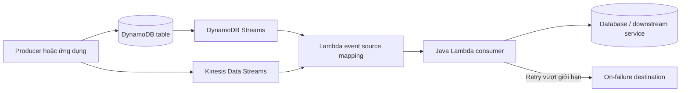

# Đọc DynamoDB Streams và Kinesis bằng Lambda consumer

AWS Lambda có thể phản ứng với thay đổi dữ liệu và luồng sự kiện mà không cần một ứng dụng server luôn chạy để polling. Với **DynamoDB Streams** và **Amazon Kinesis Data Streams**, Lambda dùng một thành phần gọi là **event source mapping** để đọc record từ stream, gom thành batch rồi gọi function xử lý.

Hai nguồn dữ liệu này đều phù hợp với kiến trúc event-driven, nhưng mục đích khác nhau. DynamoDB Streams ghi lại thay đổi của item trong một DynamoDB table. Kinesis Data Streams là dịch vụ streaming tổng quát để nhiều producer phát các record theo partition key. Khi thiết kế consumer, cần hiểu shard, thứ tự record, batch, checkpoint, retry, idempotency và giới hạn thời gian lưu dữ liệu.

Bài học trình bày cách chọn nguồn stream, cấu hình Lambda event source mapping, đọc event bằng Java và xử lý lỗi sao cho một record lỗi không làm mất hoặc nhân đôi tác dụng phụ nghiệp vụ.

## 1. Kiến trúc Lambda consumer cho stream

Với hai nguồn stream này, Lambda không được gọi trực tiếp bởi từng record theo kiểu HTTP request. Thay vào đó, event source mapping do Lambda quản lý sẽ poll stream:

1. Producer ghi dữ liệu vào DynamoDB table hoặc Kinesis Data Stream.
2. Dịch vụ stream lưu record theo cấu trúc và thứ tự của nó.
3. Lambda event source mapping đọc record từ shard hoặc stream iterator.
4. Mapping gom record thành batch theo batch size và batching window.
5. Lambda gọi function với event chứa các record.
6. Function xử lý batch và trả kết quả hoặc báo record lỗi theo cơ chế hỗ trợ.
7. Event source mapping cập nhật vị trí đọc/checkpoint và tiếp tục lấy batch tiếp theo.



Event source mapping chịu trách nhiệm poll và gọi Lambda. Nhà phát triển cấu hình nguồn, vị trí bắt đầu, batch, retry và quyền IAM; không cần tự viết vòng lặp polling trong handler.

Điều này khác với một Lambda function tự chạy lịch định kỳ rồi gọi API đọc stream. Dùng event source mapping giúp nền tảng quản lý việc đọc shard, checkpoint và scale consumer theo nguồn dữ liệu.

## 2. DynamoDB Streams và Kinesis Data Streams khác nhau thế nào?

| Tiêu chí | DynamoDB Streams | Kinesis Data Streams |
|---|---|---|
| Mục đích | Ghi lại thay đổi item của DynamoDB table | Luồng record tổng quát cho sự kiện từ nhiều producer |
| Nguồn record | INSERT, MODIFY, REMOVE của item | Record do producer ghi vào stream |
| Dữ liệu | Keys và các ảnh item theo StreamViewType | Partition key, sequence number và payload bytes |
| Phân vùng | Shard do dịch vụ quản lý cho stream của table | Shard được quản lý theo cấu hình/on-demand capacity |
| Thứ tự | Thứ tự thay đổi được bảo đảm cho cùng một item | Thứ tự record trong shard; cùng partition key đi vào cùng shard |
| Retention | 24 giờ | Theo cấu hình retention của stream |
| Dùng khi | Đồng bộ thay đổi bảng, audit, cập nhật search index, xử lý hậu thay đổi | Event ingestion, telemetry, clickstream, IoT, log và nhiều producer |
| Consumer | Lambda event source mapping, KCL và các consumer hỗ trợ khác | Lambda, KCL, enhanced fan-out và consumer khác |

### Khi nào chọn DynamoDB Streams?

Dùng DynamoDB Streams khi sự kiện cần phản ánh thay đổi của một DynamoDB table. Ví dụ:

- Khi đơn hàng chuyển trạng thái, cập nhật projection hoặc search index.
- Khi hồ sơ người dùng thay đổi, đồng bộ dữ liệu sang hệ thống khác.
- Khi item được thêm, sửa hoặc xóa, phát thông báo hoặc cập nhật cache.
- Khi cần xử lý dữ liệu dựa trên ảnh trước và sau thay đổi.

DynamoDB Streams là change data capture (CDC) của DynamoDB. Ứng dụng không phải tự phát event mỗi lần ghi item; stream được tạo từ thay đổi của table.

### Khi nào chọn Kinesis Data Streams?

Dùng Kinesis khi cần một luồng record độc lập với một database cụ thể. Ví dụ:

- Nhiều ứng dụng phát telemetry hoặc clickstream.
- Hệ thống IoT gửi dữ liệu thiết bị liên tục.
- Nhiều producer phát event cần được xử lý theo partition key.
- Cần giữ record theo retention đã cấu hình để nhiều consumer đọc độc lập.

Kinesis phù hợp khi stream là một thành phần dữ liệu trung tâm, có producer và consumer riêng. Một table DynamoDB có thể phát DynamoDB Streams cho thay đổi của nó, còn Kinesis nhận record do ứng dụng chủ động publish.

## 3. Shard, partition key và thứ tự record

Cả DynamoDB Streams và Kinesis Data Streams đều chia luồng thành các shard. Shard là đơn vị phân vùng và đọc dữ liệu của stream.

### Kinesis partition key

Producer gửi record cùng partition key. Kinesis dùng partition key để ánh xạ record vào shard. Vì vậy, các record có cùng partition key được đưa vào cùng shard và có thứ tự trong shard.

Ví dụ:

- partition key = order-123 cho các sự kiện của một đơn hàng.
- partition key = customer-42 cho các sự kiện của một khách hàng.
- partition key = device-900 cho telemetry của một thiết bị.

Chọn partition key ảnh hưởng đến phân bố tải. Nếu mọi record dùng cùng một key, một shard có thể trở thành hot shard trong khi shard khác ít tải. Nếu key quá ngẫu nhiên, các record của cùng thực thể có thể phân tán và không còn thứ tự theo thực thể đó.

Hãy chọn key theo ranh giới cần giữ thứ tự và khả năng phân bố tải.

### DynamoDB Streams shard

DynamoDB Streams tạo shard và quản lý quan hệ shard theo vòng đời của table. Các thay đổi cho cùng một item được sắp thứ tự trong stream. Consumer không nên tự giả định thứ tự toàn cục giữa mọi item hoặc mọi shard.

### Thứ tự không đồng nghĩa với xử lý đúng một lần

Thứ tự record trong stream giúp consumer xử lý thay đổi theo trình tự cần thiết. Tuy nhiên, Lambda có thể gọi lại một batch khi function lỗi, timeout hoặc không xác nhận được checkpoint. Vì vậy, cùng record có thể được xử lý lại.

Hệ thống cần kết hợp thứ tự với idempotency. Không dùng sequence number hoặc event ID như bằng chứng rằng tác dụng phụ đã được thực hiện đúng một lần.

## 4. DynamoDB Streams: cấu hình và cấu trúc record

Để dùng DynamoDB Streams, bật stream trên table và chọn StreamViewType. Các lựa chọn phổ biến:

| StreamViewType | Dữ liệu record |
|---|---|
| KEYS_ONLY | Chỉ khóa của item đã thay đổi |
| NEW_IMAGE | Ảnh item sau thay đổi |
| OLD_IMAGE | Ảnh item trước thay đổi |
| NEW_AND_OLD_IMAGES | Cả ảnh trước và sau thay đổi |

Chọn view theo dữ liệu consumer thực sự cần. NEW_AND_OLD_IMAGES hữu ích khi cần so sánh thay đổi, nhưng record lớn hơn và có thể chứa nhiều dữ liệu nhạy cảm hơn.

Một record DynamoDB Streams thường có:

- eventName: INSERT, MODIFY hoặc REMOVE.
- eventID: định danh record.
- eventSource: aws:dynamodb.
- awsRegion và eventSourceARN.
- dynamodb.Keys: khóa item.
- dynamodb.NewImage: ảnh mới nếu view type cung cấp.
- dynamodb.OldImage: ảnh cũ nếu view type cung cấp.
- dynamodb.SequenceNumber: số thứ tự record trong shard.
- dynamodb.ApproximateCreationDateTime: thời điểm gần đúng record được tạo.

Ví dụ payload rút gọn:

```json
{
  "eventName": "MODIFY",
  "eventSource": "aws:dynamodb",
  "eventID": "1a2b3c",
  "awsRegion": "ap-southeast-1",
  "dynamodb": {
    "Keys": {
      "orderId": { "S": "ord-123" }
    },
    "OldImage": {
      "status": { "S": "PENDING" }
    },
    "NewImage": {
      "status": { "S": "PAID" }
    },
    "SequenceNumber": "800000000000000000001"
  }
}
```

Payload thực tế có thêm metadata và phụ thuộc StreamViewType. Không giả định OldImage hoặc NewImage luôn tồn tại.

## 5. Đọc DynamoDB Streams bằng Java Lambda

AWS Lambda Java Events library cung cấp model để nhận DynamoDB event. Ví dụ sau xử lý các record thay đổi trạng thái đơn hàng.

```java
import com.amazonaws.services.lambda.runtime.Context;
import com.amazonaws.services.lambda.runtime.RequestHandler;
import com.amazonaws.services.lambda.runtime.events.DynamodbEvent;
import com.amazonaws.services.lambda.runtime.events.models.dynamodb.AttributeValue;
import com.amazonaws.services.lambda.runtime.events.models.dynamodb.StreamRecord;
import java.util.Map;

public class OrderStreamHandler
        implements RequestHandler<DynamodbEvent, Void> {

    @Override
    public Void handleRequest(
            DynamodbEvent event,
            Context context) {

        for (DynamodbEvent.DynamodbStreamRecord record
                : event.getRecords()) {

            String eventName = record.getEventName();
            StreamRecord change = record.getDynamodb();

            Map<String, AttributeValue> keys = change.getKeys();
            Map<String, AttributeValue> newImage = change.getNewImage();
            Map<String, AttributeValue> oldImage = change.getOldImage();

            AttributeValue orderIdValue =
                    keys == null ? null : keys.get("orderId");

            String orderId = orderIdValue == null
                    ? null : orderIdValue.getS();

            String newStatus = readString(newImage, "status");
            String oldStatus = readString(oldImage, "status");

            context.getLogger().log(
                    "event=" + eventName
                    + ", orderId=" + orderId
                    + ", oldStatus=" + oldStatus
                    + ", newStatus=" + newStatus);

            processChange(record, orderId, oldStatus, newStatus);
        }

        return null;
    }

    private static String readString(
            Map<String, AttributeValue> image,
            String name) {
        if (image == null || image.get(name) == null) {
            return null;
        }
        return image.get(name).getS();
    }

    private void processChange(
            DynamodbEvent.DynamodbStreamRecord record,
            String orderId,
            String oldStatus,
            String newStatus) {
        // Kiểm tra event type và thực hiện logic nghiệp vụ idempotent.
    }
}
```

Đây là skeleton minh họa. Cần thêm dependency aws-lambda-java-events tương thích với runtime và kiểm tra kiểu dữ liệu của AttributeValue theo schema table. DynamoDB AttributeValue có thể là S, N, BOOL, M, L, SS, NS, B và các kiểu khác; không gọi getS() cho mọi thuộc tính.

Một số lưu ý:

- Với INSERT, NewImage có thể có dữ liệu còn OldImage không có.
- Với REMOVE, OldImage có thể có dữ liệu còn NewImage không có.
- Với MODIFY, hai ảnh chỉ có đầy đủ nếu StreamViewType cung cấp.
- eventName cần được xử lý rõ ràng; không giả định mọi record đều là MODIFY.
- Nếu chỉ quan tâm một trường, kiểm tra null và kiểu trước khi đọc giá trị.

## 6. Kinesis Data Streams: cấu trúc record

Kinesis record có một số trường quan trọng:

- partitionKey: key producer dùng để phân vùng.
- sequenceNumber: số thứ tự record trong shard.
- data: payload bytes do producer gửi.
- approximateArrivalTimestamp: thời điểm đến gần đúng.
- eventSourceARN: ARN của stream.
- eventID: thường chứa shard ID và sequence number.

Ví dụ payload minh họa:

```json
{
  "eventSource": "aws:kinesis",
  "eventSourceARN": "arn:aws:kinesis:ap-southeast-1:123456789012:stream/order-events",
  "records": [
    {
      "eventID": "shardId-000000000000:49590338271490256608559692538361571095921575989136588898",
      "kinesis": {
        "partitionKey": "order-123",
        "sequenceNumber": "49590338271490256608559692538361571095921575989136588898",
        "data": "eyJ0eXBlIjoib3JkZXIucGFpZCIsIm9yZGVySWQiOiJvcmRlci0xMjMifQ=="
      }
    }
  ]
}
```

Trong JSON event hiển thị, data được biểu diễn bằng Base64. Khi dùng AWS Lambda Java Events model, trường data thường được cung cấp dưới dạng ByteBuffer đã được thư viện giải mã từ event JSON. Không Base64-decode lần thứ hai nếu đang đọc từ model đã giải mã.

## 7. Đọc Kinesis bằng Java Lambda

Ví dụ sau nhận KinesisEvent, lấy payload bytes và chuyển thành JSON string UTF-8.

```java
import com.amazonaws.services.lambda.runtime.Context;
import com.amazonaws.services.lambda.runtime.RequestHandler;
import com.amazonaws.services.lambda.runtime.events.KinesisEvent;
import java.nio.ByteBuffer;
import java.nio.charset.StandardCharsets;

public class KinesisConsumer
        implements RequestHandler<KinesisEvent, Void> {

    @Override
    public Void handleRequest(
            KinesisEvent event,
            Context context) {

        for (KinesisEvent.KinesisEventRecord record
                : event.getRecords()) {

            ByteBuffer data =
                    record.getKinesis().getData().asReadOnlyBuffer();

            byte[] payload = new byte[data.remaining()];
            data.get(payload);

            String json = new String(
                    payload, StandardCharsets.UTF_8);

            String partitionKey =
                    record.getKinesis().getPartitionKey();

            String sequenceNumber =
                    record.getKinesis().getSequenceNumber();

            context.getLogger().log(
                    "partitionKey=" + partitionKey
                    + ", sequenceNumber=" + sequenceNumber);

            processRecord(json, partitionKey, sequenceNumber);
        }

        return null;
    }

    private void processRecord(
            String json,
            String partitionKey,
            String sequenceNumber) {
        // Parse schema, validate payload và xử lý idempotent.
    }
}
```

Dùng asReadOnlyBuffer() để đọc một view riêng mà không thay đổi position của ByteBuffer gốc. Nếu payload là JSON, parse bằng Jackson hoặc parser đã chọn và validate schema trước khi áp dụng nghiệp vụ.

Kinesis chỉ bảo đảm thứ tự trong shard. Nếu cần xử lý theo từng đơn hàng, producer nên dùng orderId làm partition key. Nếu producer dùng random key, record của cùng một đơn hàng có thể nằm ở nhiều shard và được xử lý song song.

## 8. Lambda event source mapping và batch

Event source mapping xác định cách Lambda đọc stream. Các cấu hình quan trọng gồm:

| Cấu hình | Ý nghĩa |
|---|---|
| Event source ARN | DynamoDB Stream ARN hoặc Kinesis Stream ARN |
| Starting position | Vị trí bắt đầu đọc |
| Batch size | Số record tối đa trong một batch |
| Maximum batching window | Thời gian tối đa gom record trước khi gọi function |
| Parallelization factor | Số batch có thể xử lý đồng thời trên mỗi shard |
| Maximum retry attempts | Số lần retry tối đa khi batch lỗi |
| Maximum record age | Tuổi tối đa record còn được phép xử lý |
| Bisect batch on function error | Chia nhỏ batch khi function lỗi để cô lập record lỗi |
| Function response types | Bật partial batch response như ReportBatchItemFailures |
| On-failure destination | Nơi gửi thông tin record bị loại sau khi hết retry, nếu nguồn hỗ trợ |

Batch lớn giúp giảm số lần invocation nhưng có thể tăng thời gian xử lý, bộ nhớ và phạm vi record bị retry. Batch nhỏ giúp cô lập lỗi tốt hơn nhưng tăng số lần gọi function.

Ngoài batch size, event source mapping còn chịu giới hạn payload invocation của Lambda. Kích thước event thực tế bao gồm metadata và envelope, không chỉ payload gốc. Hãy kiểm tra giới hạn hiện hành của dịch vụ và thử với record có kích thước lớn.

### Starting position

Các lựa chọn phổ biến:

- **TRIM_HORIZON:** bắt đầu từ record cũ nhất còn trong retention.
- **LATEST:** bắt đầu từ record mới được thêm vào sau vị trí đọc hiện tại.
- **AT_TIMESTAMP:** bắt đầu từ một thời điểm xác định, nếu nguồn hỗ trợ.

LATEST phù hợp khi chỉ quan tâm dữ liệu mới sau khi consumer bắt đầu hoạt động. Tuy nhiên, trong thời gian event source mapping được tạo hoặc cập nhật, poller cần thời gian bắt đầu đọc; nếu yêu cầu không bỏ sót record trong giai đoạn chuyển tiếp, hãy cân nhắc TRIM_HORIZON hoặc một quy trình bootstrap/đối soát rõ ràng.

TRIM_HORIZON chỉ đọc được record còn trong retention. Nó không thể khôi phục dữ liệu đã hết thời gian lưu.

### Batch size và batching window

Batch size xác định số record tối đa một invocation có thể nhận. Batching window cho phép Lambda chờ thêm record để tạo batch lớn hơn trước khi gọi function.

Giá trị cụ thể phụ thuộc loại stream và giới hạn AWS hiện hành. DynamoDB Streams và Kinesis có giới hạn batch size khác nhau. Ngoài ra, tổng payload event phải nằm trong giới hạn kích thước invocation. Đừng chỉ đặt batch size lớn nhất mà không đo latency, memory và khả năng xử lý.

## 9. Shard concurrency và ParallelizationFactor

Mặc định, Lambda xử lý một batch tại một thời điểm cho mỗi shard của stream mapping. Điều này giúp duy trì thứ tự record trong shard nhưng có thể giới hạn throughput khi function xử lý chậm.

ParallelizationFactor cho phép xử lý nhiều batch đồng thời trên một shard, trong giới hạn dịch vụ. Với Kinesis và DynamoDB Streams, giá trị có thể cấu hình tối đa 10. Lambda vẫn giữ thứ tự xử lý theo partition key đối với Kinesis và theo item đối với DynamoDB Streams khi sử dụng cơ chế này.

Không nên tăng parallelization factor mà không kiểm tra:

- Function có xử lý đồng thời an toàn không?
- Các batch có cập nhật cùng một item hoặc aggregate không?
- Database đích chịu được số connection và transaction tăng thêm không?
- Các tác dụng phụ có idempotent không?
- Có yêu cầu thứ tự toàn cục giữa các key hay không?

Tăng concurrency có thể tăng throughput nhưng cũng tăng tải downstream. Nếu một dịch vụ phía sau có quota thấp, cần giới hạn concurrency hoặc dùng queue để làm phẳng tải.

### Hot shard và partition key

Kinesis partition key không phân bố đều có thể tạo hot shard. Một shard nhận quá nhiều record có thể trở thành nút thắt dù các shard khác còn dư năng lực.

Cần theo dõi IncomingRecords, IncomingBytes, ReadProvisionedThroughputExceeded, IteratorAgeMilliseconds và các metric liên quan. Với Kinesis on-demand hoặc provisioned mode, cơ chế scale shard khác nhau; chọn capacity mode và partition key theo throughput dự kiến.

Với DynamoDB Streams, theo dõi IteratorAge và lỗi xử lý. Không giả định thêm Lambda concurrency có thể khắc phục mọi giới hạn ở nguồn hoặc downstream.

## 10. Retry, checkpoint và lỗi batch

Lambda event source mapping ghi nhận tiến độ đọc stream thông qua checkpoint/sequence number. Khi function xử lý batch thất bại, mapping có thể retry batch theo cấu hình. Với stream, lỗi có thể ảnh hưởng các record tiếp theo vì thứ tự cần được giữ.

Nếu không cấu hình giới hạn retry hoặc record age phù hợp, một record lỗi cố định (poison pill) có thể khiến shard bị chặn lâu. Ví dụ, một payload sai schema khiến handler luôn ném exception; batch chứa payload đó có thể bị gửi lại liên tục.

Các cấu hình giúp kiểm soát:

- Maximum retry attempts: giới hạn số lần thử lại.
- Maximum record age: bỏ qua record đã quá cũ theo chính sách.
- Bisect batch on function error: chia batch lỗi thành các batch nhỏ để tìm record gây lỗi.
- On-failure destination: lưu thông tin record bị loại để điều tra hoặc xử lý lại.
- Partial batch response: chỉ báo record lỗi theo định dạng được hỗ trợ.

Không nên chỉ tăng retry vô hạn. Cần phân loại lỗi có thể phục hồi và lỗi dữ liệu không thể phục hồi, đồng thời có quy trình xử lý record bị loại.

### Retry không đồng nghĩa với exactly-once

Một record có thể được xử lý thành công ở downstream nhưng function timeout trước khi mapping ghi nhận checkpoint. Khi đó, Lambda có thể gửi lại record. Consumer phải giả định có thể nhận record trùng.

Cách xử lý:

1. Xác định khóa idempotency ổn định cho record.
2. Ghi nhận khóa và kết quả xử lý trong database có unique constraint hoặc transaction.
3. Thực hiện cập nhật nghiệp vụ một cách nguyên tử khi có thể.
4. Nếu gọi dịch vụ bên ngoài, truyền idempotency key nếu API hỗ trợ.
5. Khi nhận record đã xử lý, trả thành công mà không tạo tác dụng phụ lần nữa.

Với Kinesis, có thể dùng stream ARN + sequence number làm khóa kỹ thuật. Với DynamoDB Streams, có thể dùng eventID hoặc tổ hợp stream ARN và eventID. Khóa nghiệp vụ như orderId + event version có thể phù hợp hơn nếu cần chống trùng ở cấp nghiệp vụ.

## 11. Partial batch response

Nếu chỉ một record trong batch lỗi, mặc định function có thể phải trả lỗi cho cả batch. Partial batch response cho phép function báo record nào thất bại để Lambda tiếp tục checkpoint các record trước đó.

Với Kinesis và DynamoDB Streams, cấu hình event source mapping phải bật ReportBatchItemFailures. Function trả danh sách batch item failure có sequence number. Lambda sử dụng sequence number lỗi sớm nhất để xác định vị trí retry trong shard.

Ví dụ handler Kinesis:

```java
import com.amazonaws.services.lambda.runtime.Context;
import com.amazonaws.services.lambda.runtime.RequestHandler;
import com.amazonaws.services.lambda.runtime.events.KinesisEvent;
import com.amazonaws.services.lambda.runtime.events.StreamsEventResponse;
import java.util.ArrayList;
import java.util.List;

public class PartialKinesisConsumer
        implements RequestHandler<KinesisEvent, StreamsEventResponse> {

    @Override
    public StreamsEventResponse handleRequest(
            KinesisEvent event,
            Context context) {

        List<StreamsEventResponse.BatchItemFailure> failures =
                new ArrayList<>();

        for (KinesisEvent.KinesisEventRecord record
                : event.getRecords()) {
            try {
                process(record);
            } catch (RetryableRecordException ex) {
                String sequenceNumber =
                        record.getKinesis().getSequenceNumber();

                failures.add(
                        new StreamsEventResponse.BatchItemFailure(
                                sequenceNumber));

                // Dừng ở lỗi đầu tiên để không vượt qua record
                // đang chặn thứ tự xử lý trong shard.
                break;
            }
        }

        return new StreamsEventResponse(failures);
    }

    private void process(KinesisEvent.KinesisEventRecord record) {
        // Parse, validate và xử lý idempotent.
    }
}
```

Ví dụ minh họa cách trả lỗi theo sequence number; cần dùng phiên bản aws-lambda-java-events tương thích với runtime. Nếu exception là lỗi không thể phục hồi, ứng dụng cần áp dụng chính sách riêng như ghi record vào kho cách ly rồi xác nhận, hoặc để event source mapping retry và chuyển đến on-failure destination theo cấu hình.

Với thứ tự trong shard, dừng tại record lỗi đầu tiên thường là cách dễ hiểu và an toàn. Các record phía sau sẽ được xử lý lại khi Lambda tiếp tục từ sequence number lỗi. Nếu tiếp tục xử lý record phía sau rồi trả lỗi record trước, cần bảo đảm việc xử lý out-of-order không vi phạm nghiệp vụ.

Partial batch response giảm số record thành công bị xử lý lại, nhưng không loại bỏ yêu cầu idempotency.

## 12. Tumbling window và xử lý theo cửa sổ

Kinesis event source mapping hỗ trợ tumbling window để gom record theo cửa sổ thời gian và truyền trạng thái giữa các lần invocation của cửa sổ. Điều này hữu ích khi cần tổng hợp dữ liệu theo khoảng thời gian, chẳng hạn số đơn hàng mỗi phút hoặc tổng telemetry theo thiết bị.

Tumbling window có cơ chế state transfer giữa các invocation và giới hạn riêng về thời lượng, payload và trạng thái. Đây không phải giải pháp thay thế database cho trạng thái nghiệp vụ dài hạn.

Trước khi dùng, cần xác định:

- Cửa sổ thời gian và cách xử lý record đến muộn.
- Kích thước trạng thái tổng hợp.
- Hành vi retry khi một invocation của cửa sổ lỗi.
- Khả năng trùng hoặc chạy lại khi checkpoint chưa được xác nhận.
- Cách ghi kết quả cuối cùng idempotent vào kho dữ liệu.

DynamoDB Streams cũng có thể dùng một số tính năng event source mapping tương ứng tùy cấu hình và giới hạn của Lambda; kiểm tra tài liệu hiện hành trước khi áp dụng.

## 13. IAM và bảo mật cho Lambda consumer

Lambda cần quyền đọc stream và ghi log. Dùng execution role riêng cho function, giới hạn quyền theo đúng stream ARN và các thao tác cần thiết.

Với DynamoDB Streams, các quyền đọc thường gồm:

- dynamodb:DescribeStream
- dynamodb:GetRecords
- dynamodb:GetShardIterator
- dynamodb:ListStreams

Với Kinesis Data Streams, các quyền thường gồm:

- kinesis:DescribeStream
- kinesis:DescribeStreamSummary
- kinesis:GetRecords
- kinesis:GetShardIterator
- kinesis:ListShards

Function cũng cần quyền CloudWatch Logs phù hợp để ghi log. Tùy cấu hình mã hóa, có thể cần quyền KMS để đọc stream mã hóa bằng customer managed key. Quyền cụ thể phụ thuộc cách tạo event source mapping và cấu hình encryption.

Các nguyên tắc bảo mật:

- Không cấp quyền đọc tất cả stream nếu function chỉ cần một stream.
- Không ghi toàn bộ payload chứa dữ liệu cá nhân hoặc bí mật vào log.
- Dùng KMS và encryption at rest khi yêu cầu dữ liệu cần bảo vệ.
- Hạn chế quyền của function với database và dịch vụ downstream.
- Kiểm soát ai được tạo, sửa hoặc xóa event source mapping.
- Kiểm tra schema và kích thước record trước khi xử lý sâu.
- Theo dõi việc thay đổi StreamViewType, shard và quyền truy cập.

## 14. Retention, iterator age và khả năng bắt kịp stream

Stream chỉ giữ record trong một khoảng thời gian. DynamoDB Streams giữ record trong 24 giờ. Kinesis Data Streams có retention cấu hình được; thời gian mặc định và giới hạn tối đa phụ thuộc cấu hình và chế độ dịch vụ.

Nếu consumer ngừng hoạt động quá thời gian retention, record cũ có thể bị loại khỏi stream trước khi Lambda đọc được. Vì vậy, cần theo dõi độ trễ consumer.

Metric quan trọng là IteratorAgeMilliseconds: tuổi của record khi Lambda xử lý. Nếu metric tăng liên tục, consumer đang tụt lại phía sau producer.

Nguyên nhân có thể gồm:

- Function xử lý quá chậm.
- Batch size hoặc parallelization factor chưa phù hợp.
- Shard không đủ throughput.
- Hot partition key làm tải dồn vào một shard.
- Downstream database hoặc API bị chậm.
- Retry liên tục do poison record.
- Function concurrency bị giới hạn.

Cách khắc phục có thể là tối ưu handler, tăng batch phù hợp, điều chỉnh parallelization factor, phân bố partition key tốt hơn, tăng shard/capacity với Kinesis hoặc giảm tải downstream. Không chỉ tăng concurrency nếu downstream đang là nút thắt.

## 15. Ví dụ tạo event source mapping

Có thể tạo mapping qua AWS Console, AWS CLI, CloudFormation, CDK hoặc Terraform. Ví dụ CLI khái niệm cho Kinesis:

```bash
aws lambda create-event-source-mapping --function-name OrderStreamConsumer --event-source-arn arn:aws:kinesis:ap-southeast-1:123456789012:stream/order-events --starting-position TRIM_HORIZON --batch-size 100 --maximum-batching-window-in-seconds 1 --function-response-types ReportBatchItemFailures --maximum-retry-attempts 5 --maximum-record-age-in-seconds 3600 --bisect-batch-on-function-error
```

Đây là ví dụ cấu hình, cần thay function name, ARN và giới hạn theo workload. Các tùy chọn retry, record age, batching window và response type có thể có giới hạn khác nhau theo nguồn stream và phiên bản API. Xác minh lệnh với AWS CLI/API hiện hành trước khi triển khai.

Với DynamoDB Streams, event-source ARN là stream ARN của table, không phải table ARN. Bật stream trên table trước rồi lấy stream ARN tương ứng. Khi table tạo stream mới do thay đổi cấu hình, ARN stream có thể thay đổi; event source mapping cần trỏ đến ARN đang hoạt động.

Sau khi tạo mapping, kiểm tra trạng thái Enabled và State của mapping, metric iterator age, số invocation và lỗi function. Mapping có thể cần thời gian để chuyển sang trạng thái hoạt động.

## 16. Kiểm thử consumer

Trước khi đưa vào production, kiểm thử cả dữ liệu hợp lệ, lỗi và hành vi retry:

| Tình huống | Kết quả mong đợi |
|---|---|
| DynamoDB INSERT | Handler đọc Keys và NewImage |
| DynamoDB MODIFY | Handler xử lý thay đổi theo OldImage/NewImage nếu view type có |
| DynamoDB REMOVE | Handler không giả định NewImage tồn tại |
| Kinesis record hợp lệ | Decode bytes và parse payload |
| Record sai schema | Được phân loại là lỗi dữ liệu, không retry vô hạn |
| Downstream timeout | Retry có giới hạn và idempotency bảo vệ tác dụng phụ |
| Cùng record được giao lại | Không tạo tác dụng phụ lần hai |
| Một record trong batch lỗi | Partial batch response chỉ ra sequence number lỗi |
| Batch lớn | Handler nằm trong timeout và memory limit |
| Shard tăng hoặc reshard | Mapping tiếp tục xử lý shard mới theo cơ chế dịch vụ |
| Consumer chậm | IteratorAge được cảnh báo trước khi vượt retention |
| IAM thiếu quyền | Mapping/function báo lỗi rõ và được phát hiện qua monitoring |

Dùng test event đại diện cho cả DynamoDB và Kinesis. Test không chỉ gọi handler với một record đơn lẻ; cần thử batch có nhiều record, record lỗi ở giữa batch và cùng record được gửi lại.

## 17. Những lỗi triển khai thường gặp

- **Nhầm DynamoDB Streams với Kinesis:** một nguồn là CDC của table, nguồn còn lại là stream tổng quát do producer ghi.
- **Giả định thứ tự toàn cục:** thứ tự chỉ được bảo đảm trong phạm vi item hoặc partition/shard theo semantics của nguồn.
- **Coi Lambda event source mapping là exactly-once:** batch có thể được gửi lại; handler cần idempotent.
- **Dùng LATEST khi cần đọc bù dữ liệu cũ:** LATEST không đọc lại toàn bộ record còn lưu trước vị trí bắt đầu.
- **Không tính retention:** consumer dừng quá lâu có thể mất khả năng đọc record cũ.
- **Batch quá lớn:** invocation có thể vượt timeout hoặc memory, làm phạm vi retry rộng.
- **Không cấu hình partial batch response:** một record lỗi có thể khiến record thành công trong batch bị xử lý lại.
- **Retry vô hạn poison record:** shard có thể bị chặn và iterator age tăng.
- **Partition key tập trung:** tạo hot shard và giới hạn throughput.
- **Không xử lý record trùng:** downstream có thể nhận tác dụng phụ lặp.
- **Log toàn bộ image hoặc payload:** có thể làm lộ dữ liệu nhạy cảm và tăng chi phí log.
- **Cấp IAM quá rộng:** tăng phạm vi ảnh hưởng nếu function bị khai thác.

## 18. Quy trình thiết kế Lambda stream consumer

Khi xây dựng consumer Java cho DynamoDB Streams hoặc Kinesis, có thể làm theo trình tự:

1. Xác định nguồn sự kiện: thay đổi item DynamoDB hay stream record tổng quát.
2. Chọn partition key hoặc StreamViewType theo dữ liệu và thứ tự cần giữ.
3. Xác định retention, starting position và cách bootstrap/đối soát.
4. Tạo Lambda execution role với quyền đọc đúng stream.
5. Tạo event source mapping và cấu hình batch size, batching window.
6. Đặt parallelization factor theo throughput và khả năng downstream.
7. Viết Java handler parse đúng event model và validate schema.
8. Thiết kế idempotency cho từng record và mọi tác dụng phụ.
9. Bật partial batch response nếu handler có thể xác định record lỗi.
10. Đặt retry attempts, record age, bisect và on-failure destination.
11. Theo dõi IteratorAge, invocation, error, throttling và DLQ.
12. Kiểm thử duplicate, poison record, batch lỗi, reshard và tải cao.

## 19. Ghi nhớ

DynamoDB Streams phù hợp khi cần phản ứng với thay đổi item trong DynamoDB table. Kinesis Data Streams phù hợp với luồng record tổng quát từ nhiều producer. Lambda event source mapping poll các shard, gom batch và gọi Java consumer.

Thiết kế consumer phải hiểu partition key, shard, thứ tự, retention, batch, checkpoint và retry. Record có thể được xử lý lại, vì vậy cần idempotency; partial batch response giúp cô lập lỗi record nhưng không tạo ra exactly-once processing. Theo dõi IteratorAge và khả năng downstream để bảo đảm consumer bắt kịp stream khi tải tăng.

