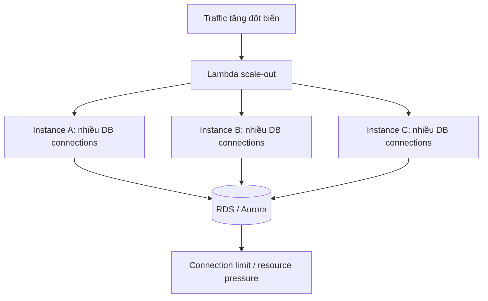
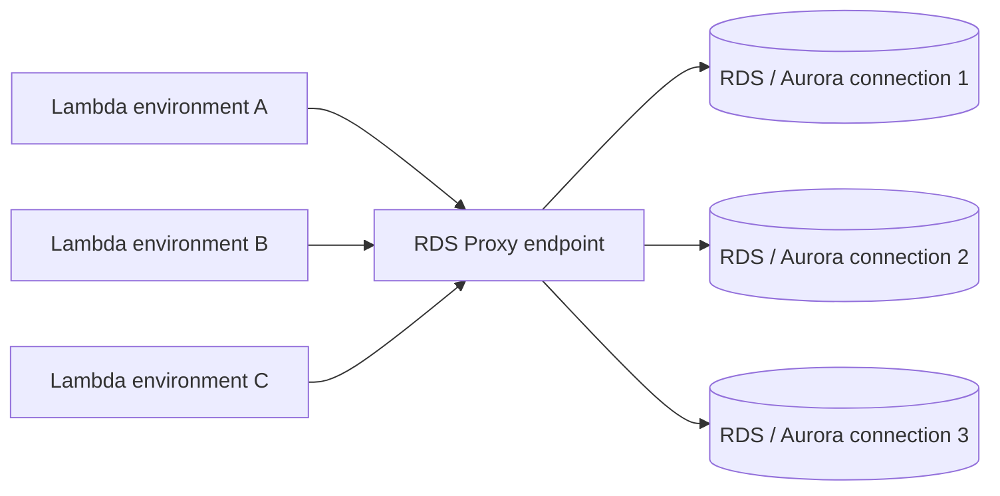
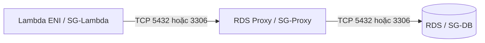
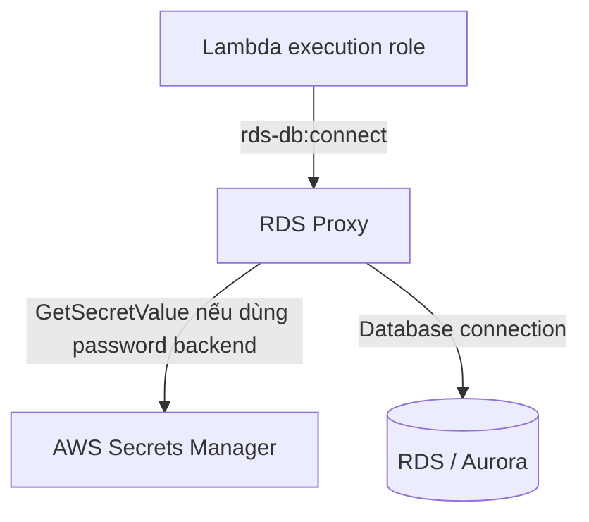

# Truy cập RDS qua RDS Proxy từ Lambda

AWS Lambda có thể tăng số execution environment rất nhanh khi lượng request hoặc event tăng. Nếu mỗi invocation tự mở một kết nối trực tiếp đến Amazon RDS hoặc Aurora, database có thể nhận một đợt kết nối đồng thời vượt quá giới hạn, dù mỗi function chỉ xử lý một thao tác nhỏ. RDS Proxy giúp quản lý connection pool ở phía database, chia sẻ các kết nối backend giữa nhiều client và giảm áp lực khi Lambda scale-out.

RDS Proxy không thay thế database và cũng không làm cho mọi truy vấn tự động nhanh hơn. Lambda vẫn phải mở kết nối đến endpoint của proxy; proxy tiếp tục duy trì kết nối đến database. Lợi ích chính nằm ở quản lý kết nối, khả năng multiplexing khi phiên làm việc cho phép và hỗ trợ phục hồi kết nối khi database failover. Để dùng hiệu quả, cần cấu hình đúng VPC, security group, xác thực, quyền IAM, transaction và concurrency.

## 1. Vì sao Lambda cần RDS Proxy?

### 1.1. Vấn đề khi kết nối trực tiếp

Một function instance thường tạo kết nối database khi cần xử lý. Khi Lambda nhận nhiều invocation đồng thời, nhiều execution environment có thể cùng tạo kết nối. Nếu mỗi invocation mở nhiều connection hoặc mỗi environment giữ pool riêng, số kết nối có thể tăng rất nhanh.

Ví dụ, một function có thể scale lên 300 execution environment. Nếu mỗi environment mở pool 5 kết nối, database có thể phải phục vụ tới 1.500 kết nối từ workload này. Con số thực tế còn phụ thuộc số invocation đồng thời trên mỗi environment, vòng đời connection và cách ứng dụng quản lý pool.

Database có giới hạn connection và mỗi kết nối tiêu thụ tài nguyên như bộ nhớ, process/thread hoặc slot quản lý. Khi chạm giới hạn, các kết nối mới có thể bị từ chối, truy vấn chậm hoặc ứng dụng timeout trước khi bắt đầu xử lý nghiệp vụ.



Tăng `max_connections` của database không phải lúc nào cũng là giải pháp. Tăng giới hạn có thể làm database tiêu thụ thêm bộ nhớ và giảm tài nguyên dành cho truy vấn. Trước tiên cần giảm số connection không cần thiết và kiểm soát concurrency.

### 1.2. RDS Proxy giải quyết điều gì?

RDS Proxy là dịch vụ proxy database được quản lý. Lambda kết nối đến endpoint của proxy; proxy duy trì một pool kết nối backend đến RDS/Aurora. Khi client thực hiện công việc phù hợp, proxy có thể cho nhiều client lần lượt dùng chung một kết nối database backend thay vì giữ một kết nối backend riêng cho từng client trong toàn bộ thời gian sống của client.



Proxy quản lý việc mượn và trả kết nối backend, giới hạn lượng kết nối database theo cấu hình và hỗ trợ chuyển kết nối khi database gặp failover. Số kết nối client đến proxy vẫn có thể lớn; điều cần kiểm soát là số kết nối backend mà database phải chịu và thời gian client phải chờ để mượn connection.

### 1.3. RDS Proxy không giải quyết mọi vấn đề

RDS Proxy không thay thế việc tối ưu SQL, index, transaction hay mô hình dữ liệu. Nó cũng không bảo đảm mọi client connection đều được multiplex sang backend connection khác nhau trong mọi thời điểm.

Các tình huống sau vẫn cần xử lý ở ứng dụng:

- truy vấn chậm hoặc lock contention;
- transaction kéo dài;
- connection bị pin vào một backend session;
- số lượng invocation vượt năng lực database;
- retry không an toàn sau khi một transaction đã tạo side effect;
- cấu hình mạng, IAM hoặc secret sai.

RDS Proxy phù hợp khi workload có nhiều client connection ngắn hạn, tải biến động hoặc Lambda scale-out, và database cần được bảo vệ khỏi connection storm.

## 2. Luồng kết nối Lambda → RDS Proxy → RDS

Một request đi qua các bước:

1. API Gateway, SQS, EventBridge hoặc caller invoke Lambda.
2. Java handler xác thực request/event và bắt đầu transaction nếu cần.
3. Lambda mở kết nối JDBC đến endpoint RDS Proxy trong VPC.
4. Client xác thực với proxy bằng IAM database authentication hoặc username/password theo cấu hình.
5. Proxy mượn kết nối backend đến database; proxy xác thực với database theo cấu hình riêng.
6. Handler thực hiện truy vấn và commit/rollback transaction.
7. Khi client đóng connection, proxy có thể trả backend connection về pool nếu session không còn bị pin và không có transaction đang mở.

Hai chặng xác thực cần được phân biệt:

- **Lambda client → RDS Proxy:** xác thực bằng IAM hoặc database credential tùy cấu hình proxy.
- **RDS Proxy → RDS/Aurora:** proxy dùng thông tin xác thực được cấu hình cho target database; mô hình phổ biến là secret trong AWS Secrets Manager, ngoài ra có thể dùng IAM authentication giữa proxy và database nếu engine/cấu hình hỗ trợ.

IAM auth ở chặng client-to-proxy không tự động có nghĩa proxy dùng IAM auth ở chặng proxy-to-database. Hãy cấu hình và kiểm thử riêng từng chặng.

## 3. Chuẩn bị RDS Proxy và database

### 3.1. Kiểm tra engine và điều kiện hỗ trợ

RDS Proxy hỗ trợ các engine và phiên bản cụ thể của Amazon RDS/Aurora. Trước khi triển khai, kiểm tra danh sách engine/version, region, tính năng IAM authentication, TLS và các giới hạn tương ứng trong tài liệu AWS hiện hành.

Xác định rõ:

- engine và phiên bản database;
- database instance hay Aurora cluster;
- endpoint writer/reader cần dùng;
- số kết nối tối đa và mức tải hiện tại;
- cách xác thực từ proxy đến database;
- yêu cầu TLS, CA certificate và mã hóa;
- có cần failover nhanh hoặc nhiều client ngắn hạn hay không.

Không giả định mọi tính năng RDS Proxy giống nhau giữa MySQL, PostgreSQL, MariaDB và các engine Aurora được hỗ trợ. Các tham số, hành vi session pinning và yêu cầu IAM có thể khác nhau; hãy kiểm tra ma trận hỗ trợ theo engine/version hiện tại.

### 3.2. Tạo database user phù hợp

Tạo user database riêng cho workload Lambda, chỉ cấp quyền trên schema/table cần thiết. Không dùng tài khoản master của database trong function.

Ví dụ quyền ở mức nghiệp vụ:

- Function đọc đơn hàng chỉ cần `SELECT` trên bảng hoặc view tương ứng.
- Function cập nhật trạng thái đơn hàng cần quyền cập nhật các bảng liên quan.
- Function chạy migration nên dùng role riêng, không dùng chung với runtime role.

Tách user theo service hoặc workload giúp giới hạn tác động nếu credential bị lộ và hỗ trợ audit. Nếu dùng IAM database authentication, database user phải được cấu hình theo hướng dẫn của engine để chấp nhận cơ chế IAM.

### 3.3. Tạo RDS Proxy

Quy trình cấu hình tổng quát:

1. Chọn VPC và các subnet có thể kết nối đến database.
2. Chọn security group cho proxy.
3. Chọn secret hoặc cơ chế xác thực mà proxy dùng để kết nối database.
4. Cấu hình IAM role của proxy để đọc secret nếu dùng Secrets Manager.
5. Chọn engine family và target database/cluster.
6. Cấu hình TLS, IAM authentication, connection pool và timeout theo workload.
7. Tạo proxy endpoint và chờ trạng thái proxy/target sẵn sàng.
8. Kiểm tra target health và thử kết nối từ một môi trường nằm trong cùng mạng.

RDS Proxy thường yêu cầu các subnet thuộc ít nhất hai Availability Zone để cung cấp khả năng sẵn sàng cao. Chọn subnet theo vùng triển khai và khả năng kết nối thực tế của database. Không đưa endpoint proxy vào public subnet với giả định nó sẽ trở thành endpoint công khai; proxy được truy cập qua mạng VPC theo cấu hình.

### 3.4. Endpoint của proxy

Sau khi tạo, RDS Proxy cung cấp endpoint DNS. Ứng dụng dùng hostname này thay cho endpoint trực tiếp của database. Không hard-code địa chỉ IP vì endpoint có thể thay đổi khi dịch vụ vận hành hoặc failover.

Giữ endpoint trong cấu hình theo môi trường, chẳng hạn environment variable `DB_PROXY_HOST`. Không đưa username/password hoặc token vào cùng biến cấu hình không được bảo vệ.

## 4. VPC và security group

### 4.1. Lambda phải có đường mạng đến proxy

RDS Proxy nằm trong VPC. Lambda cần được cấu hình truy cập VPC tương ứng để mở kết nối đến endpoint proxy. Khi cấu hình Lambda VPC, chọn subnet có route đến proxy và security group phù hợp.

Việc gắn Lambda vào subnet private không tự động cho phép function truy cập internet. Nếu function còn gọi public API, cần thiết kế NAT hoặc VPC endpoint phù hợp. Đường đến RDS Proxy là lưu lượng nội bộ trong VPC.

### 4.2. Quy tắc security group theo từng chặng

Giả sử PostgreSQL dùng cổng 5432 hoặc MySQL dùng cổng 3306. Có thể mô hình hóa security group như sau:

| Thành phần | Inbound | Outbound |
| --- | --- | --- |
| Lambda security group | Thường không cần mở inbound cho kết nối JDBC khởi tạo từ Lambda | Cho phép đến proxy security group trên cổng database |
| Proxy security group | Cho phép từ Lambda security group trên cổng database | Cho phép đến database security group trên cổng database |
| Database security group | Cho phép từ proxy security group trên cổng database | Theo chính sách mạng cần thiết của database |



Ưu tiên tham chiếu security group làm source/destination thay vì mở cổng từ `0.0.0.0/0` hoặc toàn bộ CIDR VPC. Quy tắc thực tế cần xét cả outbound policy, network ACL và route table. Nếu dùng cổng tùy chỉnh, cấu hình đồng nhất ở database, proxy, security group và JDBC URL.

### 4.3. DNS và TLS

Lambda phải phân giải được hostname proxy. Khi gặp timeout hoặc connection refused, kiểm tra DNS resolution, route, subnet, network ACL và security group trước khi kết luận database không sẵn sàng.

Bật TLS cho kết nối đến proxy và xác minh chứng thư server theo cấu hình driver. Với PostgreSQL JDBC có thể dùng `sslmode=verify-full` cùng trust store chứa CA phù hợp; với MySQL Connector/J dùng chế độ xác minh danh tính server như `sslMode=VERIFY_IDENTITY`. Chỉ mã hóa mà không xác minh danh tính server có thể không bảo vệ đầy đủ trước endpoint giả mạo.

Không tắt kiểm tra chứng thư để “sửa nhanh” lỗi TLS trong production. Kiểm tra CA bundle, hostname, thời gian hệ thống và cấu hình driver.

## 5. Xác thực: IAM và Secrets Manager

### 5.1. Hai lớp credential

RDS Proxy có thể dùng secret để kết nối backend database. Lambda có thể dùng IAM authentication để kết nối proxy mà không cần đọc mật khẩu database. Đây là mô hình thường hữu ích cho serverless:



Mô hình xác thực cụ thể phụ thuộc engine và cấu hình RDS Proxy. Nếu client dùng username/password, Lambda phải lấy secret an toàn và kết nối bằng credential đó. Nếu client dùng IAM authentication, Lambda tạo token ngắn hạn và cần quyền `rds-db:connect` đúng resource. Không cấp quyền đọc secret cho Lambda nếu function không cần đọc secret.

### 5.2. Quyền của role mà RDS Proxy sử dụng

Khi proxy dùng Secrets Manager để lấy database credentials, role được gắn cho proxy cần quyền `secretsmanager:GetSecretValue` trên secret tương ứng. Nếu secret được mã hóa bằng customer-managed KMS key, role có thể cần thêm `kms:Decrypt` theo key policy và encryption context.

Role này là role phục vụ proxy truy cập secret; nó khác với Lambda execution role. Không gắn quyền đọc tất cả secrets trong account nếu proxy chỉ cần một vài secret cụ thể.

Role của proxy cần trust relationship cho dịch vụ RDS, thường là principal `rds.amazonaws.com`. Ví dụ trust policy rút gọn:

```json
{
  "Version": "2012-10-17",
  "Statement": [
    {
      "Effect": "Allow",
      "Principal": { "Service": "rds.amazonaws.com" },
      "Action": "sts:AssumeRole"
    }
  ]
}
```

Gắn permissions policy giới hạn `secretsmanager:GetSecretValue` vào đúng secret ARN. Nếu secret dùng customer-managed KMS key, bổ sung quyền `kms:Decrypt` trên key cụ thể và kiểm tra key policy cho phép role này sử dụng key.

### 5.3. IAM authentication từ Lambda đến proxy

Với IAM database authentication, Lambda tạo token dựa trên hostname, port, username và AWS credentials hiện có. Token được dùng làm password trong bước bắt tay kết nối. Token có thời hạn ngắn (15 phút cho quá trình xác thực); kết nối đã thiết lập không cần thay password giữa một truy vấn đang chạy chỉ vì token hết hạn. Khi mở kết nối mới, hãy tạo token mới.

Execution role cần quyền `rds-db:connect` trên resource ID của RDS Proxy và database user được phép. ARN có dạng:

```text
arn:aws:rds-db:<region>:<account-id>:dbuser:<proxy-resource-id>/<db-user>
```

Trong ARN của proxy, resource ID có tiền tố `prx-`. Đây là resource ID của proxy, không phải tên DNS endpoint và cũng không phải ARN của secret. Ví dụ policy minh họa:

```json
{
  "Version": "2012-10-17",
  "Statement": [
    {
      "Sid": "ConnectToOrdersProxyAsAppUser",
      "Effect": "Allow",
      "Action": "rds-db:connect",
      "Resource": "arn:aws:rds-db:ap-southeast-1:123456789012:dbuser:prx-ABCDEFGHIJKL01234/orders_app"
    }
  ]
}
```

Thay region, account ID, proxy resource ID và username bằng giá trị thật. Không dùng wildcard resource rộng hơn cần thiết. Ngoài policy IAM, database user phải được cấu hình để hỗ trợ IAM authentication theo engine.

### 5.4. Client password authentication

Nếu dùng username/password từ Lambda đến proxy, function cần lấy secret từ Secrets Manager hoặc Parameter Store SecureString. Execution role khi đó cần quyền đọc đúng secret; nếu dùng customer-managed KMS key, cần quyền giải mã theo cấu hình.

Không đặt mật khẩu database trong source code, file JAR, image, payload event hoặc log. Nếu dùng cache secret trong execution environment, đặt TTL phù hợp và có chiến lược làm mới khi secret rotation xảy ra. Một môi trường Lambda được tái sử dụng không đồng nghĩa credential trong bộ nhớ luôn còn hợp lệ.

### 5.5. IAM authentication ở chặng proxy đến database

Xác thực client-to-proxy và proxy-to-database là hai cấu hình riêng. Một số engine/cấu hình hỗ trợ proxy sử dụng IAM authentication đến database; các trường hợp khác dùng credential lấy từ Secrets Manager. Kiểm tra engine/version, trạng thái IAM auth trên database, user mapping và quyền của role proxy theo tài liệu AWS tương ứng. Không suy luận rằng bật IAM ở một chặng sẽ tự bật cho chặng còn lại.

## 6. Java JDBC kết nối đến RDS Proxy

### 6.1. Cấu hình kết nối

Các giá trị không bí mật có thể truyền qua environment variables:

| Biến | Ví dụ | Mục đích |
| --- | --- | --- |
| `DB_PROXY_HOST` | `orders.proxy-abc123.ap-southeast-1.rds.amazonaws.com` | Endpoint DNS của proxy |
| `DB_PORT` | `5432` hoặc `3306` | Cổng database |
| `DB_NAME` | `orders` | Database/schema cần kết nối |
| `DB_USER` | `orders_app` | Database user |
| Region của Lambda runtime | `ap-southeast-1` | Lambda cung cấp biến hệ thống `AWS_REGION`; SDK mặc định cũng có thể dùng region provider chain |

Không cần tự khai báo đè biến hệ thống `AWS_REGION` của Lambda. Không đặt password hoặc IAM token cố định trong environment variable. IAM token nên được tạo ngay trước khi mở connection; secret password nên được lấy từ secret store khi cần.

### 6.2. Ví dụ PostgreSQL với IAM authentication

Ví dụ dưới đây dùng AWS SDK for Java 2.x để tạo IAM authentication token, PostgreSQL JDBC driver để kết nối và `try-with-resources` để đóng connection sau thao tác. Execution role của Lambda cung cấp AWS credentials tạm thời cho SDK.

```java
package com.example.orders;

import java.sql.Connection;
import java.sql.DriverManager;
import java.sql.ResultSet;
import java.sql.SQLException;
import java.sql.Statement;
import java.util.Properties;

import software.amazon.awssdk.auth.credentials.DefaultCredentialsProvider;
import software.amazon.awssdk.regions.Region;
import software.amazon.awssdk.services.rds.RdsUtilities;

public final class OrdersRepository {
    private final String host;
    private final int port;
    private final String database;
    private final String username;
    private final RdsUtilities rdsUtilities;

    public OrdersRepository(
            String host,
            int port,
            String database,
            String username,
            Region region) {
        this.host = host;
        this.port = port;
        this.database = database;
        this.username = username;
        this.rdsUtilities = RdsUtilities.builder()
                .region(region)
                .credentialsProvider(DefaultCredentialsProvider.create())
                .build();
    }

    public long countOrders() throws SQLException {
        String token = rdsUtilities.generateAuthenticationToken(builder -> builder
                .hostname(host)
                .port(port)
                .username(username));

        String jdbcUrl = "jdbc:postgresql://" + host + ":" + port + "/" + database
                + "?sslmode=verify-full";

        Properties properties = new Properties();
        properties.setProperty("user", username);
        properties.setProperty("password", token);

        try (Connection connection = DriverManager.getConnection(jdbcUrl, properties);
             Statement statement = connection.createStatement();
             ResultSet resultSet = statement.executeQuery("SELECT COUNT(*) FROM orders")) {

            if (!resultSet.next()) {
                throw new SQLException("Count query returned no row");
            }
            return resultSet.getLong(1);
        }
    }
}
```

Đây là ví dụ khung; cần thêm dependency AWS SDK RDS utilities, AWS credentials provider, PostgreSQL JDBC driver và cấu hình trust store chứa CA phù hợp để `sslmode=verify-full` xác minh chứng thư. Database user phải được cấu hình cho IAM authentication theo hướng dẫn của RDS PostgreSQL. Endpoint truyền vào phải là endpoint RDS Proxy, không phải endpoint trực tiếp của database.

Ví dụ dependency Maven (quản lý version qua AWS SDK BOM trong project):

```xml
<dependency>
    <groupId>software.amazon.awssdk</groupId>
    <artifactId>rds</artifactId>
</dependency>
<dependency>
    <groupId>org.postgresql</groupId>
    <artifactId>postgresql</artifactId>
    <version>${postgresql.jdbc.version}</version>
</dependency>
```

SDK module `rds` cung cấp `RdsUtilities`; PostgreSQL driver cung cấp JDBC implementation. Chọn version tương thích và đóng gói dependency vào artifact Lambda.

Token được tạo từ AWS credentials của execution role và có hiệu lực ngắn cho bước xác thực. Không log token. Khi connection được đóng, proxy có thể tái sử dụng backend connection nếu session không bị pin và transaction đã kết thúc.

### 6.3. Ví dụ MySQL: các điểm cần thay đổi

Với MySQL, JDBC driver và tham số TLS khác PostgreSQL. URL có dạng tổng quát:

```text
jdbc:mysql://<proxy-endpoint>:3306/<database>?sslMode=VERIFY_IDENTITY
```

Khi dùng IAM database authentication, tạo token cho đúng endpoint, port và database user rồi truyền token làm password trong `Properties`. Driver phải được cấu hình trust CA phù hợp và xác minh hostname. Database user cần được cấu hình với cơ chế IAM authentication của engine. Không sao chép nguyên cấu hình PostgreSQL `sslmode` sang MySQL Connector/J.

### 6.4. Đóng connection đúng cách

Trong Lambda, một pattern đơn giản là mở JDBC connection đến proxy trong invocation, dùng transaction ngắn và đóng connection trong `finally`/try-with-resources. Việc đóng client connection giúp proxy biết phiên làm việc đã kết thúc và có thể đưa backend connection trở lại pool nếu đủ điều kiện.

Không để connection hoặc transaction mở qua nhiều invocation. Nếu dùng connection pool ở mỗi execution environment, đặt pool size rất nhỏ và tính tổng số client connection theo concurrency. RDS Proxy quản lý backend pool; nó không làm cho một HikariCP pool lớn trên từng Lambda instance trở nên miễn phí.

### 6.5. Transaction ngắn và statement chuẩn bị

```java
try (Connection connection = dataSource.getConnection()) {
    connection.setAutoCommit(false);
    try {
        updateOrder(connection, orderId);
        insertOutboxEvent(connection, eventId, orderId);
        connection.commit();
    } catch (SQLException error) {
        connection.rollback();
        throw error;
    }
}
```

Transaction nên bao quanh một đơn vị thay đổi dữ liệu nhỏ, commit hoặc rollback trước khi handler kết thúc. Không gọi API ngoài hoặc chờ người dùng trong khi transaction database đang mở. Nếu phải kết hợp database với queue, cân nhắc transactional outbox để ghi thay đổi nghiệp vụ và event trong cùng transaction.

## 7. Connection pooling, multiplexing và session pinning

### 7.1. Pooling hoạt động như thế nào?

RDS Proxy duy trì tập connection backend đến database. Khi một client cần thực hiện truy vấn, proxy mượn connection phù hợp. Khi transaction kết thúc và session ở trạng thái có thể chia sẻ, proxy có thể trả backend connection vào pool để phục vụ client khác.

Điều này đặc biệt có ích khi client connection tồn tại lâu hơn transaction hoặc Lambda tạo nhiều client connection ngắn hạn. Tuy nhiên, proxy vẫn cần một số lượng backend connection tương ứng với mức đồng thời và thời gian sử dụng thực tế.

### 7.2. Multiplexing

Multiplexing cho phép proxy chuyển một backend connection giữa các client session ở ranh giới an toàn, thường sau khi transaction hoàn tất. Nhiều client có thể được phục vụ bằng số backend connection ít hơn số client connection tổng cộng.

Ví dụ, 200 Lambda environments có thể duy trì client connection đến proxy, trong khi chỉ một phần trong số đó đang chạy transaction tại cùng thời điểm. Proxy có thể dùng một pool backend nhỏ hơn 200 connection nếu các session không cần giữ trạng thái riêng và database đủ khả năng xử lý tải.

### 7.3. Session pinning

Một số thao tác làm session gắn với một backend connection trong thời gian dài hơn. Khi session bị pin, proxy không thể tự do chia sẻ backend connection đó với client khác cho đến khi session kết thúc hoặc điều kiện pin được giải phóng.

Các hành vi có thể gây pin tùy engine và phiên bản bao gồm:

- thay đổi session state hoặc session variable;
- tạo temporary table;
- giữ transaction mở;
- một số prepared statement hoặc thao tác session-specific;
- thiết lập trạng thái connection mà proxy không thể reset an toàn.

Danh sách chính xác phụ thuộc engine. Hãy kiểm tra tài liệu session pinning của RDS Proxy cho engine đang dùng và quan sát metric `DatabaseConnectionsCurrentlySessionPinned`.

Để giảm pinning:

- giữ transaction ngắn;
- tránh thay đổi session variable nếu có thể dùng cấu hình ở cấp database/schema;
- tránh temporary table khi không cần thiết;
- đóng statement/result set/connection đúng cách;
- không giữ connection mở qua nhiều công việc độc lập;
- kiểm tra hành vi driver và framework khi dùng prepared statement hoặc connection initialization query.

Không cố tắt mọi session feature chỉ để tăng multiplexing. Nếu nghiệp vụ cần session state, hãy chấp nhận connection pinning và sizing database phù hợp.

### 7.4. Connection pool ở ứng dụng có cần không?

RDS Proxy đã quản lý backend connection pool, nhưng Lambda vẫn tạo client connection đến proxy. Có ba cách phổ biến:

1. **Mở/đóng connection trong mỗi invocation:** đơn giản, phù hợp với function ngắn và lượng truy vấn vừa phải; proxy quản lý backend pooling.
2. **Tái sử dụng một connection trong execution environment:** có thể giảm handshake nhưng phải phát hiện connection stale, timeout và không giữ transaction/session state ngoài ý muốn.
3. **Pool nhỏ trong mỗi execution environment:** hữu ích với function có nhiều thao tác DB trong một invocation hoặc runtime chạy lâu, nhưng cần tính tổng pool size nhân với concurrency.

Không tạo pool lớn cho mỗi Lambda environment. Ví dụ, pool 10 connection và 100 environment có thể tạo 1.000 client connection đến proxy dù proxy chỉ cần một phần backend connection. Cần benchmark cách hoạt động của driver, proxy và workload thực tế.

## 8. Cấu hình connection pool và giới hạn tải

### 8.1. Các tham số cần quan tâm

RDS Proxy có các cấu hình quản lý backend pool, tên trường có thể xuất hiện khác nhau giữa console, API và IaC:

| Tham số | Ý nghĩa |
| --- | --- |
| `MaxConnectionsPercent` | Tỷ lệ phần trăm giới hạn connection backend so với giới hạn database mà proxy sử dụng |
| `MaxIdleConnectionsPercent` | Tỷ lệ connection backend tối đa được giữ idle trong pool |
| `ConnectionBorrowTimeout` | Thời gian client chờ proxy cấp backend connection trước khi lỗi |
| `IdleClientTimeout` | Thời gian client connection không hoạt động trước khi proxy đóng kết nối theo policy |
| `InitQuery` | Câu lệnh khởi tạo session nếu cấu hình; có thể ảnh hưởng session state/pinning tùy engine |

Không tăng `MaxConnectionsPercent` lên 100% một cách mặc định. Database còn cần connection cho quản trị, migration, monitoring và workload khác. Giữ headroom để tránh proxy chiếm hết connection budget.

### 8.2. Tính concurrency và connection budget

Giả sử database chịu được 500 connection trong điều kiện tải mục tiêu. Nếu dành 60% cho proxy, giới hạn backend danh nghĩa của proxy khoảng 300 connection. Phần còn lại dành cho admin, monitoring và các ứng dụng khác. Đây chỉ là ví dụ tính toán; cần lấy giới hạn thực tế của instance/cluster và reserve headroom.

Ở phía Lambda, ước lượng:

```text
Client connection tối đa xấp xỉ
  = Lambda concurrency tối đa
    x số client connection đồng thời trên mỗi invocation/environment
```

Backend connection cần thiết phụ thuộc tỷ lệ transaction đồng thời, thời gian transaction, pinning và mức sử dụng pool. Không thể suy ra backend connection chỉ từ số Lambda invocation.

Reserved concurrency có thể giới hạn số invocation cùng lúc. Với queue trigger, giới hạn maximum concurrency và batch size cũng giúp điều tiết tốc độ. Đặt giới hạn dựa trên tải database và metric borrow latency, không chỉ dựa trên khả năng scale của Lambda.

### 8.3. Chọn timeout tương thích

`ConnectionBorrowTimeout` cần đủ để proxy có cơ hội cấp connection nhưng không nên dài hơn thời gian còn lại của invocation. JDBC connect timeout, socket timeout và query timeout cần được cấu hình sao cho function còn thời gian rollback, ghi log và trả kết quả.

Ví dụ quan hệ timeout:

| Thành phần | Timeout minh họa |
| --- | ---: |
| Mượn backend connection từ proxy | 3 giây |
| Mở JDBC connection | 4 giây |
| Một truy vấn SQL | 5 giây |
| Toàn bộ Lambda invocation | 10 giây |

Các con số không phải khuyến nghị cố định. Cần tính thời gian TLS handshake, query plan, lock wait, retry và phần code sau truy vấn. Tránh để query timeout bằng hoặc lớn hơn function timeout.

## 9. Xử lý lỗi, retry và failover

### 9.1. Lỗi kết nối

Các lỗi phổ biến:

- `AccessDenied` khi IAM role không có `rds-db:connect` hoặc secret access;
- lỗi xác thực database do username, password hoặc user mapping sai;
- timeout do security group, route, DNS hoặc proxy không mượn được connection;
- TLS handshake thất bại do CA/hostname/driver configuration;
- connection reset khi proxy hoặc database failover;
- query timeout do lock, SQL chậm hoặc database quá tải.

Hãy phân biệt lỗi ở chặng Lambda-to-proxy với proxy-to-database. Nếu Lambda không thể resolve endpoint hoặc TCP handshake, kiểm tra VPC/network. Nếu TCP kết nối được nhưng xác thực thất bại, kiểm tra IAM token, secret, user và cấu hình IAM auth. Nếu proxy nhận client nhưng không mượn được backend, xem connection pool và sức khỏe database.

### 9.2. Failover và tính sẵn sàng

RDS Proxy có thể giúp giảm thời gian phục hồi ứng dụng khi database failover bằng cách quản lý kết nối và chuyển hướng kết nối backend phù hợp. Tuy nhiên, transaction đang chạy vẫn có thể thất bại. Client connection có thể cần được tạo lại và thao tác đang thực hiện có thể cần retry.

Ứng dụng nên:

- xử lý connection exception và mở connection mới khi phù hợp;
- retry transaction ở ranh giới an toàn, không retry một câu lệnh ghi đơn lẻ khi không biết transaction đã commit chưa;
- dùng idempotency key cho side effect nghiệp vụ;
- đối soát trạng thái khi kết quả commit không xác định;
- đặt retry có giới hạn và backoff để tránh tạo connection storm sau failover.

Không giả định RDS Proxy biến database thành dịch vụ không gián đoạn. Nó giảm một số vấn đề kết nối và failover nhưng không thay thế backup, Multi-AZ, thiết kế transaction và phục hồi ở ứng dụng.

### 9.3. Retry an toàn

Với lỗi kết nối trước khi transaction bắt đầu, retry mở connection có thể an toàn. Với lỗi sau khi gửi lệnh `COMMIT` nhưng trước khi nhận kết quả, trạng thái commit có thể không rõ. Cần truy vấn trạng thái nghiệp vụ bằng idempotency key hoặc transaction ID trước khi chạy lại.

Không retry vô hạn `AccessDenied`, lỗi schema hoặc sai password. Những lỗi này cần sửa policy/cấu hình/secret. Với lỗi throttling hoặc borrow timeout, giảm concurrency và tăng backoff thay vì để mọi Lambda invocation liên tục thử lại.

## 10. Quan sát RDS Proxy và Lambda

Theo dõi metric ở cả Lambda, RDS Proxy và database để xác định điểm nghẽn.

### 10.1. Metric của proxy

Các metric CloudWatch hữu ích có thể gồm:

| Metric | Ý nghĩa cần theo dõi |
| --- | --- |
| `ClientConnections` | Số kết nối client đến proxy |
| `DatabaseConnections` | Số kết nối backend đến database |
| `DatabaseConnectionsCurrentlyBorrowed` | Số backend connection đang được client mượn |
| `DatabaseConnectionsCurrentlySessionPinned` | Số backend connection đang bị pin vào session |
| `DatabaseConnectionsBorrowLatency` | Thời gian client chờ proxy cấp backend connection |
| `MaxDatabaseConnectionsAllowed` | Giới hạn backend connection proxy có thể sử dụng theo cấu hình |

Tên metric và khả năng hiển thị có thể khác theo engine/region hoặc phiên bản dịch vụ. Xác minh trong CloudWatch metrics của proxy đang dùng.

### 10.2. Metric Lambda và database

Ở Lambda, theo dõi `ConcurrentExecutions`, `Duration`, `Errors`, `Throttles`, timeout và init duration. Ở database, theo dõi CPU, memory, database connections, query latency, lock wait, deadlock và storage I/O.

Một số mẫu chẩn đoán:

- `ClientConnections` tăng mạnh nhưng `DatabaseConnections` ổn định: proxy đang hấp thụ nhiều client connection; xem thêm borrow latency.
- `DatabaseConnectionsCurrentlyBorrowed` gần giới hạn và borrow latency tăng: backend pool có thể thiếu so với tải hoặc transaction đang quá dài.
- `DatabaseConnectionsCurrentlySessionPinned` cao: kiểm tra session state, transaction và cách ứng dụng sử dụng connection.
- Lambda concurrency tăng cùng DB CPU và query latency: có thể cần giới hạn concurrency hoặc tối ưu truy vấn.
- Borrow latency cao nhưng database CPU thấp: xem pool configuration, connection pinning, target health và các giới hạn connection.

### 10.3. Log và tracing

Ghi log có cấu trúc với `awsRequestId`, `correlationId`, function version, database operation, thời lượng và mã lỗi. Không log password, IAM token, JDBC URL có credential hoặc toàn bộ SQL parameter chứa dữ liệu nhạy cảm.

Nếu bật logging chi tiết của RDS Proxy để điều tra, cần cân nhắc nội dung log, quyền truy cập và chi phí. Tắt hoặc giảm mức log sau khi điều tra nếu không cần giữ mức chi tiết cao liên tục.

## 11. Bảo mật và vận hành

### 11.1. Quyền tối thiểu

Tách các IAM role:

- **Lambda execution role:** quyền `rds-db:connect` nếu dùng IAM auth đến proxy, quyền CloudWatch Logs và các quyền AWS mà handler thực sự cần.
- **RDS Proxy role:** quyền đọc secret trong Secrets Manager và giải mã KMS key nếu cấu hình backend authentication yêu cầu.
- **Deployment role:** quyền tạo/cập nhật Lambda, proxy, IAM policy, secret và cấu hình mạng; không dùng role triển khai làm runtime role.

Không cấp quyền `rds:*`, `secretsmanager:*` hoặc `kms:*` trên `*` nếu chỉ cần một database user, secret hoặc key cụ thể.

### 11.2. Secret rotation

Nếu proxy dùng Secrets Manager, cấu hình rotation theo hướng dẫn của RDS/Secrets Manager và kiểm tra secret được gắn đúng database user. Sau khi rotation, xác minh proxy có thể tạo backend connection mới và Lambda có thể tiếp tục kết nối.

Nếu Lambda tự đọc secret để kết nối client-to-proxy bằng password, cần xử lý cache/refresh để tránh giữ mật khẩu cũ sau rotation. IAM authentication có thể giảm việc phân phối password cho Lambda, nhưng không loại bỏ nhu cầu quản lý credential ở chặng proxy-to-database nếu cấu hình đó dùng secret.

### 11.3. Mã hóa

Bật TLS cho kết nối Lambda-to-proxy và cấu hình mã hóa phù hợp cho database. Secret được mã hóa bằng KMS; giới hạn quyền giải mã. Không lưu IAM token hoặc password trong log, exception message hay metric label.

### 11.4. Không chia sẻ connection state giữa invocation

Không giữ transaction mở qua invocation, không lưu `Connection` trong static field rồi giả định nó luôn hợp lệ và không để session variable của invocation trước ảnh hưởng invocation sau. Nếu tái sử dụng connection trong execution environment, cần kiểm tra trạng thái, xử lý connection stale và bảo đảm không có dữ liệu session rò sang request khác.

Với phần lớn handler Lambda, connection ngắn hạn trong một invocation và đóng rõ ràng là điểm bắt đầu dễ kiểm soát. Tối ưu reuse sau khi đo, và kiểm tra ảnh hưởng đến pinning/multiplexing.

## 12. Troubleshooting

| Triệu chứng | Nguyên nhân có thể | Hướng kiểm tra |
| --- | --- | --- |
| Lambda không kết nối được endpoint proxy | Lambda không ở VPC phù hợp, DNS/route/SG sai | Kiểm tra VPC config, subnet, SG, route và DNS |
| TCP timeout hoặc connection refused | SG/NACL sai, proxy không healthy hoặc sai port | Kiểm tra từng chặng Lambda→Proxy và Proxy→DB |
| IAM authentication thất bại | Thiếu `rds-db:connect`, sai proxy resource ID/user/region hoặc DB user chưa bật IAM auth | Kiểm tra token host/port/user, policy ARN và cấu hình engine |
| Proxy không đọc được secret | Proxy role thiếu `secretsmanager:GetSecretValue` hoặc KMS decrypt | Kiểm tra role gắn với proxy, secret resource policy và KMS key policy |
| `Access denied for user` | Credential sai, secret không khớp DB user hoặc quyền database thiếu | Kiểm tra secret, user mapping và grants trong database |
| Borrow latency cao | Backend pool thiếu, connection pinning hoặc transaction kéo dài | Xem borrowed/pinned connections, max connections và thời gian transaction |
| Database vẫn chạm connection limit | Proxy max connections quá cao hoặc còn client kết nối trực tiếp | Kiểm tra DB connections, proxy target và các workload khác |
| Failover gây lỗi ghi | Transaction bị ngắt hoặc kết quả commit không xác định | Đối soát theo idempotency key rồi retry transaction an toàn |
| TLS handshake thất bại | CA/trust store/hostname hoặc driver SSL mode sai | Cập nhật CA bundle và bật xác minh hostname |
| Tải Lambda tăng làm DB quá tải | Concurrency và số connection/transaction vượt sức chịu tải | Giới hạn reserved concurrency, batch size và tối ưu SQL |

## 13. Quy trình triển khai tham khảo

1. Chọn engine/version RDS hoặc Aurora được RDS Proxy hỗ trợ.
2. Tạo database user riêng cho ứng dụng và cấp quyền tối thiểu.
3. Tạo secret trong Secrets Manager nếu proxy dùng password để kết nối backend.
4. Tạo role cho proxy và cấp quyền đọc đúng secret/KMS key.
5. Tạo RDS Proxy trong VPC, chọn subnet ở các AZ phù hợp, security group và target database.
6. Cấu hình IAM auth hoặc password auth cho client-to-proxy; kiểm tra riêng backend authentication.
7. Cấu hình security group theo hai chặng Lambda→Proxy và Proxy→Database.
8. Cấu hình Lambda trong VPC, execution role và biến môi trường không nhạy cảm.
9. Nếu dùng IAM auth, cấp `rds-db:connect` trên proxy resource ID và DB user; cấu hình user trong database.
10. Thêm JDBC driver, AWS SDK RDS utilities hoặc secret client phù hợp; bật TLS và xác minh CA.
11. Thử kết nối, transaction, đóng connection và xử lý timeout/failover trong môi trường test.
12. Đặt concurrency, pool parameters và timeout theo tải đo được.
13. Bật metric/alert cho borrow latency, connection count, pinning, Lambda throttle và DB health.
14. Triển khai qua IaC, version/alias và kế hoạch rollback.

## 14. Checklist trước khi đưa vào production

- [ ] Engine/version và region hỗ trợ RDS Proxy cùng các tính năng cần dùng.
- [ ] Proxy target healthy và endpoint DNS được cấu hình đúng.
- [ ] Lambda chạy trong VPC/subnet có đường mạng đến proxy.
- [ ] Security group giới hạn đúng hai chặng Lambda→Proxy và Proxy→Database.
- [ ] TLS được bật và server certificate/hostname được xác minh.
- [ ] Client-to-proxy auth được cấu hình rõ: IAM hoặc password.
- [ ] Proxy-to-database auth được cấu hình riêng và kiểm thử.
- [ ] Proxy role chỉ đọc đúng secret/KMS key khi cần.
- [ ] Lambda execution role chỉ có `rds-db:connect` đúng proxy/user nếu dùng IAM auth.
- [ ] Database user có quyền tối thiểu và được cấu hình đúng cho IAM auth nếu dùng.
- [ ] Secret rotation và cache/refresh được kiểm thử.
- [ ] JDBC connection/statement/result set được đóng đúng cách.
- [ ] Transaction ngắn; không giữ session state không cần thiết.
- [ ] Connection pool per Lambda environment nhỏ và được tính theo concurrency.
- [ ] `MaxConnectionsPercent`, `MaxIdleConnectionsPercent` và borrow timeout có headroom phù hợp.
- [ ] Reserved concurrency/event source concurrency bảo vệ database.
- [ ] Retry có giới hạn, idempotency và đối soát khi kết quả commit không rõ.
- [ ] Theo dõi client/backend connections, borrow latency, pinning, DB health và Lambda errors.
- [ ] Có kiểm thử failover, connection reset, secret rotation và database quá tải.

## Kết luận

RDS Proxy giúp Lambda kết nối đến RDS/Aurora ổn định hơn khi số execution environment thay đổi, nhờ quản lý pool backend, multiplexing trong điều kiện phù hợp và hỗ trợ phục hồi kết nối. Ứng dụng vẫn kết nối đến endpoint proxy bằng JDBC; proxy mới là thành phần quản lý kết nối backend đến database.

Để triển khai an toàn, cần thiết kế riêng xác thực Lambda-to-proxy và proxy-to-database, phân biệt Lambda execution role với role đọc secret của proxy, cấu hình VPC/security group/TLS theo từng chặng và giới hạn concurrency theo năng lực database. Transaction ngắn, tránh session pinning không cần thiết, đóng connection đúng cách và dùng idempotency khi retry giúp tận dụng connection pooling mà vẫn bảo toàn tính đúng đắn nghiệp vụ.

Hãy đo client connections, backend connections, borrow latency, session pinning, Lambda concurrency và database health trong tải thực tế. RDS Proxy là một phần của chiến lược quản lý kết nối; hiệu quả cuối cùng vẫn phụ thuộc cách ứng dụng dùng JDBC, cách thiết kế transaction và giới hạn tài nguyên của database.
