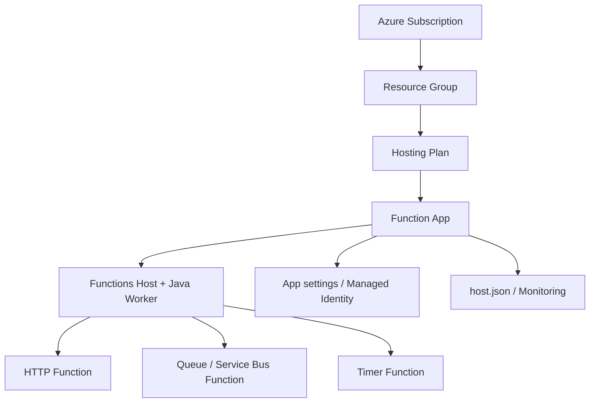
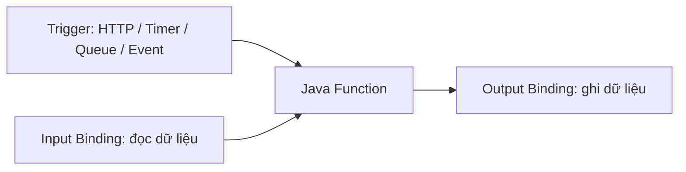
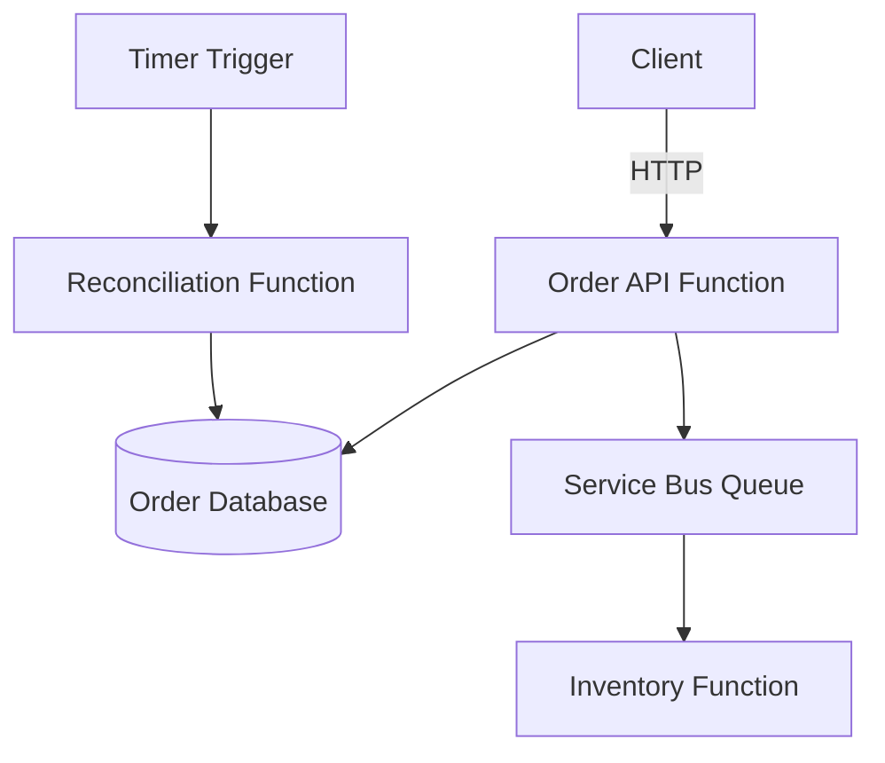

# Function App, function và các lựa chọn hosting của Azure Functions

Azure Functions là dịch vụ FaaS của Azure. Ứng dụng được tổ chức thành một hoặc nhiều **Function App**; bên trong mỗi Function App có các **function** riêng lẻ được kích hoạt bởi HTTP request, timer, message hoặc sự kiện từ dịch vụ Azure. Khi tạo Function App, người phát triển đồng thời chọn môi trường hosting để quyết định cách ứng dụng được cấp tài nguyên, mở rộng, kết nối mạng và tính phí.

Với Java, một function thường là một phương thức `public` được đánh dấu bằng `@FunctionName`. Trigger xác định lúc nào phương thức được gọi; binding giúp truyền dữ liệu vào hoặc đưa kết quả ra dịch vụ khác. Việc chọn đúng ranh giới Function App và hosting plan giúp các function có vòng đời triển khai, cấu hình, bảo mật và đặc tính tải phù hợp.

## 1. Phân biệt Function App và function

### 1.1. Function là đơn vị xử lý

Một **function** thực hiện một nhiệm vụ nghiệp vụ cụ thể. Nó có một trigger xác định cách kích hoạt và có thể có thêm input/output binding. Ví dụ:

- `CreateOrder`: nhận HTTP request để tạo đơn hàng.
- `ProcessOrderMessage`: nhận message từ Azure Service Bus hoặc Queue Storage.
- `ResizeImage`: xử lý blob mới được tải lên.
- `DailyCleanup`: chạy theo lịch để dọn dữ liệu hết hạn.

Trong Java, entry point của function là một phương thức `public` có annotation `@FunctionName`. Tên function phải duy nhất trong package được triển khai. Một project có thể có nhiều class và nhiều phương thức `@FunctionName`.

```java
package com.example.functions;

import com.microsoft.azure.functions.ExecutionContext;
import com.microsoft.azure.functions.HttpMethod;
import com.microsoft.azure.functions.HttpRequestMessage;
import com.microsoft.azure.functions.HttpResponseMessage;
import com.microsoft.azure.functions.HttpStatus;
import com.microsoft.azure.functions.annotation.AuthorizationLevel;
import com.microsoft.azure.functions.annotation.FunctionName;
import com.microsoft.azure.functions.annotation.HttpTrigger;

import java.util.Optional;

public class GreetingFunctions {

    @FunctionName("hello")
    public HttpResponseMessage hello(
            @HttpTrigger(
                    name = "request",
                    methods = {HttpMethod.GET},
                    authLevel = AuthorizationLevel.FUNCTION)
            HttpRequestMessage<Optional<String>> request,
            ExecutionContext context) {

        String name = request.getQueryParameters()
                .getOrDefault("name", "Azure");

        context.getLogger().info("Handling greeting request");
        return request.createResponseBuilder(HttpStatus.OK)
                .body("Hello, " + name + "!")
                .build();
    }
}
```

Trong ví dụ, `@FunctionName("hello")` đặt tên function; `@HttpTrigger` khai báo HTTP GET là trigger; `AuthorizationLevel.FUNCTION` yêu cầu function key khi gọi endpoint. `ExecutionContext` cung cấp logger và metadata invocation. Khi triển khai public API, cần cấu hình xác thực và phân quyền phù hợp; không nên chọn `ANONYMOUS` chỉ để tiện thử nghiệm rồi quên giới hạn truy cập.

### 1.2. Function App là đơn vị triển khai và quản lý

**Function App** là môi trường Azure chứa một nhóm function. Với Java, nhiều function trong cùng project/package được triển khai cùng một gói ứng dụng; Azure Functions Java không hỗ trợ triển khai nhiều JAR độc lập như những ứng dụng tách rời vào cùng một Function App.

Các function trong cùng Function App cũng dùng chung lựa chọn ngôn ngữ của app. Một Function App Java không phải nơi trộn các function Java, C# và JavaScript thành những worker runtime độc lập.

Function App cung cấp ngữ cảnh chung để triển khai, chạy và quản lý các function. Các thành phần thường được chia sẻ ở cấp app gồm:

- Một gói triển khai và lịch phát hành.
- Phiên bản Functions host và language worker/runtime stack.
- App settings, biến môi trường, cấu hình kết nối và managed identity.
- File `host.json` với các thiết lập host và binding áp dụng cho app.
- Cấu hình mạng, giám sát và hosting plan.

Mỗi function vẫn có tên, trigger, binding và logic riêng. Trong project Java, Maven plugin tạo metadata `function.json` cho từng function từ annotation trong mã nguồn; `host.json` là cấu hình chung của Function App.



Không nên gom mọi function của tổ chức vào một Function App chỉ vì chúng cùng viết bằng Java. Nếu các function có yêu cầu triển khai, quyền truy cập, mạng, mức tải hoặc mục tiêu độ tin cậy khác nhau, hãy cân nhắc tách thành các Function App. Cách này giảm phạm vi ảnh hưởng khi một app cần thay đổi cấu hình hoặc phát hành. Ngược lại, những function có cùng vòng đời và cần chia sẻ cấu hình có thể nằm trong cùng app để đơn giản hóa vận hành.

Lưu ý về mở rộng: ở nhiều hosting plan, Function App là ranh giới chính của việc scale và các function trong app có thể dùng chung instance. Flex Consumption hỗ trợ per-function scaling cho các trigger được hỗ trợ, nên mỗi function có thể được mở rộng độc lập theo tải của nó. Cần kiểm tra hành vi scale theo plan và trigger cụ thể trước khi nhóm function.

## 2. Trigger và binding trong Azure Functions

Trigger và binding là hai khái niệm nền tảng của mô hình lập trình Azure Functions.

- **Trigger** bắt đầu invocation và xác định nguồn sự kiện. Mỗi function có đúng một trigger.
- **Input binding** khai báo dữ liệu bổ sung mà function cần đọc từ dịch vụ.
- **Output binding** khai báo nơi function ghi kết quả sau khi xử lý.

Ví dụ, một function có thể được kích hoạt bởi HTTP, đọc một bản ghi qua input binding và gửi message qua output binding. Binding giúp giảm mã kết nối dịch vụ trong các tình huống phổ biến; khi cần truy vấn phức tạp, transaction, SDK API đặc thù hoặc kiểm soát chi tiết, ứng dụng có thể dùng Azure SDK trực tiếp.



Một số trigger/binding thường gặp:

| Dịch vụ | Trigger | Input binding | Output binding | Ví dụ sử dụng |
|---|---:|---:|---:|---|
| HTTP | Có | — | Có | API, webhook |
| Timer | Có | — | — | Báo cáo hoặc dọn dữ liệu định kỳ |
| Azure Blob Storage | Có | Có | Có | Xử lý file tải lên, đọc/ghi blob |
| Azure Queue Storage | Có | — | Có | Worker xử lý tác vụ nền |
| Azure Service Bus | Có | — | Có | Xử lý message nghiệp vụ |
| Event Hubs | Có | — | Có | Thu thập và xử lý telemetry/event stream |
| Event Grid | Có | — | Có | Phản ứng với sự kiện tài nguyên |
| Azure Cosmos DB | Có | Có | Có | Phản ứng khi dữ liệu thay đổi, đọc/ghi document |
| Azure SQL | Có | Có | Có | Kích hoạt hoặc truy cập dữ liệu SQL theo extension hỗ trợ |

Danh sách hỗ trợ và khả năng của từng binding phụ thuộc extension, runtime, ngôn ngữ và hosting plan. Một số trigger không khả dụng trên một số plan. Hãy kiểm tra tài liệu của binding cụ thể trước khi thiết kế.

### 2.1. Cấu hình binding trong Java

Trong Java, annotation từ `com.microsoft.azure.functions.annotation` khai báo trigger và binding trên phương thức hoặc tham số. Ví dụ HTTP trigger có thể trả về response qua kiểu trả về của method; queue output có thể dùng `@QueueOutput` và `OutputBinding<T>`.

```java
import com.microsoft.azure.functions.ExecutionContext;
import com.microsoft.azure.functions.HttpMethod;
import com.microsoft.azure.functions.HttpRequestMessage;
import com.microsoft.azure.functions.HttpResponseMessage;
import com.microsoft.azure.functions.HttpStatus;
import com.microsoft.azure.functions.OutputBinding;
import com.microsoft.azure.functions.annotation.AuthorizationLevel;
import com.microsoft.azure.functions.annotation.FunctionName;
import com.microsoft.azure.functions.annotation.HttpTrigger;
import com.microsoft.azure.functions.annotation.QueueOutput;

import java.util.Optional;

@FunctionName("enqueueWork")
public HttpResponseMessage enqueueWork(
        @HttpTrigger(
                name = "request",
                methods = {HttpMethod.POST},
                authLevel = AuthorizationLevel.FUNCTION)
        HttpRequestMessage<Optional<String>> request,
        @QueueOutput(
                name = "message",
                queueName = "work-items",
                connection = "StorageConnection")
        OutputBinding<String> output,
        ExecutionContext context) {

    String body = request.getBody().orElse("");
    if (body.isBlank()) {
        return request.createResponseBuilder(HttpStatus.BAD_REQUEST)
                .body("Request body is required")
                .build();
    }

    output.setValue(body);
    return request.createResponseBuilder(HttpStatus.ACCEPTED)
            .body("Work item accepted")
            .build();
}
```

`StorageConnection` là tên app setting chứa cấu hình kết nối hoặc thông tin xác thực theo cơ chế mà binding hỗ trợ; không ghi connection string trực tiếp trong mã nguồn. Nếu dùng managed identity, cấu hình binding và quyền Azure RBAC theo hướng dẫn của extension tương ứng.

Output binding làm cho thao tác gửi dữ liệu gọn hơn, nhưng không nên mặc định rằng việc ghi vào database và gửi message qua hai binding khác nhau tạo thành một transaction phân tán nguyên tử. Nếu cần bảo đảm nhất quán giữa thay đổi nghiệp vụ và phát event, hãy cân nhắc transactional outbox hoặc một workflow có cơ chế bù trừ.

## 3. Cấu trúc project Java và cấu hình Function App

Một project Java Functions thường được tạo bằng Maven archetype hoặc công cụ Azure Functions trong IDE. Cấu trúc sau là dạng điển hình sau khi build:

```text
functions-project/
├── pom.xml
├── host.json
├── local.settings.json       # cấu hình local; không commit secret
└── src/
    └── main/
        └── java/
            └── com/example/functions/
                ├── GreetingFunctions.java
                ├── QueueFunctions.java
                └── TimerFunctions.java

target/
└── azure-functions/
    └── <function-app-name>/
        ├── host.json
        ├── FunctionApp.jar
        ├── lib/
        ├── bin/
        ├── hello/
        │   └── function.json
        ├── enqueueWork/
        │   └── function.json
        └── dailyCleanup/
            └── function.json
```

Các thành phần quan trọng:

- `pom.xml`: khai báo Java version, thư viện `azure-functions-java-library`, dependency ứng dụng và Maven plugin dùng để tạo package/deploy.
- `host.json`: cấu hình Functions host và các extension; các thiết lập ở đây thường áp dụng cho toàn Function App.
- `local.settings.json`: app settings dùng khi chạy local. File này có thể chứa secret nên phải loại khỏi source control.
- `function.json`: metadata trigger/binding được Maven plugin sinh cho từng function từ annotation Java.
- `target/azure-functions/<app-name>`: thư mục staging/package mà plugin tạo để triển khai.

Một Function App có thể chứa nhiều function trong cùng package. Không chia các function của cùng app thành nhiều JAR triển khai riêng. Thư viện Java trong `pom.xml` thường được đóng gói cùng ứng dụng khi chạy Maven package; kiểm tra output build để xác nhận dependency runtime đã có mặt.

### 3.1. Runtime và phiên bản Java

Azure Functions hiện dùng Functions runtime v4 cho ứng dụng được hỗ trợ. Phiên bản Java cần thống nhất giữa JDK build, cấu hình trong `pom.xml`, runtime stack của Function App và môi trường kiểm thử.

Theo bảng hỗ trợ runtime Java hiện tại của Microsoft, Java 25, 21, 17, 11 và 8 được liệt kê ở mức GA với ngày kết thúc hỗ trợ tương ứng; khả năng chọn phiên bản còn phụ thuộc hệ điều hành và hosting plan. Đặc biệt, Java 21 là phiên bản mới nhất được hỗ trợ cho Linux Consumption legacy plan; plan này không nhận các Java version mới hơn. Với ứng dụng mới, nên chọn runtime LTS đang được hỗ trợ trên plan mục tiêu và kiểm tra lại ma trận hỗ trợ trước khi triển khai.

## 4. Các lựa chọn hosting của Azure Functions

Hosting plan quyết định cách cấp compute, scale, cold start, thời gian chạy, mạng, hỗ trợ container và mô hình tính phí. Các lựa chọn hiện hành gồm Flex Consumption, Premium, Dedicated (App Service) và Azure Container Apps. Consumption plan truyền thống vẫn tồn tại cho ứng dụng cũ nhưng là lựa chọn legacy.

### 4.1. Flex Consumption

Flex Consumption là lựa chọn serverless được Microsoft khuyến nghị cho Function App mới cần mô hình tính phí theo mức sử dụng. Plan này chạy trên Linux và cung cấp:

- Scale-to-zero khi không có tải, cùng khả năng scale-out theo sự kiện.
- Tùy chọn kích thước bộ nhớ instance và cấu hình concurrency.
- Per-function scaling cho các trigger được hỗ trợ.
- Virtual network integration để truy cập tài nguyên trong mạng riêng.
- Always-ready instances tùy chọn để giảm cold start.
- Mô hình tính phí theo thời gian thực thi/tài nguyên dùng và số instance luôn sẵn sàng nếu bật.

Flex Consumption phù hợp với workload biến động, có thể từ không tải đến tăng tải nhanh, nhưng vẫn cần kết nối VNet hoặc cần kiểm soát concurrency tốt hơn Consumption cũ. Plan này là Linux code deployment; không hỗ trợ container image. Nếu cần đóng gói custom Linux image, hãy xem Premium hoặc Container Apps.

### 4.2. Premium

Premium cung cấp worker được pre-warm và có thể giữ instance luôn sẵn sàng, giúp giảm cold start. Plan tự động mở rộng theo tải, hỗ trợ VNet và có tùy chọn custom Linux container.

Premium phù hợp khi:

- Ứng dụng cần độ trễ khởi động thấp hoặc chạy liên tục/gần liên tục.
- Có nhiều invocation nhỏ với thông lượng cao.
- Cần CPU/bộ nhớ hoặc thời gian chạy lớn hơn giới hạn Consumption legacy.
- Cần truy cập tài nguyên qua VNet.
- Cần custom Linux image nhưng vẫn muốn giữ mô hình Functions host và event-driven scaling.

Đổi lại, Premium có chi phí cho compute được cấp và worker pre-warmed; cần ước lượng tải, số instance tối thiểu và thời gian sử dụng để tránh trả tiền cho công suất nhàn rỗi.

### 4.3. Dedicated (App Service plan)

Dedicated hosting chạy Function App trên tài nguyên của một App Service plan. Compute được cấp theo SKU và có thể chia sẻ với web app hoặc function app khác trong cùng plan.

Dedicated phù hợp khi cần:

- Tài nguyên và hóa đơn dễ dự đoán theo cấu hình App Service plan.
- Scale thủ công hoặc dùng khả năng scale của App Service.
- Chia sẻ compute đã có với các ứng dụng App Service khác.
- Chạy tác vụ dài hoặc yêu cầu compute lớn, trong giới hạn của plan và cấu hình Always On.
- Tích hợp mạng và cô lập ở mức App Service Environment khi cần.

Đây không phải mô hình scale-to-zero theo từng lần thực thi. Cần bật Always On cho kịch bản Function App cần host hoạt động liên tục và tính chi phí theo tài nguyên App Service được cấp.

### 4.4. Azure Container Apps

Azure Container Apps có thể host ứng dụng dùng Azure Functions programming model dưới dạng container. Lựa chọn này phù hợp khi nhóm cần kiểm soát container image, đóng gói thư viện hệ thống/native dependency hoặc chạy function cạnh microservice, API và workflow khác trong cùng môi trường Container Apps.

Container Apps hỗ trợ scale theo sự kiện và có thể scale về zero nếu cấu hình minimum replicas bằng zero. Đặt minimum replicas lớn hơn zero giúp giữ host chạy liên tục và giảm độ trễ khởi động, nhưng làm thay đổi chi phí. Đây là mô hình container-only trên Linux; nhóm phải quản lý image, registry, cập nhật base image và quy trình build/scan.

### 4.5. Consumption plan truyền thống (legacy)

Consumption plan cũ tự động thêm/bớt instance theo sự kiện và tính phí dựa trên số lần thực thi, thời gian chạy và bộ nhớ. Tuy nhiên, Microsoft đánh dấu plan này là legacy và khuyến nghị Flex Consumption cho Function App serverless mới.

Linux Consumption sẽ ngừng nhận tính năng và phiên bản ngôn ngữ mới; thời điểm retire được Microsoft công bố là ngày 30/09/2028. Ứng dụng hiện có trên Windows Consumption hiện chưa bị ảnh hưởng bởi mốc retire Linux này, nhưng vẫn cần đánh giá lộ trình chuyển đổi và hỗ trợ runtime. Không nên chọn Linux Consumption cho một triển khai mới.

## 5. So sánh hosting plan

| Tiêu chí | Flex Consumption | Premium | Dedicated | Container Apps | Consumption legacy |
|---|---|---|---|---|---|
| Mô hình | Serverless theo mức sử dụng | Event-driven với worker pre-warmed | Compute App Service được cấp | Container Apps environment | Serverless theo mức sử dụng |
| Scale-to-zero | Có | Không theo cấu hình pre-warmed tối thiểu | Không | Có nếu min replicas = 0 | Có |
| Cold start | Được tối ưu; có always-ready tùy chọn | Giảm mạnh nhờ pre-warmed | Host chạy liên tục nếu Always On | Phụ thuộc minimum replicas | Có thể xuất hiện khi scale từ zero |
| VNet integration | Có | Có | Có, tùy SKU/ASE | Có qua môi trường Container Apps | Không |
| Container image | Không | Linux | Linux | Có, container-only | Không hỗ trợ Linux container |
| Hệ điều hành | Linux | Linux/Windows theo cấu hình | Linux/Windows theo cấu hình | Linux | Windows legacy; Linux đang retire |
| Cách tính phí | Execution/resource usage + always-ready | Core/memory của worker và pre-warmed capacity | Giá App Service plan | Theo plan của Container Apps | Execution count/time/memory |
| Phù hợp | Tải biến động, serverless mới, VNet | Độ trễ ổn định, tải cao, VNet, custom image | Hóa đơn dự đoán, chia sẻ App Service | Custom container và hệ microservice | Ứng dụng cũ cần duy trì |

Các giới hạn như số instance, timeout, memory, slot, networking và khả năng trigger thay đổi theo region, OS, SKU và cấu hình. Bảng trên dùng để chọn hướng kiến trúc; hãy xem bảng giới hạn chính thức trước khi chốt thiết kế.

## 6. Scale, cold start và thời gian chạy

### 6.1. Scale theo trigger và hosting plan

Azure Functions có thể tăng số instance khi có nhiều request hoặc event. Cơ chế scale phụ thuộc trigger và plan. Với Flex Consumption, các function có thể scale độc lập khi trigger hỗ trợ per-function scaling. Với các plan khác, nhiều function trong cùng Function App thường cùng chia sẻ tài nguyên và scale boundary.

Scale-out không làm cho mọi dependency tự mở rộng theo. Nếu một Function App tăng nhiều instance cùng lúc, database, connection pool, downstream API hoặc broker có thể bị quá tải. Cần đặt giới hạn concurrency, tái sử dụng connection an toàn, dùng queue để điều tiết tải và theo dõi throttling ở dịch vụ phụ thuộc.

### 6.2. Cold start

Cold start xảy ra khi nền tảng cần tạo hoặc khởi động worker/host để xử lý invocation sau thời gian nhàn rỗi hoặc khi scale-out. Java còn có thời gian khởi động JVM, nạp class, khởi tạo framework và dependency.

Các lựa chọn giảm cold start gồm:

- Chọn Flex Consumption với always-ready instances hoặc Premium với pre-warmed instances khi độ trễ quan trọng.
- Dùng Dedicated với Always On hoặc Container Apps với minimum replicas lớn hơn zero khi cần host chạy liên tục.
- Giảm dependency và công việc khởi tạo không cần thiết; trì hoãn kết nối hoặc truy vấn đến khi thực sự cần.
- Đo riêng thời gian khởi tạo và thời gian xử lý để xác định nguyên nhân.

Giữ instance luôn sẵn sàng làm tăng chi phí. Chỉ nên trả cho compute warm nếu lợi ích độ trễ đáp ứng yêu cầu nghiệp vụ.

### 6.3. Timeout và HTTP response

Timeout của function được cấu hình trong `host.json` hoặc ghi đè bằng app setting. Mỗi hosting plan có default/max timeout riêng; Consumption legacy có giới hạn tối đa thấp hơn các plan còn lại. Dù tăng timeout của function, HTTP-triggered function vẫn có giới hạn khoảng 230 giây cho thời gian phản hồi do Azure Load Balancer.

Với tác vụ HTTP kéo dài, không nên giữ kết nối đến khi xử lý xong. Có thể trả `202 Accepted` cùng `jobId`, lưu trạng thái công việc và xử lý nền qua queue hoặc Durable Functions. Client truy vấn endpoint trạng thái hoặc nhận callback/event khi hoàn tất.

## 7. Storage, cấu hình và danh tính

Function App thường cần một Storage account cho các hoạt động của Functions host và một số trigger/binding. Một số trigger như Blob, Queue và Table Storage cũng cần kết nối tới dịch vụ tương ứng. Khi tạo app, hãy hiểu rõ storage nào dùng cho host state, storage nào là dữ liệu nghiệp vụ.

### 7.1. App settings và host.json

- `host.json` chứa cấu hình chung cho Functions host và extension; thay đổi có thể ảnh hưởng nhiều function trong cùng app.
- App settings chứa cấu hình môi trường như tên queue, endpoint, feature flag và tham chiếu secret. Có thể dùng application settings để ghi đè một số giá trị `host.json` theo môi trường.
- `local.settings.json` chỉ dành cho local development; không commit secret và không coi file này là cấu hình được triển khai tự động lên Azure.

Không lưu trạng thái nghiệp vụ trong biến static hoặc filesystem tạm của instance. Function có thể chạy trên nhiều instance, bị restart hoặc scale-in. Hãy lưu dữ liệu bền vững trong database, Storage hoặc dịch vụ phù hợp.

### 7.2. Managed identity và quyền truy cập

Ưu tiên managed identity để Function App truy cập Storage, Key Vault, Service Bus, Event Hubs hoặc dịch vụ Azure khác mà không nhúng connection secret trong source code. Cấp Azure RBAC ở phạm vi nhỏ nhất có thể: đúng resource, đúng data action và đúng Function App.

Với binding, cấu hình connection theo tên app setting hoặc cơ chế identity mà extension hỗ trợ. Không phải binding/extension nào cũng hỗ trợ cùng một kiểu xác thực; cần kiểm tra tài liệu của extension cụ thể. Nếu dùng Azure SDK trực tiếp, có thể dùng `DefaultAzureCredential`/managed identity và kiểm soát quyền qua RBAC.

## 8. Triển khai và vận hành

### 8.1. Build và deploy Java Function App

Maven archetype `com.microsoft.azure:azure-functions-archetype` giúp tạo project Java có cấu trúc và plugin phù hợp. Quy trình thường gồm:

1. Chọn Functions runtime v4, Java version và hosting plan.
2. Tạo project bằng Maven archetype hoặc IDE.
3. Viết function method với `@FunctionName`, trigger và binding annotation.
4. Khai báo dependency và plugin trong `pom.xml`.
5. Chạy test và build package; kiểm tra thư mục `target/azure-functions`.
6. Tạo Function App cùng Storage account và cấu hình identity/network.
7. Deploy package lên Function App, cấu hình app settings và kiểm tra trigger đã được đồng bộ.
8. Chạy smoke test cho từng trigger và xác nhận log/metric.

Một package Java có thể chứa nhiều function. Khi deploy package mới, các function trong cùng Function App được phát hành cùng nhau; cần kiểm thử hợp đồng trigger/binding của toàn app trước khi phát hành.

### 8.2. Quan sát

Application Insights và Azure Monitor giúp theo dõi invocation, exception, dependency và trace. Những chỉ số cần xem gồm:

- Invocation count, success/failure, execution duration và timeout.
- Thời gian khởi tạo, cold start và số instance/concurrency.
- Queue length, message age, retry, dead-letter và trigger lag.
- Dependency duration, lỗi kết nối và throttling ở Storage/Service Bus/Database.
- Chi phí theo plan, compute đã dùng, always-ready capacity và tài nguyên phụ trợ.

Ghi correlation ID hoặc operation ID để nối request với các function downstream. Không ghi token, connection string hoặc payload nhạy cảm vào log. Với message/event, hãy thiết kế idempotency vì trigger có thể retry hoặc giao lại tùy dịch vụ.

## 9. Ví dụ chọn Function App và hosting cho hệ thống đơn hàng

Giả sử hệ thống có ba nhiệm vụ: API tạo đơn, worker xử lý message tồn kho và job đối soát hằng ngày.



Nếu ba function có cùng vòng đời phát hành, cùng quyền truy cập và cùng đặc tính tải, có thể đặt trong một Function App. Nếu API cần mạng/identity khác, worker cần concurrency cao hoặc job đối soát cần tài nguyên riêng, hãy tách thành các Function App để giới hạn phạm vi cấu hình và scale.

Với tải biến động và cần VNet, Flex Consumption là điểm bắt đầu phù hợp cho Function App mới. Nếu API yêu cầu cold start thấp và tải ổn định, cân nhắc always-ready trên Flex hoặc Premium. Nếu worker cần custom Linux image, Premium hoặc Container Apps có thể phù hợp hơn. Nếu tổ chức đã có App Service plan được cấp sẵn và muốn hóa đơn cố định, Dedicated có thể là lựa chọn hợp lý.

## 10. Bảng quyết định nhanh

| Nhu cầu chính | Hướng lựa chọn ban đầu | Điều cần xác minh |
|---|---|---|
| Function mới, tải biến động, pay-per-use, cần VNet | Flex Consumption | Linux-only, code-only, trigger và region được hỗ trợ |
| Cần giảm cold start, CPU/memory cao, VNet hoặc custom Linux image | Premium | Mức pre-warmed tối thiểu và chi phí compute |
| Tải ổn định, muốn dùng chung App Service plan hoặc hóa đơn dễ dự đoán | Dedicated | Always On, SKU, giới hạn App Service và scale thủ công |
| Cần custom container, native library, chạy cạnh microservice | Azure Container Apps | Image/registry, min/max replicas, ingress và chi phí ACA |
| Duy trì ứng dụng cũ đang ở Consumption | Đánh giá migration sang Flex | OS, Java version, storage, deployment method và cấu hình mạng |

## 11. Checklist trước khi tạo Function App

1. Các function có cùng vòng đời phát hành, runtime, cấu hình, identity và yêu cầu mạng không?
2. Có nên gom chúng vào một Function App hay tách app để cô lập scale và quyền truy cập?
3. Trigger và binding nào được dùng? Extension/runtime/plan có hỗ trợ đầy đủ không?
4. Java version có được hỗ trợ trên đúng OS và hosting plan không?
5. Flex Consumption, Premium, Dedicated hay Container Apps phù hợp với tải, cold start, VNet, container và chi phí?
6. Storage account nào phục vụ Functions host và storage nào lưu dữ liệu nghiệp vụ?
7. App settings, host.json, local.settings.json và secret được quản lý đúng cách chưa?
8. Managed identity có quyền tối thiểu đến đúng resource không?
9. Timeout, concurrency, retry, idempotency và giới hạn downstream đã được tính đến chưa?
10. Đã có Application Insights, cảnh báo, smoke test và quy trình deploy/rollback chưa?

## Kết luận

Function là đơn vị xử lý được kích hoạt bởi một trigger; Function App là đơn vị triển khai, chạy và quản lý một nhóm function. Trigger bắt đầu invocation, còn binding kết nối function với dữ liệu vào/ra. Hosting plan quyết định cách cấp compute, scale, cold start, mạng, container và tính phí. Với Function App Java mới, hãy bắt đầu bằng việc nhóm các function có cùng vòng đời và yêu cầu vận hành, sau đó chọn hosting theo tải, độ trễ, networking, runtime và chi phí. Flex Consumption là lựa chọn serverless mặc định đáng xem xét cho app mới; Premium, Dedicated và Container Apps đáp ứng các nhu cầu kiểm soát compute hoặc container khác nhau.

## Tài liệu tham khảo chính thức

- [Azure Functions Java developer guide](https://learn.microsoft.com/en-us/azure/azure-functions/functions-reference-java)
- [Azure Functions hosting options](https://learn.microsoft.com/en-us/azure/azure-functions/functions-scale)
- [Flex Consumption plan](https://learn.microsoft.com/en-us/azure/azure-functions/flex-consumption-plan)
- [Azure Functions runtime versions and language support](https://learn.microsoft.com/en-us/azure/azure-functions/functions-versions)
- [Triggers and bindings](https://learn.microsoft.com/en-us/azure/azure-functions/functions-triggers-bindings)
- [host.json reference](https://learn.microsoft.com/en-us/azure/azure-functions/functions-host-json)
- [Application settings reference](https://learn.microsoft.com/en-us/azure/azure-functions/functions-app-settings)
