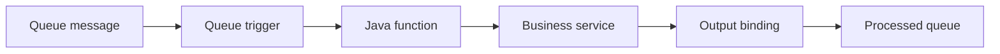

# Lập trình Java function với trigger và binding

Azure Functions cho phép một method Java được kích hoạt bởi HTTP request, message trong queue, sự kiện từ dịch vụ khác hoặc lịch chạy. Thay vì tự viết vòng lặp polling hay dựng một server luôn hoạt động, lập trình viên khai báo **trigger** để runtime biết khi nào cần gọi function và dùng **binding** để kết nối function với dữ liệu vào/ra của dịch vụ.

Với Java, function thường được khai báo bằng `@FunctionName` và các annotation như `@HttpTrigger`, `@QueueTrigger`, `@TimerTrigger` hoặc `@BlobTrigger`. Runtime Azure Functions gọi method, chuyển dữ liệu trigger vào tham số và xử lý output binding sau khi method hoàn tất. Phần logic nghiệp vụ vẫn có thể được tổ chức thành service Java thông thường để kiểm thử độc lập.

Bài học này tập trung vào cách viết Java function với trigger và binding, cách chọn giữa binding với SDK, cách xử lý lỗi và retry theo từng loại trigger, cấu hình local/deployment và các vấn đề vận hành khi function mở rộng.

## 1. Trigger và binding là gì?

**Trigger** xác định sự kiện làm function bắt đầu chạy. Mỗi function có đúng một trigger. Trigger cung cấp dữ liệu đầu vào và metadata về lần kích hoạt, ví dụ HTTP method, queue message, blob name hoặc thông tin lịch.

**Binding** khai báo cách function kết nối với một dịch vụ. Input binding đọc dữ liệu từ dịch vụ và đưa vào tham số method. Output binding ghi dữ liệu do function tạo ra sang dịch vụ đích. Binding có thể dùng cùng trigger hoặc kết nối thêm dịch vụ khác.

Ví dụ một function xử lý đơn hàng:

- `@QueueTrigger` kích hoạt khi có message mới trong queue.
- Tham số `String message` nhận nội dung message.
- `@QueueOutput` khai báo nơi ghi message kết quả.
- Function parse input, gọi service nghiệp vụ rồi đặt giá trị cho output binding.



Trigger và binding là hợp đồng giữa ứng dụng với Functions host. Host chịu trách nhiệm lắng nghe trigger, chuyển đổi dữ liệu, quản lý một phần giao nhận và thực hiện binding. Vì vậy, function không cần tự kết nối và polling queue trong trường hợp binding đã hỗ trợ thao tác đó.

## 2. Mô hình lập trình Java Functions

Một class Java có thể chứa một hoặc nhiều function method. Mỗi method được đánh dấu bằng `@FunctionName`; tên trong annotation là tên function được host nhận diện. Các tham số method được khai báo bằng trigger hoặc binding annotation, và có thể thêm `ExecutionContext` để ghi log hoặc đọc metadata invocation.

Ví dụ cấu trúc tối giản:

```java
import com.microsoft.azure.functions.ExecutionContext;
import com.microsoft.azure.functions.annotation.FunctionName;
import com.microsoft.azure.functions.annotation.QueueTrigger;

public class OrderFunctions {
    @FunctionName("processOrder")
    public void processOrder(
            @QueueTrigger(
                    name = "message",
                    queueName = "orders",
                    connection = "AzureWebJobsStorage")
            String message,
            ExecutionContext context) {

        context.getLogger().info("Received order message");
        // Parse message và gọi service nghiệp vụ.
    }
}
```

Các import annotation thuộc `azure-functions-java-library`. Khi build project Java, plugin Azure Functions tạo metadata cần thiết để host tìm thấy function và trigger. Runtime cần `host.json`, artifact Java và cấu hình ứng dụng phù hợp.

### Các thành phần chính

| Thành phần | Vai trò |
| --- | --- |
| `@FunctionName` | Đăng ký một method là Azure Function và đặt tên function |
| Trigger annotation | Khai báo nguồn kích hoạt và tham số đầu vào |
| Input/output binding annotation | Khai báo dữ liệu đọc hoặc ghi từ dịch vụ khác |
| `ExecutionContext` | Cung cấp logger và metadata invocation |
| `@BindingName` | Đọc metadata hoặc binding data theo tên |
| `OutputBinding<T>` | Đặt giá trị cho output binding trong method |
| `HttpRequestMessage<T>` / `HttpResponseMessage<T>` | Mô hình request/response cho HTTP trigger |

Tên annotation và thuộc tính cụ thể phụ thuộc extension của trigger. Hãy dùng thư viện Java Functions và extension version tương thích với Functions runtime của ứng dụng.

## 3. Tạo project Java và chạy local

Một project Java Functions thường dùng Maven hoặc Gradle, thư viện `azure-functions-java-library` và plugin đóng gói dành cho Azure Functions. Plugin tạo thư mục triển khai chứa JAR/dependency, `host.json` và metadata function.

Một cấu trúc Maven thường gặp:

```text
orders-functions/
├── pom.xml
├── host.json
├── local.settings.json       # cấu hình local, không commit secret
└── src/
    ├── main/java/com/example/orders/
    │   ├── OrderFunctions.java
    │   ├── OrderService.java
    │   └── OrderRepository.java
    └── test/java/com/example/orders/
        └── OrderServiceTest.java
```

Các phần thường có trong `pom.xml` gồm:

- Dependency `com.microsoft.azure:azure-functions-java-library` để dùng annotation và kiểu dữ liệu của Java Functions.
- `azure-functions-maven-plugin` để đóng gói và deploy Function App.
- Java compiler target phù hợp với phiên bản Java runtime đã chọn.
- Dependency của trigger extension hoặc SDK cần thiết theo loại binding và cách project được tạo.

Không nên chép một version plugin hoặc JDK cố định từ ví dụ cũ. Hãy chọn phiên bản Java được Functions runtime và hosting plan hỗ trợ tại thời điểm triển khai, đồng thời giữ phiên bản plugin, extension và SDK tương thích.

### Cấu hình local

Azure Functions Core Tools dùng `host.json` để cấu hình host và `local.settings.json` để cung cấp app settings khi chạy trên máy phát triển. Ví dụ:

```json
{
  "IsEncrypted": false,
  "Values": {
    "AzureWebJobsStorage": "UseDevelopmentStorage=true",
    "FUNCTIONS_WORKER_RUNTIME": "java",
    "ServiceBusConnection": "<local-service-bus-connection-string>"
  }
}
```

Đây là ví dụ minh họa; chỉ thêm setting của dịch vụ mà function thực sự dùng. `local.settings.json` dành cho local và không tự động trở thành cấu hình của Function App khi deploy. Không commit connection string, password hoặc key thật vào Git. Trong môi trường cloud, cấu hình tương ứng được đặt trong Function App settings hoặc được cấp qua identity-based connection khi extension hỗ trợ.

Thông thường có thể build bằng Maven, sau đó chạy Functions host local bằng Core Tools. Kiểm tra log khởi động để xác nhận host đã nạp đúng function, trigger extension và setting. Khi local test phụ thuộc Storage Emulator/Azurite hoặc dịch vụ bên ngoài, cần khởi động các thành phần đó trước.

## 4. HTTP trigger: nhận request và trả response

HTTP trigger phù hợp với API endpoint, webhook hoặc callback. Java method thường nhận `HttpRequestMessage<T>` và trả `HttpResponseMessage<T>`. Annotation cho phép cấu hình tên binding, HTTP methods, authorization level và route.

Ví dụ endpoint tạo đơn hàng:

```java
import com.microsoft.azure.functions.HttpMethod;
import com.microsoft.azure.functions.HttpRequestMessage;
import com.microsoft.azure.functions.HttpResponseMessage;
import com.microsoft.azure.functions.HttpStatus;
import com.microsoft.azure.functions.ExecutionContext;
import com.microsoft.azure.functions.annotation.AuthorizationLevel;
import com.microsoft.azure.functions.annotation.FunctionName;
import com.microsoft.azure.functions.annotation.HttpTrigger;
import java.util.Optional;

public class OrderHttpFunction {
    private final OrderService orders = new OrderService();

    @FunctionName("createOrder")
    public HttpResponseMessage<String> createOrder(
            @HttpTrigger(
                    name = "request",
                    methods = {HttpMethod.POST},
                    route = "orders",
                    authLevel = AuthorizationLevel.FUNCTION)
            HttpRequestMessage<Optional<String>> request,
            ExecutionContext context) {

        String body = request.getBody().orElse("");
        if (body.isBlank()) {
            return request.createResponseBuilder(HttpStatus.BAD_REQUEST)
                    .body("Request body is required")
                    .build();
        }

        String orderId = orders.createFromJson(body);
        context.getLogger().info("Created order " + orderId);

        return request.createResponseBuilder(HttpStatus.CREATED)
                .header("Content-Type", "application/json")
                .body("{\"orderId\":\"" + orderId + "\"}")
                .build();
    }
}
```

Ví dụ rút gọn để minh họa trigger và response; production nên dùng JSON serializer như Jackson thay vì ghép chuỗi JSON, validate schema, giới hạn kích thước body và map lỗi theo contract API.

### Authorization level không thay thế authorization nghiệp vụ

`ANONYMOUS`, `FUNCTION` và `ADMIN` là các mức authorization của HTTP trigger. `FUNCTION` yêu cầu function key; `ADMIN` dùng master key với quyền rộng hơn; `ANONYMOUS` không yêu cầu key ở lớp trigger. Đây không phải mô hình phân quyền theo người dùng hoặc tenant. Với API production, thường cần xác thực danh tính bằng Microsoft Entra ID, API Management hoặc một lớp xác thực phù hợp, sau đó kiểm tra quyền nghiệp vụ cho từng tài nguyên.

Không đưa function key hoặc master key vào source code, query string công khai hay log. Nếu endpoint nhận webhook, hãy xác minh chữ ký hoặc cơ chế xác thực của nhà cung cấp, kiểm tra timestamp/chống replay và dùng idempotency key.

### Route, query và header

Route có thể chứa parameter, ví dụ `route = "orders/{orderId}"`. Giá trị route và metadata binding có thể được đọc qua tham số có `@BindingName("orderId")`. Query string và header có thể đọc từ `HttpRequestMessage`. Hãy kiểm tra input và không tin `tenantId`, `role` hoặc `userId` chỉ vì chúng xuất hiện trong header/body.

HTTP trigger thường phù hợp với request ngắn. Với công việc dài, trả `202 Accepted` cùng URL trạng thái hoặc job ID, đưa công việc vào queue/workflow rồi kết thúc invocation. Không giữ HTTP connection mở để chờ tác vụ kéo dài nếu client hoặc host có thể timeout.

## 5. Queue Storage trigger và output binding

Queue Storage trigger kích hoạt function khi có message trong Azure Storage Queue. Đây là lựa chọn đơn giản cho xử lý bất đồng bộ, tách producer khỏi consumer và hấp thụ tải tăng đột biến.

```java
import com.microsoft.azure.functions.ExecutionContext;
import com.microsoft.azure.functions.OutputBinding;
import com.microsoft.azure.functions.annotation.FunctionName;
import com.microsoft.azure.functions.annotation.QueueOutput;
import com.microsoft.azure.functions.annotation.QueueTrigger;

public class OrderQueueFunction {
    @FunctionName("processOrderQueue")
    public void run(
            @QueueTrigger(
                    name = "orderMessage",
                    queueName = "orders",
                    connection = "AzureWebJobsStorage")
            String orderMessage,
            @QueueOutput(
                    name = "processedMessage",
                    queueName = "processed-orders",
                    connection = "AzureWebJobsStorage")
            OutputBinding<String> processed,
            ExecutionContext context) {

        context.getLogger().info("Processing order message");
        String result = process(orderMessage);
        processed.setValue(result);
    }

    private String process(String message) {
        // Validate, process and return a compact result message.
        return "processed:" + message;
    }
}
```

`@QueueTrigger` là input trigger; `@QueueOutput` là output binding. Host thực hiện thao tác ghi output sau khi method chạy theo binding contract. Nếu cần kiểm soát sâu kết quả gửi, transaction, batch hoặc retry riêng, có thể dùng Azure Storage SDK trực tiếp.

### Retry và poison message

Queue trigger có thể giao lại message khi function thất bại hoặc host không xác nhận xử lý thành công. Storage Queue sử dụng dequeue count để theo dõi số lần nhận; khi vượt giới hạn cấu hình, message có thể được đưa vào poison queue theo quy ước của trigger. Cấu hình host, extension và thời điểm visibility timeout ảnh hưởng đến hành vi cụ thể.

Consumer phải idempotent vì cùng message có thể được xử lý lại sau timeout hoặc lỗi. Dùng message ID hoặc business key ổn định, lưu kết quả xử lý và tránh thực hiện side effect trùng. Không bắt exception rồi trả về bình thường nếu nghiệp vụ chưa hoàn tất; host có thể xem invocation là thành công và không retry.

## 6. Timer trigger: chạy theo lịch

Timer trigger kích hoạt function theo biểu thức NCRONTAB của Azure Functions. Biểu thức thường có sáu trường, bao gồm giây, phút, giờ, ngày, tháng và thứ trong tuần. Ví dụ dưới đây chạy mỗi năm phút:

```java
import com.microsoft.azure.functions.ExecutionContext;
import com.microsoft.azure.functions.annotation.FunctionName;
import com.microsoft.azure.functions.annotation.TimerTrigger;

public class CleanupTimerFunction {
    @FunctionName("cleanupExpiredJobs")
    public void run(
            @TimerTrigger(name = "timerInfo", schedule = "0 */5 * * * *")
            String timerInfo,
            ExecutionContext context) {

        context.getLogger().info("Cleanup schedule fired: " + timerInfo);
        cleanupExpiredJobs();
    }

    private void cleanupExpiredJobs() {
        // Xóa hoặc đánh dấu dữ liệu đã hết hạn theo batch giới hạn.
    }
}
```

Timer trigger phù hợp với cleanup, đối soát, đồng bộ định kỳ hoặc tạo báo cáo. Nó không phải cơ chế lập lịch chính xác đến từng mili giây. Thời điểm chạy chịu ảnh hưởng của host, timezone và cấu hình schedule; nên dùng UTC nếu nghiệp vụ cần lịch nhất quán giữa môi trường.

Timer trigger dùng cơ chế lưu trạng thái/lịch để tránh nhiều host cùng thực hiện một lịch trong cùng Function App theo cấu hình runtime. Tuy nhiên, không nên giả định mọi side effect chỉ xảy ra đúng một lần. Một lần chạy có thể bị gián đoạn và được tiếp tục hoặc chạy lại theo tình huống vận hành; tác vụ cleanup/đối soát vẫn nên idempotent.

## 7. Blob trigger: xử lý file khi được tạo hoặc cập nhật

Blob trigger kích hoạt function khi blob trong container phù hợp với path được cấu hình. Có thể dùng binding metadata như tên blob để định danh file và đọc nội dung qua tham số method.

```java
import com.microsoft.azure.functions.ExecutionContext;
import com.microsoft.azure.functions.annotation.BindingName;
import com.microsoft.azure.functions.annotation.BlobTrigger;
import com.microsoft.azure.functions.annotation.FunctionName;

public class DocumentBlobFunction {
    @FunctionName("processUploadedDocument")
    public void run(
            @BlobTrigger(
                    name = "content",
                    path = "incoming-documents/{name}",
                    dataType = "binary",
                    connection = "AzureWebJobsStorage")
            byte[] content,
            @BindingName("name") String blobName,
            ExecutionContext context) {

        context.getLogger().info("Received blob: " + blobName);
        processDocument(blobName, content);
    }

    private void processDocument(String name, byte[] content) {
        // Kiểm tra định dạng, kích thước, checksum và xử lý file.
    }
}
```

Ví dụ dùng `byte[]` nên phù hợp với file nhỏ hoặc vừa. Với file lớn, tránh giữ toàn bộ nội dung trong heap; dùng stream hoặc SDK để đọc theo buffer và giới hạn kích thước xử lý. Kiểm tra định dạng thật của file, không chỉ dựa vào extension hoặc Content-Type do client gửi.

Blob trigger có thể phát sinh lại khi nội dung thay đổi hoặc khi host chưa ghi nhận xử lý thành công. Hãy dùng blob name cùng version/ETag hoặc checksum để nhận diện nội dung, vì cùng một tên blob có thể được ghi đè bằng phiên bản mới. Nếu cần kiểm soát chặt event và scale, có thể dùng Event Grid trigger cho Blob Storage thay cho cơ chế polling của Blob trigger tùy yêu cầu.

## 8. Service Bus trigger và Event Hubs trigger

Azure Service Bus phù hợp với queue/topic messaging cần delivery semantics, dead-letter queue, message lock, sessions hoặc scheduling. Java function có thể dùng `@ServiceBusQueueTrigger` để nhận message:

```java
import com.microsoft.azure.functions.ExecutionContext;
import com.microsoft.azure.functions.annotation.ServiceBusQueueTrigger;
import com.microsoft.azure.functions.annotation.FunctionName;

public class ServiceBusOrderFunction {
    @FunctionName("handleServiceBusOrder")
    public void run(
            @ServiceBusQueueTrigger(
                    name = "message",
                    queueName = "orders",
                    connection = "ServiceBusConnection")
            String message,
            ExecutionContext context) {

        context.getLogger().info("Received Service Bus message");
        handleOrder(message);
    }

    private void handleOrder(String message) {
        // Xử lý nghiệp vụ theo message contract.
    }
}
```

Service Bus trigger quản lý việc nhận và hoàn tất message theo extension/runtime. Nếu function không hoàn tất, message có thể được giao lại sau khi lock hết hạn hoặc theo delivery policy. Sau số lần giao tối đa, message có thể vào dead-letter queue. Cần xử lý duplicate, lock renewal, max delivery count và DLQ theo cấu hình thực tế.

Event Hubs phù hợp với luồng sự kiện có throughput cao và consumer đọc theo partition. Một function có thể nhận một batch event trong một invocation:

```java
import com.microsoft.azure.functions.ExecutionContext;
import com.microsoft.azure.functions.annotation.EventHubTrigger;
import com.microsoft.azure.functions.annotation.FunctionName;

public class TelemetryEventFunction {
    @FunctionName("processTelemetry")
    public void run(
            @EventHubTrigger(
                    name = "events",
                    eventHubName = "telemetry",
                    connection = "EventHubConnection")
            String[] events,
            ExecutionContext context) {

        context.getLogger().info("Received event count: " + events.length);
        for (String event : events) {
            processTelemetryEvent(event);
        }
    }

    private void processTelemetryEvent(String event) {
        // Parse schema, validate event ID and persist idempotently.
    }
}
```

Event Hubs sử dụng partition và checkpoint để theo dõi vị trí consumer. Nếu batch lỗi trước khi checkpoint tiến lên, một phần event có thể được đọc lại. Không giả định mỗi event chỉ đến một lần. Hãy dùng event ID hoặc khóa nghiệp vụ để chống duplicate và theo dõi partition lag, checkpoint age cùng throughput.

## 9. Input binding, output binding và binding expressions

Binding có thể đọc dữ liệu hoặc ghi dữ liệu mà không cần tự viết mã kết nối trong function. Ví dụ input binding đọc một blob, output binding ghi queue message hoặc lưu một blob mới.

Binding annotation thường có các thuộc tính:

| Thuộc tính | Ý nghĩa |
| --- | --- |
| `name` | Tên binding để tham chiếu trong function method |
| `connection` | Tên app setting chứa connection hoặc cấu hình identity-based connection |
| `queueName`, `path`, `containerName`... | Đích/nguồn dịch vụ theo loại binding |
| `dataType` | Gợi ý cách runtime chuyển đổi dữ liệu, ví dụ text hoặc binary |
| `route`, `methods`, `authLevel` | Các tùy chọn riêng của HTTP trigger |
| `direction` | Được mô tả qua annotation input/output tương ứng |

Có hai dạng biểu thức thường gặp:

- `%SettingName%` tham chiếu app setting, ví dụ `%OrdersQueueName%`.
- `{name}` tham chiếu binding data/metadata từ trigger, ví dụ blob path `incoming/{name}`.

Ví dụ:

```java
@QueueTrigger(
        name = "message",
        queueName = "%OrdersQueueName%",
        connection = "StorageConnection")
String message
```

Tên queue được cấu hình theo môi trường thay vì hard-code. Không đặt secret trực tiếp trong annotation. `connection` thường là tên setting hoặc prefix setting mà extension dùng để tìm credential/endpoint.

## 10. Output binding hay gọi SDK trực tiếp?

Output binding phù hợp khi thao tác đơn giản: ghi một message, lưu một blob hoặc trả một HTTP response. Host thực hiện thao tác binding theo cấu hình và quản lý phần giao tiếp với dịch vụ.

Nên cân nhắc SDK trực tiếp khi cần:

- Transaction hoặc phối hợp nhiều thao tác có tính nguyên tử.
- Kiểm soát chính xác retry, timeout, batching, partition key hoặc message properties.
- Đọc/ghi stream lớn và quản lý tài nguyên chi tiết.
- Dùng API nâng cao mà binding không bộc lộ.
- Nhận kết quả gửi hoặc lỗi dịch vụ ngay trong luồng code để đưa ra quyết định nghiệp vụ.
- Tái sử dụng client, connection hoặc pipeline theo lifecycle của ứng dụng.

Một output binding có thể đơn giản hóa code nhưng không có nghĩa database write và queue publish trở thành một transaction. Nếu cần lưu đơn hàng và phát event mà không mất event khi process chết, dùng transactional outbox hoặc một cơ chế đảm bảo tương đương. Không dựa vào hai binding output để giả định tính nguyên tử giữa hai dịch vụ.

## 11. Connection settings và managed identity

Thuộc tính `connection` thường trỏ tới app setting, không phải nơi viết connection string trực tiếp. Với cấu hình connection string, app setting có thể chứa thông tin kết nối; với extension hỗ trợ identity-based connection, có thể dùng một nhóm setting theo prefix để chỉ định namespace/endpoint và để Function App dùng managed identity.

Managed identity giúp tránh lưu credential dài hạn trong cấu hình. Tuy nhiên, cần:

1. Bật system-assigned hoặc user-assigned managed identity cho Function App.
2. Gán role phù hợp trên Storage, Service Bus, Event Hubs hoặc dịch vụ tương ứng.
3. Cấu hình app setting/prefix theo hướng dẫn của extension version đang dùng.
4. Đảm bảo network path tới dịch vụ hoạt động, nhất là khi dịch vụ dùng private endpoint.
5. Kiểm tra role scope và quyền tối thiểu; không gán role quản trị rộng chỉ để làm cho trigger chạy.

Managed identity giải quyết xác thực, không tự tạo đường mạng. Nếu Storage Account hoặc Service Bus chỉ cho phép private network, Function App cần cấu hình networking phù hợp với hosting plan và dịch vụ đích.

## 12. Binding data và metadata trigger

Trigger thường cung cấp metadata bổ sung ngoài body. Ví dụ HTTP có method, URL và headers; Blob có tên blob và container; Queue có message ID và dequeue count; Event Hubs có partition/sequence metadata tùy binding.

`@BindingName` có thể dùng để đọc giá trị metadata được đặt tên trong binding expression. Hãy kiểm tra tên metadata được extension cụ thể cung cấp; không giả định mọi trigger đều có cùng trường.

Ví dụ blob name:

```java
@FunctionName("inspectBlob")
public void run(
        @BlobTrigger(
                name = "content",
                path = "incoming/{fileName}",
                dataType = "binary",
                connection = "AzureWebJobsStorage")
        byte[] content,
        @BindingName("fileName") String fileName,
        ExecutionContext context) {

    context.getLogger().info("File name: " + fileName);
}
```

Metadata giúp function định tuyến và ghi log. Tuy nhiên, tên file hoặc queue message không phải bằng chứng xác thực quyền sở hữu. Trước khi đọc hoặc thay đổi dữ liệu tenant, hãy đối chiếu với record nghiệp vụ và identity đã xác thực.

## 13. Lỗi, retry và dead-letter theo loại trigger

Không có một semantics retry duy nhất cho tất cả trigger. Host và extension quyết định cách message/event được xác nhận, giao lại hoặc checkpoint.

| Trigger | Khi function lỗi | Điều cần thiết kế |
| --- | --- | --- |
| HTTP | Caller nhận lỗi hoặc timeout; client có thể retry | Idempotency key, timeout budget, response lỗi rõ ràng |
| Azure Storage Queue | Message có thể được dequeue lại; vượt ngưỡng có thể vào poison queue | Idempotent handler, dequeue count, poison queue và alert |
| Service Bus | Message có thể được abandon/redeliver khi lock hết hạn hoặc xử lý thất bại; có thể vào DLQ | Message lock, max delivery count, duplicate detection, DLQ processing |
| Event Hubs | Batch/partition có thể được đọc lại nếu checkpoint chưa tiến | Event ID, idempotent writes, checkpoint và partition lag |
| Blob | Event/blob có thể được phát hiện hoặc xử lý lại | Blob version/ETag, idempotency và xử lý file đã thay đổi |
| Timer | Lịch chạy có thể bị trễ hoặc cần xử lý lại theo trạng thái host | Công việc idempotent, lịch UTC, theo dõi lần chạy và missed schedule |

Phân biệt lỗi không retry với lỗi tạm thời. Payload sai, schema không hỗ trợ hoặc thiếu quyền thường cần quarantine/DLQ và điều tra. Lỗi mạng, throttling hoặc downstream tạm thời không khả dụng có thể retry với giới hạn và backoff.

Không retry vô hạn. Retry nhiều tầng có thể nhân số lần gọi; ví dụ client retry, function retry và SDK retry cùng lúc. Hãy tính tổng attempt và thời gian có thể tiêu tốn. Với poison message, cần quy trình đọc, phân loại, sửa dữ liệu và redrive có kiểm soát.

## 14. Idempotency và side effect

Azure Functions có thể giao lại message/event khi function timeout, host restart hoặc ACK/checkpoint chưa được ghi nhận. Do đó, function nên giả định cùng một công việc có thể được gọi nhiều lần.

Một handler idempotent có thể dùng event ID hoặc business key để kiểm tra kết quả đã xử lý:

```java
public void handleOrderEvent(OrderCreated event) {
    boolean claimed = processedEventRepository
            .claimIfAbsent(event.eventId());
    if (!claimed) {
        return; // Event đã được xử lý hoặc đang được claim.
    }

    orderProjectionRepository.apply(event);
}
```

Đoạn code là minh họa; thao tác claim và cập nhật projection cần được thực hiện trong transaction hoặc qua inbox/outbox phù hợp. Nếu claim thành công nhưng update projection thất bại, record có thể bị đánh dấu đã xử lý dù công việc chưa xong. Một mô hình trạng thái như `PROCESSING`, `SUCCEEDED`, `FAILED` cùng lease/version có thể cần thiết cho tác vụ phức tạp.

Với HTTP webhook, lưu webhook ID hoặc idempotency key. Với Storage Queue, dùng message ID/business ID. Với Event Hubs, dùng event ID hoặc khóa nguồn ổn định. Với Blob, dùng blob path cùng version/ETag. Không tạo một ID mới mỗi lần retry cho cùng một side effect.

## 15. Chia sẻ logic nghiệp vụ giữa nhiều function

Một ứng dụng có thể có HTTP function tạo đơn và queue function xử lý đơn sau khi được tạo. Cả hai không nên tự sao chép quy tắc nghiệp vụ. Đặt logic trong service Java và inject qua constructor hoặc factory.

```java
public final class OrderService {
    public String createFromJson(String json) {
        // Deserialize, validate và lưu đơn qua repository.
        return "order-1001";
    }

    public void processMessage(String message) {
        // Xử lý nghiệp vụ bất đồng bộ.
    }
}
```

Function method chỉ nên làm adapter: đọc input, lấy metadata, gọi service và map output. Tránh đặt state mutable theo request trong field dùng chung. Runtime có thể tái sử dụng class instance hoặc process theo cách phụ thuộc host; dữ liệu cần sống qua invocation phải được lưu trong database, storage hoặc workflow state.

Nếu dùng DI framework, cần kiểm tra cách khởi tạo bean và thread safety. Client dùng chung phải thread-safe; connection/transaction phải được mở và đóng đúng phạm vi; không chạy thread nền với giả định host sẽ giữ function sống sau khi method trả về.

## 16. host.json và cấu hình runtime

`host.json` cấu hình hành vi của Functions host và một số extension. Tùy runtime/extension, file có thể điều chỉnh logging, queue batch, retry, concurrency, timeout hoặc các giới hạn liên quan.

Ví dụ khung cấu hình:

```json
{
  "version": "2.0",
  "logging": {
    "applicationInsights": {
      "samplingSettings": {
        "isEnabled": true
      }
    }
  },
  "extensions": {
    "queues": {
      "batchSize": 16,
      "newBatchThreshold": 8,
      "maxDequeueCount": 5
    }
  }
}
```

Đây là cấu hình minh họa cho Queue Storage extension, không phải bộ giá trị tối ưu chung. Cần xác minh schema và mặc định của Functions runtime/extension version đang dùng. Tăng `batchSize` hoặc concurrency có thể tăng throughput nhưng cũng làm tăng bộ nhớ, tải database và phạm vi batch bị retry.

Không đặt secret trong `host.json`. Những giá trị thay đổi theo môi trường nên dùng app settings; thông tin nhạy cảm nên dùng Key Vault reference hoặc managed identity khi phù hợp. Local settings và cloud app settings cần được quản lý riêng.

## 17. Scale, concurrency và giới hạn downstream

Azure Functions có thể mở rộng số host instance theo trigger và hosting plan. Cách scale, giới hạn instance và mức concurrency khác nhau giữa Consumption, Flex Consumption, Premium và Dedicated/App Service plan cũng như giữa các extension.

Khi scale-out, nhiều invocation có thể đồng thời truy cập database, Storage, Service Bus hoặc API đối tác. Đặt giới hạn theo khả năng downstream:

- Chọn batch size phù hợp với thời gian xử lý và bộ nhớ.
- Dùng connection pool nhỏ và giới hạn tổng kết nối.
- Đặt concurrency/scale limit nếu trigger hoặc plan hỗ trợ.
- Dùng backpressure, queue và retry có backoff khi downstream bị throttling.
- Theo dõi queue age, Service Bus active/dead-letter count, Event Hubs lag và function duration.
- Tránh ghi log toàn bộ payload ở lưu lượng cao.

Một function xử lý batch 100 message có thể giảm overhead invocation nhưng nếu một record lỗi, cách retry phụ thuộc trigger có thể khiến nhiều record được chạy lại. Hãy làm handler idempotent và kiểm tra hỗ trợ partial batch/partial failure của extension.

## 18. Bảo mật trigger và binding

Binding giúp giảm code kết nối nhưng không thay thế authorization. Cần bảo vệ cả nguồn trigger, identity của Function App và tài nguyên đích.

- Dùng managed identity khi extension và dịch vụ hỗ trợ; gán role tối thiểu cho queue, topic, container hoặc storage account cần thiết.
- Với HTTP, xác thực caller và kiểm tra quyền theo tenant/resource; function key chỉ là một lớp bảo vệ endpoint.
- Với Service Bus/Event Hubs, giới hạn quyền listen/send theo namespace hoặc entity cần dùng.
- Với Storage, giới hạn quyền vào container/prefix phù hợp; không cấp quyền account-wide nếu function chỉ cần một container.
- Validate schema, kích thước và encoding của message/event/file.
- Không log secret, connection string, access token hoặc dữ liệu cá nhân không cần thiết.
- Dùng private endpoint/network integration khi yêu cầu mạng riêng; identity không tự tạo network path.

Nếu binding dùng connection string, bảo vệ setting bằng cơ chế secret của nền tảng và luân chuyển credential. Không để chuỗi kết nối trong annotation hoặc source code.

## 19. Quan sát và chẩn đoán

`ExecutionContext` cung cấp logger theo invocation. Nên ghi log có cấu trúc với các trường như function name, invocation ID, message/event ID, business key, attempt và correlation ID. Không ghi payload đầy đủ nếu chứa dữ liệu nhạy cảm.

Các chỉ số quan trọng:

| Nhóm | Chỉ số |
| --- | --- |
| HTTP | Request rate, status code, latency p50/p95/p99, timeout và throttling |
| Queue Storage | Queue length, dequeue count, poison queue depth, message age |
| Service Bus | Active message, delivery count, lock lost, DLQ count, processing latency |
| Event Hubs | Incoming/outgoing events, partition lag, checkpoint age, throttling |
| Blob | Trigger delay, processing duration, failure count, file size |
| Function | Invocation count, execution duration, memory, exception rate, scale-out |
| Downstream | Database connection, query latency, dependency failure và retry |

Application Insights và Azure Monitor giúp nối log, trace, dependency và metric. Khi điều tra, dùng invocation ID để tìm lần chạy cụ thể, sau đó đối chiếu message/event ID và trạng thái nghiệp vụ để biết side effect đã xảy ra chưa.

## 20. Kiểm thử Java function

Tách logic nghiệp vụ khỏi annotation giúp unit test không cần Functions host. Có thể test service Java bằng JUnit với repository fake/mock, sau đó test adapter và binding ở mức integration.

Các lớp kiểm thử nên có:

1. **Unit test:** xác minh quy tắc nghiệp vụ, validation, idempotency và xử lý lỗi.
2. **Adapter test:** xác minh HTTP request/response, parse JSON, route, metadata và mapping exception.
3. **Local host test:** chạy Functions Core Tools với local settings và Azurite/queue/service giả lập phù hợp.
4. **Cloud integration test:** xác minh managed identity, RBAC, trigger delivery, retry, poison/DLQ, private networking và scale.

Không chỉ kiểm tra function trả kết quả đúng khi chạy một lần. Hãy mô phỏng message trùng, timeout sau side effect, payload sai, downstream chậm, queue backlog và function restart.

## 21. Những lỗi thường gặp

| Lỗi | Nguyên nhân thường gặp | Cách xử lý |
| --- | --- | --- |
| Host không tìm thấy function | Sai `@FunctionName`, build metadata hoặc artifact | Kiểm tra Maven plugin, output package và log host startup |
| Trigger không nhận message | Sai connection setting, queue name, quyền hoặc extension | Kiểm tra app settings, identity/RBAC và extension version |
| Local chạy được nhưng cloud lỗi | `local.settings.json` không được deploy; cloud thiếu app setting/role | Cấu hình cloud app settings và managed identity riêng |
| Function chạy lặp | Delivery at-least-once, lock hết hạn hoặc host restart | Thiết kế idempotency và lưu trạng thái xử lý |
| Message vào poison/DLQ | Lỗi dữ liệu, exception lặp hoặc retry limit | Kiểm tra attempt, log, sửa dữ liệu và redrive có kiểm soát |
| HTTP trả 401/403 | Function key, Entra auth hoặc authorization nghiệp vụ không đúng | Xác định lớp từ chối và kiểm tra identity/policy |
| Blob xử lý file quá lớn bị OOM | Binding nạp toàn bộ bytes vào heap | Dùng stream/SDK và giới hạn kích thước |
| Database hết connection khi scale-out | Nhiều host/instance mở pool lớn | Giảm pool/concurrency, dùng proxy và tối ưu query |
| Output không xuất hiện | Output binding setting sai hoặc thao tác host thất bại | Kiểm tra binding metadata, connection và log host |

## 22. Quy trình chọn trigger và binding

| Nhu cầu | Trigger/binding thường phù hợp |
| --- | --- |
| API hoặc webhook nhận request | HTTP trigger |
| Xử lý công việc nền từ queue đơn giản | Queue Storage trigger |
| Messaging có lock, topic/subscription, DLQ hoặc sessions | Service Bus trigger |
| Dòng sự kiện telemetry/stream lớn | Event Hubs trigger |
| Xử lý file khi được tải lên | Blob trigger hoặc Event Grid trigger tùy yêu cầu |
| Công việc định kỳ | Timer trigger |
| Ghi message/blob đơn giản | Output binding |
| Cần transaction, API nâng cao hoặc kiểm soát kết quả gửi | Azure SDK trực tiếp |

Không chọn trigger chỉ dựa vào annotation ngắn nhất. Hãy xét delivery semantics, retry, thứ tự, batch, throughput, độ trễ, dead-letter và khả năng scale của dịch vụ nguồn.

## 23. Checklist trước khi triển khai

- [ ] Mỗi function có một trigger và tên function duy nhất.
- [ ] Input/output binding dùng đúng kiểu dữ liệu, path, queue/topic và connection setting.
- [ ] Logic nghiệp vụ được tách khỏi method adapter và có unit test.
- [ ] HTTP trigger có authentication, authorization, validation và response contract rõ ràng.
- [ ] Queue/event handler idempotent và xử lý duplicate/redelivery an toàn.
- [ ] Retry, poison queue/DLQ, lock, checkpoint và batch failure đã được cấu hình.
- [ ] File/message lớn được stream hoặc chia nhỏ; có giới hạn payload.
- [ ] Connection dùng managed identity khi phù hợp và role được giới hạn tối thiểu.
- [ ] `host.json`, app settings và local settings được quản lý đúng môi trường.
- [ ] JDK, Functions runtime, Java library, extension và Maven/Gradle plugin tương thích.
- [ ] Đã test local, integration và cloud cho trigger/binding thực tế.
- [ ] Có log, metric, alert cho invocation lỗi, backlog, poison/DLQ và downstream.
- [ ] Concurrency và batch size không vượt khả năng database hoặc dịch vụ phụ thuộc.

Azure Functions Java dùng trigger để xác định khi nào function chạy và binding để khai báo dữ liệu cần đọc/ghi. HTTP, queue, timer, blob, Service Bus và Event Hubs có delivery semantics và cách xử lý lỗi khác nhau. Khi adapter chỉ làm nhiệm vụ chuyển đổi giao thức, logic nghiệp vụ được kiểm thử độc lập, connection được quản lý an toàn và handler có idempotency, ứng dụng Java có thể tận dụng khả năng kích hoạt theo sự kiện và scale của Azure Functions mà vẫn kiểm soát được trạng thái, quyền truy cập và chi phí.
