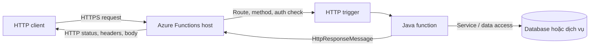
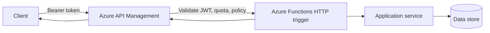
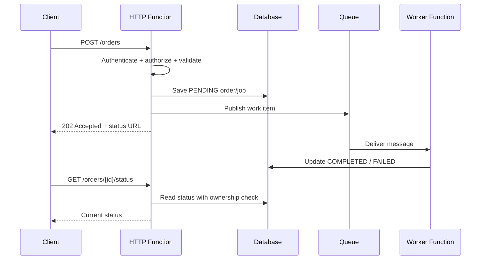

# Cấu hình HTTP trigger và kiểm soát quyền truy cập

Azure Functions cho phép triển khai một hàm Java được kích hoạt khi có HTTP request. HTTP trigger phù hợp để xây dựng webhook, API nhỏ, endpoint nhận lệnh hoặc lớp tiếp nhận yêu cầu cho một quy trình bất đồng bộ. Khi cấu hình trigger, nhóm cần xác định route, HTTP method, kiểu dữ liệu request/response và mức xác thực. Những lựa chọn này ảnh hưởng trực tiếp đến cách client gọi function, cách bảo vệ endpoint và cách vận hành ứng dụng.

Một điểm dễ nhầm là `authLevel` của HTTP trigger. Mức `FUNCTION` yêu cầu function key, nhưng key chỉ là bí mật dùng chung để cho phép gọi endpoint; nó không xác định danh tính người dùng và không thay thế authorization theo vai trò hoặc quyền sở hữu dữ liệu. Với API cần xác thực người dùng hoặc ứng dụng theo danh tính, nên kết hợp Microsoft Entra ID, App Service Authentication, API Management hoặc cơ chế OAuth 2.0/OIDC phù hợp.

Bài học này trình bày cách khai báo HTTP trigger trong Java, thiết kế route và response, lựa chọn `AuthorizationLevel`, bảo vệ endpoint bằng function key hoặc danh tính Entra ID, kết hợp network controls, CORS, managed identity và các nguyên tắc kiểm thử bảo mật.

## 1. HTTP trigger trong Azure Functions

HTTP trigger là một binding đầu vào. Khi Azure Functions nhận request khớp route và method đã khai báo, runtime gọi Java function và chuyển thông tin request vào tham số được gắn annotation `@HttpTrigger`. Function có thể đọc query string, header, route parameter và body, sau đó trả về `HttpResponseMessage`.



Một Java function thường được nhận diện bằng `@FunctionName`. Tham số request dùng `@HttpTrigger` để khai báo tên binding, method, route và mức xác thực. Với endpoint trả dữ liệu tùy chỉnh, nên trả `HttpResponseMessage` để kiểm soát status code, header và body.

### Thành phần của HTTP trigger

| Thuộc tính | Vai trò |
|---|---|
| `name` | Tên binding được runtime sử dụng trong function signature |
| `methods` | Các HTTP method được endpoint chấp nhận, ví dụ GET, POST, PUT hoặc DELETE |
| `route` | Route template của function; có thể chứa route parameter |
| `authLevel` | Mức kiểm tra key: `ANONYMOUS`, `FUNCTION` hoặc `ADMIN` |
| `HttpRequestMessage<T>` | Request, gồm query parameters, headers, URI và body |
| `HttpResponseMessage` | Response với status, headers và body |

Nếu không chỉ định route, function thường được gọi theo tên function dưới route prefix mặc định `api`. Có thể thay đổi route prefix trong `host.json`, nhưng cần phối hợp với gateway, API Management và client đang sử dụng endpoint.

## 2. Tạo HTTP trigger bằng Java

Trong mô hình Java annotation-based, function được khai báo bằng `@FunctionName` và tham số trigger bằng `@HttpTrigger`. Ví dụ sau tạo endpoint POST nhận JSON để tiếp nhận yêu cầu tạo đơn hàng.

Với Maven, project cần thư viện Java API của Azure Functions cùng các thư viện mà ứng dụng sử dụng:

```xml
<dependency>
    <groupId>com.microsoft.azure</groupId>
    <artifactId>azure-functions-java-library</artifactId>
    <version>${azure.functions.java.library.version}</version>
</dependency>
```

Đặt phiên bản trong Maven property hoặc dependency management theo template/tooling đang dùng; không sao chép một phiên bản cũ mà chưa kiểm tra tương thích runtime.

```java
import com.fasterxml.jackson.core.JsonProcessingException;
import com.fasterxml.jackson.databind.JsonNode;
import com.fasterxml.jackson.databind.ObjectMapper;
import com.microsoft.azure.functions.AuthorizationLevel;
import com.microsoft.azure.functions.HttpMethod;
import com.microsoft.azure.functions.HttpRequestMessage;
import com.microsoft.azure.functions.HttpResponseMessage;
import com.microsoft.azure.functions.HttpStatus;
import com.microsoft.azure.functions.annotation.FunctionName;
import com.microsoft.azure.functions.annotation.HttpTrigger;

import java.util.Collections;
import java.util.Optional;

public class OrderHttpFunction {
    // ObjectMapper sau khi cấu hình xong có thể được dùng đồng thời.
    private static final ObjectMapper JSON = new ObjectMapper();

    @FunctionName("CreateOrder")
    public HttpResponseMessage createOrder(
            @HttpTrigger(
                    name = "request",
                    methods = {HttpMethod.POST},
                    route = "orders",
                    authLevel = AuthorizationLevel.FUNCTION
            ) HttpRequestMessage<Optional<String>> request) {

        String body = request.getBody().orElse("");
        if (body.trim().isEmpty()) {
            return request.createResponseBuilder(HttpStatus.BAD_REQUEST)
                    .body("Request body is required")
                    .build();
        }

        try {
            JsonNode payload = JSON.readTree(body);
            if (payload == null || !payload.isObject()) {
                return request.createResponseBuilder(HttpStatus.BAD_REQUEST)
                        .body("Request body must be a JSON object")
                        .build();
            }
            JsonNode customerId = payload.get("customerId");
            if (customerId == null || customerId.isNull()
                    || customerId.asText().trim().isEmpty()) {
                return request.createResponseBuilder(HttpStatus.BAD_REQUEST)
                        .body("customerId is required")
                        .build();
            }

            // Thay bằng application service và thao tác nghiệp vụ thực tế.
            String responseBody = JSON.writeValueAsString(
                    Collections.singletonMap("valid", true)
            );

            return request.createResponseBuilder(HttpStatus.OK)
                    .header("Content-Type", "application/json; charset=utf-8")
                    .body(responseBody)
                    .build();
        } catch (JsonProcessingException exception) {
            return request.createResponseBuilder(HttpStatus.BAD_REQUEST)
                    .body("Request body must be valid JSON")
                    .build();
        }
    }
}
```

Ví dụ minh họa HTTP contract và kiểm tra JSON. Phần tạo đơn thực tế nên nằm trong application service riêng để có thể kiểm thử độc lập. Không trả stack trace hoặc thông tin nội bộ trong response lỗi. `ObjectMapper` được cấu hình trước khi dùng và không thay đổi cấu hình sau đó; dữ liệu request được giữ trong biến cục bộ của invocation.

### Đọc route parameter

Route có thể chứa tham số như `orders/{orderId}`. Dùng `@BindingName` để nhận giá trị đã được route binding trích xuất:

```java
import com.microsoft.azure.functions.AuthorizationLevel;
import com.microsoft.azure.functions.HttpMethod;
import com.microsoft.azure.functions.HttpRequestMessage;
import com.microsoft.azure.functions.HttpResponseMessage;
import com.microsoft.azure.functions.HttpStatus;
import com.microsoft.azure.functions.annotation.BindingName;
import com.microsoft.azure.functions.annotation.FunctionName;
import com.microsoft.azure.functions.annotation.HttpTrigger;
import java.util.Optional;

public class OrderLookupFunction {
    @FunctionName("GetOrder")
    public HttpResponseMessage getOrder(
            @HttpTrigger(
                    name = "request",
                    methods = {HttpMethod.GET},
                    route = "orders/{orderId}",
                    authLevel = AuthorizationLevel.FUNCTION
            ) HttpRequestMessage<Optional<String>> request,
            @BindingName("orderId") String orderId) {

        if (orderId == null || orderId.trim().isEmpty()) {
            return request.createResponseBuilder(HttpStatus.BAD_REQUEST)
                    .body("orderId is required")
                    .build();
        }

        // Kiểm tra quyền xem orderId ở application service trước khi trả dữ liệu.
        return request.createResponseBuilder(HttpStatus.OK)
                .body("Order lookup accepted")
                .build();
    }
}
```

Route parameter chỉ cung cấp giá trị định tuyến. Nó không chứng minh caller có quyền truy cập tài nguyên mang ID đó.

### Chọn HTTP method và status code

Hãy dùng method theo ý nghĩa của thao tác:

| Method | Mục đích thường gặp | Ví dụ |
|---|---|---|
| GET | Đọc tài nguyên, không tạo side effect nghiệp vụ | `GET /api/orders/{id}` |
| POST | Tạo tài nguyên hoặc gửi lệnh | `POST /api/orders` |
| PUT | Thay thế toàn bộ biểu diễn tài nguyên | `PUT /api/orders/{id}` |
| PATCH | Cập nhật một phần | `PATCH /api/orders/{id}` |
| DELETE | Yêu cầu xóa tài nguyên | `DELETE /api/orders/{id}` |

Một số status code thường dùng:

- `200 OK`: xử lý thành công và có response body.
- `201 Created`: tài nguyên mới đã được tạo; có thể trả header `Location`.
- `202 Accepted`: đã tiếp nhận công việc bất đồng bộ nhưng chưa hoàn tất.
- `204 No Content`: thành công và không cần body.
- `400 Bad Request`: request sai cấu trúc hoặc thiếu dữ liệu bắt buộc.
- `401 Unauthorized`: caller chưa được xác thực hoặc thông tin xác thực không hợp lệ.
- `403 Forbidden`: caller đã xác thực nhưng không được phép thực hiện thao tác.
- `404 Not Found`: tài nguyên không tồn tại hoặc không được phép tiết lộ sự tồn tại của nó.
- `409 Conflict`: trạng thái hiện tại xung đột với thao tác được yêu cầu.
- `429 Too Many Requests`: vượt giới hạn tốc độ hoặc quota.
- `500 Internal Server Error`: lỗi không dự kiến ở phía server.

Không dùng `200 OK` cho mọi trường hợp. Status code rõ ràng giúp client quyết định có retry, yêu cầu xác thực lại hay sửa request.

## 3. Route, route prefix và version API

Route là một phần của API contract. Nên dùng danh từ tài nguyên và cấu trúc nhất quán, ví dụ:

```text
GET    /api/v1/orders/{orderId}
POST   /api/v1/orders
PATCH  /api/v1/orders/{orderId}
DELETE /api/v1/orders/{orderId}
```

Có thể đặt route trực tiếp trong `@HttpTrigger`, hoặc dùng cấu hình route prefix trong `host.json`. Ví dụ:

```json
{
  "version": "2.0",
  "extensions": {
    "http": {
      "routePrefix": "api"
    }
  }
}
```

Với cấu hình trên, route `orders/{orderId}` được công bố dưới prefix `api`. Nếu thay prefix, cần cập nhật client, API Management policy, health check và tài liệu API. Không thay route đã công bố mà không có kế hoạch tương thích hoặc versioning.

### API versioning

Khi thay đổi request/response không tương thích, có thể tạo route version mới như `/api/v2/orders`. Một số hệ thống version qua header hoặc API gateway. Chọn một cách nhất quán và quy định thời gian hỗ trợ version cũ.

Ưu tiên thay đổi tương thích như thêm field tùy chọn, giữ ý nghĩa field cũ và không làm client cũ thất bại. Nếu cần loại bỏ field hoặc đổi kiểu dữ liệu, triển khai consumer/server tương thích trước rồi mới chuyển client theo giai đoạn.

## 4. AuthorizationLevel và function key

HTTP trigger có ba mức `AuthorizationLevel` thường dùng:

| Mức | Cách hoạt động | Trường hợp sử dụng |
|---|---|---|
| `ANONYMOUS` | Không yêu cầu function key | Endpoint công khai hoặc endpoint được bảo vệ bởi lớp xác thực khác |
| `FUNCTION` | Yêu cầu function key có quyền gọi function | Tích hợp đơn giản giữa các hệ thống tin cậy, thường qua gateway hoặc backend |
| `ADMIN` | Yêu cầu master key của Function App | Tác vụ quản trị đặc biệt; không dùng cho endpoint ứng dụng thông thường |

Function key có thể được gửi qua header `x-functions-key` hoặc query parameter `code`. Với hệ thống thực tế, ưu tiên header vì URL thường xuất hiện trong access log, browser history, proxy log hoặc telemetry. Không nhúng key vào mã JavaScript phía trình duyệt hoặc ứng dụng mobile.

Azure Functions có thể có function-level key và host-level key. Function key giới hạn vào function tương ứng; host key có thể gọi các function trong Function App. Master key có quyền quản trị runtime API và cần được bảo vệ ở mức cao nhất. Không chia sẻ host/master key cho client bên ngoài chỉ để thuận tiện.

### Function key không phải danh tính người dùng

Function key là shared secret. Nếu nhiều người hoặc hệ thống cùng dùng một key, nền tảng không tự biết request thuộc người dùng nào. Key cũng không mô tả role, tenant, quyền đọc một order cụ thể hoặc quyền thực hiện một hành động nghiệp vụ.

Vì vậy:

- Dùng `FUNCTION` để thêm một lớp bảo vệ bằng key cho endpoint tích hợp đơn giản.
- Dùng xác thực dựa trên danh tính khi cần biết caller là ai.
- Thực hiện authorization trong application service cho từng tài nguyên và hành động.
- Không coi việc request có function key hợp lệ là bằng chứng người dùng sở hữu dữ liệu trong route.

### Quản lý và xoay vòng key

Không ghi key vào source code, file cấu hình được commit hoặc log. Dùng cơ chế quản lý key của Azure Functions và phân phối key qua secret store phù hợp. Khi xoay vòng:

1. Tạo key mới.
2. Cập nhật client/gateway dùng key mới.
3. Xác minh traffic đã chuyển sang key mới.
4. Thu hồi key cũ.
5. Theo dõi lỗi xác thực sau khi thu hồi.

Nếu một key bị lộ, cần thu hồi ngay theo quy trình incident thay vì chờ chu kỳ xoay vòng thông thường. Hạn chế số nơi lưu key và số người có quyền đọc key.

## 5. Xác thực bằng Microsoft Entra ID

Với API dành cho người dùng hoặc service-to-service, Microsoft Entra ID thường phù hợp hơn shared function key. Client lấy access token theo OAuth 2.0/OpenID Connect và gửi token dạng bearer:

```http
Authorization: Bearer <access-token>
```

Token cần có audience đúng API, issuer đáng tin cậy, thời hạn còn hiệu lực và các claim phù hợp. Sau khi xác thực, hệ thống cần kiểm tra scope, role hoặc policy để quyết định caller có được thực hiện thao tác hay không.

### App Service Authentication (Easy Auth)

Azure Functions có thể tích hợp xác thực ở lớp nền tảng thông qua App Service Authentication, thường được gọi là Easy Auth. Nền tảng có thể xác thực token trước khi request đến function và cung cấp thông tin principal đã xác thực cho ứng dụng theo cơ chế được hỗ trợ.

Lợi ích:

- Tập trung cấu hình identity provider và chính sách truy cập.
- Giảm lượng code xác minh token lặp lại trong từng function.
- Có thể yêu cầu xác thực trước khi request được chuyển tới handler.
- Hỗ trợ mô hình Microsoft Entra ID và các provider được nền tảng hỗ trợ.

Ứng dụng vẫn cần kiểm tra quyền nghiệp vụ. Một token hợp lệ chỉ chứng minh danh tính/ứng dụng theo claim được xác thực; nó không tự cho phép đọc mọi tài nguyên. Khi lấy principal từ header hoặc context do nền tảng cung cấp, chỉ tin dữ liệu được nền tảng xác thực và bảo đảm client không thể tự giả mạo đường truyền đó. Không đọc một header tùy ý do caller gửi rồi coi đó là danh tính đã xác thực.

### API Management làm lớp bảo vệ API

Azure API Management (APIM) có thể đứng trước Function App để cung cấp một điểm vào thống nhất. APIM có thể xác thực JWT, kiểm tra subscription, áp dụng rate limit/quota, chuẩn hóa header, ghi nhận telemetry và định tuyến tới backend.



Nếu APIM thực hiện xác thực, cần bảo vệ backend để caller không thể bỏ qua gateway và gọi Function App trực tiếp bằng một đường public khác. Có thể dùng private endpoint, access restriction hoặc cấu hình mạng phù hợp với plan và kiến trúc. Backend cũng nên kiểm tra các giả định về identity và header từ gateway theo một ranh giới tin cậy rõ ràng.

## 6. Authorization ở tầng nghiệp vụ

Authentication trả lời “caller là ai?”. Authorization trả lời “caller được phép làm gì với tài nguyên nào?”. Hai bước này cần tách biệt.

Ví dụ, một access token hợp lệ có thể đại diện cho user `user-17`, nhưng user đó chỉ được xem order thuộc tài khoản của mình. Nếu endpoint nhận `GET /orders/order-99`, service phải kiểm tra quan hệ sở hữu hoặc quyền được cấp trước khi trả dữ liệu.

Một luồng authorization thường gồm:

1. Xác thực token hoặc principal ở lớp nền tảng/gateway.
2. Lấy subject, tenant, scope hoặc role từ principal đã xác minh.
3. Nạp tài nguyên bằng ID từ route.
4. Kiểm tra quyền trên chính tài nguyên đó, không chỉ kiểm tra role chung.
5. Thực hiện thao tác và ghi audit event nếu nghiệp vụ yêu cầu.

Không tin `userId`, `tenantId` hoặc `role` do client gửi trong JSON nếu các trường đó có thể được suy ra từ token. Nếu payload có thông tin chủ sở hữu, hãy so sánh với principal đã xác thực và từ chối khi không khớp.

### 401 và 403

- Trả `401 Unauthorized` khi thiếu hoặc không thể xác minh thông tin xác thực theo cơ chế của API.
- Trả `403 Forbidden` khi caller đã xác thực nhưng không có quyền thực hiện hành động.
- Có thể trả `404 Not Found` thay cho `403` nếu chính sách bảo mật yêu cầu không tiết lộ sự tồn tại của tài nguyên.

Response không nên cho biết chi tiết nội bộ về user, token hoặc quy tắc bảo mật. Ghi thông tin đủ để audit ở server, nhưng không log token nguyên vẹn.

## 7. Network security, CORS và giới hạn truy cập

Xác thực ở tầng ứng dụng nên được kết hợp với kiểm soát mạng khi yêu cầu bảo mật cần giới hạn nguồn truy cập.

### Access restrictions và private endpoint

Azure Functions có các tùy chọn giới hạn inbound network access, access restrictions và private endpoint tùy loại hosting plan và cấu hình. Private endpoint cho phép truy cập qua mạng riêng trong kiến trúc được hỗ trợ; VNet integration chủ yếu phục vụ kết nối outbound từ Function App tới tài nguyên trong mạng ảo. Hai khái niệm này giải quyết hai hướng lưu lượng khác nhau.

Trước khi triển khai, xác minh tính năng mạng có sẵn cho hosting plan/region đang dùng. Nếu APIM hoặc một dịch vụ nội bộ là caller duy nhất, cân nhắc chỉ cho phép backend nhận traffic từ ranh giới mạng được kiểm soát. Không mở public endpoint rộng nếu không cần.

### CORS không phải authentication

Cross-Origin Resource Sharing (CORS) là cơ chế browser kiểm soát JavaScript từ origin nào được phép đọc response. CORS không ngăn một chương trình server, curl hoặc client khác gửi request trực tiếp. CORS cũng không xác minh danh tính và không thay thế function key, JWT hoặc authorization.

Chỉ thêm các origin cần thiết, ưu tiên origin cụ thể thay vì wildcard. Nếu dùng cookie hoặc credential trong browser, cấu hình CORS phải tuân thủ quy tắc browser về credentials và origin. Không bật `Access-Control-Allow-Origin: *` cùng credentials.

### TLS, rate limiting và WAF

Sử dụng HTTPS cho endpoint public. Với API có nguy cơ bị lạm dụng, đặt rate limit, quota hoặc WAF ở APIM/front door phù hợp. Giới hạn tốc độ nên dựa trên caller, subscription, IP hoặc một khóa tin cậy khác; tránh chỉ dựa vào header tùy ý từ client.

## 8. Managed identity và truy cập dịch vụ phía sau

Managed identity dùng để Function App xác thực khi gọi tài nguyên Azure như Key Vault, Storage, Service Bus hoặc các dịch vụ hỗ trợ Microsoft Entra authentication. Đây là **danh tính outbound của Function App**, khác với danh tính của client gọi HTTP trigger.

Ví dụ:

- Client gọi endpoint bằng access token Entra ID.
- Function xác thực caller và kiểm tra quyền nghiệp vụ.
- Function dùng managed identity của mình để đọc secret hoặc ghi message vào Service Bus.

Không dùng managed identity của Function App để suy ra user HTTP đã được xác thực. Hai danh tính có mục đích và phạm vi quyền khác nhau.

### Cấp quyền tối thiểu

Ưu tiên role phù hợp ở đúng scope tài nguyên. Ví dụ, nếu function chỉ cần gửi message vào một Service Bus queue, chỉ cấp quyền gửi tới namespace/entity cần thiết; không cấp quyền quản trị toàn subscription. Tách identity giữa môi trường dev, staging và production để giảm nguy cơ dùng nhầm credential.

Secret có thể được lấy từ Key Vault bằng managed identity hoặc qua cơ chế Key Vault reference trong application settings. Tránh đưa secret trực tiếp vào `local.settings.json` được commit, `host.json` hoặc source code. Bảo vệ cả pipeline triển khai và người có quyền sửa app settings.

## 9. Request validation, lỗi và chống lạm dụng

HTTP endpoint là ranh giới không tin cậy. Mọi dữ liệu từ client cần được xác thực và kiểm tra trước khi đi vào domain logic.

### Kiểm tra request

- Kiểm tra HTTP method và content type.
- Giới hạn kích thước body theo nhu cầu và giới hạn nền tảng.
- Parse JSON an toàn, từ chối payload sai cấu trúc.
- Kiểm tra field bắt buộc, độ dài chuỗi, miền giá trị và định dạng.
- Kiểm tra route parameter và query parameter.
- Không nối trực tiếp dữ liệu client vào SQL, command hoặc đường dẫn storage.
- Kiểm tra quyền tài nguyên trước khi đọc hoặc thay đổi dữ liệu.
- Dùng idempotency key cho thao tác tạo/cập nhật có thể bị client retry.

Với tệp lớn, không nên gửi toàn bộ nội dung qua HTTP trigger nếu request/timeout/bộ nhớ không phù hợp. Có thể cấp upload URL có thời hạn tới object storage, sau đó nhận một request nhỏ chứa object reference để bắt đầu xử lý.

### Lỗi và response

Trả thông báo ngắn, không để lộ stack trace, SQL, connection string hoặc tên nội bộ. Ghi chi tiết kỹ thuật ở server log với correlation ID. Phân biệt lỗi validation, xác thực, authorization, conflict, throttling và lỗi phụ thuộc tạm thời để client có chiến lược retry đúng.

Nếu endpoint thực hiện thao tác không idempotent, hãy thiết kế khóa chống trùng. Ví dụ client gửi `Idempotency-Key`; server lưu khóa cùng kết quả và trả lại kết quả cũ khi request được gửi lại trong thời hạn chính sách. Không tin khóa do client gửi nếu không ràng buộc nó với principal và phạm vi nghiệp vụ phù hợp.

## 10. Xử lý công việc dài qua HTTP

HTTP trigger phù hợp với request/response ngắn. Nếu công việc có thể mất nhiều thời gian, phụ thuộc nhiều dịch vụ hoặc cần retry độc lập, nên tách bước tiếp nhận khỏi bước xử lý.

Một mẫu phổ biến:

1. Client gửi `POST /api/orders`.
2. Function xác thực caller, kiểm tra request và ghi một job/order ở trạng thái `PENDING`.
3. Function gửi message vào queue hoặc khởi tạo workflow.
4. Function trả `202 Accepted` cùng ID và URL truy vấn trạng thái.
5. Worker xử lý bất đồng bộ, cập nhật trạng thái `COMPLETED` hoặc `FAILED`.
6. Client gọi endpoint status để xem tiến trình hoặc nhận callback/webhook theo thiết kế.



Việc ghi database và gửi queue cần được thiết kế để không mất công việc nếu một bước thành công còn bước kia thất bại. Có thể dùng transactional outbox hoặc workflow phù hợp. Endpoint status cũng phải kiểm tra caller có quyền xem job đó hay không.

Không giữ HTTP request mở chỉ để chờ một quy trình nền dài nếu nền tảng/gateway có giới hạn thời gian phản hồi. `202 Accepted` diễn đạt đúng rằng yêu cầu đã được tiếp nhận, chưa khẳng định công việc đã hoàn tất.

## 11. Cấu hình và triển khai

Một Function App thường chứa nhiều function và chia sẻ một số cấu hình host, identity, network và runtime. `host.json` chứa cấu hình host; application settings chứa cấu hình theo môi trường. `local.settings.json` phục vụ local development và không nên commit secret.

Ví dụ cấu hình ứng dụng:

```text
FUNCTIONS_WORKER_RUNTIME=java
FUNCTIONS_EXTENSION_VERSION=~4
ORDERS_TABLE_NAME=orders
SERVICEBUS_NAMESPACE=orders-prod.servicebus.windows.net
```

Đây là ví dụ tên setting, không phải bộ cấu hình đầy đủ cho mọi dự án. Connection string/secret nên lấy từ Key Vault hoặc managed identity khi dịch vụ hỗ trợ. Không đặt thông tin bí mật trong `host.json` hoặc repository.

Quy trình phát hành nên gồm:

1. Build package Java bằng Maven/Gradle và kiểm tra dependency/runtime tương thích.
2. Deploy vào Function App của môi trường đích.
3. Cấu hình app settings, identity, role assignment và network.
4. Xác minh route, method, auth level và gateway policy.
5. Kiểm tra endpoint bằng caller hợp lệ và caller không hợp lệ.
6. Kiểm tra log, metric, tracing và cảnh báo.
7. Dùng deployment slot hoặc chiến lược rollout phù hợp nếu hosting plan hỗ trợ.
8. Xác minh rollback và xoay vòng key/secret.

Không coi việc deploy thành công là bằng chứng endpoint đã được bảo vệ đúng. Cần kiểm thử trực tiếp hành vi xác thực và authorization sau triển khai.

## 12. Kiểm thử HTTP trigger và quyền truy cập

Một ma trận kiểm thử tối thiểu:

| Tình huống | Kết quả mong đợi |
|---|---|
| Request đúng method, route và key/token hợp lệ | Function nhận request và trả response theo contract |
| Thiếu function key với `FUNCTION` | Request bị từ chối trước khi vào logic nghiệp vụ |
| Key sai hoặc đã thu hồi | Request bị từ chối |
| Endpoint `ANONYMOUS` có Easy Auth yêu cầu đăng nhập | Request không có token hợp lệ bị chặn ở lớp auth |
| Token hết hạn, sai issuer hoặc audience | Bị từ chối xác thực |
| Token hợp lệ nhưng thiếu scope/role | Bị từ chối authorization |
| User hợp lệ truy cập order của user khác | Application service từ chối hoặc trả 404 theo policy |
| Request body không phải JSON hợp lệ | Trả 400, không ghi dữ liệu nghiệp vụ |
| Body vượt giới hạn | Bị từ chối theo giới hạn ứng dụng/nền tảng |
| Request lặp với cùng idempotency key | Không tạo side effect trùng |
| Origin không nằm trong CORS allowlist | Browser không được phép đọc response theo policy; server vẫn phải tự bảo vệ endpoint |
| Gọi trực tiếp backend bỏ qua APIM | Bị chặn bởi network/auth policy hoặc vẫn được backend xác thực độc lập |

### Kiểm thử function key

Với endpoint `FUNCTION`, thử cả ba trường hợp: không có key, key hợp lệ và key đã thu hồi. Gửi key qua `x-functions-key` header trong test. Không lưu key trong collection public hoặc log CI. Nếu dùng APIM, kiểm tra client không thể lấy key backend từ response hoặc telemetry.

### Kiểm thử Entra ID

Kiểm tra token với issuer, audience, expiry, scope/role khác nhau. Bao gồm trường hợp token hợp lệ nhưng principal không có quyền trên tài nguyên cụ thể. Kiểm tra cả đường gọi qua gateway và đường gọi trực tiếp tới Function App nếu backend vẫn có thể truy cập.

## 13. Quan sát và audit

Đối với HTTP trigger, nên ghi log có cấu trúc gồm:

- Function name và operation.
- Correlation ID hoặc trace ID.
- HTTP method và route template, không nhất thiết ghi toàn bộ URL/query.
- Status code và duration.
- Kết quả xác thực/authorization ở dạng mã phân loại, không ghi token.
- Mã tài nguyên nghiệp vụ nếu được phép ghi và không làm lộ dữ liệu nhạy cảm.
- Mã lỗi của dependency khi có lỗi downstream.

Theo dõi request count, latency p50/p95/p99, 4xx/5xx, 401/403, 429, throttling, dependency failures và cold start. Nếu dùng APIM, đối chiếu telemetry gateway với Function App để biết request bị chặn ở lớp nào.

Audit log nên ghi ai thực hiện hành động gì trên tài nguyên nào và kết quả ra sao theo yêu cầu nghiệp vụ. Không ghi access token, function key, secret, password hoặc toàn bộ request body có dữ liệu cá nhân. Cần xác định retention và quyền đọc log phù hợp.

## 14. Các lỗi cấu hình thường gặp

| Lỗi | Hệ quả | Cách khắc phục |
|---|---|---|
| Để `ANONYMOUS` mà không có lớp xác thực khác | Endpoint có thể được gọi công khai | Bật auth phù hợp hoặc đặt gateway/auth platform phía trước |
| Cho rằng function key xác định người dùng | Không thể authorization theo user/tenant | Dùng Entra ID và kiểm tra quyền nghiệp vụ |
| Dùng host/master key cho mọi client | Phạm vi ảnh hưởng khi lộ key rất lớn | Dùng function key giới hạn hoặc identity theo caller |
| Đưa key vào query string hoặc frontend code | Key có thể lộ qua log, history hoặc bundle | Dùng header và backend secret management |
| Tin `userId`/`tenantId` từ request body | Có thể truy cập chéo dữ liệu | Lấy identity từ token đã xác minh và kiểm tra ownership |
| Coi CORS là bảo mật API | Non-browser client vẫn có thể gọi endpoint | Dùng authentication, authorization và network controls |
| Chỉ bảo vệ APIM nhưng để backend public | Caller có thể bỏ qua gateway | Giới hạn inbound hoặc xác thực backend độc lập |
| Dùng managed identity để xác thực HTTP caller | Nhầm identity outbound với identity inbound | Tách Entra ID caller authentication và Function managed identity |
| Trả lỗi kèm stack trace | Lộ thông tin nội bộ | Response tổng quát, log chi tiết ở server |
| Chờ HTTP request cho công việc quá dài | Timeout ở client/gateway/platform | Trả 202 và xử lý qua queue/workflow |

## 15. Quy trình thiết kế endpoint

Khi tạo một HTTP trigger mới, hãy đi theo trình tự:

1. **Xác định caller.** Người dùng cuối, service-to-service, webhook công khai hay gateway nội bộ?
2. **Chọn auth.** Function key cho tích hợp đơn giản; Entra ID/OAuth cho danh tính; APIM/Easy Auth khi cần quản lý tập trung.
3. **Chọn authorization.** Xác định role/scope và quyền trên từng tài nguyên nghiệp vụ.
4. **Thiết kế route và method.** Giữ contract ổn định, version khi có thay đổi không tương thích.
5. **Định nghĩa request/response.** Kiểu dữ liệu, validation, status code, error format và idempotency.
6. **Bảo vệ mạng.** HTTPS, access restriction/private endpoint nếu phù hợp, CORS đúng origin và rate limit.
7. **Cấp quyền outbound.** Dùng managed identity và role tối thiểu cho dịch vụ phía sau.
8. **Thiết kế xử lý dài.** Dùng 202, queue/workflow và status endpoint khi công việc vượt quá request/response ngắn.
9. **Thiết lập observability.** Correlation ID, audit, latency, auth failure và dependency metrics.
10. **Kiểm thử cả đường hợp lệ và bị từ chối.** Xác minh không chỉ function hoạt động mà quyền truy cập cũng đúng.

## Kết luận

HTTP trigger giúp Azure Functions Java cung cấp endpoint cho ứng dụng và dịch vụ khác. Annotation `@HttpTrigger` xác định method, route và `authLevel`; `HttpRequestMessage` đọc request còn `HttpResponseMessage` kiểm soát response. Function key phù hợp với một số tích hợp đơn giản nhưng là shared secret, không thay thế danh tính và authorization theo người dùng. Với API cần identity, hãy dùng Microsoft Entra ID, Easy Auth hoặc API Management, rồi kiểm tra quyền trên từng tài nguyên ở application layer. Kết hợp HTTPS, network restrictions, CORS đúng mục đích, managed identity cho truy cập outbound, validation, rate limit và xử lý bất đồng bộ để endpoint an toàn và vận hành được.
