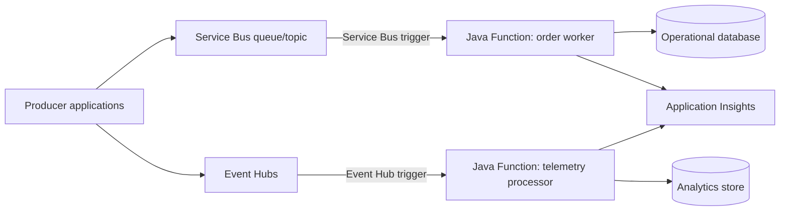
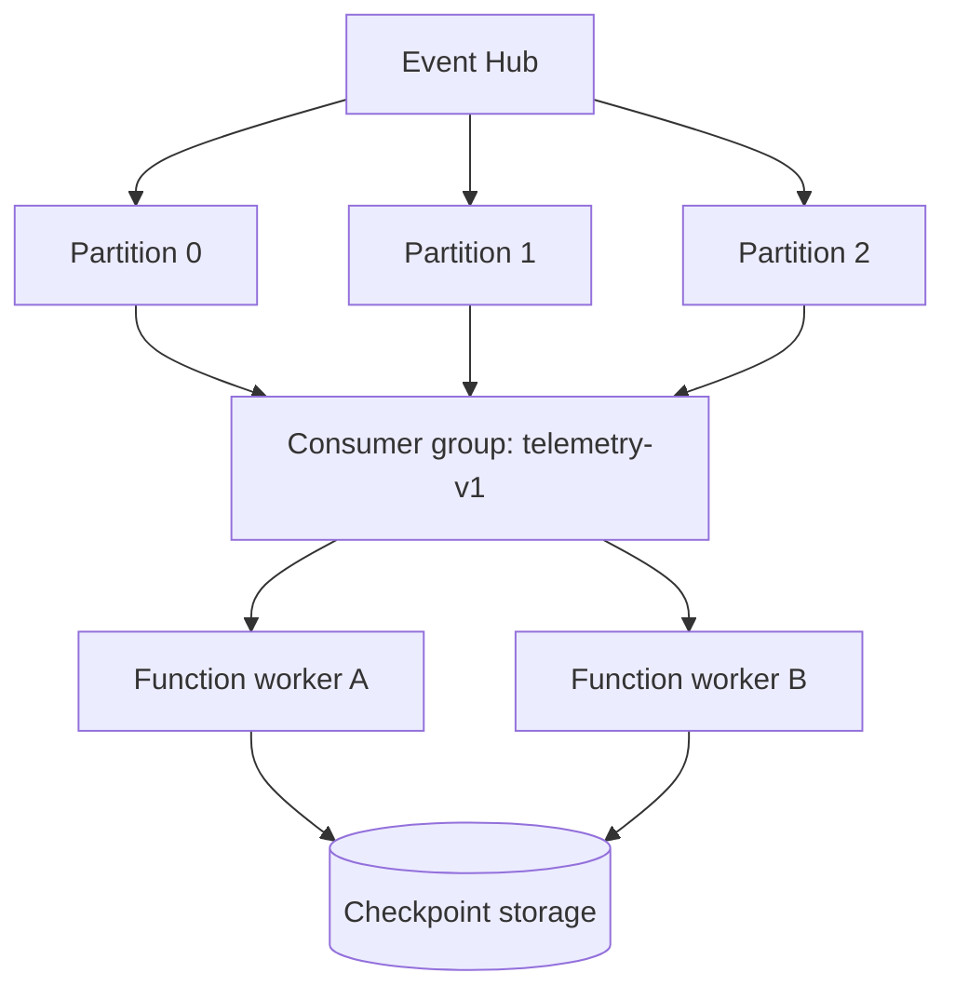
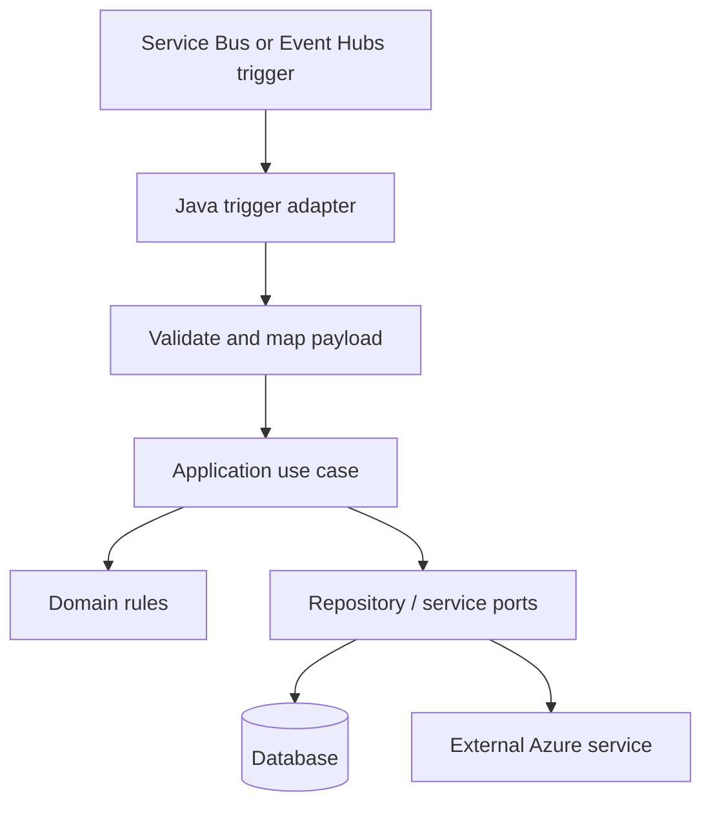

# Tích hợp Service Bus và Event Hubs trong Azure Functions

Azure Functions có thể xử lý message và event từ nhiều dịch vụ Azure mà không cần duy trì một worker server chạy liên tục. Hai nguồn thường gặp là **Azure Service Bus** và **Azure Event Hubs**. Cả hai đều kích hoạt function khi có dữ liệu mới, nhưng phục vụ hai kiểu giao tiếp khác nhau: Service Bus phù hợp với hàng đợi và thông điệp nghiệp vụ; Event Hubs phù hợp với luồng sự kiện lớn, liên tục và có thể đọc lại theo offset.

Với Java, Azure Functions cung cấp annotation để khai báo trigger trên method. Runtime và binding extension tiếp nhận message/event, chuyển dữ liệu vào tham số hàm và quản lý một phần cơ chế giao nhận. Người phát triển vẫn phải thiết kế schema, xử lý lỗi, idempotency, quyền truy cập, concurrency và quan sát hệ thống.

Trong phạm vi **CLOUD_SERVERLESS**, bài học tập trung vào Java function được kích hoạt bởi HTTP, message hoặc event, cùng các vấn đề trigger, trạng thái, quyền truy cập, retry, idempotency, mở rộng và chi phí. Service Bus và Event Hubs là hai ví dụ quan trọng để chọn đúng mô hình xử lý bất đồng bộ trên Azure.

## 1. Chọn Service Bus hay Event Hubs?

Hai dịch vụ có thể đều nhận dữ liệu từ producer và kích hoạt consumer, nhưng mô hình lưu trữ và giao nhận khác nhau.

| Tiêu chí | Azure Service Bus | Azure Event Hubs |
|---|---|---|
| Mô hình | Message broker | Distributed event streaming platform |
| Thành phần chính | Queue, topic và subscription | Event hub, partition và consumer group |
| Mục tiêu | Phân phối lệnh/message nghiệp vụ đến consumer | Thu nhận và phát luồng event với throughput cao |
| Cách đọc | Consumer nhận và settle message | Consumer đọc event theo partition và offset |
| Hoàn tất xử lý | Complete, abandon, defer hoặc dead-letter theo mô hình settlement | Lưu checkpoint để ghi nhận offset đã xử lý |
| Giao nhận lặp | Có thể giao lại khi lock hết hạn hoặc xử lý thất bại | Có thể đọc lại khi checkpoint chưa tiến lên hoặc consumer khởi động lại |
| Ordering | Có thể dùng message sessions để giữ thứ tự theo session | Thứ tự trong một partition; không có thứ tự toàn cục giữa partition |
| Phù hợp | Đặt hàng, thanh toán, xử lý workflow, lệnh nền | Telemetry, clickstream, log, dữ liệu IoT và event ingestion |

Hãy chọn theo ý nghĩa của dữ liệu. Nếu producer đang yêu cầu một consumer thực hiện công việc và cần xác nhận, retry, dead-letter hoặc session, Service Bus thường phù hợp. Nếu producer phát một dòng sự kiện liên tục cho nhiều consumer độc lập cần đọc theo vị trí và xử lý song song, Event Hubs thường phù hợp hơn.

Không nên dùng Event Hubs như một queue có settlement cho từng message; cũng không nên chọn Service Bus chỉ để lưu một luồng telemetry lớn nếu yêu cầu chính là throughput, partition và replay.

## 2. Kiến trúc tổng quát với Azure Functions

Một Function App có thể chứa nhiều function. Mỗi function có thể được kích hoạt bởi một trigger riêng, còn binding giúp kết nối function với input/output của dịch vụ.



Trigger là điểm kích hoạt invocation. Input binding có thể cung cấp dữ liệu hoặc client cho function; output binding có thể gửi kết quả đến dịch vụ đích. Binding giúp giảm mã kết nối, nhưng với logic cần kiểm soát chi tiết về transaction, settlement hoặc client lifecycle, có thể dùng Azure SDK trực tiếp trong application adapter.

Trong Java, method có annotation `@FunctionName` và một hoặc nhiều tham số binding. Tên setting được tham chiếu bằng thuộc tính `connection` trong trigger annotation; giá trị thực được cấu hình trong Function App settings hoặc `local.settings.json` khi phát triển cục bộ.

## 3. Tích hợp Azure Service Bus queue

Queue lưu message cho đến khi consumer xử lý và xác nhận. Nhiều consumer có thể cạnh tranh nhận message từ cùng queue; một message thường được xử lý bởi một consumer tại một thời điểm, nhưng có thể được giao lại nếu xử lý không hoàn tất.

Java function có thể dùng `@ServiceBusQueueTrigger`:

```java
import com.microsoft.azure.functions.ExecutionContext;
import com.microsoft.azure.functions.annotation.FunctionName;
import com.microsoft.azure.functions.annotation.ServiceBusQueueTrigger;

public class OrderFunctions {

    @FunctionName("processOrder")
    public void processOrder(
            @ServiceBusQueueTrigger(
                    name = "message",
                    queueName = "orders",
                    connection = "ServiceBusConnection") String message,
            ExecutionContext context) {

        context.getLogger().info("Received an order message");
        // Parse message, validate contract, then call an application use case.
    }
}
```

Ví dụ dùng body dạng `String` để tập trung vào ranh giới trigger. Trong ứng dụng thực tế, có thể bind sang kiểu dữ liệu được extension hỗ trợ hoặc deserialize sang DTO bằng JSON codec. Không ghi toàn bộ message vào log nếu payload có thông tin cá nhân hoặc dữ liệu nhạy cảm.

Thuộc tính `connection` trỏ đến cấu hình kết nối có tên `ServiceBusConnection`. Với connection string, đây thường là một app setting có đúng tên đó. Với managed identity, có thể dùng các setting theo tiền tố như `ServiceBusConnection__fullyQualifiedNamespace`.

## 4. Tích hợp Service Bus topic và subscription

Topic cho phép một producer phát message cho nhiều subscription. Mỗi subscription hoạt động như một hàng đợi logic riêng, có thể áp dụng filter/rule để chọn message cần nhận.

Ví dụ một function nhận message từ subscription `billing` của topic `orders`:

```java
import com.microsoft.azure.functions.ExecutionContext;
import com.microsoft.azure.functions.annotation.FunctionName;
import com.microsoft.azure.functions.annotation.ServiceBusTopicTrigger;

public class BillingFunctions {

    @FunctionName("processBillingOrder")
    public void process(
            @ServiceBusTopicTrigger(
                    name = "message",
                    topicName = "orders",
                    subscriptionName = "billing",
                    connection = "ServiceBusConnection") String message,
            ExecutionContext context) {

        // Map message to a command and invoke billing use case.
    }
}
```

Topic phù hợp khi một sự kiện nghiệp vụ cần được nhiều hệ thống xử lý độc lập, ví dụ `OrderPlaced` được gửi đến billing, inventory và notification. Mỗi subscription có thể có trạng thái, retry và dead-letter riêng. Cần quản lý subscription filter để tránh gửi mọi message đến mọi consumer khi không cần thiết.

## 5. Message settlement: complete, abandon và dead-letter

Service Bus thường dùng mô hình *Peek-Lock*. Consumer nhận message với một lock có thời hạn. Trong thời gian lock, consumer xử lý message; sau khi thành công, message được complete để loại khỏi queue/subscription. Nếu xử lý thất bại, message có thể được abandon hoặc lock hết hạn để được giao lại.

Các hành động thường gặp:

| Hành động | Ý nghĩa | Khi nào dùng |
|---|---|---|
| Complete | Xác nhận xử lý xong và loại message khỏi queue/subscription | Nghiệp vụ đã hoàn tất bền vững |
| Abandon | Nhả lock để message có thể được giao lại | Lỗi tạm thời hoặc cần thử lại |
| Defer | Trì hoãn message để nhận lại sau bằng sequence number | Xử lý theo thứ tự hoặc chờ điều kiện khác |
| Dead-letter | Chuyển message sang dead-letter subqueue | Payload không hợp lệ, lỗi vĩnh viễn hoặc vượt số lần giao |

Với trigger binding, Azure Functions host và Service Bus extension thường thực hiện settlement theo kết quả invocation và cấu hình auto-completion. Nếu function hoàn tất thành công, host có thể complete message; nếu function ném lỗi, message có thể được giao lại theo cơ chế lock/retry. Chi tiết phụ thuộc phiên bản extension và cấu hình. Không nên giả định một lần `return` đồng nghĩa message đã được xử lý bền vững nếu use case chỉ ghi dữ liệu vào bộ nhớ.

Nếu cần kiểm soát settlement thủ công hoặc thao tác nâng cao như defer, session, transaction hay nhận nhiều message theo cách riêng, hãy xác minh binding hỗ trợ kiểu tham số/action tương ứng trong phiên bản Java extension đang dùng; nếu không, dùng Azure Service Bus SDK trong adapter chuyên biệt.

## 6. Delivery count, lock duration và dead-letter queue

Một message không được complete có thể được giao lại. Service Bus tăng delivery count theo hành vi giao nhận; khi vượt `MaxDeliveryCount`, message thường được chuyển vào dead-letter queue. Giá trị mặc định và cách cấu hình phụ thuộc entity/namespace và cần kiểm tra trong Azure portal hoặc IaC.

Function cần hoàn tất xử lý trong thời hạn lock hoặc dựa vào cơ chế gia hạn lock mà extension hỗ trợ. Nếu xử lý lâu hơn lock duration, message có thể được giao cho consumer khác trong khi invocation đầu vẫn chạy. Điều này tạo ra xử lý đồng thời và side effect trùng.

Các biện pháp:

- Giữ mỗi invocation ngắn; chuyển công việc dài sang workflow hoặc chia nhỏ thành các message.
- Đặt `maxAutoLockRenewalDuration` phù hợp nếu extension hỗ trợ gia hạn lock tự động.
- Đặt concurrency phù hợp với năng lực database và dịch vụ phụ thuộc.
- Dùng idempotency key để xử lý an toàn khi message được giao lại.
- Theo dõi active message, dead-letter message, delivery count và lock lost.
- Xây dựng quy trình điều tra, sửa dữ liệu và phát lại dead-letter có kiểm soát.

Không nên tăng lock duration hoặc số lần giao tối đa để che giấu handler bị treo hay lỗi dữ liệu. Hãy xác định nguyên nhân thực tế trước khi thay đổi chính sách.

## 7. Sessions và thứ tự message trong Service Bus

Nếu nghiệp vụ cần xử lý theo thứ tự cho một nhóm message, Service Bus sessions có thể gom message theo `SessionId`. Consumer nhận một session và xử lý message trong session đó theo thứ tự broker cung cấp.

Ví dụ, các lệnh cập nhật một đơn hàng có thể dùng `SessionId = orderId`. Nhờ đó, các message của cùng đơn hàng được xử lý theo session, trong khi những đơn hàng khác vẫn có thể xử lý song song.

Sessions không tạo ra thứ tự toàn cục cho toàn queue. Cần xác định:

- Message nào thuộc cùng session.
- Có cần session state hay không.
- Một session được xử lý bởi một consumer tại một thời điểm theo cơ chế lock.
- Cách xử lý session bị mất lock hoặc consumer bị khởi động lại.
- Concurrency theo session và tác động đến throughput.

Nếu dùng session-enabled queue/subscription, cấu hình trigger và extension phải bật hỗ trợ session tương ứng. Hãy xác minh Java binding của phiên bản đang dùng; nếu cần session receiver hoặc thao tác state chi tiết, có thể dùng SDK trực tiếp.

## 8. Tích hợp Azure Event Hubs

Event Hubs nhận luồng event và phân phối chúng qua các partition. Producer có thể gửi event với partition key; Event Hubs ánh xạ key vào partition để giữ thứ tự trong phạm vi partition đó.

Một event hub có thể có nhiều consumer group. Mỗi consumer group theo dõi offset/checkpoint riêng, cho phép các ứng dụng độc lập đọc cùng luồng dữ liệu mà không ảnh hưởng vị trí đọc của nhau.

Java function có thể dùng `@EventHubTrigger`:

```java
import com.microsoft.azure.functions.ExecutionContext;
import com.microsoft.azure.functions.annotation.EventHubTrigger;
import com.microsoft.azure.functions.annotation.FunctionName;

public class TelemetryFunctions {

    @FunctionName("processTelemetry")
    public void process(
            @EventHubTrigger(
                    name = "event",
                    eventHubName = "%EVENT_HUB_NAME%",
                    consumerGroup = "%EVENT_HUB_CONSUMER_GROUP%",
                    connection = "EventHubConnection") String event,
            ExecutionContext context) {

        // Validate event schema and call telemetry processing use case.
    }
}
```

Các placeholder `%EVENT_HUB_NAME%` và `%EVENT_HUB_CONSUMER_GROUP%` được thay bằng Function App settings. Nếu extension hỗ trợ batch cardinality, có thể cấu hình trigger nhận nhiều event trong một invocation và dùng kiểu tham số phù hợp như mảng hoặc collection theo phiên bản Java binding. Hãy kiểm tra tài liệu extension thay vì giả định kiểu dữ liệu batch giống nhau ở mọi phiên bản.

Event Hubs trigger thường dùng Azure Storage để lưu checkpoint và điều phối ownership của partition. Cấu hình storage là một phần của vận hành trigger; nếu storage không truy cập được, function có thể không tiến checkpoint như mong đợi.

## 9. Partition, consumer group và checkpoint

Ba khái niệm quan trọng của Event Hubs:

- **Partition:** một phần log có thứ tự riêng. Event được append vào partition và có offset/sequence number tương ứng.
- **Consumer group:** một view độc lập của luồng event. Nhiều ứng dụng có thể dùng consumer group riêng để đọc cùng event hub.
- **Checkpoint:** vị trí đã xử lý đến trong một partition. Function host/processor lưu checkpoint để tiếp tục từ vị trí phù hợp sau khi restart hoặc scale.



Trong cùng một consumer group, Event Hubs processor phân phối partition giữa các instance đang hoạt động. Số partition ảnh hưởng mức song song tối đa hữu ích của một consumer group. Thêm function instance không làm một partition tự động được xử lý song song bởi nhiều consumer trong cùng group theo cách tùy ý.

Checkpoint thường được ghi theo batch hoặc theo cấu hình extension. Nếu function xử lý một batch rồi gặp lỗi trước khi checkpoint được cập nhật, batch hoặc một phần event có thể được đọc lại. Vì vậy, checkpoint không phải bằng chứng rằng từng side effect nghiệp vụ chỉ xảy ra đúng một lần.

## 10. Batch processing với Event Hubs

Event Hubs thường được dùng để xử lý nhiều event trong một invocation nhằm tăng throughput và giảm overhead. Batch size, prefetch và thời gian chờ batch cần cân bằng độ trễ với hiệu quả xử lý.

Ví dụ cấu hình `host.json` minh họa:

```json
{
  "version": "2.0",
  "extensions": {
    "eventHubs": {
      "maxEventBatchSize": 100,
      "prefetchCount": 300,
      "batchCheckpointFrequency": 1
    }
  }
}
```

Các tên setting và giá trị hỗ trợ phụ thuộc phiên bản Event Hubs extension. Hãy xác minh schema `host.json` của extension đang cài. `maxEventBatchSize` là giới hạn trên của batch; batch thực tế có thể nhỏ hơn do lượng event, thời gian chờ và giới hạn dịch vụ.

Khi nhận batch, handler nên:

1. Xác thực từng event và schema version.
2. Xử lý mỗi event theo idempotency key riêng.
3. Ghi nhận kết quả hoặc event lỗi để có thể điều tra.
4. Chỉ hoàn tất invocation khi batch đã đạt mức xử lý mà logic yêu cầu.
5. Tránh giữ toàn bộ payload lớn trong memory nếu có thể xử lý streaming hoặc theo từng phần.

Không nên ghi checkpoint sau khi chỉ nhận event vào bộ nhớ. Checkpoint cần phản ánh điểm xử lý mà ứng dụng có thể phục hồi an toàn; hãy hiểu hành vi checkpoint do host/extension thực hiện và thiết kế side effect theo at-least-once.

## 11. Event Hubs không có per-message settlement như Service Bus

Khác biệt này ảnh hưởng trực tiếp đến cách xử lý lỗi.

Với Service Bus, consumer có thể complete, abandon hoặc dead-letter một message cụ thể. Với Event Hubs, consumer đọc event từ log và ghi checkpoint theo partition. Event không bị xóa khỏi Event Hub khi consumer xử lý xong; chúng được giữ đến khi hết retention.

Vì vậy, một event lỗi trong Event Hubs thường cần được xử lý bằng logic ứng dụng:

- Ghi event ID, partition, offset, sequence number và lý do lỗi vào quarantine store hoặc một queue lỗi.
- Quyết định tiếp tục xử lý các event khác trong batch hay dừng batch.
- Không checkpoint vượt qua event lỗi nếu yêu cầu nghiệp vụ cần xử lý lại event đó trước khi tiến tiếp.
- Nếu cách ly event và tiếp tục, bảo đảm dữ liệu lỗi được lưu bền vững trước khi checkpoint đi qua vị trí đó.
- Có quy trình replay hoặc chạy lại từ offset/time phù hợp trong thời hạn retention.

Không áp dụng khái niệm dead-letter queue của Service Bus trực tiếp cho Event Hubs. Có thể tự xây dựng dead-letter/quarantine pipeline, nhưng đó là một luồng bổ sung do ứng dụng thiết kế.

## 12. Retry và idempotency trong cả hai dịch vụ

Service Bus có thể giao lại message khi lock hết hạn, abandon hoặc function thất bại. Event Hubs có thể đọc lại event khi checkpoint chưa tiến, partition được chuyển sang instance khác hoặc function host khởi động lại. Trong cả hai trường hợp, side effect có thể lặp.

Một thiết kế idempotent cần:

- Định danh ổn định cho message/event, ví dụ `messageId`, `eventId` hoặc business key.
- Kho idempotency dùng chung, không dựa vào biến static trong function instance.
- Conditional insert/update hoặc transaction để chỉ một invocation claim được key.
- Lưu trạng thái và kết quả xử lý đủ để invocation retry biết thao tác đã hoàn tất hay còn dang dở.
- Có thời hạn lưu idempotency record phù hợp với thời gian retry, retention và replay.

Ví dụ pseudo-code Java:

```java
public void handle(OrderSubmitted event) {
    String key = "order-submitted:" + event.eventId();

    idempotency.executeOnce(key, () -> {
        orderService.submit(event.orderId());
        return null;
    });
}
```

`executeOnce` là port minh họa; phần triển khai phải dùng database hoặc store hỗ trợ ghi có điều kiện/giao dịch. Nếu thao tác gọi dịch vụ bên ngoài, hãy dùng idempotency key của dịch vụ đó hoặc thiết kế outbox/saga để xử lý lỗi một phần.

Retry nên giới hạn và có backoff. Lỗi dữ liệu vĩnh viễn không tự biến mất khi thử lại; cần cách ly hoặc dead-letter theo cơ chế phù hợp của từng dịch vụ.

## 13. Quản lý kết nối bằng managed identity

Azure Functions có thể dùng managed identity để truy cập Service Bus, Event Hubs và Azure Storage mà không lưu connection string có key trong cấu hình ứng dụng.

Ví dụ setting cho Service Bus:

```text
ServiceBusConnection__fullyQualifiedNamespace = my-namespace.servicebus.windows.net
```

Ví dụ setting cho Event Hubs:

```text
EventHubConnection__fullyQualifiedNamespace = my-eventhub-namespace.servicebus.windows.net
```

Trong annotation, thuộc tính `connection` tham chiếu tên tiền tố, ví dụ `ServiceBusConnection` hoặc `EventHubConnection`. Với cấu hình identity-based, Functions host sử dụng các setting con để tạo kết nối theo danh tính được cấu hình. Cách đặt setting có thể thay đổi theo extension và phiên bản runtime; hãy kiểm tra tài liệu của binding tương ứng.

Role thường gặp:

| Nguồn | Quyền cho trigger nhận dữ liệu | Quyền khi gửi dữ liệu |
|---|---|---|
| Service Bus | `Azure Service Bus Data Receiver` | `Azure Service Bus Data Sender` |
| Event Hubs | `Azure Event Hubs Data Receiver` | `Azure Event Hubs Data Sender` |
| Storage dùng cho checkpoint | Role ghi/đọc blob phù hợp, thường là `Storage Blob Data Contributor` theo scope cần thiết | Tùy workload lưu dữ liệu |

Gán role ở scope hẹp nhất phù hợp: namespace, queue, topic/subscription hoặc event hub nếu dịch vụ và mô hình RBAC hỗ trợ. Function chỉ nhận message không cần quyền sender. Nếu Event Hubs trigger dùng Storage checkpoint, managed identity cũng phải có quyền trên storage account/container checkpoint.

## 14. Connection string và cấu hình cục bộ

Trong môi trường phát triển, có thể dùng connection string trong `local.settings.json`. File này chứa secret nên không được commit lên repository.

Ví dụ cấu trúc rút gọn:

```json
{
  "IsEncrypted": false,
  "Values": {
    "AzureWebJobsStorage": "UseDevelopmentStorage=true",
    "FUNCTIONS_WORKER_RUNTIME": "java",
    "ServiceBusConnection": "<service-bus-connection-string>",
    "EventHubConnection": "<event-hubs-connection-string>",
    "EVENT_HUB_NAME": "telemetry",
    "EVENT_HUB_CONSUMER_GROUP": "function-app"
  }
}
```

Đây là ví dụ cho local development; thay placeholder bằng cấu hình của môi trường thử nghiệm và giữ file local settings ngoài source control. Trong Azure, đặt app settings hoặc managed identity configuration trong Function App; không đóng secret vào JAR hay container image.

`AzureWebJobsStorage` được Functions host dùng cho các nhu cầu lưu trữ của runtime và extension. Event Hubs trigger cũng cần checkpoint storage. Có thể dùng cấu hình storage được quản lý bằng identity theo khả năng của runtime; phải cấp quyền đúng cho host và extension.

## 15. Cấu hình concurrency và scale

Azure Functions có thể scale theo tải của trigger. Tuy nhiên, scale-out cần được cân bằng với khả năng của database và dịch vụ downstream.

Với Service Bus, các yếu tố quan trọng gồm:

- Số message đang chờ và tốc độ đến/xử lý.
- `maxConcurrentCalls` và prefetch của extension.
- Số instance tối đa hoặc giới hạn scale của plan.
- Lock duration, auto lock renewal và thời gian xử lý.
- Sessions và số session có thể xử lý đồng thời.

Với Event Hubs, các yếu tố gồm:

- Số partition và số consumer group.
- Số partition được phân bổ cho các instance.
- Batch size, prefetch và checkpoint frequency.
- Tốc độ ingest, consumer lag và retention.
- Năng lực downstream để xử lý dữ liệu theo batch.

Ví dụ cấu hình `host.json` đơn giản:

```json
{
  "version": "2.0",
  "extensions": {
    "serviceBus": {
      "prefetchCount": 0,
      "maxConcurrentCalls": 8,
      "maxAutoLockRenewalDuration": "00:05:00"
    },
    "eventHubs": {
      "maxEventBatchSize": 100,
      "prefetchCount": 300,
      "batchCheckpointFrequency": 1
    }
  }
}
```

Các setting trên chỉ là ví dụ ban đầu. Cấu hình chính xác phụ thuộc extension version và plan. `maxConcurrentCalls` không phải tổng concurrency của toàn Function App; nó ảnh hưởng cách extension xử lý song song trên từng host/instance. Cần đo tải thật và kiểm tra các giới hạn khác như maximum scale-out, downstream connection pool và memory.

Nếu database chỉ chịu được một số lượng kết nối nhất định, hãy giới hạn concurrency hoặc dùng queue/batch để điều tiết. Scale nhanh không có ích nếu downstream bị quá tải và message liên tục retry.

## 16. Theo dõi lỗi và độ trễ

Với Service Bus, nên quan sát:

- Active message count, dead-letter message count và scheduled message count.
- Delivery count, lock lost, message age và thời gian xử lý.
- Function invocation, failure, retry, duration và throttling.
- Queue/topic/subscription throughput và số consumer hoạt động.

Với Event Hubs, nên quan sát:

- Incoming/outgoing messages và throughput theo partition.
- Consumer lag: khoảng cách giữa event mới nhất và checkpoint/offset đã xử lý.
- Số partition, ownership và checkpoint update.
- Batch size, processing duration, error count và restart.
- Storage checkpoint latency hoặc lỗi quyền truy cập checkpoint.

Trong Java, dùng `ExecutionContext` logger hoặc logging framework được tích hợp phù hợp. Ghi correlation ID, message ID/event ID, partition/offset hoặc sequence number, function name và kết quả xử lý. Tránh ghi secret, connection string hoặc toàn bộ payload nhạy cảm.

Application Insights có thể cung cấp distributed tracing, invocation telemetry và dependency tracking. Truyền correlation/trace context qua message properties hoặc application properties nếu producer/consumer hỗ trợ để nối một luồng nghiệp vụ qua nhiều function.

## 17. Dead-letter và replay

Với Service Bus, dead-letter queue là nơi giữ message không thể xử lý theo chính sách hoặc bị ứng dụng chủ động dead-letter. Quy trình vận hành nên có:

1. Theo dõi DLQ và cảnh báo khi số message tăng.
2. Đọc dead-letter reason/description và message metadata.
3. Xác định lỗi do dữ liệu, quyền, dependency hay bug.
4. Sửa nguyên nhân và kiểm tra payload.
5. Phát lại message bằng công cụ hoặc worker được kiểm soát, giữ nguyên message ID/trace metadata nếu phù hợp.
6. Bảo đảm consumer idempotent vì message replay có thể tạo side effect lặp.

Với Event Hubs, dữ liệu được giữ trong thời gian retention và consumer có thể bắt đầu từ offset/time được chọn theo cấu hình. Replay cần được thiết kế rõ: dùng consumer group riêng để chạy lại dữ liệu, hoặc reset checkpoint theo quy trình được kiểm soát. Không reset checkpoint của consumer production đang chạy mà không hiểu tác động vì có thể xử lý lại lượng dữ liệu lớn.

Nếu Event Hubs cần quarantine event lỗi, ghi event gốc cùng partition, offset, sequence number và lỗi vào storage/queue riêng trước khi cho phép checkpoint tiến qua event đó.

## 18. Java application design và phân tách mã nghiệp vụ

Không nên để function method chứa toàn bộ JSON parsing, truy vấn database, gọi dịch vụ và quy tắc nghiệp vụ. Hãy dùng trigger method làm adapter mỏng:



Ví dụ use case không phụ thuộc Azure SDK:

```java
public record TelemetryEvent(
        String eventId,
        String deviceId,
        Instant occurredAt,
        double temperature) {}

public interface TelemetryRepository {
    void save(TelemetryEvent event);
}

public final class StoreTelemetryUseCase {
    private final TelemetryRepository repository;

    public StoreTelemetryUseCase(TelemetryRepository repository) {
        this.repository = repository;
    }

    public void execute(TelemetryEvent event) {
        if (event.temperature() < -100 || event.temperature() > 200) {
            throw new InvalidTelemetryException("Temperature out of range");
        }
        repository.save(event);
    }
}
```

Service Bus adapter có thể chuyển message thành command cho use case xử lý đơn hàng; Event Hubs adapter chuyển event thành `TelemetryEvent`. Application layer không cần biết event đến từ queue, topic hay partition nào trừ khi metadata đó thực sự cần cho nghiệp vụ hoặc idempotency.

## 19. Kiểm thử tích hợp

Nên kiểm thử ở nhiều lớp:

| Loại test | Mục tiêu |
|---|---|
| Unit test | Kiểm tra domain rule, validation và use case bằng fake repository |
| Trigger adapter test | Kiểm tra deserialize, event type, schema version và mapping sang command |
| Contract test | Xác minh producer/consumer thống nhất schema và metadata |
| Integration test | Kết nối Service Bus/Event Hubs test namespace, RBAC và checkpoint storage |
| Failure test | Mô phỏng duplicate, lock expiry, poison message, checkpoint retry và dependency timeout |
| Load test | Đo batch size, concurrency, partition throughput và sức chịu tải downstream |
| Deployment smoke test | Xác minh Function App, trigger, managed identity, app settings và logs trên Azure |

Test cục bộ có thể dùng Azure Functions Core Tools và `local.settings.json`, nhưng không phải mọi hành vi scale, lock, checkpoint hoặc managed identity đều được mô phỏng đầy đủ trên máy developer. Cần có integration test trong Azure test environment với quyền và cấu hình gần production.

## 20. Triển khai Java Function App

Một dự án Java Functions thường cần:

- Java version được Azure Functions runtime và extension hỗ trợ.
- Azure Functions Java library và annotation cho trigger/binding.
- Maven/Gradle build cấu hình plugin Azure Functions phù hợp.
- `host.json` cho cấu hình host và extension.
- Function App settings cho connection, entity name, consumer group và storage.
- Managed identity và role assignment cho Service Bus/Event Hubs/Storage.

Quy trình triển khai tổng quát:

1. Tạo Service Bus namespace/queue hoặc topic/subscription, hoặc Event Hubs namespace/event hub/consumer group.
2. Tạo Storage Account/container cần cho Azure Functions host và Event Hubs checkpoint nếu sử dụng.
3. Build Java artifact và kiểm tra function metadata do plugin tạo ra.
4. Deploy Function App vào plan phù hợp với yêu cầu scale, cold start và networking.
5. Bật managed identity và cấp role tối thiểu cho trigger cùng checkpoint storage.
6. Cấu hình app settings, extension version và `host.json`.
7. Gửi message/event thử nghiệm, xác minh log, checkpoint/settlement và kết quả nghiệp vụ.

Không commit `local.settings.json` hoặc connection string chứa SAS key. Với production, ưu tiên managed identity và private endpoint/network rules khi yêu cầu bảo mật cần thiết.

## 21. Chi phí và lựa chọn hosting plan

Chi phí phụ thuộc cả Function App lẫn dịch vụ messaging:

- Azure Functions plan: executions, memory/duration, instance hoặc mức tài nguyên được cấp tùy plan.
- Service Bus: tier, số operation, throughput và các tính năng như sessions/transactions theo mô hình giá.
- Event Hubs: throughput units hoặc processing units/capacity tùy tier, retention và số partition.
- Storage: checkpoint, host storage, log và dữ liệu quarantine.
- Application Insights: ingestion, retention và truy vấn telemetry.
- Network: private endpoints, egress và kết nối giữa các dịch vụ theo mô hình giá.

Khi đánh giá plan, xem xét cold start, thời gian chạy liên tục, scale-out, concurrency, VNet integration và giới hạn quota. Consumption-style plan có thể phù hợp workload biến động; Premium hoặc Dedicated có thể phù hợp khi cần khả năng giữ sẵn instance, networking hoặc mức kiểm soát khác. Tên plan, tính năng và giới hạn thay đổi theo phiên bản Azure Functions và region; hãy kiểm tra tài liệu hiện hành trước khi chọn.

Không tối ưu riêng chi phí function. Nếu giảm concurrency khiến queue backlog tăng hoặc Event Hubs consumer lag vượt retention, chi phí vận hành và rủi ro nghiệp vụ có thể lớn hơn khoản tiết kiệm compute.

## 22. Lỗi thường gặp và cách khắc phục

| Triệu chứng | Nguyên nhân có thể | Hướng kiểm tra |
|---|---|---|
| Function không nhận message Service Bus | Sai queue/topic/subscription, connection hoặc RBAC | Kiểm tra trigger metadata, setting prefix, entity và Data Receiver role |
| `Unauthorized` khi nhận message | Connection string sai hoặc managed identity thiếu role | Kiểm tra identity đang được dùng và scope role assignment |
| Message liên tục giao lại | Function ném exception, lock hết hạn hoặc xử lý vượt thời gian | Xem delivery count, duration, lock renewal và downstream latency |
| Message vào DLQ | Vượt max delivery count hoặc bị dead-letter | Đọc dead-letter reason, sửa nguyên nhân và replay có kiểm soát |
| Event Hubs trigger không tiến checkpoint | Storage lỗi/quyền thiếu hoặc invocation thất bại | Kiểm tra checkpoint storage, identity, host logs và consumer lag |
| Consumer xử lý lại event | Checkpoint chưa ghi hoặc partition ownership thay đổi | Thiết kế idempotency và theo dõi offset/sequence |
| Throughput thấp dù tăng instance | Số partition hạn chế, batch nhỏ hoặc downstream chậm | Kiểm tra partition count, batch, prefetch và processing time |
| Database bị quá tải khi scale-out | Concurrency vượt connection budget | Giới hạn concurrency, batch hoặc điều tiết bằng queue |
| Event lỗi làm dừng cả luồng | Không có quarantine policy | Lưu event lỗi bền vững, quyết định checkpoint và replay |
| Local chạy được nhưng Azure thất bại | App settings, managed identity hoặc network khác nhau | So sánh cấu hình, role, firewall và checkpoint storage |

## 23. Checklist trước khi đưa tích hợp vào production

| Câu hỏi | Bằng chứng hoặc cấu hình cần có |
|---|---|
| Dữ liệu là command/message hay event stream? | Lý do chọn Service Bus hoặc Event Hubs |
| Trigger có đúng entity? | Queue/topic/subscription hoặc event hub/consumer group được xác định |
| Identity có quyền tối thiểu? | Data Receiver/Sender và quyền Storage checkpoint phù hợp |
| Connection có an toàn? | Managed identity hoặc secret được quản lý, không commit key |
| Service Bus lock có đủ? | Lock duration/renewal, timeout và max delivery count được đo |
| Event Hubs partition đủ? | Partition strategy, consumer group và parallelism được xác định |
| Checkpoint có đáng tin cậy? | Storage access, checkpoint frequency và replay procedure |
| Message/event trùng thì sao? | Idempotency key và store bền vững |
| Payload lỗi thì sao? | Service Bus DLQ hoặc Event Hubs quarantine policy |
| Concurrency có bảo vệ downstream? | `host.json`, plan limit, database connection budget |
| Có thể theo dõi backlog/lag? | Queue metrics, consumer lag, function errors và alerts |
| Có quy trình replay? | DLQ replay hoặc Event Hubs offset/checkpoint recovery |
| Có kiểm thử tải và lỗi? | Integration, duplicate, failure và load tests |
| Chi phí có được kiểm soát? | Budget/alerts cho Functions, messaging, storage và telemetry |

## 24. Khi nào dùng từng dịch vụ với Azure Functions?

Chọn **Service Bus** khi ứng dụng trao đổi lệnh hoặc message nghiệp vụ cần queueing, competing consumers, topic subscriptions, sessions, settlement và dead-letter. Ví dụ: xử lý đơn hàng, yêu cầu thanh toán, gửi thông báo hoặc phối hợp các bước workflow.

Chọn **Event Hubs** khi ứng dụng thu nhận luồng event lớn, liên tục và cần xử lý song song theo partition, consumer group độc lập hoặc replay trong thời gian retention. Ví dụ: telemetry thiết bị, clickstream, log và dữ liệu hành vi.

Với cả hai dịch vụ, Java function cần coi trigger là adapter ở biên, giữ business logic trong use case độc lập, xử lý giao nhận lặp bằng idempotency và cấp quyền bằng managed identity theo nguyên tắc tối thiểu. Service Bus dùng settlement và DLQ; Event Hubs dùng checkpoint, offset và quarantine/replay do ứng dụng thiết kế. Hiểu đúng khác biệt này giúp chọn mô hình messaging phù hợp và vận hành Azure Functions ổn định khi tải tăng.
