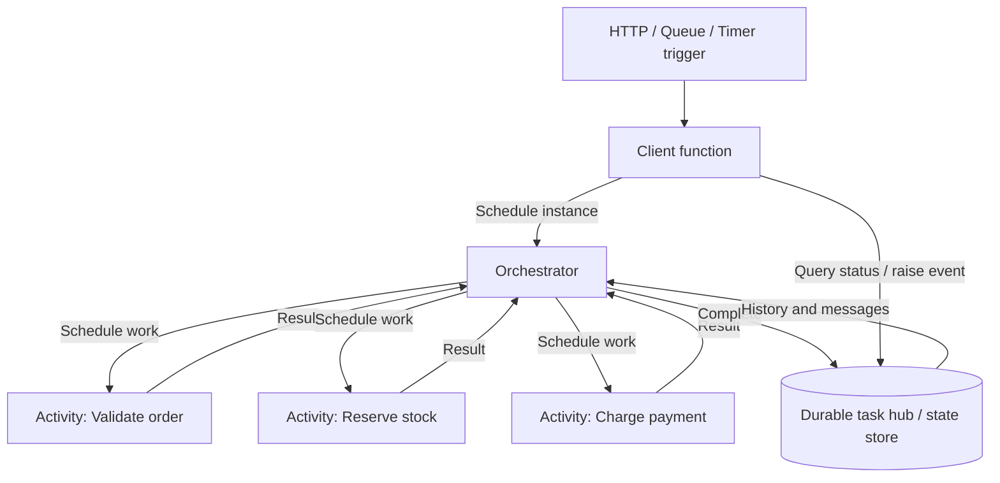
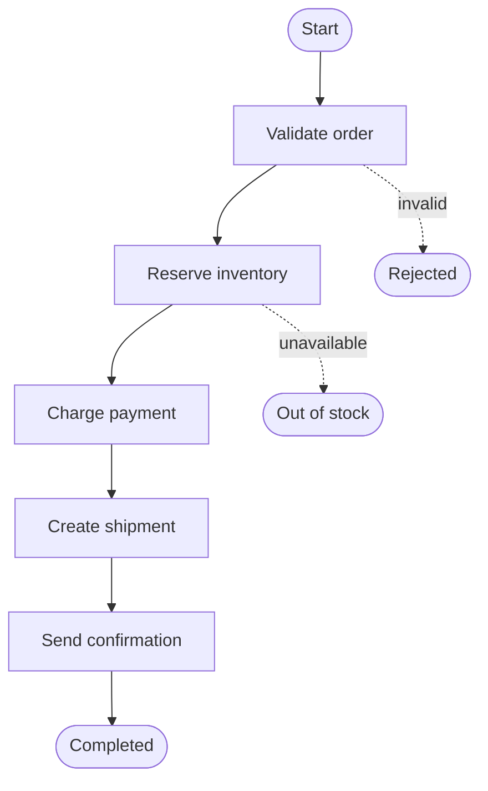
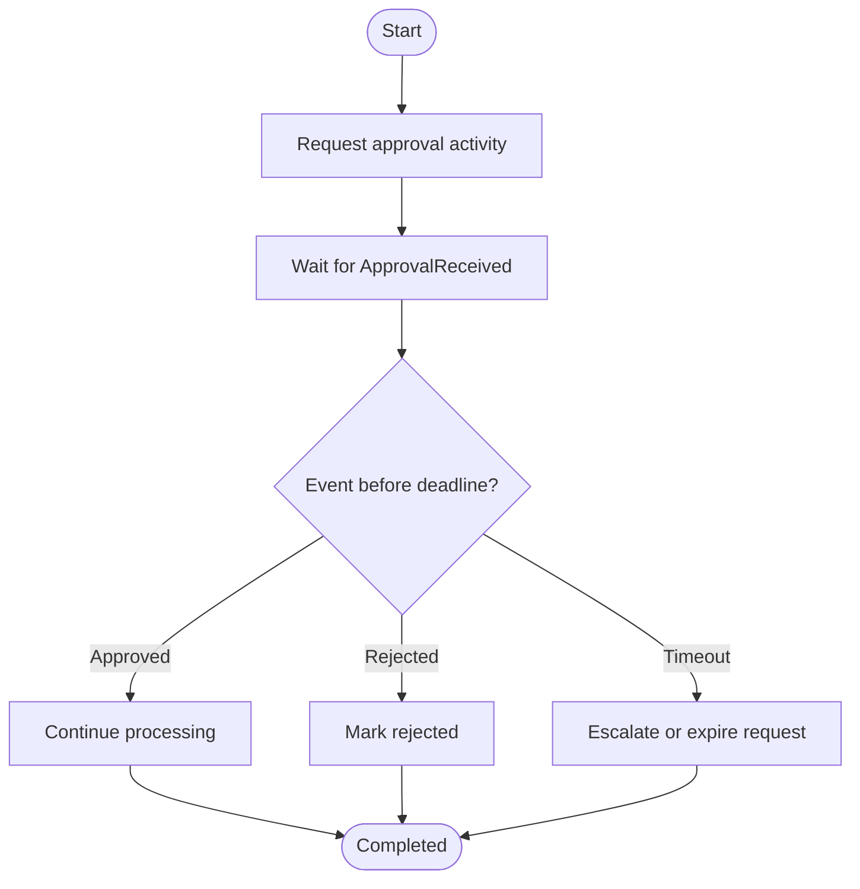

# Điều phối quy trình bằng Durable Functions

## 1. Durable Functions giải quyết vấn đề gì?

Một function thông thường thường xử lý một lần gọi rồi kết thúc. Mô hình này phù hợp với API ngắn, webhook hoặc consumer xử lý một thông điệp. Tuy nhiên, nhiều nghiệp vụ cần nhiều bước, kéo dài hàng phút đến nhiều ngày, chờ phản hồi từ người dùng hoặc hệ thống bên ngoài, và phải tiếp tục được sau khi process bị dừng hay hạ tầng được cập nhật.

Ví dụ, quy trình xử lý đơn hàng có thể kiểm tra thông tin, giữ hàng, thu tiền, tạo vận đơn, chờ đối tác vận chuyển xác nhận và gửi thông báo. Nếu mỗi function tự gọi function tiếp theo, logic điều phối sẽ bị phân tán. Khi một bước lỗi, nhóm phải tự theo dõi trạng thái, biết bước nào đã hoàn tất và quyết định chạy lại từ đâu. Một biến trong bộ nhớ không thể bảo đảm trạng thái còn tồn tại sau khi execution environment bị thu hồi.

**Azure Durable Functions** là phần mở rộng của Azure Functions, bổ sung khả năng điều phối workflow có trạng thái. Durable runtime lưu lịch sử thực thi và thông điệp điều phối vào một backend bền vững. Nhờ đó, workflow có thể tạm dừng, chờ sự kiện hoặc timer, khôi phục sau khi host khởi động lại và tiếp tục từ trạng thái đã được ghi nhận.

Với Java, có thể xây dựng Durable Functions bằng các annotation và API Java dành cho Azure Functions. Một ứng dụng cơ bản gồm ba vai trò: **Client** khởi chạy hoặc quản lý workflow, **Orchestrator** mô tả thứ tự và điều kiện của quy trình, **Activity** thực hiện công việc thực tế. Các vai trò này chạy như Azure Functions được kích hoạt bởi trigger tương ứng.

Durable Functions phù hợp với quy trình cần lưu trạng thái và điều phối đáng tin cậy. Nó không thay thế database nghiệp vụ, message broker hoặc mọi loại workflow engine. Cần chọn đúng công cụ theo thời gian xử lý, yêu cầu tương tác, throughput và mức độ phức tạp của quy trình.

## 2. Các thành phần của một Durable Functions app

### 2.1. Client function

Client là điểm bắt đầu hoặc quản lý orchestration. Client có thể được kích hoạt bởi HTTP, queue, timer hoặc một function khác. Nhiệm vụ thường gặp:

- Tạo một orchestration instance mới và truyền input.
- Chọn instance ID để liên kết với một nghiệp vụ, nếu cần.
- Truy vấn trạng thái, output và custom status.
- Gửi external event đến orchestration đang chờ.
- Kết thúc instance hoặc purge history khi đáp ứng điều kiện và chính sách retention.

Client không thực hiện toàn bộ quy trình ngay trong request. Thông thường, nó xếp lịch cho orchestration rồi trả về instance ID và các URL để kiểm tra trạng thái. Client có thể phản hồi HTTP `202 Accepted` vì công việc đã được tiếp nhận nhưng chưa chắc đã hoàn tất.

### 2.2. Orchestrator function

Orchestrator định nghĩa luồng điều khiển: gọi activity nào, theo thứ tự nào, khi nào rẽ nhánh, chờ bao lâu và xử lý lỗi ra sao. Có thể viết logic bằng các cấu trúc Java quen thuộc như `if`, `switch`, vòng lặp và `try/catch`.

Orchestrator không nên trực tiếp gọi database, HTTP API hoặc thực hiện side effect. Nó lập lịch các hoạt động thông qua context, chờ kết quả rồi quyết định bước tiếp theo. Runtime có thể chạy lại mã orchestrator nhiều lần để dựng lại trạng thái từ lịch sử; vì vậy mã này phải deterministic (có tính xác định). Đây là quy tắc quan trọng nhất khi lập trình Durable Functions.

### 2.3. Activity function

Activity là đơn vị thực hiện công việc. Ví dụ:

- Gọi API của cổng thanh toán.
- Ghi dữ liệu vào database.
- Kiểm tra tồn kho.
- Tạo vận đơn.
- Gửi email hoặc tin nhắn.
- Tính toán hoặc xử lý tệp.

Activity nhận input, thực hiện công việc và trả output. Nó không chịu ràng buộc deterministic giống orchestrator vì activity không được replay theo cùng cách để tái dựng luồng điều khiển. Tuy nhiên, activity có thể được chạy lại nếu host lỗi sau khi side effect đã xảy ra nhưng trước khi kết quả được ghi nhận. Do đó, activity nên idempotent khi có thể.

### 2.4. Sub-orchestration

Sub-orchestration là một workflow con được gọi từ orchestrator khác. Nó có instance/history riêng và trả kết quả về workflow cha. Có thể dùng để tách một quy trình lớn thành các phần có ý nghĩa nghiệp vụ rõ ràng, ví dụ `VerifyCustomer`, `ProcessPayment` hoặc `ArrangeShipment`.

Sub-orchestration giúp tái sử dụng logic và giới hạn độ phức tạp của một orchestrator. Không nên chia workflow thành quá nhiều phần nhỏ nếu chúng không có ranh giới nghiệp vụ hoặc nhu cầu vận hành riêng, vì việc điều phối và quan sát sẽ phức tạp hơn.

### 2.5. Durable entity và lưu ý với Java

Durable entity mô hình hóa một đối tượng nhỏ có trạng thái bền vững và một tập operation, ví dụ bộ đếm, giỏ hàng hoặc semaphore phân tán. Entity phù hợp khi nhiều workflow cần gửi lệnh đến cùng một đối tượng trạng thái và muốn các operation của đối tượng đó được xử lý tuần tự.

Tài liệu Durable Functions liệt kê entity function trong một số ngôn ngữ và hosting model. Tuy nhiên, Java Durable Task SDK hiện chưa cung cấp entity API tương đương trong mô hình SDK độc lập. Khi phát triển Java, hãy xác minh chính xác khả năng của gói Java và hosting model đang dùng trước khi thiết kế dựa trên entity. Với bài học này, trọng tâm là orchestrator, activity và client.

### 2.6. Sơ đồ tổng quan



Sơ đồ mô tả vai trò logic. Durable runtime và storage provider thực tế chịu trách nhiệm lưu history, trạng thái instance và thông điệp điều phối; orchestrator không cần giữ một process Java hoạt động liên tục trong suốt workflow.

## 3. Durable execution: task hub, history và replay

### 3.1. Task hub và trạng thái bền vững

Task hub là vùng logic lưu trữ và điều phối các orchestration instance. Nó giữ trạng thái, lịch sử sự kiện, thông điệp điều khiển và các work item cần thực thi. Nhiều ứng dụng có thể dùng task hub khác nhau để tách môi trường hoặc nhóm workflow.

Storage provider chịu trách nhiệm lưu dữ liệu và phân phối công việc. Các lựa chọn Durable Functions hiện có gồm:

| Provider | Cách lưu trữ | Điểm cần cân nhắc |
| --- | --- | --- |
| Durable Task Scheduler | Backend Azure được quản lý | Được khuyến nghị cho ứng dụng mới; giảm việc tự quản lý storage, có dashboard và hỗ trợ managed identity |
| Azure Storage | Queue, Table và Blob | Lựa chọn lâu đời, dễ phát triển local với Azurite; cần quản lý storage account và quyền truy cập |
| Microsoft SQL Server (MSSQL) | Database SQL Server hoặc Azure SQL | Phù hợp khi cần dùng hạ tầng SQL hiện có hoặc yêu cầu tính di động của dữ liệu |
| Netherite | Event Hubs và Azure Page Blobs | Provider hiện có kế hoạch kết thúc hỗ trợ Durable Functions vào ngày 31-03-2028; cần đánh giá lộ trình chuyển đổi |

Tài liệu Microsoft hiện khuyến nghị Durable Task Scheduler cho triển khai được quản lý. Azure Storage vẫn là lựa chọn phù hợp cho workload hiện hữu hoặc khi muốn tự quản lý storage. Khả năng và giới hạn của từng provider khác nhau; cần kiểm tra bảng so sánh trước khi chọn.

Không nên coi provider là chi tiết có thể đổi tùy ý sau khi đã có dữ liệu production. Hiện tại, tài liệu provider nêu rằng không hỗ trợ di chuyển trực tiếp dữ liệu orchestration từ backend storage này sang backend khác. Hãy quyết định sớm và lập kế hoạch migration riêng nếu cần thay đổi.

Khả năng của provider và extension bundle có thể khác theo ngôn ngữ, phiên bản và feature. Với Java, hãy xác minh provider cụ thể được extension bundle hiện tại hỗ trợ và kiểm tra giới hạn của provider trước khi triển khai production. Durable Task Scheduler là lựa chọn được khuyến nghị; Azure Storage là backend BYO có hỗ trợ rộng và tích hợp local tốt.

### 3.2. Event sourcing và execution history

Durable runtime lưu các sự kiện mô tả tiến trình, ví dụ:

- Orchestration instance được tạo.
- Orchestrator lên lịch một activity.
- Activity hoàn tất và trả kết quả.
- Orchestrator tạo timer hoặc chờ external event.
- Timer hết hạn hoặc external event đến.
- Instance hoàn tất, thất bại hoặc bị terminate.

Lịch sử này là cơ sở để runtime dựng lại trạng thái của workflow. Các biến cục bộ trong orchestrator không được giữ như một Java process bình thường; chúng được tái tạo khi orchestrator chạy lại dựa trên input và kết quả đã ghi trong history.

### 3.3. Replay hoạt động như thế nào?

Giả sử orchestrator gọi `ValidateOrder`, sau đó gọi `ReserveInventory`. Khi activity đầu tiên hoàn tất, runtime ghi kết quả vào history. Nếu host bị dừng trước khi bước tiếp theo hoàn tất, runtime có thể nạp lại orchestration và chạy lại mã orchestrator từ đầu.

Trong replay:

1. Orchestrator chạy lại từ dòng đầu.
2. Khi mã gọi `ValidateOrder`, runtime tìm kết quả đã có trong history và trả lại kết quả đó, không thực hiện lại activity thành công.
3. Mã tiếp tục đến `ReserveInventory`.
4. Nếu activity này chưa hoàn tất, runtime lên lịch hoặc tiếp tục xử lý work item.
5. Khi có kết quả mới, runtime ghi vào history và tiếp tục replay đến điểm chờ kế tiếp.

Replay giúp workflow khôi phục mà không cần giữ toàn bộ trạng thái trong RAM. Đổi lại, mã orchestrator phải deterministic và không được tự tạo side effect.

### 3.4. Điều gì được bảo đảm và điều gì không?

Durable runtime lưu tiến trình và điều phối lại các task sau khi gián đoạn. Tuy nhiên, điều đó không có nghĩa mọi activity chỉ chạy đúng một lần. Activity có thể được thực thi ít nhất một lần và đôi khi chạy lại nếu kết quả chưa được ghi nhận. Không được dựa vào một giả định “exactly once” để thực hiện thanh toán, gửi email hoặc tạo tài nguyên.

Thiết kế an toàn cần kết hợp:

- History bền vững của workflow.
- Activity idempotent hoặc có idempotency key.
- Retry có giới hạn và phân loại lỗi.
- Đối soát khi không biết chắc side effect đã xảy ra hay chưa.
- Compensation cho các bước phân tán có thể cần hoàn tác nghiệp vụ.

## 4. Quy tắc deterministic cho orchestrator Java

### 4.1. Chỉ dùng API có kết quả ổn định khi replay

Với cùng input và cùng history, orchestrator phải tạo ra cùng thứ tự lệnh điều phối. Tránh gọi trực tiếp các API sau trong orchestrator:

- `Instant.now()`, `LocalDateTime.now()` hoặc `System.currentTimeMillis()`.
- `UUID.randomUUID()` hoặc `new Random()`.
- `Thread.sleep()` hoặc tạo thread/executor riêng.
- Gọi HTTP API, database, filesystem hoặc dịch vụ cloud.
- Đọc environment variable hoặc cấu hình có thể thay đổi theo thời gian.
- Lấy dữ liệu phụ thuộc trạng thái bên ngoài mà không thông qua activity.

Thay vào đó:

- Dùng `ctx.getCurrentInstant()` để lấy thời gian logic của orchestration.
- Dùng API tạo ID deterministic của context nếu SDK cung cấp, hoặc gọi activity để sinh ID ngẫu nhiên.
- Dùng `ctx.createTimer(...)` thay cho `Thread.sleep()`.
- Chuyển I/O và side effect sang activity.
- Truyền cấu hình cần thiết vào orchestration input hoặc lấy qua activity.

### 4.2. Ví dụ sai và đúng

Không nên viết:

```java
public void run(TaskOrchestrationContext ctx) {
    // Không deterministic: mỗi lần replay có thể nhận một thời điểm khác.
    Instant now = Instant.now();

    // Không được gọi trực tiếp dịch vụ bên ngoài trong orchestrator.
    paymentClient.charge("order-42");

    // Không dùng sleep để chờ trong workflow.
    Thread.sleep(5000);
}
```

Nên chuyển các thao tác đó thành activity và dùng durable timer:

```java
public void run(TaskOrchestrationContext ctx) {
    Instant orchestrationTime = ctx.getCurrentInstant();

    ctx.callActivity("ChargePayment", "order-42", Void.class).await();
    ctx.createTimer(Duration.ofSeconds(5)).await();

    ctx.callActivity("RecordCheckpoint", orchestrationTime.toString(), Void.class).await();
}
```

Đoạn mã minh họa API Java của Durable Task SDK. Trong Azure Functions, orchestrator function được gắn annotation `@DurableOrchestrationTrigger` như ví dụ ở phần sau.

### 4.3. Log an toàn khi replay

Nếu ghi log trực tiếp trong orchestrator, mỗi lần replay có thể phát lại cùng log và tạo bản ghi trùng. Có thể kiểm tra `ctx.getIsReplaying()` trước khi ghi log hoặc dùng replay-safe logger nếu integration đang dùng cung cấp API đó.

```java
if (!ctx.getIsReplaying()) {
    logger.info("Starting orchestration " + ctx.getInstanceId());
}
```

Log nghiệp vụ quan trọng nên đặt trong activity hoặc dùng correlation/instance ID để liên kết log. Không dùng log của orchestrator làm bằng chứng rằng một side effect chỉ xảy ra một lần.

## 5. Xây dựng Durable Functions bằng Java

### 5.1. Dependency và môi trường phát triển

Tài liệu quickstart Java hiện hướng dẫn sử dụng JDK 11 trở lên, Apache Maven, Azure Functions Core Tools v4 và Java Durable Functions SDK. Dependency chính trong ví dụ quickstart:

```xml
<dependency>
    <groupId>com.microsoft</groupId>
    <artifactId>durabletask-azure-functions</artifactId>
    <version>1.0.0</version>
</dependency>
```

Phiên bản trên phản ánh ví dụ tài liệu quickstart được tham khảo tại thời điểm soạn bài. Khi tạo dự án mới, hãy kiểm tra phiên bản mới nhất, yêu cầu Java và tương thích Azure Functions runtime trong tài liệu Microsoft Learn.

Các import thường gặp trong Java Functions Durable app:

```java
import com.microsoft.azure.functions.*;
import com.microsoft.azure.functions.annotation.*;
import com.microsoft.durabletask.*;
import com.microsoft.durabletask.azurefunctions.DurableActivityTrigger;
import com.microsoft.durabletask.azurefunctions.DurableClientContext;
import com.microsoft.durabletask.azurefunctions.DurableClientInput;
import com.microsoft.durabletask.azurefunctions.DurableOrchestrationTrigger;
import java.time.Duration;
import java.util.ArrayList;
import java.util.List;
import java.util.Map;
```

#### Phân biệt Java Durable Functions và Durable Task SDK độc lập

Hai mô hình có chung nền tảng Durable Task nhưng cách host khác nhau:

| Mô hình | Package/API | Ai quản lý trigger và worker? |
| --- | --- | --- |
| Durable Functions trên Azure Functions | `durabletask-azure-functions`, annotation như `@DurableOrchestrationTrigger`, `@DurableActivityTrigger`, `@DurableClientInput` | Azure Functions host quản lý trigger, binding và function lifecycle |
| Durable Task SDK độc lập | `durabletask-client`, `DurableTaskClient`, `DurableTaskGrpcWorker`, `TaskOrchestration` | Ứng dụng tự đăng ký worker và tự tích hợp HTTP/message consumer; backend được cấu hình riêng |

Bài học này dùng mô hình đầu tiên. Không lấy ví dụ tạo `DurableTaskGrpcWorker` của ứng dụng tự host rồi trộn vào một Function App có trigger/binding. Java SDK độc lập hiện dùng Durable Task Scheduler làm backend; Durable Functions có thêm lựa chọn storage provider theo khả năng extension bundle.

### 5.2. Activity function

Activity `SayHello` nhận tên thành phố và trả lời một chuỗi:

```java
public class DurableFunctionsSample {

    @FunctionName("SayHello")
    public String sayHello(
            @DurableActivityTrigger(name = "city") String city) {
        return "Hello " + city + "!";
    }
}
```

`@FunctionName` đăng ký tên function với Azure Functions. `@DurableActivityTrigger` cho biết function được gọi như một activity bởi orchestrator. Activity có thể gọi dịch vụ bên ngoài, ghi database hoặc thực hiện tính toán.

### 5.3. Orchestrator tuần tự

Orchestrator gọi activity theo thứ tự. Mỗi lời gọi trả về một `Task`; `await()` nhận kết quả khi activity hoàn tất. Nếu chưa có kết quả, Durable runtime có thể lưu trạng thái và đưa orchestrator vào trạng thái chờ.

```java
@FunctionName("ChainingOrchestration")
public String chainingOrchestration(
        @DurableOrchestrationTrigger(name = "ctx") TaskOrchestrationContext ctx) {

    String result = "";
    result += ctx.callActivity("SayHello", "Tokyo", String.class).await() + " ";
    result += ctx.callActivity("SayHello", "Seattle", String.class).await() + " ";
    result += ctx.callActivity("SayHello", "London", String.class).await();

    return result;
}
```

Kết quả cuối cùng là `Hello Tokyo! Hello Seattle! Hello London!`. Đây là function chaining: bước sau chỉ được lên lịch sau khi bước trước trả kết quả.

### 5.4. Client function khởi chạy orchestration

Client có thể là HTTP-triggered function. Ví dụ dưới đây khởi chạy `ChainingOrchestration` và trả response chứa URL kiểm tra trạng thái:

```java
@FunctionName("StartChaining")
public HttpResponseMessage startChaining(
        @HttpTrigger(
            name = "req",
            methods = {HttpMethod.POST},
            authLevel = AuthorizationLevel.FUNCTION)
            HttpRequestMessage<Void> request,
        @DurableClientInput(name = "durableContext") DurableClientContext durableContext) {

    DurableTaskClient client = durableContext.getClient();
    String instanceId = client.scheduleNewOrchestrationInstance("ChainingOrchestration");
    return durableContext.createCheckStatusResponse(request, instanceId);
}
```

`createCheckStatusResponse` tạo response chuẩn để client truy vấn trạng thái, gửi event hoặc terminate instance theo các URL mà Durable client cung cấp. Ví dụ dùng `AuthorizationLevel.FUNCTION`; trong production cần chọn cơ chế xác thực phù hợp và không để endpoint điều khiển workflow bị công khai ngoài ý muốn.

### 5.5. Tổ chức một class hoàn chỉnh

Trong dự án thực tế, có thể đặt các function trong một class hoặc tách class theo trách nhiệm. Điều quan trọng là tên orchestrator/activity trong lời gọi phải khớp tên đã đăng ký bằng `@FunctionName`.

```java
public class OrderWorkflowFunctions {

    @FunctionName("ValidateOrder")
    public OrderValidation validateOrder(
            @DurableActivityTrigger(name = "order") OrderRequest order) {
        // Kiểm tra dữ liệu và quy tắc nghiệp vụ.
        return new OrderValidation(order.orderId(), true, "VALID");
    }

    @FunctionName("ReserveInventory")
    public Reservation reserveInventory(
            @DurableActivityTrigger(name = "order") OrderRequest order) {
        // Gọi inventory service; hoạt động này cần idempotency.
        return inventoryService.reserve(order.orderId(), order.items());
    }

    @FunctionName("CreateOrderWorkflow")
    public OrderWorkflowResult createOrderWorkflow(
            @DurableOrchestrationTrigger(name = "ctx") TaskOrchestrationContext ctx) {

        OrderRequest order = ctx.getInput(OrderRequest.class);
        OrderValidation validation = ctx.callActivity(
                "ValidateOrder", order, OrderValidation.class).await();

        if (!validation.valid()) {
            return new OrderWorkflowResult(order.orderId(), "REJECTED");
        }

        Reservation reservation = ctx.callActivity(
                "ReserveInventory", order, Reservation.class).await();

        if (!reservation.successful()) {
            return new OrderWorkflowResult(order.orderId(), "OUT_OF_STOCK");
        }

        return new OrderWorkflowResult(order.orderId(), "READY_FOR_PAYMENT");
    }
}
```

Đây là ví dụ cấu trúc để thể hiện cách nối function; `OrderRequest`, `OrderValidation`, `Reservation`, `OrderWorkflowResult` và `inventoryService` là kiểu ứng dụng cần được định nghĩa trong dự án. Không đặt việc gọi `inventoryService` trực tiếp trong orchestrator; nó chỉ xuất hiện trong activity.

## 6. Các mẫu điều phối thường dùng

### 6.1. Function chaining: các bước tuần tự

Chaining phù hợp khi kết quả của bước trước quyết định bước sau. Ví dụ xử lý đơn hàng:



Ưu điểm là thứ tự rõ ràng và có thể phục hồi giữa các bước. Tuy nhiên, cần thiết kế lỗi và compensation. Nếu thanh toán thất bại sau khi giữ hàng, workflow có thể cần activity giải phóng reservation.

### 6.2. Conditional branching: rẽ nhánh

Orchestrator có thể dùng `if`, `switch` để chọn nhánh theo input hoặc kết quả activity. Ví dụ:

```java
@FunctionName("PaymentOrchestration")
public PaymentResult paymentOrchestration(
        @DurableOrchestrationTrigger(name = "ctx") TaskOrchestrationContext ctx) {

    PaymentRequest request = ctx.getInput(PaymentRequest.class);

    if ("CARD".equals(request.method())) {
        return ctx.callActivity("ChargeCard", request, PaymentResult.class).await();
    }

    if ("BANK_TRANSFER".equals(request.method())) {
        return ctx.callActivity("CreateBankTransfer", request, PaymentResult.class).await();
    }

    return new PaymentResult("UNSUPPORTED_METHOD", false);
}
```

Điều kiện phải deterministic. Nếu cần gọi dịch vụ để đánh giá rủi ro hoặc đọc dữ liệu bên ngoài, hãy tạo activity như `EvaluateRisk`, nhận kết quả rồi mới rẽ nhánh. Đừng gọi API trực tiếp trong orchestrator.

### 6.3. Fan-out/fan-in: chạy song song và tổng hợp

Fan-out/fan-in dùng khi nhiều công việc độc lập có thể chạy đồng thời. Orchestrator lên lịch nhiều activity trước, sau đó đợi tất cả hoàn tất và tổng hợp kết quả.

```java
@FunctionName("FanOutFanInOrchestration")
public List<String> fanOutFanInOrchestration(
        @DurableOrchestrationTrigger(name = "ctx") TaskOrchestrationContext ctx) {

    String[] cities = {"Tokyo", "Seattle", "London", "Paris", "Berlin"};
    List<Task<String>> tasks = new ArrayList<>();

    for (String city : cities) {
        tasks.add(ctx.callActivity("SayHello", city, String.class));
    }

    List<String> results = new ArrayList<>();
    for (Task<String> task : tasks) {
        results.add(task.await());
    }

    return results;
}
```

Có thể dùng `ctx.allOf(tasks).await()` để chờ tất cả task và lấy kết quả theo thứ tự danh sách input:

```java
List<String> results = ctx.allOf(tasks).await();
```

Không nên fan-out hàng triệu activity cùng lúc trong một orchestrator. Kích thước history và fan-in có thể trở thành nút thắt; hãy chia lô, dùng sub-orchestration hoặc giới hạn concurrency. Với workload lớn, fan-in có thể tập trung trên một worker cho một orchestration instance, nên cần đo khả năng tổng hợp kết quả.

### 6.4. Sub-orchestration: workflow con

Workflow cha có thể gọi workflow con bằng `ctx.callSubOrchestrator(...)`. Workflow con có instance/history riêng, phù hợp để tách các bước dùng lại hoặc quy trình có logic phức tạp.

Ví dụ, mỗi đơn hàng có thể gọi một sub-orchestration `ProcessPayment`, còn workflow tổng thể xử lý giữ hàng, vận chuyển và thông báo. Nếu sub-orchestration thất bại, lỗi được truyền về workflow cha để xử lý.

### 6.5. Durable timer: chờ theo thời gian

Durable timer cho phép workflow chờ mà không giữ thread hoặc process hoạt động liên tục. Ví dụ, chờ 30 phút để thanh toán hoàn tất hoặc đặt thời hạn phản hồi của đối tác:

```java
ctx.createTimer(Duration.ofMinutes(30)).await();
```

Thời gian hiện tại phải lấy từ `ctx.getCurrentInstant()` khi cần tính deadline trong orchestrator. Không dùng `Instant.now()` vì giá trị có thể khác nhau khi replay.

Durable timer cũng có thể dùng để tạo timeout bằng cách chạy song song một activity và một timer, sau đó dùng `ctx.anyOf(...)` để biết bên nào hoàn tất trước. Với Java, hãy theo đúng semantics của API `anyOf` và timer trong phiên bản SDK đang dùng. Nếu timer thắng, orchestrator ngừng chờ activity; điều này không đồng nghĩa activity đang chạy bị hủy.

### 6.6. External event: chờ tín hiệu bên ngoài

External event cho phép workflow chờ một tín hiệu từ client hoặc hệ thống khác. Ví dụ, sau khi gửi yêu cầu phê duyệt, workflow chờ sự kiện `ApprovalReceived`.

```java
ApprovalDecision decision = ctx.waitForExternalEvent(
        "ApprovalReceived", Duration.ofHours(72), ApprovalDecision.class).await();
```

Client gửi event bằng instance ID và event name thông qua Durable client API. Nếu event đến trước thời điểm orchestrator bắt đầu chờ, runtime có thể lưu event và phân phối khi workflow gọi `waitForExternalEvent`.

Khi kết hợp external event với timeout, cần xử lý trường hợp event đến muộn, trùng hoặc sai workflow instance. Nên kiểm tra người gửi, correlation ID và trạng thái nghiệp vụ trước khi chấp nhận quyết định.

### 6.7. Long-running approval workflow

Một workflow phê duyệt có thể hoạt động như sau:



Workflow có thể chờ nhiều giờ hoặc nhiều ngày mà không cần giữ một function process chạy liên tục. Trạng thái chờ được lưu trong task hub và được đánh thức khi event hoặc timer đến.

## 7. Retry, timeout và xử lý lỗi

### 7.1. Retry activity

Activity có thể thất bại do lỗi mạng, throttling hoặc dịch vụ phụ thuộc tạm thời. Durable Task SDK hỗ trợ retry policy cho activity và sub-orchestration. Ví dụ Java:

```java
RetryPolicy retryPolicy = new RetryPolicy(
        3,                       // maxNumberOfAttempts
        Duration.ofSeconds(5),   // firstRetryInterval
        2.0,                     // backoffCoefficient
        Duration.ofMinutes(1),   // maxRetryInterval
        Duration.ofMinutes(5)    // retryTimeout
);

TaskOptions options = new TaskOptions(retryPolicy);

String result = ctx.callActivity(
        "UnreliableActivity", input, options, String.class).await();
```

Số lần thử, khoảng chờ ban đầu, hệ số tăng backoff, khoảng chờ tối đa và thời hạn retry cần được chọn theo SLA. Retry không sửa được lỗi vĩnh viễn như dữ liệu sai schema hoặc quyền truy cập thiếu.

### 7.2. Activity phải idempotent

Runtime có thể chạy lại activity nếu kết quả chưa được ghi vào history. Ví dụ, một activity gửi yêu cầu thanh toán có thể đã nhận phản hồi thành công từ cổng thanh toán nhưng host lỗi trước khi ghi kết quả. Khi workflow khôi phục, activity có thể được chạy lại.

Để tránh thu tiền hai lần:

- Tạo idempotency key ổn định theo business ID và tên bước, ví dụ `order-42:charge-payment`.
- Gửi cùng key cho cổng thanh toán ở mọi lần retry nếu nhà cung cấp hỗ trợ.
- Lưu trạng thái xử lý trong database với unique constraint hoặc conditional write.
- Trước khi thực hiện lại, kiểm tra giao dịch đã được tạo hay chưa.
- Có quy trình đối soát nếu kết quả từ hệ thống ngoài không rõ ràng.

Không tạo key mới cho mỗi lần retry. Nếu key thay đổi, nhà cung cấp có thể xem đó là giao dịch mới.

### 7.3. Try/catch và compensation

Orchestrator có thể bắt lỗi activity và chọn nhánh phù hợp. Với quy trình nhiều dịch vụ, dùng mô hình Saga: mỗi bước có thể có một hành động bù tương ứng.

| Bước thuận | Tác động | Compensation có thể có |
| --- | --- | --- |
| Reserve inventory | Giữ hàng | Release inventory |
| Charge payment | Thu tiền | Refund payment |
| Create shipment | Tạo vận đơn | Cancel shipment nếu hãng vận chuyển hỗ trợ |
| Apply loyalty points | Cộng điểm | Reverse points |

Compensation không phải lúc nào cũng đảo ngược hoàn toàn. Email đã gửi không thể thu hồi chắc chắn; kiện hàng đã bàn giao có thể cần quy trình hủy riêng. Trước khi compensation sau timeout, cần đối soát trạng thái thật của bước thuận để tránh hoàn tiền khi chưa thu tiền.

### 7.4. Timeout activity

Timeout có thể được mô hình hóa bằng durable timer và `anyOf`:

```java
Task<String> activityTask = ctx.callActivity("CallPartner", input, String.class);
Task<Void> timeoutTask = ctx.createTimer(Duration.ofMinutes(2));

Task<?> winner = ctx.anyOf(activityTask, timeoutTask).await();
if (winner == activityTask) {
    String result = activityTask.await();
    // Xử lý kết quả thành công.
} else {
    // Xử lý timeout theo quy tắc nghiệp vụ.
}
```

Đây là mẫu minh họa cho việc ngừng chờ khi hết thời hạn. Timeout không tự hủy activity đã được dispatch; activity vẫn có thể tiếp tục và tạo side effect sau khi orchestrator đã chọn nhánh timeout. Vì vậy, đặt timeout ở HTTP client/database trong activity, dùng idempotency và có bước đối soát/compensation khi kết quả không rõ. Terminate orchestration cũng không nhất thiết dừng được activity đang chạy.

## 8. Quản lý instance và trạng thái workflow

### 8.1. Instance ID

Mỗi orchestration instance có một ID duy nhất. Client có thể để runtime tạo ID hoặc cung cấp ID theo nghiệp vụ. Nếu dùng business ID làm instance ID, cần quy định cách xử lý khi một instance cùng ID đã tồn tại, đang chạy hoặc đã kết thúc.

Không dùng một ID chung cho nhiều lần xử lý độc lập. Cần xác định idempotency khi client gửi request khởi chạy trùng lặp: kiểm tra instance hiện có, dùng request ID hoặc tạo khóa duy nhất phù hợp với nghiệp vụ.

### 8.2. Trạng thái thường gặp

Các trạng thái instance phổ biến gồm:

| Trạng thái | Ý nghĩa |
| --- | --- |
| `Pending` | Đã được lên lịch nhưng chưa bắt đầu xử lý |
| `Running` | Workflow đang thực thi hoặc chờ một tác vụ/event/timer |
| `Completed` | Workflow hoàn tất thành công |
| `Failed` | Workflow kết thúc do lỗi không được xử lý |
| `Terminated` | Instance bị yêu cầu kết thúc |
| `Suspended` | Instance bị tạm dừng nếu backend/API hỗ trợ |

Một instance ở trạng thái `Running` không có nghĩa CPU đang chạy liên tục. Nó có thể đang chờ timer, external event hoặc activity.

### 8.3. Custom status

Orchestrator có thể cập nhật custom status để hiển thị tiến trình cho client hoặc dashboard:

```java
ctx.setCustomStatus(Map.of(
        "step", "PAYMENT",
        "completed", 2,
        "total", 5
));
```

Custom status phải serializable và nên nhỏ gọn. Không dùng nó thay cho database nghiệp vụ hoặc lưu payload lớn. Client có thể truy vấn metadata của instance để hiển thị trạng thái phù hợp.

### 8.4. Terminate và purge history

Client có thể terminate instance nếu nghiệp vụ yêu cầu hủy quy trình. Tuy nhiên, terminate không đảm bảo dừng activity đang chạy; kết quả activity có thể bị bỏ qua sau đó. Các side effect đã phát sinh cần được xử lý bằng compensation hoặc đối soát.

Khi instance đã ở trạng thái terminal, có thể purge history theo chính sách retention. Purge xóa dữ liệu lịch sử và input/output đã lưu, vì vậy cần tuân thủ yêu cầu audit, pháp lý và điều tra trước khi xóa.

## 9. Storage provider và cấu hình task hub

### 9.1. Durable Task Scheduler

Durable Task Scheduler là backend Azure được quản lý và hiện được khuyến nghị cho Durable Functions. Nó cung cấp nơi lưu trạng thái, lịch sử và thông điệp điều phối, giảm công việc tự quản lý queue/table/blob. Scheduler có dashboard quan sát và hỗ trợ managed identity.

Ví dụ `host.json` dùng provider `azureManaged`:

```json
{
  "version": "2.0",
  "extensions": {
    "durableTask": {
      "hubName": "default",
      "storageProvider": {
        "type": "azureManaged",
        "connectionStringName": "DURABLE_TASK_SCHEDULER_CONNECTION_STRING"
      }
    }
  }
}
```

Ví dụ `local.settings.json` khi chạy emulator:

```json
{
  "IsEncrypted": false,
  "Values": {
    "AzureWebJobsStorage": "UseDevelopmentStorage=true",
    "FUNCTIONS_WORKER_RUNTIME": "java",
    "DURABLE_TASK_SCHEDULER_CONNECTION_STRING": "Endpoint=http://localhost:8080;TaskHub=default;Authentication=None"
  }
}
```

Đây là cấu hình local theo quickstart. Trong Azure, không đưa secret vào source control; dùng application settings/secret store và managed identity khi provider hỗ trợ.

### 9.2. Azure Storage provider

Azure Storage provider dùng:

- Azure Queues để phân phối activity và control messages.
- Azure Tables để lưu orchestration history và instance state.
- Azure Blobs và blob leases để hỗ trợ partition, lock và payload lớn.

Provider này phù hợp với ứng dụng muốn tự quản lý storage account hoặc đã dùng Azure Storage. Với workload nhạy cảm về throughput, cần đánh giá tài khoản storage riêng để tránh cạnh tranh với hoạt động nội bộ của Azure Functions host.

### 9.3. Quyền truy cập storage

Durable runtime cần quyền đọc/ghi dữ liệu task hub. Nên dùng managed identity thay vì lưu connection string có access key nếu provider hỗ trợ. Với Azure Storage, các role dữ liệu thường cần gồm Storage Blob Data Contributor, Storage Queue Data Contributor và Storage Table Data Contributor ở phạm vi tài nguyên phù hợp.

Không cấp Owner hoặc Contributor toàn subscription chỉ để workflow chạy. Tách quyền triển khai hạ tầng khỏi quyền runtime và chỉ cấp các quyền dữ liệu cần thiết cho function app.

## 10. Serialization và quản lý payload

Input, output của activity, kết quả sub-orchestration và dữ liệu event có thể được serialize và lưu trong history/task hub. Vì vậy:

- Chỉ truyền dữ liệu cần thiết cho bước tiếp theo.
- Dùng DTO có schema rõ ràng và có khả năng tương thích phiên bản.
- Không truyền secret, token, mật khẩu hoặc dữ liệu cá nhân không cần thiết.
- Không đưa tệp lớn hoặc payload hàng MB qua nhiều bước nếu có thể lưu ở Blob Storage.
- Truyền URI hoặc object key có kiểm soát quyền thay vì truyền toàn bộ nội dung.
- Lập kế hoạch retention và purge history phù hợp.

Thay đổi cấu trúc DTO có thể ảnh hưởng đến instance đang chạy và history cũ. Khi nâng cấp ứng dụng, cần giữ khả năng đọc dữ liệu cũ hoặc version hóa workflow và payload. Không đổi tên activity/orchestrator hoặc thay kiểu dữ liệu một cách không tương thích khi còn instance đang chạy mà chưa có kế hoạch migration.

## 11. Mở rộng và hiệu năng

### 11.1. Activity scale-out

Activity là nơi thực hiện công việc thực tế và thường có thể mở rộng ngang theo số lượng work item. Orchestrator chủ yếu điều phối và nên giữ nhẹ: tính toán điều kiện nhỏ, lập lịch task, chờ kết quả và tổng hợp trạng thái.

Đừng đưa xử lý CPU nặng, parse payload lớn hoặc I/O đồng bộ vào orchestrator. Chuyển công việc đó sang activity để backend phân phối và scale theo năng lực compute.

### 11.2. Fan-out/fan-in có giới hạn

Fan-out có thể tăng throughput, nhưng fan-in và history cũng có giới hạn. Nếu một orchestration tạo quá nhiều task cùng lúc:

- History tăng nhanh và replay lâu hơn.
- Backend phải lưu và phân phối nhiều message.
- Orchestrator có thể trở thành điểm nghẽn khi tổng hợp kết quả.
- Activity có thể gây quá tải database hoặc API phụ thuộc.

Giải pháp gồm chia batch, giới hạn số task đồng thời, chia thành sub-orchestration và lưu kết quả tổng hợp ở kho dữ liệu chuyên dụng. Nếu có hàng trăm nghìn item, không nên giữ mọi kết quả trong một biến/list của một orchestrator duy nhất.

### 11.3. History dài và continue-as-new

Orchestration chạy lâu hoặc lặp liên tục có thể tích lũy history lớn. Java `TaskOrchestrationContext` hỗ trợ `continueAsNew(...)` để khởi động lại orchestration với input mới và xóa history cũ theo semantics của API. Mẫu này hữu ích cho workflow lặp dài hạn, ví dụ giám sát trạng thái thiết bị hoặc polling theo lịch.

Chỉ dùng continue-as-new khi hiểu cách xử lý task chưa hoàn tất và external event chưa được xử lý. Nó không phải thao tác reset tùy ý; phải thiết kế input mới và trạng thái cần giữ rõ ràng.

### 11.4. Chi phí

Chi phí của Durable Functions không chỉ là thời gian chạy function. Cần tính:

- Compute của client, orchestrator và activity.
- Durable Task Scheduler hoặc Azure Storage/MSSQL/Event Hubs tùy provider.
- Số lượng message, history event, transaction và lần retry.
- Log, metric, tracing và dashboard.
- Lưu trữ payload lớn, dữ liệu archive và thời gian retention.
- Network egress và các dịch vụ phụ thuộc.

Một workflow chờ vài ngày bằng durable timer thường không cần giữ function process chạy liên tục, nhưng vẫn phát sinh chi phí lưu trạng thái và dịch vụ backend. Retry vô hạn, fan-out quá lớn và history không được purge có thể làm chi phí tăng nhanh.

## 12. Quan sát và vận hành

### 12.1. Theo dõi instance

Client có thể truy vấn trạng thái orchestration qua API/URL trả về khi khởi chạy. Cần theo dõi:

- Số instance theo trạng thái `Pending`, `Running`, `Completed`, `Failed` và `Terminated`.
- Thời gian từ lúc nhận yêu cầu đến khi workflow hoàn tất.
- Activity duration và retry count.
- Số workflow chờ external event hoặc timer.
- Số lượng history event và kích thước payload.
- Tỷ lệ compensation thành công/thất bại.
- Queue/backlog hoặc provider throttling.

### 12.2. Correlation và logging

Gắn instance ID, business ID và correlation ID vào log của activity. Điều này giúp liên kết một request HTTP ban đầu với nhiều activity và hệ thống bên ngoài. Trong orchestrator, dùng replay-safe logging hoặc chỉ ghi khi `ctx.getIsReplaying()` trả về false.

Không log toàn bộ input/output nếu có dữ liệu nhạy cảm. Hãy che thông tin cá nhân và token. Lịch sử Durable có thể lưu input/output, vì vậy quyền truy cập dashboard và API status cũng cần được bảo vệ.

### 12.3. Dashboard và cảnh báo

Durable Task Scheduler có dashboard để xem execution history và trạng thái. Với Azure Storage provider, có thể dùng các công cụ Azure Functions và Storage để kiểm tra task hub. Cần thiết lập cảnh báo cho:

- Instance `Failed` tăng bất thường.
- Workflow `Running` quá lâu so với SLA.
- Activity retry vượt ngưỡng.
- Queue backlog tăng hoặc provider throttling.
- Storage/backend mất kết nối.
- External event hoặc callback đến quá hạn.

## 13. Phát triển và chạy thử cục bộ

### 13.1. Công cụ cần có

Quickstart Java hiện hướng dẫn JDK 11+, Maven, Azure Functions Core Tools v4 và Docker. Với Durable Task Scheduler emulator, cần chạy emulator cùng Azurite cho phần storage local của Azure Functions host.

Ví dụ khởi chạy hai container:

```bash
docker run -d --name dtsemulator -p 8080:8080 -p 8082:8082 \
  mcr.microsoft.com/dts/dts-emulator:latest

docker run -d --name azurite -p 10000:10000 -p 10001:10001 -p 10002:10002 \
  mcr.microsoft.com/azure-storage/azurite
```

Dashboard emulator thường được truy cập tại `http://localhost:8082`.

### 13.2. Build và chạy Function App

Với dự án Maven:

```bash
mvn clean package
mvn azure-functions:run
```

Sau khi host khởi động, gọi endpoint HTTP starter, ví dụ:

```powershell
$response = Invoke-RestMethod -Method POST -Uri http://localhost:7071/api/StartChaining
$response
Invoke-RestMethod -Uri $response.statusQueryGetUri
```

Response starter thường chứa `id`, `statusQueryGetUri`, `sendEventPostUri`, `terminatePostUri` và `purgeHistoryDeleteUri`. Nếu `runtimeStatus` vẫn là `Pending` hoặc `Running`, truy vấn lại sau một khoảng ngắn. Khi `Completed`, kết quả workflow nằm trong trường `output`.

### 13.3. Kiểm thử các đường đi

Không chỉ test đường thành công. Nên kiểm tra:

- Input hợp lệ và không hợp lệ.
- Một activity thất bại tạm thời rồi thành công.
- Activity thất bại hết số lần retry.
- Duplicate activity invocation và idempotency.
- Orchestration bị restart trong khi đang chờ activity.
- Timer hết hạn và external event đến đúng hạn/trễ.
- Nhiều activity fan-out và một activity lỗi.
- Terminate instance khi activity đang chạy.
- Payload thiếu field hoặc thay đổi schema.
- Storage/backend tạm thời không khả dụng.

Local emulator giúp kiểm thử logic và luồng điều phối. Trước production vẫn cần test trên Azure thật để xác minh IAM, networking, scale, quota, provider behavior và billing.

## 14. Bảo mật và quản lý dữ liệu

Durable workflow lưu input, output và history trong backend. Không đưa access token, mật khẩu, private key hoặc dữ liệu nhạy cảm vào orchestration input nếu không cần. Nếu activity cần secret, hãy lấy từ Key Vault hoặc secret manager trong activity bằng identity có quyền tối thiểu.

HTTP starter, status endpoint, event endpoint và terminate endpoint đều có thể làm thay đổi hoặc tiết lộ trạng thái workflow. Bảo vệ chúng bằng xác thực phù hợp, kiểm tra quyền sở hữu instance và giới hạn quyền gửi external event. Không cho phép client tùy ý gửi `ApprovalReceived` chỉ bằng cách đoán instance ID.

Dùng managed identity để kết nối storage/backend khi provider hỗ trợ. Phân quyền ở phạm vi tài nguyên nhỏ nhất. Kiểm soát quyền đọc history vì dữ liệu đã lưu có thể chứa thông tin nghiệp vụ.

## 15. Khi nào nên dùng Durable Functions?

| Tình huống | Durable Functions phù hợp khi |
| --- | --- |
| Quy trình nhiều bước | Cần ghi nhận kết quả từng bước và tiếp tục sau lỗi |
| Chờ phản hồi lâu | Cần timer hoặc external event mà không giữ process chạy liên tục |
| Fan-out/fan-in | Có nhiều activity độc lập và cần tổng hợp kết quả |
| Human approval | Workflow phải chờ người dùng hoặc nhân viên duyệt |
| Saga | Nhiều dịch vụ có side effect và cần compensation |
| Quy trình chạy dài | Cần trạng thái bền vững qua restart/scale |

Không nhất thiết cần Durable Functions nếu một function đơn giản xử lý xong trong thời gian ngắn, không cần lưu tiến trình hoặc chỉ cần truyền thông điệp giữa các dịch vụ. Với pipeline khai báo phức tạp, tích hợp SaaS hoặc quy trình low-code, có thể cân nhắc Azure Logic Apps. Với messaging thuần túy, Azure Service Bus hoặc Event Grid có thể đủ; Durable Functions hữu ích khi cần điều phối stateful dựa trên các message/event đó.

## 16. Lỗi thiết kế thường gặp

| Lỗi | Hậu quả | Cách khắc phục |
| --- | --- | --- |
| Gọi HTTP/database trực tiếp trong orchestrator | Replay tạo side effect trùng hoặc lỗi deterministic | Chuyển I/O sang activity |
| Dùng `Instant.now()` hoặc UUID ngẫu nhiên trong orchestrator | Kết quả thay đổi giữa các lần replay | Dùng API context hoặc activity |
| Dùng `Thread.sleep()` để chờ | Giữ thread và không lưu được timer bền vững | Dùng durable timer |
| Giả định activity chỉ chạy một lần | Thu tiền hoặc tạo tài nguyên trùng | Thiết kế idempotency key và đối soát |
| Truyền payload lớn qua nhiều state | Tăng storage, serialization và replay time | Lưu dữ liệu ở Blob Storage, truyền reference |
| Fan-out quá nhiều trong một instance | History lớn và fan-in nghẽn | Chia batch, giới hạn concurrency, dùng sub-orchestration |
| Không xử lý compensation | Workflow thất bại nhưng tài nguyên đã giữ/thu tiền vẫn còn | Thiết kế Saga và hành động bù |
| Không quản lý version orchestration | Instance cũ có thể replay với logic không tương thích | Giữ tương thích và version workflow có kế hoạch |
| Không purge history | Storage và dữ liệu nhạy cảm tích lũy lâu dài | Thiết lập retention và purge theo chính sách |
| Coi terminate là hủy mọi activity ngay lập tức | Side effect của activity vẫn có thể xảy ra | Thiết kế cancellation/compensation ở tầng nghiệp vụ |

## 17. Quy trình thiết kế một workflow

1. **Mô tả trạng thái nghiệp vụ:** xác định các trạng thái, bước và điều kiện chuyển tiếp.
2. **Chia activity:** mỗi activity thực hiện một công việc có ranh giới rõ, có input/output serializable.
3. **Viết orchestrator deterministic:** chỉ điều phối; không trực tiếp I/O, không dùng clock/random/thread.
4. **Chọn trigger/client:** HTTP, queue hoặc timer tùy cách workflow được bắt đầu.
5. **Chọn storage provider:** đánh giá Durable Task Scheduler, Azure Storage hoặc backend phù hợp; quyết định task hub và môi trường.
6. **Thiết kế retry/timeout:** phân loại lỗi, đặt backoff, giới hạn thời gian và nhánh lỗi.
7. **Bảo đảm idempotency:** xác định key theo nghiệp vụ và xử lý side effect có thể lặp.
8. **Thiết kế timer/event:** quy định deadline, tên event, người gửi hợp lệ và hành vi event đến muộn.
9. **Bổ sung observability:** instance ID, correlation ID, custom status, metric, dashboard và cảnh báo.
10. **Quản lý dữ liệu:** giới hạn payload, bảo vệ secret, retention và purge history.
11. **Kiểm thử phục hồi:** restart host, duplicate activity, provider outage, retry và compensation.
12. **Triển khai có kiểm soát:** quản lý version, cấu hình identity, kiểm thử Azure thật và chuẩn bị rollback.

## 18. Kết luận

Durable Functions biến các function riêng lẻ thành workflow có trạng thái và khả năng phục hồi. Client khởi chạy/quản lý instance, orchestrator mô tả luồng điều khiển, activity thực hiện side effect và sub-orchestration giúp chia nhỏ quy trình. Durable timer và external event hỗ trợ các quy trình cần chờ lâu; fan-out/fan-in giúp chạy các công việc độc lập song song.

Khả năng phục hồi dựa trên history và replay, vì vậy orchestrator phải deterministic. Activity có thể chạy lại nên cần idempotent. Storage provider, task hub, payload, retention, quyền truy cập và quan sát đều là phần của thiết kế chứ không phải chi tiết phụ. Khi các yếu tố này được xác định rõ, Java Durable Functions có thể điều phối các quy trình dài, nhiều bước và có tương tác bên ngoài mà không cần giữ một process chạy liên tục trong suốt vòng đời nghiệp vụ.

## Tài liệu tham khảo

- [Quickstart: Create a Java Durable Functions app](https://learn.microsoft.com/en-us/azure/durable-task/durable-functions/quickstart-java)
- [Durable orchestrations](https://learn.microsoft.com/en-us/azure/durable-task/common/durable-task-orchestrations)
- [Programming model: orchestrators, activities, and entities](https://learn.microsoft.com/en-us/azure/durable-task/common/durable-task-programming-model-overview)
- [Orchestrator code constraints](https://learn.microsoft.com/en-us/azure/durable-task/common/durable-task-code-constraints)
- [Storage providers for Durable Task](https://learn.microsoft.com/en-us/azure/durable-task/common/durable-task-storage-providers)
- [Durable timers: delays and timeouts](https://learn.microsoft.com/en-us/azure/durable-task/common/durable-task-timers)
- [Durable Functions packages, extensions, and SDKs](https://learn.microsoft.com/en-us/azure/durable-task/durable-functions/durable-functions-packages)
- [TaskOrchestrationContext Java API](https://learn.microsoft.com/en-us/java/api/com.microsoft.durabletask.taskorchestrationcontext?view=durabletask-java-1.x)
- [Handle errors and retries](https://learn.microsoft.com/en-us/azure/durable-task/common/durable-task-error-handling)
