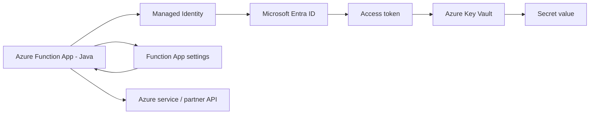

# Managed Identity, Key Vault và cấu hình Function App

Azure Functions thường cần truy cập các tài nguyên bên ngoài như Azure Storage, Service Bus, Cosmos DB, Azure SQL hoặc một API đối tác. Function cũng cần cấu hình theo môi trường: endpoint, tên queue, feature flag, timeout nghiệp vụ và secret để xác thực. Nếu nhúng credential vào source code, file cấu hình hoặc deployment package, secret có thể bị lộ qua repository, log, artifact hoặc người có quyền đọc package.

Azure cung cấp **Managed Identity** để Function App nhận token Microsoft Entra ID mà không phải tự lưu client secret hoặc certificate. **Azure Key Vault** lưu và kiểm soát truy cập secret. **Function App settings** cung cấp cấu hình theo môi trường và đưa giá trị vào process dưới dạng environment variable. Kết hợp đúng ba cơ chế giúp Java function lấy cấu hình, xác thực đến dịch vụ Azure và quản lý vòng đời secret an toàn hơn.

Trong mô hình serverless, mỗi function invocation có thể chạy trên instance khác nhau, scale out hoặc được khởi động lại. Vì vậy, credential và cấu hình phải được quản lý ở cấp ứng dụng/dịch vụ, còn trạng thái nghiệp vụ cần lưu ở kho bền vững. Managed Identity giải quyết danh tính của workload; nó không tự cấp quyền truy cập dữ liệu, không thay thế network configuration và cũng không thay thế kiểm tra quyền nghiệp vụ.

## 1. Vai trò của ba thành phần

| Thành phần | Giải quyết vấn đề | Ví dụ |
|---|---|---|
| Managed Identity | Cung cấp danh tính cho Function App khi gọi dịch vụ hỗ trợ Microsoft Entra ID | Lấy token để đọc secret trong Key Vault hoặc nhận message từ Service Bus |
| Azure Key Vault | Lưu secret, key và certificate, quản lý quyền truy cập và vòng đời | API key, connection credential, certificate |
| Function App settings | Cung cấp cấu hình triển khai theo môi trường | `ORDERS_QUEUE_NAME`, `KEY_VAULT_URI`, `PAYMENT_API_KEY` |

Một luồng điển hình:



Function App lấy danh tính từ platform, yêu cầu Entra ID cấp token cho tài nguyên đích và dùng token đó để gọi Key Vault hoặc dịch vụ hỗ trợ Entra ID. Với cấu hình Key Vault reference, platform có thể phân giải secret thành app setting trước khi ứng dụng đọc environment variable.

## 2. Managed Identity là gì?

Managed Identity là danh tính được Azure quản lý cho một resource. Azure chịu trách nhiệm tạo và vận hành credential của danh tính; ứng dụng yêu cầu access token khi cần. Developer không cần tạo client secret, lưu certificate hay tự xoay vòng credential của service principal.

Managed Identity dựa trên Microsoft Entra ID. Khi Function App cần truy cập một resource, SDK hoặc platform lấy token cho resource/audience tương ứng. Resource đích vẫn kiểm tra token và quyền data-plane được gán cho identity.

Managed Identity không phải là một quyền truy cập mặc định. Bật identity chỉ tạo danh tính. Muốn đọc secret, identity phải được cấp quyền phù hợp trên Key Vault; muốn nhận message từ Service Bus, identity phải có quyền nhận message trên namespace hoặc entity tương ứng.

### System-assigned identity

System-assigned identity được tạo trực tiếp trên Function App. Vòng đời identity gắn với resource:

- Khi bật, Azure tạo một service principal trong Microsoft Entra ID.
- Function App sử dụng identity đó để lấy token.
- Khi xóa Function App, identity system-assigned cũng bị xóa.
- Mỗi Function App có một system-assigned identity riêng.

Đây thường là lựa chọn đơn giản khi một Function App cần một danh tính riêng và quyền truy cập chỉ phục vụ vòng đời của ứng dụng đó.

### User-assigned identity

User-assigned identity là một Azure resource độc lập. Có thể tạo trước, gán quyền trước rồi gắn identity vào một hoặc nhiều Function App.

- Vòng đời identity độc lập với Function App.
- Có thể tái sử dụng cho nhiều resource cần cùng một quyền.
- Có thể cấp quyền trước khi triển khai Function App.
- Một Function App có thể được gắn nhiều user-assigned identity và chọn identity phù hợp cho từng tích hợp.

Tái sử dụng identity giúp quản lý thuận tiện, nhưng nếu nhiều ứng dụng dùng chung identity thì phạm vi ảnh hưởng khi quyền bị cấp quá rộng cũng lớn hơn. Chỉ chia sẻ identity khi các workload thực sự có cùng ranh giới tin cậy và quyền.

### So sánh

| Tiêu chí | System-assigned | User-assigned |
|---|---|---|
| Tạo | Bật trực tiếp trên Function App | Tạo resource identity riêng |
| Vòng đời | Theo Function App | Độc lập với Function App |
| Gắn nhiều app | Không dùng chung một identity system-assigned giữa nhiều app | Có thể gắn cho nhiều app |
| Cấp quyền trước khi deploy app | Thường phải tạo app và bật identity trước | Có thể tạo identity và cấp quyền trước |
| Phù hợp | Một app, một danh tính riêng | Nhiều resource dùng chung danh tính được quản trị có chủ đích |

## 3. Bật Managed Identity cho Function App

Có thể bật identity trong Azure Portal ở phần Identity của Function App hoặc qua Azure CLI/ARM/Bicep/Terraform. Với system-assigned identity, thao tác bật sẽ tạo danh tính gắn với Function App. Với user-assigned identity, cần tạo resource identity rồi thêm nó vào danh sách identity được gắn với app.

Sau khi bật, ghi lại các thông tin cần cho quản trị và IaC:

- **Principal ID / Object ID:** định danh service principal trong Entra ID, thường dùng khi gán role.
- **Client ID:** định danh client của user-assigned identity; dùng để chọn identity trong một số SDK/configuration.
- **Resource ID:** đường dẫn Azure Resource Manager của user-assigned identity; dùng khi gắn identity vào Function App hoặc cấu hình platform chọn identity.

Không nhầm Client ID với Principal ID. Khi tạo role assignment, Azure thường cần principal/object ID. Khi SDK chọn một user-assigned identity, cấu hình thường dùng client ID. Khi gắn identity vào resource hoặc đặt `keyVaultReferenceIdentity`, cấu hình dùng resource ID.

Sau khi bật identity, có thể cần chờ role assignment và thay đổi directory được truyền bá. Một lần gọi ngay lập tức có thể tạm thời nhận lỗi authorization dù cấu hình đã được tạo; hãy kiểm tra lại sau khi propagation hoàn tất.

## 4. Cấp quyền bằng Azure RBAC

Managed Identity cung cấp danh tính; Azure RBAC quyết định danh tính được phép làm gì trên resource. Nên cấp role data-plane nhỏ nhất cần thiết ở scope hẹp nhất.

Ví dụ role thường gặp:

| Tài nguyên | Vai trò data-plane thường dùng | Mục đích |
|---|---|---|
| Key Vault | `Key Vault Secrets User` | Đọc secret contents |
| Azure Storage Blob | `Storage Blob Data Reader` hoặc `Storage Blob Data Contributor` | Đọc hoặc đọc/ghi blob |
| Azure Service Bus | `Azure Service Bus Data Receiver`, `Azure Service Bus Data Sender` hoặc `Azure Service Bus Data Owner` | Nhận, gửi hoặc quản lý dữ liệu messaging theo phạm vi role |
| Azure Cosmos DB for NoSQL | Role data-plane tương ứng như `Cosmos DB Built-in Data Reader` hoặc `Cosmos DB Built-in Data Contributor` | Đọc hoặc ghi dữ liệu Cosmos DB |

Tên role và quyền cụ thể phụ thuộc loại dịch vụ và cấu hình. Role quản trị resource trên control plane, chẳng hạn quyền quản lý resource trong subscription, không tự động đồng nghĩa với quyền đọc dữ liệu bên trong Key Vault, Storage hoặc Service Bus. Phải phân biệt control-plane RBAC và data-plane RBAC.

### Key Vault RBAC và access policies

Key Vault hỗ trợ mô hình Azure RBAC hoặc access policies tùy cấu hình vault. Với mô hình RBAC, cấp `Key Vault Secrets User` ở vault hoặc scope hẹp hơn nếu phù hợp. Với vault dùng access policy, cần cấp đúng quyền secret, thường là `Get` cho việc đọc secret; chỉ cấp `List` nếu ứng dụng thực sự cần liệt kê.

Không cấp `Key Vault Administrator` hoặc quyền quản trị vault cho Function App chỉ để đọc một secret. Không cấp role ở subscription scope nếu chỉ một vault cần được truy cập. Kiểm tra mô hình authorization hiện tại của vault trước khi tạo role assignment; RBAC role assignment không có tác dụng như mong muốn nếu vault đang dùng access policy model.

## 5. Key Vault reference trong Function App settings

App Service platform, nền tảng chạy Azure Functions, hỗ trợ Key Vault references trong application settings. Thay vì lưu secret trực tiếp trong app setting, có thể đặt giá trị dạng reference:

```text
PAYMENT_API_KEY=@Microsoft.KeyVault(SecretUri=https://<vault-name>.vault.azure.net/secrets/payment-api-key/)
```

Platform dùng identity được cấu hình để truy cập Key Vault, lấy secret và cung cấp giá trị đã phân giải cho ứng dụng như một application setting. Java function đọc `PAYMENT_API_KEY` bằng `System.getenv("PAYMENT_API_KEY")` như một environment variable thông thường.

### Secret URI có version và không có version

Reference có thể dùng URI chỉ rõ version:

```text
@Microsoft.KeyVault(SecretUri=https://<vault-name>.vault.azure.net/secrets/payment-api-key/<secret-version>)
```

Hoặc URI không chỉ rõ version:

```text
@Microsoft.KeyVault(SecretUri=https://<vault-name>.vault.azure.net/secrets/payment-api-key/)
```

URI có version giữ ứng dụng ở một phiên bản secret cụ thể cho đến khi cấu hình được cập nhật. URI không version cho phép platform lấy phiên bản hiện tại theo cơ chế refresh của Key Vault reference. Platform cache giá trị đã phân giải; thay đổi secret không nhất thiết xuất hiện tức thì trong process đang chạy. Có thể kích hoạt refresh theo cơ chế platform hỗ trợ hoặc thay đổi cấu hình/restart app khi cần. Cần lập kế hoạch rotation theo thời gian cache và không giả định mỗi invocation đều gọi Key Vault.

### Chọn user-assigned identity cho Key Vault reference

Mặc định, Key Vault reference sử dụng system-assigned identity nếu Function App có identity này. Nếu muốn dùng user-assigned identity, cấu hình thuộc tính platform `keyVaultReferenceIdentity` bằng resource ID của identity đó. Sau đó bảo đảm identity được gắn vào app và có quyền đọc secret trong vault.

Không nhầm cấu hình `keyVaultReferenceIdentity` của platform với `AZURE_CLIENT_ID` của SDK trong code. Một cấu hình chọn identity cho Key Vault reference; cấu hình còn lại thường giúp Azure Identity SDK chọn user-assigned identity khi ứng dụng tự gọi dịch vụ.

### Khi nào nên dùng Key Vault reference?

Phù hợp khi:

- Ứng dụng chỉ cần một secret như một app setting.
- Muốn code đọc cấu hình qua environment variable mà không cần biết Key Vault SDK.
- Muốn platform đảm nhận việc phân giải và cache reference.
- Secret có vòng đời phù hợp với cơ chế refresh của platform.

Không phù hợp hoặc chưa đủ khi:

- Ứng dụng cần liệt kê, tạo, cập nhật hoặc xóa secret.
- Cần chọn secret theo tenant hoặc theo request.
- Cần logic rotation/cache tùy chỉnh hoặc cần truy cập nhiều version.
- Cần dùng key/certificate theo API cryptographic của Key Vault thay vì chỉ lấy secret value.

Trong các trường hợp đó, cân nhắc dùng Azure SDK trực tiếp với Managed Identity.

## 6. Đọc secret trực tiếp bằng Azure SDK for Java

Java application có thể dùng Azure Identity và Azure Security Key Vault Secrets SDK. `DefaultAzureCredential` chọn credential phù hợp theo môi trường: khi phát triển local, nó có thể dùng thông tin đăng nhập từ Azure CLI hoặc IDE; khi chạy trên Azure, nó có thể dùng Managed Identity đã bật cho Function App.

Các dependency Maven cần có:

```xml
<dependency>
  <groupId>com.azure</groupId>
  <artifactId>azure-identity</artifactId>
</dependency>
<dependency>
  <groupId>com.azure</groupId>
  <artifactId>azure-security-keyvault-secrets</artifactId>
</dependency>
```

Ví dụ tạo SecretClient:

```java
import com.azure.identity.DefaultAzureCredential;
import com.azure.identity.DefaultAzureCredentialBuilder;
import com.azure.security.keyvault.secrets.SecretClient;
import com.azure.security.keyvault.secrets.SecretClientBuilder;

public final class KeyVaultClients {
    private KeyVaultClients() {}

    public static SecretClient create(String vaultUrl) {
        DefaultAzureCredential credential =
                new DefaultAzureCredentialBuilder().build();

        return new SecretClientBuilder()
                .vaultUrl(vaultUrl)
                .credential(credential)
                .buildClient();
    }
}
```

Trong môi trường Azure, SDK sử dụng Managed Identity phù hợp với cấu hình. Trong môi trường local, developer đăng nhập bằng công cụ hỗ trợ như Azure CLI và phải được cấp quyền đọc secret trên vault. Không đưa client secret vào code chỉ để local development thuận tiện.

Nếu Function App gắn nhiều user-assigned identity, có thể chọn identity bằng `AZURE_CLIENT_ID` theo cấu hình Azure Identity SDK hoặc cấu hình `ManagedIdentityCredentialBuilder` với client ID. Ví dụ chọn trực tiếp Managed Identity:

```java
import com.azure.identity.ManagedIdentityCredential;
import com.azure.identity.ManagedIdentityCredentialBuilder;

String clientId = System.getenv("AZURE_CLIENT_ID");
ManagedIdentityCredential credential =
        new ManagedIdentityCredentialBuilder()
                .clientId(clientId)
                .build();
```

Ví dụ này dành cho môi trường Azure có user-assigned identity tương ứng. `ManagedIdentityCredential` không tự chuyển sang Azure CLI khi chạy local; để dùng chung code local và Azure, `DefaultAzureCredential` thường thuận tiện hơn.

### Lấy secret và quản lý cache

```java
import com.azure.security.keyvault.secrets.SecretClient;
import com.azure.security.keyvault.secrets.models.KeyVaultSecret;

public final class PaymentConfiguration {
    private final SecretClient secretClient;

    public PaymentConfiguration(SecretClient secretClient) {
        this.secretClient = secretClient;
    }

    public String paymentApiKey() {
        KeyVaultSecret secret = secretClient.getSecret("payment-api-key");
        return secret.getValue();
    }
}
```

Không gọi `getSecret` cho mọi request nếu không cần. Key Vault có latency, quota và chi phí request; mỗi lần gọi thêm một phụ thuộc mạng vào đường xử lý. Tái sử dụng `SecretClient` an toàn ở cấp instance và cache secret theo chính sách phù hợp với yêu cầu rotation. Khi cache, cần có thời hạn, cơ chế refresh, xử lý lỗi refresh và tránh log giá trị secret. Không lưu secret lâu dài trong biến global nếu ứng dụng không có kế hoạch cập nhật khi secret bị rotate.

## 7. Cấu hình Function App settings

Function App settings là các cặp key/value được cấu hình ở cấp Function App. Platform cung cấp chúng cho process dưới dạng environment variables. Trong Java có thể đọc bằng `System.getenv`; framework như Spring Boot có thể bind environment variable vào `@ConfigurationProperties` hoặc `@Value`.

Ví dụ tên app settings:

| Setting | Ý nghĩa | Bí mật? |
|---|---|---|
| `ORDERS_QUEUE_NAME` | Tên queue cần xử lý | Không |
| `KEY_VAULT_URI` | URI của vault | Không nhất thiết |
| `PAYMENT_API_KEY` | API key, nên là Key Vault reference | Có |
| `PAYMENT_API_BASE_URL` | Endpoint API thanh toán | Thường không |
| `FEATURE_NEW_CHECKOUT` | Bật/tắt feature | Không |
| `APPLICATIONINSIGHTS_CONNECTION_STRING` | Cấu hình telemetry | Có thể chứa thông tin kết nối, cần bảo vệ theo chính sách |

App settings thường được chia sẻ bởi các function trong cùng Function App. Nếu hai function có yêu cầu quyền hoặc secret khác nhau, hãy cân nhắc tách Function App hoặc dùng identity/secret access có phạm vi phù hợp thay vì cấp một tập quyền rộng cho toàn ứng dụng.

### Đọc cấu hình trong Java

```java
public final class AppConfig {
    private final String ordersQueueName;
    private final String paymentApiKey;

    public AppConfig() {
        this.ordersQueueName = required("ORDERS_QUEUE_NAME");
        this.paymentApiKey = required("PAYMENT_API_KEY");
    }

    private static String required(String name) {
        String value = System.getenv(name);
        if (value == null || value.isBlank()) {
            throw new IllegalStateException(
                    "Missing required application setting: " + name);
        }
        return value;
    }

    public String ordersQueueName() {
        return ordersQueueName;
    }

    public String paymentApiKey() {
        return paymentApiKey;
    }
}
```

Lỗi thiếu cấu hình nên được phát hiện sớm khi ứng dụng khởi tạo hoặc khi function cần cấu hình đó. Không in giá trị secret ra log để hỗ trợ chẩn đoán; chỉ log tên setting và thông tin trạng thái đã được làm sạch.

### Cấu hình phân cấp

Azure App Settings hỗ trợ các key có dấu `__` để biểu diễn cấu hình phân cấp theo cách tương thích với nhiều framework .NET và cross-platform. Ví dụ `Payments__TimeoutSeconds` có thể ánh xạ thành cấu hình `Payments:TimeoutSeconds` trong .NET. Trong Java/Spring, quy tắc binding phụ thuộc framework; cần đặt tên theo convention mà ứng dụng đang dùng và kiểm tra trên Linux cũng như Windows nếu hỗ trợ cả hai.

Đừng mặc định mọi dấu `:` được giữ nguyên giống nhau trên mọi OS và công cụ triển khai. Dùng `__` khi cần tên environment variable đa nền tảng, và ánh xạ nó trong framework/configuration layer.

## 8. local.settings.json và phát triển local

Azure Functions Core Tools sử dụng `local.settings.json` để cung cấp cấu hình cho lần chạy local. Phần `Values` được đưa vào môi trường chạy local; file này không phải kho secret và thường được đặt trong `.gitignore`.

Ví dụ cấu trúc:

```json
{
  "IsEncrypted": false,
  "Values": {
    "AzureWebJobsStorage": "UseDevelopmentStorage=true",
    "FUNCTIONS_WORKER_RUNTIME": "java",
    "KEY_VAULT_URI": "https://example-vault.vault.azure.net/",
    "ORDERS_QUEUE_NAME": "orders-local"
  }
}
```

Không commit secret thật trong `local.settings.json`. Nếu cần thử Key Vault, developer đăng nhập Azure CLI bằng tài khoản được cấp quyền tối thiểu và dùng `DefaultAzureCredential`. Với test unit, inject interface/config giả thay vì gọi vault thật.

`local.settings.json` dành cho local runtime. Khi publish, app settings trên Function App được cấu hình riêng bằng Portal, CLI hoặc IaC; không giả định nội dung local tự động đồng bộ lên Azure. Không bật publish local settings vào production nếu chưa kiểm tra từng giá trị và loại bỏ credential thử nghiệm.

## 9. Key Vault reference và SDK: chọn mô hình nào?

| Tiêu chí | Key Vault reference | Azure SDK trực tiếp |
|---|---|---|
| Ai đọc secret? | App Service platform | Code của Function App |
| Cách code nhận | Environment variable/app setting | `SecretClient.getSecret()` |
| Quyền truy cập | Identity dùng bởi platform reference | Identity do SDK credential chọn |
| Cache/refresh | Platform quản lý theo cơ chế reference | Ứng dụng quản lý cache và refresh |
| Chọn secret theo request | Không phù hợp | Có thể thực hiện, cần kiểm soát quyền và cache |
| Dùng API Key Vault khác | Không, reference chỉ đưa giá trị secret vào setting | Có thể dùng SDK phù hợp cho secret/key/certificate |
| Độ phức tạp code | Thấp | Cao hơn, có thêm SDK và xử lý lỗi |

Nếu chỉ cần một API key cho toàn Function App, Key Vault reference thường đơn giản. Nếu cần truy cập secret động theo tenant, version hoặc nghiệp vụ, SDK có thể phù hợp hơn. Không nên dùng cả hai cách cho cùng một secret nếu không có lý do rõ ràng; hai đường truy cập có thể dùng identity khác nhau và gây khó điều tra quyền.

## 10. Kết nối Azure services bằng Managed Identity

Managed Identity không chỉ dùng với Key Vault. Nhiều Azure service hỗ trợ Microsoft Entra ID để xác thực data-plane. Ví dụ:

- Azure Storage: dùng token để đọc/ghi blob hoặc queue nếu SDK và service hỗ trợ.
- Azure Service Bus: dùng token để gửi hoặc nhận message.
- Azure Cosmos DB: dùng token và role data-plane tương ứng.
- Azure SQL: dùng Microsoft Entra authentication theo cấu hình driver/database.
- Azure App Configuration: dùng identity để đọc key-value được cấp quyền.

Với trigger hoặc binding của Azure Functions, một số extension hỗ trợ identity-based connections. Cấu hình cụ thể phụ thuộc loại binding, phiên bản extension và loại dịch vụ. Không được giả định mọi connection string đều có thể thay bằng một setting `ManagedIdentity=true`; cần dùng đúng tên setting và credential mode được extension hỗ trợ.

Ví dụ, với một Azure SDK client, ứng dụng thường dùng `DefaultAzureCredential` rồi cấu hình endpoint/resource URI. SDK lấy token cho resource đích. Identity cần được cấp role data-plane tương ứng trên đúng resource.

### Java: truy cập Blob Storage bằng Managed Identity

```java
import com.azure.identity.DefaultAzureCredentialBuilder;
import com.azure.storage.blob.BlobServiceClient;
import com.azure.storage.blob.BlobServiceClientBuilder;

public final class StorageClients {
    public static BlobServiceClient blobService(String accountUrl) {
        return new BlobServiceClientBuilder()
                .endpoint(accountUrl)
                .credential(new DefaultAzureCredentialBuilder().build())
                .buildClient();
    }
}
```

Function App identity cần role data-plane phù hợp, ví dụ `Storage Blob Data Reader` cho đọc blob hoặc `Storage Blob Data Contributor` nếu cần ghi. Quyền `Reader` trên Azure resource không tự cấp quyền đọc nội dung blob.

## 11. Cấu hình host và application

Azure Functions có các setting phục vụ host/runtime và setting do ứng dụng định nghĩa. Cần phân biệt:

- `FUNCTIONS_WORKER_RUNTIME`: chỉ định worker runtime, với Java thường là `java`.
- `FUNCTIONS_EXTENSION_VERSION`: chọn major version Azure Functions runtime, theo phiên bản được hỗ trợ trong môi trường triển khai.
- `AzureWebJobsStorage`: cấu hình storage mà Functions host cần cho một số tính năng/runtime behavior; cách dùng connection string hoặc identity-based connection phụ thuộc host/extension và cấu hình triển khai.
- Application settings như `ORDERS_QUEUE_NAME`, `KEY_VAULT_URI`: do ứng dụng sử dụng.

Không xóa hoặc đổi setting host chỉ vì ứng dụng không đọc trực tiếp nó. Thay đổi `AzureWebJobsStorage` có thể ảnh hưởng host state, timer, scale hoặc extension tùy cấu hình. Khi chuyển sang identity-based connection cho host storage hoặc binding, hãy làm theo tài liệu đúng phiên bản runtime/extension và cấp đủ quyền cho host.

## 12. Deployment slots và cấu hình theo môi trường

Nếu dùng deployment slots, mỗi slot có thể có app settings riêng. Những setting cần giữ cố định với slot, chẳng hạn endpoint database, Key Vault reference hoặc tên queue của staging, nên được đánh dấu deployment slot setting (sticky) khi phù hợp. Khi swap, setting sticky ở lại slot tương ứng thay vì đi theo package code.

Ví dụ:

| Setting | Development | Staging | Production |
|---|---|---|---|
| `ORDERS_QUEUE_NAME` | `orders-dev` | `orders-staging` | `orders-prod` |
| `KEY_VAULT_URI` | Vault dev | Vault staging | Vault prod |
| `PAYMENT_API_BASE_URL` | Sandbox | Sandbox/staging | Production endpoint |
| `FEATURE_NEW_CHECKOUT` | `true` | `true` | Theo rollout |

Không dùng chung secret production cho staging chỉ để đơn giản hóa cấu hình. Mỗi môi trường nên có vault, identity và quyền truy cập riêng hoặc một mô hình phân tách được phê duyệt rõ ràng.

## 13. Network access: Managed Identity không vượt qua firewall

Managed Identity giải quyết xác thực và danh tính. Nó không tự mở đường mạng đến Key Vault hoặc dịch vụ đích. Nếu Key Vault bật firewall, private endpoint hoặc giới hạn network access, Function App phải có đường mạng phù hợp.

Với private endpoint, cần xem xét:

- Function App có VNet integration phù hợp để truy cập mạng riêng hay không.
- DNS phân giải hostname Key Vault sang private IP qua private DNS zone tương ứng.
- Outbound routing và network security rules có cho phép kết nối hay không.
- Các endpoint phụ thuộc khác (Entra ID token endpoint, Storage, logging) có đường kết nối phù hợp.

Một lỗi `403` có thể do thiếu role data-plane hoặc do network ACL/firewall. Không giải quyết mọi lỗi bằng cách cấp thêm quyền. Kiểm tra cả identity, role assignment, token và network path.

## 14. Rotation, cache và vòng đời secret

Secret cần được xoay vòng theo chính sách của tổ chức và nhà cung cấp. Một quy trình rotation nên:

1. Tạo secret version mới hoặc credential mới ở hệ thống đích.
2. Cập nhật Key Vault với giá trị mới.
3. Đảm bảo Function App có thể lấy phiên bản mới qua reference refresh hoặc SDK refresh.
4. Kiểm tra function gọi hệ thống đích thành công với credential mới.
5. Chỉ thu hồi credential cũ sau khi các instance và consumer đã chuyển đổi.
6. Ghi nhận thời điểm, owner và kết quả rotation trong audit log.

Nếu ứng dụng cache secret trong memory, cần TTL và refresh strategy. Khi refresh thất bại, quyết định rõ có tiếp tục dùng secret cũ trong một khoảng an toàn hay fail closed. Với credential bị lộ hoặc bị thu hồi khẩn cấp, cache cũ có thể khiến function tiếp tục lỗi; cần cơ chế invalidate/restart hoặc refresh chủ động.

Không ghi secret vào log, exception message, metric label hoặc trace attribute. Khi debug, log secret name/version và trạng thái truy cập, không log secret value.

## 15. Troubleshooting

| Triệu chứng | Nguyên nhân có thể | Cách kiểm tra |
|---|---|---|
| `401` khi gọi Key Vault | Token thiếu, sai audience hoặc credential chain chọn nhầm identity | Kiểm tra identity đang bật, credential mode và SDK configuration |
| `403 Forbidden` | Thiếu data-plane role, sai scope, access policy không đúng hoặc network ACL chặn | Kiểm tra authorization model, role assignment, propagation và network |
| `404 SecretNotFound` | Sai vault URI, secret name hoặc version đã bị xóa/không tồn tại | Kiểm tra URI và trạng thái secret/version |
| Key Vault reference chưa phân giải | Identity chưa được chọn/cấp quyền, reference sai hoặc vault không truy cập được | Kiểm tra reference status, identity, role và network |
| Local chạy được, Azure lỗi | Developer credential có quyền nhưng Managed Identity thiếu role | Kiểm tra principal ID của app và role assignment trên resource |
| Dùng nhầm user-assigned identity | Client ID hoặc `keyVaultReferenceIdentity` không đúng | Phân biệt client ID với resource ID và kiểm tra identity được gắn |
| Secret mới chưa có hiệu lực | Platform reference cache hoặc ứng dụng cache riêng | Kiểm tra refresh policy, TTL và restart/config refresh |
| Chỉ lỗi khi chạy trong VNet | Private DNS, route hoặc firewall chưa đúng | Kiểm tra DNS resolution và outbound network path |

Khi điều tra, xác định rõ request đang dùng identity nào, gọi resource nào, bằng credential path nào và lỗi ở lớp token, authorization hay network. Không log access token để chẩn đoán.

## 16. Bảo mật Function App và cấu hình

- Dùng Managed Identity thay cho client secret khi dịch vụ đích hỗ trợ Entra ID.
- Cấp role data-plane tối thiểu và ở scope nhỏ nhất phù hợp.
- Tách Function App khi các function cần quyền hoặc ranh giới bảo mật khác nhau.
- Lưu secret trong Key Vault; dùng Key Vault reference hoặc SDK tùy nhu cầu.
- Không commit `local.settings.json` chứa secret hoặc file `.env` có credential.
- Không log secret, token, connection string nhạy cảm hoặc payload có dữ liệu cá nhân.
- Dùng private endpoint/VNet khi yêu cầu network isolation; xác thực và network là hai lớp độc lập.
- Bảo vệ quyền sửa app settings, identity assignment và role assignment vì người có quyền cấu hình app có thể thay đổi nguồn cấu hình hoặc hành vi workload.
- Dùng IaC để quản lý identity, role assignment, vault reference và app settings có thể tái tạo.
- Kiểm tra quyền truy cập theo tenant/resource trong application service; identity của Function App không thay thế authorization nghiệp vụ.

## 17. Ví dụ luồng HTTP Function đọc cấu hình và gọi service

Một Java HTTP-triggered function có thể đọc app setting đã được Key Vault reference phân giải, sau đó gọi application service. Ví dụ dưới đây dùng annotation Azure Functions Java library; chi tiết DTO và service là phần ứng dụng tự định nghĩa.

```java
import com.microsoft.azure.functions.*;
import com.microsoft.azure.functions.annotation.*;
import java.util.Optional;

public class PaymentFunction {

    @FunctionName("createPayment")
    public HttpResponseMessage run(
            @HttpTrigger(
                    name = "request",
                    methods = {HttpMethod.POST},
                    authLevel = AuthorizationLevel.FUNCTION)
            HttpRequestMessage<Optional<PaymentRequest>> request,
            ExecutionContext context) {

        String apiKey = System.getenv("PAYMENT_API_KEY");
        if (apiKey == null || apiKey.isBlank()) {
            context.getLogger().severe("PAYMENT_API_KEY is not configured");
            return request.createResponseBuilder(HttpStatus.INTERNAL_SERVER_ERROR)
                    .body("Payment configuration is unavailable")
                    .build();
        }

        PaymentRequest payload = request.getBody().orElse(null);
        if (payload == null) {
            return request.createResponseBuilder(HttpStatus.BAD_REQUEST)
                    .body("Request body is required")
                    .build();
        }

        // Inject a payment client configured with the secret in real code.
        context.getLogger().info("Processing payment request");
        return request.createResponseBuilder(HttpStatus.ACCEPTED)
                .body("Payment request accepted")
                .build();
    }
}
```

Trong production, không khởi tạo HTTP client hoặc đọc Key Vault secret mới cho mỗi request nếu có thể tái sử dụng client/cache an toàn. Không ghi `apiKey` ra log. Ví dụ dùng `AuthorizationLevel.FUNCTION` để minh họa trigger authorization; với API công khai hoặc yêu cầu danh tính người dùng, nên tích hợp xác thực phù hợp như Microsoft Entra ID/Easy Auth và kiểm tra quyền nghiệp vụ.

## 18. Checklist triển khai

- [ ] Đã chọn system-assigned hay user-assigned identity theo vòng đời và ranh giới tin cậy.
- [ ] Đã phân biệt Client ID, Principal/Object ID và Resource ID.
- [ ] Function App identity được bật và được chọn đúng trong SDK/platform reference.
- [ ] Key Vault dùng authorization model đã biết; identity có role data-plane tối thiểu.
- [ ] Key Vault reference có URI đúng, version policy và refresh plan rõ ràng.
- [ ] Nếu dùng user-assigned identity cho reference, `keyVaultReferenceIdentity` trỏ đến đúng resource ID.
- [ ] App settings chứa cấu hình không bí mật; secret được lưu trong Key Vault.
- [ ] `local.settings.json` không chứa credential production và không được commit.
- [ ] Java dùng `DefaultAzureCredential` hoặc credential cụ thể phù hợp môi trường.
- [ ] SecretClient/SDK client được tái sử dụng an toàn; cache có TTL/refresh strategy.
- [ ] Trigger/binding identity-based connection được cấu hình theo đúng extension version.
- [ ] Host settings như `AzureWebJobsStorage` được giữ đúng yêu cầu runtime.
- [ ] Slot settings và Key Vault reference tách biệt giữa staging/production.
- [ ] Network path, private endpoint, DNS và firewall đã được kiểm tra.
- [ ] Có rotation, audit, logging và alert cho lỗi authorization/secret refresh.
- [ ] IAM/RBAC và quyền sửa Function App settings được giới hạn.

Managed Identity cung cấp danh tính cho Function App mà không cần nhúng credential vào code. Key Vault lưu secret và kiểm soát quyền đọc; Function App settings đưa cấu hình theo môi trường vào process. Khi phân biệt rõ identity với authorization, platform reference với SDK retrieval, và authentication với network access, Java Azure Function có thể kết nối các dịch vụ an toàn hơn, hỗ trợ rotation và triển khai nhất quán qua các môi trường.
