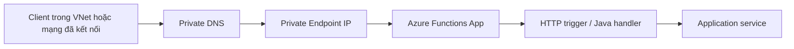
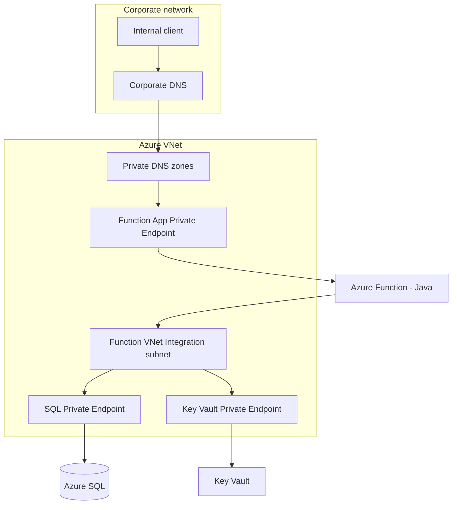

# Kết nối riêng tư và lựa chọn mạng cho Azure Functions

## 1. Vì sao Azure Functions cần thiết kế mạng riêng?

Azure Functions thường chạy trong một môi trường được Azure quản lý, nhưng function vẫn cần giao tiếp với các hệ thống khác: API nội bộ, Azure SQL, Storage, Key Vault, Service Bus, Event Hubs, Cosmos DB hoặc máy chủ tại trung tâm dữ liệu. Một số hệ thống chỉ cho phép kết nối từ mạng riêng hoặc từ một subnet được phê duyệt. Đồng thời, tổ chức có thể yêu cầu endpoint của function không được truy cập từ Internet công cộng.

Thiết kế mạng cần trả lời hai câu hỏi độc lập:

- **Inbound (lưu lượng vào):** client, API gateway, hệ thống nội bộ hoặc người dùng gọi function qua đường nào?
- **Outbound (lưu lượng ra):** function kết nối đến database, storage, dịch vụ nội bộ hoặc Internet qua đường nào?

Một Function App có thể cần cả hai hướng. Ví dụ, API nội bộ gọi HTTP trigger qua Private Endpoint; function sau đó truy cập Azure SQL và Key Vault qua private endpoint trong cùng VNet. Private Endpoint của Function App giải quyết đường vào; VNet Integration giải quyết đường ra. Một tính năng không tự động thay thế tính năng còn lại.

Trong module CLOUD_SERVERLESS, mạng là một phần của thiết kế trigger, quyền truy cập, mở rộng và độ tin cậy. Một function có thể chạy tốt trên máy cá nhân nhưng timeout trên Azure do DNS, route, NSG hoặc firewall. Cần kiểm tra cả đường mạng của runtime, trigger, host storage và đường triển khai.

## 2. Phân biệt các thành phần mạng chính

| Thành phần | Hướng lưu lượng | Mục đích | Có tạo IP riêng cho Function App không? |
|---|---|---|---|
| Access restrictions | Inbound | Cho phép/chặn theo IP, service tag hoặc subnet | Không |
| Service Endpoint | Inbound hoặc outbound đến dịch vụ Azure được hỗ trợ | Ràng buộc quyền truy cập với subnet được chọn | Không tạo private IP cho Function App |
| Private Endpoint | Inbound vào Function App hoặc outbound đến dịch vụ khác | Đưa endpoint của dịch vụ vào VNet bằng private IP | Có private IP trên NIC của Private Endpoint |
| VNet Integration | Outbound từ Function App | Cho function truy cập tài nguyên trong VNet, peered VNet hoặc mạng hybrid | Không; đây là tích hợp đường ra |
| NAT Gateway | Outbound | Cung cấp public source IP ổn định cho lưu lượng đi Internet qua subnet | Không |
| VPN Gateway / ExpressRoute | Kết nối mạng hybrid | Kết nối VNet với mạng tại chỗ hoặc mạng khác | Không |
| App Service Environment (ASE) | Inbound và outbound trong môi trường cô lập | Chạy App Service/Functions trong môi trường riêng của VNet | Có thể dùng internal load balancer và địa chỉ mạng riêng |

Hai quy tắc cần nhớ:

1. VNet Integration không tạo private inbound endpoint cho Function App. Nó chỉ định tuyến kết nối đi ra từ ứng dụng.
2. Private Endpoint của Function App không tự giúp function gọi một database private. Muốn gọi database đó, function cần đường outbound như VNet Integration và DNS phù hợp.

## 3. Chọn hosting plan trước khi chọn kiến trúc mạng

Khả năng mạng khác nhau theo hosting plan. Không nên thiết kế Private Endpoint hoặc VNet Integration rồi mới chọn plan, vì có plan không hỗ trợ các tính năng đó.

| Hosting option | Inbound access restrictions | Private Endpoint cho Function App | Outbound VNet Integration | Ghi chú |
|---|---:|---:|---:|---|
| Flex Consumption | Có | Có | Có | Lựa chọn serverless mới, hỗ trợ virtual network triggers |
| Consumption (legacy) | Có | Không | Không | Plan cũ; không phù hợp nếu cần mạng riêng hoặc storage bị khóa mạng |
| Elastic Premium | Có | Có | Có | Phù hợp khi cần VNet, prewarmed instances và kiểm soát scale tốt hơn |
| Dedicated / App Service plan | Có | Có | Có | Dùng khi cần tài nguyên App Service, cấu hình scale hoặc tích hợp hiện có |
| App Service Environment | Có, theo cấu hình môi trường | Có các lựa chọn cô lập mạng của ASE | Có | Phù hợp yêu cầu cô lập sâu và địa chỉ mạng riêng |
| Azure Container Apps hosting | Theo ingress và môi trường Container Apps | Không hỗ trợ Private Endpoint trực tiếp cho Function App theo mô hình Functions plan | Do môi trường Container Apps quản lý | Cần dùng tài liệu mạng Container Apps |

Microsoft hiện xem Consumption là hosting plan cũ và khuyến nghị Flex Consumption cho Function App serverless mới. Consumption cũ không hỗ trợ Private Endpoint hoặc outbound VNet Integration. Nếu ứng dụng phải dùng storage bị giới hạn mạng, truy cập private endpoint hoặc cần virtual network trigger, hãy chọn Flex Consumption, Elastic Premium hoặc một plan phù hợp khác.

Flex Consumption hỗ trợ Private Endpoint và VNet Integration. Với Flex, VNet Integration dùng subnet cùng region và subnet cần delegation `Microsoft.App/environments`. Với Elastic Premium và Dedicated (App Service), subnet VNet Integration dùng delegation `Microsoft.Web/serverFarms`. Kích thước subnet cũng khác nhau; xem phần subnet bên dưới trước khi tạo mạng.

## 4. Kiểm soát inbound bằng Access Restrictions

Access restrictions là danh sách quy tắc ưu tiên cho phép hoặc từ chối request đến endpoint của Function App. Quy tắc có thể dựa trên:

- Địa chỉ IPv4 hoặc IPv6.
- Dải CIDR của văn phòng, VPN hoặc NAT Gateway.
- Service tag của Azure.
- Virtual Network subnet dùng Service Endpoint.

Khi có một hoặc nhiều quy tắc, hệ thống có implicit deny ở cuối danh sách. Điều này có nghĩa chỉ các nguồn được cho phép mới truy cập được; cần kiểm tra thứ tự ưu tiên của rule để không vô tình chặn health probe hoặc hệ thống triển khai.

Access restrictions phù hợp khi vẫn muốn giữ public hostname nhưng chỉ cho một số địa chỉ hoặc subnet truy cập. Ví dụ, một webhook public có thể chỉ nhận request từ dải IP của đối tác. Tuy nhiên, endpoint vẫn là public endpoint; access restriction chỉ lọc nguồn truy cập.

Với quy tắc VNet, Azure dùng Service Endpoint `Microsoft.Web` trên subnet để nhận diện lưu lượng đến từ subnet được chọn. Service Endpoint không cấp private IP cho Function App và không thay thế Private Link. Nó là cách giới hạn nguồn đến endpoint công khai của App Service/Functions theo subnet.

Service Endpoint inbound cho Function App cũng phụ thuộc hosting plan: Flex Consumption, Elastic Premium và Dedicated hỗ trợ; Consumption plan cũ không hỗ trợ. Nếu đang dùng Consumption cũ, chỉ dùng các access restriction mà plan hỗ trợ, chẳng hạn quy tắc IP, hoặc chuyển sang plan có tính năng mạng cần thiết.

Access restrictions không thay thế authentication hoặc authorization ở ứng dụng. Một request đến từ subnet được phép vẫn phải có danh tính, token hoặc khóa truy cập hợp lệ và được kiểm tra quyền ở function.

## 5. Private Endpoint cho HTTP Function App

Azure Private Endpoint tạo một network interface trong subnet của VNet và cấp một địa chỉ IP riêng. Client trong VNet có thể gọi Function App qua địa chỉ riêng này trong khi vẫn sử dụng hostname HTTPS chuẩn của ứng dụng.

Private Endpoint cho Function App dùng subresource `sites` của resource `Microsoft.Web/sites`. Private Endpoint được hỗ trợ trên Flex Consumption, Elastic Premium và Dedicated (App Service); không được hỗ trợ trên Consumption plan cũ.

### Luồng request



Client vẫn gọi hostname thông thường, ví dụ `https://orders-func.azurewebsites.net/api/orders`. DNS trong mạng riêng phân giải hostname đó về private IP của Private Endpoint. TLS vẫn dùng hostname của ứng dụng, không nên gọi trực tiếp private IP trong URL.

### Private Endpoint không tự tắt public endpoint

Tạo Private Endpoint không có nghĩa public access tự động bị tắt. Nếu yêu cầu là chỉ cho phép truy cập riêng tư, hãy cấu hình `Public network access` thành `Disabled` sau khi đã kiểm tra đường private hoạt động. Nếu cần cả client public được chọn lọc và client private, giữ public access và cấu hình Access Restrictions phù hợp.

Trước khi tắt public access, hãy xác minh:

- Client trong VNet hoặc mạng hybrid phân giải hostname về private IP.
- NSG, route và firewall cho phép TCP 443.
- DNS zone đã được link tới mọi VNet cần truy cập.
- Pipeline triển khai và endpoint SCM/Kudu có đường truy cập riêng.
- Health check, API gateway, webhook hoặc hệ thống bên ngoài đã chuyển sang đường mạng mới.

## 6. DNS cho Private Endpoint của Azure Functions

DNS là phần thường gây lỗi nhất khi triển khai Private Endpoint. Function App vẫn có hostname công khai theo định dạng `app-name.azurewebsites.net`; DNS cần đưa client trong mạng riêng đến địa chỉ Private Endpoint.

Trong Azure public cloud, private DNS zone chuẩn cho App Service và Azure Functions là:

```text
privatelink.azurewebsites.net
```

Private DNS zone thường có hai bản ghi A:

| Tên record | Giá trị | Dùng cho |
|---|---|---|
| `orders-func` | Private IP của Private Endpoint | Function App endpoint |
| `orders-func.scm` | Cùng Private IP của Private Endpoint | SCM/Kudu deployment endpoint |

Tên đầy đủ tương ứng là `orders-func.privatelink.azurewebsites.net` và `orders-func.scm.privatelink.azurewebsites.net`. Khi dùng Private DNS Zone Group với zone được khuyến nghị, Azure có thể tự quản lý các bản ghi này.

### Các bước DNS

1. Tạo Private Endpoint trong subnet dành cho Private Endpoint.
2. Tạo hoặc chọn Private DNS zone `privatelink.azurewebsites.net`.
3. Link zone với VNet chứa client cần truy cập.
4. Tạo DNS Zone Group cho Private Endpoint để liên kết zone.
5. Kiểm tra cả hostname của ứng dụng và hostname SCM phân giải về private IP.
6. Nếu có custom DNS server, cấu hình forwarding đến Azure DNS Private Resolver hoặc cơ chế forwarder phù hợp để truy vấn private zone.

Nếu client ở on-premises, DNS server tại chỗ cũng phải phân giải được private zone. Có thể dùng Azure DNS Private Resolver kết hợp VPN hoặc ExpressRoute để chuyển truy vấn DNS từ mạng tại chỗ vào Azure. Chỉ link private DNS zone vào VNet chưa đủ nếu DNS resolver của client không truy vấn được zone đó.

DNS resolution và quyền truy cập là hai vấn đề độc lập. Một hostname phân giải thành công không chứng minh client có route, firewall rule hoặc quyền ứng dụng để kết nối. Ngược lại, nếu DNS trả public IP thay vì private IP, request có thể đi sai đường dù Private Endpoint đã được tạo đúng.

## 7. SCM/Kudu và triển khai khi Function App dùng Private Endpoint

Function App có endpoint SCM riêng, thường dùng cho Kudu, deployment API, Zip Deploy và một số thao tác triển khai. Khi dùng Private Endpoint, không được chỉ kiểm tra hostname ứng dụng rồi kết luận deployment sẽ hoạt động.

Hostname SCM có dạng:

```text
orders-func.scm.azurewebsites.net
```

DNS riêng cần có record SCM trỏ về Private Endpoint. Agent triển khai (Azure DevOps self-hosted agent, GitHub Actions self-hosted runner hoặc máy triển khai nội bộ) cần nằm trong VNet hoặc có route qua VPN/ExpressRoute đến subnet Private Endpoint. Nếu dùng hosted agent công khai, agent có thể không truy cập được SCM khi public access đã bị tắt.

Portal vẫn có thể quản lý resource, nhưng các tính năng cần gọi trực tiếp vào ứng dụng đang bị giới hạn mạng, như Code + Test hoặc Kudu, cần một máy khách có đường truy cập hợp lệ. Hãy tách quyền quản trị Azure Resource Manager khỏi quyền truy cập data plane của Function App.

## 8. Outbound VNet Integration

VNet Integration cho phép lưu lượng đi ra từ Function App truy cập tài nguyên trong VNet. Các đích thường gặp:

- Private Endpoint của Azure SQL, Storage, Key Vault, Service Bus, Event Hubs hoặc Cosmos DB.
- Máy chủ trong subnet khác hoặc VNet peered.
- Mạng on-premises qua VPN Gateway hoặc ExpressRoute.
- Firewall hoặc gateway trung tâm thông qua User Defined Route (UDR).

VNet Integration không đưa Function App vào subnet như một máy ảo có NIC cố định. Nền tảng quản lý hạ tầng thực thi và sử dụng subnet dành riêng cho đường outbound. Đây là lý do không dùng inbound NSG rule trên subnet Integration để lọc request đến Function App; inbound cần được kiểm soát bằng Access Restrictions hoặc Private Endpoint.

### Regional VNet Integration

Regional VNet Integration là cách được khuyến nghị. Function App và VNet cần ở cùng region. VNet có thể kết nối đến VNet khác bằng peering, ExpressRoute hoặc VPN nếu route và DNS được cấu hình đúng.

Subnet Integration phải dành riêng cho mục đích này và được delegate theo hosting plan. Không dùng chung subnet đó cho Private Endpoint NIC hoặc workload khác. Private Endpoint nên nằm ở subnet riêng.

### Route All

Với Elastic Premium và Dedicated/App Service, VNet Integration cho phép truy cập tài nguyên riêng trong VNet. Lưu lượng đến địa chỉ private thường được định tuyến qua VNet; lưu lượng đến public IP có thể vẫn đi theo đường outbound mặc định của App Service nếu chưa bật Route All.

Khi bật Route All, toàn bộ outbound traffic được đưa vào VNet và chịu ảnh hưởng của NSG, UDR, firewall và NAT Gateway được cấu hình trên đường đi. Điều này hữu ích khi tổ chức cần kiểm soát toàn bộ egress hoặc gửi Internet traffic qua firewall tập trung.

Với Flex Consumption, outbound traffic đã được định tuyến qua VNet Integration; không cần bật Route All theo cách của Premium/Dedicated. Cần dùng đúng hướng dẫn theo plan để tránh cấu hình route sai.

### NSG và UDR

- NSG trên subnet Integration có thể kiểm soát outbound traffic từ ứng dụng.
- Inbound rules của NSG subnet Integration không kiểm soát request đi vào Function App.
- UDR có thể chuyển traffic đến firewall, NVA hoặc VPN/ExpressRoute gateway.
- Nếu định tuyến đến on-premises, mạng ngoài Azure cần có route trả về (return route) tương ứng.
- Với Route All, cả lưu lượng public cũng chịu ảnh hưởng của route và NSG; cần cho phép DNS, HTTPS và các dependency cần thiết.

## 9. Kích thước và delegation của subnet

Subnet cần đủ địa chỉ IP cho số instance và quá trình scale. Azure giữ lại năm địa chỉ đầu trong mỗi subnet. Với Elastic Premium và Dedicated, mỗi instance đang chạy thường tiêu thụ một IP từ subnet Integration; khi scale up/down, nhu cầu có thể tạm thời tăng gần gấp đôi để phục vụ quá trình chuyển đổi.

| Hosting plan | Subnet Integration tối thiểu | Khuyến nghị thường dùng | Delegation |
|---|---:|---:|---|
| Flex Consumption | `/27` | `/27` cho một app, `/26` cho nhiều app | `Microsoft.App/environments` |
| Elastic Premium Windows | `/28` | `/24` | `Microsoft.Web/serverFarms` |
| Elastic Premium Linux | `/28` | `/26` | `Microsoft.Web/serverFarms` |
| Dedicated / App Service | `/28` | `/26` hoặc lớn hơn | `Microsoft.Web/serverFarms` |
| Consumption legacy | Không hỗ trợ | N/A | N/A |

Đối với Flex Consumption, subnet `/27` là mức khuyến nghị cho một Function App; `/26` phù hợp hơn khi nhiều app dùng chung hoặc cần thêm dung lượng mạng outbound. Flex sử dụng các shared gateway gắn với subnet; subnet quá nhỏ hoặc workload I/O lớn có thể gây tăng latency/timeout mạng dù scale-out của function vẫn hoạt động.

Với Premium/Dedicated, đừng chỉ tính IP cho số instance bình thường. Hãy tính cả các app khác cùng plan, các ứng dụng chia sẻ subnet và IP tạm thời trong lúc scale. Không thể tùy ý đổi kích thước subnet sau khi đã gán vào một số cấu hình tích hợp; hãy dự trù CIDR ngay từ đầu.

## 10. Kết nối đến dịch vụ Azure bằng Private Endpoint hoặc Service Endpoint

### Private Endpoint đến dịch vụ đích

Ví dụ Function App gọi Azure SQL qua private endpoint:

1. Tạo Private Endpoint cho Azure SQL trong VNet.
2. Cấu hình private DNS zone của Azure SQL và link tới VNet.
3. Bật VNet Integration cho Function App.
4. Cho phép outbound TCP 1433 trên NSG/firewall nếu cần.
5. Dùng hostname SQL chuẩn trong connection string; DNS trong VNet sẽ phân giải về private IP.
6. Xác thực bằng Microsoft Entra ID/managed identity hoặc cơ chế credential được quản lý an toàn.

Function không cần hardcode private IP. IP có thể thay đổi khi endpoint được tạo lại; dùng hostname để DNS và TLS hoạt động đúng.

### Service Endpoint đến dịch vụ Azure

Service Endpoint cho phép dịch vụ Azure nhận diện lưu lượng từ subnet được chọn và áp dụng firewall/network rule theo subnet. Khi Function App cần gọi một dịch vụ được bảo vệ bằng Service Endpoint, ứng dụng vẫn cần VNet Integration để lưu lượng đi ra qua subnet có Service Endpoint.

Service Endpoint thường đơn giản hơn Private Endpoint nhưng không tạo private IP cho dịch vụ. Nếu yêu cầu là kết nối qua private IP và hạn chế public network path, hãy chọn Private Endpoint.

## 11. Bảo vệ Function App storage và host dependency

Mỗi Function App cần một Storage Account để vận hành. `AzureWebJobsStorage` được host dùng cho trạng thái, khóa, điều phối và một số chức năng runtime. Một số trigger/binding còn dùng Storage cho checkpoint, queue hoặc dữ liệu phụ trợ. Nếu Storage Account bị khóa mạng mà Function App không có đường đến, function có thể không khởi động, không scale hoặc trigger không hoạt động.

Khi bảo vệ storage bằng firewall, Service Endpoint hoặc Private Endpoint:

- Chọn hosting plan hỗ trợ mạng cần thiết. Consumption legacy không hỗ trợ VNet Integration và không thể dùng storage account bị network-secured theo cách này.
- Bảo đảm Function App có outbound route tới tất cả subresource cần dùng: Blob, Queue, Table và File tùy plan/tính năng.
- Tạo private DNS zone tương ứng, ví dụ `privatelink.blob.core.windows.net`, `privatelink.queue.core.windows.net`, `privatelink.table.core.windows.net` và `privatelink.file.core.windows.net` khi dùng các endpoint đó.
- Dùng managed identity cho `AzureWebJobsStorage` nếu tính năng và extension/runtime hỗ trợ; cấp đúng data-plane role.
- Nếu plan dùng Azure Files content share, kiểm tra riêng cấu hình content share routing. Với một số cấu hình Premium, cần bật `vnetContentShareEnabled` và bảo đảm các app/slot chia sẻ cùng storage có cấu hình nhất quán.
- Kiểm thử deployment, startup, scale-out và trigger sau khi tắt public network access của storage.

Không mặc định rằng function chỉ cần kết nối đến database nghiệp vụ. Host storage là dependency của nền tảng và cần được thiết kế mạng cùng lúc với ứng dụng.

## 12. Virtual network triggers (non-HTTP)

Một số trigger cần runtime đọc metadata hoặc poll event source nằm trong VNet, ví dụ Service Bus, Event Hubs, Cosmos DB hoặc Storage được giới hạn mạng. Function App cần có đường mạng tới trigger source; nếu không, function có thể không nhận event hoặc không scale theo backlog.

Flex Consumption hỗ trợ virtual network triggers một cách native, không cần cấu hình Runtime Scale Monitoring bổ sung cho việc scale từ các nguồn mạng riêng được hỗ trợ.

Elastic Premium hỗ trợ virtual network triggers. Tuy nhiên, theo mặc định các trigger này không nhất thiết scale vượt số prewarmed instance. Một số extension hỗ trợ dynamic scale monitoring; cần bật `functionsRuntimeScaleMonitoringEnabled` và dùng extension version hỗ trợ. Không phải mọi trigger extension đều có thể làm app scale động khi nguồn nằm trong VNet.

Với App Service plan hoặc ASE, function có thể nhận trigger từ resource bảo vệ bằng VNet nếu app được tích hợp vào VNet có quyền truy cập nguồn. Cần kiểm tra riêng scale behavior, không chỉ connectivity.

Trước khi triển khai private trigger, hãy xác minh:

- DNS hostname của namespace/endpoint phân giải đúng private IP.
- Function App có VNet Integration và route tới subnet đích.
- NSG/firewall cho phép đúng port và protocol của trigger.
- Managed identity hoặc connection setting có quyền truy cập data plane.
- Runtime/extension hỗ trợ loại trigger và chế độ scale mong muốn.
- Host storage vẫn truy cập được để runtime lưu checkpoint và trạng thái.

## 13. Kết nối mạng hybrid: VPN, ExpressRoute và Hybrid Connections

### VPN Gateway hoặc ExpressRoute

VNet Integration có thể cho function truy cập mạng on-premises thông qua VPN Gateway hoặc ExpressRoute. Để kết nối ổn định, cần cấu hình:

- Route từ subnet Integration đến dải mạng on-premises.
- Route trả về từ on-premises đến địa chỉ mạng Azure liên quan.
- DNS forwarding để function phân giải hostname nội bộ.
- Firewall hai chiều chỉ mở port cần thiết.
- NSG và UDR không chặn traffic.
- Tránh trùng CIDR giữa VNet và mạng on-premises.

Nếu function truy cập được tài nguyên trong VNet nhưng không truy cập được máy chủ on-premises, hãy kiểm tra route trả về và DNS trước khi thay đổi code.

### Hybrid Connections

Hybrid Connections của Azure Relay cung cấp đường kết nối outbound từ ứng dụng đến một endpoint TCP xác định (host và port) trong mạng khác. Nó không cung cấp đường inbound để client gọi ngược vào Function App. Trong Azure Functions, Hybrid Connections chỉ hỗ trợ ứng dụng Windows; Linux không được hỗ trợ.

Hybrid Connections có thể phù hợp khi chỉ cần truy cập một dịch vụ TCP cụ thể và không cần định tuyến toàn bộ subnet. Nếu cần nhiều hệ thống nội bộ, nhiều port hoặc network topology rộng, VNet Integration kết hợp VPN/ExpressRoute thường dễ quản lý hơn.

## 14. Public outbound IP ổn định và NAT Gateway

Một số hệ thống đối tác chỉ cho phép source IP nằm trong allowlist. Outbound IP mặc định của Function App có thể thuộc danh sách IP outbound được công bố trong thuộc tính app và có thể thay đổi theo cấu hình/scale/plan.

Với plan hỗ trợ VNet Integration, có thể định tuyến outbound traffic qua NAT Gateway gắn vào subnet Integration để sử dụng public IP tĩnh do tổ chức quản lý. Với Premium/Dedicated, cần bật Route All để đưa cả public traffic vào VNet trước khi NAT. Flex có mô hình định tuyến outbound qua VNet khác; hãy kiểm tra hướng dẫn plan-specific và thử xác nhận source IP thực tế.

Nếu yêu cầu static inbound và outbound IP ở cấp môi trường, App Service Environment là một lựa chọn cô lập hơn. NAT Gateway chỉ giải quyết source IP outbound; nó không tạo private inbound endpoint cho Function App.

Không dùng danh sách outbound IP hiện tại như một hợp đồng bất biến nếu chưa có cấu hình giữ IP. Khi dependency bên ngoài dùng allowlist, cần có kế hoạch cập nhật và kiểm tra IP sau khi đổi plan, scale hoặc cấu hình mạng.

## 15. Kiến trúc mẫu: HTTP API riêng tư và database private

Giả sử một ứng dụng Java Azure Function nhận request tạo đơn hàng. Client chạy trong mạng công ty, Function App cần gọi Azure SQL và lấy secret từ Key Vault.



Các thành phần cần cấu hình:

1. Function App chạy trên Flex Consumption hoặc Elastic Premium để hỗ trợ Private Endpoint và VNet Integration.
2. Một subnet riêng cho Private Endpoint của Function App.
3. Một subnet Integration riêng, delegate đúng theo plan.
4. Private DNS zone `privatelink.azurewebsites.net` cho Function App và SCM.
5. Private DNS zone tương ứng cho SQL và Key Vault.
6. DNS forwarding từ mạng công ty qua Azure DNS Private Resolver hoặc DNS forwarder.
7. NSG/UDR chỉ cho phép client và function truy cập đúng port.
8. Public network access của Function App, SQL và Key Vault được tắt hoặc giới hạn theo yêu cầu.
9. Function dùng managed identity để truy cập Key Vault/SQL nếu dịch vụ hỗ trợ.
10. Deployment agent có kết nối riêng tới SCM endpoint.

## 16. Ví dụ cấu hình VNet Integration bằng Azure CLI

Ví dụ dưới đây giả định Function App và VNet đã tồn tại, cùng region, subnet Integration đã được tạo và delegate đúng cho hosting plan.

```bash
az functionapp vnet-integration add \
  --resource-group rg-app \
  --name orders-func \
  --vnet vnet-app \
  --subnet snet-functions-integration
```

Kiểm tra cấu hình:

```bash
az functionapp vnet-integration list \
  --resource-group rg-app \
  --name orders-func
```

Thao tác tích hợp có thể khởi động lại Function App. Hãy thực hiện trong cửa sổ triển khai phù hợp và kiểm tra function sau khi hoàn tất.

## 17. Ví dụ tạo Private Endpoint và DNS bằng Azure CLI

Ví dụ sau dùng Azure public cloud, subresource `sites` và Private DNS zone `privatelink.azurewebsites.net`. Cần tạo subnet dành riêng cho Private Endpoint trước. Giá trị resource group, VNet và tên app cần thay theo môi trường.

```bash
FUNCTION_APP_ID=$(az functionapp show \
  --resource-group rg-app \
  --name orders-func \
  --query id \
  --output tsv)

az network private-endpoint create \
  --name pe-orders-func \
  --resource-group rg-network \
  --vnet-name vnet-app \
  --subnet snet-private-endpoints \
  --private-connection-resource-id "$FUNCTION_APP_ID" \
  --group-id sites \
  --connection-name pe-orders-func-connection

az network private-dns zone create \
  --resource-group rg-network \
  --name privatelink.azurewebsites.net

az network private-dns link vnet create \
  --resource-group rg-network \
  --zone-name privatelink.azurewebsites.net \
  --name link-vnet-app \
  --virtual-network vnet-app \
  --registration-enabled false

az network private-endpoint dns-zone-group create \
  --resource-group rg-network \
  --endpoint-name pe-orders-func \
  --name default \
  --private-dns-zone privatelink.azurewebsites.net \
  --zone-name sites
```

Sau khi DNS record được tạo, kiểm tra từ máy nằm trong VNet hoặc mạng hybrid đã cấu hình DNS:

```bash
nslookup orders-func.azurewebsites.net
nslookup orders-func.scm.azurewebsites.net
```

Hai hostname cần phân giải theo chuỗi CNAME/A về private IP của Private Endpoint trong mạng nội bộ. Nếu trả public IP hoặc không tìm thấy record, kiểm tra zone link, DNS forwarder và bản ghi `scm`.

Không tắt public network access trước khi xác nhận client, deployment agent và công cụ vận hành đã truy cập được qua đường private. Sau khi xác nhận, có thể tắt public access trong Networking settings hoặc cấu hình ARM/Bicep tương ứng.

## 18. Java Function kết nối tới dịch vụ nội bộ

Khi VNet, route và DNS đã đúng, Java code nên dùng hostname của dịch vụ nội bộ thay vì hardcode IP private. Ví dụ dưới đây dùng `java.net.http.HttpClient` gọi một API nội bộ qua private endpoint:

```java
import java.net.URI;
import java.net.http.HttpClient;
import java.net.http.HttpRequest;
import java.net.http.HttpResponse;
import java.time.Duration;

public final class InternalCatalogClient {
    private final HttpClient httpClient;
    private final URI baseUri;

    public InternalCatalogClient(String baseUrl) {
        this.httpClient = HttpClient.newBuilder()
                .connectTimeout(Duration.ofSeconds(3))
                .build();
        this.baseUri = URI.create(baseUrl);
    }

    public String findProduct(String sku) throws Exception {
        HttpRequest request = HttpRequest.newBuilder()
                .uri(baseUri.resolve("/api/products/" + sku))
                .timeout(Duration.ofSeconds(5))
                .GET()
                .build();

        HttpResponse<String> response = httpClient.send(
                request,
                HttpResponse.BodyHandlers.ofString());

        if (response.statusCode() != 200) {
            throw new IllegalStateException(
                    "Catalog returned HTTP " + response.statusCode());
        }
        return response.body();
    }
}
```

Trong production, bổ sung xác thực (ví dụ Microsoft Entra ID/managed identity), validate SKU trước khi đưa vào URL, xử lý lỗi theo nhóm và log correlation ID. Private Endpoint chỉ tạo đường mạng riêng; nó không tự cấp quyền gọi API. Không tắt TLS hoặc thay hostname bằng private IP để né lỗi chứng chỉ.

Nếu dùng Spring `WebClient`, `RestClient` hoặc Azure SDK, nguyên tắc vẫn giống nhau: cấu hình timeout, xác thực và retry ở client; DNS/route/NSG do nền tảng và VNet quyết định.

## 19. Bảo mật mạng và nguyên tắc least privilege

Mạng riêng là một lớp phòng vệ, không phải toàn bộ mô hình bảo mật. Một function trong VNet vẫn cần xác thực, phân quyền và kiểm soát dữ liệu.

- Tắt public network access nếu ứng dụng chỉ được gọi nội bộ.
- Nếu vẫn cần public endpoint, dùng Access Restrictions allowlist và xác thực caller.
- Dùng managed identity để truy cập Azure resources, cấp role đúng phạm vi và đúng data plane.
- Chỉ mở outbound port cần thiết; tránh cho function quyền truy cập toàn bộ subnet.
- Dùng NSG và UDR để giới hạn egress, nhưng kiểm tra DNS và các endpoint nền tảng cần thiết.
- Mã hóa TLS khi kết nối dịch vụ; dùng private DNS nhưng vẫn giữ hostname chuẩn.
- Không ghi connection string, access token, secret hoặc payload nhạy cảm vào log.
- Tách subnet Private Endpoint, subnet Integration và subnet workload theo mục đích.
- Theo dõi thay đổi DNS, NSG, route, firewall và quyền truy cập bằng IaC/change management.

Không nên dùng `0.0.0.0/0` hoặc mở mọi port chỉ để sửa timeout. Hãy xác định chính xác hostname, IP đích, port, DNS server và hướng traffic bị chặn.

## 20. Triển khai và vận hành khi mạng bị giới hạn

Khi Function App có private inbound hoặc outbound integration, pipeline cần được thiết kế cùng kiến trúc mạng:

1. Self-hosted build/deployment agent phải có đường mạng đến SCM/Kudu nếu deploy qua endpoint đó.
2. Agent cần phân giải hostname SCM về private IP và có route đến subnet Private Endpoint.
3. Nếu deploy qua Azure Resource Manager, quyền control plane không tự động cho phép gọi endpoint SCM.
4. Package, container image hoặc extension cần tải từ registry có thể yêu cầu outbound route riêng.
5. Host storage, content share, Key Vault và monitoring endpoint phải reachable theo plan.
6. Khi đổi DNS hoặc private endpoint, kiểm tra cả production slot và deployment slot nếu chúng có cấu hình mạng riêng.
7. Kiểm thử cold start/scale-out vì instance mới có thể làm lộ vấn đề DNS, subnet capacity hoặc connection limit.

Nếu app dùng deployment slot, kiểm tra VNet Integration và Private Endpoint behavior theo slot/plan. Không giả định mọi slot có cùng cấu hình mạng hoặc cùng hostname SCM.

## 21. Chẩn đoán lỗi DNS và kết nối

Khi function không kết nối được dependency, hãy phân tích theo thứ tự từ DNS đến ứng dụng:

### Bước 1: Kiểm tra DNS

- Hostname có phân giải được không?
- Kết quả có phải private IP mong muốn không?
- Private DNS zone đã link với đúng VNet chưa?
- Custom DNS có forward query tới Azure DNS Private Resolver không?
- Có record SCM riêng không?
- Có zone trùng hoặc bản ghi A cũ không?

### Bước 2: Kiểm tra route và subnet

- Function App có VNet Integration đúng subnet không?
- Subnet có đúng delegation và còn đủ IP không?
- VNet peering, VPN hoặc ExpressRoute đã có route hai chiều chưa?
- UDR có gửi traffic đến firewall/gateway không?
- Return route có quay lại được không?

### Bước 3: Kiểm tra NSG và firewall

- Outbound TCP port cần thiết có được cho phép không?
- Firewall có allow hostname/FQDN hoặc IP đích không?
- NSG có chặn DNS UDP/TCP 53 tới resolver không?
- Network virtual appliance có đang drop traffic hoặc không có route trả về không?

### Bước 4: Kiểm tra dịch vụ đích

- Private Endpoint connection đã ở trạng thái Approved chưa?
- Public network access hoặc firewall của dịch vụ đích có đúng policy không?
- Managed identity có quyền data-plane không?
- TLS certificate, hostname và SNI có hợp lệ không?
- Database có giới hạn connection hoặc từ chối login không?

### Công cụ kiểm tra

Từ console của ứng dụng (Kudu hoặc portal console), có thể dùng các công cụ phù hợp với hệ điều hành để kiểm tra DNS và TCP. Trên một số môi trường Windows App Service, có `nameresolver.exe` để kiểm tra DNS và `tcpping.exe` để kiểm tra kết nối TCP đến hostname/port. Trên Linux/container, dùng công cụ có sẵn như `nslookup`, `getent hosts`, `curl` hoặc `nc` nếu image có cài đặt.

Ví dụ kiểm tra từ môi trường Linux:

```bash
getent hosts sql-prod.database.windows.net
nc -vz sql-prod.database.windows.net 1433
curl -I --connect-timeout 3 https://orders-func.azurewebsites.net/health
```

Chạy kiểm tra từ đúng vị trí mạng. Kiểm tra trên laptop cá nhân không chứng minh function runtime có cùng DNS, route hoặc NSG. Với Private Endpoint, thực hiện test từ VM hoặc agent nằm trong VNet/đường hybrid tương ứng.

Các nguyên nhân thường gặp:

| Triệu chứng | Nguyên nhân có thể | Hướng kiểm tra |
|---|---|---|
| DNS trả public IP | Private DNS zone chưa link hoặc custom DNS chưa forward | Kiểm tra A record, zone link và resolver |
| DNS timeout | NSG/firewall chặn DNS hoặc resolver lỗi | Kiểm tra UDP/TCP 53 và DNS server của VNet |
| TCP timeout | NSG, UDR hoặc firewall chặn | Kiểm tra route, egress rule và firewall log |
| Kết nối private endpoint bị refused | Endpoint chưa Approved hoặc service chưa lắng nghe | Kiểm tra trạng thái PE và port đích |
| Chỉ lỗi khi scale-out | Subnet thiếu IP, network capacity hoặc connection pool cạn | Kiểm tra subnet size, instance count và connection metrics |
| App gọi được SQL nhưng không gọi được Key Vault | Thiếu private DNS zone/role hoặc endpoint khác | Kiểm tra DNS zone, route và managed identity |
| Deploy thất bại sau khi tắt public access | Agent không truy cập SCM hoặc thiếu DNS SCM | Chạy agent trong VNet và kiểm tra `app.scm.azurewebsites.net` |
| Trigger không nhận event | Runtime không truy cập nguồn hoặc scale monitor không hỗ trợ | Kiểm tra VNet trigger, extension và runtime scale monitoring |

## 22. Quy trình chọn kiến trúc mạng

Khi bắt đầu một Function App mới, có thể đi theo trình tự sau:

1. **Liệt kê luồng traffic:** ai gọi function, function gọi dịch vụ nào, trigger source ở đâu.
2. **Đánh dấu public/private:** xác định endpoint nào được Internet truy cập, endpoint nào chỉ được gọi nội bộ.
3. **Chọn hosting plan:** bảo đảm plan hỗ trợ Private Endpoint, VNet Integration, private storage và trigger cần dùng.
4. **Thiết kế VNet/subnet:** tách subnet Integration, Private Endpoint và workload; chọn CIDR có đủ IP cho scale.
5. **Thiết kế DNS:** tạo private zones, link VNet, cấu hình custom DNS/hybrid forwarding và SCM record.
6. **Thiết kế route và policy:** NSG, UDR, firewall, NAT Gateway, VPN/ExpressRoute và return route.
7. **Bảo vệ host storage:** kiểm tra `AzureWebJobsStorage`, Azure Files content share và trigger storage.
8. **Cấp identity:** managed identity, RBAC và data-plane role cho từng dịch vụ.
9. **Cấu hình inbound:** Private Endpoint hoặc Access Restrictions; tắt public network access khi đã xác nhận private path.
10. **Cấu hình outbound:** VNet Integration, Route All nếu cần và quyền truy cập dependency.
11. **Cấu hình deployment:** agent có thể truy cập SCM, package registry và control plane.
12. **Kiểm thử end-to-end:** DNS, TCP, TLS, auth, trigger, scale-out, cold start và failover.
13. **Giám sát:** log kết nối, DNS failure, timeout, dependency latency, subnet capacity và trigger lag.

## 23. Checklist trước khi đưa production

- [ ] Đã phân biệt rõ inbound và outbound networking.
- [ ] Hosting plan hỗ trợ các tính năng mạng cần thiết; không dùng Consumption legacy nếu cần VNet/Private Endpoint.
- [ ] Private Endpoint của Function App dùng subresource `sites` và trạng thái kết nối đã Approved.
- [ ] Public network access được bật/tắt theo đúng yêu cầu và đã kiểm tra đường truy cập thực tế.
- [ ] Private DNS zone `privatelink.azurewebsites.net` được link tới các VNet cần thiết.
- [ ] DNS có record cho app và SCM; deployment agent truy cập được SCM.
- [ ] VNet Integration dùng subnet riêng, đúng region, đúng delegation và đủ địa chỉ IP.
- [ ] Private Endpoint subnet tách khỏi Integration subnet.
- [ ] Route All được cấu hình đúng theo hosting plan; không áp dụng máy móc giữa Flex và Premium/Dedicated.
- [ ] NSG, UDR, firewall và return route cho phép đúng traffic cần thiết.
- [ ] Private endpoint của SQL, Storage, Key Vault hoặc Service Bus có DNS zone và route tương ứng.
- [ ] `AzureWebJobsStorage` và content share có đường mạng hợp lệ.
- [ ] Virtual network trigger hoạt động và scale behavior được xác minh theo extension/plan.
- [ ] Managed identity có quyền data-plane tối thiểu; Private Endpoint không bị coi là quyền truy cập.
- [ ] NAT Gateway hoặc ASE được dùng khi có yêu cầu địa chỉ IP ổn định phù hợp.
- [ ] Đã kiểm thử từ đúng VNet/hybrid path, gồm DNS, TCP, TLS và authentication.
- [ ] Đã kiểm thử deployment, scale-out, cold start và lỗi dependency.
- [ ] Có dashboard/cảnh báo cho DNS failure, timeout, connection count và trigger lag.

## 24. Tài liệu Microsoft Learn tham khảo

- [Azure Functions networking options](https://learn.microsoft.com/azure/azure-functions/functions-networking-options)
- [Azure Functions hosting options and scale](https://learn.microsoft.com/azure/azure-functions/functions-scale)
- [Frequently asked questions about networking in Azure Functions](https://learn.microsoft.com/azure/azure-functions/functions-networking-faq)
- [Use private endpoints to integrate Azure Functions with a virtual network](https://learn.microsoft.com/azure/azure-functions/functions-create-vnet)
- [Azure Private Endpoint DNS configuration](https://learn.microsoft.com/azure/private-link/private-endpoint-dns)
- [Storage considerations for Azure Functions](https://learn.microsoft.com/azure/azure-functions/storage-considerations)
- [Control Azure Functions outbound IP with a NAT Gateway](https://learn.microsoft.com/azure/azure-functions/functions-how-to-use-nat-gateway)
- [Azure CLI: Function App VNet Integration](https://learn.microsoft.com/cli/azure/functionapp/vnet-integration)

## Kết luận

Thiết kế mạng cho Azure Functions bắt đầu bằng việc tách lưu lượng inbound khỏi outbound. Access Restrictions lọc nguồn đến public endpoint; Service Endpoint ràng buộc dịch vụ với subnet; Private Endpoint đưa endpoint vào VNet bằng private IP; VNet Integration tạo đường outbound cho function. Hosting plan quyết định tính năng nào khả dụng, còn DNS, route, NSG, storage và deployment agent quyết định kết nối có hoạt động thực tế hay không. Khi chọn đúng plan, chia subnet hợp lý, cấu hình private DNS và xác minh cả trigger lẫn host storage, Java Function có thể truy cập dịch vụ nội bộ an toàn mà vẫn giữ được khả năng scale của mô hình serverless.
