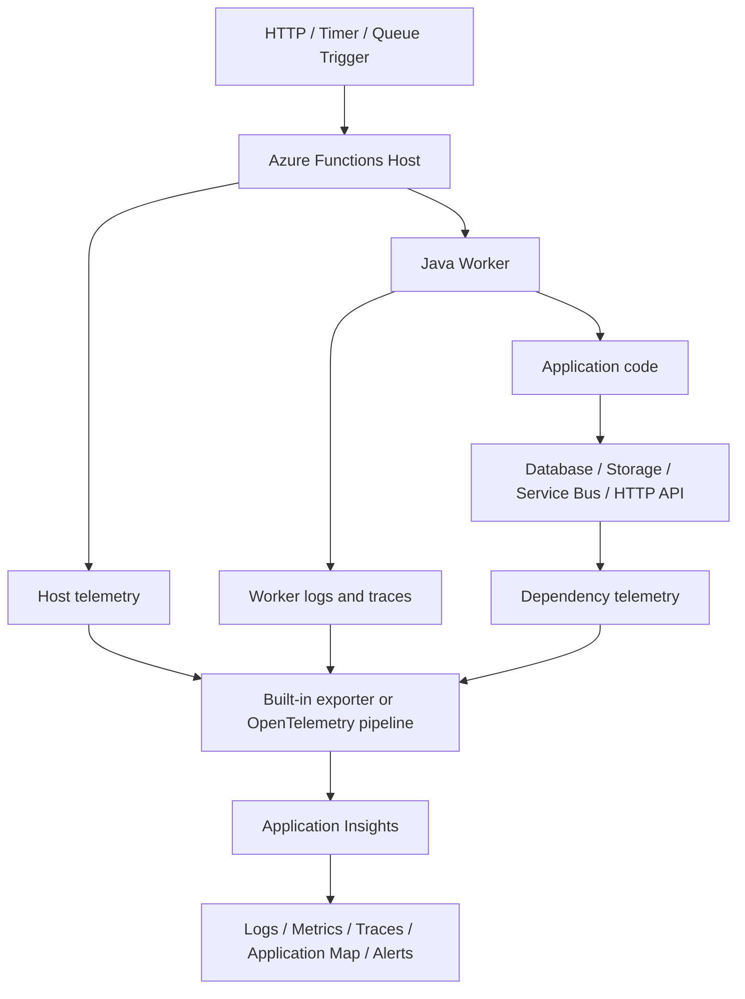

# Quan sát và chẩn đoán với Application Insights

Azure Functions có thể tạo hàng nghìn invocation mỗi phút, chạy trên nhiều worker và gọi các dịch vụ như Storage, Service Bus, database hoặc HTTP API. Khi một function chậm hay thất bại, chỉ xem một dòng log riêng lẻ thường không đủ để tìm nguyên nhân. Cần nối được request, invocation, log, exception và dependency trong cùng một luồng xử lý.

**Application Insights** là dịch vụ Application Performance Monitoring (APM) thuộc Azure Monitor. Dịch vụ thu thập telemetry từ Functions host và mã function, lưu dữ liệu để truy vấn, hiển thị biểu đồ, theo dõi dependency và tạo cảnh báo. Với ứng dụng Java mới, Microsoft khuyến nghị dùng OpenTelemetry cùng Azure Monitor exporter để có telemetry theo chuẩn mở và khả năng gửi đến các endpoint OTLP khác.

## 1. Quan sát một Function App gồm những gì?

Quan sát (observability) giúp trả lời ba câu hỏi chính:

- **Metrics:** Hệ thống đang hoạt động ở mức nào? Ví dụ số invocation, tỷ lệ lỗi, thời gian xử lý, concurrency và queue age.
- **Logs:** Điều gì đã xảy ra trong một invocation? Ví dụ bắt đầu xử lý đơn hàng, xác thực thất bại hoặc dịch vụ phụ thuộc trả lỗi.
- **Traces:** Một request đã đi qua những function và dependency nào? Bước nào chiếm nhiều thời gian hoặc thất bại?

Azure Functions tạo telemetry từ ít nhất hai tiến trình: Functions host quản lý trigger và invocation; language worker chạy mã Java của ứng dụng. Application Insights có thể thu thập dữ liệu từ cả hai tiến trình, sau đó liên kết các bản ghi theo invocation và operation.



Ví dụ, một HTTP function nhận yêu cầu tạo đơn hàng, ghi database rồi gửi message vào Service Bus. Nếu request mất 4 giây, trace có thể cho thấy 100 ms ở function, 3,5 giây ở database và 400 ms ở Service Bus. Thông tin đó giúp xác định bước chậm nằm ở dependency nào thay vì chỉ tăng timeout của function.

## 2. Kết nối Function App với Application Insights

Khi tạo Function App từ Azure Portal, Azure CLI, Azure Functions Core Tools hoặc công cụ phát triển, Application Insights thường được bật và liên kết tự động. Nếu app chưa có cấu hình kết nối, hãy tạo hoặc chọn một Application Insights resource rồi thêm application setting:

```text
APPLICATIONINSIGHTS_CONNECTION_STRING=<connection-string>
```

Connection string xác định resource nhận telemetry. Lấy giá trị từ trang Overview của Application Insights trong Azure Portal và lưu dưới dạng application setting hoặc cấu hình được quản lý an toàn. Không ghi connection string vào source code, log hay file được commit vào Git.

`APPINSIGHTS_INSTRUMENTATIONKEY` là cấu hình cũ. Với triển khai mới, ưu tiên `APPLICATIONINSIGHTS_CONNECTION_STRING`; một số môi trường cloud chuyên biệt yêu cầu connection string. Tránh cấu hình cả hai giá trị nếu không có lý do tương thích cụ thể.

Sau khi cấu hình, tạo một vài invocation thử nghiệm rồi mở Application Insights để xác nhận telemetry đã đến. Dữ liệu thường không xuất hiện tức thì vì telemetry client có thể gom lô trước khi gửi. Live Metrics có thể hiển thị dữ liệu gần thời gian thực.

## 3. Chọn cách xuất telemetry cho Java Functions

Có hai hướng chính khi gửi telemetry từ Azure Functions:

1. **Built-in Application Insights integration:** Functions host thu thập telemetry mặc định, gồm invocation, exception, log do host và worker chuyển tiếp, cùng một số dependency. Đây là cách bắt đầu đơn giản cho nhu cầu giám sát cơ bản.
2. **OpenTelemetry với Azure Monitor exporter:** chuẩn hóa log, trace và metric theo OpenTelemetry, hỗ trợ correlation giữa host và worker, đồng thời có thể gửi đến Application Insights hoặc endpoint OTLP tương thích.

Microsoft khuyến nghị OpenTelemetry cho ứng dụng mới và ứng dụng hiện có cần mở rộng telemetry. Các classic Application Insights SDK dùng để tự ghi custom telemetry đã ở trạng thái legacy và không còn nhận tính năng mới; nên lên kế hoạch chuyển sang OpenTelemetry.

### 3.1. Bật OpenTelemetry ở Functions host

Thêm `telemetryMode` vào `host.json`:

```json
{
  "version": "2.0",
  "telemetryMode": "OpenTelemetry"
}
```

Thêm các application settings sau cho Function App:

```text
APPLICATIONINSIGHTS_CONNECTION_STRING=<connection-string>
JAVA_APPLICATIONINSIGHTS_ENABLE_TELEMETRY=true
```

`APPLICATIONINSIGHTS_CONNECTION_STRING` định tuyến telemetry của host đến Application Insights. `JAVA_APPLICATIONINSIGHTS_ENABLE_TELEMETRY=true` cho phép Java worker gửi OpenTelemetry logs trực tiếp theo cơ chế Azure Functions hỗ trợ, tránh host phát lại các bản ghi worker ở mức host và tạo dữ liệu trùng.

OpenTelemetry cần được bật ở cả host và worker để có correlation tốt hơn giữa telemetry runtime và mã ứng dụng. Java worker tự phát hiện middleware invocation của Functions; làm theo hướng dẫn Java hiện hành của Microsoft cho các dependency và exporter tương ứng với runtime đang dùng.

Khi bật `telemetryMode: OpenTelemetry`, phần `logging.applicationInsights` trong `host.json` không còn điều khiển pipeline OpenTelemetry. Azure Portal cũng không hỗ trợ một số trải nghiệm như log streaming và Recent function invocation traces trong mọi trường hợp; các truy vấn và dashboard trong Application Insights vẫn là cách chính để phân tích telemetry đã xuất.

### 3.2. Log trong mã Java

Với Java Functions, `ExecutionContext` cung cấp logger. Ví dụ:

```java
import com.microsoft.azure.functions.ExecutionContext;
import com.microsoft.azure.functions.annotation.FunctionName;
import com.microsoft.azure.functions.annotation.QueueTrigger;

public class OrderFunctions {

    @FunctionName("processOrder")
    public void processOrder(
            @QueueTrigger(
                    name = "message",
                    queueName = "orders",
                    connection = "StorageConnection")
            String orderId,
            ExecutionContext context) {

        String invocationId = context.getInvocationId();
        context.getLogger().info(
                "Processing orderId=" + orderId
                + ", invocationId=" + invocationId);

        // Gọi application service để xử lý nghiệp vụ.
        context.getLogger().info(
                "Order processing completed, invocationId=" + invocationId);
    }
}
```

Ví dụ minh họa cách ghi log và gắn invocation ID. Trong hệ thống thật, chỉ ghi các định danh không nhạy cảm đã được phép; nếu `orderId` có thể suy ra dữ liệu khách hàng, hãy cân nhắc dùng mã tham chiếu hoặc correlation ID. Không ghi toàn bộ message body, access token, connection string, thông tin thanh toán hoặc dữ liệu cá nhân vào log.

Nên chọn mức log theo mục đích:

| Mức log | Khi nào dùng | Ví dụ |
|---|---|---|
| `Trace` | Chi tiết rất sâu khi điều tra trong môi trường kiểm thử | Giá trị trung gian không nhạy cảm |
| `Debug` | Thông tin hỗ trợ phát triển | Nhánh xử lý hoặc quyết định mapping |
| `Information` | Các mốc nghiệp vụ quan trọng | Bắt đầu/kết thúc xử lý, kết quả thành công |
| `Warning` | Bất thường nhưng luồng vẫn có thể tiếp tục | Retry, message chuyển sang poison queue |
| `Error` | Một thao tác thất bại | Không ghi được dữ liệu, dependency timeout |
| `Critical` | Sự cố nghiêm trọng cần can thiệp | Thành phần cốt lõi không thể tiếp tục |

Không bật `Trace` toàn bộ trong production. Log quá chi tiết vừa làm tăng chi phí ingestion vừa có nguy cơ lộ dữ liệu. Dùng log có cấu trúc và trường định danh ổn định để truy vấn thay vì ghép toàn bộ payload thành một chuỗi.

## 4. Hiểu các loại telemetry và bảng dữ liệu

Application Insights lưu các loại telemetry trong những bảng khác nhau. Với giao diện Logs của Application Insights, những bảng thường dùng gồm:

| Bảng | Nội dung | Câu hỏi có thể trả lời |
|---|---|---|
| `requests` | Một bản ghi cho mỗi lần function invocation | Function nào chạy nhiều, chậm hoặc thất bại? |
| `traces` | Log từ Functions host, scale controller và mã function | Điều gì đã được ghi nhận trong invocation? |
| `exceptions` | Exception do runtime hoặc mã ứng dụng ghi nhận | Loại lỗi nào xuất hiện thường xuyên? |
| `dependencies` | Lời gọi HTTP, SQL và một số dịch vụ được theo dõi tự động | Function đang chờ dịch vụ bên ngoài nào? |
| `customMetrics` | Metric tổng hợp như số invocation, success rate và duration | Xu hướng hiệu năng thay đổi ra sao? |
| `customEvents` | Event telemetry do runtime hoặc ứng dụng ghi | Một mốc nghiệp vụ có xảy ra không? |

Một số dữ liệu Functions-specific nằm trong `customDimensions`, ví dụ `InvocationId`, `Category` và `LogLevel`. `operation_Id` giúp nối telemetry của nhiều thành phần trong cùng một logical operation. Tên bảng có thể khác khi truy vấn trực tiếp trong workspace Log Analytics dùng schema Azure Monitor mới; hãy chọn đúng schema theo giao diện truy vấn đang mở.

### 4.1. Xem invocation và lỗi

Trong Azure Portal, mở Function App rồi chọn Application Insights hoặc Monitor. Màn hình invocation hiển thị những lần chạy gần đây, trạng thái thành công/thất bại và log liên quan. Chọn một invocation để xem log; từ đó có thể mở query tương ứng trong Application Insights Logs.

Các trang hữu ích trong Application Insights:

- **Failures:** xem tỷ lệ lỗi, exception và operation thất bại.
- **Performance:** so sánh thời gian xử lý, throughput và instance.
- **Metrics:** tạo biểu đồ và alert cho invocation count, execution time và success rate.
- **Live Metrics:** quan sát telemetry gần thời gian thực khi đang thử nghiệm hoặc điều tra sự cố.
- **Application Map:** xem các thành phần và dependency được ghi nhận trong luồng xử lý.

Live Metrics hữu ích khi cần thấy điều đang xảy ra ngay lúc tải tăng. Truy vấn Logs phù hợp để điều tra lịch sử, so sánh theo thời gian và tìm mẫu lỗi lặp lại.

## 5. Truy vấn telemetry bằng KQL

Kusto Query Language (KQL) cho phép lọc, nhóm và tổng hợp telemetry. Các truy vấn dưới đây dùng tên bảng trong Application Insights Logs.

### 5.1. Tỷ lệ lỗi và độ trễ theo function

```kusto
requests
| where timestamp > ago(1h)
| summarize
    invocations = count(),
    failures = countif(success == false),
    p95Duration = percentile(duration, 95)
  by name
| extend failureRate = round(100.0 * failures / invocations, 2)
| order by failures desc
```

Truy vấn cho biết số invocation, số lần thất bại, tỷ lệ lỗi và độ trễ p95 theo tên function. p95 cao thường có nghĩa 5% invocation chậm nhất vượt xa phần lớn request; đây là tín hiệu cần điều tra dependency hoặc cold start.

### 5.2. Tìm exception phổ biến

```kusto
exceptions
| where timestamp > ago(24h)
| summarize occurrences = count() by type, outerMessage
| order by occurrences desc
| take 20
```

Nhóm theo `type` và `outerMessage` giúp phát hiện một lỗi xuất hiện nhiều lần. Không nên đưa nguyên exception message có chứa dữ liệu nhạy cảm vào log; hãy chuẩn hóa lỗi và giữ thông tin chi tiết ở nơi có quyền truy cập phù hợp.

### 5.3. Xem log của một invocation

```kusto
traces
| where timestamp > ago(1h)
| extend invocationId = tostring(customDimensions["InvocationId"])
| where invocationId == "<INVOCATION_ID>"
| project timestamp, severityLevel, message, customDimensions
| order by timestamp asc
```

Thay `<INVOCATION_ID>` bằng invocation ID cần điều tra. Các log theo cùng ID giúp dựng lại thứ tự sự kiện trong một lần function chạy.

### 5.4. Nối nhiều function trong cùng một operation

```kusto
traces
| where timestamp > ago(1h)
| where operation_Id == "<OPERATION_ID>"
| project timestamp, operation_Id,
          invocationId = tostring(customDimensions["InvocationId"]),
          message
| order by timestamp asc
```

Một operation có thể đi qua API function, queue-triggered function và một dependency. Dùng `operation_Id` để tìm các log có cùng trace context. Khi tự phát message hoặc gọi HTTP service, hãy truyền W3C trace context (`traceparent` và `tracestate` khi phù hợp) để các hệ thống downstream có thể tiếp tục trace.

### 5.5. Tìm dependency chậm hoặc thất bại

```kusto
dependencies
| where timestamp > ago(1h)
| summarize
    calls = count(),
    failures = countif(success == false),
    p95Duration = percentile(duration, 95)
  by target, name
| order by p95Duration desc
```

Truy vấn này giúp xác định dịch vụ hoặc loại dependency nào có độ trễ cao. Nếu dependency không được tự động instrument, cần bổ sung OpenTelemetry instrumentation phù hợp hoặc log thời gian gọi với correlation ID. Không bật thu thập SQL command text nếu chưa đánh giá rủi ro lộ dữ liệu và yêu cầu bảo mật.

## 6. Cấu hình log level và sampling trong host.json

Functions host có thể tạo nhiều telemetry khi tải tăng. `host.json` cho phép kiểm soát mức log theo category và sampling để cân bằng giữa khả năng điều tra với chi phí lưu trữ.

Ví dụ cấu hình built-in Application Insights integration:

```json
{
  "version": "2.0",
  "logging": {
    "logLevel": {
      "default": "Warning",
      "Host.Aggregator": "Information",
      "Host.Results": "Information",
      "Function": "Information"
    },
    "applicationInsights": {
      "samplingSettings": {
        "isEnabled": true,
        "maxTelemetryItemsPerSecond": 20,
        "excludedTypes": "Request;Exception"
      }
    }
  }
}
```

Trong ví dụ:

- `default: Warning` hạn chế log từ category không được chỉ định.
- `Host.Results: Information` giữ telemetry kết quả invocation.
- `Function: Information` giữ các log runtime cần thiết cho function.
- Sampling giới hạn lượng telemetry được giữ trong lúc tải cao.
- `excludedTypes` giữ lại request và exception khỏi sampling trong cấu hình minh họa.

Không đặt `Host.Results` hoặc `Function` ở `Warning` hay cao hơn một cách tùy tiện. Các category này có thể điều khiển dữ liệu invocation, dependency và metric tổng hợp; lọc quá mạnh có thể làm mất thông tin thành công hoặc khiến Function Monitor và Application Insights hiển thị thiếu dữ liệu. `Host.Aggregator` cũng cần mức phù hợp để giữ các metric tổng hợp.

Sampling có nghĩa một phần telemetry bị loại bỏ có chủ đích. Nếu truy vấn chỉ thấy một phần request hoặc trace, hãy kiểm tra `itemCount` và cấu hình sampling trước khi kết luận function không phát log. Khi dùng SDK hoặc exporter tự instrument, cần đồng bộ chính sách sampling để tránh thống kê sai hoặc làm mất correlation.

Lưu ý: cấu hình `logging.applicationInsights` ở trên dành cho built-in integration. Khi đặt `telemetryMode` thành `OpenTelemetry`, cấu hình này không điều khiển pipeline OpenTelemetry; hãy cấu hình sampling và exporter theo hướng dẫn OpenTelemetry tương ứng.

## 7. Chẩn đoán các vấn đề thường gặp

### 7.1. Không thấy log hoặc invocation

Kiểm tra theo thứ tự:

1. Function App có `APPLICATIONINSIGHTS_CONNECTION_STRING` hợp lệ không?
2. Application Insights resource có đúng subscription, workspace và region không?
3. `host.json` có đặt log level quá cao khiến `Host.Results`, `Function` hoặc `Host.Aggregator` bị lọc không?
4. Sampling có loại bỏ telemetry cần tìm không?
5. Function App có quyền và đường mạng outbound để gửi telemetry đến Azure Monitor không? Với VNet/firewall, kiểm tra outbound HTTPS 443 và endpoint Azure Monitor cần thiết.
6. Có chạm daily cap hoặc ingestion limit khiến telemetry mới không còn được nhận không?
7. Đang xem đúng resource, time range, timezone và bảng dữ liệu chưa?

Telemetry có thể mất vài phút mới xuất hiện trong truy vấn thường. Dùng Live Metrics để phân biệt dữ liệu chưa được gửi với dữ liệu đã gửi nhưng bị lọc bởi query.

### 7.2. Invocation thất bại nhưng không thấy exception rõ ràng

Mở bản ghi trong `requests`, tìm `operation_Id` và `InvocationId`, sau đó truy vấn `traces` và `exceptions`. Kiểm tra cả log từ Functions host lẫn Java worker. Nếu handler bắt exception rồi chỉ ghi warning và trả thành công, runtime có thể coi invocation là thành công; hãy xác định rõ lỗi nào cần throw để trigger áp dụng retry và lỗi nào là kết quả nghiệp vụ dự kiến.

### 7.3. Function chậm

So sánh duration p50/p95/p99 theo function và theo instance. Mở dependency timeline để xem thời gian ở database, Storage, Service Bus hoặc HTTP API. Nếu thời gian khởi tạo tăng, kiểm tra cold start, JVM startup, class loading và dependency initialization. Nếu chỉ một instance chậm, kiểm tra tài nguyên, mạng hoặc trạng thái worker cụ thể.

Không nên chỉ tăng memory hoặc timeout mà không đo. Với function xử lý batch, xem batch size, thời gian xử lý mỗi record và concurrency. Với HTTP function, phân biệt thời gian trong function với thời gian gateway và client.

### 7.4. Scale-out hoặc scale-in khó giải thích

Azure Functions scale controller quyết định số worker dựa trên trigger và tình trạng tải. Có thể bật scale controller logs để điều tra lý do thay đổi số instance. Tính năng này đang ở preview; chỉ bật trong khoảng thời gian cần thu thập dữ liệu vì log chi tiết làm tăng chi phí.

Ví dụ bật log mức verbose đến Application Insights:

```bash
az functionapp config appsettings set \
  --name <FUNCTION_APP_NAME> \
  --resource-group <RESOURCE_GROUP_NAME> \
  --settings SCALE_CONTROLLER_LOGGING_ENABLED=AppInsights:Verbose
```

Sau khi đủ dữ liệu, tắt logging để tránh phát sinh telemetry không cần thiết:

```bash
az functionapp config appsettings set \
  --name <FUNCTION_APP_NAME> \
  --resource-group <RESOURCE_GROUP_NAME> \
  --settings SCALE_CONTROLLER_LOGGING_ENABLED=AppInsights:None
```

Scale controller logs thường xuất hiện trong `traces` với category `ScaleControllerLogs`. Có thể truy vấn:

```kusto
traces
| extend dimensions = todynamic(tostring(customDimensions))
| where tostring(dimensions.Category) == "ScaleControllerLogs"
| project timestamp, message, dimensions
| order by timestamp desc
```

Không nhầm scale controller logs với log nghiệp vụ của Java function. Chúng giải thích quyết định scale ở cấp host/trigger.

## 8. Cảnh báo và vận hành chủ động

Dashboard giúp quan sát tình trạng hiện tại; alert giúp phát hiện vấn đề trước khi người dùng báo lỗi. Nên tạo cảnh báo dựa trên SLO và đặc điểm nghiệp vụ thay vì chỉ cảnh báo mỗi khi có một exception.

Các tín hiệu thường hữu ích:

| Tín hiệu | Gợi ý cảnh báo | Ý nghĩa |
|---|---|---|
| Failure rate | Tỷ lệ invocation lỗi vượt ngưỡng trong cửa sổ thời gian | Function có thể đang gặp lỗi hệ thống hoặc dependency |
| p95/p99 duration | Độ trễ cao hơn SLO trong nhiều cửa sổ liên tiếp | Người dùng hoặc consumer có thể bị chậm |
| Throttles / concurrency | Throttling tăng hoặc concurrency chạm giới hạn | Nhu cầu vượt cấu hình hoặc downstream không chịu được tải |
| Queue age / trigger lag | Message cũ nhất hoặc iterator age tăng liên tục | Consumer không theo kịp producer |
| Dependency failures | Tỷ lệ lỗi database/HTTP/Service Bus tăng | Sự cố có thể nằm ngoài function |
| Dropped async events / DLQ | Có event bị loại bỏ hoặc DLQ tăng | Công việc nền có nguy cơ không hoàn tất |
| Telemetry ingestion | Ingestion tăng đột biến hoặc chạm cap | Chi phí và khả năng lưu telemetry bị ảnh hưởng |

Khi tạo alert, đặt aggregation window, threshold và evaluation frequency phù hợp để tránh cảnh báo nhiễu. Với hệ thống quan trọng, theo dõi cả SLI người dùng nhìn thấy như tỷ lệ request thành công và thời gian phản hồi, không chỉ trạng thái invocation của function.

## 9. Chi phí, sampling và bảo vệ dữ liệu

Application Insights thường tính phí theo lượng dữ liệu ingest và lưu giữ, tùy workspace và cấu hình. Một function ghi log mỗi record của batch, cộng thêm dependency tracking và exception stack trace, có thể tạo lượng telemetry lớn hơn nhiều so với dự kiến.

Để kiểm soát chi phí:

- Chọn log level phù hợp; không bật Trace/Debug liên tục trong production.
- Dùng sampling có chủ đích và kiểm tra tỷ lệ giữ lại bằng `itemCount`.
- Ghi log theo mốc nghiệp vụ có ích, tránh log mỗi vòng lặp hoặc toàn bộ payload.
- Dùng metric tổng hợp cho số lượng lớn thay vì tạo một custom event cho từng chi tiết không cần thiết.
- Thiết lập retention và daily cap theo yêu cầu vận hành; hiểu rằng cap có thể làm dữ liệu mới ngừng xuất hiện khi đạt giới hạn.
- Chỉ bật scale controller verbose logs hoặc SQL command text collection trong thời gian cần điều tra và có đánh giá bảo mật.

Telemetry cũng là dữ liệu cần bảo vệ. Không ghi password, API key, connection string, access token, dữ liệu thẻ hoặc payload chứa thông tin cá nhân. Giới hạn quyền truy cập Application Insights và Log Analytics theo vai trò; cấu hình retention phù hợp và kiểm tra dữ liệu trước khi chia sẻ query hoặc dashboard ra ngoài nhóm.

## 10. Quy trình điều tra một sự cố

Khi một function có lỗi hoặc chậm, có thể đi theo trình tự sau:

1. Xác định thời điểm, function, trigger và phạm vi người dùng bị ảnh hưởng.
2. Mở Failures hoặc truy vấn `requests` để xem tỷ lệ lỗi, duration và instance.
3. Lấy `operation_Id` hoặc `InvocationId` của một lần chạy đại diện.
4. Truy vấn `traces` để dựng lại log theo thời gian và `exceptions` để tìm stack trace.
5. Mở `dependencies` hoặc Application Map để xác định dịch vụ ngoài gây chậm/lỗi.
6. Kiểm tra retry, queue age, DLQ và scale controller logs nếu trigger là message/stream.
7. Đối chiếu sampling, log level, ingestion cap và quyền mạng nếu telemetry thiếu.
8. Ghi nhận nguyên nhân gốc, hành động khắc phục và alert cần bổ sung.

Một quy trình nhất quán giúp phân biệt lỗi trong Java code, lỗi runtime, lỗi mạng và lỗi dịch vụ phụ thuộc. Tránh thay đổi nhiều cấu hình cùng lúc trước khi có bằng chứng từ telemetry.

## 11. Checklist cấu hình Application Insights cho Java Functions

- Function App đã được liên kết với Application Insights resource chưa?
- `APPLICATIONINSIGHTS_CONNECTION_STRING` đã được cấu hình an toàn chưa?
- Dự án dùng built-in integration hay OpenTelemetry? Các pipeline có bị cấu hình trùng không?
- Nếu dùng OpenTelemetry, `host.json` có `telemetryMode: OpenTelemetry` và Java worker setting có đúng không?
- Log level có giữ `Host.Results`, `Function` và các category cần thiết ở mức phù hợp không?
- Sampling có cân bằng giữa chi phí và khả năng điều tra không?
- Java logs có invocation ID/correlation ID và tránh dữ liệu nhạy cảm không?
- KQL query có thể tìm request, trace, exception và dependency theo cùng operation không?
- Dashboard và alert có theo dõi failure rate, p95/p99, dependency, queue age và throttling không?
- Retention, quyền truy cập, daily cap và chi phí ingestion đã được kiểm soát chưa?

## Kết luận

Application Insights giúp quan sát Azure Functions bằng cách nối invocation, logs, exceptions, dependencies và metrics. Với Java, có thể bắt đầu bằng built-in integration và logger từ `ExecutionContext`; với ứng dụng mới hoặc cần distributed tracing chuẩn hóa, nên cân nhắc OpenTelemetry cùng Azure Monitor exporter. Cấu hình log level, sampling và retention đúng cách để dữ liệu đủ dùng cho điều tra mà không tạo chi phí hoặc rủi ro lộ thông tin. Khi xảy ra sự cố, dùng invocation ID và operation ID để nối log, exception và dependency, từ đó tìm đúng thành phần gây lỗi hoặc độ trễ.

## Tài liệu tham khảo chính thức

- [Monitor executions in Azure Functions](https://learn.microsoft.com/en-us/azure/azure-functions/functions-monitoring)
- [Configure monitoring for Azure Functions](https://learn.microsoft.com/en-us/azure/azure-functions/configure-monitoring)
- [Analyze Azure Functions telemetry in Application Insights](https://learn.microsoft.com/en-us/azure/azure-functions/analyze-telemetry-data)
- [Use OpenTelemetry with Azure Functions](https://learn.microsoft.com/en-us/azure/azure-functions/opentelemetry-howto)
- [Configure OpenTelemetry in Application Insights](https://learn.microsoft.com/en-us/azure/azure-monitor/app/opentelemetry-configuration)
- [Java developer reference for Azure Functions](https://learn.microsoft.com/en-us/azure/azure-functions/functions-reference-java)
- [ExecutionContext interface for Azure Functions Java](https://learn.microsoft.com/en-us/java/api/com.microsoft.azure.functions.executioncontext)
