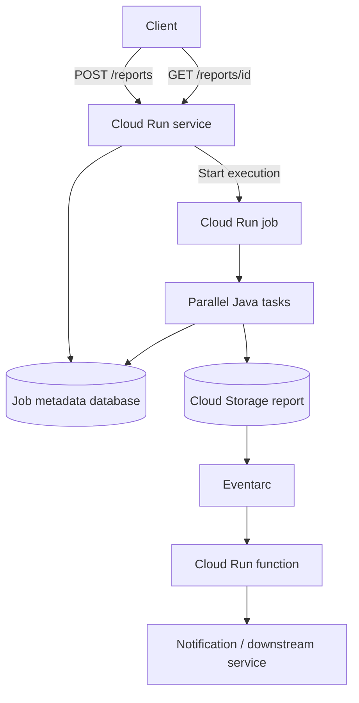
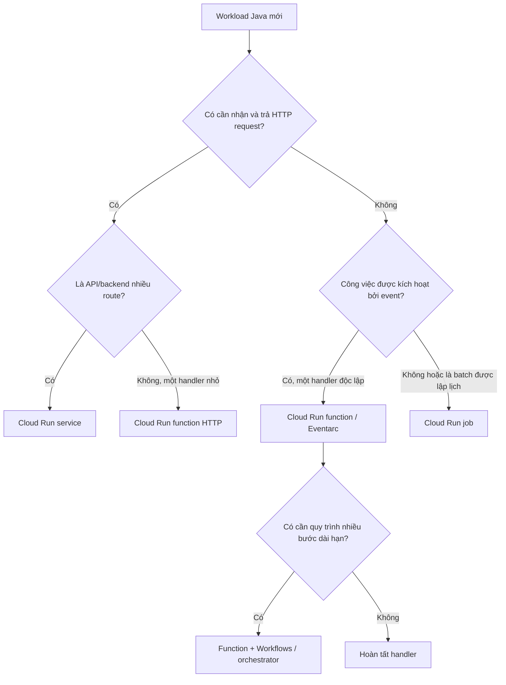

# Phân biệt Cloud Run services, jobs và Cloud Run functions

Google Cloud cung cấp nhiều cách chạy ứng dụng theo mô hình serverless. Ba lựa chọn thường gặp là **Cloud Run services**, **Cloud Run jobs** và **Cloud Run functions**. Cả ba đều có thể chạy mã Java mà không cần tự quản lý máy chủ, nhưng chúng giải quyết ba kiểu công việc khác nhau:

- Cloud Run services phục vụ request qua HTTP hoặc giao thức được hỗ trợ, thường chạy như một API hoặc web service.
- Cloud Run jobs chạy một tác vụ đến khi hoàn tất rồi kết thúc, có thể chia thành nhiều task song song.
- Cloud Run functions chạy một function handler được kích hoạt bởi HTTP hoặc event, phù hợp với xử lý theo sự kiện và tích hợp Functions Framework/Eventarc.

Chọn đúng mô hình giúp xác định cách đóng gói Java, điểm vào chương trình, cách scale, retry, timeout, trạng thái và chi phí. Không nên chọn chỉ theo tên gọi: hãy bắt đầu từ cách công việc được kích hoạt, nó có cần trả lời request ngay hay không, và nó kết thúc theo request hay theo tiến độ của một tác vụ.

## 1. Nhìn nhanh ba mô hình

| Tiêu chí | Cloud Run services | Cloud Run jobs | Cloud Run functions |
| --- | --- | --- | --- |
| Mục tiêu | Phục vụ ứng dụng hoặc API | Chạy tác vụ đến khi hoàn tất | Xử lý một HTTP request hoặc event bằng function handler |
| Điểm vào Java | Ứng dụng/container khởi động HTTP server | Chương trình Java có `main` hoặc command | Class/method implement Functions Framework |
| Cách kích hoạt | HTTP request, gRPC, WebSocket hoặc dịch vụ gọi endpoint | Người dùng, CLI/API, Cloud Scheduler, Workflows hoặc hệ thống điều phối | HTTP trigger hoặc event trigger, thường qua Eventarc và Functions Framework |
| Vòng đời | Instance phục vụ nhiều request; có thể scale về 0 tùy cấu hình | Execution gồm một hay nhiều task; task kết thúc thì hoàn tất | Mỗi lần gọi handler xử lý một request/event; runtime quản lý instance |
| Kết quả | HTTP response hoặc stream response | Exit code, log và dữ liệu lưu bền vững | HTTP response hoặc hoàn tất xử lý event |
| Song song | Nhiều request trên các instance và concurrency của mỗi instance | Nhiều task trong một execution và nhiều execution | Nhiều invocation/instance theo khả năng scale của nền tảng |
| Phù hợp | REST API, backend, webhook receiver, service nội bộ | Import/export lớn, batch, báo cáo, migration, xử lý định kỳ | Event handler, webhook nhỏ, xử lý message/sự kiện độc lập |

Một cách nhớ hữu ích: service **chờ request**, job **chạy đến khi xong**, function **chạy khi có trigger**. Đây là cách phân biệt theo mục tiêu thiết kế; về hạ tầng, Cloud Run functions cũng dùng nền tảng Cloud Run và có thể được triển khai như một workload được quản lý tương tự service.

## 2. Cloud Run services: ứng dụng nhận request

Cloud Run service triển khai một container có HTTP server. Khi có request, nền tảng định tuyến request đến một instance đang hoạt động hoặc tạo instance mới nếu cần. Một instance có thể xử lý nhiều request đồng thời tùy concurrency được cấu hình. Khi tải giảm, Cloud Run có thể giảm số instance; cấu hình min instances có thể giữ sẵn một số instance để giảm độ trễ khởi động.

Các trường hợp phù hợp:

- REST API cho ứng dụng web hoặc mobile.
- Backend Java dùng Spring Boot, Quarkus, Micronaut, Jakarta REST hoặc HTTP server gọn nhẹ.
- Webhook receiver cần trả HTTP status/response cho bên gửi.
- Service nội bộ giao tiếp qua HTTP/gRPC.
- Ứng dụng cần stream response hoặc giữ kết nối theo giao thức Cloud Run hỗ trợ.

### Hợp đồng của container

Container phải khởi động một server và lắng nghe trên port do môi trường cung cấp qua biến `PORT` (mặc định thường là 8080). Server cần bind trên interface có thể nhận traffic từ runtime, thường là `0.0.0.0`, không chỉ `localhost`.

Ví dụ cấu hình Spring Boot:

```properties
server.port=${PORT:8080}
server.address=0.0.0.0
```

Một controller Java đơn giản:

```java
import org.springframework.boot.SpringApplication;
import org.springframework.boot.autoconfigure.SpringBootApplication;
import org.springframework.web.bind.annotation.GetMapping;
import org.springframework.web.bind.annotation.RestController;

@SpringBootApplication
public class OrdersApplication {
    public static void main(String[] args) {
        SpringApplication.run(OrdersApplication.class, args);
    }
}

@RestController
class HealthController {
    @GetMapping("/health")
    public String health() {
        return "ok";
    }
}
```

Ví dụ giả định project đã có Spring Boot Web dependency và cấu hình ở trên. Cloud Run không yêu cầu Spring Boot; bất kỳ HTTP server nào đáp ứng contract container đều có thể dùng.

### Request timeout và concurrency

Cloud Run service phù hợp với công việc có kết quả trả về trong ngân sách HTTP. Nếu một request cần xử lý lâu, request timeout, client timeout hoặc proxy timeout có thể kết thúc việc chờ trong khi tác vụ phía server đã thực hiện một phần side effect. Với công việc kéo dài, service nên tiếp nhận yêu cầu, lưu job và trả `202 Accepted` cùng job ID; worker hoặc job execution xử lý phần việc còn lại.

Concurrency xác định số request có thể được xử lý đồng thời trên một instance. Tăng concurrency có thể tận dụng CPU/memory tốt hơn cho workload I/O-bound, nhưng cũng có thể gây tranh chấp thread, connection pool hoặc bộ nhớ. Giảm concurrency có thể tăng số instance cần thiết. Hãy đo latency p95/p99, CPU, memory và tải downstream dưới workload đại diện.

Cloud Run service có revision khi deploy phiên bản mới. Có thể chuyển traffic giữa các revision để rollout dần, kiểm tra hoặc rollback. Đây là lợi thế khi triển khai API cần kiểm soát thay đổi và khả năng quay lại phiên bản trước.

## 3. Cloud Run jobs: chạy tác vụ đến khi hoàn tất

Cloud Run job chạy container theo một command hoặc entry point và kết thúc khi chương trình thoát. Job không cần mở HTTP server để chờ request. Một execution có thể gồm nhiều task; mỗi task chạy cùng image nhưng có thể nhận chỉ số task để xử lý một phần dữ liệu riêng.

Các trường hợp phù hợp:

- Import hoặc export hàng triệu bản ghi.
- Sinh báo cáo lớn, nén file hoặc xử lý media theo lô.
- Đồng bộ dữ liệu, migration và cleanup định kỳ.
- Tính toán batch hoặc xử lý dữ liệu chia partition.
- Tác vụ quản trị chạy một lần hoặc theo lịch.

### Task, execution và parallelism

Phân biệt các khái niệm:

- **Job definition:** cấu hình image, command/args, environment, service account, CPU/memory, timeout, retry và số task.
- **Execution:** một lần chạy job cụ thể.
- **Task:** một đơn vị trong execution. Một job có thể chạy một task hoặc nhiều task.
- **Task index:** số thứ tự giúp task xác định phần dữ liệu mình chịu trách nhiệm.
- **Parallelism:** số task được phép chạy đồng thời trong một execution.

Ví dụ một job xử lý 12 partition có thể tạo 12 task và giới hạn parallelism là 4. Tại một thời điểm tối đa 4 task chạy; khi một task hoàn tất, task tiếp theo được lên lịch. Tổng thời gian phụ thuộc khối lượng từng partition, giới hạn tài nguyên và downstream.

### Java job đọc task metadata

Cloud Run Jobs cung cấp các biến môi trường để task biết execution và vị trí của mình. Ví dụ:

```java
public final class ImportJob {
    public static void main(String[] args) {
        int taskIndex = Integer.parseInt(
                System.getenv().getOrDefault("CLOUD_RUN_TASK_INDEX", "0"));
        int taskCount = Integer.parseInt(
                System.getenv().getOrDefault("CLOUD_RUN_TASK_COUNT", "1"));
        String execution = System.getenv("CLOUD_RUN_EXECUTION");
        String attempt = System.getenv("CLOUD_RUN_TASK_ATTEMPT");

        System.out.printf(
                "execution=%s task=%d/%d attempt=%s%n",
                execution, taskIndex, taskCount, attempt);

        processPartition(taskIndex, taskCount);
    }

    private static void processPartition(int index, int count) {
        // Chỉ xử lý dữ liệu thuộc partition này.
        // Lưu kết quả/checkpoint bền vững trước khi thoát.
    }
}
```

Các biến môi trường trên giúp task xác định execution, task index, tổng số task và attempt. Cần thiết kế phép chia partition sao cho không bỏ sót hoặc xử lý trùng khi số task thay đổi. Không dùng index làm idempotency key duy nhất nếu một execution có thể được chạy lại; hãy kết hợp execution ID, partition/business key và version dữ liệu.

### Retry và exit code

Task được xem là thành công khi chương trình kết thúc với exit code thành công; lỗi có thể khiến task được retry theo cấu hình retry limit. Vì vậy:

- Chỉ thoát với code 0 khi phần việc đã được lưu bền vững và hoàn tất.
- Trả exit code khác 0 khi cần báo lỗi để nền tảng retry theo policy.
- Không retry vô hạn lỗi dữ liệu không hợp lệ hoặc lỗi quyền cố định.
- Lưu checkpoint và làm thao tác idempotent để task chạy lại không nhân đôi kết quả.
- Đặt timeout đủ cho partition nhưng có giới hạn để phát hiện task bị kẹt.

Nếu task đã ghi output nhưng process chết trước khi exit thành công, lần retry có thể chạy lại. Cloud Run Jobs không tự tạo transaction bao phủ database, object storage và các side effect bên ngoài. Dùng unique key, conditional write, staging output hoặc manifest để công bố kết quả hoàn tất an toàn.

## 4. Cloud Run functions: function handler theo trigger

Cloud Run functions là mô hình triển khai function theo event hoặc HTTP, sử dụng Functions Framework và hạ tầng Cloud Run. Đây là hướng phát triển tiếp nối Cloud Functions thế hệ mới (2nd gen) trong hệ sinh thái Google Cloud. Người viết tập trung vào một entry point xử lý request hoặc event thay vì tự xây dựng toàn bộ HTTP server.

Các trường hợp phù hợp:

- Xử lý một CloudEvent phát ra khi object được tạo trong Cloud Storage.
- Phản ứng với message hoặc event từ Pub/Sub qua Eventarc.
- Xử lý webhook hoặc HTTP endpoint nhỏ.
- Chạy logic độc lập khi có sự kiện từ dịch vụ Google Cloud.
- Kết nối nhanh trigger với một handler Java nhỏ, có input/output contract rõ.

### Functions Framework

Với Java, Functions Framework cung cấp interface để runtime gọi function. Hai dạng phổ biến là:

- `HttpFunction`: nhận HTTP request và ghi HTTP response.
- `CloudEventsFunction`: nhận event theo CloudEvents format.

Ví dụ HTTP function:

```java
import com.google.cloud.functions.HttpFunction;
import com.google.cloud.functions.HttpRequest;
import com.google.cloud.functions.HttpResponse;
import java.io.IOException;

public class HelloHttp implements HttpFunction {
    @Override
    public void service(HttpRequest request, HttpResponse response)
            throws IOException {
        response.setStatusCode(200);
        response.setContentType("text/plain; charset=utf-8");
        response.getWriter().write("Hello from a Java function");
    }
}
```

Ví dụ CloudEvent function:

```java
import com.google.cloud.functions.CloudEventsFunction;
import io.cloudevents.CloudEvent;
import java.nio.charset.StandardCharsets;

public class StorageObjectCreated implements CloudEventsFunction {
    @Override
    public void accept(CloudEvent event) throws Exception {
        String eventId = event.getId();
        String eventType = event.getType();
        String source = event.getSource().toString();
        String payload = event.getData() == null
                ? ""
                : new String(event.getData().toBytes(), StandardCharsets.UTF_8);

        System.out.printf("eventId=%s type=%s source=%s%n",
                eventId, eventType, source);
        processObjectEvent(payload, eventId);
    }

    private static void processObjectEvent(String payload, String eventId) {
        // Validate event schema and process idempotently by eventId.
    }
}
```

Đoạn code minh họa contract handler; project cần khai báo đúng phiên bản Functions Framework Java API và entry point khi build/deploy. Với event thực tế, hãy parse data theo schema của event type thay vì coi mọi payload là cùng một JSON. Kiểm tra `id`, `source`, `type`, subject và version; event có thể được giao lại nên handler phải idempotent.

### Eventarc và nguồn sự kiện

Eventarc định tuyến sự kiện từ các nguồn Google Cloud hoặc nguồn tích hợp đến đích như Cloud Run service hoặc Cloud Run function. Event thường được biểu diễn theo CloudEvents, giúp chuẩn hóa metadata như ID, source, type, time và data.

Cloud Run service cũng có thể nhận CloudEvent qua HTTP endpoint nếu ứng dụng tự xử lý CloudEvents. Khác biệt của Cloud Run functions là mô hình handler và cách deploy function entry point; Eventarc là lớp định tuyến sự kiện. Vì vậy, “có event” không bắt buộc phải chọn functions: có thể dùng service khi cần toàn quyền kiểm soát HTTP server hoặc cần xử lý nhiều route trong cùng container.

## 5. Cloud Run service và function: khác nhau ở đâu?

Hai mô hình này có thể cùng xử lý HTTP hoặc CloudEvent, nhưng abstraction và cách tổ chức code khác nhau:

| Câu hỏi | Cloud Run service | Cloud Run function |
| --- | --- | --- |
| Ai cung cấp HTTP server? | Ứng dụng/container tự cung cấp | Functions Framework/runtime cung cấp adapter cho handler |
| Điểm vào | `main` khởi động server; framework quản lý route | Entry point implement `HttpFunction` hoặc `CloudEventsFunction` |
| Nhiều route/endpoint | Tự do tổ chức theo framework web | Thường tập trung vào một function entry point; có thể triển khai nhiều function riêng |
| Tích hợp event | Có thể nhận CloudEvent qua HTTP hoặc Eventarc | Có mô hình function handler và tích hợp event trigger thuận tiện |
| Kiểm soát container | Kiểm soát trực tiếp Dockerfile, process và server | Có thể deploy từ source theo Functions Framework/buildpack hoặc container theo cách hỗ trợ |
| Phù hợp | API/backend có cấu trúc ứng dụng rộng | Handler nhỏ, tập trung vào một sự kiện hoặc endpoint |

Không có quy tắc rằng function luôn nhẹ hơn service hoặc service luôn có nhiều tính năng hơn. Kích thước image, startup time, dependency và mức dùng tài nguyên phụ thuộc cách viết Java, framework và cấu hình triển khai.

## 6. So sánh điểm vào và cách triển khai Java

| Mô hình | Java entry point | Cách triển khai thường dùng |
| --- | --- | --- |
| Cloud Run service | `public static void main`, khởi động HTTP server | Build container image rồi `gcloud run deploy` |
| Cloud Run job | `public static void main`, chạy task rồi thoát | Build image rồi `gcloud run jobs deploy`, sau đó execute |
| Cloud Run function | Class/method implement Functions Framework interface | Deploy function source/entry point bằng công cụ Cloud Run functions, thường qua `gcloud functions deploy` cho thế hệ hiện hành |

Tên lệnh CLI và runtime Java có thể thay đổi theo phiên bản Google Cloud CLI và khu vực. Kiểm tra tài liệu hiện hành trước khi dùng trong pipeline. Điểm quan trọng là service/job thường triển khai một container image; function triển khai theo contract Functions Framework và trigger/entry point.

### Dockerfile tối giản cho service hoặc job

Một service và một job có thể dùng chung image nếu command/entry point được cấu hình khác nhau. Ví dụ Dockerfile đóng gói JAR:

```dockerfile
FROM eclipse-temurin:21-jre
WORKDIR /app
COPY target/application.jar /app/application.jar
ENV PORT=8080
ENTRYPOINT ["java", "-jar", "/app/application.jar"]
```

Với service, JAR khởi động HTTP server và lắng nghe `PORT`. Với job, JAR chạy tác vụ rồi thoát; có thể dùng command/args khác hoặc build một artifact chuyên biệt. Không dùng Dockerfile này cho function source deploy nếu Functions Framework/buildpack của function đã quản lý entry point và image theo cách riêng.

## 7. Ví dụ cùng một nghiệp vụ dưới ba mô hình

Giả sử hệ thống cần tạo báo cáo doanh thu:

**Cloud Run service:** client gọi `POST /reports`; service xác thực, tạo job record và trả `202 Accepted` cùng status URL. Endpoint `GET /reports/{id}` cho phép tra cứu tiến độ. Service phù hợp với API quản lý và theo dõi job.

**Cloud Run job:** job đọc các partition doanh thu, tính toán song song, ghi file CSV vào Cloud Storage và cập nhật trạng thái hoàn tất. Không cần giữ HTTP request mở trong toàn bộ thời gian tính toán.

**Cloud Run function:** khi job hoàn tất hoặc object báo cáo được tạo, Eventarc gửi event đến function để gửi thông báo hoặc cập nhật một hệ thống khác. Function xử lý một event độc lập và kết thúc.



Trong kiến trúc này, service quản lý HTTP contract, job xử lý batch và function phản ứng với event. Có thể thay function bằng một Cloud Run service nhận CloudEvent nếu cần endpoint phức tạp hoặc muốn dùng chung server với nhiều route.

## 8. Trạng thái, retry và idempotency

Không mô hình nào bảo đảm side effect nghiệp vụ chỉ xảy ra đúng một lần trong mọi tình huống. Request có thể bị client gửi lại, event có thể được giao lại, job task có thể retry sau khi process chết.

| Mô hình | Cách lỗi được thể hiện | Cách thiết kế an toàn |
| --- | --- | --- |
| Service | HTTP status, request timeout, instance restart | Idempotency key cho POST, timeout downstream, lưu trạng thái job bền vững |
| Job | Task exit code, retry attempt, execution/task timeout | Checkpoint, output theo partition, unique key và retry limit |
| Function | Handler error/HTTP response hoặc event delivery retry | Event ID, deduplication, schema validation, DLQ/quarantine hoặc retry policy của trigger |

### Service: request retry

Nếu service ghi đơn hàng nhưng client timeout trước khi nhận response, client có thể gửi lại. Lưu idempotency key theo caller/tenant và request hash; cùng key với cùng payload trả lại kết quả cũ, cùng key với payload khác trả conflict.

### Job: task retry

Nếu job task ghi xong partition 3 nhưng process bị dừng trước khi báo thành công, task có thể chạy lại. Ghi kết quả theo key ổn định như `(executionId, partitionId, dataVersion)` và dùng upsert/conditional write. Chỉ đánh dấu partition hoàn tất sau khi output đã được ghi bền vững.

### Function: event redelivery

Eventarc và các nguồn sự kiện thường có delivery/retry semantics riêng; hãy giả định duplicate có thể xuất hiện nếu nguồn hỗ trợ giao lại. Lưu event ID hoặc business key đã xử lý, nhưng phối hợp việc ghi dấu với side effect qua transaction/inbox/outbox hoặc downstream idempotency. Không đánh dấu event hoàn tất trước khi tác động nghiệp vụ được lưu bền vững.

## 9. Scale, concurrency và cold start

Ba mô hình có thể scale độc lập nhưng cách đặt giới hạn khác nhau:

- **Service:** scale theo request và cấu hình concurrency, min/max instances, CPU/memory. Một instance có thể xử lý nhiều request đồng thời.
- **Job:** scale theo số task và parallelism của execution. Giới hạn số task chạy song song để bảo vệ database, API đối tác và quota.
- **Function:** scale theo HTTP/event invocation và giới hạn instance/concurrency được hỗ trợ trong cấu hình function/runtime.

Cold start có thể xuất hiện khi nền tảng cần tạo instance mới. Với Java, thời gian khởi động phụ thuộc JVM, class loading, framework, dependency, cấu hình DI và kết nối ban đầu. Min instances hoặc cấu hình giữ sẵn có thể giảm cold start nhưng tăng chi phí khi ít request.

Đối với batch job, startup overhead thường được phân bổ trên một lượng công việc lớn hơn; nhưng task quá nhỏ có thể tạo nhiều lần khởi động và tăng overhead. Chọn số task/partition dựa trên thời gian xử lý, dữ liệu và chi phí scheduling.

Không đặt concurrency tối đa chỉ theo CPU. Một function I/O-bound có thể xử lý nhiều invocation hơn, nhưng database connection, file descriptor, memory và giới hạn downstream mới là ràng buộc. Đo dưới tải đại diện và đặt giới hạn phù hợp.

## 10. Networking và quyền truy cập

Mỗi workload chạy với một service account runtime. Hãy cấp quyền tối thiểu theo tác vụ:

- Service API có thể cần đọc cấu hình, ghi database và truy cập dịch vụ downstream.
- Job import có thể cần đọc bucket đầu vào và ghi bucket kết quả.
- Function nhận event có thể cần đọc event payload, cập nhật metadata và publish event tiếp theo.

Không dùng service account mặc định có quyền rộng nếu workload chỉ cần một số resource. Tách service account giữa service, job và function giúp giảm phạm vi ảnh hưởng khi credential hoặc cấu hình bị lộ.

Cloud Run hỗ trợ cấu hình ingress và egress/network path theo yêu cầu. Nếu truy cập private IP trong VPC, cấu hình Direct VPC egress hoặc Serverless VPC Access connector theo khả năng và khuyến nghị hiện hành của workload/region. Nếu cần gọi Google APIs qua private path, xem xét Private Google Access hoặc Private Service Connect tùy dịch vụ và kiến trúc. Identity/IAM không tự tạo network route; networking và authorization phải được cấu hình riêng.

Với event-driven function, Eventarc cần quyền invoke đích. Cấu hình trigger, service account của trigger, role invoke và quyền truy cập nguồn event phải khớp. Nếu function không cần public access, yêu cầu xác thực IAM hoặc giới hạn ingress phù hợp.

## 11. Chi phí: tính theo cách workload chạy

Chi phí của Cloud Run phụ thuộc cấu hình CPU/memory, thời gian sử dụng, request, instance giữ sẵn, network và các dịch vụ phụ trợ. Chi tiết billing mode và mức giá thay đổi theo region, loại workload và thời điểm.

| Mô hình | Các yếu tố cần dự toán |
| --- | --- |
| Service | Request/compute duration theo billing mode, CPU/memory, min instances, network egress, logging và database |
| Job | Số task, thời gian task, CPU/memory, retry, dữ liệu đọc/ghi, Cloud Storage và orchestration |
| Function | Invocation, thời gian xử lý/compute theo Cloud Run billing, trigger/Eventarc, retry và downstream |

Để so sánh, đo **chi phí trên một kết quả nghiệp vụ thành công**. Ví dụ một báo cáo hoàn tất có thể bao gồm chi phí service tiếp nhận, job tasks, Cloud Storage, Eventarc function, database và log. Chỉ nhìn hóa đơn của job hoặc function sẽ bỏ sót phần còn lại.

Các cách kiểm soát chi phí:

1. Chọn CPU/memory đủ cho workload nhưng benchmark vài cấu hình trước khi chốt.
2. Đặt max instances/concurrency hoặc job parallelism để tránh tải vượt khả năng downstream.
3. Dùng min instances chỉ khi lợi ích latency đáng với compute giữ sẵn.
4. Tránh retry vô hạn; sửa lỗi poison input và giới hạn attempt.
5. Đưa file lớn vào Cloud Storage, truyền reference thay vì copy payload qua nhiều service.
6. Giảm log payload lặp, đặt retention và sampling phù hợp.
7. Dùng service cho request ngắn, job cho batch dài, function cho handler sự kiện gọn để tránh giữ tài nguyên sai vòng đời.

## 12. Quan sát và vận hành

Ba mô hình có các tín hiệu vận hành khác nhau:

| Mô hình | Nên theo dõi |
| --- | --- |
| Service | Request rate, latency p50/p95/p99, HTTP 4xx/5xx, instance count, concurrency, CPU/memory, startup và dependency latency |
| Job | Execution status, task success/failure, retry count, task duration, parallelism, log theo task index, execution age |
| Function | Invocation count, event age/lag, handler duration, error/retry, event ID, source/type, instance count và downstream failures |

Gắn `requestId`, `jobExecutionId`, `taskIndex`, `eventId` và `correlationId` vào log/trace tùy mô hình. Không dùng các ID có cardinality cao làm metric label nếu hệ thống quan sát tính phí theo cardinality hoặc bị giới hạn số series.

Với service, kiểm tra health/startup behavior và khả năng nhận traffic khi revision mới khởi động. Với job, kiểm tra task bị kẹt, partition không hoàn tất và output thiếu. Với function, kiểm tra event đến trễ, duplicate, schema không hợp lệ và quyền invoke của Eventarc.

## 13. Kiểm thử và triển khai Java

### Kiểm thử service

- Unit test service/domain logic.
- Integration test HTTP route, authentication, request validation và response.
- Container test xác minh process lắng nghe `PORT` và bind đúng interface.
- Load test concurrency, timeout, memory và downstream connection.

### Kiểm thử job

- Chạy main program với task index/count mẫu.
- Test partition boundary, empty input, partial failure và retry.
- Xác minh output/checkpoint idempotent khi task chạy lại.
- Test timeout, max retries và xử lý dữ liệu lỗi.

### Kiểm thử function

- Unit test handler với HTTP request hoặc CloudEvent giả lập.
- Validate event schema, source/type và duplicate event ID.
- Test retry/redelivery và quyền Eventarc invoke.
- Chạy local Functions Framework khi cần xác minh contract handler.

### Lệnh triển khai ở mức khái niệm

Cloud Run service thường triển khai container image:

```bash
gcloud run deploy orders-api \
  --image REGION-docker.pkg.dev/PROJECT/REPOSITORY/orders-api:TAG \
  --region REGION
```

Cloud Run job triển khai image rồi tạo execution:

```bash
gcloud run jobs deploy monthly-report \
  --image REGION-docker.pkg.dev/PROJECT/REPOSITORY/monthly-report:TAG \
  --region REGION

gcloud run jobs execute monthly-report --region REGION
```

Cloud Run functions được triển khai theo Functions Framework entry point và trigger bằng công cụ Cloud Run functions (trong nhiều workflow CLI, lệnh vẫn là `gcloud functions deploy` với thế hệ phù hợp):

```bash
gcloud functions deploy process-storage-event \
  --gen2 \
  --runtime JAVA_RUNTIME \
  --region REGION \
  --source . \
  --entry-point StorageObjectCreated \
  --trigger-event-filters="type=google.cloud.storage.object.v1.finalized" \
  --trigger-event-filters="bucket=BUCKET_NAME"
```

Các lệnh trên là mẫu để minh họa sự khác nhau trong luồng deploy. Thay project, region, image, runtime, trigger và entry point bằng giá trị thật; kiểm tra `gcloud` version và runtime được hỗ trợ trước khi đưa vào pipeline. Trigger event có thể cần bật API, cấp quyền cho Eventarc service agent và cấu hình service account riêng.

## 14. Chọn mô hình theo tình huống

| Tình huống | Lựa chọn ban đầu | Vì sao |
| --- | --- | --- |
| API Java nhận request và trả kết quả nhanh | Cloud Run service | Có HTTP server, routing và revision/traffic management |
| Backend có nhiều endpoint và middleware | Cloud Run service | Ứng dụng web framework kiểm soát toàn bộ HTTP contract |
| Xử lý event Storage nhỏ rồi cập nhật metadata | Cloud Run function | Handler tập trung vào một event và Eventarc trigger |
| Nhận webhook đơn giản rồi enqueue việc dài | Service hoặc HTTP function | Chọn service nếu cần API nhiều route; function nếu handler nhỏ và độc lập |
| Chạy báo cáo 30 phút trên nhiều partition | Cloud Run job | Run-to-completion, task parallelism và retry |
| Migration database hoặc cleanup một lần | Cloud Run job | Không cần HTTP server, có execution status và exit code |
| Chờ event rồi kích hoạt nhiều bước nghiệp vụ | Function + Workflows hoặc service điều phối | Tách event handler khỏi orchestration dài hạn |
| Event cần xử lý bằng logic HTTP server phức tạp | Cloud Run service nhận CloudEvent | Có thể tổ chức nhiều route và middleware trong một ứng dụng |

### Cây quyết định nhanh



Đây là hướng chọn ban đầu. Một kiến trúc thực tế có thể kết hợp cả ba: service tiếp nhận và theo dõi request, job xử lý batch, function phản ứng với event phát sinh từ job hoặc storage.

## 15. Các lỗi lựa chọn thường gặp

1. **Dùng service cho batch kéo dài chỉ vì đã có HTTP API.** Request có thể timeout và instance bị giữ trong lúc xử lý. Hãy trả job ID rồi chuyển phần batch sang Cloud Run job.
2. **Dùng job để phục vụ API tương tác.** Job không được thiết kế để trả HTTP response trực tiếp cho mỗi client request. Dùng service hoặc function làm lớp tiếp nhận.
3. **Dùng function cho quy trình điều phối phức tạp.** Một function đơn lẻ không tự cung cấp state machine dài hạn. Dùng Workflows hoặc orchestrator và lưu trạng thái bền vững.
4. **Cho rằng function và service hoàn toàn khác hạ tầng.** Cloud Run functions dùng nền tảng Cloud Run; khác biệt quan trọng là abstraction, entry point và trigger contract.
5. **Giả định local filesystem hoặc heap là nơi lưu trạng thái.** Instance/task có thể bị kết thúc hoặc chạy lại. Lưu trạng thái và output vào database/object storage.
6. **Không giới hạn concurrency/parallelism.** Scale nhanh có thể làm cạn database connection hoặc quota downstream.
7. **Giả định event/task chạy đúng một lần.** Retry và redelivery có thể lặp. Thiết kế idempotency và checkpoint.
8. **Chỉ đo chi phí của một thành phần.** Tính cả trigger, orchestration, storage, network, log và downstream.

## 16. Checklist trước khi triển khai

- [ ] Đã xác định workload cần phục vụ request, chạy batch đến khi xong hay phản ứng với event chưa?
- [ ] Service có HTTP server lắng nghe `PORT` và bind đúng interface không?
- [ ] Job có command/entry point kết thúc đúng exit code và chia task/partition rõ ràng không?
- [ ] Function có implement đúng Functions Framework interface và entry point không?
- [ ] Trigger/Eventarc có đúng event type, source, filter và quyền invoke không?
- [ ] Input/output lớn có được lưu ở Cloud Storage và truyền bằng reference không?
- [ ] State, checkpoint và kết quả có được lưu bền vững ngoài container không?
- [ ] Retry, timeout, idempotency và duplicate event/task đã được thiết kế chưa?
- [ ] Service account có quyền tối thiểu cho đúng workload không?
- [ ] Ingress, egress, VPC và private access có đáp ứng yêu cầu mạng không?
- [ ] Concurrency, max instances, task parallelism và connection pool có giới hạn phù hợp không?
- [ ] Có log/metric/trace và cảnh báo theo request, execution, task hoặc event ID không?
- [ ] Đã benchmark cold start, latency, throughput, memory và chi phí trên workload đại diện chưa?
- [ ] CLI/runtime/region/trigger/API được kiểm tra theo phiên bản triển khai hiện tại chưa?

Cloud Run services, jobs và functions đều giúp chạy Java mà không phải quản lý máy chủ, nhưng điểm vào và vòng đời khác nhau. Service phù hợp với ứng dụng phục vụ request; job phù hợp với tác vụ chạy đến khi hoàn tất và có thể chia task; function phù hợp với handler được kích hoạt bởi HTTP hoặc event. Khi chọn dựa trên trigger, cách trả kết quả, thời lượng, nhu cầu điều phối và semantics retry, bạn có thể kết hợp chúng thành một kiến trúc serverless dễ mở rộng, dễ vận hành và kiểm soát chi phí.
