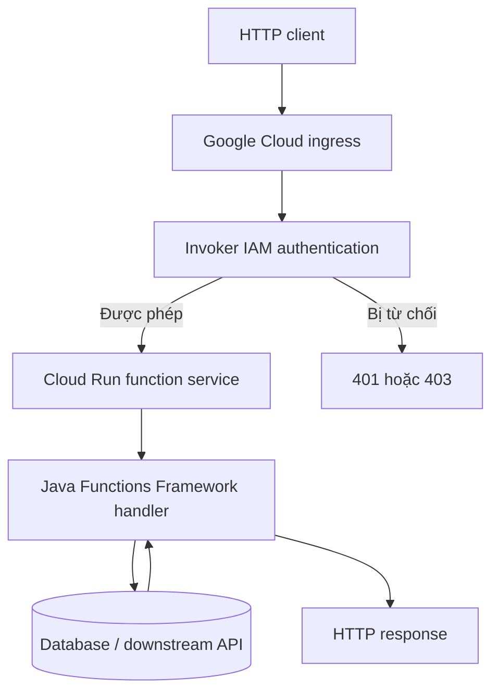
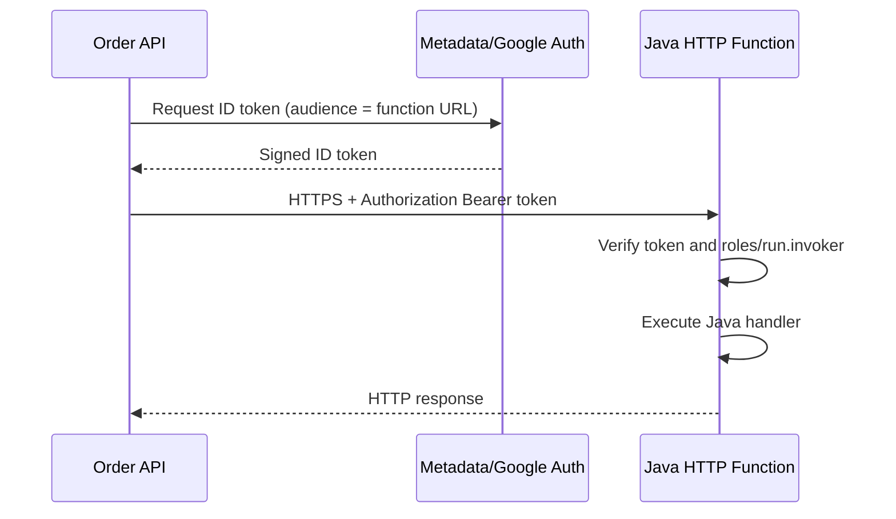

# Triển khai HTTP function và kiểm soát quyền gọi

HTTP function là một cách đưa logic Java lên nền tảng serverless để hệ thống khác gọi qua HTTP. Trên Google Cloud, Cloud Run functions (tên trước đây là Cloud Functions thế hệ 2) cho phép triển khai function Java theo mô hình này. Nền tảng quản lý việc chạy container, định tuyến request và mở rộng instance; nhóm phát triển tập trung vào handler, cấu hình runtime, quyền truy cập và cách xử lý lỗi.

Triển khai được một endpoint chưa có nghĩa là endpoint đã được bảo vệ đúng. Cần xác định ai được phép gọi, request đi vào từ mạng nào, function chạy dưới danh tính nào và ứng dụng kiểm tra quyền nghiệp vụ ra sao. Bài học trình bày cách viết HTTP function bằng Java Functions Framework, triển khai lên Google Cloud và kiểm soát quyền gọi bằng IAM, ID token và ingress.

## 1. HTTP function trên Google Cloud hoạt động thế nào?

Cloud Run functions cung cấp môi trường thực thi function theo request hoặc event. Với HTTP trigger, nền tảng nhận HTTP request rồi chuyển request đến handler Java. Ở thế hệ 2, function chạy trên nền tảng Cloud Run và được quản lý bằng các thành phần của Cloud Run.

Luồng HTTP cơ bản:

1. Client gửi request đến URL của function.
2. Lớp nền tảng kiểm tra ingress và xác thực IAM nếu endpoint yêu cầu xác thực.
3. Request hợp lệ được chuyển đến instance đang chạy hoặc nền tảng tạo instance mới.
4. Java handler đọc method, path, headers và body.
5. Handler chạy logic nghiệp vụ, gọi dịch vụ phụ thuộc nếu cần và tạo HTTP response.
6. Nền tảng trả response về client.



Sơ đồ thể hiện đường đi khái niệm. Một request có thể bị chặn ở ingress hoặc IAM trước khi mã Java được gọi. Vì vậy, không nên dùng log trong handler làm bằng chứng duy nhất để xác định mọi request đã đến endpoint.

### Thế hệ 1 và thế hệ 2

Google Cloud có hai thế hệ Cloud Functions. Thế hệ 2 được xây dựng trên Cloud Run, hỗ trợ nhiều khả năng cấu hình và tích hợp hơn. Tài liệu và công cụ hiện nay cũng dùng tên Cloud Run functions cho sản phẩm này.

Bài học tập trung vào HTTP function thế hệ 2:

- Dùng Functions Framework để viết handler.
- Triển khai bằng Cloud Functions API/gcloud với tùy chọn gen2.
- Function được chạy trên nền tảng Cloud Run.
- Quyền gọi HTTP được kiểm soát bằng Cloud Run Invoker IAM role (roles/run.invoker).

Với thế hệ 1, mô hình IAM invoker có khác biệt; không áp dụng máy móc role của thế hệ 2 cho function cũ. Khi làm việc với một function đã tồn tại, hãy kiểm tra generation và tài nguyên thực tế trước khi thay đổi IAM.

## 2. Viết HTTP function bằng Java Functions Framework

Functions Framework cung cấp interface để viết function mà không cần tự tạo một ứng dụng web server hoàn chỉnh. Với HTTP function, class Java triển khai interface HttpFunction và cài đặt phương thức service.

Ví dụ handler đơn giản:

```java
package com.example;

import com.google.cloud.functions.HttpFunction;
import com.google.cloud.functions.HttpRequest;
import com.google.cloud.functions.HttpResponse;
import java.io.Writer;

public class HelloHttp implements HttpFunction {

    @Override
    public void service(
            HttpRequest request,
            HttpResponse response) throws Exception {

        if (!"GET".equals(request.getMethod())) {
            response.setStatusCode(405);
            response.appendHeader("Allow", "GET");
            response.appendHeader("Content-Type", "text/plain; charset=utf-8");
            response.getWriter().write("Method not allowed");
            return;
        }

        response.setStatusCode(200);
        response.appendHeader("Content-Type", "text/plain; charset=utf-8");

        Writer writer = response.getWriter();
        writer.write("Hello from a Java HTTP function");
    }
}
```

Class này xử lý GET và trả 405 cho method khác. Functions Framework quản lý việc gọi handler và cung cấp request/response abstraction. Function không cần tự mở port hoặc tự quản lý servlet container.

### Dependency Maven

Một dự án Maven tối thiểu cần dependency API của Functions Framework. Ví dụ phần dependency trong pom.xml:

```xml
<dependency>
    <groupId>com.google.cloud.functions</groupId>
    <artifactId>functions-framework-api</artifactId>
    <version>1.1.0</version>
    <scope>provided</scope>
</dependency>
```

Dependency scope provided phù hợp vì API được cung cấp bởi môi trường Functions Framework khi function chạy. Dự án cũng cần khai báo phiên bản Java phù hợp với runtime đã chọn. Ví dụ triển khai bên dưới dùng Java 21; hãy xác nhận runtime đó còn được hỗ trợ trong region và thời điểm triển khai.

Với handler thực tế, nên tách phần HTTP adapter khỏi nghiệp vụ. Handler chịu trách nhiệm đọc request, kiểm tra đầu vào cơ bản, gọi service và chuyển kết quả thành status code. Logic nghiệp vụ có thể được kiểm thử độc lập bằng unit test.

## 3. Triển khai HTTP function thế hệ 2

Trước khi deploy, cần chuẩn bị:

- Google Cloud project và billing phù hợp.
- Đã cài Google Cloud CLI và chọn đúng project.
- Bật các API cần thiết cho Cloud Functions, Cloud Run, Cloud Build và Artifact Registry theo luồng triển khai.
- Source có pom.xml và class entry point.
- Danh tính triển khai có quyền build/deploy function và quyền actAs runtime service account được chọn.

Ví dụ lệnh deploy từ thư mục chứa source:

```bash
gcloud functions deploy helloHttp --gen2 --runtime=java21 --region=asia-southeast1 --source=. --entry-point=com.example.HelloHttp --trigger-http --no-allow-unauthenticated
```

Ý nghĩa các tham số:

| Tham số | Ý nghĩa |
|---|---|
| functions deploy helloHttp | Tạo hoặc cập nhật function có tên helloHttp |
| gen2 | Dùng thế hệ 2, chạy trên nền tảng Cloud Run |
| runtime=java21 | Chọn Java runtime |
| region=asia-southeast1 | Chọn region triển khai |
| source=. | Dùng source trong thư mục hiện tại |
| entry-point=com.example.HelloHttp | Class Java triển khai HttpFunction |
| trigger-http | Tạo HTTP trigger |
| no-allow-unauthenticated | Không cấp quyền gọi công khai cho allUsers |

Lệnh này là ví dụ. Thay project, region, runtime và class theo môi trường thực tế. Nếu dùng runtime khác, kiểm tra tên runtime được Google Cloud hỗ trợ tại thời điểm deploy.

### Chọn runtime service account

Function chạy dưới một runtime service account. Danh tính này được dùng khi mã Java gọi các dịch vụ Google Cloud như Secret Manager, Pub/Sub hoặc database có tích hợp IAM.

Có thể chỉ định service account bằng tham số --service-account trong lệnh deploy:

```bash
gcloud functions deploy helloHttp --gen2 --runtime=java21 --region=asia-southeast1 --source=. --entry-point=com.example.HelloHttp --trigger-http --no-allow-unauthenticated --service-account=hello-http-runtime@PROJECT_ID.iam.gserviceaccount.com
```

Runtime service account khác với danh tính của người hoặc pipeline thực hiện deploy. Không cấp quyền deploy cho runtime service account chỉ vì function cần đọc secret. Cũng không dùng quyền Owner hoặc Editor cho runtime nếu function chỉ cần một vài quyền cụ thể.

Ví dụ, nếu function chỉ đọc một secret, cấp quyền Secret Manager Secret Accessor trên secret cần thiết cho runtime service account, thay vì cấp quyền đọc mọi secret trong project.

## 4. Kiểm soát ai được gọi function bằng IAM

Với HTTP function thế hệ 2, endpoint chạy trên Cloud Run. Người gọi đã xác thực cần quyền Cloud Run Invoker, role:

```text
roles/run.invoker
```

Nên cấp role ở phạm vi service cụ thể để giới hạn quyền gọi đúng endpoint cần thiết. Cấp role ở cấp project có thể cho principal gọi nhiều Cloud Run service trong project hơn dự kiến.

Ví dụ cấp quyền cho một service account gọi function:

```bash
gcloud run services add-iam-policy-binding helloHttp --region=asia-southeast1 --project=PROJECT_ID --member=serviceAccount:caller@PROJECT_ID.iam.gserviceaccount.com --role=roles/run.invoker
```

Trong đó:

- helloHttp là Cloud Run service tương ứng với function thế hệ 2.
- caller@PROJECT_ID.iam.gserviceaccount.com là danh tính của workload gọi function.
- roles/run.invoker cho phép principal gọi service qua HTTP.
- project và region phải khớp với nơi function được triển khai.

Người thực hiện lệnh cần quyền đọc và cập nhật IAM policy của Cloud Run service. Không cấp quyền này cho chính runtime service account nếu function không cần tự gọi lại chính nó.

### Kiểm tra IAM policy

Có thể xem policy của service:

```bash
gcloud run services get-iam-policy helloHttp --region=asia-southeast1 --project=PROJECT_ID
```

Trong policy, kiểm tra member được gán roles/run.invoker. Các member thường gặp:

- serviceAccount:... cho một workload hoặc service account cụ thể.
- user:... cho người dùng cụ thể.
- group:... cho nhóm Google Workspace/Cloud Identity.
- allUsers cho mọi người, kể cả request không có danh tính Google được xác thực.

Hạn chế dùng allUsers nếu endpoint không thực sự cần công khai. Nếu đã cấp nhầm quyền cho một principal, có thể gỡ binding ở đúng service:

```bash
gcloud run services remove-iam-policy-binding helloHttp --region=asia-southeast1 --project=PROJECT_ID --member=serviceAccount:caller@PROJECT_ID.iam.gserviceaccount.com --role=roles/run.invoker
```

Sau khi thay đổi IAM, kiểm thử bằng cả một caller được phép và một caller không được phép. Đừng chỉ dựa vào việc deploy thành công để kết luận quyền gọi đã đúng.

## 5. Gọi function bằng ID token

Khi service yêu cầu xác thực IAM, client cần gửi Google-signed ID token trong header Authorization:

```http
Authorization: Bearer ID_TOKEN
```

Token phải có audience phù hợp với URL service hoặc custom audience đã cấu hình. Principal trong token cũng phải có roles/run.invoker trên service.

Để kiểm thử thủ công từ môi trường đã đăng nhập Google Cloud CLI, có thể lấy identity token rồi gọi URL function:

```bash
TOKEN=$(gcloud auth print-identity-token)
curl -H "Authorization: Bearer $TOKEN" FUNCTION_URL
```

Đây là ví dụ cho môi trường phát triển. Với service-to-service trong production, workload nên dùng service account riêng và lấy ID token thông qua môi trường xác thực của Google Cloud hoặc thư viện Google Auth. Không lưu token dài hạn trong source code hay file cấu hình; token có thời hạn và cần được làm mới.

Nếu một workload chạy trên Cloud Run gọi function, service account gắn với workload đó cần roles/run.invoker trên function. Workload có thể lấy ID token từ metadata server với audience là URL đích. Nếu dùng service account impersonation từ bên ngoài Google Cloud, danh tính yêu cầu impersonation còn cần quyền tạo token theo cơ chế IAM phù hợp.

### OAuth access token và ID token không giống nhau

ID token thể hiện danh tính của caller và được dùng để xác thực request đến Cloud Run service. OAuth access token thường dùng để gọi Google APIs theo OAuth scopes. Không thay thế tùy tiện loại token này cho loại kia.

Khi gọi HTTP function có IAM authentication, dùng ID token với audience phù hợp. Khi handler gọi Google API khác, runtime service account thường dùng credential provider hoặc access token phù hợp cho API đó.

## 6. Phân biệt IAM invoker, ingress và xác thực nghiệp vụ

Ba lớp này giải quyết các câu hỏi khác nhau:

| Lớp | Câu hỏi | Ví dụ |
|---|---|---|
| Ingress | Request có được phép đi vào service từ mạng/nguồn này không? | Chỉ nhận traffic nội bộ hoặc qua external Application Load Balancer |
| IAM invoker | Danh tính Google Cloud nào được phép gọi service? | Chỉ service account của order-api có roles/run.invoker |
| Xác thực/phân quyền nghiệp vụ | Người dùng cuối có được phép thực hiện hành động này không? | User A chỉ được đọc đơn hàng thuộc tài khoản A |

IAM invoker không thay thế authorization trong ứng dụng. Ví dụ, một backend service có quyền gọi function có thể nhận request thay mặt nhiều người dùng. Function vẫn phải kiểm tra user context, tenant, quyền truy cập tài nguyên và quy tắc nghiệp vụ nếu endpoint thực hiện hành động theo người dùng.

Tương tự, ingress internal không tự động chứng minh caller có quyền nghiệp vụ. Nó chỉ giới hạn đường mạng có thể tiếp cận service. Một request đi qua mạng nội bộ vẫn cần được xác thực và phân quyền theo thiết kế.

### Cấu hình ingress

Cloud Run hỗ trợ các chế độ ingress để giới hạn nguồn traffic, chẳng hạn:

- all: nhận request từ mọi nguồn mạng được endpoint cho phép.
- internal: chỉ nhận nguồn được Google Cloud phân loại là internal theo quy tắc ingress.
- internal-and-cloud-load-balancing: nhận traffic nội bộ và traffic đi qua Cloud Load Balancing phù hợp.

Với Cloud Run functions thế hệ 2, cấu hình ingress có thể được đặt khi deploy hoặc qua cấu hình service tương ứng. Chọn giá trị đúng theo loại tích hợp; ví dụ endpoint chỉ được gọi từ workload nội bộ có thể dùng ingress internal cùng IAM invoker.

Ingress và IAM phải được thiết kế cùng nhau. Nếu endpoint cần nhận webhook từ nhà cung cấp bên ngoài, chế độ internal có thể chặn request trước khi đến handler. Khi đó cần thiết kế ingress phù hợp và dùng cơ chế xác minh webhook ở tầng ứng dụng nếu provider không thể dùng IAM ID token.

## 7. Public HTTP function có nên cho phép không xác thực?

Một số endpoint thực sự cần công khai, ví dụ webhook từ đối tác không hỗ trợ Google identity hoặc API public đọc dữ liệu. Trong trường hợp đó, có thể cho phép unauthenticated invocation, nhưng phải quyết định có chủ đích.

Khi bật public access, IAM policy thường có binding allUsers với roles/run.invoker. Request có thể đến handler mà không có Google ID token. Vì vậy, ứng dụng phải có cơ chế bảo vệ phù hợp:

- Xác minh chữ ký webhook trên raw request body nếu nhận callback từ nhà cung cấp.
- Dùng API key hoặc token ứng dụng chỉ khi nó phù hợp với threat model; API key không thay thế danh tính người dùng.
- Xác thực JWT/OIDC của đối tác theo issuer, audience, signature và thời hạn.
- Kiểm tra input, giới hạn kích thước body và rate limit.
- Chống replay và xử lý idempotent.
- Không để endpoint public truy cập dữ liệu nội bộ chỉ dựa trên một ID do client gửi.

Nếu function không cần public, giữ --no-allow-unauthenticated và cấp quyền cho caller cụ thể. Nếu cần public, ghi rõ lý do, giới hạn hành vi và theo dõi traffic bất thường.

Một số tổ chức áp dụng Organization Policy để cấm cấp allUsers. Khi đó, deploy với public access có thể bị từ chối dù người triển khai có quyền IAM thông thường.

## 8. Gọi function từ service khác trong Google Cloud

Một kiến trúc phổ biến là một Cloud Run service hoặc function khác gọi HTTP function nội bộ.

Luồng ví dụ:

1. order-api nhận request từ client.
2. order-api xác thực người dùng và xử lý phần nghiệp vụ của nó.
3. order-api dùng runtime service account để lấy ID token với audience là URL của function.
4. order-api gọi function bằng HTTPS và gửi Authorization: Bearer ID_TOKEN.
5. Google Cloud kiểm tra token và IAM invoker role.
6. Java function thực hiện tác vụ và trả response.



Không nên truyền token qua log hoặc đưa token vào query string. Dùng header Authorization và HTTPS. Nếu function gọi một service khác, mỗi service cần quyền gọi riêng theo nguyên tắc least privilege.

## 9. Phân biệt danh tính deployer và runtime identity

Trong quá trình triển khai có ít nhất hai danh tính quan trọng:

- **Deployer identity:** người hoặc pipeline chạy lệnh deploy, cập nhật cấu hình và IAM.
- **Runtime service account:** danh tính mà code Java sử dụng khi function đang chạy.

Một deployer có thể cần quyền tạo function, tạo hoặc cập nhật Cloud Run service, sử dụng build service và gắn runtime service account. Runtime service account chỉ cần quyền truy cập các tài nguyên mà code thực sự sử dụng.

Không cấp quyền quá rộng cho runtime chỉ để lệnh deploy thành công. Nếu deploy báo thiếu quyền actAs, kiểm tra quyền của deployer trên runtime service account. Nếu function chạy nhưng không đọc được secret hoặc publish message, kiểm tra quyền của runtime service account trên tài nguyên tương ứng.

Tách hai danh tính giúp thu hẹp phạm vi ảnh hưởng khi pipeline hoặc code bị xâm phạm.

## 10. HTTP contract và xử lý request

HTTP function nên có contract rõ ràng:

- Method được hỗ trợ.
- Path và query parameter.
- Header bắt buộc.
- Content-Type và schema body.
- Status code và cấu trúc response.
- Timeout và giới hạn payload.
- Cách xác thực và phân quyền.

Ví dụ endpoint health check có thể chỉ trả 200 và không truy cập dependency. Endpoint tạo đơn hàng nên kiểm tra JSON, xác thực quyền và dùng idempotency key nếu client có thể retry.

Các status code thường gặp:

| Status | Ý nghĩa |
|---|---|
| 200 OK | Request thành công và có response |
| 201 Created | Đã tạo tài nguyên |
| 202 Accepted | Đã tiếp nhận công việc bất đồng bộ |
| 400 Bad Request | Request sai cú pháp hoặc dữ liệu |
| 401 Unauthorized | Thiếu hoặc không hợp lệ thông tin xác thực ở tầng ứng dụng |
| 403 Forbidden | Caller đã xác thực nhưng không có quyền nghiệp vụ |
| 404 Not Found | Route hoặc tài nguyên không tồn tại |
| 405 Method Not Allowed | Method không được endpoint hỗ trợ |
| 409 Conflict | Xung đột trạng thái hoặc idempotency |
| 429 Too Many Requests | Caller vượt giới hạn tốc độ/quota |
| 500 Internal Server Error | Lỗi không mong muốn trong function |
| 503 Service Unavailable | Function hoặc dependency tạm thời không sẵn sàng |

Khi IAM chặn request trước handler, response xác thực do nền tảng trả về; không nhầm response đó với 401/403 do code Java tạo ra sau khi đã nhận request.

Không trả stack trace, secret hoặc chi tiết nội bộ trong HTTP response. Ghi log có cấu trúc với request ID và mã lỗi để điều tra.

## 11. Timeout, concurrency và mở rộng

Cloud Run functions thế hệ 2 được chạy trên nền tảng Cloud Run. Số instance có thể tăng theo lưu lượng và cấu hình. Một instance có thể xử lý nhiều request đồng thời tùy cấu hình concurrency.

Cần xem xét:

- **Request timeout:** đặt đủ cho nghiệp vụ nhưng nằm trong giới hạn dịch vụ và timeout của caller.
- **Concurrency:** số request đồng thời trên mỗi instance; ứng dụng Java phải an toàn khi nhiều request cùng chạy.
- **Min/max instances:** kiểm soát mức instance tối thiểu và tối đa theo nhu cầu latency và quota.
- **CPU/memory:** chọn phù hợp với framework và tải.
- **Dependency capacity:** scale-out có thể làm tăng connection đến database hoặc API phía sau.
- **Cold start:** instance mới cần thời gian khởi tạo runtime và ứng dụng.

Không tăng max instances vô hạn nếu database chỉ chịu được một số lượng connection nhất định. Hãy kết hợp giới hạn concurrency, connection pool, quota và backpressure. Với request dài hoặc công việc nền, cân nhắc trả 202 sau khi ghi nhận công việc bền vững rồi xử lý bằng queue/worker.

## 12. Secret, cấu hình và quyền truy cập dịch vụ

HTTP function thường cần secret hoặc cấu hình như API key của đối tác, database password hoặc signing key.

Các nguyên tắc:

- Lưu secret trong Secret Manager hoặc cơ chế quản lý secret phù hợp.
- Cấp quyền Secret Manager Secret Accessor cho runtime service account trên đúng secret.
- Không đưa secret vào source, container image, query string hoặc log.
- Phân biệt biến môi trường cấu hình thông thường với secret.
- Dùng service account riêng cho từng function hoặc nhóm workload có quyền tương tự.
- Kiểm tra quyền truy cập database và API downstream theo least privilege.

Nếu function chỉ cần đọc một secret, không cấp quyền quản trị Secret Manager. Nếu secret được rotation, ứng dụng cần có chiến lược refresh và không giữ credential cũ vô thời hạn trong static field.

## 13. Quan sát và vận hành

Cloud Run functions tích hợp với Cloud Logging, Cloud Monitoring và Error Reporting. Nên theo dõi:

- Request count và tỷ lệ lỗi theo status code.
- Request latency p50/p95/p99.
- Instance count và concurrency.
- Container startup/cold start latency.
- CPU và memory utilization.
- Timeout, throttling và số request bị từ chối bởi IAM.
- Lỗi dependency, connection pool và retry.
- Chi phí theo request, CPU, memory, network và dịch vụ phụ trợ.

Log nên chứa request/correlation ID, route template, method, thời gian xử lý và mã lỗi. Tránh ghi Authorization header, cookie, ID token hoặc toàn bộ body có dữ liệu nhạy cảm.

Nếu request bị từ chối trước handler do IAM, dùng audit log và log nền tảng để điều tra; handler không thể log một request mà nó chưa nhận được.

## 14. Kiểm thử triển khai và quyền gọi

Trước khi đưa endpoint vào production, kiểm thử theo nhiều danh tính:

| Trường hợp | Kết quả mong đợi |
|---|---|
| Caller có roles/run.invoker và ID token hợp lệ | Request đến handler |
| Caller không có invoker role | Bị nền tảng từ chối |
| Token sai audience | Bị từ chối xác thực |
| Token hết hạn hoặc sai chữ ký | Bị từ chối xác thực |
| Endpoint bị ingress chặn | Request không đến handler |
| Method không hỗ trợ | Handler trả 405 |
| JSON sai schema | Handler trả lỗi client theo contract |
| Caller có thể gọi service nhưng không có quyền với order | Logic nghiệp vụ trả 403 |
| Runtime service account thiếu quyền đọc secret | Function ghi nhận lỗi dependency, không làm lộ secret |
| Dependency timeout | Function xử lý theo timeout/retry policy |

Ngoài kiểm thử thủ công, nên có integration test hoặc smoke test sau deploy. Xác minh URL, generation, region, runtime, service account, ingress và IAM policy. Kiểm thử cả principal được phép lẫn không được phép; chỉ test happy path sẽ bỏ sót lỗi cấu hình public access.

## 15. Những lỗi triển khai thường gặp

- **Cho rằng HTTP trigger mặc định đã bảo vệ endpoint:** cần kiểm tra cấu hình unauthenticated và IAM policy.
- **Dùng roles/cloudfunctions.invoker cho gen2:** function gen2 chạy trên Cloud Run; quyền gọi service dùng roles/run.invoker.
- **Cấp roles/run.invoker ở project scope không cần thiết:** có thể cho phép gọi nhiều service; ưu tiên service-level binding.
- **Nhầm runtime service account với caller:** runtime identity dùng để code truy cập tài nguyên; caller identity cần quyền invoker.
- **Nhầm ingress với IAM:** ingress giới hạn đường mạng, IAM xác định principal được gọi.
- **Nhầm IAM invoker với quyền người dùng cuối:** handler vẫn cần kiểm tra owner, tenant và quyền nghiệp vụ.
- **Để allUsers gọi endpoint nhạy cảm:** public access cần xác thực ứng dụng, rate limit và chống lạm dụng.
- **Đưa ID token vào URL hoặc log:** token có thể bị lộ; gửi qua Authorization header.
- **Dùng access token thay ID token:** loại token và audience phải đúng contract của Cloud Run.
- **Tăng max instances mà không kiểm tra database:** scale-out có thể làm cạn connection hoặc quota downstream.
- **Trả 200 trước khi ghi nhận công việc:** nếu xử lý bất đồng bộ, phải lưu bền vững trước khi xác nhận.

## 16. Quy trình triển khai thực tế

Khi xây dựng HTTP function Java trên Google Cloud, có thể làm theo trình tự:

1. Chọn Cloud Run functions thế hệ 2 và runtime Java được hỗ trợ.
2. Viết handler bằng Functions Framework và xác định HTTP contract.
3. Chuẩn bị Maven source, entry point và dependency.
4. Tạo runtime service account riêng với quyền tối thiểu.
5. Bật API và chuẩn bị quyền deploy/build cho deployer.
6. Deploy function với HTTP trigger và tắt unauthenticated invocation mặc định.
7. Cấp roles/run.invoker ở phạm vi service cho caller cần thiết.
8. Thiết lập ingress theo nguồn request.
9. Kiểm thử ID token, audience và IAM policy.
10. Bổ sung xác thực người dùng và authorization nghiệp vụ nếu endpoint thao tác theo người dùng.
11. Đặt timeout, concurrency, min/max instances và giới hạn tài nguyên.
12. Thiết lập logging, monitoring, alert và kiểm thử cả caller được phép lẫn bị từ chối.

## 17. Ghi nhớ

Cloud Run functions cho phép triển khai HTTP handler Java mà không phải tự quản lý server. Với thế hệ 2, function chạy trên nền tảng Cloud Run và dùng Functions Framework để nhận request, trả response.

Để kiểm soát quyền gọi, dùng roles/run.invoker cho caller cụ thể, gửi ID token có audience phù hợp và đặt ingress theo yêu cầu mạng. Phân biệt rõ deployer identity, runtime service account và caller identity. IAM bảo vệ quyền gọi service; handler vẫn phải xác thực người dùng và kiểm tra quyền nghiệp vụ khi cần.

Giữ endpoint private nếu không cần public, giới hạn quyền ở phạm vi service, kiểm thử bằng nhiều danh tính và theo dõi timeout, concurrency cùng lỗi truy cập. Cấu hình đúng cả triển khai lẫn quyền gọi giúp HTTP function an toàn và vận hành ổn định khi tải thay đổi.

