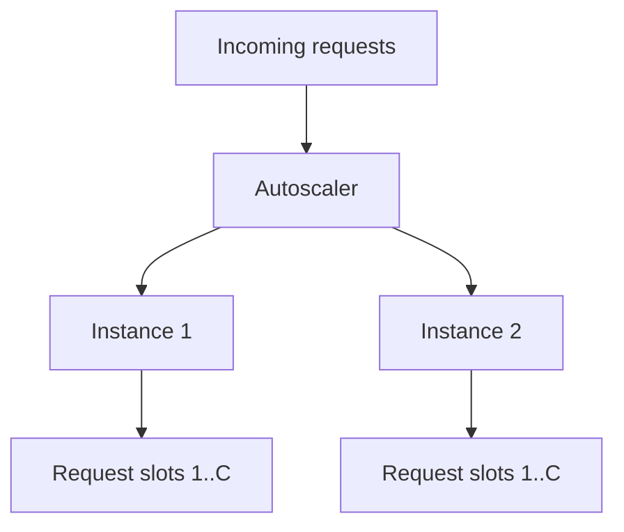

# Cấu hình concurrency, min instances và max instances

Một Java function trên Google Cloud có thể nhận nhiều request hoặc event trong thời gian ngắn. Nền tảng serverless tự động tạo thêm instance để xử lý tải, nhưng khả năng mở rộng cần được giới hạn theo năng lực thực tế của ứng dụng và các dịch vụ phụ thuộc. Ba cấu hình quan trọng là **concurrency**, **minimum instances** và **maximum instances**.

Concurrency quyết định một instance có thể xử lý bao nhiêu request đồng thời. Min instances giữ sẵn một số instance để giảm thời gian chờ khởi động. Max instances đặt giới hạn mở rộng để bảo vệ ngân sách và database. Ba cấu hình này tác động lẫn nhau: concurrency cao có thể giảm số instance cần thiết; min cao tăng năng lực sẵn sàng nhưng tăng chi phí; max thấp bảo vệ downstream nhưng có thể làm request chờ hoặc thất bại khi tải vượt giới hạn.

Trong phạm vi **CLOUD_SERVERLESS**, bài học tập trung vào phát triển và triển khai Java function được kích hoạt bởi HTTP, message hoặc event, đồng thời xử lý cold start, mở rộng, trạng thái, quyền truy cập, retry và chi phí. Các ví dụ sử dụng Cloud Run functions thế hệ 2 và Cloud Run services; cần phân biệt cấu hình của hai loại tài nguyên và không áp dụng mặc định của loại này cho loại kia.

## 1. Phân biệt Cloud Run functions và Cloud Run services

Google Cloud có nhiều cách triển khai workload serverless. Cloud Run functions (trước đây thường được gọi là Cloud Functions thế hệ 2) cho phép triển khai function từ mã nguồn với HTTP trigger hoặc event trigger. Cloud Run services chạy container HTTP do ứng dụng cung cấp. Cloud Run functions thế hệ 2 được triển khai trên hạ tầng Cloud Run, vì vậy có nhiều khái niệm scaling chung, nhưng giao diện cấu hình và một số mặc định khác nhau.

| Khái niệm | Cloud Run functions thế hệ 1 | Cloud Run functions thế hệ 2 | Cloud Run services |
|---|---|---|---|
| Đơn vị triển khai | Function | Function được triển khai thành Cloud Run service/revision | Service gồm một hoặc nhiều revision |
| Concurrency | Không cấu hình concurrency nhiều request như thế hệ 2 | Cấu hình được; API mặc định 1 request/instance | Cấu hình tối đa request/instance; mặc định phụ thuộc cách triển khai |
| Min instances | Có cấu hình riêng theo thế hệ và loại trigger | Có cấu hình min instance cho function | Có thể cấu hình ở service hoặc revision level |
| Max instances | Có giới hạn riêng theo thế hệ và loại trigger | Có cấu hình max instance cho function | Có service-level và revision-level max |
| Trường hợp phù hợp | Workload cũ đang sử dụng gen 1 | Event/HTTP function cần khả năng Cloud Run gen 2 | Java web/API container hoặc function framework tự quản lý HTTP server |

Khi đọc tài liệu, hãy xác định đang thao tác với Cloud Run functions hay Cloud Run service. Ví dụ, `gcloud functions deploy` dùng các flag `--min-instances`, `--max-instances`, `--concurrency`; `gcloud run deploy` có `--min`, `--max` ở service level và `--min-instances`, `--max-instances` ở revision level.

## 2. Concurrency là gì?

Concurrency là số request tối đa một instance có thể xử lý cùng lúc. Nếu một instance có concurrency bằng 1, nó xử lý một request tại một thời điểm. Nếu concurrency bằng 8, nền tảng có thể gửi tối đa 8 request đồng thời đến instance đó, miễn là ứng dụng và tài nguyên đủ khả năng.



Concurrency là giới hạn trên, không phải lời hứa rằng instance luôn nhận đủ số request đó. Nếu CPU đã bận, bộ nhớ gần giới hạn hoặc ứng dụng không xử lý được thêm request, autoscaler có thể tạo thêm instance thay vì đẩy thêm request vào instance hiện tại.

Concurrency ảnh hưởng đến:

- Số instance cần thiết để xử lý cùng một lượng request đang chạy.
- Mức sử dụng CPU và memory trên mỗi instance.
- Số thread, connection và tài nguyên dùng chung trong ứng dụng Java.
- Độ trễ khi request phải chờ trong hàng đợi nội bộ hoặc chờ connection pool.
- Chi phí do số instance và thời gian instance hoạt động thay đổi.

## 3. Mặc định concurrency khác nhau theo loại triển khai

Không nên giả định mọi workload Google Cloud đều có cùng giá trị concurrency mặc định.

- Cloud Run functions thế hệ 2 có trường `maxInstanceRequestConcurrency`; tài liệu API hiện mô tả mặc định là `1`.
- Cloud Run services hỗ trợ tối đa `1.000` request đồng thời trên một instance. Mặc định thường là `80` khi triển khai qua Console; với gcloud CLI hoặc Terraform, mặc định cho service mới có thể là `80` lần số vCPU.
- Cloud Run functions thế hệ 1 không hỗ trợ cấu hình concurrency nhiều request trên một instance như thế hệ 2.

Các mặc định có thể thay đổi theo công cụ, phiên bản API và cấu hình runtime. Với workload quan trọng, hãy đặt giá trị tường minh và kiểm tra revision/function sau khi deploy.

## 4. Concurrency ảnh hưởng thế nào đến Java?

Java có thể xử lý nhiều request đồng thời bằng nhiều thread. Tuy nhiên, concurrency cao chỉ có lợi nếu ứng dụng được thiết kế an toàn khi chạy song song và đủ tài nguyên cho các request cùng lúc.

Các điểm cần rà soát:

- **Thread safety:** controller, handler, service singleton và thư viện dùng chung không được chứa mutable state của request nếu không có đồng bộ phù hợp.
- **Database connection pool:** nếu 20 request đồng thời cùng cần database nhưng pool chỉ có 5 connection, 15 request còn lại có thể phải chờ.
- **CPU:** tác vụ CPU-bound như nén ảnh, mã hóa hoặc tính toán lớn có thể tranh chấp CPU khi concurrency quá cao.
- **Memory:** mỗi request có thể giữ payload, object graph, buffer hoặc kết quả trung gian; nhiều request đồng thời làm memory tăng.
- **HTTP client:** giới hạn connection pool, timeout và khả năng tái sử dụng client cần phù hợp với số request.
- **Rate limit của dependency:** tăng concurrency có thể vượt quota của API bên ngoài hoặc làm database quá tải.

Một Java service stateless, dùng client thread-safe và connection pool có giới hạn thường có thể tận dụng concurrency. Nếu handler giữ trạng thái mutable trong field hoặc dùng một connection JDBC dùng chung, cần sửa thiết kế trước khi tăng concurrency.

Ví dụ handler không lưu dữ liệu request trong field:

```java
public final class ReportService {
    private final ReportRepository repository;

    public ReportService(ReportRepository repository) {
        this.repository = repository;
    }

    public Report create(CreateReportCommand command) {
        // Biến cục bộ thuộc invocation hiện tại.
        var filters = command.filters();
        return repository.create(command.ownerId(), filters);
    }
}
```

Đối tượng `ReportService` có thể được dùng chung nếu dependency của nó an toàn khi gọi đồng thời. Không nên thêm field như `currentUser`, `currentRequest` hoặc `currentReport` để giữ dữ liệu riêng của từng invocation.

## 5. Chọn concurrency thấp hay cao?

Concurrency thấp thường phù hợp khi mỗi request dùng nhiều CPU, nhiều memory, giữ transaction lâu hoặc cần cô lập mạnh. Concurrency cao có thể phù hợp với request nhẹ, chủ yếu chờ I/O và dùng tài nguyên chung hiệu quả.

| Đặc tính workload | Hướng bắt đầu |
|---|---|
| CPU-bound, xử lý nặng | Concurrency thấp; tăng dần sau benchmark |
| I/O-bound, chờ database hoặc HTTP | Có thể thử concurrency cao hơn, nhưng giới hạn theo pool và quota downstream |
| Dùng thư viện không thread-safe | Đặt concurrency thấp hoặc thay thư viện/điều chỉnh cách sử dụng |
| Request giữ nhiều dữ liệu trong memory | Giảm concurrency để tránh memory pressure |
| API đơn giản, stateless, thời gian ngắn | Thử mức vừa phải rồi đo latency và cost |
| Function thế hệ 2 cần hành vi gần 1 request/instance | Đặt concurrency bằng 1 |

Không có một giá trị tối ưu cho mọi Java function. Hãy chạy load test với dữ liệu và dependency thực tế, sau đó chọn mức concurrency đạt throughput cần thiết mà không làm p95/p99 latency, lỗi hoặc tài nguyên vượt ngưỡng.

## 6. Min instances là gì?

Min instances là số instance tối thiểu nền tảng cố gắng giữ ở trạng thái sẵn sàng. Khi không có request, các instance này có thể ở trạng thái idle. Khi traffic đến, request có thể được gửi đến instance đã khởi tạo thay vì phải chờ một instance mới khởi động.

Min instances hữu ích khi:

- API có yêu cầu latency thấp và cold start ảnh hưởng rõ đến p95/p99.
- Function được gọi thường xuyên theo các đợt, nhưng không đủ đều để luôn có instance active.
- Khởi tạo Java tốn thời gian do framework, dependency hoặc kết nối ban đầu.
- Có lịch tải dự đoán được và cần chuẩn bị trước một lượng capacity.

Min instances không phải cam kết tuyệt đối rằng không bao giờ có cold start. Nền tảng có thể restart instance, cân bằng lại hạ tầng hoặc tạm thời không đạt mức tối thiểu do quota, capacity vùng hay lỗi ứng dụng. Instance mới vẫn có thể được tạo khi traffic vượt capacity đang giữ sẵn.

## 7. Min instances ở service level và revision level

Cloud Run services hỗ trợ hai phạm vi cấu hình min instances:

- **Service-level minimum:** đặt mức tối thiểu cho toàn service. Nền tảng phân bổ instance giữa các revision đang nhận traffic theo tỷ lệ traffic split. Thay đổi có thể áp dụng mà không cần tạo revision mới.
- **Revision-level minimum:** đặt mức tối thiểu cho một revision cụ thể. Thay đổi cấu hình tạo revision mới; revision có thể được giữ chạy khi được traffic split hoặc traffic tag tham chiếu.

Google khuyến nghị ưu tiên service-level minimum cho phần lớn trường hợp và tránh kết hợp cả hai phạm vi nếu không có lý do rõ ràng. Nếu gắn traffic tag vào revision có revision-level minimum, revision đó có thể được giữ chạy dù không nhận traffic thông thường và vẫn phát sinh chi phí.

Với Cloud Run functions thế hệ 2, cấu hình function có trường `minInstanceCount`. Khi dùng `gcloud functions deploy`, có thể đặt `--min-instances`. Đừng nhầm tên flag này với `--min` của Cloud Run service-level.

## 8. Max instances là gì?

Max instances đặt giới hạn số instance mà service hoặc function được phép sử dụng trong điều kiện bình thường. Đây là một cách kiểm soát:

- Chi phí khi traffic tăng đột biến.
- Số kết nối đồng thời đến database.
- Mức tải lên API hoặc hệ thống downstream.
- Tài nguyên CPU/memory được sử dụng trong một region.
- Mức concurrency và tốc độ xử lý mà hệ thống có thể duy trì.

Max instances không đồng nghĩa hệ thống sẽ luôn scale đến giá trị đó. Nền tảng còn chịu ảnh hưởng bởi quota CPU/memory theo region, capacity hạ tầng, thời gian khởi động và tình trạng của ứng dụng.

Max instances cũng không phải giới hạn tuyệt đối trong mọi khoảnh khắc. Khi traffic tăng rất nhanh, trong quá trình thay thế instance hoặc triển khai revision mới, tổng instance có thể tạm thời vượt giá trị dự kiến. Nếu downstream không chịu được bất kỳ mức vượt nào, cần đặt max thấp hơn ngân sách cứng và có thêm giới hạn ở tầng database/proxy.

## 9. Max instances ở service level và revision level

Cloud Run services có hai phạm vi max instances:

- **Service-level max:** giới hạn tổng số instance của service, được phân bổ giữa các revision đang nhận traffic. Đây thường là lựa chọn phù hợp để đặt giới hạn chi phí hoặc giới hạn tổng tải lên database.
- **Revision-level max:** giới hạn riêng từng revision. Cấu hình gắn với revision và thay đổi tạo revision mới.

Khi đặt cả hai, giới hạn hiệu lực thường là mức thấp hơn giữa service max và revision max. Với traffic split, service-level max được chia theo tỷ lệ traffic cho các revision. Vì vậy, một revision có thể chạm giới hạn riêng dù tổng service chưa dùng hết toàn bộ ngân sách instance.

Trong thời gian triển khai revision mới, revision cũ có thể tiếp tục phục vụ request đang chạy trong khi revision mới nhận traffic. Do đó, nếu chỉ tính max theo một revision, tổng instance trong giai đoạn rollout có thể cao hơn dự tính.

Với Cloud Run functions thế hệ 2, dùng `--max-instances` trong `gcloud functions deploy` để cấu hình function. Với Cloud Run service, cân nhắc `--max` ở service level khi mục tiêu là giới hạn tổng instance của service.

## 10. Tính capacity từ concurrency và số instance

Một ước lượng đơn giản về số request có thể đang được xử lý đồng thời:

\[
\text{In-flight capacity} \approx \text{instances} \times \text{concurrency}
\]

Nếu service có max 20 instance và concurrency 8, capacity lý thuyết là khoảng 160 request đồng thời. Đây chỉ là giới hạn từ hai cấu hình; CPU, memory, ứng dụng, thời gian xử lý và dependency có thể làm capacity thực tế thấp hơn.

Để ước lượng số request đang chạy từ lưu lượng và độ trễ, có thể dùng định luật Little:

\[
L = \lambda \times W
\]

Trong đó `L` là số request trung bình đang xử lý, `λ` là tốc độ request đến mỗi giây và `W` là thời gian xử lý trung bình tính bằng giây.

Ví dụ, API nhận trung bình 100 request/giây và mỗi request mất 0,2 giây. Số request đang chạy trung bình ước lượng là 20. Nếu concurrency mỗi instance đặt là 5, cần khoảng 4 instance để phục vụ mức tải trung bình này. Để chịu peak, biến động latency và headroom, cần thử tải cao hơn và quan sát autoscaler.

Không dùng công thức này như lời bảo đảm về số instance. Cloud Run autoscaler còn xem xét CPU utilization, request concurrency, tốc độ khởi động và các giới hạn theo region.

## 11. Cân bằng ba cấu hình

Ba cấu hình trả lời ba câu hỏi khác nhau:

| Cấu hình | Câu hỏi | Giá trị quá thấp | Giá trị quá cao |
|---|---|---|---|
| Concurrency | Một instance nhận bao nhiêu request cùng lúc? | Cần nhiều instance, có thể tăng cold start và chi phí | Tranh chấp CPU/memory, thread và connection; latency tăng |
| Min instances | Cần giữ sẵn bao nhiêu instance? | Có thể gặp cold start khi không có instance active | Tốn chi phí idle và phân tán traffic lên quá nhiều instance |
| Max instances | Cho phép scale tối đa bao nhiêu instance? | Request chờ/thất bại, backlog hoặc throttling | Có thể vượt ngân sách và làm downstream quá tải |

Một cấu hình khởi đầu cho Java API có thể là concurrency 4–8, min 1 và max 10–20, nhưng chỉ là giả thuyết để benchmark. Function xử lý ảnh CPU-bound hoặc function ghi database với pool nhỏ có thể cần concurrency thấp hơn. API nhẹ và I/O-bound có thể chịu concurrency cao hơn.

## 12. Ví dụ tính connection budget cho database

Giả sử Java service có:

- Max instances = 30.
- Mỗi instance có JDBC pool tối đa 4 connection.
- Các ứng dụng khác dùng 40 connection.
- Database có giới hạn 200 connection, cần giữ 30 connection dự phòng cho quản trị và batch job.

Nhu cầu connection tối đa ước lượng từ service:

\[
30 \times 4 = 120 \text{ connections}
\]

Ngân sách còn lại sau khi trừ workload khác và dự phòng:

\[
200 - 40 - 30 = 130 \text{ connections}
\]

Service dùng tối đa 120 connection, nằm trong ngân sách 130 theo giả định. Nếu tăng max instances lên 40, nhu cầu sẽ là 160 connection và vượt ngân sách.

Ví dụ này cho thấy max instances không nên được đặt chỉ dựa vào traffic. Cần tính đồng thời concurrency, pool size, số function/service cùng dùng database và các connection khác. Nếu pool tối đa 4 nhưng concurrency là 12, mỗi instance có thể có 8 request chờ connection; cần đo wait time và xem có nên tăng pool hay giảm concurrency.

## 13. Cấu hình Cloud Run functions thế hệ 2 bằng gcloud

Ví dụ deploy Java function HTTP thế hệ 2 với concurrency, min và max được đặt tường minh:

```bash
gcloud functions deploy orders-api \
  --gen2 \
  --runtime=javaXX \
  --region=asia-southeast1 \
  --source=. \
  --entry-point=com.example.OrdersFunction \
  --trigger-http \
  --concurrency=8 \
  --min-instances=1 \
  --max-instances=20 \
  --memory=1Gi \
  --cpu=1
```

`javaXX` là placeholder; thay bằng runtime Java còn được Google Cloud hỗ trợ tại thời điểm triển khai. Tên entry point phải khớp class/function trong artifact. Các flag scaling trên dành cho Cloud Run functions thế hệ 2; thế hệ 1 không hỗ trợ cấu hình concurrency nhiều request trên một instance.

Có thể cập nhật function đã triển khai bằng cùng lệnh và đúng tên function/region. Dùng `--clear-min-instances` hoặc `--clear-max-instances` khi muốn xóa cấu hình tương ứng; đọc lại cấu hình sau deploy để xác nhận giá trị hiệu lực.

## 14. Cấu hình Cloud Run service bằng gcloud

Nếu Java application được đóng gói thành container và triển khai như Cloud Run service, có thể cấu hình service-level min/max cùng concurrency:

```bash
gcloud run deploy orders-service \
  --image=asia-southeast1-docker.pkg.dev/PROJECT_ID/apps/orders:VERSION \
  --region=asia-southeast1 \
  --concurrency=8 \
  --min=1 \
  --max=20 \
  --cpu=1 \
  --memory=1Gi
```

Trong lệnh trên, `--min` và `--max` áp dụng ở service level. Nếu cần đặt min/max riêng cho revision, Cloud Run CLI có các flag `--min-instances` và `--max-instances`. Không trộn hai cặp flag nếu chưa hiểu cách Cloud Run phân bổ instance giữa service và revision.

Thay `PROJECT_ID`, image, version và region bằng giá trị của môi trường. Với Cloud Run service, container Java phải lắng nghe trên port được cung cấp qua biến môi trường `PORT` và đáp ứng readiness/startup behavior của nền tảng.

## 15. Cấu hình bằng YAML hoặc Terraform

Cloud Run service có thể được cấu hình qua YAML. Ví dụ rút gọn:

```yaml
apiVersion: serving.knative.dev/v1
kind: Service
metadata:
  name: orders-service
  annotations:
    run.googleapis.com/minScale: '1'
    run.googleapis.com/maxScale: '20'
spec:
  template:
    spec:
      containerConcurrency: 8
      containers:
        - image: asia-southeast1-docker.pkg.dev/PROJECT_ID/apps/orders:VERSION
```

Trong ví dụ này, annotation ở `metadata` đặt min/max ở service level; `containerConcurrency` thuộc revision template. Nếu muốn cấu hình riêng từng revision, dùng annotation scaling ở `spec.template.metadata.annotations` theo tài liệu Cloud Run.

Với Terraform Cloud Run v2, các thuộc tính tương ứng thường được đặt trong resource `google_cloud_run_v2_service`:

```hcl
resource "google_cloud_run_v2_service" "orders" {
  name     = "orders-service"
  location = "asia-southeast1"

  scaling {
    min_instance_count = 1
    max_instance_count = 20
  }

  template {
    max_instance_request_concurrency = 8

    containers {
      image = "asia-southeast1-docker.pkg.dev/PROJECT_ID/apps/orders:VERSION"
    }
  }
}
```

Đây là ví dụ cấu trúc, cần bổ sung project, service account, ingress, CPU, memory, environment và các thiết lập bảo mật của dự án. Tên field Terraform/API có thể thay đổi theo provider version; hãy kiểm tra schema của phiên bản provider đang khóa trong repository.

## 16. Min instances và cold start của Java

Cold start là khoảng thời gian nền tảng cần để tạo instance mới, khởi động runtime/container, nạp class, khởi tạo framework và sẵn sàng nhận request. Với Java, các yếu tố có thể làm tăng startup time gồm:

- Số lượng class và dependency cần nạp.
- Thời gian khởi tạo Spring hoặc framework tương tự.
- Tạo SDK client, connection pool hoặc cache lúc khởi động.
- Đọc cấu hình và secret từ dịch vụ bên ngoài.
- Thiết lập kết nối database hoặc network.
- Kích thước container image và thời gian tải image.

Min instances giúp giữ sẵn một phần capacity, nhưng không thay thế tối ưu startup. Nên đo riêng thời gian khởi tạo và thời gian xử lý request; giảm dependency không cần thiết, tái sử dụng client thread-safe và tránh thực hiện network call chậm trong static initializer nếu không cần.

Min instances cũng có thể được restart. Vì vậy, không được lưu trạng thái nghiệp vụ trong memory của instance với giả định instance sẽ tồn tại liên tục. Dữ liệu quan trọng phải lưu trong database, object storage hoặc kho trạng thái bền vững.

## 17. Max instances và backpressure

Khi tất cả instance đạt concurrency tối đa và service đã chạm max instances, request mới có thể phải chờ trong khoảng thời gian giới hạn. Nếu không có capacity giải phóng, HTTP request có thể thất bại với mã lỗi như `429` hoặc lỗi liên quan đến capacity. Hành vi cụ thể phụ thuộc loại trigger và nền tảng.

Với event-driven workload, cần xét cơ chế retry/delivery của nguồn event. Một số nguồn có thể giữ event và retry khi function không nhận được; HTTP caller có thể phải tự retry theo hợp đồng API. Không giả định mọi request đều được lưu bền vững khi max instances đã chạm.

Backpressure giúp giữ tải trong giới hạn mà downstream chịu được:

- Dùng queue để tách tốc độ nhận event khỏi tốc độ xử lý.
- Giới hạn concurrency hoặc max instances theo database/API dependency.
- Dùng retry có backoff và jitter, tránh retry storm.
- Trả `429`/`503` phù hợp khi hệ thống không thể nhận thêm công việc.
- Với tác vụ dài, trả task ID và xử lý bất đồng bộ thay vì giữ HTTP request mở.
- Theo dõi queue depth, request latency và số lần throttling để điều chỉnh capacity.

## 18. Chi phí của min, max và concurrency

Chi phí phụ thuộc số instance, CPU/memory, thời gian hoạt động, request, network và mô hình billing đang cấu hình.

- **Min instances:** instance idle vẫn có thể phát sinh phí. Với request-based billing, idle instance có thể được tính ở mức thấp hơn khi chờ request; với instance-based billing, chi phí áp dụng trong toàn bộ vòng đời instance.
- **Max instances:** max cao tăng khả năng phục vụ peak nhưng cũng mở rộng trần tài nguyên và chi phí. Max thấp giảm rủi ro ngân sách nhưng có thể gây queueing, 429 hoặc backlog.
- **Concurrency:** concurrency cao có thể giúp ít instance hơn xử lý cùng lượng request, nhưng nếu gây memory/CPU pressure hoặc kéo dài latency, tổng chi phí và tỷ lệ lỗi có thể tăng.
- **CPU/memory:** tăng tài nguyên mỗi instance có thể tăng throughput và giảm thời gian xử lý, nhưng giá mỗi instance cũng thay đổi.

Không nên đặt min bằng peak capacity nếu phần lớn thời gian traffic thấp. Min nên gần với tải nền cần phục vụ nhanh. Max nên phản ánh giới hạn chi phí và năng lực downstream. Hãy dùng billing budget và alert để phát hiện tăng chi phí bất thường.

## 19. Theo dõi và điều chỉnh cấu hình

Các metric nên quan sát cùng nhau:

| Nhóm | Metric | Dấu hiệu cần chú ý |
|---|---|---|
| Traffic | Request count, request rate, event rate | Burst hoặc tăng tải bất thường |
| Latency | p50, p95, p99, startup latency | Cold start hoặc request chờ capacity |
| Concurrency | Concurrent requests, utilization per instance | Concurrency chạm trần hoặc quá cao |
| Scaling | Active/idle instance count, min/max reached | Max cap, scale chậm hoặc min dư thừa |
| Errors | 429, 5xx, timeout, failed invocation | Thiếu capacity hoặc dependency lỗi |
| Runtime | CPU, memory, GC pause, thread count | CPU/memory pressure hoặc thread pool nghẽn |
| Database | Active/idle connection, pool wait, query latency | Max instances × pool size vượt budget |
| Cost | CPU-seconds, GiB-seconds, idle instance time | Min cao hoặc scale-out kéo dài |

Thay đổi từng thông số một hoặc dùng một ma trận test có kiểm soát. Ví dụ, chạy concurrency 1, 4, 8 và 16 với cùng payload; ghi throughput, p95, memory và database wait. Sau đó giữ concurrency tốt nhất và thay đổi min/max để đánh giá cold start, backlog và chi phí.

## 20. Quy trình benchmark cho Java function

Một quy trình thực tế:

1. Chọn một function đại diện và cố định phiên bản Java, CPU, memory, framework, payload và dependency.
2. Đo cold start khi min instances bằng 0; phân biệt request đầu tiên với request warm.
3. Chạy tải ổn định và burst với concurrency 1, 4, 8, 16 hoặc các mức phù hợp với ứng dụng.
4. Ghi throughput, p95/p99 latency, CPU, memory, GC, connection pool wait và lỗi.
5. Đặt max instances đủ cao để benchmark năng lực ứng dụng mà không làm hỏng database hoặc dịch vụ ngoài.
6. Đặt min instances bằng 1 hoặc mức tải nền dự kiến, đo tỷ lệ cold start và chi phí idle.
7. Giảm max instances để mô phỏng giới hạn downstream; xác minh hành vi queueing, 429 và retry.
8. Chạy lại sau khi thay đổi framework, dependency, connection pool hoặc runtime Java.

Không chỉ benchmark request trung bình. Hãy đưa vào payload lớn, truy vấn chậm, lỗi dependency và các tình huống burst để biết hệ thống phản ứng thế nào khi gần chạm giới hạn.

## 21. Lỗi cấu hình thường gặp

| Triệu chứng | Nguyên nhân có thể | Cách kiểm tra |
|---|---|---|
| Nhiều instance dù traffic vừa phải | Concurrency đặt quá thấp hoặc request xử lý lâu | Kiểm tra concurrency, CPU và latency |
| Một instance có nhiều request nhưng latency tăng | Concurrency quá cao, CPU/thread/memory tranh chấp | Giảm concurrency và benchmark lại |
| Cold start vẫn xuất hiện dù min lớn hơn 0 | Instance bị restart, scale-out tạo instance mới hoặc min là best-effort | Theo dõi startup latency và instance lifecycle |
| Database hết connection khi traffic tăng | Max instances × pool size vượt connection budget | Tính tổng pool và giảm max/concurrency hoặc dùng proxy |
| Request trả 429 khi tải đột biến | Max instances đạt trần hoặc quota/capacity bị giới hạn | Xem max limit, quota và request pending |
| Chi phí idle cao | Min instances lớn hoặc billing mode tính phí toàn vòng đời | Kiểm tra min, idle time và billing mode |
| Rollout tạo nhiều instance hơn dự kiến | Revision cũ và mới cùng phục vụ request trong thời gian chuyển traffic | Tính capacity cho nhiều revision trong giai đoạn rollout |
| Max đặt cao nhưng service không scale đến mức đó | Regional CPU/memory quota hoặc capacity giới hạn | Kiểm tra quota và metrics scaling |

## 22. Checklist production

| Câu hỏi | Bằng chứng cần có |
|---|---|
| Đang dùng Cloud Run functions hay Cloud Run service? | Loại resource và thế hệ được xác định rõ |
| Concurrency phù hợp với Java code? | Load test, thread safety, CPU và memory |
| Pool database có đủ nhưng không quá lớn? | Connection budget theo max instances và số workload khác |
| Min instances có lý do rõ ràng? | Cold start/latency data và ước tính idle cost |
| Max instances có bảo vệ downstream? | Database/API capacity và safety margin |
| Service-level hay revision-level scaling? | Quyết định dựa trên traffic split và rollout |
| Có hiểu behavior khi chạm max? | Test 429, pending request, event retry và backlog |
| Có quan sát cold start và scale? | Startup latency, instance count, concurrency và errors |
| Có tính đến quota theo region? | CPU/memory quota và mức sử dụng tổng thể |
| Có tính chi phí min idle? | Billing mode, budget và alert |
| Có xử lý trạng thái bền vững? | Không phụ thuộc memory của instance |
| Có kế hoạch kiểm thử lại? | Benchmark khi đổi runtime, dependency hoặc cấu hình |

## 23. Khi nào nên tăng hoặc giảm từng thông số?

**Tăng concurrency** khi instance còn CPU/memory, request chủ yếu chờ I/O, code thread-safe và downstream còn capacity. Giảm concurrency khi request CPU-bound, memory lớn, dependency có giới hạn hoặc p95/p99 tăng do tranh chấp tài nguyên.

**Tăng min instances** khi cold start làm vi phạm mục tiêu latency và có tải nền đủ ổn định để biện minh cho chi phí idle. Giảm min khi instance idle quá nhiều, startup đã được tối ưu hoặc độ trễ cold start chấp nhận được.

**Tăng max instances** khi request backlog hoặc throttling tăng, database/API vẫn còn capacity và ngân sách cho phép. Giảm max khi cần bảo vệ database, API quota hoặc ngân sách, nhưng phải chuẩn bị backpressure, queue và retry phù hợp.

Concurrency, min instances và max instances nên được điều chỉnh dựa trên số liệu của chính workload. Với Java function, hãy kiểm tra thread safety, pool connection, CPU, memory và thời gian khởi tạo trước khi tăng capacity. Cấu hình tốt là cấu hình đáp ứng latency và throughput cần thiết, giữ downstream trong giới hạn và duy trì chi phí có thể dự đoán.

## 24. Tài liệu tham khảo

- [Cloud Run: Maximum concurrent requests for services](https://cloud.google.com/run/docs/about-concurrency)
- [Cloud Run: Set minimum instances for services](https://cloud.google.com/run/docs/configuring/min-instances)
- [Cloud Run: Set maximum instances for services](https://cloud.google.com/run/docs/configuring/max-instances)
- [Cloud Run functions: Quotas and limits](https://cloud.google.com/functions/quotas)
- [Cloud Run functions v2 API: Function service configuration](https://cloud.google.com/functions/docs/reference/rest/v2/projects.locations.functions)
- [Google Cloud SDK: gcloud functions deploy](https://cloud.google.com/sdk/gcloud/reference/functions/deploy)
- [Google Cloud SDK: gcloud run deploy](https://cloud.google.com/sdk/gcloud/reference/run/deploy)
