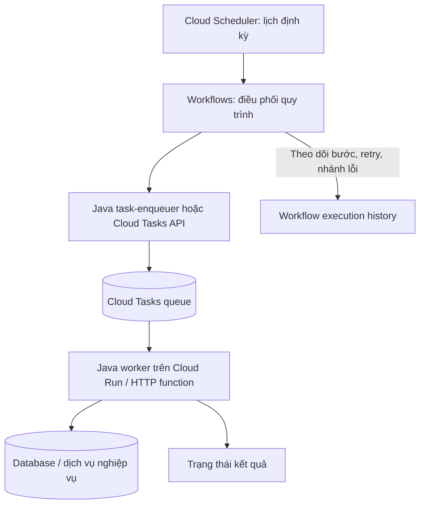
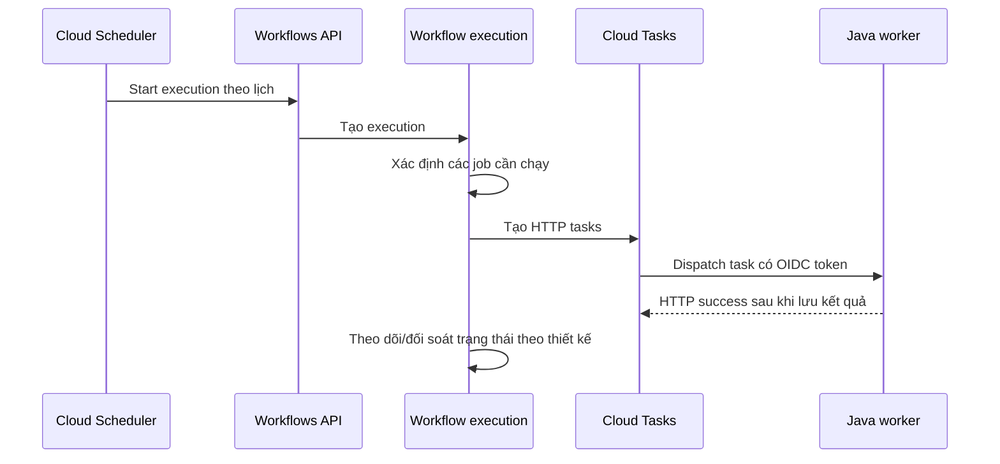
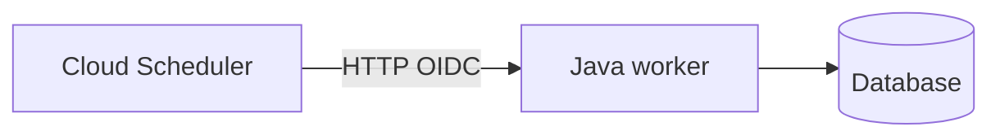
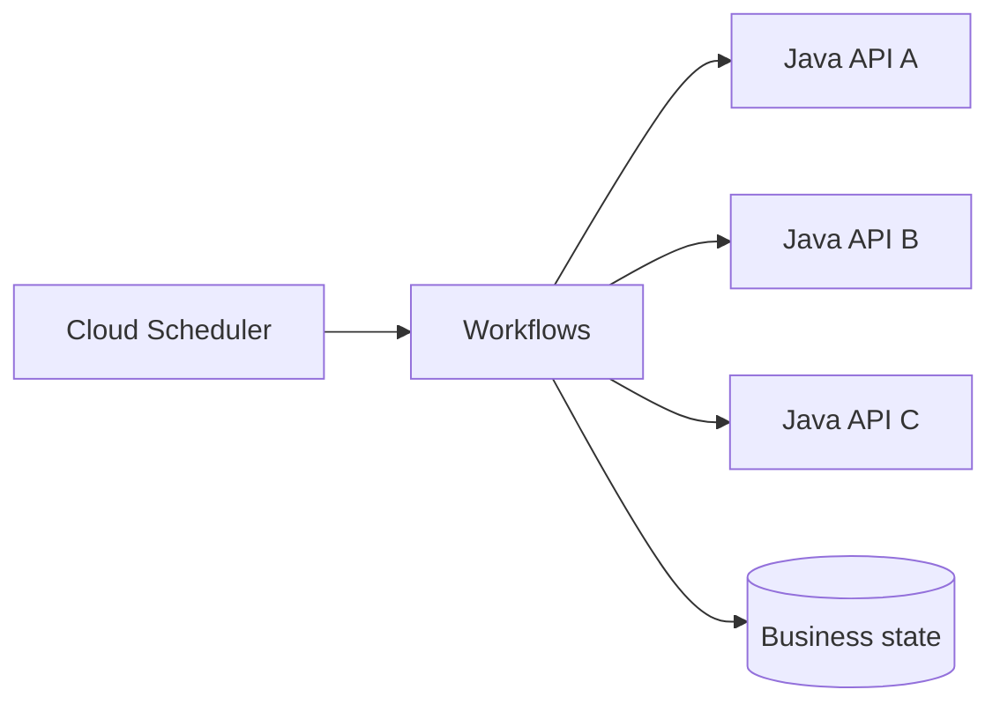
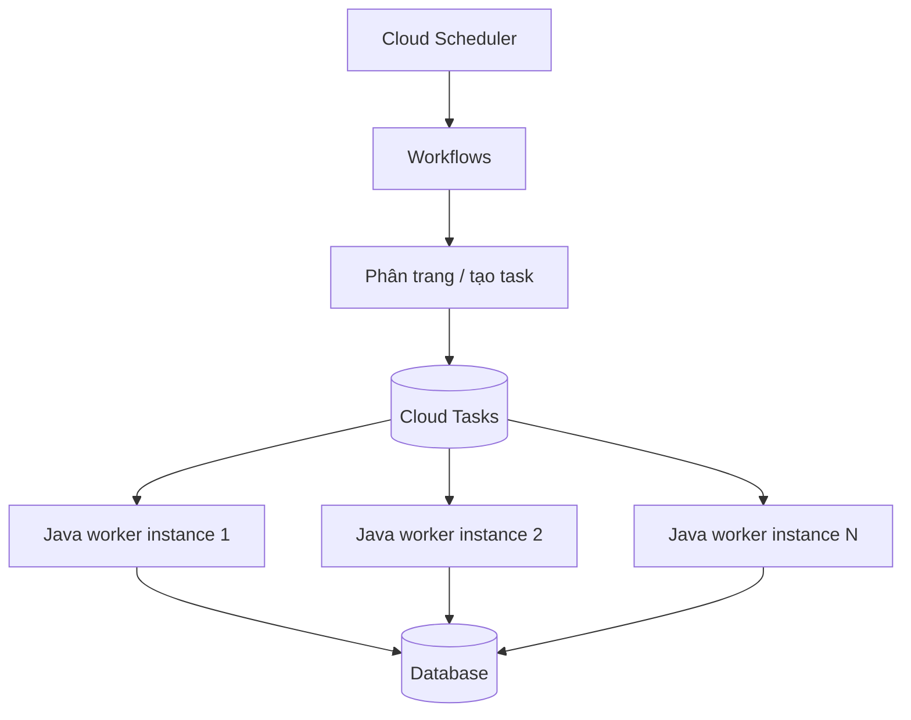
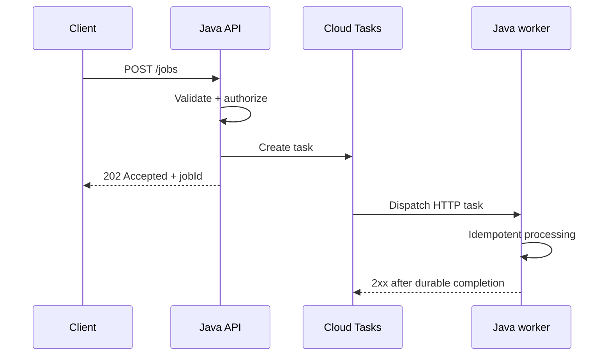

# Điều phối bằng Workflows, Cloud Tasks và Cloud Scheduler

Một ứng dụng serverless thường có nhiều loại công việc: chạy quy trình gồm nhiều bước, gửi một tác vụ tới worker khi đến thời điểm phù hợp, hoặc tự động khởi chạy công việc theo lịch. Trên Google Cloud, **Workflows**, **Cloud Tasks** và **Cloud Scheduler** giải quyết ba nhu cầu liên quan nhưng khác nhau.

- **Workflows** điều phối một quy trình gồm nhiều bước, lưu trạng thái thực thi và quản lý nhánh, retry, lỗi giữa các bước.
- **Cloud Tasks** đưa một tác vụ HTTP vào hàng đợi để phân phối tới worker, kiểm soát tốc độ và concurrency, đồng thời retry khi endpoint chưa xử lý thành công.
- **Cloud Scheduler** kích hoạt một công việc theo lịch cron hoặc thời điểm đã cấu hình, ví dụ mỗi đêm, mỗi giờ hoặc vào ngày đầu tháng.

Ba dịch vụ có thể kết hợp. Ví dụ, Cloud Scheduler khởi chạy Workflows mỗi đêm; workflow truy vấn các lô dữ liệu cần xử lý và tạo Cloud Tasks; Cloud Tasks phân phối từng tác vụ tới Java service chạy trên Cloud Run hoặc HTTP function. Cách phân chia này giúp lịch chạy, logic điều phối và việc phân phối tải có trách nhiệm rõ ràng.

## 1. Phân biệt vai trò của ba dịch vụ

| Dịch vụ | Câu hỏi chính | Cơ chế | Phù hợp với |
|---|---|---|---|
| Workflows | Các bước nghiệp vụ phải chạy theo trình tự nào? | Workflow definition với steps, conditions, loops, parallel branches, retries và error handling | Quy trình nhiều bước, tích hợp nhiều API, cần theo dõi trạng thái tiến trình |
| Cloud Tasks | Một tác vụ HTTP cần được giao cho worker khi nào và với tốc độ nào? | Task queue, HTTP target, dispatch rate, concurrency và retry policy | Xử lý nền, deferred work, giới hạn tốc độ gọi service, hấp thụ burst |
| Cloud Scheduler | Khi nào cần khởi chạy một công việc? | Lịch cron/time zone và target HTTP, Pub/Sub hoặc App Engine | Báo cáo định kỳ, cleanup, đồng bộ theo lịch, khởi tạo workflow |

Không nên dùng một dịch vụ thay thế hoàn toàn hai dịch vụ còn lại. Workflows có thể chờ và retry một bước, nhưng không phải hàng đợi phân phối số lượng lớn tác vụ độc lập với rate control chi tiết. Cloud Tasks có thể lên lịch một task trong tương lai, nhưng không phải bộ lập lịch cron định kỳ. Cloud Scheduler kích hoạt theo lịch, nhưng không quản lý toàn bộ trạng thái của một quy trình nhiều bước.

### Kiến trúc phối hợp thường gặp



Ví dụ: mỗi ngày lúc 02:00 UTC, Scheduler khởi chạy workflow tạo báo cáo. Workflow xác định các khách hàng cần xử lý, chia thành các tác vụ nhỏ và đưa vào Cloud Tasks. Queue chỉ dispatch một số lượng request nhất định trong mỗi giây. Java worker xử lý từng tác vụ, ghi kết quả và trả HTTP success khi đã hoàn tất hoặc đã lưu trạng thái tiếp nhận bền vững theo contract.

## 2. Workflows: điều phối quy trình có trạng thái

Google Cloud Workflows là dịch vụ điều phối serverless. Người phát triển mô tả quy trình bằng YAML hoặc JSON. Mỗi execution chạy qua các step có thể gọi HTTP endpoint, connector tới Google Cloud API, gán biến, rẽ nhánh, lặp, chạy song song, xử lý lỗi và gọi subworkflow.

Workflows hữu ích khi một quy trình cần thể hiện rõ:

- Bước nào phải hoàn thành trước bước nào.
- Điều kiện nào quyết định nhánh tiếp theo.
- Bước nào có thể retry và dùng backoff ra sao.
- Khi một bước thất bại, cần dừng, thử lại, gọi bước bù trừ hay đánh dấu tiến trình thất bại.
- Kết quả của từng bước được truyền sang bước tiếp theo như thế nào.

Workflows lưu trạng thái execution và lịch sử thực thi để có thể theo dõi tiến trình. Tuy vậy, trạng thái workflow không thay thế database nghiệp vụ. Những dữ liệu như trạng thái đơn hàng, quyền sở hữu, số dư hoặc kết quả cần tra cứu lâu dài vẫn nên được lưu trong hệ thống dữ liệu do ứng dụng quản lý.

### Ví dụ workflow gọi Java HTTP service

Giả sử Java service trên Cloud Run có endpoint `POST /prepare` và `POST /finalize`. Workflow gọi bước chuẩn bị, sau đó hoàn tất; nếu bước gọi tạm thời lỗi, workflow retry với exponential backoff.

```yaml
main:
  params: [args]
  steps:
    - initialize:
        assign:
          - jobId: ${args.jobId}
          - workerUrl: ${sys.get_env("WORKER_URL")}

    - prepare:
        call: http.post
        args:
          url: ${workerUrl + "/prepare"}
          auth:
            type: OIDC
            audience: ${workerUrl}
          body:
            jobId: ${jobId}
        result: prepareResponse
        retry:
          predicate: ${http.default_retry_predicate}
          max_retries: 3
          backoff:
            initial_delay: 1
            max_delay: 20
            multiplier: 2

    - finalize:
        call: http.post
        args:
          url: ${workerUrl + "/finalize"}
          auth:
            type: OIDC
            audience: ${workerUrl}
          body:
            jobId: ${jobId}
            preparation: ${prepareResponse.body}
        result: finalizeResponse

    - finish:
        return:
          jobId: ${jobId}
          status: ${finalizeResponse.code}
```

Đây là ví dụ minh họa cú pháp Workflows. Cần thay URL, audience và response contract theo dịch vụ thật. Service account của workflow phải có quyền gọi Cloud Run service, thường là `roles/run.invoker`. Nếu endpoint dùng authentication khác, cấu hình `auth` phải phù hợp với cơ chế đó. Không để endpoint production công khai chỉ để workflow gọi được.

### Retry trong Workflows

Retry nên dành cho lỗi có khả năng tự phục hồi như timeout mạng, throttling hoặc lỗi dịch vụ tạm thời. Một retry policy thường có:

- Predicate xác định lỗi nào được retry.
- Số lần retry tối đa.
- Thời gian chờ ban đầu.
- Thời gian chờ tối đa.
- Hệ số tăng backoff.

Không retry vô hạn lỗi validation, lỗi quyền hoặc dữ liệu nghiệp vụ không hợp lệ. Khi một bước đã tạo side effect rồi response bị mất, retry có thể gọi lại bước đó. Vì vậy, endpoint được workflow gọi cần idempotent theo `jobId`, operation ID hoặc business key.

### Compensation và Saga

Workflows điều phối các bước, nhưng không tự tạo một distributed transaction bao trùm database, payment service và các API khác. Nếu bước thứ ba thất bại sau khi hai bước trước đã tạo side effect, workflow có thể gọi các bước bù trừ đã được ứng dụng định nghĩa.

Ví dụ:

1. Giữ chỗ tồn kho.
2. Tạo yêu cầu thanh toán.
3. Xác nhận đơn hàng.
4. Nếu bước xác nhận đơn thất bại, gọi bước hủy thanh toán và giải phóng tồn kho nếu nghiệp vụ cho phép.

Các hành động bù trừ cũng có thể lỗi và cần retry, audit, idempotency. Không phải mọi side effect đều có thể đảo ngược hoàn toàn; hãy xác định rõ trạng thái trung gian và quy trình xử lý thủ công.

### Khi nào không nên dùng Workflows?

Nếu chỉ cần gọi một HTTP endpoint duy nhất, một task queue hoặc Scheduler trực tiếp có thể đơn giản hơn. Nếu cần xử lý một lượng lớn message độc lập với throughput cao, Cloud Tasks hoặc Pub/Sub thường phù hợp hơn. Workflow nên mô tả tiến trình nghiệp vụ có nhiều bước và cần quan sát trạng thái, không nên biến thành vòng lặp khổng lồ để thay một queue.

## 3. Cloud Tasks: phân phối tác vụ HTTP có kiểm soát

Cloud Tasks lưu các task trong queue và dispatch chúng tới HTTP target. Queue có thể kiểm soát tốc độ dispatch, số request đồng thời và retry khi target chưa xác nhận thành công. Worker có thể là Cloud Run service, Cloud Run function hoặc HTTP endpoint tương thích.

Cloud Tasks phù hợp khi ứng dụng cần:

- Đẩy một tác vụ ra khỏi request hiện tại để trả response nhanh.
- Trì hoãn tác vụ tới một thời điểm cụ thể.
- Hạn chế tốc độ gọi API bên ngoài hoặc database.
- Hấp thụ burst và phân phối công việc theo năng lực worker.
- Retry request khi endpoint lỗi tạm thời hoặc timeout.

Cloud Tasks là queue hướng HTTP. Producer tạo task, Cloud Tasks gọi endpoint đích; worker không tự pull message như mô hình consumer queue truyền thống. Khi endpoint trả response thành công theo contract của Cloud Tasks, task được xem là đã hoàn tất. Nếu request thất bại hoặc không được xác nhận, task có thể được dispatch lại theo retry policy.

### Dispatch rate và concurrency

Queue có các thiết lập kiểm soát tải như:

- Số dispatch tối đa mỗi giây.
- Số task đang được dispatch đồng thời tối đa.
- Số lần thử tối đa.
- Backoff tối thiểu/tối đa và số lần tăng gấp đôi khoảng chờ.
- Thời lượng retry tối đa.

Các giới hạn này giúp bảo vệ worker và dependency. Ví dụ, nếu database chỉ chịu được một số lượng kết nối hoặc request nhất định, queue có thể giới hạn concurrency để worker không tạo burst quá lớn. Cần theo dõi queue backlog và tuổi task lâu nhất để biết worker có theo kịp producer không.

### Retry và at-least-once

Cloud Tasks có thể dispatch cùng một task nhiều lần. Một tình huống điển hình: worker đã ghi dữ liệu thành công nhưng response bị mất trước khi Cloud Tasks nhận được xác nhận. Task sẽ được gửi lại. Vì vậy, worker phải idempotent.

Task name có thể giúp phát hiện việc tạo task trùng trong khoảng thời gian deduplication mà dịch vụ hỗ trợ. Tuy nhiên, không dùng task name làm bảo đảm exactly-once cho nghiệp vụ. Cần lưu business idempotency key ở database và bảo vệ side effect bằng unique constraint hoặc conditional update.

Cloud Tasks không phải một event log có retention/replay tùy ý và không có mô hình DLQ giống Pub/Sub subscription. Hãy cấu hình retry giới hạn, ghi trạng thái lỗi bền vững ở ứng dụng và xây dựng quy trình điều tra/re-enqueue có kiểm soát cho tác vụ thất bại cuối cùng.

## 4. Tạo Cloud Task từ Java

Java có thể dùng Google Cloud Tasks client library để tạo HTTP task. Dependency Maven:

```xml
<dependency>
    <groupId>com.google.cloud</groupId>
    <artifactId>google-cloud-tasks</artifactId>
    <version>${google.cloud.tasks.version}</version>
</dependency>
```

Quản lý phiên bản bằng Maven property hoặc dependency management theo BOM/phiên bản thư viện mà dự án đã chọn. Ví dụ dưới đây tạo task POST tới một Cloud Run service và gắn OIDC token của service account để xác thực request.

```java
import com.google.cloud.tasks.v2.CloudTasksClient;
import com.google.cloud.tasks.v2.HttpMethod;
import com.google.cloud.tasks.v2.HttpRequest;
import com.google.cloud.tasks.v2.OidcToken;
import com.google.cloud.tasks.v2.QueueName;
import com.google.cloud.tasks.v2.Task;
import com.google.protobuf.ByteString;

public final class TaskEnqueuer {
    private final CloudTasksClient client;
    private final String projectId;
    private final String locationId;
    private final String queueId;
    private final String workerUrl;
    private final String taskServiceAccount;

    public TaskEnqueuer(
            CloudTasksClient client,
            String projectId,
            String locationId,
            String queueId,
            String workerUrl,
            String taskServiceAccount) {
        this.client = client;
        this.projectId = projectId;
        this.locationId = locationId;
        this.queueId = queueId;
        this.workerUrl = workerUrl;
        this.taskServiceAccount = taskServiceAccount;
    }

    public Task enqueue(String jobId) {
        String body = "{\"jobId\":\"" + jobId + "\"}";

        HttpRequest request = HttpRequest.newBuilder()
                .setHttpMethod(HttpMethod.POST)
                .setUrl(workerUrl + "/tasks/process")
                .putHeaders("Content-Type", "application/json")
                .setBody(ByteString.copyFromUtf8(body))
                .setOidcToken(OidcToken.newBuilder()
                        .setServiceAccountEmail(taskServiceAccount)
                        .setAudience(workerUrl)
                        .build())
                .build();

        Task task = Task.newBuilder()
                .setHttpRequest(request)
                .build();

        QueueName queue = QueueName.of(projectId, locationId, queueId);
        return client.createTask(queue, task);
    }
}
```

Đoạn code tập trung vào cách tạo request và OIDC token. Trong ứng dụng thực tế, hãy serialize body bằng Jackson/Gson thay vì nối chuỗi để tránh lỗi escaping; xác thực `jobId`; và tái sử dụng `CloudTasksClient` theo vòng đời application/execution environment thay vì tạo một client mới cho mỗi task. `CloudTasksClient` cần được đóng theo lifecycle ứng dụng được hỗ trợ.

### Quyền cần có

Có hai danh tính cần phân biệt:

1. **Enqueuer identity:** danh tính của Java service tạo task. Identity này cần quyền tạo task trong queue và quyền `iam.serviceAccounts.actAs` (thường qua `roles/iam.serviceAccountUser`) trên service account được gắn vào OIDC token.
2. **Task target identity:** service account mà Cloud Tasks dùng để ký OIDC token khi gọi worker. Identity này cần quyền invoke endpoint, ví dụ `roles/run.invoker` trên Cloud Run service.

Cloud Tasks service agent của project cũng cần được giữ đúng role do Google quản lý để tạo token. Không dùng service account mặc định quyền rộng nếu một identity chuyên biệt với quyền tối thiểu đáp ứng được yêu cầu.

### Xác nhận task ở worker

Worker cần xác minh request đến từ danh tính được phép, kiểm tra schema/body, rồi xử lý theo idempotency key. Chỉ trả HTTP 2xx khi công việc đã hoàn tất bền vững hoặc đã được ghi nhận tiếp nhận theo một contract rõ ràng. Nếu worker trả success trước khi lưu trạng thái, task có thể bị xóa dù công việc chưa được đảm bảo.

Nếu worker trả lỗi, Cloud Tasks có thể retry theo queue policy. Đừng trả 500 cho lỗi dữ liệu vĩnh viễn mà không có giới hạn retry, vì task sẽ tiêu tốn tài nguyên cho đến khi đạt giới hạn. Ghi lỗi nghiệp vụ vào kho trạng thái và có quy trình xử lý thủ công/re-enqueue.

## 5. Cloud Scheduler: kích hoạt theo lịch

Cloud Scheduler là dịch vụ lập lịch cron được quản lý. Một job có thể chạy theo lịch và gọi HTTP endpoint, publish message lên Pub/Sub hoặc kích hoạt App Engine target. Scheduler hữu ích cho công việc định kỳ mà không cần một server luôn chạy để chờ thời gian.

Ví dụ:

- Chạy báo cáo doanh thu mỗi ngày.
- Dọn dữ liệu tạm mỗi tuần.
- Đồng bộ dữ liệu đối tác mỗi giờ.
- Kích hoạt workflow đóng sổ cuối tháng.
- Gửi lệnh kiểm tra trạng thái hệ thống theo lịch.

### Cron và time zone

Cloud Scheduler dùng biểu thức cron gồm phút, giờ, ngày trong tháng, tháng và ngày trong tuần. Ví dụ `0 2 * * *` có nghĩa chạy lúc 02:00 mỗi ngày theo time zone cấu hình của job.

```text
0 2 * * *
```

Với workload vận hành và dữ liệu toàn cầu, UTC thường giúp tránh bất ngờ do daylight saving time. Nếu nghiệp vụ cần chạy theo giờ địa phương, hãy đặt time zone tường minh và kiểm tra hành vi vào ngày chuyển DST, khi một giờ địa phương có thể bị bỏ qua hoặc lặp lại.

### Gọi Workflows từ Scheduler

Cloud Scheduler có thể gọi Workflows Executions API để bắt đầu một execution theo lịch. Đây là cách kết hợp phổ biến: Scheduler quyết định thời điểm; Workflows quản lý các bước sau đó.

Ví dụ kiến trúc:



Khi Scheduler gọi Google APIs như Workflows Executions API, cấu hình OAuth token với service account có quyền invoke workflow. Khi Scheduler gọi một Cloud Run HTTP service trực tiếp, có thể dùng OIDC token và cấp `roles/run.invoker` cho service account. Chọn kiểu token theo loại target; không hoán đổi OAuth và OIDC một cách tùy ý.

### Scheduler có thể gửi trùng

Scheduler là cơ chế giao job theo lịch; trong một số tình huống lỗi hoặc retry, target có thể nhận request nhiều lần. Endpoint đích nên idempotent theo ngày chạy, kỳ báo cáo hoặc schedule occurrence. Ví dụ dùng khóa `daily-report:2026-11-17` để bảo đảm hai lần kích hoạt cho cùng ngày không tạo hai báo cáo độc lập.

Nếu job Scheduler khởi chạy workflow, có thể lưu lịch sử execution và business run ID trong database để tránh chạy trùng. Không dựa hoàn toàn vào thời điểm nhận request để xác định một lần chạy là duy nhất.

## 6. Chọn mô hình phối hợp

Các mô hình sau thường gặp trong ứng dụng serverless Java.

### Mẫu A: Scheduler gọi worker trực tiếp



Dùng khi công việc định kỳ đơn giản, chỉ có một endpoint và không cần điều phối nhiều bước. Worker cần idempotent và có timeout phù hợp. Nếu xử lý kéo dài hoặc tải không ổn định, chuyển sang Cloud Tasks hoặc Workflows.

### Mẫu B: Scheduler khởi chạy Workflows



Dùng khi công việc có trình tự, nhánh, retry, điều kiện và cần theo dõi execution. Workflow chịu trách nhiệm phối hợp, còn các Java service thực hiện nghiệp vụ.

### Mẫu C: Scheduler → Workflows → Cloud Tasks → worker



Dùng khi một lịch chạy cần tạo nhiều công việc độc lập, nhưng worker phải được giới hạn tốc độ và retry riêng. Workflows không cần chờ từng tác vụ nếu nghiệp vụ chỉ cần ghi nhận đã enqueue; nếu cần biết tất cả task hoàn tất, cần thiết kế cơ chế đối soát trạng thái hoặc callback rõ ràng.

### Mẫu D: API tiếp nhận → Cloud Tasks



Dùng khi client cần phản hồi nhanh và công việc có thể chạy sau. API nên lưu job state hoặc outbox trước khi trả 202 để tránh nhận request nhưng mất task nếu enqueue lỗi. Nếu ghi database và tạo task không thể thực hiện nguyên tử, hãy có reconciler/outbox để khôi phục khoảng trống lỗi.

## 7. Phối hợp retry ở nhiều tầng

Khi kết hợp ba dịch vụ, có thể xuất hiện nhiều tầng retry:

- Cloud Scheduler retry việc gọi target theo retry config của job.
- Workflows retry từng step theo predicate/backoff.
- Cloud Tasks retry HTTP dispatch theo queue retry policy.
- Java worker hoặc SDK có thể retry lời gọi database/API bên trong handler.

Nếu mọi tầng đều retry tối đa nhiều lần, một lỗi ở downstream có thể tạo số request lớn hơn dự kiến. Hãy xác định tầng nào sở hữu retry cho từng loại lỗi.

| Loại lỗi | Tầng thường xử lý | Lưu ý |
|---|---|---|
| Scheduler không gọi được Workflows API | Cloud Scheduler retry | Workflow chưa chắc đã được tạo; dùng run ID/idempotency cho cùng lịch |
| Workflow gọi một API tạm thời lỗi | Workflows retry step | API phải idempotent nếu request có thể đã tạo side effect |
| Cloud Tasks gọi worker timeout/5xx | Cloud Tasks retry dispatch | Worker có thể đã xử lý xong trước khi response mất |
| Worker gọi database bị throttling | SDK/worker retry có giới hạn | Đừng retry quá thời gian dispatch deadline hoặc invocation timeout |
| Dữ liệu nghiệp vụ không hợp lệ | Không nên retry mù quáng | Ghi trạng thái failed và đưa vào quy trình sửa dữ liệu |

Một quy tắc hữu ích là retry gần nơi phát sinh lỗi nhất nếu lỗi có thể phân loại rõ, nhưng giữ tổng retry budget trong giới hạn. Dùng exponential backoff và jitter khi nhiều worker có thể retry cùng lúc. Tránh retry đồng thời ở cả workflow và task queue cho cùng một operation mà không có idempotency.

### Phân biệt trạng thái kỹ thuật và nghiệp vụ

HTTP 2xx từ worker có nghĩa task đã được xác nhận theo contract của queue; nó không nhất thiết có nghĩa toàn bộ nghiệp vụ đã hoàn tất nếu worker chỉ ghi nhận tiếp nhận. Hãy định nghĩa rõ response contract:

- Nếu task chỉ đại diện cho việc enqueue một job con, worker có thể trả 2xx sau khi job con được ghi bền vững.
- Nếu task đại diện cho hoàn tất xử lý, chỉ trả 2xx sau khi kết quả đã commit.
- Nếu lỗi nghiệp vụ không thể retry, ghi trạng thái `FAILED_PERMANENT` và trả response theo chiến lược đã chọn để tránh retry vô hạn.

## 8. Idempotency và chống chạy trùng

Cloud Scheduler, Workflows và Cloud Tasks đều có thể dẫn đến việc một thao tác được thử lại. Vì thế, idempotency phải được thiết kế ở tầng nghiệp vụ, không chỉ ở cấu hình dịch vụ.

Các khóa có thể dùng:

| Nguồn kích hoạt | Khóa idempotency gợi ý |
|---|---|
| Scheduler chạy báo cáo hàng ngày | `report:{reportDate}` |
| Scheduler khởi chạy workflow theo tháng | `monthly-close:{yearMonth}` |
| Workflows gọi bước cho một order | `orderId + operationName + workflowVersion` |
| Cloud Tasks xử lý job | `jobId` hoặc business event ID |
| Tác vụ theo từng đối tượng trong batch | `batchId + itemId + operationVersion` |

Kho dữ liệu cần bảo vệ khóa bằng unique constraint hoặc conditional write. Mẫu đơn giản:

1. Tạo bản ghi idempotency với trạng thái `PROCESSING` nếu chưa tồn tại.
2. Nếu bản ghi đã `COMPLETED`, trả lại kết quả đã lưu.
3. Nếu một worker khác đang giữ lease, không thực hiện side effect đồng thời.
4. Commit kết quả và trạng thái `COMPLETED` trong transaction phù hợp.
5. Nếu worker chết giữa chừng, lease hết hạn để worker khác có thể tiếp tục theo quy trình phục hồi.

Không dùng biến static để chống trùng vì mỗi instance có bộ nhớ riêng và có thể bị thu hồi. Không chỉ dựa vào task name deduplication hoặc lịch sử execution để bảo vệ side effect ở database/đối tác ngoài.

## 9. IAM và xác thực giữa các dịch vụ

Trong Google Cloud, mỗi thành phần nên dùng service account riêng theo nhiệm vụ.

| Thành phần | Quyền cần thiết thường gặp |
|---|---|
| Cloud Scheduler job | Quyền gọi target: ví dụ Workflows Invoker khi gọi workflow, hoặc quyền invoke Cloud Run khi gọi service |
| Workflows execution | Quyền gọi API/service mà workflow cần, ví dụ `roles/run.invoker` hoặc quyền tạo task trong queue |
| Java enqueuer | Quyền tạo task trong queue; quyền actAs trên service account được dùng để ký OIDC token nếu cần |
| Cloud Tasks target identity | Quyền invoke Cloud Run service/function đích |
| Java worker runtime identity | Quyền truy cập database, Secret Manager, Storage hoặc dịch vụ nghiệp vụ cần thiết |

Với HTTP task tới Cloud Run, Cloud Tasks có thể gắn OIDC token của service account. Service account đó cần quyền invoke Cloud Run service. Enqueuer cần quyền tạo task và quyền sử dụng service account được chỉ định. Cấu hình service agent của Cloud Tasks cũng phải còn đúng role do Google quản lý.

Workflows gọi Cloud Run bằng OIDC khi endpoint yêu cầu IAM authentication. Workflows gọi Google APIs thường dùng cơ chế xác thực OAuth/connector phù hợp với API. Cloud Scheduler gọi Google APIs như Workflows Executions API bằng OAuth token; khi gọi Cloud Run HTTP target, OIDC thường phù hợp. Chọn loại token theo loại endpoint.

Không chia sẻ một service account có quyền Editor cho toàn bộ Scheduler, Workflows, enqueuer và worker. Tách identity giúp giới hạn ảnh hưởng khi một thành phần bị cấu hình sai hoặc bị xâm nhập.

## 10. Vùng triển khai, quota và độ trễ

Workflows, Cloud Tasks queue, Cloud Scheduler job và Cloud Run service có các thuộc tính vùng/địa điểm triển khai. Nên chọn location phù hợp với worker, dữ liệu và yêu cầu residency. Việc gọi chéo region có thể tăng latency, chi phí mạng và độ phức tạp vận hành.

Trước khi chọn region và scale, kiểm tra:

- Workflows location và khả năng truy cập API/service ở region khác.
- Cloud Tasks queue location và vị trí worker target.
- Cloud Scheduler job location và target endpoint.
- Quota tạo task, dispatch rate, concurrent dispatch và execution của Workflows.
- Quota Cloud Run concurrency, CPU/memory và database connection.
- Giới hạn payload, deadline và thời gian xử lý của từng dịch vụ.

Không mặc định tăng dispatch rate sẽ làm toàn hệ thống nhanh hơn. Nếu database là bottleneck, tăng tốc queue chỉ chuyển backlog từ queue sang database connection pool hoặc lock contention.

## 11. Chi phí và lựa chọn kiến trúc

Chi phí cần xem xét theo toàn bộ luồng:

- Số lần Scheduler job chạy và target được gọi.
- Số Workflows execution, step và thời gian thực thi theo mô hình tính phí hiện hành.
- Số task được tạo và dispatch, cùng thời gian retry.
- Tài nguyên Cloud Run/Functions tiêu thụ khi worker chạy.
- Logging, tracing, metrics, lưu trạng thái và database.
- Lưu lượng mạng giữa các region hoặc ra ngoài Google Cloud.

Một quy trình nhỏ chạy một lần mỗi ngày có thể chỉ cần Scheduler gọi trực tiếp một worker. Thêm Workflows và Cloud Tasks sẽ tạo thêm khả năng quan sát, retry và kiểm soát tải, nhưng cũng tăng thành phần và chi phí. Ngược lại, nếu workflow có nhiều bước, retry phức tạp và hàng nghìn tác vụ cần dispatch có kiểm soát, việc tách vai trò có thể giảm công sức vận hành và bảo vệ downstream.

Hãy ước tính theo kịch bản tải bình thường và burst, bao gồm số lần retry và số task tạo ra cho mỗi lần Scheduler chạy. Đối chiếu bảng giá và quota Google Cloud hiện hành trước khi chốt ngân sách; không dùng giá hoặc giới hạn hard-code trong tài liệu kiến trúc nếu chúng có thể thay đổi.

## 12. Quan sát và xử lý sự cố

Mỗi dịch vụ có góc nhìn vận hành riêng:

| Dịch vụ | Dữ liệu nên theo dõi |
|---|---|
| Cloud Scheduler | Job execution result, thời điểm chạy gần nhất, retry và lỗi target |
| Workflows | Execution state, step hiện tại, thời gian step, lỗi và retry history |
| Cloud Tasks | Queue depth, task dispatch count, task age, retry và response của target |
| Cloud Run/Java worker | Request count, latency, error rate, concurrency, CPU/memory và log nghiệp vụ |
| Database | Connection count, lock wait, query latency, transaction failure và idempotency conflict |

Đưa `correlationId`, `workflowExecutionId`, `jobId` và `taskName` qua các bước. Log có cấu trúc để có thể truy vết từ lần Scheduler kích hoạt đến worker cuối cùng. Không log access token, OIDC token, secret hoặc toàn bộ payload nhạy cảm.

### Một số tình huống và hướng điều tra

- **Scheduler chạy nhưng không có task:** kiểm tra OAuth/OIDC, quyền invoke, target URI, request body và log job.
- **Workflow thất bại ở một step:** xem execution history, response code, retry predicate và quyền service account.
- **Task queue tăng backlog:** kiểm tra dispatch rate, max concurrency, worker errors, downstream latency và quota.
- **Task được dispatch nhiều lần:** kiểm tra timeout, response 2xx, worker idempotency và retry policy.
- **Worker bị 401/403:** xác minh OIDC audience, service account email, IAM binding và endpoint authentication.
- **Công việc hoàn tất hai lần:** kiểm tra idempotency key ở tầng nghiệp vụ; không chỉ xem task name.
- **Lịch chạy lệch giờ:** kiểm tra time zone, biểu thức cron và quy tắc daylight saving time.

## 13. Các lỗi thiết kế thường gặp

| Lỗi | Hệ quả | Cách khắc phục |
|---|---|---|
| Dùng Scheduler để điều phối nhiều bước nghiệp vụ | Logic retry và trạng thái rải trong nhiều endpoint | Đưa trình tự vào Workflows |
| Dùng Workflows làm queue cho lượng lớn task độc lập | Khó kiểm soát tốc độ dispatch tới worker | Đẩy task vào Cloud Tasks hoặc Pub/Sub tùy mô hình |
| Dùng Cloud Tasks cho lịch cron dài hạn | Producer phải tự tạo lại task định kỳ | Dùng Cloud Scheduler khởi chạy công việc định kỳ |
| Cho rằng task chỉ dispatch một lần | Side effect có thể lặp khi response mất | Idempotency bền vững ở worker |
| Trả 2xx trước khi lưu trạng thái | Task bị xác nhận dù công việc có thể mất | Chỉ ack sau khi hoàn tất hoặc ghi nhận durable acceptance |
| Retry đồng thời ở mọi tầng | Tăng tải và kéo dài sự cố | Chọn retry owner, giới hạn tổng retry budget |
| Dùng service account quyền rộng chung | Tăng blast radius | Tách service account và cấp role tối thiểu |
| Để worker public không cần auth | Bất kỳ caller nào cũng có thể kích hoạt | OIDC/IAM hoặc gateway/network control |
| Không truyền correlation ID | Khó truy vết một job xuyên nhiều dịch vụ | Truyền job/workflow/task IDs qua payload và log |
| Không đối soát task thất bại cuối cùng | Công việc có thể bị bỏ quên | Lưu trạng thái lỗi và quy trình re-enqueue có kiểm soát |

## 14. Quy trình thiết kế một pipeline

Khi thiết kế luồng phối hợp bằng ba dịch vụ, hãy thực hiện theo trình tự:

1. **Mô tả mục tiêu và trigger.** Công việc bắt đầu theo lịch, theo request hay sau một sự kiện?
2. **Xác định quy trình.** Có nhiều bước, nhánh, retry hoặc compensation không? Nếu có, cân nhắc Workflows.
3. **Xác định cách phân phối.** Có nhiều task độc lập, cần rate limit, concurrency và retry HTTP không? Nếu có, cân nhắc Cloud Tasks.
4. **Xác định lịch chạy.** Có cron/time zone hoặc lịch định kỳ không? Dùng Cloud Scheduler.
5. **Thiết kế hợp đồng.** Định nghĩa job ID, payload version, callback/status và response 2xx.
6. **Thiết kế idempotency.** Chọn business key và nơi lưu trạng thái bền vững.
7. **Thiết kế IAM.** Tách service account cho Scheduler, Workflows, enqueuer và worker; cấu hình OAuth/OIDC đúng target.
8. **Đặt retry budget.** Phân biệt lỗi tạm thời và lỗi vĩnh viễn; tránh retry nhân lên qua nhiều tầng.
9. **Giới hạn tải.** Cấu hình dispatch rate, concurrency và giới hạn worker theo năng lực downstream.
10. **Thiết lập quan sát và phục hồi.** Truyền correlation ID, theo dõi backlog, workflow failures và task failures; định nghĩa cách replay/re-enqueue.
11. **Kiểm thử lỗi.** Thử duplicate trigger, timeout sau side effect, worker 5xx, IAM 403, queue backlog và lỗi giữa các bước workflow.

## 15. Checklist trước khi đưa vào production

- [ ] Đã phân biệt rõ vai trò Scheduler, Workflows và Cloud Tasks.
- [ ] Workflow có input/output contract và xử lý lỗi cho từng step.
- [ ] Side effect trong step có idempotency key.
- [ ] Cloud Tasks queue có dispatch rate, concurrency và retry policy phù hợp.
- [ ] Worker chỉ trả 2xx sau khi công việc được xử lý hoặc tiếp nhận bền vững.
- [ ] Có kho trạng thái cho task thất bại cuối cùng và quy trình re-enqueue.
- [ ] Scheduler dùng cron và time zone tường minh.
- [ ] Endpoint được bảo vệ bằng OAuth/OIDC và IAM phù hợp.
- [ ] Service account được tách theo trách nhiệm và quyền tối thiểu.
- [ ] Retry ở các tầng có giới hạn và không tạo tải khuếch đại.
- [ ] Có correlation ID xuyên suốt scheduler, workflow, task và worker.
- [ ] Có metric/cảnh báo cho workflow failure, queue backlog, task retry và worker errors.
- [ ] Đã ước tính chi phí và kiểm tra quota theo tải bình thường lẫn burst.
- [ ] Đã kiểm thử duplicate, timeout, permission failure và phục hồi.

## Kết luận

Cloud Scheduler quyết định **khi nào** một công việc bắt đầu; Workflows mô tả **các bước** của quy trình và trạng thái thực thi; Cloud Tasks quyết định **tác vụ HTTP được phân phối với tốc độ nào** và thử lại ra sao. Kết hợp chúng giúp Java serverless chạy công việc định kỳ, điều phối nhiều dịch vụ và bảo vệ worker trước tải đột biến. Để pipeline tin cậy, cần idempotency ở tầng nghiệp vụ, IAM/OIDC đúng danh tính, retry budget có giới hạn, trạng thái lỗi bền vững và observability xuyên suốt. Chỉ thêm dịch vụ khi khả năng điều phối, kiểm soát tải hoặc vận hành mà nó cung cấp đáp ứng một nhu cầu cụ thể của hệ thống.
