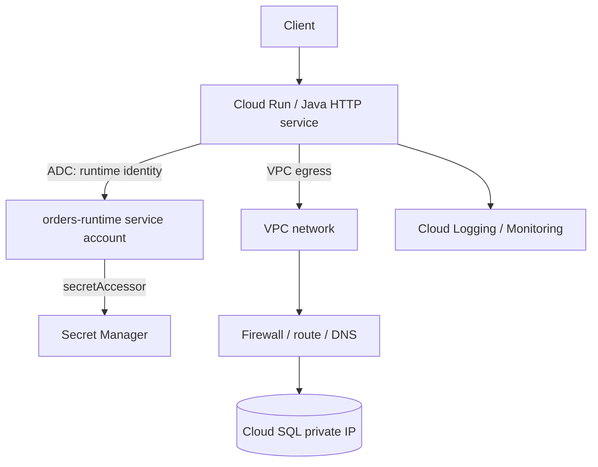

# Service account, Secret Manager và kết nối VPC

Một Java function trên Google Cloud thường cần gọi các API như Cloud Storage, Pub/Sub, Cloud SQL hoặc Secret Manager; đôi khi function còn phải truy cập một dịch vụ chỉ có địa chỉ IP riêng trong Virtual Private Cloud (VPC). Để làm được điều đó, ứng dụng cần một danh tính runtime có quyền phù hợp, một cách lấy bí mật an toàn và một đường mạng đến đúng đích.

Ba khái niệm này giải quyết ba câu hỏi khác nhau:

- **Service account:** function đang chạy với danh tính nào và được phép gọi Google Cloud API nào?
- **Secret Manager:** ứng dụng lấy password, API key hoặc credential nhạy cảm ở đâu và theo vòng đời nào?
- **VPC connectivity:** function có đường mạng đến database hoặc dịch vụ private nào, qua route và firewall nào?

Gắn function vào VPC không tự cấp quyền IAM. Gán service account có quyền đọc Secret Manager cũng không tự tạo đường mạng đến database private. Tương tự, biết endpoint database không có nghĩa function được phép đăng nhập vào database. Cần thiết kế riêng identity, secret và network rồi kiểm tra chúng cùng nhau.

## 1. Danh tính trong ứng dụng serverless trên Google Cloud

### 1.1. Service account là danh tính của workload

Service account là danh tính dành cho ứng dụng hoặc workload, không phải tài khoản đăng nhập của con người. Khi Cloud Run service hoặc Cloud Functions (2nd gen) được cấu hình một runtime service account, mã Java chạy trong function sử dụng danh tính đó khi gọi Google Cloud APIs.

Mỗi workload nên có service account riêng theo trách nhiệm. Ví dụ:

| Workload | Quyền thường cần |
| --- | --- |
| `orders-api` | Đọc/ghi dữ liệu đơn hàng, đọc secret kết nối database |
| `image-processor` | Đọc object đầu vào và ghi object kết quả trong bucket được chỉ định |
| `event-consumer` | Đọc dữ liệu cần xử lý và ghi trạng thái kết quả |
| `report-generator` | Đọc dữ liệu báo cáo và ghi artifact vào bucket báo cáo |

Nếu tất cả function dùng chung một service account có quyền Editor, một lỗi hoặc lỗ hổng ở một function có thể mở rộng ảnh hưởng đến toàn bộ workload. Tách service account giúp cấp quyền tối thiểu, audit và thu hồi quyền theo từng dịch vụ.

### 1.2. Phân biệt các danh tính thường gặp

Một lần triển khai và vận hành có thể liên quan đến nhiều principal:

| Danh tính | Dùng để làm gì? | Ví dụ quyền |
| --- | --- | --- |
| Deployer hoặc CI/CD principal | Tạo/cập nhật function, cấu hình mạng và gắn runtime service account | Cloud Run Admin/Cloud Functions Developer, Service Account User trên runtime SA, quyền triển khai artifact |
| Runtime service account | Danh tính mà code Java sử dụng khi đang chạy | Secret Accessor trên secret cụ thể, Cloud SQL Client, Storage Object Viewer |
| Event trigger service account | Được Eventarc hoặc nguồn sự kiện dùng để chuyển event và invoke đích khi cần | Eventarc Event Receiver, Cloud Run Invoker theo cấu hình trigger |
| Build service account | Xây dựng artifact/container trong quá trình deploy | Đọc source/artifact và ghi image vào Artifact Registry |
| Service agent do Google quản lý | Cho dịch vụ Google Cloud thực hiện thao tác điều khiển nền tảng | Các quyền service agent theo từng dịch vụ |

Không gán tất cả quyền này vào runtime service account. Quyền triển khai, quyền nhận event và quyền mà mã ứng dụng sử dụng có vòng đời khác nhau.

### 1.3. Runtime service account và Application Default Credentials

Các thư viện Google Cloud cho Java thường dùng **Application Default Credentials (ADC)** để tìm credential. Khi function chạy trên Cloud Run hoặc Cloud Functions, nền tảng cung cấp credential ngắn hạn cho runtime service account thông qua metadata server. Google Cloud client libraries tự dùng ADC và tự làm mới token khi cần.

Vì vậy, mã ứng dụng thường chỉ cần tạo client:

```java
import com.google.cloud.storage.Storage;
import com.google.cloud.storage.StorageOptions;

public final class StorageService {
    private final Storage storage = StorageOptions.getDefaultInstance().getService();
}
```

Không cần tải file JSON service account key vào function, không đặt key trong biến môi trường và không tự ký token nếu thư viện client đã hỗ trợ ADC. Runtime service account được gắn ở cấu hình triển khai sẽ quyết định danh tính dùng khi gọi API.

### 1.4. Không dùng service account key nếu không cần

File JSON key là credential dài hạn. Nếu bị đưa vào Git, image, log hoặc artifact, người khác có thể sử dụng nó cho đến khi key bị thu hồi. Trên môi trường Google Cloud, ưu tiên gắn service account vào workload để nhận credential ngắn hạn qua ADC.

Với workload chạy ngoài Google Cloud, cân nhắc Workload Identity Federation để đổi danh tính từ OIDC/SAML hoặc môi trường cloud khác thành credential Google ngắn hạn. Chỉ tạo service account key khi có yêu cầu kỹ thuật thực sự và không có lựa chọn federation phù hợp; khi đó cần quản lý rotation, lưu trữ, audit và thu hồi.

## 2. Tạo và gắn runtime service account

### 2.1. Tạo service account riêng

Ví dụ tạo service account cho API đơn hàng:

```bash
gcloud iam service-accounts create orders-runtime \
  --display-name="Orders API runtime"
```

Principal có dạng:

```text
orders-runtime@PROJECT_ID.iam.gserviceaccount.com
```

Tên project và service account trong ví dụ cần được thay bằng giá trị thực. Nên dùng tên mô tả workload, tránh dùng một tài khoản chung như `default-runtime` cho nhiều dịch vụ không liên quan.

### 2.2. Gắn service account cho Cloud Run

Khi deploy Cloud Run service, chỉ định runtime service account:

```bash
gcloud run deploy orders-api \
  --image REGION-docker.pkg.dev/PROJECT_ID/apps/orders-api:VERSION \
  --region REGION \
  --service-account orders-runtime@PROJECT_ID.iam.gserviceaccount.com
```

Cloud Run revision mới sẽ chạy với service account được chỉ định. Nếu thay service account, cần tạo revision mới và kiểm tra quyền của revision trước khi chuyển traffic.

### 2.3. Gắn service account cho Cloud Functions thế hệ 2

Với Cloud Functions 2nd gen, có thể chỉ định service account runtime khi deploy. Ví dụ HTTP function Java:

```bash
gcloud functions deploy orders-http \
  --gen2 \
  --runtime=java21 \
  --region=REGION \
  --source=. \
  --entry-point=com.example.OrdersHttpFunction \
  --trigger-http \
  --service-account=orders-runtime@PROJECT_ID.iam.gserviceaccount.com
```

Runtime identifier và khả năng hỗ trợ phụ thuộc danh sách runtime hiện hành tại region. Ví dụ dùng `java21` để minh họa; hãy chọn runtime còn được hỗ trợ và tương thích với thư viện của ứng dụng. Cloud Functions 2nd gen được xây dựng trên nền tảng Cloud Run, nhưng lệnh deploy và một số tùy chọn vẫn theo giao diện Cloud Functions.

### 2.4. Deployer cần quyền gì?

Principal triển khai cần quyền tạo/cập nhật function hoặc Cloud Run service, triển khai artifact và gắn runtime service account. Khi deployer chỉ định một service account khác với danh tính của chính nó, thường cần quyền `iam.serviceAccounts.actAs`, được cấp qua vai trò `roles/iam.serviceAccountUser` trên service account được gắn.

Không cấp `Service Account Admin` hoặc quyền tạo key cho mọi developer chỉ để deploy function. Cấp quyền trên đúng runtime service account và đúng môi trường. Build service account cũng cần quyền riêng để đọc source và ghi artifact vào Artifact Registry.

## 3. IAM: cấp quyền tối thiểu cho runtime

### 3.1. Vai trò IAM và phạm vi tài nguyên

IAM role chứa một tập permission. Gắn role ở cấp project thường áp dụng cho nhiều tài nguyên trong project; gắn role trực tiếp lên secret, bucket hoặc tài nguyên cụ thể có thể giới hạn phạm vi tốt hơn.

Ví dụ:

- Function chỉ đọc một secret: cấp `roles/secretmanager.secretAccessor` trên secret đó.
- Function chỉ đọc object trong một bucket: dùng role Storage phù hợp và giới hạn bucket/prefix nếu chính sách hỗ trợ.
- Function kết nối Cloud SQL: cấp `roles/cloudsql.client` trên project chứa instance theo mô hình truy cập.
- Function publish message: cấp `roles/pubsub.publisher` trên topic đích.

Không dùng `roles/editor` hoặc `roles/owner` làm runtime role. Khi gặp `PERMISSION_DENIED`, xác định API, permission, resource và principal bị từ chối trước khi thêm role.

### 3.2. Kiểm tra principal thực tế

Khi log báo permission denied, hãy xác nhận function revision đang chạy với service account nào. Một function có thể vẫn dùng service account mặc định do deploy thiếu tham số hoặc do revision cũ đang nhận traffic.

Kiểm tra:

1. Service account được gắn trong cấu hình revision/function.
2. Revision hoặc version nào đang nhận traffic/event.
3. Role được gắn ở project hay resource cụ thể.
4. IAM policy có condition, deny policy hoặc organization policy nào ảnh hưởng không.
5. API cần gọi đã được enable trong project chưa.

IAM policy có thể thay đổi theo thời gian và có độ trễ lan truyền. Sau khi cấp quyền, thử lại có kiểm soát và ghi nhận principal/resource/action để điều tra.

### 3.3. Quyền invoke khác quyền gọi API từ bên trong

Runtime service account là danh tính cho các outbound API calls. Quyền cho phép caller hoặc Eventarc invoke Cloud Run service/function là một lớp khác.

Ví dụ, một Eventarc trigger có thể dùng service account riêng để nhận event và invoke Cloud Run service; service account đó cần role tương ứng như `roles/eventarc.eventReceiver` và quyền invoke đích theo cấu hình. Runtime service account của function có thể cần quyền đọc Secret Manager hoặc ghi Cloud Storage. Không gộp hai danh tính này thành một.

Với HTTP service riêng tư, caller cần quyền invoke phù hợp, thường là `roles/run.invoker` trên Cloud Run service. Việc runtime service account có quyền gọi Pub/Sub không làm cho người dùng Internet tự động được phép gọi HTTP endpoint.

## 4. Secret Manager: lưu và truy cập bí mật

### 4.1. Khi nào cần Secret Manager?

Secret Manager phù hợp để quản lý thông tin nhạy cảm như:

- password database;
- API key của dịch vụ bên ngoài;
- private credential hoặc signing secret;
- token dùng cho tích hợp legacy;
- cấu hình nhạy cảm cần rotation và audit.

Không lưu secret trong source code, file `.env` được commit, Docker image, event payload hoặc log. Các giá trị cấu hình không nhạy cảm như tên bucket, region, feature flag hoặc endpoint có thể để trong environment variables/configuration service.

### 4.2. Secret và secret version

Secret là tài nguyên quản lý metadata và policy; giá trị thực được lưu trong các version. Version có thể được enable, disable hoặc destroy theo vòng đời. Ứng dụng truy cập một version cụ thể hoặc alias như `latest` nếu chính sách cho phép.

Nên phân biệt:

- **Secret ID:** tên định danh secret, ví dụ `orders-db-password`.
- **Version:** một giá trị bất biến được thêm vào secret.
- **Alias:** tên trỏ đến version, ví dụ `latest`.
- **IAM policy:** principal nào được phép truy cập secret/version.

Version cụ thể giúp triển khai có thể lặp lại và dễ rollback. Alias `latest` thuận tiện khi rotation, nhưng ứng dụng cần hiểu rõ thời điểm đọc lại secret và cache.

### 4.3. Tạo secret và thêm version

Ví dụ:

```bash
printf '%s' 'REPLACE_WITH_SECRET_VALUE' | \
  gcloud secrets create orders-db-password \
    --data-file=- \
    --replication-policy=automatic
```

Nếu secret đã tồn tại, thêm version mới:

```bash
printf '%s' 'REPLACE_WITH_NEW_SECRET_VALUE' | \
  gcloud secrets versions add orders-db-password --data-file=-
```

Các chuỗi minh họa ở trên không phải credential thật. Khi thao tác trong shell hoặc CI, tránh để secret xuất hiện trong command history, process list hoặc log pipeline; dùng secret input mechanism của môi trường triển khai khi có thể.

### 4.4. Cấp quyền Secret Accessor ở cấp secret

Runtime service account cần role `roles/secretmanager.secretAccessor` để truy cập payload. Ưu tiên cấp role trực tiếp trên secret cần dùng:

```bash
gcloud secrets add-iam-policy-binding orders-db-password \
  --member="serviceAccount:orders-runtime@PROJECT_ID.iam.gserviceaccount.com" \
  --role="roles/secretmanager.secretAccessor"
```

Không cấp quyền accessor trên toàn project nếu function chỉ cần một secret. Nếu secret dùng customer-managed encryption key, kiểm tra quyền KMS và key policy theo cấu hình mã hóa; không mặc định mọi secret cần runtime principal tự gọi `cloudkms.decrypt`.

### 4.5. Java: đọc secret qua Secret Manager API

Google Cloud Java client libraries sử dụng ADC, nên code không cần đọc file service account key. Ví dụ:

```java
package com.example.config;

import com.google.cloud.secretmanager.v1.AccessSecretVersionResponse;
import com.google.cloud.secretmanager.v1.SecretManagerServiceClient;
import com.google.cloud.secretmanager.v1.SecretVersionName;

import java.io.IOException;

public final class SecretLoader {
    private SecretLoader() {}

    public static String readSecret(
            String projectId,
            String secretId,
            String version) throws IOException {

        SecretVersionName name = SecretVersionName.of(
                projectId,
                secretId,
                version);

        try (SecretManagerServiceClient client = SecretManagerServiceClient.create()) {
            AccessSecretVersionResponse response = client.accessSecretVersion(name);
            return response.getPayload().getData().toStringUtf8();
        }
    }
}
```

`version` có thể là số version cụ thể hoặc alias `latest`. Trong function, tạo client ở phạm vi có thể tái sử dụng nếu thư viện hỗ trợ và đóng đúng vòng đời. Không log chuỗi secret. Trong production, cần xử lý payload encoding, kiểm tra secret rỗng, timeout và lỗi permission/version disabled.

Dependency Maven:

```xml
<dependency>
    <groupId>com.google.cloud</groupId>
    <artifactId>google-cloud-secretmanager</artifactId>
    <version>${google-cloud-secretmanager.version}</version>
</dependency>
```

Quản lý version thư viện trong BOM hoặc dependency management của project và đóng gói dependency vào artifact/container.

### 4.6. Không đọc secret trên mọi request nếu không cần

Gọi Secret Manager cho mỗi HTTP request làm tăng latency, API quota và chi phí. Có thể đọc secret một lần trong quá trình khởi tạo execution environment hoặc cache với TTL, nhưng phải tính đến rotation và thu hồi credential.

Một cách tiếp cận:

- cache client Secret Manager dùng chung nếu thread-safe;
- cache giá trị secret với TTL phù hợp nếu ứng dụng cần đọc lại;
- khi nhận lỗi xác thực do credential cũ, refresh secret có kiểm soát rồi thử lại một lần nếu thao tác an toàn;
- không giữ secret trong log, exception message hoặc metric label;
- hạn chế thời gian secret tồn tại trong bộ nhớ và không chia sẻ qua request không liên quan.

Không giả định execution environment luôn mới. Lambda-like serverless runtime có thể tái sử dụng process; cache trong static field có thể tồn tại qua nhiều invocation trong cùng instance.

### 4.7. Rotation và cách function nhận version mới

Rotation cần phối hợp giữa nơi lưu secret và hệ thống đích, ví dụ database password. Cập nhật secret trong Secret Manager mà không đổi password ở database (hoặc ngược lại) có thể làm gián đoạn kết nối.

Với ứng dụng tự gọi Secret Manager API:

1. Thêm version mới sau khi hệ thống đích đã chấp nhận credential mới theo quy trình rotation.
2. Xác minh function có thể đọc version mới và kết nối thành công.
3. Chuyển alias hoặc cấu hình version theo kế hoạch.
4. Thu hồi credential cũ sau khi không còn client sử dụng.

Nếu pin version số cụ thể, cần deploy/configure lại để chuyển sang version mới. Nếu dùng `latest`, lần đọc tiếp theo có thể nhận version mới nhưng cache cũ vẫn có thể tồn tại đến khi hết TTL.

Với Cloud Run secret environment variable, giá trị được lấy khi instance khởi động; thay đổi secret không tự sửa environment variable của instance đang chạy. Với secret volume, ứng dụng có thể đọc file version được mount và cơ chế cập nhật phụ thuộc cách cấu hình version/mount. Nếu cần rotation tự động, hãy kiểm tra semantics hiện hành của sản phẩm, dùng version phù hợp và chủ động đọc lại file/secret theo chu kỳ. Không cho rằng mọi cách mount đều tự làm mới tức thì.

## 5. Secret injection cho Cloud Run và Cloud Functions

Có hai cách chính để ứng dụng nhận secret:

1. **Đọc qua Secret Manager API:** ứng dụng gọi API khi cần; kiểm soát version, cache và refresh trong code.
2. **Cấu hình secret như environment variable hoặc mounted file:** nền tảng cung cấp secret vào runtime theo cấu hình deploy.

Environment variable thuận tiện cho thư viện cần cấu hình lúc khởi động, nhưng secret có thể bị lộ qua diagnostic dump hoặc log nếu ứng dụng in toàn bộ environment. Mounted file thường giúp ứng dụng đọc secret như một file và có thể phù hợp hơn với việc làm mới version; vẫn phải giới hạn quyền truy cập file và xử lý rotation rõ ràng.

Ví dụ cấu hình Cloud Run dùng secret environment variable:

```bash
gcloud run deploy orders-api \
  --image REGION-docker.pkg.dev/PROJECT_ID/apps/orders-api:VERSION \
  --region REGION \
  --service-account orders-runtime@PROJECT_ID.iam.gserviceaccount.com \
  --set-secrets=DB_PASSWORD=orders-db-password:5
```

Ở đây `DB_PASSWORD` là tên biến môi trường trong container; `orders-db-password:5` là secret và version số cụ thể. Runtime service account cần quyền accessor trên secret. Dùng version cụ thể để revision có cấu hình xác định và dễ rollback.

Nếu dùng API, secret ID/version nên được cấu hình riêng, còn payload chỉ được đọc qua client library. Dù chọn cách nào, không đưa giá trị secret vào deployment manifest công khai, log build hoặc command output.

## 6. Kết nối VPC từ serverless runtime

### 6.1. Khi nào cần VPC egress?

Function thường không cần VPC nếu chỉ gọi Google Cloud APIs qua public endpoints hoặc xử lý request mà không truy cập private resource. VPC connectivity cần thiết khi function phải gọi:

- Cloud SQL instance dùng private IP;
- Memorystore hoặc Redis/Valkey nằm trong VPC;
- VM hoặc service nội bộ có IP private;
- database hoặc API trong mạng peered/on-premises qua Cloud VPN/Interconnect;
- endpoint private được công bố qua Private Service Connect.

VPC egress là luồng outbound từ function đến mạng VPC. Nó không tự tạo inbound endpoint công khai cho function và không thay thế IAM authorization.

### 6.2. Hai cách kết nối phổ biến

Google Cloud có hai mô hình quan trọng:

| Cách | Đặc điểm | Khi cân nhắc |
| --- | --- | --- |
| Serverless VPC Access connector | Tạo connector trong region/VPC; serverless runtime gửi traffic qua connector | Cloud Functions thế hệ 2 và các workload cần connector theo cấu hình sản phẩm |
| Direct VPC egress | Cloud Run gắn trực tiếp vào subnet VPC, không cần connector riêng | Cloud Run services/jobs và các loại workload được sản phẩm hỗ trợ tại region/runtime |

Cloud Functions, Cloud Run services và Cloud Run functions có giao diện triển khai khác nhau. Kiểm tra sản phẩm, generation, region và runtime cụ thể trước khi chọn phương thức; không sao chép cờ cấu hình của Cloud Run service sang Cloud Functions mà không kiểm tra.

### 6.3. Serverless VPC Access connector

Connector cung cấp đường đi từ serverless runtime đến VPC. Khi tạo connector, cần chọn region trùng với workload, network và dải IP không xung đột. Connector thường dùng một dải `/28` dành riêng; không dùng lại dải đã được cấp cho subnet hoặc thiết bị khác.

Ví dụ tạo connector:

```bash
gcloud compute networks vpc-access connectors create orders-connector \
  --region=REGION \
  --network=orders-vpc \
  --range=10.8.0.0/28 \
  --min-instances=2 \
  --max-instances=4
```

Đây là cấu hình minh họa. Chọn CIDR không trùng với subnet, peered network, VPN hoặc dải IP đang dùng. Min/max instance và throughput phải dựa trên lượng traffic, không chọn chỉ theo ví dụ.

Gắn connector cho Cloud Functions 2nd gen:

```bash
gcloud functions deploy process-order \
  --gen2 \
  --runtime=java21 \
  --region=REGION \
  --source=. \
  --entry-point=com.example.ProcessOrderFunction \
  --trigger-topic=orders-topic \
  --service-account=orders-runtime@PROJECT_ID.iam.gserviceaccount.com \
  --vpc-connector=orders-connector \
  --egress-settings=private-ranges-only
```

Flag runtime và trigger là ví dụ. Dùng đúng kiểu trigger của function và kiểm tra cờ egress mà phiên bản `gcloud`/API đang dùng hỗ trợ.

### 6.4. Direct VPC egress trên Cloud Run

Cloud Run có thể sử dụng Direct VPC egress để kết nối trực tiếp với subnet mà không cần Serverless VPC Access connector. Ví dụ minh họa:

```bash
gcloud run deploy orders-api \
  --image REGION-docker.pkg.dev/PROJECT_ID/apps/orders-api:VERSION \
  --region=REGION \
  --network=orders-vpc \
  --subnet=orders-subnet \
  --vpc-egress=private-ranges-only \
  --service-account=orders-runtime@PROJECT_ID.iam.gserviceaccount.com
```

Direct VPC egress có thể đơn giản hóa kiến trúc mạng và tránh quản lý connector riêng. Hãy kiểm tra yêu cầu subnet, firewall, scaling behavior và giới hạn của sản phẩm/region. Với Cloud Functions 2nd gen, dùng phương thức được hỗ trợ bởi giao diện triển khai của Cloud Functions; không giả định mọi flag Cloud Run service đều áp dụng giống hệt.

### 6.5. Chọn egress mode

Hai chế độ thường gặp:

- **Private ranges only:** chỉ traffic đến địa chỉ private được định tuyến qua VPC; traffic public có thể đi theo đường egress mặc định của serverless runtime.
- **All traffic:** mọi outbound traffic được định tuyến qua VPC. Nếu cần truy cập Internet public, VPC cần đường ra như Cloud NAT và route phù hợp.

Chọn `all traffic` có thể hữu ích khi cần kiểm soát egress, dùng firewall hoặc NAT tập trung. Nhưng nếu thiếu Cloud NAT/route, function có thể mất khả năng gọi public API. Chọn `private ranges only` giúp traffic public đi trực tiếp theo đường mặc định, trong khi private IP đi qua VPC.

## 7. Firewall, route, DNS và private service

### 7.1. Firewall rules

Sau khi có VPC egress, cần cho phép traffic từ nguồn serverless đến đích. Kiểm tra:

- source range hoặc network tag được dùng bởi connector/direct egress;
- destination subnet/IP hoặc target tag;
- TCP port của database/service;
- ingress/egress rule và thứ tự ưu tiên;
- hierarchical firewall policy hoặc organization policy nếu có.

Ví dụ, Cloud SQL PostgreSQL private IP thường nhận TCP 5432 từ nguồn đã được cho phép; Redis có thể dùng cổng khác tùy cấu hình. Chỉ mở cổng cần thiết và giới hạn source theo connector/subnet phù hợp.

### 7.2. Route và kết nối hybrid

Nếu đích nằm ở một VPC peered hoặc on-premises, cần cấu hình Cloud VPN hoặc Cloud Interconnect, route hai chiều và firewall ở cả hai phía. VPC peering không tự động chia sẻ mọi route bắc cầu; không giả định một VPC peered có thể dùng VPC khác làm transit sang mạng thứ ba.

Khi dùng private service endpoint, kiểm tra đường route và DNS. Với Private Service Connect, consumer endpoint và producer service attachment cần được cấu hình theo kiến trúc tương ứng. VPC egress chỉ đưa traffic vào VPC; nó không tự tạo peering hoặc PSC endpoint.

### 7.3. DNS private

Function có thể kết nối bằng hostname private. Để phân giải được hostname, kiểm tra Cloud DNS private zone, visibility của zone với VPC, forwarding zone và DNS policy. Nếu dùng tên nội bộ từ on-premises, cần cấu hình DNS forwarding phù hợp.

Tránh hard-code private IP nếu endpoint có thể thay đổi. Dùng DNS name do Cloud SQL, Memorystore hoặc dịch vụ đích cung cấp khi có thể.

### 7.4. Cloud NAT và public Internet

Nếu mọi traffic đi qua VPC, outbound request đến public API cần đường ra Internet. Cloud NAT cho phép workload không có external IP mở kết nối outbound; NAT không tạo inbound public endpoint cho function.

Kiểm tra route default, NAT mapping, địa chỉ NAT được cấp và firewall. Nếu public API allowlist IP, dùng địa chỉ NAT ổn định theo thiết kế và cập nhật allowlist. Nếu chỉ truy cập Google APIs, có thể cân nhắc Private Google Access hoặc Private Service Connect for Google APIs theo yêu cầu mạng và dịch vụ.

## 8. Kết nối Cloud SQL từ Java function

Cloud SQL là ví dụ phổ biến cho private database access. Có thể kết nối bằng Cloud SQL Java Connector hoặc JDBC socket factory. Connector hỗ trợ xác thực và mã hóa kết nối theo cơ chế của Cloud SQL, nhưng **không tự tạo đường mạng VPC** đến private IP. Nếu instance chỉ có private IP, function vẫn cần VPC egress và route đến địa chỉ đó.

### 8.1. Quyền IAM cho Cloud SQL

Runtime service account thường cần `roles/cloudsql.client` để thiết lập kết nối qua Cloud SQL connectors. Nếu dùng IAM database authentication, còn cần cấu hình database user IAM và role tương ứng như `roles/cloudsql.instanceUser` theo quy trình của Cloud SQL. Quyền gọi API và quyền truy cập dữ liệu bên trong database là hai lớp khác nhau.

### 8.2. Java JDBC và Cloud SQL Connector

Ví dụ cấu hình PostgreSQL qua Cloud SQL Java Connector có thể dùng JDBC URL và socket factory. Phần cấu hình phụ thuộc driver, connector version và cách xác thực:

```properties
db.url=jdbc:postgresql:///orders
db.user=orders_app
db.name=orders
cloudsql.instance=PROJECT_ID:REGION:INSTANCE_NAME
cloudsql.ipTypes=PRIVATE
```

Khi cấu hình HikariCP hoặc datasource, truyền `cloudSqlInstance` và socket factory properties theo tài liệu Cloud SQL Java Connector của version đang dùng. Với IAM database authentication, bật tùy chọn IAM auth mà connector hỗ trợ và cấu hình user tương ứng. Không copy URL ví dụ thành cấu hình hoàn chỉnh mà bỏ qua dependency, driver và TLS.

### 8.3. Connection pool và Lambda/Cloud Run concurrency

Mỗi Cloud Run instance hoặc function instance có thể tạo pool riêng. Tổng connection có thể ước lượng:

```text
Tổng connection tối đa xấp xỉ
  = số instance tối đa
    x pool size mỗi instance
```

Ví dụ, 40 instance với pool size 5 có thể tạo khoảng 200 connection. Hãy giới hạn max instances/concurrency hoặc pool size theo giới hạn Cloud SQL và workload khác. Dùng Cloud SQL connector không loại bỏ giới hạn connection của database.

Với function ngắn, pool nhỏ hoặc connection được mở trong invocation có thể dễ kiểm soát hơn. Nếu tái sử dụng pool ở cấp instance, kiểm tra connection stale, timeout và tổng connection khi scale-out.

## 9. Vận hành và xử lý lỗi

### 9.1. Chẩn đoán theo lớp

| Triệu chứng | Lớp cần kiểm tra | Hướng xử lý |
| --- | --- | --- |
| `PERMISSION_DENIED` khi đọc secret | IAM | Xác minh runtime SA, secret-level accessor role, project và secret ID |
| `NOT_FOUND` khi đọc secret | Secret/version | Kiểm tra project, secret ID, version và trạng thái version |
| Function không resolve private hostname | DNS | Kiểm tra private zone, DNS visibility và forwarding |
| TCP timeout đến database private | VPC/network | Kiểm tra connector/direct egress, subnet, route, firewall và port |
| Kết nối được nhưng database từ chối | Database auth | Kiểm tra DB user, password/IAM DB auth và grants |
| Public API không truy cập được khi all traffic | Egress | Kiểm tra default route, Cloud NAT và firewall |
| Thỉnh thoảng hết connection | Capacity | Kiểm tra max instances, concurrency, pool size và DB connection limit |
| Secret rotation gây lỗi sau deploy | Secret lifecycle | Kiểm tra version pinning, cache TTL và thời điểm credential ở database được đổi |

### 9.2. Log và metric

Log có cấu trúc nên có:

- Cloud Run revision hoặc function version;
- request ID, trace ID hoặc event ID;
- runtime service account (chỉ ghi email/identity nếu cần điều tra và chính sách cho phép);
- secret ID/version, không ghi payload secret;
- hostname đích, port và loại lỗi mạng, không ghi credential trong URL;
- thời gian lấy secret, mở connection và thực hiện query.

Theo dõi request latency, instance count, concurrency, container startup, error rate, Secret Manager API errors, Cloud SQL connection count, VPC connector throughput/instance health và NAT port utilization nếu có. Đặt alert cho permission denied tăng đột biến, connector quá tải, connection exhaustion và latency tăng.

### 9.3. Retry có kiểm soát

Lỗi `PERMISSION_DENIED`, secret không tồn tại hoặc sai database password thường không tự hết khi retry liên tục. Cần sửa IAM, cấu hình hoặc rotation. Lỗi network reset hoặc database failover có thể tạm thời, nhưng retry phải có giới hạn, backoff và idempotency.

Nếu function ghi dữ liệu rồi mất kết nối trước khi nhận xác nhận commit, không thể kết luận transaction đã rollback. Truy vấn lại trạng thái theo idempotency key hoặc business ID trước khi chạy lại thao tác tạo side effect.

### 9.4. Cold start và tái sử dụng client

Tạo Google Cloud client mỗi request có thể tăng latency. Có thể tái sử dụng client thread-safe ở cấp instance, ví dụ `SecretManagerServiceClient` hoặc Storage client, nhưng không lưu request-specific state trong static field. Đóng client theo vòng đời instance/runtime và tránh tạo một client mới cho từng lần đọc nếu không cần.

Secret value cache và database connection pool có vòng đời riêng. Cần đặt TTL/refresh cho secret, kiểm tra connection stale và tính tổng pool khi số instance tăng. Một instance được tái sử dụng không bảo đảm tồn tại mãi hoặc luôn nhận request của cùng tenant.

## 10. Bảo mật và kiểm soát truy cập

### 10.1. Tách project và môi trường

Dev, staging và production nên dùng service account, secret, VPC và database riêng hoặc có ranh giới quyền rõ ràng. Không cho service account dev đọc secret production. Nếu cần truy cập cross-project, cấp quyền trực tiếp trên resource ở project đích và xác minh organization policy.

### 10.2. Giới hạn service account impersonation

Chỉ deployer/CI principal được phép actAs runtime service account cần thiết. Không cấp `roles/iam.serviceAccountTokenCreator` rộng cho mọi developer nếu không cần impersonation. Theo dõi audit log khi service account được impersonate hoặc policy thay đổi.

### 10.3. Secret payload và dữ liệu nhạy cảm

Không đưa secret vào log, error response, metric label hoặc tracing attribute. Hạn chế quyền đọc secret và audit các lần access. Chọn retention và rotation phù hợp với loại credential. Nếu một secret bị lộ, có quy trình disable version, rotate credential ở hệ thống đích và cập nhật workload.

### 10.4. VPC không phải authorization

Một workload nằm trong VPC có thể gửi gói tin đến database, nhưng database vẫn cần xác thực user và kiểm tra quyền SQL. Một service account có quyền Secret Accessor có thể lấy password, nhưng điều đó không có nghĩa người gọi HTTP được phép xem mọi bản ghi. Xác thực người dùng, tenant isolation và authorization phải được thực hiện ở lớp ứng dụng/domain.

## 11. Ví dụ kiến trúc tổng hợp

Một Java HTTP service trên Cloud Run nhận request tạo đơn hàng. Service dùng runtime service account `orders-runtime` để đọc secret kết nối Cloud SQL. Cloud SQL dùng private IP trong VPC. Cloud Run dùng Direct VPC egress nếu sản phẩm/region hỗ trợ; nếu không, cấu hình Serverless VPC Access connector phù hợp.



Luồng xử lý:

1. Client gọi endpoint; lớp ingress/IAM hoặc ứng dụng xác thực caller theo yêu cầu.
2. Java handler kiểm tra request, tenant và quyền nghiệp vụ.
3. Service lấy secret qua Secret Manager API hoặc secret mount theo cấu hình.
4. ADC cung cấp credential ngắn hạn của `orders-runtime`.
5. Java Cloud SQL Connector/JDBC kết nối đến private IP qua VPC egress.
6. Handler thực hiện transaction ngắn và commit.
7. Log ghi request/trace ID và kết quả, không ghi secret hoặc token.

Khi scale-out, số instance và connection pool phải nằm trong giới hạn database. Khi password rotation, Secret Manager version, cache của ứng dụng và password ở Cloud SQL cần được cập nhật theo một quy trình nhất quán.

## 12. Checklist trước khi triển khai

- [ ] Mỗi workload có runtime service account riêng theo trách nhiệm.
- [ ] Deployer, build identity, trigger identity và runtime identity được phân biệt.
- [ ] Runtime service account được gắn rõ ràng vào Cloud Run/Cloud Functions revision.
- [ ] ADC được dùng trong môi trường Google Cloud; không đóng gói service account key.
- [ ] Deployer chỉ có `iam.serviceAccounts.actAs` trên service account cần gắn.
- [ ] IAM role được cấp tối thiểu và ở phạm vi resource nhỏ nhất có thể.
- [ ] Secret được lưu trong Secret Manager, không nằm trong source, image hoặc log.
- [ ] Runtime service account chỉ có Secret Accessor trên secret cần đọc.
- [ ] Secret version, alias, cache TTL và rotation được xác định rõ.
- [ ] Java Secret Manager client dùng ADC và không log payload.
- [ ] Function chỉ bật VPC egress khi cần truy cập private resource.
- [ ] Connector/direct VPC egress được chọn theo loại sản phẩm và region hỗ trợ.
- [ ] CIDR connector/subnet không xung đột với mạng khác.
- [ ] Firewall, route, DNS, VPN/peering/PSC và NAT được kiểm tra theo đường đi thực tế.
- [ ] Private IP database vẫn có IAM/database authentication riêng.
- [ ] Cloud SQL connector không bị hiểu nhầm là thay thế VPC route.
- [ ] Max instances, concurrency và connection pool phù hợp với database.
- [ ] Có log, metric, alert cho IAM, Secret Manager, VPC và database.
- [ ] Đã kiểm thử secret rotation, permission denied, network timeout, failover và duplicate event.

## Kết luận

Service account xác định danh tính runtime của Java function; Secret Manager lưu và cấp version của credential nhạy cảm; VPC egress cung cấp đường mạng đến resource private. Ba lớp này phải được cấu hình độc lập và kết hợp đúng: runtime service account cần IAM permission, secret cần policy và vòng đời rõ ràng, còn network cần route, DNS và firewall cho từng chặng.

Trên Cloud Run và Cloud Functions, ưu tiên ADC với runtime service account được gắn rõ ràng thay vì service account key. Cấp `roles/secretmanager.secretAccessor` trên đúng secret, thiết kế rotation cùng cache, và chỉ bật VPC connectivity khi workload cần private resource. Với database, kiểm soát connection pool theo số instance/concurrency và nhớ rằng VPC connectivity không thay thế database authentication hay authorization.

Khi vận hành, theo dõi principal thực tế, Secret Manager access, VPC egress, DNS/firewall, connection count và latency. Cách tách bạch identity, secret và network giúp Java function chạy an toàn khi scale-out, nhận event và triển khai qua nhiều môi trường.
