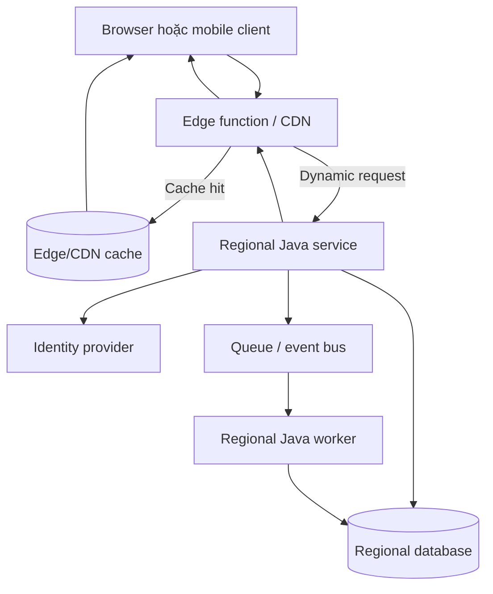

# Phân biệt regional serverless và edge function

Regional serverless và edge function đều cho phép chạy code mà nhóm phát triển không phải tự quản lý máy chủ. Khác biệt chính nằm ở **nơi code được thực thi và loại công việc phù hợp**.

Regional serverless chạy workload trong một hoặc một số region được chọn, thường gần database và các dịch vụ backend. Edge function chạy tại các điểm hiện diện (PoP) phân tán của nhà cung cấp, thường gần người dùng hoặc điểm vào mạng. Vì vậy, edge có thể giảm độ trễ cho các thao tác nhẹ ở lớp tiếp nhận request, còn regional serverless thường phù hợp hơn với nghiệp vụ cần truy cập dữ liệu tập trung, runtime đầy đủ hoặc xử lý lâu hơn.

Trong hệ thống Java serverless, Java function hoặc Spring Boot service thường đặt ở region để xử lý nghiệp vụ chính. Edge function có thể đứng trước để định tuyến, kiểm tra token, chuẩn hóa request, áp dụng chính sách đơn giản hoặc cache nội dung công khai. Hai mô hình thường được kết hợp thay vì buộc phải chọn một cho toàn bộ ứng dụng.

## 1. Regional serverless là gì?

Regional serverless là mô hình triển khai function, service hoặc container serverless vào một region cụ thể của nhà cung cấp cloud. Nhà cung cấp quản lý máy chủ, hệ điều hành, cấp phát instance và mở rộng theo cấu hình; nhóm phát triển chọn region, runtime, tài nguyên và cách kết nối đến các dịch vụ phụ thuộc.

Ví dụ:

- AWS Lambda triển khai trong một AWS Region.
- Google Cloud Run và Cloud Run functions triển khai trong một Google Cloud region.
- Azure Functions triển khai trong một Azure region.
- Các nền tảng serverless container khác cũng thường cho phép chọn region chạy workload.

Một region thường gồm nhiều vùng sẵn sàng (availability zone hoặc zone) tùy nhà cung cấp. Workload được đặt trong region đã chọn để gần database, queue, object storage hoặc hệ thống nội bộ. Regional không có nghĩa là chỉ có một máy chủ hoặc một máy ảo; nền tảng vẫn có thể chạy nhiều instance và phân tán chúng trong phạm vi hạ tầng của region.

### Đặc điểm

- **Vị trí triển khai có chủ đích:** nhóm chọn region theo vị trí dữ liệu, người dùng, yêu cầu tuân thủ và dịch vụ cần tích hợp.
- **Runtime phong phú hơn:** thường hỗ trợ Java, .NET, Python, Node.js, Go, container image và thư viện tương ứng với nền tảng.
- **Kết nối backend thuận tiện:** có thể đặt function gần database, queue và dịch vụ nội bộ trong cùng region hoặc mạng riêng.
- **Mở rộng theo tải:** nền tảng tăng hoặc giảm instance theo request, event, concurrency hoặc cấu hình.
- **Trạng thái vẫn cần lưu bên ngoài:** bộ nhớ instance có thể bị dừng hoặc thay thế; dữ liệu nghiệp vụ phải nằm trong database, object storage, queue hoặc kho lưu trữ phù hợp.
- **Có thể có cold start:** instance mới cần khởi tạo runtime và ứng dụng trước khi xử lý request.

Regional serverless phù hợp với logic nghiệp vụ chính, xử lý database, worker, workflow và API có nhiều dependency.

## 2. Edge function là gì?

Edge function là đoạn code được triển khai lên hạ tầng edge phân tán của nhà cung cấp, thường tại nhiều PoP gần mạng truy cập hoặc người dùng. Request có thể được xử lý ngay tại điểm vào gần nhất theo định tuyến của nền tảng, thay vì luôn phải đi đến một backend region trước.

Ví dụ nền tảng và dịch vụ có khả năng edge compute:

- Cloudflare Workers.
- Vercel Edge Functions.
- AWS CloudFront Functions và Lambda@Edge.
- Một số nền tảng CDN, hosting và edge network khác.

Các sản phẩm này không có runtime hoặc giới hạn giống nhau. CloudFront Functions hướng đến xử lý rất nhẹ ở lớp CDN; Lambda@Edge có mô hình và giới hạn khác; Workers và Edge Functions có thể cung cấp runtime dựa trên JavaScript, Web APIs hoặc WebAssembly. Cần xem tài liệu đúng sản phẩm trước khi chọn.

### Đặc điểm

- **Thực thi phân tán:** code có thể chạy tại nhiều PoP, giúp xử lý request gần người dùng hơn.
- **Độ trễ thấp cho thao tác phù hợp:** kiểm tra header, rewrite URL, redirect, xác thực token đơn giản hoặc chọn origin có thể hoàn thành ngay ở edge.
- **Runtime thường bị giới hạn:** một số nền tảng chỉ hỗ trợ JavaScript/TypeScript hoặc WebAssembly và giới hạn CPU, bộ nhớ, thời gian chạy, API hệ điều hành, thư viện native hay kết nối mạng.
- **Trạng thái phân tán:** mỗi lần chạy không nên dựa vào bộ nhớ tiến trình để giữ trạng thái lâu dài hoặc đồng bộ toàn cầu.
- **Dữ liệu có thể ở xa:** nếu edge phải gọi database hoặc API ở một region xa, thời gian mạng có thể làm mất lợi ích latency.
- **Phân phối phiên bản phức tạp hơn:** một thay đổi có thể được phát hành đến nhiều PoP; cần hiểu cách rollout, cache và rollback của nhà cung cấp.

Edge function không đồng nghĩa với CDN cache. CDN có thể trả nội dung đã cache mà không chạy code ứng dụng. Edge function thực thi logic tại edge, đôi khi quyết định có dùng cache, cache key nào hoặc request nào được chuyển đến origin.

## 3. So sánh regional serverless và edge function

| Tiêu chí | Regional serverless | Edge function |
|---|---|---|
| Vị trí chạy | Region do nhóm chọn | PoP phân tán của nhà cung cấp |
| Mục tiêu chính | Xử lý nghiệp vụ và truy cập dịch vụ backend | Xử lý gần điểm vào request, giảm round trip |
| Runtime | Thường đa dạng, có Java và container | Thường giới hạn hơn; nhiều nền tảng ưu tiên JS/TS hoặc WASM |
| Kết nối dữ liệu | Thuận tiện khi dữ liệu ở cùng region | Có thể phải gọi về region hoặc dùng data store phân tán |
| Thời gian chạy | Thường hỗ trợ workload dài hơn, tùy dịch vụ | Thường tối ưu cho tác vụ ngắn và có giới hạn chặt |
| CPU/bộ nhớ | Có thể cấu hình tương đối rộng | Thường có quota nhỏ hơn hoặc giới hạn riêng |
| Trạng thái | Dùng database/cache/queue trong region | Cần thiết kế cho môi trường phân tán và eventual consistency nếu có |
| Cold start | Phụ thuộc runtime, cấu hình và nền tảng | Phụ thuộc isolate/runtime và nền tảng edge |
| Tác vụ phù hợp | API nghiệp vụ, worker, xử lý event, tích hợp database | Rewrite, redirect, routing, header, kiểm tra request nhẹ, cache decision |
| Ràng buộc dữ liệu | Dễ đặt gần nguồn dữ liệu tập trung | Phải cân nhắc data locality, residency và khoảng cách đến origin |
| Quan sát | Thường có metric/log theo region và service | Cần theo dõi theo PoP, quốc gia hoặc vùng mạng nếu nền tảng cung cấp |

Không có quy tắc rằng edge luôn nhanh hơn hoặc regional luôn chậm hơn. Kết quả phụ thuộc vị trí người dùng, origin, dịch vụ dữ liệu, giao thức, cache hit rate, tải và cách nhà cung cấp định tuyến.

## 4. Độ trễ: đặt code ở đâu mới thực sự nhanh?

Một request đến ứng dụng thường đi qua nhiều chặng:

1. Client phân giải DNS và kết nối đến mạng phân phối.
2. Request được định tuyến đến PoP hoặc region.
3. Code chạy ở vị trí được chọn.
4. Code có thể đọc cache hoặc gọi dịch vụ khác.
5. Response quay lại client.

Với edge function, phần xử lý tại bước 3 có thể rất gần người dùng. Nhưng nếu code gọi database ở một region xa, request vẫn phải đi từ edge về region rồi quay lại. Vì vậy, cần tính toàn bộ đường đi thay vì chỉ đo thời gian thực thi code.

Có thể mô tả đơn giản:

```text
Tổng latency =
  client-to-edge
  + edge execution
  + edge-to-origin/data
  + origin processing
  + response network
```

Đối với regional serverless:

```text
Tổng latency =
  client-to-region
  + function/service execution
  + region-to-data
  + data processing
  + response network
```

Edge có lợi khi xử lý tại PoP loại bỏ được một round trip đến origin hoặc cho phép trả response từ cache. Nếu request nào cũng phải gọi backend region, lợi ích có thể nhỏ hoặc âm do thêm một chặng xử lý.

### Ví dụ

Một website có người dùng ở nhiều quốc gia:

- Redirect từ /vi sang /en dựa trên URL hoặc header có thể xử lý tại edge.
- Chọn phiên bản ảnh đã tối ưu hoặc trả cache công khai có thể xử lý tại edge.
- Đọc số dư tài khoản và cập nhật đơn hàng cần gọi dữ liệu chuẩn; regional service gần database thường phù hợp hơn.
- Tính giá đơn hàng dựa trên nhiều bảng và quy tắc nghiệp vụ nên chạy ở backend có runtime, dữ liệu và khả năng quan sát phù hợp.

## 5. Runtime và khả năng chạy Java

Đây là khác biệt quan trọng khi thiết kế hệ thống Java serverless.

Regional serverless thường hỗ trợ runtime Java chính thức hoặc cho phép đóng gói Java application thành container. Ví dụ, có thể chạy Java Lambda, Google Cloud Run functions Java hoặc Spring Boot trên Cloud Run/Azure Container Apps tùy nền tảng.

Nhiều edge function dùng runtime nhẹ dựa trên JavaScript engine, Web APIs hoặc WebAssembly. Điều đó không có nghĩa là có thể tải trực tiếp một JAR Java hoặc chạy một JVM đầy đủ tại mọi PoP.

Nếu muốn đưa logic Java đến edge, phải kiểm tra rõ:

- Nền tảng có runtime Java hay chỉ hỗ trợ JavaScript/TypeScript?
- Có hỗ trợ WebAssembly module không?
- Toolchain Java có thể biên dịch ứng dụng thành định dạng tương thích không?
- Có giới hạn về native library, reflection, thread, filesystem, socket và memory không?
- Cold start và footprint của artifact có nằm trong quota không?
- Thư viện mã hóa, parser hoặc SDK có hoạt động trong runtime đó không?

Một số toolchain có thể biên dịch Java thành native executable hoặc WebAssembly trong những cấu hình nhất định, nhưng điều đó không bảo đảm artifact chạy được trên mọi edge runtime. GraalVM Native Image tạo native executable; bản thân nó không tự động biến ứng dụng thành module WebAssembly tương thích với mọi nền tảng.

### Mô hình thực tế cho nhóm Java

Một cách thiết kế thường hợp lý là:

- Edge function dùng JavaScript/TypeScript hoặc runtime edge được hỗ trợ để xử lý request nhẹ.
- Java function hoặc Java container chạy trong region để xử lý nghiệp vụ.
- Database, queue và object storage đặt ở region phù hợp với dữ liệu.
- Edge chuyển request đến backend sau khi đã áp dụng routing, cache hoặc kiểm tra ban đầu.

Như vậy, nhóm vẫn giữ được hệ sinh thái Java cho phần nghiệp vụ và chỉ dùng edge ở nơi nó mang lại lợi ích rõ ràng.

## 6. Ví dụ edge function xử lý redirect và header

Ví dụ sau minh họa kiểu handler trên runtime tương thích với Cloudflare Workers. Đây là JavaScript để thể hiện đặc trưng của edge runtime; không phải Java code và không thể chạy trực tiếp trong Java Lambda.

```javascript
export default {
  async fetch(request) {
    const url = new URL(request.url);

    if (url.pathname === "/legacy") {
      return Response.redirect(
        "https://www.example.com/docs",
        308
      );
    }

    const response = await fetch(request);

    const headers = new Headers(response.headers);
    headers.set("X-Served-By", "edge");

    return new Response(response.body, {
      status: response.status,
      statusText: response.statusText,
      headers
    });
  }
};
```

Trong ví dụ:

- Redirect được xử lý tại edge mà không cần gọi Java backend.
- Request khác được chuyển tiếp đến origin.
- Edge thêm một response header để minh họa xử lý tại lớp phân phối.

Trong production, cần xem xét header nào được phép chuyển tiếp, cache policy, redirect allow-list và cách bảo vệ origin. Không thêm header chứa thông tin nội bộ nhạy cảm. Cũng không nên cho client kiểm soát tùy ý origin đích vì có thể tạo lỗ hổng SSRF hoặc open proxy.

## 7. Ví dụ Java service chạy ở region

Java service có thể xử lý nghiệp vụ chính trong region, gần database. Ví dụ Spring Boot endpoint:

```java
import org.springframework.http.ResponseEntity;
import org.springframework.web.bind.annotation.GetMapping;
import org.springframework.web.bind.annotation.PathVariable;
import org.springframework.web.bind.annotation.RestController;

@RestController
public class OrderController {

    private final OrderService orderService;

    public OrderController(OrderService orderService) {
        this.orderService = orderService;
    }

    @GetMapping("/orders/{orderId}")
    public ResponseEntity<OrderView> getOrder(
            @PathVariable String orderId) {

        OrderView order = orderService.findVisibleOrder(orderId);

        if (order == null) {
            return ResponseEntity.notFound().build();
        }

        return ResponseEntity.ok(order);
    }
}
```

Service này có thể được đóng gói thành container và triển khai trên Cloud Run hoặc một nền tảng regional serverless phù hợp. OrderService thực hiện xác thực quyền truy cập dữ liệu và đọc từ database cùng region.

Edge có thể chuyển tiếp request đến service này, nhưng không thay thế authorization trong OrderService. Việc một request đã đi qua edge không chứng minh người dùng có quyền đọc order tương ứng.

## 8. Kết hợp edge và regional serverless

Một kiến trúc kết hợp có thể đặt edge ở lớp tiếp nhận request và regional service ở lớp nghiệp vụ.



Ví dụ trách nhiệm:

| Thành phần | Trách nhiệm |
|---|---|
| Edge function | Redirect, rewrite URL, chọn locale, thêm header, kiểm tra token ở mức phù hợp, cache decision |
| CDN cache | Trả nội dung công khai đã cache |
| Regional Java service | Xác thực nghiệp vụ, xử lý đơn hàng, đọc/ghi database, điều phối workflow |
| Queue/event bus | Tiếp nhận công việc bất đồng bộ |
| Regional Java worker | Xử lý message, retry, idempotency và cập nhật trạng thái |
| Database | Nguồn dữ liệu chuẩn cho nghiệp vụ |

Không cần đưa mọi request qua edge function nếu CDN hoặc load balancer đã đáp ứng được nhu cầu. Mỗi lớp bổ sung đều có chi phí, cấu hình và điểm lỗi riêng.

### Quy tắc thiết kế đường đi

- Request tĩnh và công khai: ưu tiên CDN cache.
- Request cần redirect hoặc rewrite đơn giản: edge function có thể phù hợp.
- Request cần truy cập dữ liệu chuẩn: chuyển đến regional service.
- Tác vụ dài hoặc bất đồng bộ: ghi nhận bền vững rồi đưa vào queue/workflow.
- Request có dữ liệu nhạy cảm: áp dụng cache policy chặt và xác thực ở backend.
- Request cần xử lý theo tenant hoặc quyền nghiệp vụ: backend phải kiểm tra quyền trên tài nguyên.

## 9. Trạng thái và dữ liệu phân tán

Edge function có thể chạy ở nhiều PoP. Một request của người dùng hôm nay có thể đến PoP A, request tiếp theo có thể đến PoP B. Không nên dựa vào biến global hoặc memory cache cục bộ để lưu trạng thái phiên hoặc dữ liệu nghiệp vụ.

Các lựa chọn lưu trạng thái gồm:

- Database trong region.
- Distributed key-value store có API edge.
- Durable Object hoặc dịch vụ stateful edge tương đương nếu nền tảng cung cấp.
- Cache phân tán với TTL và chính sách invalidation.
- Queue/event bus để chuyển công việc đến regional backend.

Mỗi lựa chọn có trade-off về consistency, latency, durability, chi phí và vị trí lưu dữ liệu. Ví dụ, distributed KV có thể tối ưu đọc gần edge nhưng eventual consistency có thể không phù hợp với số dư tài khoản hoặc trạng thái thanh toán.

### Tránh ghi dữ liệu nghiệp vụ quan trọng trực tiếp vào cache edge

Cache phù hợp với dữ liệu có thể tái tạo hoặc chấp nhận được độ cũ. Không dùng cache phân tán làm nguồn dữ liệu chuẩn cho các giao dịch cần transaction và tính nhất quán mạnh nếu dịch vụ không cung cấp semantics đó.

Với dữ liệu cần cập nhật, backend regional nên là nguồn chuẩn. Edge chỉ cache kết quả công khai hoặc dữ liệu đã được thiết kế rõ ràng về TTL, invalidation và stale response.

## 10. Bảo mật ở edge và regional backend

Edge là điểm tiếp xúc sớm với request từ Internet nên có thể giúp giảm tải và chặn một số request không hợp lệ. Tuy nhiên, edge không thay thế toàn bộ lớp bảo mật của backend.

### Tại edge

- Kiểm tra method, path, kích thước header và định dạng cơ bản.
- Áp dụng rate limit hoặc bot policy nếu nền tảng hỗ trợ.
- Kiểm tra token theo chuẩn và key rotation phù hợp nếu thực sự cần ở edge.
- Chuẩn hóa header và loại bỏ header giả mạo theo chính sách.
- Không log token, cookie hoặc dữ liệu cá nhân nhạy cảm.
- Hạn chế quyền truy cập secret và biến môi trường.
- Không cho client tùy ý chỉ định URL origin hoặc địa chỉ nội bộ.

### Tại regional backend

- Xác minh danh tính và quyền nghiệp vụ.
- Kiểm tra tenant, owner và quyền trên từng tài nguyên.
- Xác thực lại dữ liệu đầu vào và schema.
- Kiểm tra idempotency với request có tác dụng phụ.
- Giữ secret và credential theo least privilege.
- Không tin header do client tự gửi để khẳng định request đã đi qua edge.

Nếu backend chỉ có thể được gọi qua edge, cần bảo vệ origin bằng cơ chế phù hợp như private ingress, authenticated service-to-service, mTLS hoặc secret/header ký giữa các lớp. Một header tĩnh do edge thêm vào không đủ nếu client có thể tự gửi header giống hệt. Nên dùng xác thực mật mã hoặc mạng riêng theo khả năng nền tảng.

### Token và dữ liệu cá nhân

Việc xác minh JWT ở edge có thể giảm một round trip đến identity service nếu runtime có thư viện và key cache phù hợp. Nhưng phải kiểm tra chữ ký, issuer, audience, thời hạn và thuật toán được cho phép. Khi key rotation, cache JWKS cần được refresh.

Không cache response chứa thông tin cá nhân hoặc dữ liệu theo user bằng cache key chỉ dựa trên URL. Cache key cần bao gồm các chiều phân tách an toàn hoặc tốt hơn là không cache dữ liệu nhạy cảm ở edge nếu không có thiết kế rõ ràng.

## 11. Data locality, residency và tuân thủ

Đưa code đến gần người dùng không có nghĩa dữ liệu cũng được lưu tại đó. Edge function có thể chạy tại một PoP ở quốc gia khác rồi gọi database trong region đã chọn.

Cần phân biệt:

- Vị trí thực thi code.
- Vị trí lưu dữ liệu.
- Vị trí xử lý dữ liệu cá nhân.
- Vị trí log, trace và telemetry.
- Vị trí backup và replica.

Một số tổ chức có yêu cầu dữ liệu phải được xử lý hoặc lưu trong phạm vi địa lý nhất định. Khi đó, cần kiểm tra nơi edge runtime có thể chạy và dữ liệu nào được phép đi qua. Không gửi payload nhạy cảm đến edge chỉ để giảm vài mili giây nếu không đáp ứng yêu cầu residency.

Regional deployment giúp nhóm kiểm soát region lưu trữ và xử lý tốt hơn, nhưng vẫn cần kiểm tra dịch vụ phụ trợ, log và backup có thể nằm ở đâu.

## 12. Cold start, concurrency và giới hạn runtime

Cả regional serverless và edge function đều có thể có thời gian khởi tạo, nhưng mô hình runtime khác nhau.

Regional Java runtime có thể cần nạp JVM, class, framework, dependency injection và connection pool. Spring Boot application lớn có thể có cold start đáng kể. Có thể giảm bằng cách tối ưu dependency, lazy initialization có kiểm soát, chọn cấu hình CPU/memory phù hợp hoặc dùng snapshot/restore nếu nền tảng hỗ trợ.

Edge runtime thường dùng isolate hoặc runtime nhẹ hơn, nhưng không đồng nghĩa không có startup latency hay quota. Nền tảng có thể giới hạn:

- CPU time mỗi request.
- Memory.
- Kích thước bundle.
- Thời gian thực thi.
- Số lượng subrequest hoặc kết nối.
- API hệ điều hành và thư viện native.
- Dung lượng cache hoặc state store.

Đọc giới hạn theo sản phẩm và gói dịch vụ. Không suy ra giới hạn của Cloudflare Workers áp dụng cho Vercel Edge Functions hoặc CloudFront Functions.

### Concurrency và downstream

Edge có thể nhận lưu lượng từ nhiều PoP cùng lúc. Nếu mỗi request gọi về một regional backend, backend có thể nhận burst lớn. Regional service cũng có thể scale-out và làm tăng connection đến database.

Cần kiểm soát:

- Rate limit ở edge hoặc gateway.
- Max instance/concurrency ở regional service.
- Connection pool và database quota.
- Queue để làm phẳng workload.
- Timeout và retry để tránh retry storm.
- Cache để giảm request lặp đến origin.

## 13. Chi phí: so sánh tổng thể

Không nên chỉ so giá mỗi lần chạy function. Cần tính cả network và dịch vụ phụ thuộc.

| Thành phần | Regional serverless | Edge function |
|---|---|---|
| Compute | Invocation, CPU, memory, instance time | Request, CPU time hoặc quota theo sản phẩm |
| Network | Client-to-region và region-to-data | Edge-to-origin, data transfer và subrequest |
| Data store | Database/cache trong region | Distributed KV/state store hoặc regional origin |
| CDN/cache | Có thể dùng CDN phía trước | Thường tích hợp chặt với edge network |
| Observability | Log, metric, trace theo region và service | Log/trace theo nền tảng và PoP nếu có |
| Vận hành | Quản lý nhiều region nếu cần HA | Quản lý rollout và hành vi phân tán trên PoP |
| Rủi ro chi phí | Instance hoặc dependency chạy lâu | Nhiều subrequest, egress và cache miss về origin |

Edge có thể tiết kiệm chi phí backend nếu cache hit rate cao hoặc loại bỏ nhiều request không hợp lệ trước khi đến origin. Nhưng nếu mỗi edge request đều gọi database ở region, chi phí network và origin có thể tăng.

Regional service có thể kinh tế hơn khi workload xử lý nghiệp vụ dài, cần runtime đầy đủ hoặc truy cập dữ liệu thường xuyên. Hãy đo theo workload thực tế, không chọn dựa trên tên gọi serverless.

## 14. Quan sát hệ thống kết hợp

Khi request đi qua edge rồi đến regional service, cần nối được trace giữa hai lớp.

Nên theo dõi:

- Request count và latency tại edge.
- Cache hit/miss và tỷ lệ request chuyển đến origin.
- Phân bố request theo quốc gia/PoP nếu nền tảng cung cấp.
- Edge execution errors và quota exceeded.
- Regional request latency, cold start và instance count.
- Network latency từ edge đến origin.
- Database connection, query latency và lỗi downstream.
- Tỷ lệ 4xx/5xx theo từng lớp.
- Retry, timeout và queue age.

Dùng correlation ID hoặc trace context xuyên suốt. Nếu edge tạo request mới đến origin, truyền trace context theo chuẩn và không tin trace header do client tùy ý đặt nếu chưa được chuẩn hóa.

Log ở edge cần gọn vì lượng request có thể lớn. Không log toàn bộ cookie, authorization header hoặc body. Ghi route template, status, PoP/region nếu có và correlation ID.

## 15. Chọn mô hình theo tình huống

| Tình huống | Mô hình thường phù hợp | Lý do |
|---|---|---|
| REST API Java cần truy cập database và xử lý nghiệp vụ | Regional serverless | Runtime Java và dữ liệu backend ở cùng region |
| Redirect, rewrite URL hoặc chọn locale | Edge function | Logic nhẹ, không cần truy cập database |
| Cache nội dung công khai và trả response gần người dùng | CDN cache, có thể kết hợp edge | Tránh round trip đến origin khi cache hit |
| Xác minh token ở lớp đầu vào | Edge hoặc regional gateway tùy yêu cầu | Edge có thể giảm latency nhưng cần quản lý key và policy |
| Tính giá dựa trên nhiều bảng dữ liệu | Regional serverless | Cần dữ liệu chuẩn và logic phức tạp |
| Xử lý message, workflow hoặc tác vụ nền | Regional worker/serverless | Thường cần queue, retry, state và runtime đầy đủ |
| Chặn request theo quy tắc đơn giản | Edge/WAF/gateway | Loại request trước khi đến backend |
| Xử lý dữ liệu nhạy cảm có yêu cầu residency | Region được phê duyệt | Dễ kiểm soát nơi xử lý và lưu dữ liệu hơn |
| Ứng dụng có tải lớn từ nhiều quốc gia nhưng dữ liệu tập trung | Kết hợp edge + regional | Edge xử lý request nhẹ; regional giữ nguồn dữ liệu chuẩn |

### Ba câu hỏi quyết định

**1. Logic có cần dữ liệu hoặc dependency ở region không?**

Nếu phần lớn thời gian là truy cập database, queue hoặc API nội bộ, đặt logic gần dependency thường có lợi. Nếu logic có thể hoàn thành chỉ từ request và cấu hình, edge là lựa chọn đáng cân nhắc.

**2. Runtime có đáp ứng yêu cầu không?**

Nếu cần Java/JVM, thư viện native, thread hoặc thời gian chạy dài, regional serverless thường phù hợp hơn. Nếu edge runtime giới hạn API hoặc bundle, hãy kiểm tra khả năng triển khai trước khi thiết kế.

**3. Lợi ích latency có được giữ sau khi tính network không?**

Đo từ client đến edge, edge đến origin, thời gian xử lý và response. Nếu edge chỉ thêm một hop rồi gọi regional backend cho mọi request, có thể không đáng triển khai.

## 16. Checklist thiết kế và triển khai

Trước khi chọn edge function hoặc regional serverless, hãy kiểm tra:

- [ ] Xác định vị trí người dùng và vị trí database/dependency.
- [ ] Xác định latency budget của từng request.
- [ ] Xác định runtime, ngôn ngữ và thư viện bắt buộc.
- [ ] Kiểm tra giới hạn CPU, memory, request duration và network của nền tảng.
- [ ] Xác định trạng thái nào có thể cache và TTL phù hợp.
- [ ] Không lưu trạng thái nghiệp vụ trong memory cục bộ của edge instance.
- [ ] Kiểm tra data locality, residency và nơi lưu log.
- [ ] Bảo vệ origin để client không thể bỏ qua edge policy.
- [ ] Kiểm tra authentication và authorization ở đúng tầng.
- [ ] Đặt timeout, rate limit, concurrency và retry.
- [ ] Đo cache hit rate, origin latency và chi phí network.
- [ ] Kiểm thử từ nhiều khu vực mạng và nhiều loại client.
- [ ] Chuẩn bị rollout, rollback và quan sát theo PoP/region.

## 17. Những nhầm lẫn thường gặp

- **“Edge luôn nhanh hơn regional.”** Edge chỉ có lợi nếu xử lý gần người dùng loại bỏ được round trip hoặc tận dụng cache; gọi origin xa có thể làm chậm hơn.
- **“Edge function là CDN cache.”** Cache trả nội dung đã lưu; edge function thực thi code và có thể quyết định cache policy.
- **“Có thể chạy Java ở mọi edge platform.”** Nhiều nền tảng chỉ hỗ trợ JS/TS hoặc WASM với giới hạn riêng; JAR/JVM không mặc định được hỗ trợ.
- **“Biến global ở edge là state dùng chung.”** Instance/PoP có thể được tạo, dừng hoặc định tuyến khác nhau; state cần lưu ở dịch vụ phù hợp.
- **“Đưa logic ra edge thì không cần backend auth.”** Backend vẫn phải xác minh quyền nghiệp vụ và tài nguyên.
- **“Ingress qua edge chứng minh request đáng tin.”** Client có thể giả mạo header nếu origin không được bảo vệ bằng cơ chế xác thực phù hợp.
- **“Edge xử lý gần người dùng nghĩa là dữ liệu ở gần người dùng.”** Vị trí code và vị trí lưu/ xử lý dữ liệu là hai quyết định riêng.
- **“Nhiều PoP đồng nghĩa throughput vô hạn.”** Runtime và quota vẫn có giới hạn; origin và database vẫn có thể quá tải.

## 18. Ghi nhớ

Regional serverless chạy function hoặc service trong region được chọn, thường phù hợp với Java runtime, nghiệp vụ chính, database, queue và worker. Edge function chạy logic nhẹ tại hạ tầng phân tán gần điểm vào request, phù hợp với routing, redirect, rewrite, kiểm tra request và cache decision.

Edge không tự động nhanh hơn nếu vẫn phải gọi origin xa; regional không đồng nghĩa một máy chủ đơn lẻ. Khi thiết kế cho Java, mô hình phổ biến là giữ business logic trong regional Java service và chỉ đưa những thao tác nhẹ, có lợi ích latency rõ ràng lên edge.

Hãy quyết định dựa trên vị trí dữ liệu, runtime, latency toàn tuyến, trạng thái, bảo mật, giới hạn và chi phí. Kết hợp edge với regional serverless khi mỗi lớp có trách nhiệm rõ ràng và có thể đo được lợi ích.

