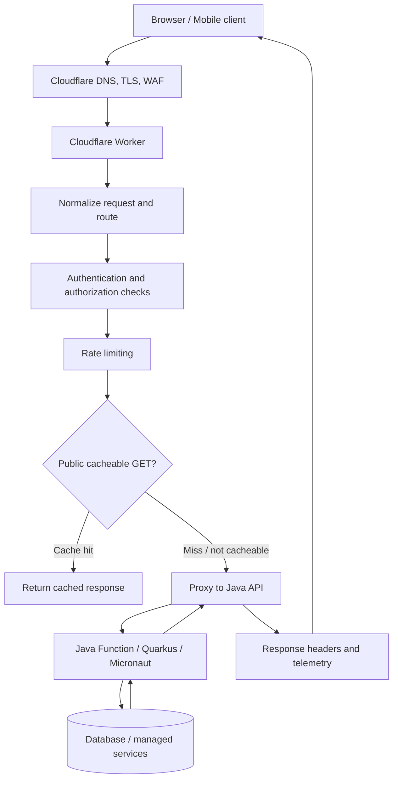
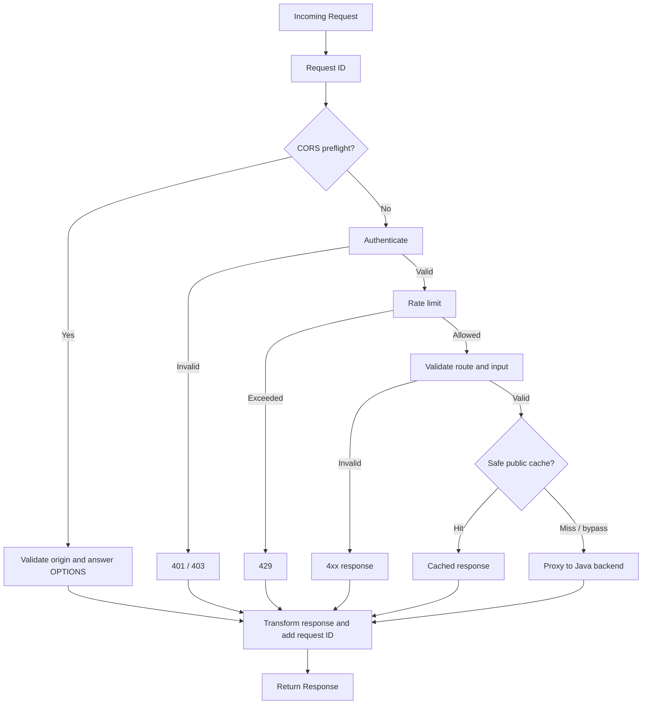

# Thiết kế edge middleware với Cloudflare Workers

## 1. Edge middleware là gì?

Edge middleware là lớp xử lý HTTP chạy gần người dùng trước khi request đến ứng dụng backend. Nó có thể kiểm tra request, xác thực, áp dụng rate limit, định tuyến, chuyển đổi header/path, cache response, ghi nhận telemetry và chuyển tiếp request đến origin.

Với ứng dụng Java serverless, Cloudflare Workers thường đóng vai trò lớp edge nằm trước Java API chạy trên AWS Lambda, Azure Functions, Google Cloud Run hoặc một nền tảng container/serverless khác. Worker xử lý những chính sách chung ở biên; Java backend tiếp tục thực hiện nghiệp vụ, truy cập dữ liệu và kiểm tra quyền trên tài nguyên.

Cloudflare Workers là runtime chạy mã JavaScript/TypeScript theo mô hình module worker, dựa trên Web APIs như `Request`, `Response` và `fetch`. Nó không phải JVM runtime để triển khai trực tiếp một Java Function như trên các nền tảng Java FaaS. Workers có thể chạy một số module WebAssembly và hỗ trợ một phần API Node.js theo compatibility date, nhưng điều đó không đồng nghĩa với việc chạy một ứng dụng Java/JVM thông thường. Vì vậy, bài học này dùng TypeScript ở edge và Java ở backend.

Một edge middleware tốt nên ngắn, có thứ tự xử lý rõ ràng và tránh biến thành nơi chứa toàn bộ nghiệp vụ. Những việc cần transaction, xử lý dữ liệu lớn, truy vấn phức tạp hoặc thời gian chạy dài thường thuộc về Java service, queue consumer hoặc workflow phía sau.

## 2. Kiến trúc tổng thể: Worker trước Java backend

Giả sử một hệ thống quản lý đơn hàng có ứng dụng web, API Java và database. Request đi qua Cloudflare trước khi đến Java backend:



Các thành phần có trách nhiệm riêng:

- **Cloudflare DNS, TLS và WAF:** tiếp nhận lưu lượng, kết thúc TLS và áp dụng chính sách bảo vệ ở lớp mạng/HTTP theo cấu hình tài khoản.
- **Worker:** chạy middleware theo request, quyết định có chuyển tiếp hay trả response ngay.
- **Java backend:** xác thực lại khi cần, thực hiện domain logic, kiểm tra quyền trên tài nguyên, truy cập database và dịch vụ nghiệp vụ.
- **Observability:** nối request ở edge với log/trace trong Java bằng request ID hoặc trace context.

Worker có thể giảm số request đến Java bằng cache và từ chối sớm request sai. Tuy nhiên, Java backend vẫn phải tự bảo vệ nếu có đường truy cập trực tiếp hoặc được gọi từ hệ thống khác. Không dùng một header do Worker thêm làm bằng chứng danh tính nếu origin vẫn cho phép client gọi thẳng và giả mạo header đó.

## 3. Cloudflare Workers runtime và request lifecycle

### 3.1. Module Worker và Fetch handler

Mô hình được khuyến nghị cho ứng dụng mới là module Worker. Request HTTP đến handler `fetch()` dưới dạng đối tượng `Request`; handler trả về một `Response` hoặc `Promise<Response>`.

```ts
export default {
  async fetch(request: Request, env: Env, ctx: ExecutionContext): Promise<Response> {
    const url = new URL(request.url);

    return Response.json({
      method: request.method,
      path: url.pathname,
      host: url.host,
    });
  },
} satisfies ExportedHandler<Env>;
```

Ba tham số thường dùng:

- `request`: method, URL, headers và body của request đến.
- `env`: các binding được cấu hình cho Worker, ví dụ secret, KV, rate limiter hoặc service binding.
- `ctx`: execution context, gồm `waitUntil()` để theo dõi một công việc phụ trợ sau khi response đã được trả.

Các thao tác bất đồng bộ như `fetch()` phải diễn ra trong request/handler context. Không gọi dịch vụ bên ngoài ở module scope khi Worker đang khởi động.

### 3.2. Isolate và trạng thái giữa các request

Workers có thể tái sử dụng isolate để xử lý nhiều request. Biến ở module scope có thể còn tồn tại qua các invocation trong cùng isolate, nhưng không được coi là nơi lưu trạng thái bền vững hoặc dữ liệu riêng của một request.

Không lưu `currentUser`, token, request body hoặc thông tin tenant vào biến mutable toàn cục. Các request có thể chạy xen kẽ và dùng chung isolate; dữ liệu request này có thể rò sang request khác. Truyền state qua tham số, Hono context hoặc một object riêng cho từng request. Dữ liệu cần chia sẻ bền vững phải đặt trong binding/storage phù hợp.

### 3.3. Compatibility date và Node.js compatibility

`compatibility_date` xác định tập hành vi runtime mà Worker sử dụng. Nên khai báo ngày rõ ràng trong `wrangler.jsonc` và cập nhật có kiểm thử khi muốn nhận thay đổi runtime mới.

Cloudflare cung cấp một tập con API Node.js. Với compatibility date từ `2026-08-04`, các API Node.js được hỗ trợ và polyfill tương ứng được bật mặc định; những API không được hỗ trợ đầy đủ vẫn có thể chỉ là stub hoặc chưa hoạt động. Không giả định một package npm chạy được trên Node.js thì chắc chắn chạy được trên Workers. Hãy kiểm tra API mà package thực sự sử dụng.

## 4. Chọn cách đưa Worker vào đường đi của request

Cloudflare có ba cách phổ biến để đưa Worker ra Internet: Routes, Custom Domains và `workers.dev`.

| Cách gắn | Worker đóng vai trò | Khi nên dùng |
| --- | --- | --- |
| Route | Chạy trước origin server đã tồn tại trong zone; Worker có thể `fetch(request)` để chuyển tiếp đến origin | Muốn thêm middleware trước một Java API đang chạy sau Cloudflare |
| Custom Domain | Worker là origin cho hostname đó; Cloudflare tạo DNS record và certificate | Muốn Worker là điểm vào chính và tự proxy đến Java backend hoặc dịch vụ khác |
| `workers.dev` | Hostname tiện cho phát triển, preview và thử nghiệm | Demo, kiểm thử hoặc endpoint không phải production-critical |

Nếu Java API đã chạy sau một hostname được Cloudflare proxy, Route thường phù hợp. Nếu Worker sẽ là API gateway chính của `api.example.com`, có thể dùng Custom Domain rồi proxy từ Worker đến Java origin.

### 4.1. Route pattern

Route pattern hỗ trợ wildcard `*`, không phải regex tổng quát. Khi nhiều pattern cùng khớp, pattern cụ thể hơn được ưu tiên. Path phân biệt chữ hoa/chữ thường; pattern không chứa query parameter và wildcard chỉ được dùng theo quy tắc của Cloudflare.

Ví dụ:

```text
api.example.com/*          -> edge-api Worker
api.example.com/admin/*    -> admin-edge Worker (nếu được cấu hình cụ thể hơn)
```

Để route hoạt động, hostname phải có DNS record được proxy qua Cloudflare. Nếu dùng route cho origin hiện hữu, cần xác minh DNS record, zone và pattern trước khi triển khai. Không dùng wildcard hostname quá rộng như `*example.com/*` nếu không muốn khớp cả những hostname chỉ tình cờ kết thúc bằng chuỗi đó.

### 4.2. Routes và Custom Domains khác nhau ở đâu?

Route bổ sung Worker trước ứng dụng origin đã có. Custom Domain trỏ hostname trực tiếp đến Worker, vì vậy Worker trở thành origin của hostname. Nếu Custom Domain Worker cần gọi Java backend, code phải chủ động gọi `fetch()` đến URL origin được cấu hình.

Với Worker Route, gọi `fetch(request)` sẽ tạo subrequest đến origin được định nghĩa trong DNS của zone. Với Custom Domain, có thể dùng `fetch()` đến external origin theo URL được cấu hình. Không nên nhận hostname đích từ query hoặc header của client rồi fetch tùy ý; điều đó biến Worker thành open proxy và có thể tạo SSRF.

## 5. Middleware pipeline: thứ tự xử lý

Middleware là các bước bao quanh handler cuối cùng. Một request có thể đi qua chuỗi:

1. Tạo request ID và ghi nhận metadata cần thiết.
2. Chuẩn hóa method, path và header theo hợp đồng API.
3. Xử lý CORS preflight.
4. Xác thực token hoặc danh tính.
5. Áp dụng rate limit theo người dùng/tenant/route.
6. Kiểm tra method, schema, kích thước request và route.
7. Quyết định cache hoặc chuyển tiếp đến Java backend.
8. Chuẩn hóa response, thêm request ID và CORS headers.
9. Gửi log/metric không quan trọng bằng tác vụ phụ trợ nếu phù hợp.

Thứ tự cần được chọn theo yêu cầu cụ thể. Ví dụ, CORS preflight phải được xử lý trước middleware đòi access token vì browser gửi `OPTIONS` để hỏi chính sách trước request thật. Rate limit theo user cần chạy sau authentication để có user ID đáng tin cậy. Cache cho response công khai có thể được kiểm tra trước khi gọi backend, nhưng không được bỏ qua authorization cho dữ liệu riêng tư.



## 6. Tổ chức middleware bằng Hono

Hono là web framework nhỏ gọn thường được dùng với Cloudflare Workers. Nó cung cấp router và middleware composition qua `app.use()`. Có thể dùng Hono để tránh tự viết router và cơ chế `next()`.

Ví dụ khai báo ứng dụng:

```ts
import { Hono } from "hono";
import { cors } from "hono/cors";

type Bindings = {
  JAVA_API_ORIGIN: string;
  API_LIMITER: RateLimit;
};

type Principal = {
  subject: string;
  scopes: string[];
};

type Variables = {
  requestId: string;
  principal: Principal;
};

const app = new Hono<{ Bindings: Bindings; Variables: Variables }>();
```

Các kiểu `RateLimit`, `ExecutionContext` và `ExportedHandler` được cung cấp bởi type definitions của Cloudflare Workers. Có thể dùng `npx wrangler types` để sinh kiểu binding theo cấu hình Wrangler của dự án. Cài Hono bằng `npm install hono`.

Thứ tự đăng ký middleware có ý nghĩa. Hono thực thi middleware theo thứ tự khai báo và `await next()` chuyển quyền điều khiển xuống bước kế tiếp. Middleware có thể bổ sung header hoặc xử lý response khi các bước phía dưới trả kết quả.

## 7. Request ID, logging và context

Request ID giúp liên kết log ở edge với log của Java backend. Có thể tạo ID mới ở Worker hoặc dùng một ID do trusted gateway phía trước cấp. Nếu lấy từ header client, hãy xác thực/chuẩn hóa giá trị và không dùng nó làm danh tính bảo mật.

```ts
app.use("/api/*", async (c, next) => {
  const requestId = c.req.header("cf-ray") ?? crypto.randomUUID();
  c.set("requestId", requestId);

  console.log({
    event: "request.started",
    requestId,
    method: c.req.method,
    path: new URL(c.req.url).pathname,
  });

  await next();
  c.header("X-Request-Id", requestId);
});
```

Trong thực tế, `cf-ray` là mã tham chiếu hữu ích để tra cứu tại Cloudflare, nhưng request ID của ứng dụng nên có quy ước riêng nếu cần xuyên suốt nhiều hệ thống. Không log access token, cookie, request body nhạy cảm hoặc thông tin cá nhân không cần thiết.

## 8. CORS và xử lý preflight

CORS là cơ chế browser dùng để quyết định JavaScript từ một origin có được đọc response của origin khác hay không. Nó không phải authentication và không ngăn mọi client khác gọi API.

Một cấu hình CORS cần xác định:

- Origin được phép, ví dụ `https://app.example.com`.
- Method được phép như `GET`, `POST`, `PATCH`, `DELETE`.
- Header client được gửi như `Authorization`, `Content-Type`, `Idempotency-Key`.
- Header response được phép JavaScript đọc, ví dụ `X-Request-Id`.
- Có dùng cookie/credentials hay không.
- Thời gian browser có thể cache kết quả preflight.

Ví dụ Hono:

```ts
app.use(
  "/api/*",
  cors({
    origin: ["https://app.example.com"],
    allowMethods: ["GET", "POST", "PATCH", "DELETE", "OPTIONS"],
    allowHeaders: ["Authorization", "Content-Type", "Idempotency-Key"],
    exposeHeaders: ["X-Request-Id"],
    maxAge: 600,
    credentials: true,
  }),
);
```

Khi bật credentials, không dùng `Access-Control-Allow-Origin: *`. Chỉ trả origin nằm trong allowlist. Đảm bảo `OPTIONS` được trả lời trước authentication middleware; preflight không mang access token theo cách request thật thường có.

## 9. Authentication và authorization ở edge

### 9.1. Xác thực token

Worker có thể xác minh JWT trước khi chuyển tiếp request. Khi dùng JWT, cần kiểm tra chữ ký bằng khóa tin cậy và xác minh tối thiểu `iss`, `aud`, `exp`, `nbf` cùng scope/role cần thiết. Không chỉ decode Base64 payload rồi tin nội dung.

Có thể dùng thư viện JOSE tương thích Workers hoặc Cloudflare Access để bảo vệ hostname/API. Nếu dùng Cloudflare Access, Worker/backend cần kiểm tra Access JWT theo đúng hướng dẫn của Access và audience đã cấu hình.

Ví dụ middleware dưới đây giả định có hàm `verifyAccessToken()` dùng thư viện xác minh JWT đã được cấu hình với issuer, audience và JWKS tin cậy. Middleware được gắn vào nhóm endpoint riêng tư; endpoint công khai như catalog có thể dùng route/policy riêng:

```ts
app.use("/api/private/*", async (c, next) => {
  const authorization = c.req.header("Authorization");
  const token = authorization?.startsWith("Bearer ")
    ? authorization.slice("Bearer ".length)
    : undefined;

  if (!token) {
    return c.json({ error: "unauthorized" }, 401);
  }

  let principal: Principal | null;
  try {
    principal = await verifyAccessToken(token);
  } catch {
    principal = null;
  }
  if (!principal) {
    return c.json({ error: "invalid_token" }, 401);
  }

  c.set("principal", principal);
  await next();
});
```

`verifyAccessToken()` là adapter xác thực của ứng dụng; phải triển khai bằng thư viện JWT được duy trì và cấu hình đúng nhà phát hành token. Không tự viết thuật toán xác minh chữ ký nếu không có lý do chuyên biệt.

### 9.2. Xác thực không thay thế authorization nghiệp vụ

JWT hợp lệ cho biết request đến từ principal nào và có scope nào. Nó không tự chứng minh principal được đọc mọi đơn hàng. Java backend vẫn cần kiểm tra quyền trên tài nguyên, ví dụ user có sở hữu `orderId` đang truy vấn hay không.

Nếu Worker thêm `X-User-Id` hoặc `X-Tenant-Id`, client có thể gửi header cùng tên để giả mạo nếu Worker không xóa/ghi đè. Java backend chỉ được tin identity header khi origin được bảo vệ để chỉ Worker đáng tin cậy gọi được và giá trị được xác thực bằng cơ chế phù hợp. Một lựa chọn an toàn là chuyển tiếp bearer token để Java service xác minh lại.

### 9.3. Bảo vệ Java origin khỏi truy cập trực tiếp

Nếu origin Java vẫn mở công khai, client có thể gọi thẳng origin và bỏ qua WAF, rate limit hoặc auth middleware ở Worker. Cần chọn cơ chế bảo vệ origin như Cloudflare Tunnel, Cloudflare Access service token, mTLS hoặc network policy phù hợp. Java backend vẫn phải xác thực request và kiểm tra quyền nghiệp vụ.

Không chỉ dựa vào header `X-Forwarded-For`, `CF-Connecting-IP` hoặc header tự đặt để cấp quyền. Các header chuyển tiếp phải được chuẩn hóa ở edge và chỉ được tin khi đường vào origin được kiểm soát.

## 10. Rate limiting và bảo vệ backend

Rate limiting ở edge giúp hạn chế lạm dụng, bảo vệ Java API và phân bổ quota theo người dùng/tenant/route. Có thể dùng Rate Limiting binding của Workers hoặc các sản phẩm WAF/rate limiting ở Cloudflare.

Với Rate Limiting binding, Worker gọi `limit()` theo một key do ứng dụng chọn:

```ts
app.use("/api/private/*", async (c, next) => {
  const principal = c.get("principal");
  const path = new URL(c.req.url).pathname;
  const { success } = await c.env.API_LIMITER.limit({
    key: `${principal.subject}:${path}`,
  });

  if (!success) {
    return c.json({ error: "rate_limit_exceeded" }, 429);
  }

  await next();
});
```

Ví dụ cấu hình binding trong `wrangler.jsonc`:

```jsonc
{
  "name": "edge-api",
  "main": "src/index.ts",
  "compatibility_date": "2026-11-17",
  "ratelimits": [
    {
      "name": "API_LIMITER",
      "namespace_id": "1001",
      "simple": {
        "limit": 100,
        "period": 60
      }
    }
  ]
}
```

Rate Limiting binding đơn giản có period 10 hoặc 60 giây và giới hạn được áp dụng riêng theo Cloudflare location. Bộ đếm cập nhật nền nên request có thể vượt ngưỡng đã cấu hình. Đây là cơ chế bảo vệ gần edge, không phải bộ đếm quota toàn cầu chính xác cho billing hoặc giao dịch tài chính. Nếu cần giới hạn chặt trên toàn hệ thống, dùng bộ đếm tập trung/đồng bộ phù hợp, chẳng hạn Durable Object hoặc dịch vụ quota riêng.

Nên đặt key sau authentication để dùng user ID/tenant ID đã xác minh. Nếu dùng IP, cân nhắc người dùng sau NAT hoặc mạng di động có thể chia sẻ IP. Có thể gán trọng số lớn hơn cho endpoint tốn nhiều tài nguyên, ví dụ search hoặc report.

## 11. Routing và proxy đến Java API

### 11.1. Route theo path và method

Worker có thể định tuyến các nhóm endpoint khác nhau:

| Route | Java backend | Chính sách edge |
| --- | --- | --- |
| `GET /api/catalog/*` | Catalog API | Có thể cache dữ liệu công khai |
| `GET /api/orders/*` | Order API | Yêu cầu auth; không cache response cá nhân |
| `POST /api/orders` | Order API | Auth, validation, rate limit; giữ nguyên body |
| `POST /api/payments/*` | Payment API | Auth mạnh, idempotency, không cache |
| `/api/admin/*` | Admin API | Access policy riêng, audit log |

Không nên tạo một open proxy nhận `targetUrl` từ query string. Backend origin phải được cố định trong cấu hình/binding, và Worker chỉ cho phép các route dự kiến.

### 11.2. Proxy request

Ví dụ dưới đây dùng Hono và `fetch()` để chuyển request đến Java origin. Worker giữ method, body và query string, đồng thời thêm request ID. `JAVA_API_ORIGIN` là cấu hình được quản lý, không phải giá trị client có thể điều khiển.

```ts
app.all("/api/*", async (c) => {
  const incoming = new URL(c.req.url);
  const origin = new URL(c.env.JAVA_API_ORIGIN);
  const backendPath = incoming.pathname.replace(/^\/api(?=\/|$)/, "") || "/";
  const target = new URL(`${backendPath}${incoming.search}`, origin);

  const initialRequest = new Request(target, c.req.raw);
  const headers = new Headers(initialRequest.headers);

  // Không chuyển tiếp Host do client gửi.
  headers.delete("host");
  headers.set("X-Request-Id", c.get("requestId"));
  headers.set("X-Forwarded-Host", incoming.host);
  headers.set("X-Forwarded-Proto", incoming.protocol.slice(0, -1));

  const upstreamRequest = new Request(initialRequest, { headers });
  const upstreamResponse = await fetch(upstreamRequest);

  const responseHeaders = new Headers(upstreamResponse.headers);
  responseHeaders.set("X-Request-Id", c.get("requestId"));

  return new Response(upstreamResponse.body, {
    status: upstreamResponse.status,
    statusText: upstreamResponse.statusText,
    headers: responseHeaders,
  });
});
```

Đoạn code minh họa luồng proxy. Trong ứng dụng production, cần bổ sung xử lý lỗi kết nối, timeout, giới hạn request body, route allowlist và quy tắc redirect. Nếu origin trả redirect có `Location` trỏ đến hostname nội bộ, cần quyết định có rewrite sang hostname công khai hay không. Không forward header identity do client tự khai báo như thể đã xác thực.

Hãy đăng ký route cụ thể như `/api/catalog` trước route catch-all `app.all("/api/*")`, hoặc tách router theo nhóm để route proxy chung không che mất handler chuyên biệt.

### 11.3. Giữ body dạng stream

Nếu Worker chỉ proxy request, không cần gọi `await request.json()` rồi serialize lại body. Việc đọc body có thể tiêu thụ stream và buộc phải clone/đệm dữ liệu, làm tăng memory và độ trễ. Chỉ parse body khi cần kiểm tra hoặc biến đổi nội dung; với upload lớn, ưu tiên streaming hoặc truyền trực tiếp đến backend/storage.

Nếu cần transform JSON, hãy giới hạn kích thước, kiểm tra `Content-Type`, xử lý lỗi parse và tạo body mới rõ ràng. Không parse mọi request theo mặc định.

### 11.4. Worker-to-Worker và Service Bindings

Service binding cho phép một Worker gọi Worker khác trong cùng account mà không cần đi qua URL công khai. Nó phù hợp khi tách middleware thành nhiều Worker hoặc gọi một service Worker nội bộ.

Service binding không phải cách gọi trực tiếp Java Function trên AWS/Azure/GCP. Java backend bên ngoài thường được gọi bằng HTTP `fetch()` đến origin được bảo vệ, hoặc qua một API gateway/tunnel phù hợp. Không nhầm Service binding với kết nối đến một Java service chỉ vì cả hai cùng được gọi là service.

## 12. Request/response transformation

### 12.1. Request transformation

Worker có thể:

- Chuẩn hóa path prefix, ví dụ `/api/v1/orders` thành `/v1/orders` ở Java origin.
- Thêm request ID và trace context.
- Loại header không được phép chuyển tiếp.
- Chuẩn hóa `Accept`, `Content-Type` hoặc một số header giao thức.
- Ánh xạ hostname công khai sang backend origin cố định.
- Thêm metadata đã được xác minh, nếu origin có cơ chế tin cậy nguồn gửi.

Không tự ý đổi method, body hoặc semantics của request nếu không có hợp đồng API rõ. Request transformation nên có test cho encoding, dấu `/`, query parameter lặp và header trùng.

### 12.2. Response transformation

Worker có thể thêm `X-Request-Id`, chuẩn hóa CORS headers, xóa header nội bộ hoặc điều chỉnh cache directives cho endpoint công khai. Không để lộ stack trace, tên host nội bộ, server banner hoặc thông tin cấu hình của Java backend.

Khi tạo `Response` mới từ response upstream, giữ nguyên status code và stream body nếu không cần thay đổi nội dung. Nếu body được thay đổi, cần cập nhật `Content-Length`, `Content-Type`, `ETag`, `Content-Encoding` và các validator liên quan cho đúng.

### 12.3. Error mapping

Nên thống nhất error envelope giữa Worker và Java API. Ví dụ:

```json
{
  "error": {
    "code": "RATE_LIMIT_EXCEEDED",
    "message": "Too many requests",
    "requestId": "req-7f2a"
  }
}
```

Không chuyển mọi lỗi upstream thành `200 OK`. Giữ status phù hợp để client và monitoring phân biệt lỗi client (`4xx`), lỗi upstream (`5xx`), timeout và rate limit (`429`). Nếu Worker không kết nối được Java origin, có thể trả `502 Bad Gateway` hoặc `503 Service Unavailable` theo ngữ nghĩa lỗi.

## 13. Caching ở edge

### 13.1. Chỉ cache dữ liệu có thể chia sẻ an toàn

Cache có thể giảm latency và số request đến Java backend. Các endpoint phù hợp thường là dữ liệu công khai, ít thay đổi như danh mục sản phẩm, cấu hình công khai hoặc metadata tĩnh.

Không cache mặc định các response chứa dữ liệu riêng tư, thông tin tài khoản, đơn hàng, thanh toán hoặc kết quả phụ thuộc quyền của người dùng. Với response cá nhân, dùng `Cache-Control: private, no-store` hoặc chính sách rõ ràng tương đương.

### 13.2. Cache key và biến thể response

Cache key phải bao gồm mọi yếu tố ảnh hưởng nội dung response. Nếu response phụ thuộc locale, currency, tenant, query parameter hoặc `Accept`, cache key/`Vary` phải phản ánh điều đó. Nếu bỏ qua một yếu tố, người dùng có thể nhận response của tenant hoặc ngôn ngữ khác.

Chỉ cache `GET`/`HEAD` có ngữ nghĩa an toàn. Không cache `POST`, `PATCH`, `DELETE` hoặc request có side effect như một response dùng chung. Cần xác định TTL, stale behavior, purge/invalidation và xử lý khi backend lỗi.

### 13.3. Workers Cache, Cache API và fetch

Cloudflare có nhiều cách cache; cần hiểu phạm vi của từng API:

- **Workers Cache:** cache response HTTP cho Worker theo cấu hình cache và response headers. Cache hit có thể trả response mà không chạy Worker; chỉ `GET` và `HEAD` đủ điều kiện, và các điều kiện bypass chuẩn vẫn áp dụng.
- **Cache API:** cho phép code chủ động `match`, `put` và `delete` response. Cache API có phạm vi local theo data center và không cung cấp tiered cache như Workers Cache.
- **`fetch()` đến origin:** trong mô hình middleware/proxy, thường là cách phù hợp để gửi subrequest đến origin và tận dụng chính sách cache sẵn có của zone/origin.

Cloudflare Workers Cache có thể tự bypass khi request có `Authorization` hoặc response có `Set-Cookie`. Tuy vậy, không dựa duy nhất vào bypass tự động: hãy đặt cache policy đúng với dữ liệu nghiệp vụ và kiểm tra cache key.

Nếu dùng Workers Cache do Worker quản lý, cần bật `cache.enabled` trong Wrangler configuration; tính năng này yêu cầu Wrangler 4.69.0 trở lên theo tài liệu hiện hành. Nếu không bật, header `Cache-Control` vẫn có thể điều khiển cache ở browser hoặc các lớp cache khác, nhưng không tự bật Workers Cache cho Worker.

```jsonc
{
  "cache": {
    "enabled": true
  }
}
```

### 13.4. Ví dụ cache response công khai

```ts
app.get("/api/catalog", async (c) => {
  const upstreamUrl = new URL("/v1/catalog", c.env.JAVA_API_ORIGIN);
  const upstream = await fetch(upstreamUrl);

  const headers = new Headers(upstream.headers);
  if (upstream.ok) {
    headers.set("Cache-Control", "public, max-age=60, s-maxage=300");
  } else {
    headers.set("Cache-Control", "no-store");
  }

  return new Response(upstream.body, {
    status: upstream.status,
    headers,
  });
});
```

Ví dụ này chỉ dành cho catalog công khai. Không sao chép chính sách `public` sang endpoint đã xác thực. TTL cụ thể cần dựa trên độ mới dữ liệu, khả năng purge và yêu cầu nghiệp vụ.

## 14. Secrets, bindings và cấu hình môi trường

### 14.1. Bindings và biến cấu hình

Workers nhận tài nguyên qua `env` bindings. Có thể dùng:

- `vars` cho cấu hình không bí mật như `JAVA_API_ORIGIN`, tên environment hoặc giới hạn mặc định.
- Secrets cho API token, shared secret hoặc credential.
- Rate limiting binding cho quota gần edge.
- KV, R2, D1 hoặc Durable Objects khi ứng dụng thực sự cần các dịch vụ tương ứng.
- Service binding khi gọi một Worker khác.

Không dùng `vars` để lưu secret. Secret được quản lý riêng và truy cập qua `env`. Trong local development, dùng `.dev.vars` hoặc `.env` theo quy ước Wrangler và thêm các file này vào `.gitignore`.

### 14.2. Ví dụ Wrangler configuration

```jsonc
{
  "$schema": "./node_modules/wrangler/config-schema.json",
  "name": "edge-api",
  "main": "src/index.ts",
  "compatibility_date": "2026-11-17",
  "upload_source_maps": true,
  "routes": [
    {
      "pattern": "api.example.com/*",
      "zone_name": "example.com"
    }
  ],
  "vars": {
    "JAVA_API_ORIGIN": "https://java-origin.example.net"
  },
  "ratelimits": [
    {
      "name": "API_LIMITER",
      "namespace_id": "1001",
      "simple": {
        "limit": 100,
        "period": 60
      }
    }
  ],
  "observability": {
    "enabled": true,
    "head_sampling_rate": 0.1
  }
}
```

Đây là ví dụ route trước origin Java. Hostname cần có DNS record proxy qua Cloudflare. Nếu Worker là origin của hostname, dùng Custom Domain configuration thay cho route thông thường.

Đưa secret vào Worker bằng lệnh Wrangler, ví dụ:

```bash
npx wrangler secret put ORIGIN_SHARED_SECRET
```

Lệnh trên yêu cầu nhập giá trị bí mật trong terminal. Không commit secret, không ghi nó vào `wrangler.jsonc` và không log giá trị secret. Cấu hình `JAVA_API_ORIGIN` là public configuration; nếu origin có token hoặc credential thì quản lý riêng bằng secret.

### 14.3. Tách dev, staging và production

Mỗi môi trường nên có origin, secret, route và rate limit phù hợp. Không dùng chung secret production trong local development. Kiểm tra binding của preview/staging để tránh request test ghi vào database hoặc queue production.

Khi thay đổi secret hoặc binding, nhớ rằng isolate có thể được tái sử dụng. Tránh tạo client toàn cục phụ thuộc vào một secret có thể được xoay vòng nếu client không được làm mới đúng cách.

## 15. Bảo mật và giới hạn tin cậy

### 15.1. Không biến Worker thành open proxy

Origin phải được chọn từ cấu hình tin cậy hoặc route table nội bộ. Không nhận URL đích từ query, body hoặc header tùy ý. Nếu Worker có thể fetch mọi URL do client gửi, kẻ tấn công có thể dùng nó truy cập dịch vụ nội bộ hoặc tạo lưu lượng ra ngoài ngoài dự kiến.

### 15.2. Header và dữ liệu đầu vào

Xóa hoặc ghi đè header nội bộ do client có thể giả mạo, ví dụ `X-Authenticated-User`, `X-Internal-Role` hoặc `X-Forwarded-Host`. Giới hạn method, body size, content type và các path được phép. Không nối input trực tiếp vào URL origin, tên file hoặc câu truy vấn.

### 15.3. Origin protection

Nếu có thể, hạn chế Java origin chỉ nhận request từ một đường kết nối tin cậy. Các lựa chọn gồm Cloudflare Tunnel, Access service token, mTLS hoặc firewall/network policy. Nếu origin vẫn phải public, dùng xác thực service-to-service và vẫn kiểm tra bearer token/quyền nghiệp vụ.

### 15.4. CORS không phải authorization

CORS chỉ điều khiển việc browser cho phép JavaScript đọc response. Nó không thay thế authentication, authorization hoặc rate limiting. Một client ngoài browser vẫn có thể gọi API nếu endpoint có thể truy cập công khai.

### 15.5. Cache và dữ liệu nhạy cảm

Không cache token, cookie, response chứa dữ liệu cá nhân hoặc response có phân quyền theo user nếu cache key không phản ánh đầy đủ identity. Khi nghi ngờ, bypass cache. Kiểm tra cả `Set-Cookie`, `Authorization`, `Vary` và các header cache-control từ Java origin.

## 16. Xử lý lỗi, timeout và tác vụ phụ trợ

### 16.1. Timeout giữa edge và Java

Worker phải tính đến thời gian kết nối origin, thời gian xử lý backend và deadline của client. Đặt timeout ở HTTP client và Java service sao cho tương thích. Nếu Worker timeout nhưng Java vẫn xử lý, client có thể retry và tạo thao tác trùng; endpoint ghi dữ liệu cần idempotency key.

Không retry mọi request một cách tự động. Retry `GET` an toàn thường dễ hơn retry `POST` tạo thanh toán hoặc đơn hàng. Với request có side effect, chỉ retry khi có idempotency contract và backend hỗ trợ.

### 16.2. Phân biệt lỗi

| Tình huống | Response edge thường dùng | Ghi chú |
| --- | --- | --- |
| Token thiếu/không hợp lệ | `401 Unauthorized` | Không chuyển request đến Java nếu auth edge là bắt buộc |
| Principal không có scope | `403 Forbidden` | Authorization vẫn cần kiểm tra ở backend cho tài nguyên |
| Vượt rate limit | `429 Too Many Requests` | Không gửi tiếp request đến origin |
| Request sai schema | `400 Bad Request` hoặc `422` | Xác định lớp nào chịu trách nhiệm validation |
| Java origin không phản hồi hoặc lỗi gateway | `502` / `503` / `504` tùy nguyên nhân | Ghi request ID để tra backend |
| Lỗi không dự kiến trong Worker | `500 Internal Server Error` | Không trả stack trace cho client |

### 16.3. `ctx.waitUntil()`

`ctx.waitUntil(promise)` cho phép Worker tiếp tục một công việc phụ trợ sau khi đã trả response, ví dụ gửi analytics hoặc ghi log bổ sung. Đây không phải hàng đợi bền vững và không bảo đảm công việc quan trọng sẽ hoàn tất như một durable job.

Không dùng `waitUntil()` cho thao tác bắt buộc như ghi đơn hàng, thu tiền hoặc cập nhật trạng thái chuẩn. Những công việc đó phải hoàn tất trước response hoặc được ghi vào queue/workflow bền vững.

## 17. Observability và trace xuyên suốt edge/backend

Workers Logs có thể thu thập invocation log, custom log, lỗi và exception. Có thể bật observability trong Wrangler và điều chỉnh `head_sampling_rate` để cân bằng khả năng điều tra với lượng log.

Nên ghi log có cấu trúc:

```ts
console.log({
  event: "origin.response",
  requestId,
  route: "/api/orders/:id",
  status: upstream.status,
  durationMs,
  cacheStatus: response.headers.get("CF-Cache-Status"),
});
```

Các chỉ số nên theo dõi:

- Request count theo route/method/status.
- Tỷ lệ `4xx`, `5xx`, `429` và lỗi fetch origin.
- Edge latency và origin latency.
- Cache hit/miss/bypass và tuổi dữ liệu.
- Rate-limit rejection theo tenant/route.
- CPU time, subrequest count và lỗi runtime.
- Java backend latency, database latency và retry count.

Truyền request ID hoặc W3C trace context qua edge đến Java backend để nối distributed trace. Không tạo trace ID mới ở mỗi hop nếu cần duy trì một trace xuyên suốt. Không log authorization header, cookie, token, body nhạy cảm hoặc secret.

## 18. Kiểm thử middleware

### 18.1. Unit test cho từng middleware

Mỗi middleware cần test cả đường thành công và thất bại:

- Request ID luôn có trong response kể cả khi backend lỗi.
- CORS cho phép đúng origin và từ chối origin ngoài allowlist.
- Preflight `OPTIONS` không bị auth middleware chặn.
- JWT hết hạn, sai issuer/audience hoặc thiếu scope bị từ chối.
- Rate limit chạy theo principal đã xác thực và trả `429` khi vượt ngưỡng.
- Path rewrite không làm mất query string hoặc tạo route ngoài dự kiến.
- Header do client giả mạo bị xóa/ghi đè.
- Response riêng tư không bị cache.

### 18.2. Integration test với Java backend

Chạy Worker local bằng Wrangler và kết nối đến Java API test. Xác minh method, body, query, header, timeout, redirect và error mapping. Kiểm tra Java backend nhận đúng request ID và tự xác minh token.

Không chỉ test với Java backend khỏe mạnh. Cần mô phỏng origin timeout, connection refused, response `5xx`, body lớn, malformed JSON và redirect sang hostname nội bộ.

### 18.3. Kiểm thử cache và bảo mật

Kiểm tra các tình huống:

- Hai user khác nhau không nhận chung response riêng tư.
- Query parameter hoặc `Vary` ảnh hưởng đúng cache key.
- `Authorization` và `Set-Cookie` không làm lộ dữ liệu qua cache.
- Request đến origin không thể bỏ qua xác thực/authorization.
- Worker không thể fetch hostname tùy ý do client cung cấp.
- Origin Java không thể bị truy cập trực tiếp để bypass edge policy.

### 18.4. Local development và deploy

Các lệnh phổ biến:

```bash
# Chạy Worker local
npx wrangler dev

# Sinh type cho bindings theo Wrangler configuration
npx wrangler types

# Deploy Worker
npx wrangler deploy

# Xem log real-time
npx wrangler tail
```

Lệnh cụ thể phụ thuộc phiên bản Wrangler và cách cấu hình project. Trước production, chạy integration test với hostname/route staging, xác minh DNS proxy, TLS, origin access và secret của môi trường.

## 19. Khi nào nên dùng Hono hoặc tự viết middleware?

| Lựa chọn | Phù hợp khi | Điểm cần cân nhắc |
| --- | --- | --- |
| Hono | Có nhiều route, middleware, validation và cần API gọn | Thêm dependency; cần theo dõi compatibility của middleware/package |
| Middleware tự viết | Gateway nhỏ, số route ít và logic đơn giản | Nhóm phải tự quản lý composition, error handling và test |
| Cloudflare WAF/Rules | Chính sách có thể cấu hình ở lớp Cloudflare mà không cần code | Ít linh hoạt cho logic phụ thuộc application identity hoặc payload |
| API Gateway riêng | Cần quản lý API contract, quota, developer portal hoặc tích hợp phức tạp | Thêm một thành phần vận hành; cần đánh giá có trùng trách nhiệm với Worker không |

Không nên viết middleware chỉ để lặp lại chức năng đã được Cloudflare WAF hoặc routing rules xử lý tốt. Code Worker nên tập trung vào logic cần dữ liệu request/application, proxy đến Java origin và điều phối các binding.

## 20. Lỗi thiết kế thường gặp

| Lỗi | Hậu quả | Cách khắc phục |
| --- | --- | --- |
| Nghĩ Workers là Java runtime | Chọn sai mô hình triển khai và dependency | Giữ Worker ở JS/TS/Wasm; Java chạy ở backend/runtime riêng |
| Đặt toàn bộ domain logic ở edge | Khó quản lý transaction, dữ liệu và kiểm thử | Giữ Worker làm middleware; domain service ở Java backend |
| Dùng Route/Custom Domain sai mục đích | Request không đến Worker hoặc origin không được gọi như mong muốn | Xác định Worker là lớp trước origin hay chính origin |
| CORS đặt sau authentication | Browser preflight bị trả `401` | Đăng ký CORS trước auth và xử lý `OPTIONS` |
| Tin header identity do client gửi | Giả mạo user/tenant | Xác minh token, ghi đè header và bảo vệ origin |
| Dùng rate limiter gần edge như quota toàn cầu chính xác | Request vẫn có thể vượt ngưỡng | Dùng cơ chế tập trung khi cần giới hạn chặt |
| Cache response có Authorization | Rò dữ liệu giữa người dùng | Không cache response riêng tư; thiết kế key/TTL rõ ràng |
| Worker fetch URL do client cung cấp | Open proxy/SSRF | Dùng origin allowlist và route cố định |
| Đọc toàn bộ body khi chỉ proxy | Tăng memory và latency | Giữ request body dạng stream nếu không cần transform |
| Retry POST không idempotent | Tạo đơn/thanh toán trùng | Dùng idempotency key và retry có kiểm soát |
| Dùng `waitUntil()` cho công việc quan trọng | Mất công việc khi execution bị dừng | Dùng queue hoặc workflow bền vững |
| Không truyền request ID đến Java | Khó điều tra lỗi xuyên hệ thống | Dùng correlation/request ID thống nhất |

## 21. Quy trình thiết kế edge middleware cho Java API

1. **Xác định ranh giới:** quyết định Worker chạy trên Route trước Java origin hay là Custom Domain/API gateway.
2. **Liệt kê route:** method, path, Java backend đích và chính sách cho từng endpoint.
3. **Chốt trust model:** xác định nơi xác thực, cách bảo vệ origin và cách Java kiểm tra quyền tài nguyên.
4. **Thiết kế middleware order:** request ID, CORS, auth, rate limit, validation, cache và proxy.
5. **Chọn bindings:** origin config, secret, rate limiter, service binding hoặc storage cần thiết.
6. **Thiết kế proxy:** giữ method/body/query, giới hạn path, kiểm soát header và xử lý redirect/timeout.
7. **Xác định cache policy:** chỉ cache dữ liệu công khai, thiết kế cache key, TTL, `Vary` và purge.
8. **Thiết lập observability:** structured logs, request ID, trace context, metrics và sampling.
9. **Kiểm thử bypass/failure:** auth, CORS, cache isolation, origin outage, rate limit và body lớn.
10. **Triển khai staging:** kiểm tra DNS, route, TLS, origin protection, secrets và Java integration.
11. **Rollout có kiểm soát:** theo dõi latency/error rate, bật dần chính sách và chuẩn bị rollback.

## 22. Kết luận

Cloudflare Workers có thể làm lớp edge middleware gọn nhẹ trước Java serverless API. Worker xử lý routing, CORS, authentication ở biên, rate limiting, cache và request/response transformation; Java backend tiếp tục thực hiện nghiệp vụ, kiểm tra quyền trên tài nguyên và quản lý dữ liệu bền vững.

Thiết kế đáng tin cậy cần phân biệt Routes với Custom Domains, giữ middleware theo thứ tự rõ ràng, không tin header do client tự gửi, không cache dữ liệu cá nhân và bảo vệ Java origin khỏi đường truy cập bỏ qua edge. Rate Limiting binding có tính xấp xỉ theo từng Cloudflare location; quota toàn cầu chặt cần cơ chế tập trung. Request ID, trace context và kiểm thử lỗi origin giúp vận hành xuyên suốt từ edge đến Java service.

## Tài liệu tham khảo

- [Cloudflare Workers — Fetch Handler](https://developers.cloudflare.com/workers/runtime-apis/handlers/fetch/)
- [Cloudflare Workers — Routes](https://developers.cloudflare.com/workers/configuration/routing/routes/)
- [Cloudflare Workers — Custom Domains](https://developers.cloudflare.com/workers/configuration/routing/custom-domains/)
- [Cloudflare Workers — Fetch API](https://developers.cloudflare.com/workers/runtime-apis/fetch/)
- [Cloudflare Workers — Bindings (`env`)](https://developers.cloudflare.com/workers/runtime-apis/bindings/)
- [Cloudflare Workers — Secrets](https://developers.cloudflare.com/workers/configuration/secrets/)
- [Cloudflare Workers — Rate Limiting binding](https://developers.cloudflare.com/workers/runtime-apis/bindings/rate-limit/)
- [Cloudflare Workers — Workers Cache](https://developers.cloudflare.com/workers/cache/)
- [Cloudflare Workers — Workers Logs](https://developers.cloudflare.com/workers/observability/logs/workers-logs/)
- [Cloudflare Workers — Compatibility dates](https://developers.cloudflare.com/workers/configuration/compatibility-dates/)
- [Cloudflare Workers — Node.js compatibility](https://developers.cloudflare.com/workers/runtime-apis/nodejs/)
- [Hono — Middleware](https://hono.dev/docs/guides/middleware)
