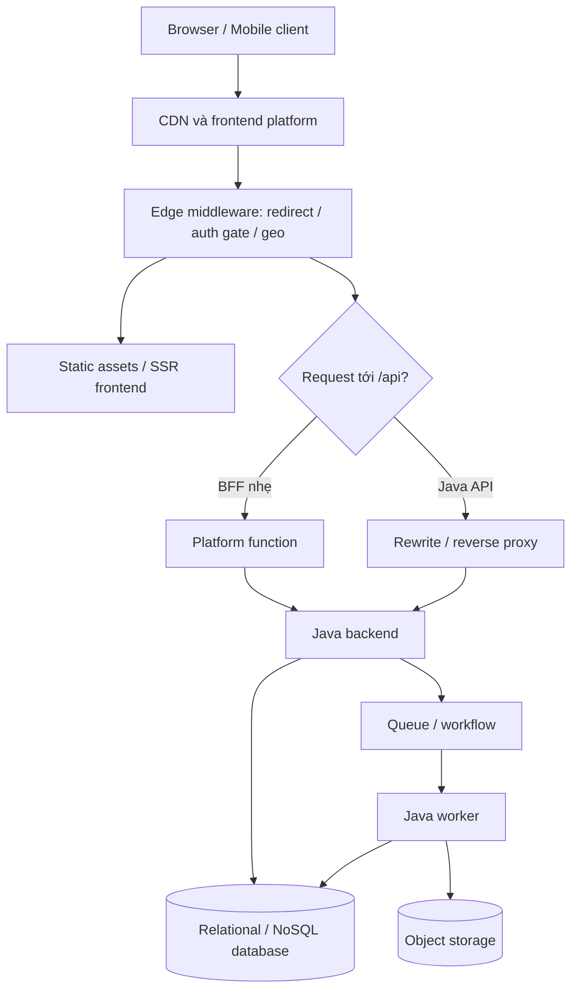
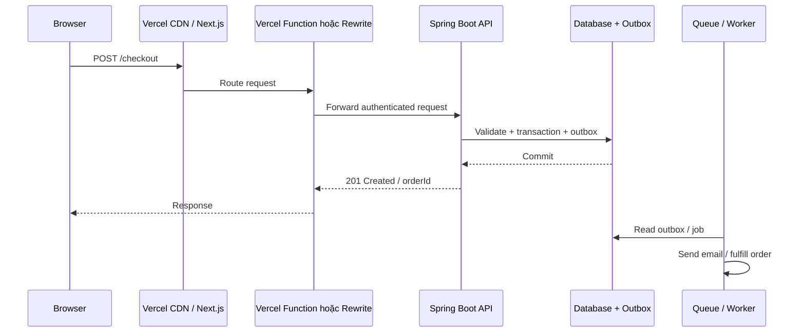
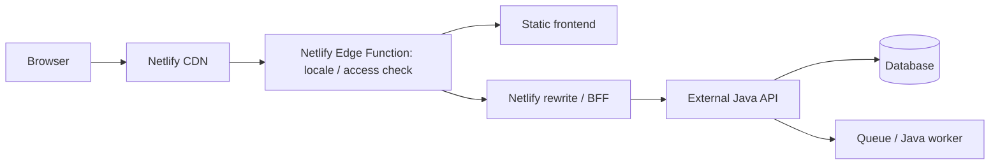

# Lựa chọn function cho ứng dụng web trên Vercel và Netlify

Vercel và Netlify là các nền tảng triển khai web có CDN, build theo Git, preview deployment và các cơ chế chạy code phía server. Cả hai đều cung cấp function và edge function để xử lý request hoặc event mà không phải tự quản lý máy chủ. Tuy nhiên, chúng hướng nhiều đến frontend và full-stack web framework; cách hỗ trợ ngôn ngữ, runtime, container và tác vụ nền khác với các nền tảng FaaS tổng quát.

Với ứng dụng Java, cần phân biệt ba câu hỏi:

1. **Ứng dụng web cần gì ở lớp gần người dùng?** Ví dụ static assets, SSR, rewrite, xác thực sớm, định tuyến theo khu vực hoặc API nhỏ.
2. **Function sẽ chạy bằng runtime nào?** Java không phải runtime source-code first-party thông thường của Netlify hoặc Vercel Edge. Vercel hiện có Container Runtime beta để chạy OCI image, còn Netlify có Functions/Edge Functions và Netlify Server với các runtime riêng.
3. **Phần nghiệp vụ Java nên đặt ở đâu?** Có thể chạy Java container trên Vercel Container Runtime nếu giới hạn beta phù hợp, hoặc triển khai backend Java trên Cloud Run, AWS, Azure hay một nền tảng container khác rồi kết nối với frontend Vercel/Netlify.

Không nên chọn edge function chỉ vì tên gọi “serverless” hoặc “gần người dùng”. Edge runtime thường tối ưu cho xử lý request ngắn bằng JavaScript/TypeScript và Web APIs. Một ứng dụng Spring Boot cần JVM, thư viện Java, JDBC, thread pool hoặc kết nối dài hạn thường phù hợp hơn với container/server runtime.

## 1. Các khối serverless web trên hai nền tảng

### Vercel

Vercel kết hợp CDN, framework deployment, Vercel Functions, Routing Middleware/Edge Runtime và các dịch vụ lưu trữ/tích hợp. Các API route hoặc server-side route của framework như Next.js có thể được build thành Vercel Functions. Function thường chạy theo vùng (region-first), tự scale theo request và có cấu hình memory, duration, region cùng các giới hạn theo plan.

Những khối cần phân biệt:

- **Vercel Functions:** xử lý server-side request hoặc lịch chạy; có các runtime như Node.js, Bun, Python, Rust, Go, Ruby, Wasm và Edge.
- **Edge Runtime:** môi trường dựa trên V8 với API web và một tập API hạn chế; thích hợp với middleware, redirect, rewrite, kiểm tra truy cập hoặc cá nhân hóa nhẹ.
- **Container Runtime:** chạy OCI image từ `Dockerfile`/`Containerfile`, cho phép đóng gói ứng dụng và thư viện tùy ý. Tại thời điểm biên soạn (17-11-2026), tính năng này đang ở Beta trên các plan. Đây là lựa chọn đáng chú ý để chạy một HTTP server Java, nhưng cần đánh giá rủi ro Beta và giới hạn Function trước khi dùng cho workload quan trọng.
- **Cron Jobs:** lịch chạy kích hoạt Vercel Function theo biểu thức lịch; không thay thế workflow engine cho quy trình nhiều bước dài hạn.

Vercel Functions có filesystem chỉ đọc, ngoại trừ vùng `/tmp` tạm thời. Dữ liệu nghiệp vụ phải nằm trong database hoặc object storage. Vị trí function và database cần được chọn gần nhau để giảm round-trip; đưa function ra nhiều vùng nhưng để database ở xa có thể làm tăng latency.

### Netlify

Netlify tích hợp static hosting, CDN, framework adapter, deploy preview và các primitive server-side. Những khối chính gồm:

- **Netlify Functions:** function theo request, platform event, lịch hoặc background task. Tài liệu hiện tại tập trung vào JavaScript/TypeScript và có hướng dẫn riêng cho Go. Runtime của function là môi trường ephemeral, tự scale theo lượng công việc.
- **Netlify Edge Functions:** chạy JavaScript/TypeScript trong runtime dựa trên Deno ở các edge location. Dùng để chỉnh request/response, định tuyến, xác thực sớm, cá nhân hóa hoặc cache.
- **Netlify Server:** server Node.js dài hạn có thể giữ connection pool, cache, SDK client, WebSocket và SSE giữa các request. Tại thời điểm biên soạn, Netlify Server đang ở Early Access và tài liệu mô tả Node.js server/framework; đây không phải Java/JVM runtime tổng quát.
- **Background Functions và Scheduled Functions:** dành cho công việc nền hoặc chạy theo lịch theo khả năng và giới hạn của plan.

Netlify Functions và Edge Functions được build/deploy cùng site, nên deploy preview có thể mang theo phiên bản function tương ứng. Với backend Java, thông thường triển khai service ở một nền tảng khác và để Netlify proxy `/api/*` đến backend đó.

## 2. So sánh runtime và khả năng chạy Java

Bảng sau mô tả khả năng ở mức nền tảng tại thời điểm 17-11-2026. Plan, Beta, giới hạn và runtime được hỗ trợ có thể thay đổi; trước khi triển khai production, cần kiểm tra tài liệu và dashboard của tài khoản thực tế.

| Khả năng | Vercel | Netlify |
| --- | --- | --- |
| Function JavaScript/TypeScript | Có, Node.js/Bun runtime | Có, Netlify Functions runtime |
| Function Python | Có runtime chính thức | Không phải runtime function được tài liệu hiện tại hướng dẫn như lựa chọn chuẩn |
| Function Go | Có runtime chính thức | Có hướng dẫn Lambda-compatible API cho Go |
| Java source runtime first-party | Không có runtime Java source chuyên biệt trong danh sách runtime chính thức | Không có Java runtime trong các function runtime được tài liệu hướng dẫn |
| Chạy Java qua container | Có Container Runtime Beta cho OCI image; có thể đóng gói JVM/Java app trong image | Netlify Functions/Edge Functions không phải nền tảng deploy OCI container tùy ý |
| Edge runtime | Edge Runtime dựa trên V8, không phải JVM | Edge Functions dựa trên Deno, không phải JVM |
| Server dài hạn | Có các lựa chọn container/service theo sản phẩm và giới hạn hiện hành | Netlify Server Early Access dành cho Node.js server |

Điểm quan trọng: **Vercel có thể chạy Java qua container image**, nhưng điều đó không có nghĩa Vercel có Java handler runtime giống AWS Lambda Java hoặc Azure Functions Java. Ứng dụng Java phải được đóng gói thành OCI image, khởi động HTTP server và tuân theo contract của Container Runtime.

Trên Netlify, có thể dùng JavaScript/TypeScript function làm lớp BFF hoặc proxy đến Java backend. Netlify Server hiện được mô tả cho Node.js; nếu ứng dụng bắt buộc chạy JVM, hãy triển khai backend ở Cloud Run, AWS Lambda/container, Azure Functions/container hoặc một dịch vụ Java phù hợp khác.

### Vì sao Edge Runtime không chạy Spring Boot?

Vercel Edge Runtime chạy trên V8 và Netlify Edge Functions chạy trên Deno. Chúng cung cấp Web APIs như `Request`, `Response`, `fetch`, `URL`, Web Crypto và Streams, với một số API bổ sung tùy nền tảng. Chúng không khởi động JVM, không nạp JAR như một Java server và không cung cấp đầy đủ API hệ điều hành như một container Linux thông thường.

Một số nền tảng có hỗ trợ WebAssembly hoặc cho phép thư viện WASM. Điều này có thể hữu ích cho một thuật toán nhỏ đã được biên dịch tương thích, nhưng không tương đương với việc chạy nguyên ứng dụng Spring Boot, JDBC driver hoặc một JVM đầy đủ ở edge. Chỉ chọn WASM khi module có thể biên dịch, không phụ thuộc API hệ thống không được hỗ trợ và đã được benchmark trong runtime đích.

## 3. Function vùng (regional) và edge function khác nhau thế nào?

Regional function thường chạy trong một vùng triển khai được cấu hình hoặc mặc định. Nó phù hợp với API cần truy cập database, SDK, thư viện server-side và xử lý nghiệp vụ. Edge function chạy gần request hơn trên mạng phân tán, có thể giảm thời gian định tuyến và thực hiện quyết định đơn giản trước khi request đến backend.

| Tiêu chí | Regional/serverless function | Edge function |
| --- | --- | --- |
| Vị trí | Một hoặc một số region cấu hình | Nhiều edge location gần người dùng |
| Runtime | Runtime ứng dụng như Node.js, Python, Go, Rust hoặc container tùy nền tảng | Runtime giới hạn dựa trên V8 hoặc Deno |
| Công việc | API, truy vấn database, tích hợp SDK, logic nghiệp vụ | Redirect, rewrite, geo, auth gate, header, cache, personalization nhẹ |
| Tài nguyên | Thường có nhiều CPU/memory và thời gian chạy hơn, tùy plan | Thường có giới hạn CPU, memory, bundle và API rõ ràng |
| Kết nối database | Phù hợp hơn khi đặt gần database | Không nên gọi database xa trên mỗi request nếu có thể tránh |
| Java/JVM | Có thể qua container ở Vercel; không phải native Java handler | Không chạy JVM/Spring Boot trực tiếp |

Đưa function ra edge không bảo đảm toàn bộ request nhanh hơn. Nếu edge function gọi database ở một region xa, round-trip đến database có thể chiếm phần lớn latency. Cần cân nhắc cache dữ liệu nhỏ, Edge Config hoặc một bước xác thực không cần truy vấn nhiều dữ liệu.

### Giới hạn edge cần đọc trước khi chọn

Netlify công bố giới hạn Edge Functions như bundle tối đa 20 MB sau nén, memory 512 MB cho tập edge functions đã deploy, CPU execution 50 ms mỗi request và response header timeout 40 giây. Đây là giới hạn runtime được công bố tại thời điểm tra cứu, không phải SLA hoặc giá trị chung cho mọi edge platform. Vercel Edge Runtime cũng có tập API hạn chế: không có filesystem thông thường, `require` trực tiếp và một số API Node.js không được hỗ trợ.

Không đặt logic CPU nặng, xử lý file lớn, truy vấn nhiều bảng hoặc Java/JVM lên edge chỉ vì muốn chạy gần người dùng. Đặt một bước quyết định nhỏ ở edge rồi chuyển request đến service vùng thường dễ kiểm soát hơn.

## 4. Chọn function cho ứng dụng web theo loại công việc

### API nhỏ gắn chặt với frontend

Nếu ứng dụng Next.js hoặc một framework được Vercel/Netlify hỗ trợ cần endpoint nhỏ để tạo session, gọi API bên thứ ba, ẩn API key hoặc ghép dữ liệu cho một trang, native function của nền tảng thường là lựa chọn đơn giản.

Ví dụ: frontend gọi `/api/profile`; function kiểm tra session, gọi một service nội bộ và chỉ trả các trường mà UI cần. Đây là Backend for Frontend (BFF). BFF nên giữ phần điều phối HTTP và trình bày dữ liệu, trong khi quy tắc nghiệp vụ chính có thể nằm ở Java backend dùng chung cho nhiều client.

### Xác thực sớm, redirect và cá nhân hóa

Edge function phù hợp với kiểm tra cookie/session nhẹ, redirect theo ngôn ngữ, geo routing, A/B test, chặn request rõ ràng không hợp lệ hoặc thêm header bảo mật. Nếu quyết định cần gọi nhiều hệ thống hoặc xác minh quyền nghiệp vụ phức tạp, chuyển đến API backend để tránh làm edge path chậm và khó kiểm soát.

### Webhook và tác vụ nền

Webhook receiver có thể chạy ở regional function nếu xử lý nhanh: xác minh chữ ký, kiểm tra event ID, ghi nhận event bền vững và enqueue công việc. Tác vụ dài nên chuyển sang queue/worker hoặc background execution. Không dựa vào thread nền sau khi HTTP handler đã trả response nếu nền tảng không bảo đảm vòng đời.

Vercel Cron Jobs có thể kích hoạt function theo lịch. Netlify có Scheduled Functions và Background Functions. Nếu cần retry nhiều bước, checkpoint, phê duyệt hoặc workflow kéo dài, dùng queue/workflow engine chuyên biệt thay vì biến một function thành scheduler tự quản lý.

### Backend Java nhiều nghiệp vụ

Nếu ứng dụng dùng Spring Boot, Quarkus hoặc Micronaut, có JDBC/JPA, transaction, nhiều endpoint, thư viện Java hoặc logic chia sẻ với batch worker, hãy cân nhắc một Java service/container. Vercel Container Runtime Beta có thể là lựa chọn nếu muốn giữ backend container trong cùng platform; Netlify thường dùng Java backend bên ngoài và proxy từ site.

Không nên tách mọi method Java thành một function nhỏ chỉ để có vẻ serverless. Việc chia quá nhỏ làm tăng số lần gọi mạng, quản lý transaction khó hơn, tăng số điểm retry và khiến tracing phức tạp. Chia theo ranh giới nghiệp vụ và nhu cầu scale độc lập.

## 5. Kiến trúc kết hợp frontend platform và Java backend

Một mô hình phổ biến cho ứng dụng web Java là:

1. Vercel hoặc Netlify phục vụ static assets, frontend framework và CDN.
2. Edge function xử lý redirect, geo hoặc kiểm tra request đơn giản nếu cần.
3. BFF function hoặc rewrite/proxy chuyển `/api/*` đến Java backend.
4. Java backend chạy trên nền tảng container/FaaS phù hợp, truy cập database, queue và object storage.
5. Worker hoặc workflow xử lý tác vụ bất đồng bộ, còn API cung cấp job status nếu người dùng cần theo dõi.



Nếu Vercel Container Runtime được dùng cho Java backend, `J` có thể là container service/function được triển khai trong Vercel. Nếu dùng Netlify, `J` thường nằm ở Cloud Run, AWS, Azure hoặc nền tảng Java khác. Đặt frontend và backend ở region phù hợp với người dùng và database; không mặc định edge location là nơi tốt nhất cho mọi xử lý.

### Cùng domain giúp đơn giản hóa browser security

Proxy `/api/*` qua domain frontend có thể giúp browser dùng một origin và giảm cấu hình CORS. Tuy nhiên, proxy không thay thế xác thực và phân quyền. Backend vẫn phải xác minh token/session, kiểm tra tenant/resource, giới hạn request body và chống CSRF nếu dùng cookie authentication.

## 6. Chạy Java HTTP app bằng Vercel Container Runtime

Tại thời điểm 17-11-2026, Vercel Container Runtime đang ở Beta và có thể chạy code/library từ OCI container image. Một Java HTTP application có thể được đóng gói trong Dockerfile và chạy như container-based Vercel Function. Runtime yêu cầu container mở HTTP server; port mặc định là `80` và có thể được ghi đè bằng biến môi trường `PORT`.

Ví dụ Spring Boot cấu hình port theo môi trường:

```properties
server.port=${PORT:80}
server.address=0.0.0.0
```

Dockerfile multi-stage minh họa:

```dockerfile
FROM maven:3.9-eclipse-temurin-21 AS build
WORKDIR /workspace
COPY pom.xml .
COPY src ./src
RUN mvn -B -DskipTests package

FROM eclipse-temurin:21-jre
WORKDIR /app
COPY --from=build /workspace/target/app.jar /app/app.jar
ENV PORT=80
EXPOSE 80
ENTRYPOINT ["java", "-XX:MaxRAMPercentage=75.0", "-jar", "/app/app.jar"]
```

Đổi tên JAR và JDK theo project. Build/test nên chạy trong CI; không dùng `-DskipTests` làm bước xác nhận chất lượng cuối cùng. Image phải chạy foreground process, ghi log ra stdout/stderr và lắng nghe trên `0.0.0.0:$PORT`.

Với project Vercel mới không nhận diện framework khác, root `Dockerfile` có thể chọn Container preset. Nếu project đã nhận diện Next.js hoặc framework khác, cần cấu hình project framework sang Container hoặc dùng tên Dockerfile theo hướng dẫn runtime. Sau đó deploy qua Vercel CLI hoặc Git integration như một container-based workload.

### Những giới hạn cần tính trước

- Container Runtime đang Beta; API, availability và điều kiện plan có thể thay đổi.
- Các giới hạn Function và mô hình Active CPU pricing của Vercel áp dụng cho custom container image.
- Function/container được scale theo traffic. Tại thời điểm tài liệu tra cứu, instance không nhận traffic trong 5 phút ở production và 30 giây ở preview sẽ scale down.
- Khi scale down, container nhận `SIGTERM` và có 30 giây grace period để dọn dẹp trước khi bị kết thúc cưỡng chế.
- Không lưu trạng thái nghiệp vụ trên filesystem hoặc heap giữa các lần scale; dùng database/cache/object storage.
- Server phải xử lý shutdown graceful: ngừng nhận công việc mới, hoàn tất request trong khả năng, đóng connection pool và không dựa vào việc process tồn tại mãi.

Vì đây là runtime Beta, hãy kiểm tra các giới hạn hiện hành, networking, vùng triển khai, request duration, image optimization limits và yêu cầu compliance trước khi chọn làm backend production quan trọng. Nếu cần process dài hạn, worker nền liên tục, protocol đặc biệt hoặc kiểm soát OS sâu, một nền tảng container/server chuyên dụng có thể phù hợp hơn.

## 7. Dùng Netlify cho frontend và kết nối Java backend bên ngoài

Netlify phù hợp để build/deploy frontend và các function nhỏ bằng runtime mà nền tảng hỗ trợ. Nếu phần backend chính là Java, triển khai Spring Boot/Quarkus/Micronaut thành service riêng. Netlify site có thể proxy route API đến domain backend.

Ví dụ `netlify.toml`:

```toml
[[redirects]]
  from = "/api/*"
  to = "https://api.example.com/api/:splat"
  status = 200
  force = true
```

Đây là rewrite/proxy mẫu. Hãy kiểm tra cú pháp redirect và hành vi proxy theo phiên bản Netlify hiện hành, tránh tạo vòng lặp nếu backend cũng redirect về frontend. Không đặt secret backend trong code frontend; giữ credential ở backend hoặc trong environment scope server-side. Backend phải xử lý CORS, cookie, authorization và forwarded headers theo topology thực tế.

Netlify Functions có thể làm BFF nhỏ trước Java API:

```typescript
// netlify/functions/profile.ts
import type { Config, Context } from "@netlify/functions";

export default async (request: Request, _context: Context) => {
  const session = request.headers.get("cookie");
  if (!session) {
    return Response.json({ error: "unauthorized" }, { status: 401 });
  }

  const upstream = await fetch(`${process.env.JAVA_API_URL}/v1/profile`, {
    headers: { cookie: session },
  });

  return new Response(upstream.body, {
    status: upstream.status,
    headers: {
      "content-type": upstream.headers.get("content-type") ?? "application/json",
      "cache-control": "no-store",
    },
  });
};

export const config: Config = {
  path: "/api/profile",
  method: "GET",
};
```

Ví dụ chỉ minh họa BFF gọi Java API. Trong production, không chuyển tiếp cookie một cách mù quáng: xác minh session tại lớp tin cậy, chỉ chuyển thông tin cần thiết, kiểm tra upstream URL từ cấu hình tin cậy, đặt timeout, giới hạn response size và không để client điều khiển hostname đích. Nếu Java backend có thể xác thực session/token trực tiếp, gọi thẳng qua rewrite có thể đơn giản hơn.

### Vai trò của Netlify Server

Netlify Server được công bố ở Early Access và cho phép chạy Node.js server dài hạn, giữ connection pool/cache/SDK client giữa các request, hỗ trợ WebSocket và SSE. Nó phù hợp với backend Node.js. Tài liệu hiện tại mô tả server bằng Node.js handler hoặc Node.js framework như Express, Fastify, Hono và Koa; không nên coi đây là cách deploy trực tiếp một JVM/Spring Boot server. Khi cần Java, tiếp tục đặt Java API ở một dịch vụ hỗ trợ Java/container.

## 8. Edge middleware nên làm gì?

Edge function nên thực hiện các quyết định rẻ, nhanh và có dữ liệu sẵn tại edge. Ví dụ:

- Chọn locale dựa trên `Accept-Language` hoặc geolocation.
- Redirect người dùng đến đường dẫn phù hợp.
- Thêm hoặc loại bỏ header bảo mật.
- Kiểm tra cookie/token đã được ký và còn hợp lệ theo chính sách đơn giản.
- Phân phối nội dung cache theo cookie/variant.
- Chặn request rõ ràng không hợp lệ trước khi đến backend.

Tránh đặt các công việc sau vào edge function:

- Chạy JVM, Spring Boot, JDBC hoặc thư viện native Java.
- Tạo kết nối database mới trên mọi request edge.
- Tính toán CPU nặng hoặc xử lý file lớn.
- Chạy workflow dài, retry nhiều bước hoặc chờ callback.
- Thực hiện authorization phức tạp cần nhiều truy vấn và trạng thái nghiệp vụ.

Edge middleware không phải nơi duy nhất quyết định quyền. Backend Java vẫn phải xác minh quyền trên từng API và tài nguyên. Nếu token bị sửa hoặc request bỏ qua edge qua một đường khác, backend không được mặc định caller đã được xác thực.

## 9. Xử lý request, background task và workflow

Một request web có thể cần xử lý theo ba dạng:

| Dạng công việc | Cách triển khai phù hợp |
| --- | --- |
| Phản hồi nhanh, dữ liệu nhỏ | Vercel/Netlify Function hoặc Java API trực tiếp |
| Tiếp nhận nhanh, xử lý nền trong thời gian giới hạn | Trả `202 Accepted`, lưu job, enqueue và cho client poll status |
| Quy trình dài nhiều bước, retry/approval/compensation | Queue + workflow engine/durable orchestration và worker Java |

Netlify Background Functions có thể dùng cho công việc nền theo giới hạn của plan và runtime. Vercel Functions có thể được kích hoạt bởi Cron và tích hợp với queue/workflow primitives. Tuy nhiên, không dùng `waitUntil`, background callback hoặc một function invocation như một workflow engine bền vững. Nếu cần checkpoint và tiếp tục sau nhiều giờ/ngày, lưu trạng thái trong hệ thống durable.

Với Java backend, queue worker có thể chạy trên Cloud Run Jobs, AWS Lambda, Azure Functions, Kubernetes worker hoặc dịch vụ phù hợp. Frontend platform chỉ cần gọi API tiếp nhận job và endpoint trạng thái.

## 10. Bảo mật và dữ liệu

Khi frontend platform và Java backend tách biệt, cần thiết kế ranh giới bảo mật rõ:

- **Authentication:** xác minh session/OIDC/JWT ở backend hoặc BFF tin cậy; không dựa vào một header do browser tự gửi.
- **Authorization:** kiểm tra tenant, owner và quyền trên từng tài nguyên trong Java service.
- **Secrets:** chỉ lưu API key, database password và signing key ở server-side environment/secret manager; không bundle vào frontend.
- **CORS/CSRF:** nếu dùng hai origin, cấu hình allowlist origin, credentials và cookie flags; nếu proxy cùng origin, vẫn phải chống CSRF khi dùng cookie.
- **Rate limiting:** giới hạn theo user, tenant, IP hoặc API key ở edge/gateway và backend.
- **Webhook:** xác minh chữ ký, timestamp, event ID và idempotency; không tin payload chỉ vì đến từ URL public.
- **Network:** giới hạn backend ingress nếu có thể, dùng private connectivity/service-to-service identity khi nền tảng hỗ trợ.
- **Logs:** không ghi token, cookie, presigned URL, secret hoặc payload nhạy cảm.

Nếu Vercel/Netlify proxy đến Java API, kiểm tra forwarded host/proto/IP headers và chỉ tin header do proxy được kiểm soát thêm vào. Không cho client tự gửi header giả để quyết định tenant hoặc quyền truy cập.

## 11. Region, latency và dữ liệu

Edge function có thể chạy gần người dùng, nhưng Java backend và database có thể nằm ở một region duy nhất. Một request đi qua edge rồi gọi Java API và database có thể phải thực hiện nhiều round-trip liên vùng. Khi chọn region:

1. Xác định vị trí phần lớn người dùng.
2. Xác định vị trí database và các dịch vụ phụ trợ.
3. Đặt Java backend gần database nếu phần lớn latency đến từ truy vấn dữ liệu.
4. Dùng edge cho quyết định không cần round-trip hoặc có thể cache an toàn.
5. Đo latency p50/p95/p99 từ trình duyệt qua CDN, edge, backend và database.
6. Kiểm tra yêu cầu data residency, compliance và private networking.

Không đặt database ở region xa chỉ để đưa function ra edge. Đôi khi một regional Java API đặt cạnh database và CDN cache tốt sẽ nhanh hơn một edge function phải gọi database xuyên lục địa.

## 12. Chi phí và hiệu năng

Chi phí phụ thuộc plan, runtime, số request, thời gian CPU, memory, duration, bandwidth, cache, storage, log, database và dịch vụ Java backend. Cần tính cả toàn bộ request path.

| Thành phần | Yếu tố cần đo |
| --- | --- |
| CDN/static hosting | Bandwidth, cache hit ratio, build/deploy và số request |
| Regional Functions | Invocation, active CPU/compute, memory, duration, region và streaming |
| Edge Functions | Invocation, CPU time, bundle size, memory, cache và số request được match |
| Vercel Container Runtime | Beta/plan availability, function limits, active CPU, memory, image size, scale-down và network |
| Netlify Server | Early Access/plan, instance count, reserved memory/active CPU khi billing áp dụng, web requests |
| Java backend bên ngoài | Instance/container/function compute, min instances, database connections, network egress và log |
| Data services | Query, storage, replication, cache, egress và backup |

Một số điểm vận hành:

- Đặt function gần database để giảm latency và network cost.
- Không tạo connection pool quá lớn trong mỗi instance; tổng pool có thể nhân theo số instance.
- Cache dữ liệu công khai hoặc ít thay đổi ở CDN/edge khi không rò rỉ dữ liệu riêng.
- Đặt timeout rõ cho mọi downstream call và trả lỗi có thể chẩn đoán.
- Giới hạn background concurrency và queue retry để tránh bão tải.
- Đo chi phí trên một tác vụ nghiệp vụ thành công, không chỉ trên một invocation.
- Đánh giá cold start, scale-to-zero và chi phí giữ instance sẵn sàng theo traffic thực.

## 13. Quy trình chọn giữa Vercel và Netlify cho Java web app

### Chọn Vercel khi…

- Frontend dùng Next.js hoặc framework được Vercel tích hợp sâu.
- Cần CDN, preview deployment, routing middleware và Vercel Functions cho BFF/API nhỏ.
- Có thể chạy backend Java như OCI container và chấp nhận đánh giá Container Runtime Beta.
- Muốn giữ frontend và container-based backend trong cùng hệ thống deployment/observability của Vercel.

### Chọn Netlify khi…

- Frontend phù hợp với hệ sinh thái framework/build của Netlify.
- Cần deploy preview, static hosting, Netlify Functions/Edge Functions và tích hợp platform event.
- Backend Java có thể chạy ở một dịch vụ riêng, được gọi qua rewrite/proxy hoặc BFF.
- Có nhu cầu Node.js server dài hạn và chấp nhận Netlify Server Early Access nếu phù hợp.

### Chọn một nền tảng backend Java chuyên dụng khi…

- Java/JVM là runtime bắt buộc và cần một server/container ổn định.
- Workload cần nhiều kết nối dài, WebSocket/server process, worker nền hoặc tác vụ vượt giới hạn function.
- Cần VPC/private network, connection pool lớn, transaction phức tạp hoặc quyền kiểm soát hệ điều hành sâu.
- Không muốn phụ thuộc một tính năng container Beta/Early Access cho hệ thống cốt lõi.

## 14. Bảng quyết định nhanh

| Yêu cầu | Hướng lựa chọn |
| --- | --- |
| Static site + frontend framework | Vercel hoặc Netlify theo framework/workflow đội ngũ |
| Next.js API route viết TypeScript | Vercel Function; Netlify adapter nếu deploy Next.js trên Netlify |
| Redirect/geo/auth gate đơn giản | Edge Middleware/Edge Function |
| API Java Spring Boot, request/response | Vercel Container Runtime Beta hoặc Java container service bên ngoài; Netlify proxy đến backend ngoài |
| Java backend có JDBC/JPA và transaction | Java service/container gần database; dùng platform function chỉ làm BFF nếu cần |
| WebSocket/SSE và giữ state trong process | Server/container runtime phù hợp; Netlify Server hiện là Node.js Early Access, không phải JVM |
| Webhook nhỏ bằng TypeScript | Vercel/Netlify Function |
| Webhook gọi Java domain logic | Function/BFF xác minh rồi gọi Java API hoặc Java service nhận webhook trực tiếp |
| Tác vụ nền ngắn | Background function/queue worker theo giới hạn platform |
| Batch dài, workflow nhiều bước | Queue + workflow engine + Java worker trên nền tảng backend phù hợp |
| Edge cần chạy thuật toán Java nhỏ | Chỉ cân nhắc biên dịch thành WASM nếu API tương thích; không coi là chạy JVM |

## 15. Ví dụ kiến trúc: frontend Vercel, backend Java

Giả sử một cửa hàng dùng Next.js trên Vercel và Spring Boot để xử lý đơn hàng. Frontend triển khai static/SSR; một route `/api/checkout` có thể thực hiện BFF nhẹ hoặc proxy đến Java backend. Java backend xác minh session/token, kiểm tra giá/tồn kho, tạo đơn trong transaction và ghi outbox event. Worker xử lý email và giao hàng bất đồng bộ.

Nếu dùng Vercel Container Runtime, Spring Boot được đóng gói trong Dockerfile và phục vụ HTTP trên `PORT`. Nếu không dùng runtime Beta, backend triển khai trên Cloud Run/AWS/Azure và Vercel rewrite `/api/*` đến API domain. Dù dùng cách nào, database và queue thuộc backend Java; không lưu trạng thái đơn hàng trong biến của Vercel Function.



## 16. Ví dụ kiến trúc: frontend Netlify, backend Java

Một site Astro/React/Vue có thể deploy lên Netlify. Edge Function có thể chọn locale hoặc kiểm tra cookie; Netlify Function có thể làm BFF cho một endpoint cần ghép dữ liệu; rewrite `/api/*` chuyển các request còn lại đến Spring Boot service ở Cloud Run hoặc một nền tảng container khác.

Không đặt Java JAR trong `netlify/functions` và kỳ vọng host chạy nó như JVM. Build system có thể build nhiều ngôn ngữ cho frontend, nhưng build-time availability không đồng nghĩa runtime function hỗ trợ ngôn ngữ đó. Nếu cần Java runtime, hãy triển khai Java backend như một service riêng.



## 17. Kiểm thử và vận hành

Kiểm thử cần bao phủ cả frontend platform và Java backend:

1. **Local frontend:** chạy framework dev server, Vercel CLI hoặc Netlify CLI để kiểm tra routing, environment variable và function adapter.
2. **Unit test Java:** kiểm tra domain service, validation, authorization và idempotency bằng JUnit.
3. **Container test:** build image Java, chạy với port được truyền qua `PORT`, gửi HTTP request và kiểm tra graceful shutdown.
4. **Contract test:** xác minh JSON, status code, cookie/header, error mapping và API version giữa BFF với Java backend.
5. **Integration test:** database, queue, secret, object storage và private network.
6. **Preview test:** xác minh preview deployment dùng đúng backend/environment và không truy cập production data ngoài ý muốn.
7. **Load test:** đo concurrency, connection pool, cold start, p95/p99 latency, rate limit và cost.
8. **Failure test:** backend timeout, queue redelivery, duplicate webhook, function retry, Java container SIGTERM và database mất kết nối.

Theo dõi request ID/correlation ID xuyên qua CDN, function/edge và Java service. Log cần phân biệt lỗi ở edge, function, proxy, backend và database. Không ghi access token, cookie, secret hoặc toàn bộ payload cá nhân.

## 18. Các lỗi thiết kế thường gặp

1. **Cho rằng mọi nền tảng serverless đều chạy Java source.** Kiểm tra runtime chính thức và container option trước khi chọn.
2. **Đưa Spring Boot lên Edge Runtime.** Edge runtime V8/Deno không phải JVM; dùng regional/container runtime cho Java.
3. **Nhầm build tool với runtime.** Việc CI có thể chạy Maven hoặc JDK không chứng minh function host có thể chạy JAR.
4. **Dùng edge cho mọi API.** Edge gọi database xa có thể làm latency tăng.
5. **Đặt toàn bộ domain logic trong BFF TypeScript.** Backend Java và các client khác có thể phải lặp quy tắc nghiệp vụ.
6. **Giữ state trong function memory hoặc `/tmp`.** Instance có thể scale down, restart hoặc chạy song song; dữ liệu cần bền vững phải ở storage/database.
7. **Dùng function cho tác vụ kéo dài không có checkpoint.** Chuyển sang queue, background worker hoặc workflow engine.
8. **Proxy nhưng quên bảo mật.** Proxy cùng domain không thay thế auth, authorization, CSRF, rate limit và kiểm tra forwarded headers.
9. **Không tính network và data locality.** Edge gần người dùng nhưng backend/database ở xa có thể làm tổng request chậm và tốn phí.
10. **Đưa tính năng Beta/Early Access vào hệ thống cốt lõi mà chưa đánh giá.** Kiểm tra giới hạn, SLA, support và phương án chuyển nền tảng.

## 19. Checklist trước khi quyết định

- [ ] Frontend framework và Git/preview workflow phù hợp với Vercel hay Netlify?
- [ ] Request cần static/SSR, regional function, edge function hay server dài hạn?
- [ ] Runtime có hỗ trợ trực tiếp ngôn ngữ và thư viện cần dùng không?
- [ ] Nếu dùng Java, đã chọn Java container/runtime thật sự chưa?
- [ ] Vercel Container Runtime Beta có đáp ứng giới hạn, plan, networking và compliance không?
- [ ] Nếu dùng Netlify, Java backend có được triển khai ở service riêng và route/proxy rõ ràng không?
- [ ] Edge code có thể chạy bằng Web APIs và không phụ thuộc JVM/filesystem/native API không?
- [ ] Database, queue và backend có nằm ở region phù hợp với function không?
- [ ] API có timeout, idempotency, retry và job status cho tác vụ dài không?
- [ ] Authentication, authorization, CORS/CSRF, secrets và rate limiting đã được thiết kế chưa?
- [ ] Có test local, contract, container, preview, integration và load test không?
- [ ] Có đo latency p95/p99, cold start, concurrency, connection count và chi phí toàn request path không?
- [ ] Có kế hoạch fallback nếu runtime Beta/Early Access thay đổi hoặc không đáp ứng production không?

Vercel và Netlify giúp triển khai frontend cùng logic server-side gần với workflow web. Function phù hợp với API nhỏ, webhook, scheduled/background task; edge function phù hợp với xử lý request ngắn gần người dùng; server/container phù hợp với ứng dụng cần process và thư viện đầy đủ hơn. Với Java, Vercel Container Runtime Beta mở ra cách chạy OCI image ngay trên Vercel, còn Netlify hiện phù hợp hơn với mô hình frontend cộng Java backend bên ngoài. Quyết định cuối cùng cần dựa trên runtime thực tế, giới hạn, trạng thái Beta/Early Access, vị trí database và cách vận hành toàn bộ request path.

## Tài liệu tham khảo chính thức

- [Vercel Functions – Runtimes](https://vercel.com/docs/functions/runtimes)
- [Vercel Container Runtime](https://vercel.com/docs/functions/runtimes/container)
- [Vercel Edge Runtime](https://vercel.com/docs/functions/runtimes/edge)
- [Vercel Functions – Limits](https://vercel.com/docs/functions/limitations)
- [Netlify Functions – Overview](https://docs.netlify.com/build/functions/overview/)
- [Netlify Functions – Get started](https://docs.netlify.com/build/functions/get-started/)
- [Netlify Edge Functions – Overview](https://docs.netlify.com/build/edge-functions/overview/)
- [Netlify Edge Functions – Limits](https://docs.netlify.com/build/edge-functions/limits/)
- [Netlify Server](https://docs.netlify.com/build/server/)
