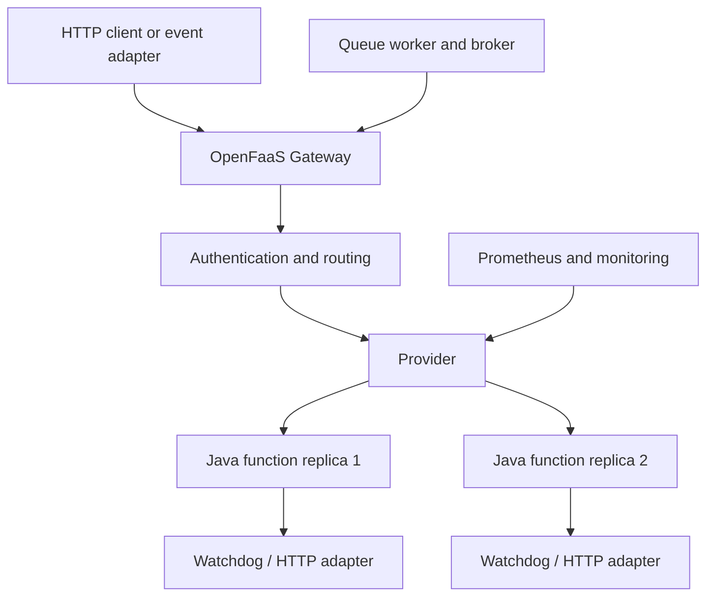
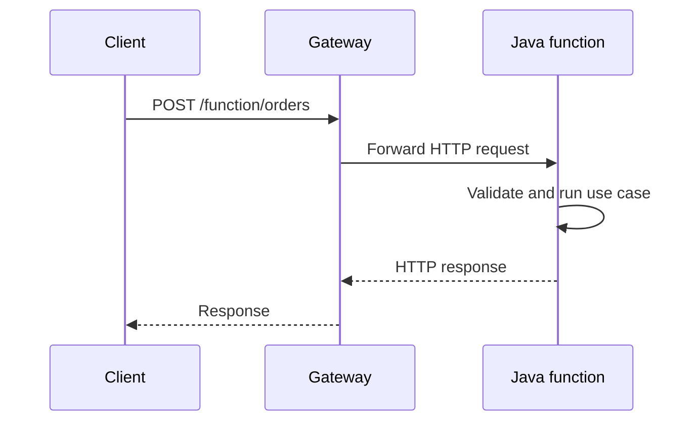
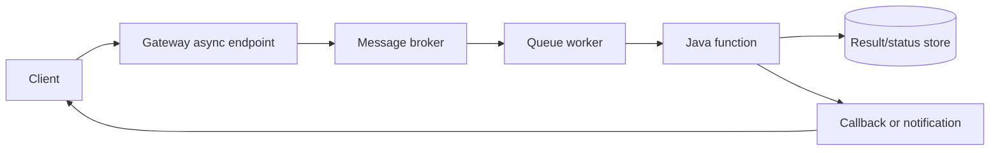
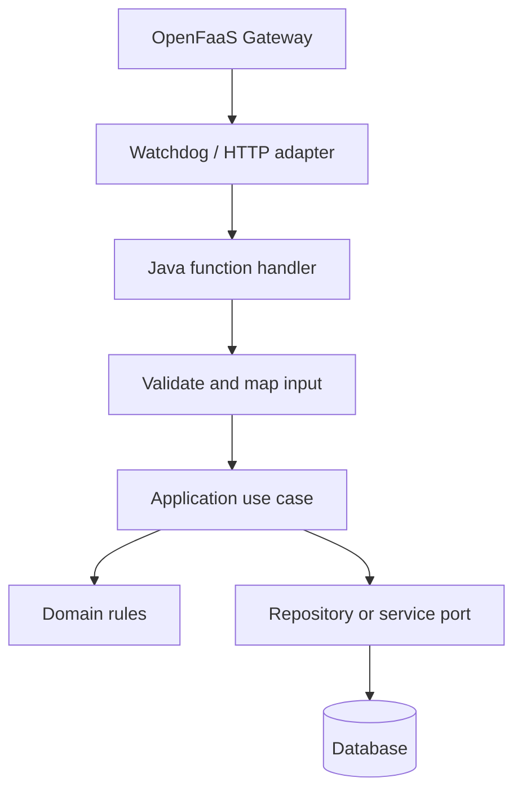

# Mô hình function và gateway trong OpenFaaS

OpenFaaS là nền tảng mã nguồn mở để đóng gói và vận hành function dưới dạng container. Thay vì buộc mã ứng dụng chạy trong một runtime độc quyền, OpenFaaS cho phép function được xây dựng từ nhiều ngôn ngữ và triển khai lên Kubernetes hoặc một môi trường container nhẹ như `faasd`. Một gateway đứng trước các function để tiếp nhận request, xác thực, định tuyến và kết nối với lớp quản lý workload.

Với Java, function thường được đóng gói cùng JRE/JDK runtime cần thiết thành image. Gateway chuyển HTTP request đến container; watchdog hoặc HTTP adapter trong template kết nối giao thức của OpenFaaS với tiến trình function. Nền tảng quản lý số replica và vòng đời container theo cấu hình triển khai. Vì function là container service, cần hiểu rõ process có thể tồn tại qua nhiều request, state trong memory chỉ thuộc một replica và scale-out có thể tạo nhiều bản sao độc lập.

Trong phạm vi **CLOUD_SERVERLESS**, bài học tập trung vào phát triển và triển khai Java function được kích hoạt bởi HTTP, message hoặc event; xử lý trigger, trạng thái, quyền truy cập, retry, idempotency, cold start, mở rộng và chi phí. OpenFaaS minh họa mô hình serverless mở, nơi gateway, provider, watchdog, function container và hệ thống quan sát phối hợp để vận hành workload.

## 1. OpenFaaS là gì?

OpenFaaS cung cấp một lớp nền tảng để triển khai và gọi function qua HTTP. Người phát triển đóng gói function thành container image; OpenFaaS triển khai image đó lên provider được cấu hình. Gateway tạo một điểm truy cập thống nhất để gọi function theo tên.

Các đặc điểm chính:

- Function được phân phối dưới dạng container image.
- Có CLI và template để tạo project, build, push và deploy.
- Gateway cung cấp HTTP endpoint để gọi function.
- Provider triển khai và quản lý workload trên Kubernetes hoặc môi trường được hỗ trợ.
- Watchdog/adapter chuyển request đến tiến trình function theo giao ước của template.
- Có thể tích hợp autoscaling, metrics, logging và asynchronous invocation tùy provider, phiên bản và thành phần được cài đặt.

OpenFaaS giúp chuẩn hóa cách đóng gói và gọi function, nhưng đội vận hành vẫn chịu trách nhiệm về cluster hoặc host, registry, mạng, storage, gateway, cập nhật nền tảng và capacity của hạ tầng.

## 2. Các thành phần trong kiến trúc

Một triển khai OpenFaaS thường có các thành phần sau:

| Thành phần | Vai trò | Điều cần hiểu |
|---|---|---|
| `faas-cli` | Công cụ tạo template, build, push và deploy function | Dùng cấu hình stack để tái lập việc triển khai |
| Gateway | Điểm vào HTTP, xác thực, định tuyến request đến function | Cần bảo vệ endpoint, TLS, auth và giới hạn lưu lượng |
| Provider | Kết nối OpenFaaS với nền tảng chạy container | Có thể là Kubernetes provider hoặc `faasd`; khả năng vận hành phụ thuộc provider |
| Function container | Chạy mã Java và dependency | Mỗi replica có process, memory và tài nguyên riêng |
| Watchdog/HTTP adapter | Nhận request theo giao ước runtime và chuyển cho function process | Chế độ chạy ảnh hưởng process lifecycle, concurrency và streaming |
| Prometheus/metrics | Thu thập số liệu phục vụ autoscaling và quan sát | Cần giữ metrics và alert có ý nghĩa |
| Queue worker/broker | Hỗ trợ asynchronous invocation khi được cấu hình | Tách nhận request khỏi thời điểm xử lý, nhưng cần retry và idempotency |



Sơ đồ khái niệm cho thấy gateway xử lý đường gọi đồng bộ; queue worker là thành phần bổ sung cho luồng bất đồng bộ. Cách triển khai thực tế có thể khác theo provider, phiên bản OpenFaaS và các thành phần được cài đặt.

## 3. Gateway làm gì?

Gateway là điểm vào thống nhất cho client. Khi nhận request, gateway thường thực hiện các bước:

1. Nhận HTTP request và xác định function từ URL.
2. Xác thực caller theo cơ chế được cấu hình.
3. Áp dụng routing và chuyển request đến endpoint của function.
4. Nhận response từ function và trả lại caller.
5. Ghi nhận metric hoặc thông tin phục vụ quan sát theo cấu hình.

Endpoint đồng bộ phổ biến có dạng:

```text
POST http://<gateway>/function/<function-name>
```

Ví dụ gọi function tên `orders`:

```bash
curl -X POST \
  http://127.0.0.1:8080/function/orders \
  -H 'Content-Type: application/json' \
  -d '{"orderId":"ord-1042","action":"validate"}'
```

Địa chỉ `127.0.0.1:8080` chỉ phù hợp môi trường local hoặc port-forward. Production nên đặt gateway sau ingress/load balancer có TLS, DNS, policy truy cập và rate limit phù hợp.

Gateway là ranh giới quan trọng nhưng không thay thế authorization nghiệp vụ. Function vẫn phải kiểm tra caller có quyền thực hiện thao tác trên order, tenant hoặc tài nguyên cụ thể hay không.

## 4. Provider và nơi function thực thi

Provider ánh xạ thao tác của OpenFaaS thành tài nguyên trên nền tảng bên dưới.

- **Kubernetes provider:** triển khai function dưới dạng workload trong cluster; có thể tận dụng scheduler, resource requests/limits, service discovery, HPA và network policy của Kubernetes theo cấu hình.
- **`faasd`:** cung cấp trải nghiệm OpenFaaS trên môi trường container nhẹ hơn, phù hợp một số host đơn hoặc edge deployment; phạm vi HA và khả năng scale phụ thuộc kiến trúc host.
- **Các môi trường khác:** cần kiểm tra provider và mức hỗ trợ cụ thể của phiên bản OpenFaaS đang dùng.

Provider quyết định cách tạo replica, cập nhật image, health check, networking và scaling. Vì vậy, không nên giả định mọi tính năng của Kubernetes đều có trên `faasd`, hoặc một cấu hình autoscaling giống nhau hoạt động trên mọi provider.

Khi triển khai production, cần xác định ai quản lý cluster/host, ai cập nhật provider, cách backup cấu hình, cách phục hồi gateway và cách giám sát node hoặc container runtime.

## 5. Watchdog và vòng đời tiến trình function

Watchdog là lớp kết nối giữa giao thức gọi function của OpenFaaS và chương trình xử lý. Các template OpenFaaS thường cung cấp watchdog hoặc adapter phù hợp với ngôn ngữ. Watchdog nhận request, chuyển input đến tiến trình function và trả output về gateway.

Các chế độ watchdog khác nhau có thể tạo process cho mỗi request hoặc chuyển request đến một tiến trình HTTP sống lâu. Chế độ cụ thể ảnh hưởng:

- Thời gian khởi động và chi phí tạo process.
- Khả năng xử lý nhiều request đồng thời.
- Cách truyền request body, header và response.
- Streaming, timeout và xử lý lỗi.
- Tính an toàn khi function dùng biến hoặc tài nguyên dùng chung.

Với Java, cần đọc hợp đồng của template/watchdog đang dùng trước khi chọn cách viết handler. Nếu template chạy một HTTP server dài hạn, JVM có thể được giữ trong suốt vòng đời container. Nếu template khởi chạy tiến trình theo request, chi phí khởi tạo có thể khác đáng kể.

Không nên suy ra vòng đời JVM chỉ từ tên “function”. Hãy kiểm tra Dockerfile, watchdog mode và command thực tế trong image.

## 6. Mô hình gọi đồng bộ

Trong mô hình đồng bộ, client gửi request qua gateway và chờ response từ function. Đây là cách phù hợp cho thao tác nhanh có kết quả ngay, chẳng hạn kiểm tra dữ liệu, tính toán nhỏ hoặc đọc thông tin.



Client phải chờ cho đến khi function hoàn tất hoặc timeout xảy ra. Với tác vụ dài, giữ request mở làm tăng thời gian kết nối và có thể vượt giới hạn của gateway, ingress hoặc caller. Khi đó, nên chuyển sang mô hình bất đồng bộ: nhận yêu cầu, lưu task, trả ID và xử lý qua queue/workflow.

## 7. Mô hình gọi bất đồng bộ

OpenFaaS có hỗ trợ asynchronous invocation thông qua endpoint và các thành phần queue worker/broker khi được cấu hình. Endpoint thường có dạng:

```text
POST /async-function/<function-name>
```

Request được đưa vào luồng xử lý bất đồng bộ; client không chờ function hoàn tất như lời gọi đồng bộ. Cơ chế broker, queue worker, callback và lưu kết quả phụ thuộc cấu hình triển khai.



Asynchronous invocation phù hợp với xử lý file, gửi email, tạo báo cáo hoặc công việc không cần response cuối cùng ngay lập tức. Cần định nghĩa cách client lấy kết quả: callback, webhook, notification hoặc API truy vấn trạng thái.

Không nên giả định async endpoint tự động cung cấp durable result store hoặc exactly-once processing. Hãy xác minh broker, queue worker, retry, retention và callback behavior của bản triển khai.

## 8. Tạo Java function bằng template

`faas-cli` hỗ trợ tạo function từ template. Danh sách template có thể thay đổi theo repository, phiên bản và store được cấu hình.

Quy trình khám phá và tạo project:

```bash
faas-cli template store list
# Replace JAVA_TEMPLATE with a Java template name shown by the command above.
faas-cli template store pull JAVA_TEMPLATE
faas-cli new orders --lang JAVA_TEMPLATE
```

Thay `JAVA_TEMPLATE` và giá trị `lang` trong stack file bằng tên template Java thực tế trong template store đang sử dụng. Một số template có thể do cộng đồng hoặc tổ chức tự duy trì; cần kiểm tra Java version, Maven/Gradle, watchdog và image base trước khi dùng.

Template thường tạo cấu trúc tương tự:

```text
orders/
├── handler/
│   └── ... Java source ...
├── function/
│   └── ... runtime or adapter files ...
├── pom.xml
└── Dockerfile
stack.yml
```

Cấu trúc chính xác phụ thuộc template. Hãy xem README và Dockerfile của template để hiểu handler contract, build command, port, watchdog mode và cách đóng gói dependency.

## 9. Tổ chức mã Java bên trong function

Function adapter nên mỏng: đọc request, kiểm tra input, chuyển thành command, gọi use case và tạo response. Business rule không nên phụ thuộc gateway hoặc watchdog.



Ví dụ use case Java thuần:

```java
public record ValidateOrderCommand(String orderId) {}

public record OrderValidationResult(
        String orderId,
        boolean valid,
        String reason) {}

public interface OrderRepository {
    Optional<Order> findById(String orderId);
}

public final class ValidateOrderService {
    private final OrderRepository orders;

    public ValidateOrderService(OrderRepository orders) {
        this.orders = orders;
    }

    public OrderValidationResult execute(ValidateOrderCommand command) {
        return orders.findById(command.orderId())
                .map(order -> new OrderValidationResult(
                        order.id(), order.isValid(), "checked"))
                .orElseThrow(() -> new OrderNotFoundException(command.orderId()));
    }
}
```

`Order`, `OrderNotFoundException` và repository implementation là các thành phần ứng dụng minh họa. Template-specific handler chỉ cần deserialize request, tạo `ValidateOrderCommand`, gọi service và serialize kết quả. Domain không cần biết request đi qua OpenFaaS gateway hay một test chạy trực tiếp trong JVM.

## 10. Docker image và runtime Java

Function được triển khai dưới dạng container image, vì vậy image cần chứa runtime Java, artifact và entry point phù hợp với watchdog/template.

Một Dockerfile Java tối giản cho ứng dụng HTTP chạy dài hạn có thể có dạng:

```dockerfile
FROM eclipse-temurin:21-jre
WORKDIR /app
COPY target/orders-function.jar /app/app.jar
ENV PORT=8080
EXPOSE 8080
CMD ["java", "-XX:MaxRAMPercentage=75.0", "-jar", "/app/app.jar"]
```

Đây là ví dụ container chạy HTTP server trực tiếp. Nếu dùng OpenFaaS Java template có watchdog, hãy giữ Dockerfile và command do template quy định hoặc điều chỉnh đúng theo watchdog mode; không chạy đồng thời hai HTTP server cùng chiếm một port.

Các điểm cần tối ưu:

- Chọn JRE tương thích với Java version của ứng dụng.
- Dùng multi-stage build để không mang Maven/Gradle build tools vào runtime image nếu không cần.
- Chọn base image được cập nhật bảo mật và có kiến trúc CPU phù hợp.
- Chạy process bằng non-root user khi có thể.
- Đặt memory/CPU limit và JVM options dựa trên container limit.
- Không đóng gói secret vào image hoặc layer build.
- Quét image và pin version/digest trong quy trình phát hành.

## 11. Cấu hình function bằng stack.yml

OpenFaaS dùng file stack để mô tả function cần build và deploy. Ví dụ rút gọn:

```yaml
provider:
  name: openfaas
  gateway: http://127.0.0.1:8080

functions:
  orders:
    lang: <java-template>
    handler: ./orders
    image: registry.example.com/orders:0.1.0
    environment:
      LOG_LEVEL: info
      TZ: UTC
    limits:
      memory: 512Mi
      cpu: 500m
    requests:
      memory: 256Mi
      cpu: 100m
```

`<java-template>` là placeholder cần thay bằng template đã pull. Gateway local chỉ là ví dụ. Với Kubernetes provider, resource requests/limits thường được ánh xạ vào tài nguyên container của workload. Với provider khác, mức hỗ trợ và cách áp dụng có thể khác.

Không đặt password, token hoặc private key trực tiếp trong `environment`. Dùng secrets mechanism của OpenFaaS/provider và giới hạn quyền đọc secret theo function cần sử dụng.

## 12. Build, push và deploy

Một quy trình CLI phổ biến:

```bash
# Build function image từ stack.yml
faas-cli build -f stack.yml

# Push image lên registry
faas-cli push -f stack.yml

# Deploy function qua gateway
faas-cli deploy -f stack.yml --gateway http://127.0.0.1:8080

# Kiểm tra function đã được triển khai
faas-cli list --gateway http://127.0.0.1:8080
```

Các lệnh cần registry, quyền truy cập gateway và provider hoạt động. Trong production, gateway thường dùng hostname HTTPS và xác thực. Nên dùng tag image bất biến hoặc digest thay vì tag `latest` để có thể truy vết và rollback đúng phiên bản.

Sau deploy, kiểm tra health, logs, metrics, function endpoint, resource limits và khả năng scale. Không xem việc `faas-cli deploy` trả thành công là bằng chứng toàn bộ luồng nghiệp vụ đã hoạt động.

## 13. Scaling và scale-to-zero

OpenFaaS có thể scale function bằng cách tăng hoặc giảm replica dựa trên metric và cấu hình provider. Trong Kubernetes, các cơ chế autoscaling có thể sử dụng Prometheus metrics và HPA hoặc thành phần autoscaler tương ứng. Khả năng scale-to-zero phụ thuộc thành phần/edition/provider được triển khai; không nên mặc định mọi cài đặt OpenFaaS đều tự động scale về zero.

Các khái niệm cần phân biệt:

- **Min replicas:** số replica tối thiểu được giữ chạy.
- **Max replicas:** giới hạn replica tối đa cho function.
- **Autoscaling metric:** tín hiệu dùng để tăng/giảm replica, ví dụ request rate, CPU hoặc concurrency.
- **Scale-to-zero:** đưa function về không replica khi idle nếu nền tảng và cấu hình hỗ trợ.
- **Cold start:** thời gian tạo container, khởi động watchdog/JVM và nạp ứng dụng khi cần replica mới.

Nếu function scale-to-zero, request đầu tiên sau idle có thể chịu cold start. Nếu giữ min replicas lớn hơn zero, latency khởi động có thể giảm nhưng cluster tiêu thụ tài nguyên khi không có traffic.

## 14. Concurrency và tài nguyên Java

Concurrency là số request đồng thời một replica có thể xử lý hiệu quả. Nó phụ thuộc watchdog mode, server HTTP, thread pool và cách application code được triển khai.

Với Java:

- Đảm bảo handler và singleton service thread-safe nếu process nhận nhiều request đồng thời.
- Không lưu request-specific state trong static field hoặc mutable singleton.
- Giới hạn thread pool và HTTP client connection pool phù hợp với CPU/memory.
- Không chia sẻ JDBC connection giữa các request; dùng pool và try-with-resources.
- Đặt timeout cho DB/API call ngắn hơn timeout request tổng thể.
- Kiểm thử heap, GC và native memory trong giới hạn container.

Nếu watchdog khởi chạy process riêng cho mỗi request, concurrency và chi phí startup khác với chế độ giữ một HTTP process lâu dài. Hãy xác định chế độ thực tế trước khi benchmark hoặc đặt replica count.

## 15. Trạng thái và dữ liệu trong function container

Container có thể sống qua nhiều request, nhưng replica có thể restart, bị thay thế hoặc scale về zero. Bộ nhớ JVM chỉ thuộc replica đó và không được chia sẻ với replica khác.

Không dùng static map hoặc file local làm nguồn trạng thái nghiệp vụ. Hãy lưu dữ liệu cần tồn tại vào database, object storage, Redis hoặc message broker phù hợp. Local filesystem chỉ nên dùng cho dữ liệu tạm trong giới hạn dung lượng và vòng đời container.

Nếu function cần cache, hãy xem cache là tối ưu có thể mất: dữ liệu phải có nguồn chuẩn bên ngoài, có TTL và cơ chế invalidation phù hợp. Không để tính đúng đắn của đơn hàng, thanh toán hoặc idempotency phụ thuộc việc một replica còn sống.

## 16. Retry và idempotency

Gateway synchronous thường trả kết quả trực tiếp cho caller. Nếu client timeout, client có thể gửi lại request dù function trước đã hoàn tất side effect. Với async invocation, queue worker/broker có thể giao lại message sau lỗi hoặc timeout. Cả hai trường hợp đều cần idempotency.

Các nguyên tắc:

- Nhận `Idempotency-Key` từ HTTP hoặc dùng event/message ID ổn định.
- Lưu key và kết quả xử lý trong kho dùng chung, không dùng memory của replica.
- Dùng conditional write/transaction để tránh hai replica claim cùng key.
- Retry lỗi tạm thời với backoff và giới hạn số lần.
- Đưa lỗi dữ liệu vĩnh viễn vào luồng cách ly/DLQ nếu kiến trúc async hỗ trợ.
- Với side effect bên ngoài, dùng idempotency API của hệ thống đích hoặc outbox/saga.

Không retry vô hạn lỗi validation, authentication hoặc thiếu quyền. Một function trả thành công chỉ khi nghiệp vụ đã hoàn tất bền vững hoặc yêu cầu đã được ghi nhận vào queue/store bền vững theo hợp đồng.

## 17. Bảo mật gateway và function

Gateway là bề mặt truy cập công khai hoặc nội bộ của các function. Cần bảo vệ cả lớp nền tảng lẫn logic nghiệp vụ:

1. Đặt gateway sau ingress có TLS; không để endpoint quản trị mở công khai không xác thực.
2. Bật authentication của OpenFaaS và quản lý credential an toàn; không nhúng credential gateway vào source code.
3. Dùng network policy hoặc firewall để chỉ cho phép nguồn truy cập cần thiết.
4. Kiểm tra authorization trong function theo user, tenant và tài nguyên nghiệp vụ.
5. Chạy container bằng non-root, dùng image tối thiểu và cập nhật dependency.
6. Cấp secret tối thiểu cho từng function; tránh chia sẻ một secret quản trị cho mọi workload.
7. Giới hạn request size, timeout và rate để giảm nguy cơ lạm dụng.
8. Ghi audit event cho thao tác nhạy cảm nhưng không ghi token hoặc dữ liệu bí mật.

Nếu gateway có endpoint quản trị hoặc API liệt kê function, chỉ cấp cho operator và pipeline triển khai. Client nghiệp vụ chỉ nên có quyền gọi function cần thiết.

## 18. Quan sát và autoscaling metrics

OpenFaaS thường tích hợp Prometheus để thu thập metrics và Grafana để hiển thị dashboard. Các số liệu cần theo dõi:

- Request count và request rate theo function.
- Request duration p50/p95/p99.
- HTTP error rate và timeout.
- Replica count, desired replicas và autoscaling events.
- CPU/memory usage, restart count và readiness.
- Queue depth, processing lag và retry nếu dùng async invocation.
- Cold start hoặc thời gian từ lúc scale đến khi replica sẵn sàng.
- Chi phí hoặc mức sử dụng tài nguyên theo namespace/function.

Log nên chứa correlation ID, function name, request ID và mã lỗi. Nếu một request gọi nhiều function, truyền trace/correlation context qua HTTP header hoặc message metadata để nối các bước.

Autoscaling metric phải phản ánh bottleneck thật. Scale theo RPS có thể không phù hợp nếu mỗi request có chi phí CPU rất khác nhau; CPU-only scaling có thể phản ứng chậm với workload chủ yếu chờ I/O. Hãy đo và chọn metric phù hợp với đặc tính function.

## 19. Timeout, payload và giới hạn request

Một function có thể bị ảnh hưởng bởi timeout của client, gateway, ingress, watchdog và ứng dụng. Thời hạn tổng thể phải nhất quán: timeout ở tầng trong nên ngắn hơn timeout ở tầng ngoài để ứng dụng có cơ hội trả lỗi có kiểm soát.

Với tác vụ dài:

- Không giữ synchronous request mở quá lâu.
- Trả task ID sau khi lưu yêu cầu bền vững.
- Đưa công việc vào queue hoặc workflow.
- Lưu trạng thái và tiến độ trong store dùng chung.
- Cho client truy vấn trạng thái hoặc nhận callback.

Payload lớn nên được stream hoặc lưu ở object storage rồi truyền reference. Không nên đưa file nhiều MB qua gateway nếu request size, memory và timeout không phù hợp.

## 20. Chi phí và trách nhiệm vận hành

OpenFaaS là nền tảng tự triển khai nên chi phí không chỉ là thời gian chạy function. Đội vận hành cần tính:

- Compute của Kubernetes node hoặc host `faasd`.
- Gateway, provider, Prometheus, Grafana và các thành phần hệ thống.
- Container registry, storage, network và load balancer.
- Replica idle/min replicas và tài nguyên giữ sẵn.
- Build pipeline, image scanning, backup, upgrade và trực vận hành.
- Chi phí database, broker và dịch vụ ngoài do function sử dụng.

Scale-to-zero có thể giảm tài nguyên của function khi idle nếu được hỗ trợ, nhưng gateway, broker, metrics và control plane vẫn cần tài nguyên. Nếu cluster đã chạy cho workload khác, chi phí biên của một function có thể thấp hơn; nếu chỉ dựng cluster cho vài function nhỏ, overhead nền tảng có thể chiếm phần lớn chi phí.

Hãy đo chi phí theo workload hoặc theo function, đặt resource requests/limits, dọn image cũ, theo dõi replica idle và tối ưu thời gian xử lý. Không đặt min replicas cao chỉ để tránh cold start nếu latency thực tế không yêu cầu.

## 21. Khi nào OpenFaaS phù hợp?

OpenFaaS có thể phù hợp khi tổ chức cần:

- Một nền tảng function dùng được nhiều ngôn ngữ và container image.
- Quyền kiểm soát môi trường chạy, mạng và vị trí triển khai.
- Triển khai trên Kubernetes hoặc edge host.
- Tích hợp function vào hệ thống container hiện có.
- Dùng CLI/template và HTTP gateway thống nhất cho nhiều team.
- Tránh phụ thuộc hoàn toàn vào API triển khai function của một cloud provider.

OpenFaaS đòi hỏi đội ngũ có năng lực vận hành gateway, provider, cluster/host, registry, monitoring, bảo mật và nâng cấp. Nếu mục tiêu là giảm tối đa trách nhiệm vận hành hạ tầng, một dịch vụ FaaS được quản lý hoàn toàn có thể phù hợp hơn.

## 22. Checklist trước khi triển khai Java function

| Câu hỏi | Bằng chứng hoặc cấu hình cần có |
|---|---|
| Provider nào đang chạy function? | Kubernetes, `faasd` hoặc provider cụ thể được xác định |
| Gateway được bảo vệ thế nào? | TLS, authentication, ingress và network policy |
| Template Java dùng watchdog nào? | README, Dockerfile, command và mode được xác minh |
| JVM có sống lâu qua nhiều request? | Process lifecycle và concurrency được kiểm tra |
| Function có stateless? | Trạng thái bền vững nằm ngoài container |
| Image có an toàn? | Base image cập nhật, non-root, scan và immutable tag |
| CPU/memory có giới hạn? | Requests/limits và benchmark |
| Autoscaling có phù hợp? | Min/max replicas, metrics và provider support |
| Scale-to-zero có thực sự được bật? | Thành phần/edition và hành vi cold start được xác minh |
| Retry có an toàn? | Idempotency store, backoff và DLQ/quarantine |
| Async invocation có broker? | Queue worker, broker, retention và callback được cấu hình |
| Có thể truy vết request? | Correlation ID, logs, Prometheus và dashboards |
| Chi phí nền tảng đã được tính? | Gateway, control plane, monitoring, idle replicas và cluster |
| Có quy trình rollback? | Image version/digest và deploy history |

## 23. Tóm tắt mô hình vận hành

Trong OpenFaaS, client gọi function qua gateway. Gateway xác thực và định tuyến request; provider quản lý workload container; watchdog hoặc adapter chuyển request đến tiến trình Java; function gọi các dịch vụ lưu trữ hoặc hệ thống bên ngoài. Với luồng bất đồng bộ, broker và queue worker tách thời điểm nhận yêu cầu khỏi thời điểm xử lý.

Đội phát triển cần thiết kế function stateless, xử lý retry bằng idempotency, giới hạn concurrency theo tài nguyên Java và downstream, bảo vệ gateway, quan sát request và kiểm soát image. Đội vận hành chịu trách nhiệm cho provider, cluster/host, registry, gateway, metrics, upgrade và capacity.

Khác biệt quan trọng của OpenFaaS là function được vận hành như container workload qua một gateway mở. Hiểu rõ ranh giới giữa gateway, provider, watchdog và function giúp triển khai Java function linh hoạt trên cloud hoặc edge, đồng thời chủ động quản lý cold start, mở rộng, quyền truy cập và chi phí.
